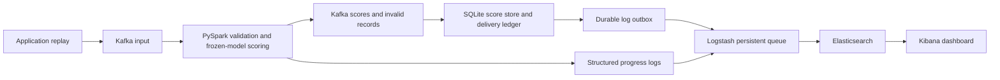

# Credit Risk and Failure Modeling Platform

The classifier estimates **lifetime charge-off probability (resolved 36-month cohort)**.
EAD/LGD are snapshot proxies; capital uses separate assumed one-year PDs.
See the [risk terminology](docs/risk_terminology.md) for definitions and legacy artifact names.

Project reports are published with MkDocs using its default theme:
[read the documentation](https://codezy93.github.io/Credit-Risk-and-Failure-Modeling-Platform/).
Markdown sources live in `docs/`; configuration is in `mkdocs.yml`.
[Preview and publishing instructions](docs/github_pages.md).

```bash
make docs-setup   # install the documentation dependency
make site-serve   # local documentation preview
```

GitHub Actions runs the full pytest suite, including Spark, using Python 3.14,
Java 21 and the streaming dependency lock. It uploads a JUnit test report.
To regenerate the model experiments from existing prepared data while retaining
historical runs, use `make refresh-experiments`. See the
[reproducibility guide](docs/reproducibility.md#continuous-integration-and-experiment-refresh).


A credit-risk project using LendingClub loan data. EDA is complete, with SQL
audits, three marimo notebooks, saved figures, a feature-availability review, and
a documented retrospective benchmark. The first MLflow comparison has trained a
dummy baseline, logistic regression, random forest, and histogram gradient boosting.

Start with the [final EDA report](docs/eda_summary.md) and
[complete statistics reference](assets/statistics.md). The
[clean-table dictionary](docs/data_dictionary.md) records the feature decisions.
The [model experiment report](docs/model_experiments.md) contains measured results.
The [Kafka/PySpark guide](docs/streaming.md) explains the streaming replay and
distributed scoring stage, including checkpoint and delivery semantics.
The [validation report](docs/validation_hardening.md) adds exact KS/Gini, paired
AUC intervals, and a separate-year calibration experiment.
The [Snapshot loss proxies and illustrative capital](docs/basel_loss_experiment.md) adds separate
EAD/LGD snapshot-proxy models, expected loss, and illustrative capital scenarios.
The [model review notebook](notebooks/10_model_review.py) displays these stages
together; its [HTML export](docs/model_review.html) opens without running training.
The [ANN experiment report](docs/ann_experiments.md) compares neural-network charge-off classifiers,
EAD and LGD challengers with the original models.
The [InterpretML and segment-bias report](docs/interpret_bias.md) explains the
incumbent and audits observed borrower-segment disparities without claiming
protected-group fairness.

## Reproduce the core workflow

The hash-locked environment is verified with **Python 3.14 on Linux x86_64**.
From the project root, run:

```bash
make all
```

This creates an isolated `.venv-locked`, installs `requirements.lock` with SHA-256
verification, runs the tests, downloads/unpacks the data, exports all three marimo
notebooks headlessly, prepares temporal splits, trains the four baseline models,
logs native MLflow evaluations, runs validation hardening and the loss experiment,
and exports the model-review notebook. Close notebook
kernels holding the DuckDB database before rerunning the complete workflow.

If Kaggle is blocked, obtain the accepted-loans CSV separately and supply it:

```bash
make all RAW_DATA=/absolute/path/to/accepted_2007_to_2018Q4.csv
# A local .csv.gz also works; it is unpacked without contacting Kaggle.
```

Dependency installation needs package-index access the first time. A local data
file removes the Kaggle dependency; it is linked into `data/raw` without replacing
an existing different file. On later runs the existing CSV is reused.

```bash
make test       # Fixture, feature-policy, temporal split, preprocessing and metric tests
make validate   # Recompute validation diagnostics using existing prepared data/models
make review     # Temporal XGBoost search, coefficient stability/ablations, and notebook export
make loss       # Fit EAD/LGD proxies and export the model-review notebook
make ann        # Fit ANN charge-off classifier/EAD/LGD challengers and export the model-review notebook
make interpret  # Explain the incumbent, audit borrower segments, and export the notebook
make full       # Also rerun the optional XGBoost and ANN research trials
```

Use `BOOTSTRAP_PYTHON=/path/to/python3.14` if `python3` points to another version.
The environment is checked for dependency conflicts after synchronization. Direct
pins live in `requirements.txt`; all transitive pins and hashes live in
`requirements.lock`. Rebuild the lock deliberately when changing dependencies.

Verification: the current suite has **101 passing tests** in the isolated environment.
An earlier complete core run on the real CSV exported all three EDA notebooks and reproduced the prepared
dataset hashes, exact historical diagnostics, all 500 bootstrap resamples, and
calibration metrics. See the [workflow verification](assets/results/validation_hardening_verification.json)
and the [fresh committed-script verification](assets/results/validation_hardening_fresh_verification.json).

The original boosting validation AUC is **0.653889**, Gini **0.307779**, and exact
KS **0.222796**. Its AUC advantage over logistic regression is **0.007659**
(paired bootstrap 95% interval **0.005913–0.009094**, conditional on the fitted
models and observed cohort). The separate 2011–2012-fit / 2013-calibration /
2014-evaluation experiment slightly improved Brier score but worsened 10-bin ECE
for both models. It remains a research result; the incumbent is unchanged.

The shared [feature policy](util/feature_policy.json) is enforced before feature
selection and training. Its exclusions override allowlists. It guards the approved
feature names, while exact source availability still needs timestamp evidence.
MLflow experiment `lendingclub_validation_hardening` contains the separate role
datasets, four raw/calibrated model versions, and four native evaluation runs.

## EAD, LGD, expected loss and capital scenarios

Run `make loss` after preparing data and training the incumbent. The experiment
fits mean and gradient-boosting regressors on eligible charged-off loans from
2011–2013, selecting each loss component by 2014 bounded MAE. It uses the same
13 origination predictors. Payment and recovery fields are targets/audit fields
and never enter predictor matrices.

Snapshot EAD is funded principal minus principal received. LGD uses net recoveries
over that residual exposure. These are retrospective proxies: recovery timing,
discounting, indirect costs and default-event exposure are unavailable. Values
outside the bounded target scope are audited and quarantined.

The selected LGD is a **constant training-cohort loan-average of 0.893671383
(89.37%)**. The 88.84% validation observed mean is a different statistic.
EAD boosting explains only 0.47% of validation ratio variance (R² 0.004710),
and its MAE improvement over the mean baseline is just 0.65%. See the
[loss-model limitations](docs/loss_model_limitations.md) for the full comparison,
units and implications for the expected-loss proxy. Run `make loss-report` to
refresh this explanation from saved results without training.

In the measured run, EAD boosting won narrowly (validation ratio MAE **0.202030**)
and the LGD mean baseline won (MAE **0.075857**). Their combined expected-loss proxy
was **$132.52 million**, against **$136.95 million** observed snapshot loss on
162,563 eligible validation loans (**−3.23%** aggregate error). The mean/mean
baseline had a smaller aggregate error (**−2.44%**); component selection does not
guarantee the best portfolio-total calibration. charge-off validation AUC stayed **0.653889**.

MLflow experiment `lendingclub_basel_loss_proxies` contains four component models,
four native regression evaluations, full train/validation datasets, the selected
bundle, loss diagnostics and figures. Saved models live under
`models/basel_loss/<batch>/`. Use `util.basel.score_loss_bundle` with exactly the
bundle's ordered predictor columns and a separate funded-amount array.

The CRE31.16 other-retail capital function takes explicitly **assumed one-year
PDs**. It does not treat the classifier's resolved-loan score as a regulatory PD.
Capital/RWA outputs are illustrative scenarios, with the assumptions and missing
regulatory requirements documented in the [loss report](docs/basel_loss_experiment.md).
The three original EDA notebooks now display stored validation/loss summaries;
the model-review notebook refreshes after each new experiment in `make all`.
The [loss and notebook verification record](assets/results/basel_loss_verification.json)
checks all four exports, saved-model hashes, native regression metrics, the
complete bundle-scoring output, and the unchanged charge-off probabilities.

## ANN challengers

Run `make ann` after the baseline and loss experiments. Scikit-learn multilayer
perceptrons add no new dependencies. Two charge-off networks (32 and 64→32 hidden units)
and 32→16 EAD/LGD regressors use the original 13 predictors. Stopping fits on
2011–2012 and uses 2013 only; each network then refits on all 2011–2013 loans for
the frozen epoch budget before the 2014 comparison. 2015 is never loaded.

The larger charge-off ANN reached **0.651546 validation AUC**, versus **0.653889** for the
incumbent boosting model. ANN EAD MAE was **0.203635**, versus **0.202030** for
boosting; ANN LGD MAE was **0.081999**, versus **0.075857** for the mean baseline.
Neither selected loss component was improved. Both loss ANNs reached the
60-epoch experiment limit; this is a bounded, single-seed trial rather than an
exhaustive ANN search or proof that neural networks cannot improve the models.

The all-ANN bundle's portfolio-total loss error was **+0.50%**, compared with
**−3.23%** for the reference, but its per-loan dollar MAE was worse (**$1,407.90**
versus **$1,389.34**). Aggregate agreement alone is not sufficient to promote it.
All incumbents remain unchanged. 2014 remains selection-influenced research data.

MLflow experiment `lendingclub_ann_challengers` stores four networks, temporal
learning curves, role-specific datasets, and four native evaluations. Models and
the ANN loss bundle live under `models/ann_experiments/<batch>/`. The
[report](docs/ann_experiments.md), model-review notebook, and statistics section 23
contain the complete comparison, including raw regression errors and clipping.
The [ANN verification record](assets/results/ann_experiments_verification.json)
checks source/model hashes, full validation predictions, epoch counts, native
metrics, the model-review HTML export, and the unchanged reference artifacts.

## Why teaching-notebook AUCs are not a comparable benchmark

A separate [teaching-extract audit](docs/teaching_extract_audit.md) measured a public,
hashed copy of `lending_club_loan_two.csv` (396,030 rows, 27 columns). Its added
address/postcode feature has ten values: three occur only with Fully Paid loans,
and three only with Charged Off loans. A postcode-only score learned on training
rows achieved **0.8396 held-out AUC**. In a fixed XGBoost ablation on identical
random-split holdout rows, AUC was **0.7202 without postcode** and **0.9071 with it**.

This quantifies the feature's influence in that public copy. It does not establish
byte identity with another uploaded CSV, the address-generation mechanism, or an
exact reproduction of another notebook. The audit also includes grade/rate and
uses a random split, so its numbers should not be compared directly with this
project's temporal origination-feature benchmark. It is isolated from the core
workflow; no project predictors or incumbents changed. MLflow stores the two
native evaluations under `lendingclub_teaching_extract_audit`.

## Folder structure

```text
sql/                SQL cleaning, validation, and EDA queries
data/raw/           Original downloaded data
data/clean/         Cleaned modeling data
models/             Saved models and metadata
scripts/            Download, preparation, training, validation, and experiment scripts
notebooks/          Marimo EDA and model-review notebooks
util/               Shared helpers and logging
util/elk/           Placeholder for planned ELK setup
docs/               GitHub Pages website and project documentation
assets/figures/     EDA plots and model explanations
assets/results/     Evaluation and benchmark results
```

## Download the data

Use the locked Python 3.14 environment from the project root:

```bash
make setup
source .venv-locked/bin/activate
python scripts/download_data.py
```

Source: [All Lending Club loan data on Kaggle](https://www.kaggle.com/datasets/wordsforthewise/lending-club).
The script downloads only `accepted_2007_to_2018Q4.csv.gz` from the latest dataset
version and unpacks it as `data/raw/accepted_2007_to_2018Q4.csv`. It keeps the
compressed original too, so leave several GB of free disk space. It skips the
download if the final CSV already exists.

If Kaggle requests authentication, run:

```bash
python -c "import kagglehub; kagglehub.login()"
```

Follow the prompt using a token from your
[Kaggle API settings](https://www.kaggle.com/settings/api). If Kaggle asks you to
accept dataset terms, do that on the dataset page before rerunning the script.
See the [KaggleHub documentation](https://github.com/Kaggle/kagglehub) for details.

Raw data, cleaned data, and saved models are excluded from Git. Figures and
selected results can be committed for the project showcase.

## Explore and clean the data with marimo

After downloading the CSV, install the updated dependencies and open the notebook:

```bash
make setup
source .venv-locked/bin/activate
marimo edit notebooks/01_data_analysis.py
```

Run all cells in order. The notebook executes the numbered files in `sql/` using
DuckDB, so the large raw CSV is not loaded into a pandas DataFrame. It audits
source rows and missingness, creates a typed analysis table, and explores:

- Numeric distributions, percentiles, extreme values, and category counts.
- Outcome balance and bivariate relationships with grades, purposes, income,
  credit scores, and debt burden.
- Grade/term and grade/cohort interactions, feature correlations, and sampled
  relationships.
- Outcome coverage across years and the limitations of resolved-only comparisons.

Detailed feature and outcome exploration uses loans issued through 2015. Later
cohorts are checked only for status coverage. The initial proposal to validate on
2016 and test on 2017–2018 was superseded at EDA completion because of low outcome
coverage. The final retrospective benchmark uses resolved 36-month loans from
2011–2015; see the final EDA report for the split and limitations. These are not
fixed-horizon default labels.

The notebook writes:

| Location | Output |
| --- | --- |
| `data/clean/lending_club.duckdb` | Local SQL database with `loans` and development-only `eda_loans` |
| `data/clean/loans.parquet` | Clean analysis table, including unresolved loans |
| `assets/figures/` | PNG and SVG charts |
| `assets/results/` | Query result CSVs and `analysis_findings.md` |

`loans.parquet` is not a model feature matrix: it includes `loan_status` and
`charged_off` for analysis. Those must never be used as input features. Cleaning
preserves missing values; preprocessing will be fitted on training data later.

To run every cell and export a standalone report without opening the editor:

```bash
marimo export html notebooks/01_data_analysis.py -o docs/data_analysis.html --no-include-code
```

This command executes the notebook before exporting, as described in the
[marimo export documentation](https://docs.marimo.io/guides/exporting/static_html/).
SQL uses [DuckDB's CSV reader](https://duckdb.org/docs/stable/data/csv/overview).
The first run scans the full CSV several times and needs a few minutes and extra
local disk space. Keep the notebook open for exploration, and close its kernel
before running a separate export against the same local database.

## Follow-up EDA

The second notebook investigates questions raised by the first pass:

```bash
marimo edit notebooks/02_deeper_eda.py
```

It reads `data/clean/loans.parquet` and runs SQL files `14`–`19` to inspect extreme
values, missingness over time and by outcome, loan/income ratios, FICO/DTI
interactions, and changes in development-cohort composition. It uses originations
through 2015; the FICO/DTI comparison uses 36-month loans from 2011–2014 and reports
its outcome coverage. It preserves the clean data and performs no model training.

The notebook saves six additional PNG/SVG figures, six CSV tables, and
`assets/results/deeper_eda_findings.md`. It refreshes section 15 of
[the statistics reference](assets/statistics.md) with all follow-up tables.
Sections 2–14 retain their original EDA snapshot and provenance.

Export the follow-up report with:

```bash
marimo export html notebooks/02_deeper_eda.py -o docs/deeper_eda.html --no-include-code
```

## EDA completion

```bash
marimo edit notebooks/03_complete_eda.py
```

The final notebook runs SQL files `20`–`25`, completes numeric/category profiles
and parsing checks, audits all 151 source and 26 clean columns, and records 14
candidate features. It adds four figure sets, dictionaries, benchmark eligibility
counts, a completion manifest, and section 16 of `assets/statistics.md`.

The first benchmark is charged off among ordinary resolved **36-month loans
issued in 2011–2015**: training 2011–2013, validation 2014, exploratory evaluation
2015. All these years were inspected during EDA. The benchmark does not represent
a pristine holdout, a fixed-horizon default probability, or a deployment backtest.
It has no established point-in-time outcome availability. Those limits must
accompany future model results.

```bash
marimo export html notebooks/03_complete_eda.py -o docs/eda_completion.html --no-include-code
```

Read [the final summary](docs/eda_summary.md),
[the final HTML report](docs/eda_completion.html), and
[the dictionary](docs/data_dictionary.md) without rerunning the notebooks.
Raw and clean data are preserved. The EDA stage fits no preprocessing; model-data
preparation is a separate step below.

## Prepare model datasets

```bash
python scripts/04_prepare_model_data.py
```

This reads the existing clean Parquet and executes SQL files `26`–`31`. It writes
three feature/target datasets and three matching metadata files to
`data/clean/modeling/`, with counts and fingerprints in
`assets/results/model_data_manifest.json`. No raw-data download or EDA rerun is
needed. All six dataset files are excluded from Git.

| Split | Issue years | Rows |
| --- | --- | --- |
| Training | 2011–2013 | 157,993 |
| Validation | 2014 | 162,570 |
| Exploratory evaluation | 2015 | 283,026 |

The training-only feature profile removes constant `application_type`, leaving
13 predictors. IDs, dates, application type, and target status are excluded from
predictors; application type remains in audit metadata. Dataset files contain
the exact predictor list plus the binary `charged_off` target. Read the feature
lists from the manifest rather than selecting every available column.

Missing values and extreme values are preserved in these prepared files. This
preparation step fits no preprocessing. The training pipelines described below
fit imputation/scaling/encoding using training rows and handle unseen categories.

See [the dataset contract](docs/model_data.md) and
[statistics section 17](assets/statistics.md#17-model-data-preparation) for the
full checks, category/missingness tables, and limitations. The evaluation remains
exploratory and does not establish fixed-horizon default risk or historical
deployment performance.

## First MLflow experiments

```bash
make setup
source .venv-locked/bin/activate
python scripts/05_train_models.py
```

Four fixed pipelines use the same 13 predictors and temporal split. Selection is
by validation average precision, with Brier score as a tie-breaker. Preprocessing
is fitted on training rows only. The selected model's threshold maximizes
validation F1 before it scores the exploratory 2015 data; the model is not refitted
on validation. This original comparison used fixed settings and no independently
fitted calibration. Later research and calibration runs are reported separately.

| Model | Validation average precision | Validation ROC-AUC |
| --- | --- | --- |
| Dummy prior | 0.1373 | 0.5000 |
| Logistic regression | 0.2103 | 0.6462 |
| Random forest | 0.2139 | 0.6491 |
| Histogram gradient boosting | 0.2165 | 0.6539 |

Selected histogram boosting scored **0.6544 ROC-AUC**, **0.2350 average precision**,
and **0.1223 Brier score** on 283,026 exploratory evaluation loans. At the
validation-selected threshold **0.147853**, precision was **0.2235**, recall
**0.5449**, and F1 **0.3170**. At threshold 0.5 it predicted no charged-off loans,
so the apparent 85.11% accuracy came with zero recall. These results illustrate
the threshold trade-off; they do not establish a lending policy or financial gain.

MLflow uses `models/mlflow.db` and local artifact storage. Start the local UI from
the project root:

```bash
mlflow ui --backend-store-uri sqlite:///models/mlflow.db --host 127.0.0.1 --port 5000
```

Each execution creates a new batch and archives results under
`assets/results/experiments/<batch-run-id>/`, figures under
`assets/figures/experiments/<batch-run-id>/`, and models under
`models/experiments/<batch-run-id>/`. The latest completed batch is described by
`assets/results/model_experiments_latest.json`. The first incomplete logging
attempt remains visible as failed MLflow runs, separate from the completed batch.

`models/selected_model.joblib` contains the full fitted pipeline. Use the manifest's
feature order and `predict_proba(... )[:, 1]`, then apply its threshold explicitly;
the pipeline's native `predict()` does not use the validation-selected threshold.
Model/data fingerprints, complete metrics, confusion matrices, calibration-bin
counts, versions, parameters, timings, and run IDs are recorded in
[the experiment report](docs/model_experiments.md) and
[statistics section 18](assets/statistics.md#18-model-experiments).

### Datasets and evaluations in MLflow

Open **Experiments → lendingclub_resolved_36m → first_model_comparison**.
The comparison run now contains train, validation, and exploratory dataset inputs.
Its `datasets/` artifacts include all three prepared Parquet files, their manifest,
and 200-row previews. Logged models have metrics linked to dataset names/digests.

Five `evaluate_*` child runs contain native classifier evaluations: validation
for every model and exploratory evaluation for the selected model. Open a run's
metrics and artifacts for ROC, precision–recall, lift, calibration, confusion
matrices, and a 1,000-row sampled evaluation table. All aggregate metrics use the
full datasets. Native evaluations use the classifier's default rule (0.5); the
frozen F1-policy metrics remain separately labeled on the selected training run.

Future training logs these entries automatically. To repair/verify an already
completed comparison without retraining:

```bash
python scripts/06_log_mlflow_evaluations.py
```

The repair is repeatable without duplicate evaluation runs. Full native metrics
and evaluation IDs are in
[statistics section 19](assets/statistics.md#19-mlflow-datasets-and-evaluations).
This project uses MLflow's classic classifier evaluation API; its GenAI
dataset/scorer pages are a separate workflow.

## Validation-only AUC improvement experiments

```bash
make setup
source .venv-locked/bin/activate
python scripts/07_improve_auc.py
```

This runs a bounded seven-trial XGBoost comparison in the separate MLflow
experiment **`lendingclub_auc_ablation`**. It compares the original 13 predictors,
expanded bureau candidates/derived ratios, and a separately labeled
post-underwriting set that also uses grade, subgrade, and interest rate.
Training and validation rows/targets remain unchanged. Protocol v2 fits on
2011–2012 and chooses tree counts using 2013 only. Each model and encoder then
refits on 2011–2013 using that frozen count, with no eval_set or early stopping.
2014 compares candidates only. It remains previously explored selection data.

The experiment does not load or score 2015, and does not replace the original
selected model. New bureau fields still require exact as-of availability review;
post-underwriting scores answer a different question from independent application
risk. A target AUC of 0.80 is not guaranteed. Native evaluations, full dataset
references, and row previews are logged in MLflow for each trial.

Measured results and limitations are in [the AUC report](docs/auc_improvement.md)
and [statistics section 20](assets/statistics.md#20-auc-improvement-experiments).

| Validation comparison | ROC-AUC |
| --- | --- |
| Original histogram boosting, 13 predictors | 0.6539 |
| XGBoost, same 13 predictors | 0.6547 |
| XGBoost with expanded bureau candidates, 58 predictors | 0.6833 |
| XGBoost with underwriting outputs, 61 predictors | 0.6901 |

The seven trials did **not** reach 0.80. The last row uses grade, subgrade, and
interest rate and therefore represents scoring after underwriting. Added bureau
timing remains unverified. These validation gains do not replace the original
selected model or constitute new test results.

2015 remains exploratory because EDA inspected it. This accepted-only,
resolved-loan benchmark does not estimate fixed-horizon default risk or reproduce
historical deployment. InterpretML explanations and a descriptive borrower-segment
audit are implemented. Protected-group fairness remains unassessed because the
required structured attributes are absent. Kafka/PySpark scoring, short local
load tests, durable score deduplication, recovery testing and ELK monitoring are
implemented. See the [load-test report](docs/load_testing.md) and
[recovery and monitoring report](docs/recovery_monitoring.md).

## Validation review

The [validation gap review](docs/validation_gaps.md) records the corrected XGBoost
protocol, [logistic sign investigation](docs/coefficient_validation.md), and the
remaining data limitations. Reproduce with `make review` after the core datasets
and baseline/loss models exist. `make all` also runs the coefficient review;
`make full` includes the corrected optional XGBoost search.

The two questioned logistic features have positive univariate coefficients but
negative pooled adjusted coefficients. Both change adjusted sign across training
years. Across 200 year/outcome-stratified pipeline refits, delinquency was negative
98.5% of the time and bankruptcies 100%. These are conditional associations in a
selected population, not evidence that adverse events protect against default.

Dropping both raised logistic validation AUC from **0.646231 to 0.646776**; the
paired bootstrap interval for the difference was **0.000061–0.000995**. The gain
is small, conditional on fitted models, and comes from an exploratory comparison.
The incumbent remains unchanged. No monotonic scorecard interpretation is claimed.

The earlier XGBoost results (**0.6846 / 0.6913**) remain historical snapshots from
the protocol that reused 2014 for stopping. Current research values are
**0.6833 / 0.6901**. Fixed-horizon default labels, point-in-time availability,
source-certified bureau timestamps, event-time EAD/economic LGD and a fresh holdout
are still unavailable. Capital remains explicitly assumed-PD sensitivity analysis.
The [verification record](assets/results/validation_gaps_verification.json) checks
all seven frozen XGBoost tree budgets, eleven logged-model validation predictions,
native metrics, bootstrap summaries, source hashes, and the notebook export.

## InterpretML and borrower-segment bias analysis

`make interpret` explains the frozen incumbent without retraining it. InterpretML
Kernel SHAP uses 64 complete training-background rows, 128 random eligible 2014
cases and eight curated error examples. Global contribution rankings exclude the
curated cases. Partial dependence uses 1,000 training rows; permutation importance
cross-checks 10,000 stratified validation rows, including missing values.

FICO, annual income and loan amount rank highest by both importance methods.
Global absolute SHAP values rank magnitude; mean signed contributions describe
the sampled cases relative to the chosen background, not linear coefficients or
the effect of increasing a feature. Contributions are not causal effects. Explanations
exclude incomplete/training-unseen cases because the numeric black-box interface
cannot represent them; full population and segment metrics retain every loan.

The audit covers both 2014 and previously explored 2015, 12 business-segment
dimensions, missing categories and two intersections. It uses the original frozen
0.147853 threshold for every group, with 0.5 as a degenerate zero-flag comparison.
Supported groups require 500 rows and 50 examples of each outcome. Smaller groups
remain visible with support flags; rate intervals are descriptive Wilson intervals.

For 2015, the lowest/highest training income quartiles (at most $42,000 / above
$85,000) had false-positive rates **67.06% / 9.22%**, default-capture rates
**81.31% / 22.45%**, and observed charged-off rates **19.26% / 11.14%**. These are
material segment differences at a common risk threshold. They are not observed
denial rates or proof of discrimination; case mix, accepted-only selection,
retrospective labels and decision context limit interpretation.

Race, sex/gender, ethnicity, age/birth date and disability fields are absent from
the verified source schema. They are not inferred from names, text, income,
geography or credit history. The project makes no protected-group fairness pass
or legal/compliance claim. No model or threshold was changed, and validation AUC
remains 0.653889; exploratory 2015 AUC remains 0.654350.

MLflow experiment `lendingclub_interpretability_bias` stores source datasets,
segment tables, explanation backgrounds/cases, native InterpretML output, plots,
scope notes and hashes. The [report](docs/interpret_bias.md), model-review notebook
and statistics section 26 contain the measured results. Native interactive HTML
uses Plotly's CDN; PNG/SVG figures and tables are available offline.

## Kafka and PySpark streaming

PySpark Structured Streaming now validates Kafka messages and scores them in
batches with the frozen incumbent. A finite replay verified **100 valid scores**
against direct predictions with **zero probability difference**, routed **3 invalid
fixtures** to `loan-invalid`, and produced **zero duplicate records** in this run.
A clean checkpoint restart consumed zero additional rows and left output offsets
unchanged. This historical correctness check is supplemented by the measured
load tests and recovery experiment below. Kafka output remains at least once.

```bash
make streaming-setup   # separate Python environment; requires Java 17 or 21
make kafka-up
make replay ARGS="--rows 1000 --rate 100 --run-id demo-001"
make stream ARGS="--available-now"
make stream-check ARGS="--run-id demo-001 --rows 1000"
```

At the initial smoke-test stage, the streaming environment passed **102 tests**, including the Spark validation
test. MLflow experiment: `lendingclub_streaming_smoke`; run
`fe86cfd3742d47ec8ad81f248e623566`. No model was retrained.

See [setup, processing and checkpoint semantics](docs/streaming.md),
[the current manifest](assets/results/streaming_latest.json), and
[the correctness verification](assets/results/streaming/spark-verified-20261110/verification.json).

## Measured Kafka/PySpark load tests

A warmed query processed **78,000 events** across three 30-second stages. Every
score matched direct model predictions; no missing outputs, duplicates, invalid
outputs or delivery errors were observed.

| Target input | Events | p95 end-to-end latency | Completed rows/s, including drain |
| --- | --- | --- | --- |
| 100 messages/s | 3,000 | 2.52 s | 92.4 |
| 500 messages/s | 15,000 | 2.40 s | 463.2 |
| 2,000 messages/s | 60,000 | 2.70 s | 1,830.7 |

These are short local runs, not production capacity or SLA guarantees. End-to-end
latency includes Spark scheduling, Kafka transport and collector polling.
At the highest rate, sampled checkpoint lag peaked at 8,604 records and drained
to zero. Final outputs arrived 2.775 seconds after the last producer acknowledgement.

```bash
make kafka-up
make load-test
```

The streaming environment passed **105 tests**. MLflow experiment:
`lendingclub_streaming_load_tests`, with one parent and three stage runs.
See [the measured report](docs/load_testing.md),
[full stage metrics](assets/results/load_test/load-20261110T120328-fcb2dc/stage_metrics.csv),
and [verification](assets/results/load_test_verification.json).

The next section adds recovery testing, downstream deduplication and ELK dashboards.
Longer repeated runs and broker failover remain future work.

## Recovery, deduplication and ELK monitoring

The pipeline now stores results in SQLite with `event_id` as a unique key.
Repeated scores are suppressed; conflicting results are recorded without
overwriting the original. A transactional outbox feeds monitoring logs before
the consumer commits its Kafka offsets. Kafka transport remains at least once.



Start the local services:

```bash
make streaming-setup
make kafka-up
make elk-up
```

Create a replay, then run scoring and storage in separate terminals:

```bash
make replay ARGS="--rows 10000 --rate 200 --run-id demo-new-id"
```

```bash
# Scoring terminal
make stream
```

```bash
# Storage terminal
make store-scores
```

The Spark Makefile targets select installed Java 21. On another machine, pass
`STREAM_JAVA_HOME=/your/java-21`. No separate Python environment activation is
needed; Make uses `.venv-streaming`. The optional runtime and matching Kafka
connector are pinned to **Spark 4.1.4**, which fixes the mid-batch restart bug
encountered on 4.1.2. Historical load measurements retain their original version.

Run both fault injections and verify deduplication and live monitoring:

```bash
make recovery-test
make monitor-check
```

The automated test uses isolated topics, checkpoint, consumer group and database.
It kills its own Spark process group while replay continues, resumes from the
same checkpoint, injects repeated events and a conflicting result, then crashes
the store between database and Kafka offset commits. Saved evidence is in
`assets/results/recovery/` and MLflow experiment `lendingclub_streaming_recovery`.

Open [Kibana](http://127.0.0.1:15601/app/dashboards#/view/credit-risk-streaming).
Its eight panels show stored-result counts, duplicates, conflicts, latency,
throughput, checkpoint lag, mean risk scores over time and operational errors.
Elasticsearch is at http://127.0.0.1:19200. The local Elastic 8.17.3 services bind
to loopback and use reduced heaps; Elasticsearch security is disabled for this demo.
The alert checker emits JSON on demand; no external notifications are configured.

Scores and broker data live under ignored `models/streaming/`; Elasticsearch and
Logstash use persistent Docker volumes. Keep the checkpoint and score database
when restarting. To stop the services without clearing their data:

```bash
make elk-down
make kafka-down
```

See [the recovery and monitoring report](docs/recovery_monitoring.md) and
[project statistics](assets/statistics.md) for measured results and limitations.

### Measured recovery result

- **6,000 main events** recovered after Spark was killed during an uncommitted batch.
- **Zero missing scores**; all probabilities and flags matched direct model scoring.
- First result for an event emitted during the outage arrived **22.31 seconds after restart launch**.
- **110 deliberately injected duplicate deliveries** were suppressed; one conflicting result was flagged without overwriting the original.
- The store survived a crash after SQLite commit and before Kafka commit; every output partition's committed group lag reached **zero** after restart.
- **6,295 monitoring records** were indexed and reconciled against local logs.
- **110 regression tests passed** in the patched streaming environment.

This is one local failure experiment, not a production availability guarantee.
The operational checker correctly reports warnings for the deliberate conflict
and outage-related latency. See [the full report](docs/recovery_monitoring.md) and
[independent verification](assets/results/recovery_verification.json).

The [current-code experiment refresh](docs/experiment_refresh.md) records seven fresh
modeling batches, 110 passing tests including Spark, and historical preservation checks.

## Expanded-bureau temporal research

The [field-timing and temporal review](docs/bureau_temporal_review.md) compares
HGB13, matched-parameter XGB13 and the 58-field expanded candidate over explored
2013, 2014 and 2015 cohorts. Expanded research AUCs are 0.671640, 0.683258 and
0.696220. The last candidate trains through 2014; it is not the unchanged
incumbent's original 2015 evaluation. All 58 inputs have timing-audit entries,
but exact CSV measurement/update lineage remains uncertified. **No promotion**
or point-in-time backtest is claimed. Run `make bureau-review` to repeat, or
`make bureau-report` to refresh the saved-result report and notebook only.

## WoE scorecard challengers

The [scorecard report](docs/scorecard.md) adds training-only monotonic quantile
bins with adjacent pooling, IV ≥ 0.02 screening, a complete coefficient audit and
unrounded additive points. The scale is 600 at model-implied good:bad odds 50:1,
with PDO 20. All five retained unconstrained WoE coefficients have the expected
sign; matching sign-constrained estimates produce effectively identical scores.
This is not an optimal-binning or regulatory validation claim.

Validation AUC is **0.629116**, versus **0.646231** for the original logistic
reference and **0.653889** for the unchanged incumbent. The interpretability
constraints and IV screen do not improve discrimination here. These remain
research challengers; no model is promoted. The full local suite passed
**120 tests**, including Spark and seven scorecard tests.
Run `make scorecard` to fit/log this comparison, or `make scorecard-report` to
read saved outputs and refresh the notebook. Existing dependency locks are unchanged.
