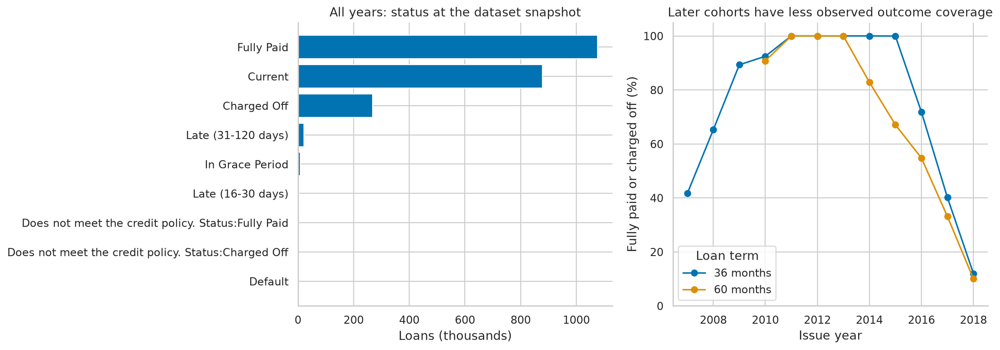
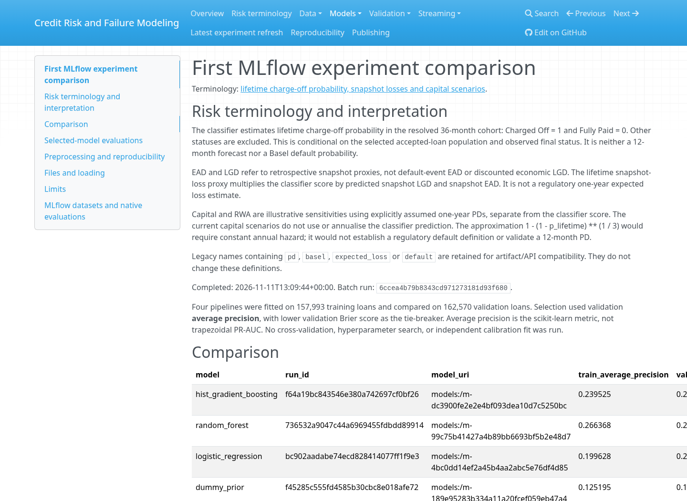
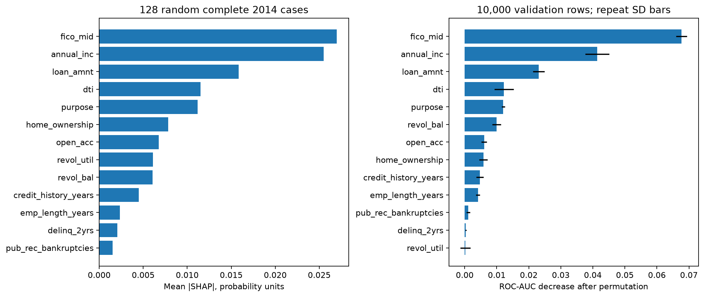
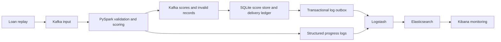
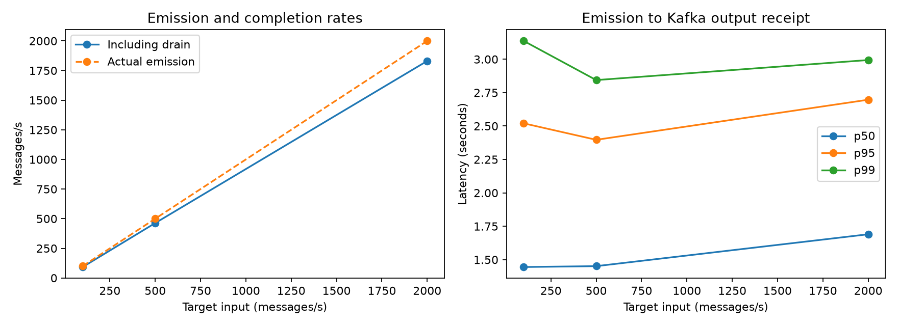
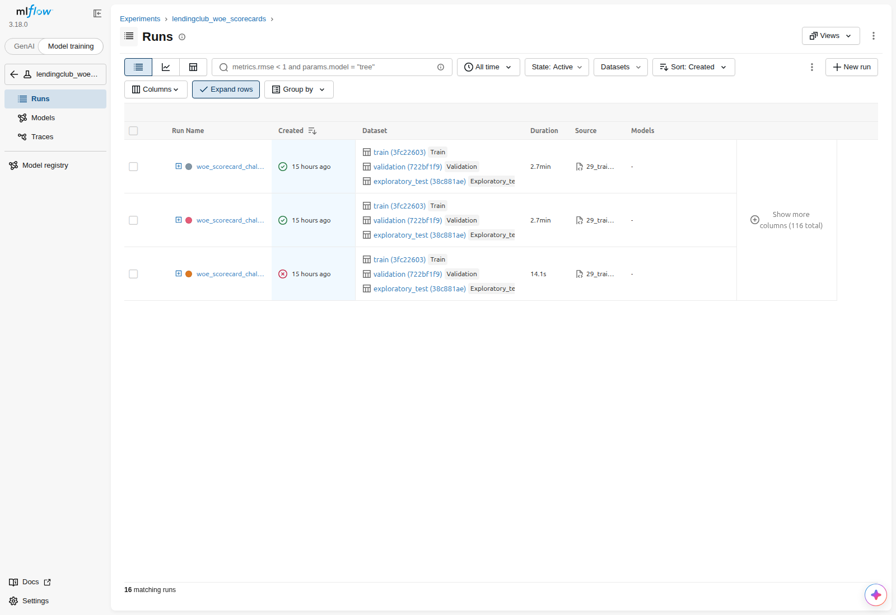
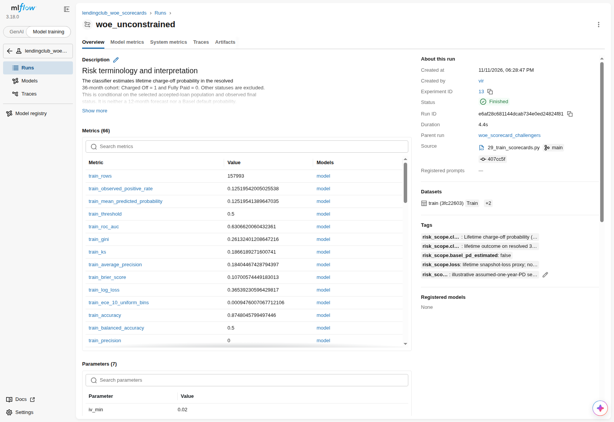
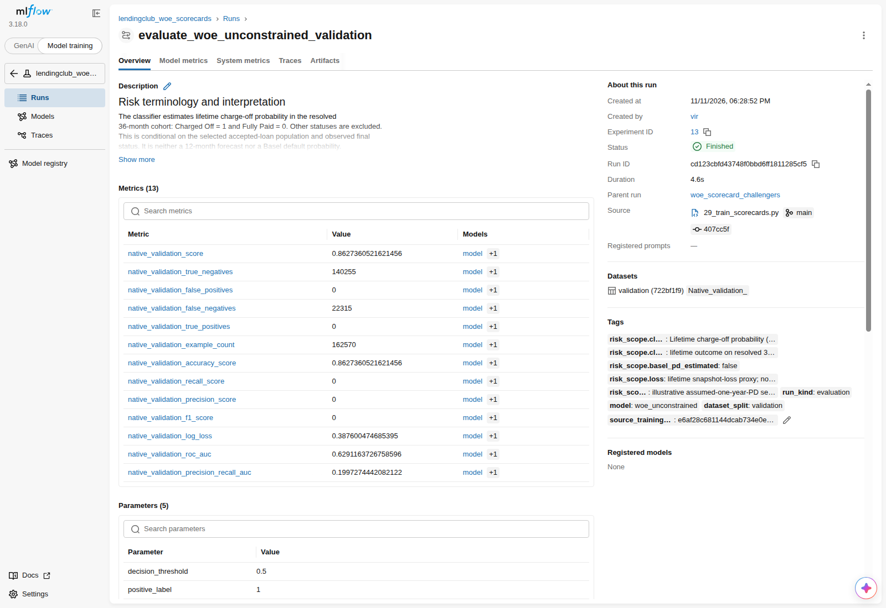
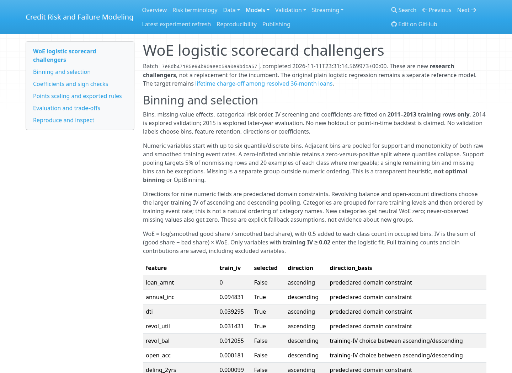

# Credit Risk and Failure Modeling Platform


| Tech stack | Role |
| --- | --- |
|  **Python** | Data preparation, modeling, and tests |
|  **DuckDB · SQL** | Cleaning, audits, and exploratory queries |
|  **marimo** | Executable analysis notebooks |
|  **scikit-learn · XGBoost · InterpretML** | Models, scorecards, and explanations |
|  **MLflow** | Experiment, dataset, model, and evaluation tracking |
|  **Kafka** ·  **PySpark** | Event replay and streaming scoring |
|  **SQLite** | Durable scores, deduplication, and delivery ledger |
|  **Elasticsearch · Logstash · Kibana** | Operational logs and dashboards |
|  **Docker Compose** | Local Kafka and monitoring services |
|  **GitHub Actions · MkDocs** | Automated tests and report publishing |

## Executive summary

This project investigates how LendingClub loan records can support credit-risk analysis, reproducible model comparison, and monitored streaming predictions. It follows the work from a raw loan file through SQL cleaning, exploratory analysis, model experiments, explanations, and failure-recovery testing.

The central finding is that **a working data and scoring pipeline is achievable, but the available data and measured model performance do not justify a production lending or regulatory-capital claim**. The retained classifier has validation ROC-AUC of **0.6539**. Expanded credit-bureau features improve retrospective ranking to **0.6833**, but their exact availability at the intended scoring time remains unverified. Neural networks and a monotonic scorecard did not outperform the incumbent.

The engineering results are stronger: short local streaming tests processed **78,000 events**, and a separate recovery experiment recovered **6,000 main events** with no missing scores. Deduplication, conflict detection, and Elasticsearch/Logstash/Kibana monitoring are implemented. These measurements demonstrate local correctness and recovery behavior; they do not establish production capacity or availability.

**Status:** a completed research and engineering case study, with explicit validation gaps. The classifier estimates **lifetime charge-off probability among resolved, accepted 36-month loans**. It is not a 12-month default forecast or a Basel-approved probability of default.

[Published project reports](https://codezy93.github.io/Credit-Risk-and-Failure-Modeling-Platform/) · [Complete statistics reference](assets/statistics.md) · [Model-review notebook](notebooks/10_model_review.py) · [Reproduction guide](docs/reproducibility.md)

### Results at a glance

| Area | Measured result | Management interpretation |
| --- | --- | --- |
| Data preparation | 2,260,701 raw rows → 2,260,668 clean rows; 151 source columns reviewed | Large-scale analysis with explicit conversions, row exclusions, and saved audits |
| Retained risk classifier | 0.6539 validation AUC; 0.6544 on explored 2015 loans | Modest ranking ability; useful as a benchmark, insufficient evidence for deployment |
| Expanded-feature research | 0.6833 validation AUC | Promising research lift, conditional on unresolved source-timing evidence |
| Neural-network challenger | 0.6515 validation AUC | Added complexity did not improve ranking in this bounded trial |
| WoE scorecard challenger | 0.6291 validation AUC; five retained features | Auditable bins and points were implemented, with weaker discrimination |
| Snapshot loss estimate | $132.52m predicted vs $136.95m observed on eligible validation loans | Aggregate error of −3.23%; weak loss components limit confidence |
| Local stream benchmark | 78,000 events over three 30-second stages | Correct outputs under short, controlled load; no capacity guarantee |
| Failure recovery | 6,000 main events recovered; 110 duplicate deliveries suppressed | Demonstrated restart and storage behavior in one local fault experiment |
| Latest recorded full test run | 120 passed, including Spark | Automated checks complement saved real-data experiment evidence |

## 1. Business question and scope

A lender needs to understand which borrowers are more likely to fail to repay, how losses might accumulate, and whether scoring remains reliable when applications arrive continuously. This project examines all three questions while keeping the distinction between analysis, prediction, and operational reliability visible.

The work asks:

- What do borrower characteristics, loan terms, and loan cohorts reveal about repayment outcomes?
- How much predictive value do different models provide using the same available information?
- Can model outputs be explained and differences across borrower segments be measured?
- Can a streaming pipeline validate applications, score them consistently, recover from interruption, and identify duplicate deliveries?

The source contains **accepted loans**. It does not describe the full applicant population or rejected applicants' outcomes. Consequently, the project does not measure the effect of an approval policy, establish discriminatory treatment, or calculate realized business savings. No live lending decisions are made.

## 2. Data and analytical approach

### Source and population

The source is the [LendingClub accepted-loans dataset on Kaggle](https://www.kaggle.com/datasets/wordsforthewise/lending-club), specifically `accepted_2007_to_2018Q4.csv`. The raw file contains loans issued from June 2007 through December 2018, including loans whose final outcomes were not yet resolved in the snapshot.

DuckDB loads source values as text, then SQL explicitly converts dates and numeric fields. Rows lacking a valid loan identifier or issue date are excluded. The resulting analysis table has **26 columns**. Failed conversions become missing values, with saved parsing audits; these checks do not establish perfect source-data quality.

The exploratory analysis examines distributions, outliers, missingness, borrower categories, income and debt burden, credit scores, cohort changes, and interactions between variables. Figures and query results are saved so findings can be reviewed without repeating the entire analysis.



*Saved EDA figure. Outcome availability matters: an unresolved recent loan cannot simply be treated as successfully repaid.*

### Outcome definition and temporal cohorts

The binary modeling outcome is **Charged Off = 1**, **Fully Paid = 0**. Other statuses are excluded from this benchmark. Modeling uses ordinary resolved **36-month loans** issued in 2011–2015, which reduces maturity-related censoring. Sixty-month loans are outside the modeling population.

| Cohort | Issue years | Loans | Charged off | Observed charge-off rate |
| --- | --- | ---: | ---: | ---: |
| Training | 2011–2013 | 157,993 | 19,780 | 12.52% |
| Validation and research selection | 2014 | 162,570 | 22,315 | 13.73% |
| Exploratory later-year evaluation | 2015 | 283,026 | 42,132 | 14.89% |

All of these years were explored during EDA. **2015 is therefore an exploratory later-year evaluation, not an untouched test set.** In addition, earlier loans' lifetime outcomes were not necessarily known by the later cohort's origination date. Chronological row splitting alone does not establish a point-in-time deployment backtest.

The original classifier uses 13 predictors: loan amount, annual income, debt-to-income ratio, revolving utilization and balance, open accounts, prior delinquencies, public-record bankruptcies, employment length, origination FICO midpoint, credit-history length, home ownership, and loan purpose. Imputation, scaling, and encoding are fitted within training pipelines. IDs, outcomes, payments, recoveries, and later credit scores are excluded from predictors.

A shared allowlist and deny-list enforce the [feature policy](util/feature_policy.json). This prevents known forbidden fields from entering a model; it does not certify every source field's measurement timestamp. Full methods and exclusions are in the [EDA report](docs/eda_summary.md), [data dictionary](docs/data_dictionary.md), and [model-data report](docs/model_data.md).

## 3. Model results and decisions

### Reading the metrics

**ROC-AUC** measures ranking: how often a randomly chosen charged-off loan receives a higher risk score than a randomly chosen fully paid loan. An AUC of 0.50 represents random ranking; 0.65 is better than chance but still modest. It is not a percentage of correct predictions.

**Average precision** summarizes the ability to concentrate charged-off loans among high-risk cases. Its baseline depends on outcome prevalence. **Brier score** measures probability error, with lower values preferred. **Calibration** asks whether predicted probabilities match observed frequencies; a model can rank loans reasonably while understating their absolute risk.

### Baseline comparison

All four baseline pipelines use the same original features and temporal cohorts. Selection used validation average precision, with Brier score as the tie-breaker.

| Model | Validation ROC-AUC | Validation average precision | Validation Brier score | Decision |
| --- | ---: | ---: | ---: | --- |
| Constant-prior baseline | 0.5000 | 0.1373 | 0.1186 | Reference for added value |
| Logistic regression | 0.6462 | 0.2103 | 0.1149 | Retain as a simple reference |
| Random forest | 0.6491 | 0.2139 | 0.1149 | No promotion |
| Histogram gradient boosting | **0.6539** | **0.2165** | **0.1144** | Retained research incumbent |

The incumbent's AUC advantage over logistic regression is **0.007659**, with a paired-bootstrap 95% interval of **0.005913–0.009094**. That interval is conditional on the fitted models and observed cohort; it does not capture the uncertainty of an entirely new training sample or future population.



*Actual browser screenshot of the locally built MkDocs model report. Full tables, run identifiers, and definitions remain available in the [source report](docs/model_experiments.md).*

### Thresholds and calibration

On explored 2015 loans, the incumbent achieved AUC **0.654350**. At the validation-selected threshold of **0.147853**, precision was **22.35%** and recall was **54.49%**. In plain language, it identified about 54% of charged-off loans, while only about 22% of flagged loans were charged off. That trade-off is a benchmark finding, not an approved lending rule.

At the default 0.50 threshold, the model flagged no loans. Its apparent 85.11% accuracy would therefore conceal zero charge-off capture. Thresholds need an explicit business objective, costs, and decision context.

Calibration is also a limitation. The mean 2015 prediction was **13.22%**, compared with an observed **14.89%** charge-off rate. A separate 2011–2012 training / 2013 calibration / 2014 evaluation experiment slightly improved Brier score but worsened ten-bin calibration error. It did not establish a durable calibration fix, and the incumbent was unchanged. See [validation diagnostics](docs/validation_hardening.md).

### Research challengers

| Research comparison | 2014 validation AUC | Interpretation |
| --- | ---: | --- |
| XGBoost, original 13 predictors, bounded search | 0.6547 | Little change from the incumbent |
| XGBoost, expanded 58-feature bureau set | 0.6833 | Stronger ranking; exact feature timing remains unverified |
| XGBoost, 61 features including grade, subgrade, interest rate | 0.6901 | Post-underwriting benchmark using the lender's own outputs |
| Larger neural network, 64 → 32 hidden units | 0.6515 | Did not beat incumbent in the measured trial |
| Monotonic WoE logistic scorecard | 0.6291 | Explainable points, weaker ranking |

These research comparisons share explored 2014 data; they are not independent confirmations of model quality. The corrected XGBoost protocol chooses tree counts using 2013, then refits on 2011–2013 before the 2014 comparison. Older **0.6846 / 0.6913** values belong to the historical protocol that reused 2014 for stopping; they are not the current reference values.

A separate matched-parameter bureau review reports expanded-feature AUCs of **0.671640**, **0.683258**, and **0.696220** across explored 2013, 2014, and 2015 windows. The last model trains through 2014, so its 2015 result is not directly interchangeable with the unchanged incumbent's original 2015 score. None of the 58 fields has issuer-certified per-field timing lineage for this exact CSV. Unknown timing is not proof of leakage, but it prevents promotion. See the [timing and temporal review](docs/bureau_temporal_review.md).

The ANN trial used temporal stopping and frozen epoch budgets. Neither loss-network challenger improved its component reference. This was a bounded, single-seed experiment, not a conclusion that neural networks cannot help.

The scorecard fits bins and information-value screening on training rows only, retaining five features. It exports complete coefficients and additive points, with **600 points at good:bad odds of 50:1 and 20 points per doubling of odds**. All retained unconstrained WoE coefficients have the expected sign; adding sign constraints produces effectively identical scores. Its lower AUC is reported without promoting it. [Scorecard details](docs/scorecard.md) · [ANN details](docs/ann_experiments.md) · [AUC research](docs/auc_improvement.md).

### Benchmark integrity

An isolated audit of a smaller teaching extract found that an added postcode feature dominated its results: a fixed random-split XGBoost comparison reached **0.7202 without postcode** and **0.9071 with it**. That extract differs from this project's raw file. Its random split, underwriting features, and outcome-associated added field make it an unsuitable direct benchmark. The [teaching-extract audit](docs/teaching_extract_audit.md) documents the measured evidence without importing that feature into the project.

## 4. Loss estimates and capital illustrations

Credit-risk ranking and financial loss estimation are separate tasks. This project adds retrospective exposure and recovery proxies:

- **Snapshot exposure at default (EAD proxy):** funded principal minus principal received.
- **Snapshot loss given default (LGD proxy):** one minus net recoveries divided by that residual exposure.
- **Lifetime snapshot-loss proxy:** classifier probability × predicted LGD proxy × predicted EAD proxy.

Payment and recovery fields are used only to build loss targets and audit results; they never become charge-off predictors. These quantities lack default-event timing, discounted recovery cash flows, and some costs, so they are not regulatory EAD or economic LGD.

| Component or portfolio result | Measured outcome | Implication |
| --- | --- | --- |
| Selected LGD | Constant training-cohort loan-average **89.37%** | The mean baseline beat the challenger; a learned recovery model was not established |
| Selected EAD ratio model | Validation R² **0.004710**; MAE **0.202030** | Explains less than 1% of ratio variance; only 0.65% MAE improvement over the mean baseline |
| Validation lifetime loss proxy | **$132.52m** predicted vs **$136.95m** observed | Aggregate error **−3.23%** across 162,563 eligible loans |
| Mean-EAD / mean-LGD baseline | Aggregate error **−2.44%** | Component-level selection did not yield the best portfolio-total agreement |

The ANN bundle's aggregate error was closer to zero (**+0.50%**) but its per-loan dollar MAE was worse. Aggregate agreement can conceal poor individual estimates and is not sufficient for promotion.

The project also implements an **illustrative other-retail capital formula using separately assumed one-year probabilities of default**. It does not feed the lifetime classifier probability directly into regulatory capital or claim an approved annualization. The classifier's AUC did not change when loss layers were added.

[Loss experiment](docs/basel_loss_experiment.md) · [Loss-model limitations and units](docs/loss_model_limitations.md) · [Risk terminology](docs/risk_terminology.md)

## 5. Explainability and borrower-segment analysis

InterpretML Kernel SHAP explains the frozen incumbent. The study uses a training background, random validation cases, and separately labeled error examples. Permutation importance and partial-dependence plots provide cross-checks. FICO, annual income, and loan amount rank highest in both importance methods.



*Importance describes predictive contribution in the sampled analysis. It is not a causal estimate of what changing a borrower attribute would do.*

A descriptive audit measures outcomes and errors across 12 business-segment dimensions, including missing categories and two intersections. At the same frozen threshold, the lowest and highest training-income quartiles had materially different 2015 false-positive rates (**67.06% vs 9.22%**) and charge-off capture rates (**81.31% vs 22.45%**). Observed charge-off rates also differed (**19.26% vs 11.14%**).

These results identify segments requiring investigation. They are not observed denial rates or proof of discrimination. Race, sex/gender, ethnicity, age/birth date, and disability are absent from the verified schema and are not inferred from other fields. **Protected-group fairness remains unassessed.** Explanations also have a narrower eligible sample than the full segment audit; the report records that coverage limit.

[Explanation methods, segment tables, and limitations](docs/interpret_bias.md)

## 6. Streaming reliability and monitoring

The operational layer replays loan applications into Kafka. PySpark Structured Streaming validates messages and applies the frozen classifier in batches. Valid scores and invalid messages go to separate Kafka topics. A downstream SQLite store uses `event_id` as a unique key, suppresses repeated results, and records conflicting results without overwriting the original.



Kafka delivery remains **at least once**: messages can be delivered again after failure. Application-level deduplication protects the durable score store. This is not an end-to-end exactly-once claim. Checkpoints, Kafka offsets, and the score database must be preserved for recovery.

### Measured local load

A warmed query processed three 30-second input stages. Every output probability matched direct model scoring; no missing outputs, duplicate outputs, invalid outputs, or delivery errors were observed in that benchmark.

| Target input rate | Events | p95 end-to-end latency | Completed rows/second, including drain |
| --- | ---: | ---: | ---: |
| 100 messages/second | 3,000 | 2.52 seconds | 92.4 |
| 500 messages/second | 15,000 | 2.40 seconds | 463.2 |
| 2,000 messages/second | 60,000 | 2.70 seconds | 1,830.7 |

At the highest rate, sampled checkpoint lag peaked at 8,604 records and drained to zero. Final outputs arrived 2.775 seconds after the last producer acknowledgement. These are short local tests, not sustainable production throughput or an SLA.



*Measured benchmark chart. End-to-end latency includes Spark scheduling, Kafka transport, and collector polling.*

### Recovery and monitoring evidence

A separate fault experiment killed Spark during an uncommitted batch, continued replay, and restarted from the same checkpoint. It then injected duplicate and conflicting deliveries and crashed the store after its database commit but before its Kafka offset commit.

| Recovery check | Recorded result |
| --- | --- |
| Main events recovered | 6,000; zero missing scores |
| Prediction consistency | All probabilities and flags matched direct scoring |
| Outage-event recovery | First result for an event emitted during the outage arrived 22.31 seconds after restart launch |
| Duplicate suppression | 110 deliberately injected duplicate deliveries suppressed |
| Conflict handling | One conflicting result flagged; original preserved |
| Consumer recovery | Committed group lag reached zero on every output partition |
| Monitoring reconciliation | 6,295 monitoring records indexed and reconciled against local logs |

ELK monitoring is implemented, with eight Kibana panels covering stored results, duplicates, conflicts, latency, throughput, lag, mean scores, and errors. A transactional outbox bridges durable result storage and monitoring logs. The checker reports warnings for the deliberate conflict and outage-related latency; external notifications are not configured.

The current runtime pins **Spark 4.1.4**, following a restart bug encountered on 4.1.2. Historical load measurements retain their original runtime version. Airflow is not implemented. Local monitoring services use loopback bindings and demonstration settings, including disabled Elasticsearch security.

[Streaming setup and semantics](docs/streaming.md) · [Load-test evidence](docs/load_testing.md) · [Recovery and monitoring evidence](docs/recovery_monitoring.md)

## 7. Evidence, reproducibility, and remaining risks

MLflow provides local experiment tracking with datasets, fitted models, parameters, evaluations, and artifacts. Versioned result directories and SHA-256 manifests connect saved evidence to source files and data. Historical runs are preserved when experiments are refreshed. The local MLflow database and full datasets/models are excluded from Git; committed reports and aggregate results can be reviewed without them.

### MLflow experiment evidence

The following screenshots show **MLflow 3.18.0 running against the project's local tracking database**, in its Model training view. They document the scorecard research experiment; the scorecard's AUC is not the incumbent model's AUC.



*Experiment run history with training, validation, and exploratory dataset names and digests. Earlier successful and failed attempts remain visible; history was not deleted to produce a cleaner screenshot.*



*Saved `woe_unconstrained` training run, including its finished status, source, dataset associations, and logged metrics. This screenshot shows the top of the run; full metrics remain available in the report and MLflow.*



*Native evaluation on 162,570 validation loans: ROC-AUC 0.629116 and precision–recall AUC 0.199727. The evaluation uses threshold 0.50, which flags no loans here; its 86.27% accuracy therefore accompanies zero recall. The validation dataset and source training run are linked in MLflow.*

The latest recorded full suite passed **120 tests, with no skips**, including Spark and seven scorecard tests. GitHub Actions is configured to run pytest using Python 3.14, Java 21, and the streaming lock, then upload JUnit results. Tests cover fixtures and implementation behavior; they do not independently reproduce every real-data model experiment or run live Kafka/ELK failure tests in CI. Real-data reruns still need the dataset and local infrastructure.



*Actual browser screenshot of the local scorecard report. The report preserves its weaker result and decision not to promote it.*

### Remaining limitations and decisions

| Priority | Gap | Next evidence required |
| --- | --- | --- |
| 1 | No untouched evaluation cohort; outcome availability is not point-in-time | A frozen protocol with genuinely unused, sufficiently mature data and documented label-availability dates |
| 2 | Expanded bureau timing is uncertified | Source-level measurement, first-availability, and update rules for each input and derived dependency |
| 3 | Modest discrimination and changing observed charge-off rates | Prospective evaluation of ranking, probability calibration, and decision costs |
| 4 | Constant LGD and weak EAD prediction | Event-level exposure/recovery data and comparison against clear portfolio-average baselines |
| 5 | Operational evidence is local and short | Longer repeated load tests, broker failover, resource measurements, and deployment-specific controls |
| 6 | Protected-group fairness cannot be evaluated | Suitable, lawfully available attributes and a defined decision context |

No demonstrated ROI, production readiness, protected-group fairness clearance, or regulatory approval is claimed. The incumbent is retained as a research reference; stronger-looking research numbers alone do not trigger promotion.

## 8. Run and review the project

### Review without training

Start with the [published MkDocs reports](https://codezy93.github.io/Credit-Risk-and-Failure-Modeling-Platform/), [model comparison](docs/model_experiments.md), and [complete statistics](assets/statistics.md). The [exported model-review notebook](docs/model_review.html) can be downloaded and opened locally without retraining. GitHub displays its source rather than serving it as an application.

### Requirements and core workflow

The hash-locked Python environment was verified on **Linux x86_64 with Python 3.14**. Dependency installation needs package-index access. The accepted-loans file and generated outputs need several GB of disk space. Close notebook kernels holding DuckDB before rerunning the workflow.

```bash
make all
```

This creates `.venv-locked`, installs hash-verified dependencies, runs tests, downloads/reuses the data, executes and exports three marimo EDA notebooks, prepares model cohorts, trains baseline models, runs validation and loss experiments, reviews coefficients and explanations, and exports the model-review notebook. Streaming services, bureau-window research, and scorecards are separate targets.

If Kaggle is blocked, use a manually obtained local file:

```bash
make all RAW_DATA=/absolute/path/to/accepted_2007_to_2018Q4.csv
# A local .csv.gz is also accepted.
```

The loader links a supplied file into `data/raw` and refuses to replace a different existing file. Kaggle authentication or dataset-term acceptance may be required when downloading. [Data setup and authentication](docs/data_setup.md).

Use `BOOTSTRAP_PYTHON=/path/to/python3.14` when the default `python3` is another version. Direct dependency pins live in `requirements.txt`; transitive versions and hashes are in `requirements.lock`. The streaming environment has its own lock.

### Analysis and experiment commands

Run these from the repository root. Modeling targets require the prepared data and relevant reference models from the core workflow.

| Command | Purpose |
| --- | --- |
| `make setup` | Create/synchronize the locked modeling environment |
| `make test` | Run tests available in that environment; use the streaming environment for full Spark coverage |
| `make validate` | Recompute validation diagnostics |
| `make auc` | Run the optional corrected XGBoost research search |
| `make review` | Run XGBoost, coefficient review, and interpretation; export notebook |
| `make loss` / `make loss-report` | Train loss proxies / refresh saved-result interpretation |
| `make ann` | Train neural-network challengers |
| `make interpret` | Explain the frozen incumbent and audit borrower segments |
| `make bureau-review` / `make bureau-report` | Run temporal bureau research / refresh its report |
| `make scorecard` / `make scorecard-report` | Train and log WoE scorecards / refresh their report |
| `make full` | Core workflow plus optional XGBoost and ANN experiments |
| `make refresh-experiments` | Regenerate the defined experiment batches from existing prepared data, preserving historical runs |

Open notebooks interactively after setup:

```bash
.venv-locked/bin/marimo edit notebooks/01_data_analysis.py
# Also: 02_deeper_eda.py, 03_complete_eda.py, 10_model_review.py
```

View MLflow locally:

```bash
.venv-locked/bin/mlflow ui \
  --backend-store-uri sqlite:///models/mlflow.db \
  --host 127.0.0.1 --port 5000
```

Open `http://127.0.0.1:5000`. Experiments include `lendingclub_resolved_36m`, `lendingclub_auc_ablation`, `lendingclub_validation_hardening`, `lendingclub_basel_loss_proxies`, `lendingclub_ann_challengers`, `lendingclub_interpretability_bias`, and `lendingclub_woe_scorecards`. Dataset artifacts contain role-specific exports; evaluation child runs contain native metrics and plots. MLflow storage is local; a hosted tracking server and deployment registry are not provided.

The incumbent pipeline is saved as `models/selected_model.joblib`. Read its manifest for ordered features, use `predict_proba(... )[:, 1]`, and apply the saved threshold explicitly. Native `predict()` uses the pipeline's default rule rather than the validation-selected threshold.

### Streaming and monitoring demonstration

Docker Compose and **Java 21** are needed for this path. Make uses `.venv-streaming` directly; activating a different Python environment does not change that choice. Set `STREAM_JAVA_HOME=/your/java-21` if its default Linux path differs.

```bash
make streaming-setup
make kafka-up
make elk-up
make replay ARGS="--rows 1000 --rate 100 --run-id demo-unique-id"
```

Run scoring and durable storage in separate terminals:

```bash
make stream
```

```bash
make store-scores
```

For a finite scoring pass, use `make stream ARGS="--available-now"`. Then verify the replay, monitor status, or run the controlled benchmarks:

```bash
make stream-check ARGS="--run-id demo-unique-id --rows 1000"
make monitor-check
make load-test
make recovery-test
```

Kibana: `http://127.0.0.1:15601/app/dashboards#/view/credit-risk-streaming`. Elasticsearch: `http://127.0.0.1:19200`. Use a fresh replay identifier for a new demonstration. Keep checkpoints and score databases when restarting.

```bash
make elk-down
make kafka-down
```

To match CI's full dependency coverage locally after `make streaming-setup`:

```bash
JAVA_HOME=/usr/lib/jvm/java-21-openjdk-amd64 SPARK_LOCAL_IP=127.0.0.1 \
  .venv-streaming/bin/python -m pytest -q
```

### Documentation preview and publishing

```bash
make docs-setup
make site-check
make site-serve
```

MkDocs uses its unmodified default theme. The GitHub Pages workflow builds and publishes documentation; the test workflow runs pytest separately. [Publishing instructions](docs/github_pages.md).

## 9. Repository and report guide

```text
sql/                  Loading, cleaning, EDA, and population queries
data/raw/             Original source files (ignored)
data/clean/           DuckDB, clean tables, and model cohorts (ignored)
models/               Fitted models, MLflow storage, streaming state (ignored)
scripts/              Download, preparation, experiments, reporting, operations
notebooks/            Marimo EDA and model-review notebooks
util/                 Shared feature policy, metrics, logging, model helpers
util/elk/             Logstash configuration and Kibana dashboard definition
docs/                 Detailed reports and exported notebooks; MkDocs source
assets/figures/       Saved analytical figures
assets/results/       Aggregate results, manifests, and verification records
assets/screenshots/   Actual report screenshots and capture provenance
.github/workflows/    Pytest CI and GitHub Pages publishing
```

| Reader question | Evidence |
| --- | --- |
| What changed during cleaning, and what did EDA find? | [EDA summary](docs/eda_summary.md), [data dictionary](docs/data_dictionary.md) |
| Which model won, with what metrics? | [Baseline experiments](docs/model_experiments.md), [validation diagnostics](docs/validation_hardening.md) |
| Why were some logistic signs counterintuitive? | [Coefficient investigation](docs/coefficient_validation.md), [WoE scorecards](docs/scorecard.md) |
| What is behind the expanded-feature uplift? | [AUC research](docs/auc_improvement.md), [timing review](docs/bureau_temporal_review.md) |
| What do the financial-loss numbers mean? | [Loss experiment](docs/basel_loss_experiment.md), [limitations](docs/loss_model_limitations.md) |
| How are explanations and segment differences assessed? | [InterpretML and segment audit](docs/interpret_bias.md) |
| Did streaming and recovery actually run? | [Load tests](docs/load_testing.md), [recovery and monitoring](docs/recovery_monitoring.md) |
| How can the results be reproduced or checked? | [Reproducibility](docs/reproducibility.md), [experiment refresh](docs/experiment_refresh.md), [statistics](assets/statistics.md) |

Screenshots are captured from actual local reports; analytical images come from saved experiment outputs. [Screenshot provenance](assets/screenshots/README.md) records the capture scope. Raw borrower records are not included in the README screenshots. Versioned artifacts remain the authoritative record of each measured run.
