# Project statistics reference

> Selected-model results are in section 18; later validation-only AUC research is in section 20; exact diagnostics, uncertainty and separate-year calibration are in section 21; separate loss models and illustrative capital scenarios are in section 22. The selected model remains unchanged. Earlier sections retain their stage-specific snapshots. InterpretML and descriptive segment-disparity results are in section 26; protected-group fairness is unassessed. Short local load tests, recovery under active load, persistent deduplication and ELK monitoring are measured in the latest sections below.

<!-- scorecard-statistics -->
## WoE logistic scorecard challengers

Batch `7e8db47185e94b90aeec59a0e9bdca57`, completed 2026-11-11T23:31:14.569973+00:00.
These are new **research challengers**, not a replacement for the incumbent.
The original plain logistic regression remains a separate reference model.
The target remains [lifetime charge-off among resolved 36-month loans](../docs/risk_terminology.md).

## Binning and selection

Bins, missing-value effects, categorical risk order, IV screening and coefficients
are fitted on **2011–2013 training rows only**. 2014 is explored validation; 2015
is explored later-year evaluation. No new holdout or point-in-time backtest is claimed.
No validation labels choose bins, feature retention, directions or coefficients.

Numeric variables start with up to six quantile/discrete bins. Adjacent bins are
pooled for support and monotonicity of both raw and smoothed training event rates.
A zero-inflated variable retains a zero-versus-positive split where quantiles
collapse. Support pooling targets 5% of nonmissing rows and 20 examples of each
class where mergeable; a single remaining bin and missing bins can be exceptions.
Missing is a separate group outside numeric ordering. This is a transparent
heuristic, **not optimal binning** or OptBinning.

Directions for nine numeric fields are predeclared domain constraints. Revolving
balance and open-account directions choose the larger training IV of ascending
and descending pooling. Categories are grouped for rare training levels and then
ordered by training event rate; this is not a natural ordering of category names.
New categories get neutral WoE zero; never-observed missing values also get zero.
These are explicit fallback assumptions, not evidence about new groups.

WoE = log(smoothed good share / smoothed bad share), with 0.5 added to each class
count in occupied bins. IV is the sum of (good share − bad share) × WoE.
Only variables with **training IV ≥ 0.02** enter the logistic fit. Full training
counts and bin contributions are saved, including excluded variables.

| feature | train_iv | selected | direction | direction_basis |
| --- | --- | --- | --- | --- |
| loan_amnt | 0 | False | ascending | predeclared domain constraint |
| annual_inc | 0.094831 | True | descending | predeclared domain constraint |
| dti | 0.039295 | True | ascending | predeclared domain constraint |
| revol_util | 0.031431 | True | ascending | predeclared domain constraint |
| revol_bal | 0.012055 | False | descending | training-IV choice between ascending/descending |
| open_acc | 0.000181 | False | descending | training-IV choice between ascending/descending |
| delinq_2yrs | 0.000099 | False | ascending | predeclared domain constraint |
| pub_rec_bankruptcies | 0.000192 | False | ascending | predeclared domain constraint |
| emp_length_years | 0.012672 | False | descending | predeclared domain constraint |
| fico_mid | 0.12591 | True | descending | predeclared domain constraint |
| credit_history_years | 0.018026 | False | descending | predeclared domain constraint |
| home_ownership | 0.033351 | True | ascending | training risk order |
| purpose | 0.016133 | False | ascending | training risk order |

Selected features: **annual_inc, dti, revol_util, fico_mid, home_ownership**. Delinquency and bankruptcy are not
silently assigned favorable economic effects: their actual IV decisions appear
above. Pooling and screening are modeling choices that can discard weak or
nonconforming signals; they do not establish causality or universal risk direction.

## Coefficients and sign checks

Both models minimize the same L2 logistic objective (C=1), with the same L-BFGS-B
optimizer, initialization and tolerances. The constrained fit additionally bounds
WoE coefficients at zero from above. The intercept is unpenalized and unconstrained.
No one-hot reference ambiguity is introduced: each retained variable has one
WoE coefficient.

Under this good/bad WoE convention a nonpositive coefficient is the expected
relationship. Positive unconstrained WoE coefficients, if present, are reported,
not silently flipped. Current unconstrained sign failures: **none**.
Constrained signs are enforced by design; passing them is not regulatory validation
or proof that the assumed raw-variable direction is economically correct. Numeric
score monotonicity applies within regular bins, holding other inputs fixed; it does
not order missing values or prove monotone observed risk in future cohorts.

| model | feature | coefficient | expected_woe_sign | sign_check_passed | zero_effect |
| --- | --- | --- | --- | --- | --- |
| woe_unconstrained | annual_inc | -0.751237 | nonpositive | True | False |
| woe_unconstrained | dti | -0.631748 | nonpositive | True | False |
| woe_unconstrained | revol_util | -0.174193 | nonpositive | True | False |
| woe_unconstrained | fico_mid | -0.841819 | nonpositive | True | False |
| woe_unconstrained | home_ownership | -0.441886 | nonpositive | True | False |
| woe_constrained | annual_inc | -0.751237 | nonpositive | True | False |
| woe_constrained | dti | -0.631748 | nonpositive | True | False |
| woe_constrained | revol_util | -0.174193 | nonpositive | True | False |
| woe_constrained | fico_mid | -0.841819 | nonpositive | True | False |
| woe_constrained | home_ownership | -0.441886 | nonpositive | True | False |

| model | selected_features | intercept | factor | offset | optimizer_iterations |
| --- | --- | --- | --- | --- | --- |
| woe_unconstrained | 5 | -1.944959 | 28.853901 | 487.122876 | 17 |
| woe_constrained | 5 | -1.944959 | 28.853901 | 487.122876 | 17 |

## Points scaling and exported rules

Base **600 points at model-implied good:bad odds 50:1**, with **PDO = 20**.
Factor = 20 / ln(2); offset = 600 − factor × ln(50).
Score = offset − factor × fitted bad-event log-odds.
Doubling good:bad odds adds 20 points. Higher scores imply lower fitted charge-off
probability. The anchor is not a guarantee of observed default rates or a FICO scale.

Unrounded per-feature points distribute the offset and intercept equally across
retained variables. Adding their exported bin points reproduces the full model
score, including explicit missing and unseen-category fallback rows. No clipping
or rounding is used. Both saved-model probabilities and point sums were verified
on the complete cohorts; the exported CSV lookup was independently checked on
all validation and exploratory rows for both challengers.

Below is the constrained card's complete points table. The
[CSV](https://github.com/Codezy93/Credit-Risk-and-Failure-Modeling-Platform/blob/main/assets/results/scorecard/7e8db47185e94b90aeec59a0e9bdca57/points_table.csv) includes both cards at full precision.

| feature | bin | count | good | bad | event_rate | woe | coefficient | points |
| --- | --- | --- | --- | --- | --- | --- | --- | --- |
| annual_inc | [-inf, 36300.0) | 26332 | 21594 | 4738 | 0.179933 | -0.427277 | -0.751237 | 99.3868 |
| annual_inc | [36300.0, 48000.0) | 25021 | 21236 | 3785 | 0.151273 | -0.219451 | -0.751237 | 103.891651 |
| annual_inc | [48000.0, 60000.0) | 25621 | 22256 | 3365 | 0.131338 | -0.054937 | -0.751237 | 107.457681 |
| annual_inc | [60000.0, 75000.0) | 27585 | 24380 | 3205 | 0.116186 | 0.084921 | -0.751237 | 110.489261 |
| annual_inc | [75000.0, 98000.0) | 26602 | 24045 | 2557 | 0.096121 | 0.296923 | -0.751237 | 115.084646 |
| annual_inc | [98000.0, inf) | 26832 | 24702 | 2130 | 0.079383 | 0.506553 | -0.751237 | 119.628616 |
| annual_inc | Missing | 0 | 0 | 0 | — | 0 | -0.751237 | 108.648505 |
| dti | [-inf, 8.53) | 26292 | 23744 | 2548 | 0.096912 | 0.287851 | -0.631748 | 113.895572 |
| dti | [8.53, 12.56) | 26344 | 23556 | 2788 | 0.105831 | 0.189903 | -0.631748 | 112.110137 |
| dti | [12.56, 16.07) | 26332 | 23288 | 3044 | 0.115601 | 0.090628 | -0.631748 | 110.300514 |
| dti | [16.07, 19.8) | 26331 | 22928 | 3403 | 0.129239 | -0.036418 | -0.631748 | 107.984658 |
| dti | [19.8, 24.32) | 26338 | 22574 | 3764 | 0.142911 | -0.152789 | -0.631748 | 105.863411 |
| dti | [24.32, inf) | 26356 | 22123 | 4233 | 0.160609 | -0.290383 | -0.631748 | 103.355283 |
| dti | Missing | 0 | 0 | 0 | — | 0 | -0.631748 | 108.648505 |
| revol_util | [-inf, 31.9) | 26297 | 23880 | 2417 | 0.091912 | 0.346355 | -0.174193 | 110.38934 |
| revol_util | [31.9, 47.0) | 26236 | 23247 | 2989 | 0.113927 | 0.107118 | -0.174193 | 109.186899 |
| revol_util | [47.0, 58.7) | 26197 | 22959 | 3238 | 0.123602 | 0.014648 | -0.174193 | 108.722131 |
| revol_util | [58.7, 69.7) | 26471 | 22997 | 3474 | 0.131238 | -0.054038 | -0.174193 | 108.376901 |
| revol_util | [69.7, 81.7) | 26287 | 22657 | 3630 | 0.138091 | -0.112852 | -0.174193 | 108.081291 |
| revol_util | [81.7, inf) | 26401 | 22383 | 4018 | 0.152191 | -0.226558 | -0.174193 | 107.509792 |
| revol_util | Missing | 104 | 90 | 14 | 0.134615 | -0.112772 | -0.174193 | 108.081697 |
| fico_mid | [-inf, 672.0) | 21375 | 17561 | 3814 | 0.178433 | -0.417095 | -0.841819 | 98.517359 |
| fico_mid | [672.0, 682.0) | 24232 | 20358 | 3874 | 0.159871 | -0.284913 | -0.841819 | 101.72804 |
| fico_mid | [682.0, 692.0) | 23873 | 20393 | 3480 | 0.145771 | -0.175954 | -0.841819 | 104.374613 |
| fico_mid | [692.0, 707.0) | 31553 | 27646 | 3907 | 0.123823 | 0.012607 | -0.841819 | 108.954718 |
| fico_mid | [707.0, 727.0) | 27651 | 24898 | 2753 | 0.099562 | 0.25794 | -0.841819 | 114.913808 |
| fico_mid | [727.0, inf) | 29309 | 27357 | 1952 | 0.066601 | 0.695885 | -0.841819 | 125.551399 |
| fico_mid | Missing | 0 | 0 | 0 | — | 0 | -0.841819 | 108.648505 |
| home_ownership | MORTGAGE | 75212 | 67342 | 7870 | 0.104638 | 0.20261 | -0.441886 | 111.231813 |
| home_ownership | OWN | 13339 | 11568 | 1771 | 0.132769 | -0.0676 | -0.441886 | 107.786591 |
| home_ownership | RENT \| NONE \| OTHER | 69442 | 59303 | 10139 | 0.146007 | -0.17783 | -0.441886 | 106.381149 |
| home_ownership | Missing | 0 | 0 | 0 | — | 0 | -0.441886 | 108.648505 |
| home_ownership | Unseen category (neutral WoE) | 0 | 0 | 0 | — | 0 | -0.441886 | 108.648505 |

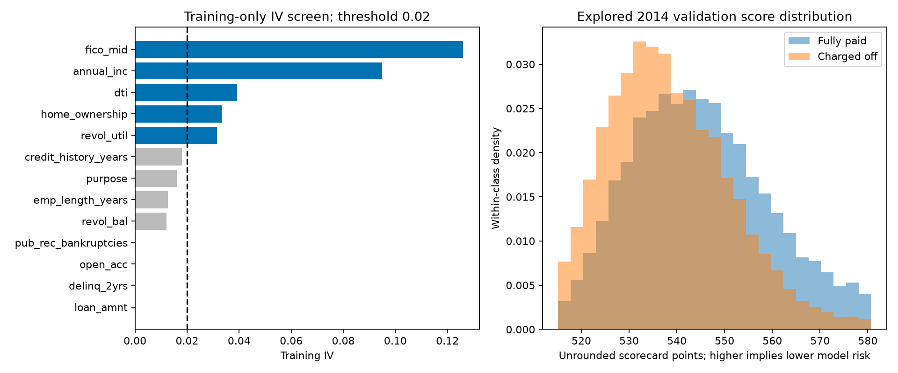

## Evaluation and trade-offs

| model | split | roc_auc | gini | ks | average_precision | brier_score | observed_positive_rate | mean_predicted_probability |
| --- | --- | --- | --- | --- | --- | --- | --- | --- |
| original_logistic | train | 0.650936 | 0.301871 | 0.218646 | 0.199628 | 0.106127 | 0.125195 | 0.125206 |
| original_logistic | validation | 0.646231 | 0.292462 | 0.213711 | 0.21028 | 0.114869 | 0.137264 | 0.132214 |
| original_logistic | exploratory_test | 0.646349 | 0.292698 | 0.212749 | 0.226319 | 0.122883 | 0.148863 | 0.132003 |
| incumbent_hgb | train | 0.684525 | 0.369051 | 0.265112 | 0.239525 | 0.104177 | 0.125195 | 0.125187 |
| incumbent_hgb | validation | 0.653889 | 0.307779 | 0.222796 | 0.216483 | 0.114375 | 0.137264 | 0.131767 |
| incumbent_hgb | exploratory_test | 0.65435 | 0.308701 | 0.223789 | 0.235027 | 0.122279 | 0.148863 | 0.132223 |
| woe_unconstrained | train | 0.630662 | 0.261324 | 0.186619 | 0.184045 | 0.107006 | 0.125195 | 0.125195 |
| woe_unconstrained | validation | 0.629116 | 0.258233 | 0.187128 | 0.199727 | 0.115577 | 0.137264 | 0.131814 |
| woe_unconstrained | exploratory_test | 0.627206 | 0.254412 | 0.181766 | 0.212171 | 0.123888 | 0.148863 | 0.13098 |
| woe_constrained | train | 0.630662 | 0.261324 | 0.186619 | 0.184045 | 0.107006 | 0.125195 | 0.125195 |
| woe_constrained | validation | 0.629116 | 0.258233 | 0.187128 | 0.199727 | 0.115577 | 0.137264 | 0.131814 |
| woe_constrained | exploratory_test | 0.627206 | 0.254412 | 0.181766 | 0.212171 | 0.123888 | 0.148863 | 0.13098 |

Both challenger variants were predeclared; no model is promoted from these results.
A monotone scorecard is not guaranteed to beat the original logistic regression or
boosting. The IV cutoff can remove jointly useful weak predictors; coarse bins
can lose ranking information. When unconstrained coefficients already have the
expected signs, the bounds may be inactive and need not improve discrimination.
Raw probabilities are not separately calibrated here. The default 0.5 classification
threshold is a reproducible diagnostic, not an approval or cost-optimized policy.

| model | split | reference | auc_difference | lower_95 | upper_95 |
| --- | --- | --- | --- | --- | --- |
| woe_unconstrained | validation | original_logistic | -0.017115 | -0.019257 | -0.014683 |
| woe_unconstrained | exploratory_test | original_logistic | -0.019143 | -0.020698 | -0.017794 |
| woe_constrained | validation | original_logistic | -0.017115 | -0.019257 | -0.014683 |
| woe_constrained | exploratory_test | original_logistic | -0.019143 | -0.020698 | -0.017794 |

Intervals compare each scorecard with the fixed original logistic model using
200 paired class-stratified resamples. They exclude binning/fit/selection uncertainty,
borrower dependence and macroeconomic variation. There is no significance claim
that these are universally better models. Per-bin counts and event rates for
train/validation/exploratory cohorts are in
[bin outcomes](https://github.com/Codezy93/Credit-Risk-and-Failure-Modeling-Platform/blob/main/assets/results/scorecard/7e8db47185e94b90aeec59a0e9bdca57/bin_outcomes_by_split.csv);
validation event-rate monotonicity is not forced.

## Reproduce and inspect

Local suite: **120 tests**, 0 failures, 0 errors, 0 skips. [JUnit](https://github.com/Codezy93/Credit-Risk-and-Failure-Modeling-Platform/blob/main/assets/results/scorecard/7e8db47185e94b90aeec59a0e9bdca57/test_results.xml).

Run `make scorecard` to fit the challengers, log real datasets/models/native
evaluations to MLflow and export reports. `make scorecard-report` reads saved
results without fitting. Current weights and input/metric/source hashes are in
[the manifest](https://github.com/Codezy93/Credit-Risk-and-Failure-Modeling-Platform/blob/main/assets/results/scorecard/7e8db47185e94b90aeec59a0e9bdca57/manifest.json).
[All bins](https://github.com/Codezy93/Credit-Risk-and-Failure-Modeling-Platform/blob/main/assets/results/scorecard/7e8db47185e94b90aeec59a0e9bdca57/binning_tables.csv),
[IV screen](https://github.com/Codezy93/Credit-Risk-and-Failure-Modeling-Platform/blob/main/assets/results/scorecard/7e8db47185e94b90aeec59a0e9bdca57/iv_screen.csv),
[coefficient audit](https://github.com/Codezy93/Credit-Risk-and-Failure-Modeling-Platform/blob/main/assets/results/scorecard/7e8db47185e94b90aeec59a0e9bdca57/coefficients.csv), and
[native evaluations](https://github.com/Codezy93/Credit-Risk-and-Failure-Modeling-Platform/blob/main/assets/results/scorecard/7e8db47185e94b90aeec59a0e9bdca57/native_evaluations.csv) remain inspectable.
Historical failed/diagnostic runs remain recorded with their execution-time sources.
No dependencies, incumbent artifacts, raw data or prepared datasets were changed.

For related ordered-fit concepts see [scikit-learn isotonic regression](https://scikit-learn.org/stable/modules/isotonic.html).
The bounded optimizer is documented by [SciPy L-BFGS-B](https://docs.scipy.org/doc/scipy/reference/optimize.minimize-lbfgsb.html).

<!-- end-scorecard-statistics -->

<!-- bureau-temporal-statistics -->
## Expanded bureau timing and temporal review

Batch `53a79329f2584a9db272ac2c42abf4e2`, completed 2026-11-11T22:42:29.307496+00:00.
**Decision: research only; no promotion.** The incumbent artifact and original
model/research manifest pointers are unchanged.

## Field timing audit

All **58 input features** have explicit timing-audit entries, including
**45 additions** to the 13-feature baseline. **Zero** have issuer-certified
per-field measurement/update lineage for this exact CSV. Policy allowlisting
prevents known later-outcome predictors; it does not certify availability.
Derived variables inherit their parents' timing uncertainty. Grade, subgrade and
interest rate are excluded from this comparison.

The filed [loan-request credit-report authorization](https://www.sec.gov/Archives/edgar/data/1409970/000095012309014424/c86710exv10w11.htm)
provides general evidence that reports were obtained for loan requests. It does
not map this extract's field values to measurement times. The
[April 2019 borrower agreement, section 6](https://www.sec.gov/Archives/edgar/data/1409970/000140997019000563/lc33119ex101.htm)
also authorizes periodic reports during the relationship. Those later terms do
not establish that any specific 2011–2015 CSV value was updated. Neither document
certifies the historical CSV snapshot. Unknown timing is not proof of leakage.

[Field audit](https://github.com/Codezy93/Credit-Risk-and-Failure-Modeling-Platform/blob/main/assets/results/bureau_temporal/53a79329f2584a9db272ac2c42abf4e2/feature_timing_audit.csv) and
[year-by-year feature coverage](https://github.com/Codezy93/Credit-Risk-and-Failure-Modeling-Platform/blob/main/assets/results/bureau_temporal/53a79329f2584a9db272ac2c42abf4e2/feature_coverage_by_year.csv)
record every field and missingness pattern. Coverage can reveal schema/cohort
changes; it is not timestamp evidence. Promotion requires an issuer/source
mapping of measurement time, first availability and update/immutability rules
for every input and its dependencies, before the intended scoring time.

## Predeclared research windows

| evaluation_year | role | rows | min_issue_date | max_issue_date | charged_off | positive_rate |
| --- | --- | --- | --- | --- | --- | --- |
| 2013 | train | 57571 | 2011-01-01 00:00:00 | 2012-12-01 00:00:00 | 7402 | 0.128572 |
| 2013 | evaluation | 100422 | 2013-01-01 00:00:00 | 2013-12-01 00:00:00 | 12378 | 0.12326 |
| 2014 | train | 157993 | 2011-01-01 00:00:00 | 2013-12-01 00:00:00 | 19780 | 0.125195 |
| 2014 | evaluation | 162570 | 2014-01-01 00:00:00 | 2014-12-01 00:00:00 | 22315 | 0.137264 |
| 2015 | train | 320563 | 2011-01-01 00:00:00 | 2014-12-01 00:00:00 | 42095 | 0.131316 |
| 2015 | evaluation | 283026 | 2015-01-01 00:00:00 | 2015-12-01 00:00:00 | 42132 | 0.148863 |

Evaluation years 2013, 2014 and 2015 were already explored. Training rows precede
evaluation rows, preprocessing fits on training only, and loan IDs are unique and
disjoint across each split. Borrower-level disjointness is not established.
Lifetime outcome labels were not necessarily known at the later origination
date, so these are **not point-in-time deployment backtests** or fresh holdouts.
Only resolved accepted 36-month loans are included; later, less-mature cohorts
are not added merely to obtain another test year.

Both XGBoost controls use exactly the same frozen parameters and
**335 trees**, without an eval_set or new tuning.
The tree budget was originally chosen using **2013 stopping data**; the
configuration and 58-feature contract were selected in earlier **2014-informed
research**. Thus 2013 reuses stopping data and 2014 reuses selection data. The
windows were fixed before this rerun, not before the project originally explored
them. These are descriptive, hindsight-informed comparisons, not independent
validation. HGB13 uses the original fixed 200-iteration
configuration but is refitted within each window. Its 2015 value is therefore
not the unchanged incumbent's original 2015 score.

## Measured results

| evaluation_year | model | train_rows | rows | roc_auc | gini | ks | average_precision | brier_score | observed_positive_rate | mean_score |
| --- | --- | --- | --- | --- | --- | --- | --- | --- | --- | --- |
| 2013 | hgb13 | 57571 | 100422 | 0.642801 | 0.285603 | 0.20653 | 0.189022 | 0.105429 | 0.12326 | 0.136538 |
| 2013 | xgb13 | 57571 | 100422 | 0.645969 | 0.291938 | 0.209494 | 0.192756 | 0.105372 | 0.12326 | 0.137152 |
| 2013 | xgb_expanded | 57571 | 100422 | 0.67164 | 0.34328 | 0.248942 | 0.215023 | 0.103727 | 0.12326 | 0.125224 |
| 2014 | hgb13 | 157993 | 162570 | 0.653889 | 0.307779 | 0.222796 | 0.216483 | 0.114375 | 0.137264 | 0.131767 |
| 2014 | xgb13 | 157993 | 162570 | 0.656124 | 0.312248 | 0.226062 | 0.218326 | 0.114261 | 0.137264 | 0.132051 |
| 2014 | xgb_expanded | 157993 | 162570 | 0.683258 | 0.366515 | 0.266477 | 0.244568 | 0.112495 | 0.137264 | 0.130218 |
| 2015 | hgb13 | 320563 | 283026 | 0.661806 | 0.323611 | 0.233764 | 0.241852 | 0.121657 | 0.148863 | 0.136401 |
| 2015 | xgb13 | 320563 | 283026 | 0.664401 | 0.328803 | 0.239271 | 0.244622 | 0.121439 | 0.148863 | 0.136457 |
| 2015 | xgb_expanded | 320563 | 283026 | 0.69622 | 0.39244 | 0.284954 | 0.276781 | 0.118935 | 0.148863 | 0.136065 |

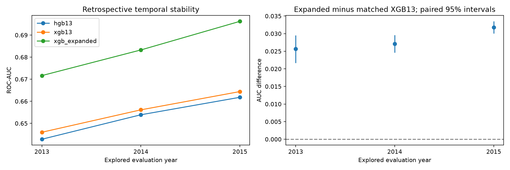

The matched XGB13 control separates added-field gains from a change of algorithm
or tree budget. Compare all windows, average precision, Brier and mean score
against observed prevalence; ranking lift alone does not establish calibration.
No new winner or threshold is chosen from these results.

## Conditional uncertainty

| evaluation_year | auc_difference_expanded_minus_base13 | lower_95 | upper_95 | scope |
| --- | --- | --- | --- | --- |
| 2013 | 0.025671 | 0.021677 | 0.029533 | paired fixed-model cohort bootstrap; excludes fitting/selection uncertainty |
| 2014 | 0.027134 | 0.024617 | 0.029598 | paired fixed-model cohort bootstrap; excludes fitting/selection uncertainty |
| 2015 | 0.031819 | 0.030031 | 0.033495 | paired fixed-model cohort bootstrap; excludes fitting/selection uncertainty |

Intervals use 200 paired, class-stratified resamples of each evaluation cohort,
seed 42. They condition on fitted models and omit training/configuration/feature
selection uncertainty, macroeconomic variation and possible borrower dependence.
Windows share observations and are not independent replications; no pooled
significance claim is made. Even consistently positive intervals would not
resolve the timing gate.

## Artifacts and next evidence

Local suite: **113 tests**, 0 failures, 0 errors and 0 skips. [JUnit](https://github.com/Codezy93/Credit-Risk-and-Failure-Modeling-Platform/blob/main/assets/results/bureau_temporal/53a79329f2584a9db272ac2c42abf4e2/test_results.xml).

Nine saved pipelines, role-specific datasets and nine native MLflow evaluation
runs are recorded in `lendingclub_bureau_temporal_review`. Native full-cohort AUCs
were checked against custom metrics; saved pipelines reproduce full-cohort scores.
The manifest pins source, input, result, dataset and model hashes.

[Manifest](https://github.com/Codezy93/Credit-Risk-and-Failure-Modeling-Platform/blob/main/assets/results/bureau_temporal/53a79329f2584a9db272ac2c42abf4e2/manifest.json),
[metrics](https://github.com/Codezy93/Credit-Risk-and-Failure-Modeling-Platform/blob/main/assets/results/bureau_temporal/53a79329f2584a9db272ac2c42abf4e2/temporal_metrics.csv), and
[native evaluations](https://github.com/Codezy93/Credit-Risk-and-Failure-Modeling-Platform/blob/main/assets/results/bureau_temporal/53a79329f2584a9db272ac2c42abf4e2/native_evaluations.csv).
Run `make bureau-review` with the existing raw and clean data to repeat.

The remaining gate is an exact as-of data contract plus genuinely unused,
sufficiently mature evaluation data and label-availability evidence. Additional
retrospective windows support a stability discussion, not deployment approval.
The [lifetime charge-off target](../docs/risk_terminology.md) and the independent
[loss-proxy limitations](../docs/loss_model_limitations.md) remain unchanged.

<!-- end-bureau-temporal-statistics -->

<!-- loss-limitations-statistics -->
## Loss-model limitations

Source batch: `bc7fbb6777cd4365b1a93a4d97fd872f`. This is a reporting update based on
saved metrics and model constants; no models were fitted and no metric CSVs changed.

## What the selected components actually are

The selected LGD component is **a constant training-cohort loan-average snapshot
LGD of 0.893671383 (89.37%)**. It is a `DummyRegressor(strategy="mean")`,
not a borrower-specific severity model. The average is unweighted across the
19,757 eligible charged-off training loans, not exposure-weighted. Every loan
receives this same predicted LGD.

The validation cohort's observed mean LGD is **0.888369323 (88.84%)**. That is a
different statistic: it is not the constant fitted on the training cohort.

The mean EAD-ratio baseline similarly predicts the training mean,
**0.581647648 (58.16%)**, rather than the observed validation mean
**0.570638717 (57.06%)**. The selected EAD component is the boosting regressor,
not this constant baseline. Its validation average prediction is 0.582186573.
All of these quantities are snapshot proxies, not event-time regulatory parameters.

## Validation against the mean baselines

Both components are evaluated on the same **22,308 eligible charged-off 2014 loans**.
Selection used bounded MAE on this already-explored cohort. MAE is measured in
fractions of the target, not dollars: 0.20 is about 20 percentage points.
Positive improvement means lower MAE than the corresponding training-mean baseline.

| Component | Predictor | Selected | Validation MAE | Validation R² | MAE improvement over training-mean baseline |
| --- | --- | --- | --- | --- | --- |
| Snapshot EAD ratio | ead_mean | no | 0.203347 | -0.002078 | 0.000% |
| Snapshot EAD ratio | ead_boosting | yes | 0.202030 | 0.004710 | 0.648% |
| Snapshot LGD | lgd_mean | yes | 0.075857 | -0.001920 | 0.000% |
| Snapshot LGD | lgd_boosting | no | 0.076627 | -0.001047 | -1.014% |

EAD boosting reduces MAE by only about **0.65%** and explains approximately
**0.47% of validation target variance** (R² = 0.004710). Its training R² is
0.081607, so most of the apparent training fit does not carry into validation.
This is little demonstrated loan-level exposure information.

LGD boosting has **worse MAE** than the mean baseline, so the constant is selected.
Its R² is slightly less negative than the constant's, but both are below zero.
R² uses the validation cohort's own observed mean as its reference; a constant
learned from training can therefore have negative validation R². These diagnostics
do not establish useful borrower-level severity discrimination. No confidence
interval or independent selection cohort establishes that the small EAD gain is robust.

## Consequences for expected loss

The lifetime snapshot-loss proxy multiplies the lifetime charge-off score,
predicted snapshot EAD and predicted snapshot LGD. A constant LGD means it has
**no borrower-specific severity differentiation**; variation comes from the
classifier, weak EAD predictions and funded-amount exposure scaling.

On the **162,563 eligible validation loans**, selected components estimate
**$132,522,640.71** against observed snapshot loss of
**$136,945,537.92**: aggregate relative error
**-3.23%**. The mean/mean baseline has a smaller aggregate
error (**-2.44%**), despite slightly worse loan-level
dollar MAE ($1,397.95 versus $1,389.34).
Component MAE selection does not guarantee portfolio-total calibration.
Aggregate error can conceal offsetting loan-level errors; it is not evidence of
accurate individual loss forecasts.

Classifier calibration error, weak EAD prediction and constant LGD all constrain
the composition. Multiplying conditional means also ignores residual EAD/LGD
dependence. Selection and evaluation share 2014, and recovery maturity, discounting,
indirect costs and default-event exposure are unavailable. There is no validated
one-year expected-loss or regulatory-capital estimate here. Capital panels remain
assumed-one-year-PD sensitivities using these uncertain loss-proxy inputs.

The supported description is **a lifetime snapshot-loss illustration with a
training-average LGD baseline and a weak EAD-ratio regressor**. See
[risk terminology](../docs/risk_terminology.md) and the [full loss report](../docs/basel_loss_experiment.md).

<!-- end-loss-limitations-statistics -->

<!-- current-experiment-refresh-statistics -->
## Latest current-code experiment refresh

Completed: 2026-11-11T21:12:03.598701+00:00. Refresh `20261111T130647666235Z`.
**110 tests passed, zero failures/errors/skips**, including Spark. GitHub Actions
now has a full-suite workflow with Python 3.14, Java 21, the streaming hash lock
and JUnit uploads. GitHub execution awaits a push; this is local execution evidence.

| Cohort | ROC-AUC | Gini | Exact KS | Brier |
| --- | --- | --- | --- | --- |
| Validation 2014 | 0.653889 | 0.307779 | 0.222796 | 0.114375 |
| Exploratory 2015 | 0.654350 | 0.308701 | 0.223789 | 0.122279 |

All 57 comparable baseline metric values reproduced (rtol `1e-9`, atol `1e-12`).
The fresh baseline tables now record Gini and full-threshold KS. The selected-model
bytes are unchanged. Seven modeling stages were re-executed from current code;
all new result CSV fingerprints and executed script hashes were checked.

| Stage | Previous batch | Fresh batch | Verified result CSVs |
| --- | --- | --- | --- |
| 05_train_models | `72061e0a7a1e4d68addcc79a2aae631d` | `6ccea4b79b8343cd971273181d93f680` | 6 |
| 07_improve_auc | `2d9a9d65b9004aa1ade7337465576f17` | `921ccc76e18340b89e608c1fcced9526` | 7 |
| 08_validate_models | `62955be6d71845418f95174c621c98d2` | `e7ebdf9092274ee3b039af91de5b5acb` | 8 |
| 09_basel_loss_experiment | `c072de3541e2496ab90ed6b7c2699137` | `bc7fbb6777cd4365b1a93a4d97fd872f` | 8 |
| 11_ann_experiments | `c85319471ca849758abb207d833f973b` | `fd10b18ae1ca40f18ddcdec526bfcc6b` | 8 |
| 13_review_validation | `da3c8ad1bee14f60ac5156def8b04b14` | `ada1537bb4c646d9baadfa73f78e09c0` | 12 |
| 14_interpret_bias | `86fe262241464da48d8c126660801e05` | `25ccff7634a34d3c893b37ea8ce0499d` | 14 |

**159 historical files** and **133 existing MLflow runs**
were preserved unchanged. Prepared inputs and execution sources remained fixed.
Historical records below retain their dates, scope and original code fingerprints.
The earlier terminology-only update is a separate historical step; this section
records the subsequent actual experiment reruns. 2015 remains exploratory.
Kafka/ELK load and recovery benchmarks were not rerun in this modeling refresh.

[Refresh verification](refresh/20261111T130647666235Z/verification.json),
[JUnit](refresh/20261111T130647666235Z/pytest.xml),
[metric comparison](refresh/20261111T130647666235Z/metric_comparison.json),
[report](../docs/experiment_refresh.md).

<!-- end-current-experiment-refresh-statistics -->

<!-- risk-terminology-statistics -->
## Risk terminology clarification

The classifier is now described as **lifetime charge-off probability (resolved
36-month cohort)**: Charged Off = 1, Fully Paid = 0, other statuses excluded.
It is not a 12-month forecast or a Basel default probability. The EAD/LGD
components are retrospective snapshot proxies; their composition with the
classifier score is a **lifetime snapshot-loss proxy**, not regulatory one-year EL.
Capital/RWA remain **illustrative assumed-one-year-PD sensitivities**. The model
score is neither annualised nor passed into the capital function.

This terminology update annotated **128 existing MLflow runs across
10 experiments** with descriptions and `risk_scope.*` tags. It confirmed
unchanged metrics, parameters, run status/times and **225 saved evidence files**
(result CSVs, latest stage manifests and model binaries). No models were fitted
and no evaluation CSVs were regenerated. The selected validation ROC-AUC remains
**0.653889** and exploratory 2015 ROC-AUC remains **0.654350**.

All four notebook sources include the scope clarification. The model-review HTML
was re-exported from saved results; three archived EDA HTML snapshots carry a
terminology notice without recomputing their tables or figures. Legacy `pd`,
`basel` and `expected_loss` identifiers and historical manifests/artifacts retain
their execution-time names for compatibility and provenance. Historical wording
elsewhere in this reference should be interpreted using these definitions.

Checks: **29 existing loss/model/ANN/metric tests passed**; the capital/loss
function ASTs are unchanged apart from docstrings. Metric regeneration and new
validation experiments remain a separate step.

[Definitions](../docs/risk_terminology.md) and
[metadata verification](results/risk_terminology_verification.json).

<!-- end-risk-terminology-statistics -->

<!-- pages-statistics -->
## MkDocs documentation verification

The website now uses **MkDocs 1.6.1** with the unmodified built-in **mkdocs**
theme. The previous custom HTML/CSS/JavaScript site, builder/checker and preview
images were removed. There are no custom stylesheets, scripts or templates.

The documentation contains **24 Markdown pages** and retains **4 notebook HTML
exports**. The generated artifact contains **57 files**, totaling **12361126 bytes**.
Figures retain their original colors and load from repository raw image URLs;
links to full result files open the committed evidence on GitHub. Raw datasets,
model binaries and local service databases are outside the documentation build.

`python -m mkdocs build --strict` passed without warnings. All repository-linked
evidence paths were checked against local files. The preceding layout build passed Chromium checks at
**1440 pixels** and **390 pixels**, including page navigation, search for
`deduplication`, two loaded loss-model figures, no homepage horizontal overflow
and no browser errors. Earlier custom-site accessibility results do not apply to
this replacement. Browser layout checks were not repeated for the terminology and experiment-result updates;
the current strict build passed. The subsequent seven-stage experiment rerun is
recorded in the latest refresh section above.

The GitHub Actions workflow installs the documentation dependency, builds MkDocs
and deploys `_site/` on main pushes. Pull requests build without deploying.
The site remains at
`https://codezy93.github.io/Credit-Risk-and-Failure-Modeling-Platform/`.

[Verification](results/site_verification.json) and
[publishing instructions](../docs/github_pages.md).

<!-- end-pages-statistics -->

<!-- recovery-statistics -->
## Latest recovery, deduplication and ELK statistics

Batch `recovery-20261110T145026-33d347` completed 2026-11-10T14:51:43.960186+00:00. Status: **passed**.
Regression transcript: `110 passed in 17.24s`.

| Measurement | Value |
| --- | --- |
| Main replay events | 6,000 |
| Unique stored results including 100 warmup events | 6,100 |
| Main event rate / second | 200 |
| Missing main scores | 0 |
| Restart to first outage-event result (seconds) | 22.311 |
| Crash to first outage-event result (seconds) | 27.429 |
| Peak sampled checkpoint lag | 5,685 |
| Final checkpoint lag | 0 |
| Suppressed duplicate deliveries | 110 |
| Deliberately injected duplicate deliveries | 110 |
| Conflicts flagged, first score preserved | 1 |
| Maximum probability difference | 0 |
| End-to-end p95, including outage (ms) | 27,040 |
| Sink restart to outbox drained (seconds) | 0.426964 |
| Sink restart to committed Kafka offsets caught up (seconds) | 9.871471 |
| Monitoring documents indexed | 6,295 |

## Failure experiment

A warmed Spark query processes historical validation events while a producer
continues at 200 events/second. The test waits for a source offset
file without its matching batch commit, then sends SIGKILL to that test's own
Spark process group. After 5 seconds,
Spark restarts from the same checkpoint. The producer was still active throughout
the injected downtime. The checkpoint query ID is preserved; no new checkpoint
or offset reset is used. Every main event's final probability and risk flag is
compared with direct predictions from the unchanged model.

First-result recovery measures the earliest stored result for an event emitted
during the outage, so already-buffered pre-crash results do not count. The
restart measurement includes JVM/connector startup. End-to-end latency uses the
first durable score's reception time and includes the outage. Peak checkpoint
lag is sampled, includes in-flight records and is not a latency SLA.

The test then injects 50 repeated application events, 50 repeated Kafka scores,
and one deliberately conflicting model fingerprint for an existing event ID.
Finally, it stops the store, injects 10 more duplicate scores, and crashes a new
store process with exit 73 immediately after its SQLite commit but before Kafka
offset commit. Restarting the same group/database retries those offsets and
drains the durable log outbox without adding score or delivery-ledger rows twice.
The test then waits for the restarted consumer's committed offsets to reach all
output partition ends. Outbox drainage alone is not treated as consumer recovery.

These are 110 deliberately repeated deliveries, separate from any natural Spark
retry duplicates observed before injection. The intentional conflict is retained
as evidence and triggers monitoring; it does not replace the original score.
This single local experiment does not establish broker failover, disk-loss
recovery, multi-host clock accuracy or distributed database availability.

## Durable deduplication

`scripts/20_store_scores.py` stores scores in SQLite with `event_id` as primary
key and a separate delivery ledger keyed by Kafka topic/partition/offset.
Logical equality includes run ID, original emission time, model fingerprint,
status, probability, flag, validation reason and threshold. Source output offsets
and scoring timestamps may change on retry. An ID reused for a different logical
result is a conflict: the first result stays intact and the conflict is recorded.
Use a new event ID for a changed application/model-scoring request.

The database uses WAL and FULL synchronization. Scores, delivery records and the
monitoring outbox commit in one transaction before Kafka offsets advance. Logs
are flushed from the outbox before it is marked exported. A repeated log export
keeps the same document ID, so Elasticsearch replaces that monitoring document.
SQLite is the authoritative score store. Kafka transport remains at least once;
this is persistent local idempotent storage, not an end-to-end exactly-once claim.
The ledger grows with deliveries and has no automatic retention policy.

## ELK

JSON-lines logs under ignored `models/streaming/logs/` feed Logstash's persistent
file reader and persistent queue. Elasticsearch stores `credit-risk-monitoring-*` with explicit field
types and stable `log_id` document IDs. Kibana has eight panels: stored results,
suppressed duplicates, conflicts, p95 score latency, stored results/minute,
checkpoint lag, average risk score and errors/invalid outputs. Counts of inserted
results exclude suppressed duplicates. Logs omit application features and loan IDs.

Dashboard: **http://127.0.0.1:15601/app/dashboards#/view/credit-risk-streaming**.
The default view includes all retained test batches. To isolate this batch, use:

```text
pipeline_id:"recovery-20261110T145026-33d347" or run_id:"recovery-20261110T145026-33d347-main" or run_id:"recovery-20261110T145026-33d347-warmup" or group_id:"recovery-20261110T145026-33d347-store"
```

The stored-result count includes 100 warmup events in addition to the main replay.
Elasticsearch: **http://127.0.0.1:19200**. These local services bind to loopback;
Elasticsearch security is disabled for this local demo. The monitoring services
use pinned Elastic 8.17.3 images, persistent data volumes and reduced heaps for
this machine. Kafka uses persistent ignored `models/streaming/kafka-data/`.
Existing broker data was preserved when adding that mount.

`make monitor-check` runs on-demand checks for conflicts/monitor errors, invalid
outputs, p95 above 10 seconds and latest checkpoint lag above 10,000. Add
`--expect-running` to the script to check for progress older than 30 seconds.
It emits JSON locally; no scheduled alerting, external messages or notifications
are configured. The deliberately injected conflict can produce a warning.
Score distributions are visible; this is not a statistical drift detector.

## Run

```bash
make streaming-setup
make kafka-up
make elk-up

# Separate terminals for normal operation; replay creates the topics.
make replay ARGS="--rows 10000 --rate 200 --run-id demo-unique-id"
make stream
make store-scores

# Automated isolated failure/retry experiment, including ELK verification.
make recovery-test
make monitor-check

# Stop services when finished; data, topics and checkpoints are retained.
make elk-down
make kafka-down
```

Spark Makefile targets select Java 21 at `/usr/lib/jvm/java-21-openjdk-amd64`.
Override `STREAM_JAVA_HOME=/your/java-21` on other machines. The optional runtime
and matching Kafka connector now use Spark 4.1.4. Fault injection reproduced
[SPARK-55271](https://issues.apache.org/jira/browse/SPARK-55271) on 4.1.2;
the patched release was installed before this successful test. Historical smoke
and load measurements retain their 4.1.2 fingerprints and are not restated as
4.1.4 measurements. Core modelling dependencies and the model are unchanged.

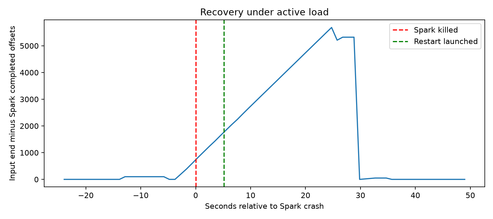

MLflow experiment: `lendingclub_streaming_recovery`; run `15ab49ecbc804015bc132ec18990485a`.
The replay dataset, metrics, logs and source snapshots are attached.
[Manifest](results/recovery_latest.json),
[verification](results/recovery_verification.json), and
[delivery ledger](results/recovery/recovery-20261110T145026-33d347/deliveries.csv.gz).

<details><summary>All recovery statistics and source fingerprints</summary>

```json
{
  "batch_id": "recovery-20261110T145026-33d347",
  "rows": 6000,
  "rate": 200,
  "configured_downtime_seconds": 5,
  "spark_killed_at_ms": 1794322250348,
  "main_results_before_crash": 272,
  "crashed_with_uncommitted_batch": true,
  "spark_exit_code": -9,
  "producer_active_after_downtime": true,
  "spark_restart_launched_at_ms": 1794322255466,
  "natural_duplicate_deliveries_before_injection": 0,
  "restart_to_first_outage_event_result_seconds": 22.311,
  "crash_to_first_outage_event_result_seconds": 27.429,
  "maximum_probability_error": 0.0,
  "checkpoint_query_id_preserved": true,
  "sink_crashed_after_sqlite_commit_before_kafka_commit": true,
  "sink_restart_to_outbox_drained_seconds": 0.42696363699906215,
  "sink_restart_to_kafka_offsets_caught_up_seconds": 9.871471237998776,
  "stored_main_unique_rows": 6000,
  "stored_total_unique_rows_including_warmup": 6100,
  "stored_delivery_rows": 6211,
  "suppressed_duplicate_deliveries": 110,
  "deliberately_injected_duplicate_deliveries": 110,
  "conflicts_flagged_without_overwrite": 1,
  "sqlite_outbox_pending_after_restart": 0,
  "sink_retry_did_not_duplicate_delivery_ledger": true,
  "missing_main_scores": 0,
  "end_checkpoint_lag": 0,
  "peak_checkpoint_lag": 5685,
  "end_to_end_p50_ms": 15478.5,
  "end_to_end_p95_ms": 27040.0,
  "end_to_end_p99_ms": 28090.390000000007,
  "drain_after_last_producer_ack_seconds": 3.138,
  "elk_verified": true,
  "expected_unique_monitoring_logs": 6295,
  "indexed_monitoring_logs": 6295,
  "status": "passed",
  "completed_at_utc": "2026-11-10T14:51:43.960186+00:00",
  "result_directory": "assets/results/recovery/recovery-20261110T145026-33d347",
  "database": "models/streaming/recovery/recovery-20261110T145026-33d347/scores.sqlite",
  "model_sha256": "beb4491348dfa7022290768ef79c8150fd7d14a722ef5b3ac78902fa9f0cc078",
  "validation_parquet_sha256": "c645fc9a7eebc4d8755155be63c8ffd44a1cd3b606f127ccb294d4b998a24fbc",
  "versions": {
    "pyspark": "4.1.4",
    "confluent-kafka": "2.16.1",
    "scikit-learn": "1.9.1",
    "numpy": "2.5.4",
    "pandas": "3.1.0"
  },
  "source_sha256": {
    "scripts/15_replay_loans.py": "cbd2cc8cec35cc4a777f186f7b7f95e12f144acf115a2d86fe27271079525d04",
    "scripts/16_stream_score.py": "e36879233f995196c39199c7628fb5e29bcff40b4e2f75778530ceefc1f15e5e",
    "scripts/20_store_scores.py": "2d57d4a39345e945acfc86c12c90628cef4643e21e01ff77d45fad1a90b8ace0",
    "scripts/21_test_recovery.py": "625b54084e9c1f466915390424b1c2aa93a8428d5513665452ae45ce517291db",
    "scripts/22_setup_elk.py": "75af106c023aafcf30e135bb53e0380ffd420dd0d3237c6e11334a9d5aeeafbc",
    "util/score_store.py": "9a1092113b7058156b54e529986b007d141a7726e0198213f51bc69a7e70a7f5",
    "util/logging.py": "44153f54a69ecb62d6c9ba710a7c11807300afa7da30ad4a6d8cf5a782c84eec",
    "util/streaming.py": "940aec522ed8f5aa729f8e97f37cc82bd5eabf2176eebc13a003ea10ddffa495",
    "util/elk/logstash.conf": "ed38c5b7ded505dd5a7430c34522dda7241e80644dd7d477b44a8f70446e1350",
    "util/elk/dashboard.ndjson": "bae90061a5c50bb0273082594e53e8c9f07283852cad6f1926fdc6bb21604621",
    "docker-compose.yml": "59e2beb699f9443d8a098cb34bcb7989b9a25d6a7944961b7f574b1eb43b87c5",
    "requirements-streaming.lock": "5e7a469b549961385edfa5ff935add14886adbd1e361becda3549a482f5e12a6"
  },
  "mlflow_run_id": "15ab49ecbc804015bc132ec18990485a"
}
```

</details>

Configuration follows the official [Logstash file input](https://www.elastic.co/guide/en/logstash/8.17/plugins-inputs-file.html)
and [Elasticsearch output](https://www.elastic.co/guide/en/logstash/8.17/plugins-outputs-elasticsearch.html) documentation.

<!-- end-recovery-statistics -->

<!-- load-test-statistics -->
## Latest Kafka–PySpark load-test statistics

Batch `load-20261110T140041-076d41`, completed 2026-11-10T14:02:57.964473+00:00.
Status: **complete**. The frozen model and threshold were unchanged.
Regression test transcript: `No test transcript attached to this batch.`.

| target_rows_per_second | expected_rows | actual_emission_rows_per_second | completed_rows_per_second | end_to_end_p50_ms | end_to_end_p95_ms | end_to_end_p99_ms | peak_sampled_checkpoint_lag | drain_after_last_ack_seconds | missing_rows | duplicate_records |
| --- | --- | --- | --- | --- | --- | --- | --- | --- | --- | --- |
| 100 | 3000 | 100 | 89.922667 | 1,482.5 | 2,452 | 2,946.16 | 388 | 3.368 | 0 | 0 |
| 500 | 15000 | 500 | 476.493011 | 1,512.5 | 2,491 | 2,979 | 2064 | 1.481 | 0 | 0 |
| 2000 | 60000 | 2,000.033334 | 1,895.135818 | 1,693 | 2,650 | 2,993 | 8519 | 1.66 | 0 | 0 |

<details><summary>Complete per-stage metrics</summary>

```json
[
  {
    "expected_rows": 3000,
    "delivered_rows": 3000,
    "received_records": 3000,
    "unique_outputs": 3000,
    "scored_rows": 3000,
    "invalid_rows": 0,
    "missing_rows": 0,
    "duplicate_records": 0,
    "delivery_errors": 0,
    "emission_seconds": 29.99,
    "emit_to_last_receive_seconds": 33.362,
    "actual_emission_rows_per_second": 100.0,
    "completed_rows_per_second": 89.92266650680415,
    "drain_after_last_ack_seconds": 3.368,
    "pending_at_last_emission": 95,
    "peak_sampled_checkpoint_lag": 388,
    "end_to_end_negative_latency_count": 0,
    "end_to_end_p50_ms": 1482.5,
    "end_to_end_p95_ms": 2452.0,
    "end_to_end_p99_ms": 2946.159999999996,
    "emit_to_worker_score_negative_latency_count": 0,
    "emit_to_worker_score_p50_ms": 1308.5,
    "emit_to_worker_score_p95_ms": 2244.0499999999997,
    "emit_to_worker_score_p99_ms": 2479.0599999999986,
    "counts_reconciled": true,
    "stage": "stage-1-100rps",
    "run_id": "load-20261110T140041-076d41-stage-1-100rps",
    "target_rows_per_second": 100,
    "configured_duration_seconds": 30,
    "end_checkpoint_lag": 0,
    "maximum_probability_error": 0.0,
    "probabilities_match": true,
    "risk_flags_match": true,
    "model_hashes_match": true,
    "expected_output_topics": true
  },
  {
    "expected_rows": 15000,
    "delivered_rows": 15000,
    "received_records": 15000,
    "unique_outputs": 15000,
    "scored_rows": 15000,
    "invalid_rows": 0,
    "missing_rows": 0,
    "duplicate_records": 0,
    "delivery_errors": 0,
    "emission_seconds": 29.998,
    "emit_to_last_receive_seconds": 31.48,
    "actual_emission_rows_per_second": 500.0,
    "completed_rows_per_second": 476.4930114358323,
    "drain_after_last_ack_seconds": 1.481,
    "pending_at_last_emission": 992,
    "peak_sampled_checkpoint_lag": 2064,
    "end_to_end_negative_latency_count": 0,
    "end_to_end_p50_ms": 1512.5,
    "end_to_end_p95_ms": 2491.0,
    "end_to_end_p99_ms": 2979.0,
    "emit_to_worker_score_negative_latency_count": 0,
    "emit_to_worker_score_p50_ms": 1305.0,
    "emit_to_worker_score_p95_ms": 2213.0,
    "emit_to_worker_score_p99_ms": 2556.0200000000004,
    "counts_reconciled": true,
    "stage": "stage-2-500rps",
    "run_id": "load-20261110T140041-076d41-stage-2-500rps",
    "target_rows_per_second": 500,
    "configured_duration_seconds": 30,
    "end_checkpoint_lag": 0,
    "maximum_probability_error": 0.0,
    "probabilities_match": true,
    "risk_flags_match": true,
    "model_hashes_match": true,
    "expected_output_topics": true
  },
  {
    "expected_rows": 60000,
    "delivered_rows": 60000,
    "received_records": 60000,
    "unique_outputs": 60000,
    "scored_rows": 60000,
    "invalid_rows": 0,
    "missing_rows": 0,
    "duplicate_records": 0,
    "delivery_errors": 0,
    "emission_seconds": 29.999,
    "emit_to_last_receive_seconds": 31.66,
    "actual_emission_rows_per_second": 2000.0333344444816,
    "completed_rows_per_second": 1895.1358180669615,
    "drain_after_last_ack_seconds": 1.66,
    "pending_at_last_emission": 3739,
    "peak_sampled_checkpoint_lag": 8519,
    "end_to_end_negative_latency_count": 0,
    "end_to_end_p50_ms": 1693.0,
    "end_to_end_p95_ms": 2650.0,
    "end_to_end_p99_ms": 2993.0,
    "emit_to_worker_score_negative_latency_count": 0,
    "emit_to_worker_score_p50_ms": 1365.0,
    "emit_to_worker_score_p95_ms": 2316.0,
    "emit_to_worker_score_p99_ms": 2565.0,
    "counts_reconciled": true,
    "stage": "stage-3-2000rps",
    "run_id": "load-20261110T140041-076d41-stage-3-2000rps",
    "target_rows_per_second": 2000,
    "configured_duration_seconds": 30,
    "end_checkpoint_lag": 0,
    "maximum_probability_error": 0.0,
    "probabilities_match": true,
    "risk_flags_match": true,
    "model_hashes_match": true,
    "expected_output_topics": true
  }
]
```

</details>

## What was measured

One continuous Spark query was warmed with 100 records, then given one
30-second paced stage per target rate. Each
stage drained before the next began. Topics and checkpoint were unique to the
test. Each stage reuses the first N historical validation applications; they are
distinct events within a stage, not new borrowers across stages. No invalid
fixtures were injected during the load test. Raw output and producer logs are
retained separately for warmup and every stage.

Actual emission rate is (N−1)/(last emission−first emission). Completed rows/s is
unique valid scores/(last collector receipt−first emission), including drain.
Latency percentiles use the first output per event and measure producer emission
to collector receipt from the output Kafka topic. They include micro-batch
scheduling, scoring, Kafka transport and collector polling/buffering; they are
not pure model inference times. Emit-to-worker-score percentiles are also saved.
Clocks share this local host; negative latency counts are recorded explicitly.

Lag is sampled about once per second: Kafka input log-end offsets minus the end
offsets in completed Spark progress. It includes the in-flight micro-batch and is
not Kafka consumer-group committed lag. Peak values can miss subsecond peaks.
`pending_at_last_emission` in the full metrics counts expected events without a
collected output at the final producer timestamp. Drain time ends at the last
unique receipt and starts at the last producer acknowledgement.

Every received valid probability and risk flag was compared with direct model
scoring. Stage metrics also count missing outputs, unexpected invalid outputs,
duplicates and delivery errors. Raw output IDs, model SHA and source offsets are
retained. A two-second quiet collection period follows each drain; duplicates
arriving later would require longer observation. Kafka delivery remains at least
once; no failure-injection or exactly-once claim is made.

## Machine and configuration

CPU: Intel(R) Core(TM) i7-10750H CPU @ 2.60GHz; 12 logical host CPUs.
Host memory: 14.88 GiB.
Docker VM: 12 CPUs,
3.54 GiB RAM.
Spark: local[2], 2-second trigger, 10,000 maximum offsets/trigger, 1,000-row Arrow
batches, three partitions per topic and one model thread per worker. Python
3.14.9; PySpark 4.1.2. Exact Java,
dependency versions, source hashes and input fingerprint are in the manifest.
The collector, producer and Spark share the host; the Kafka broker runs in Docker.

<details><summary>Complete environment, source fingerprints and manifest</summary>

```json
{
  "batch_id": "load-20261110T140041-076d41",
  "completed_at_utc": "2026-11-10T14:02:57.964473+00:00",
  "status": "complete",
  "rates": [
    100,
    500,
    2000
  ],
  "duration_seconds_per_stage": 30,
  "warmup_rows": 100,
  "topics": [
    "load-20261110T140041-076d41-input",
    "load-20261110T140041-076d41-scores",
    "load-20261110T140041-076d41-invalid"
  ],
  "result_directory": "assets/results/load_test/load-20261110T140041-076d41",
  "model_sha256": "beb4491348dfa7022290768ef79c8150fd7d14a722ef5b3ac78902fa9f0cc078",
  "python": "3.14.9",
  "platform": "Linux-7.0.0-38-generic-x86_64-with-glibc2.43",
  "logical_cpus": 12,
  "docker_resources": {
    "cpus": 12,
    "memory_bytes": 3804389376
  },
  "java": "openjdk version \"21.0.13.0.3\" 2026-10-24\nOpenJDK Runtime Environment (build 21.0.13.0.3+1-1-26.04.1-Ubuntu)\nOpenJDK 64-Bit Server VM (build 21.0.13.0.3+1-1-26.04.1-Ubuntu, mixed mode, sharing)\n",
  "host_memory_kib": 15607160,
  "cpu_model": "Intel(R) Core(TM) i7-10750H CPU @ 2.60GHz",
  "versions": {
    "pyspark": "4.1.2",
    "confluent-kafka": "2.16.1",
    "pandas": "3.1.0",
    "numpy": "2.5.4",
    "scikit-learn": "1.9.1"
  },
  "spark": {
    "master": "local[2]",
    "trigger_seconds": 2,
    "max_offsets_per_trigger": 10000,
    "arrow_batch_rows": 1000,
    "topic_partitions": 3,
    "model_threads_per_worker": 1
  },
  "source_sha256": {
    "scripts/15_replay_loans.py": "cbd2cc8cec35cc4a777f186f7b7f95e12f144acf115a2d86fe27271079525d04",
    "scripts/16_stream_score.py": "f1cc7f2c688b226c26c4f8add560b65feafd64effbf30222f21c9dacc28a0228",
    "scripts/18_run_load_test.py": "84f1f6982723d8bf2cbb2676cb74c3776e8bf4bb9ad21d1d970763fff1a9af6c",
    "util/streaming.py": "940aec522ed8f5aa729f8e97f37cc82bd5eabf2176eebc13a003ea10ddffa495",
    "util/load_test.py": "645b9dd8ddeef4770165870bef11fe48744543b930e3823ef083985509342f74",
    "docker-compose.yml": "d027bc64bf341f81b154adc1d6c498f34f3f1d49a8de0f46b85d63edabd8be00",
    "requirements-streaming.lock": "bcf3ef9777a243de87655cec81d03ac83847746e4af8be410779407c7eb70c19"
  },
  "validation_parquet_sha256": "c645fc9a7eebc4d8755155be63c8ffd44a1cd3b606f127ccb294d4b998a24fbc",
  "failure_injection_tested": false,
  "elk_monitoring_implemented": false,
  "latency_boundary": "producer emission to collector receipt of Kafka output; same-host wall clocks",
  "lag_definition": "sampled Kafka input end offsets minus Spark completed progress end offsets; includes in-flight batch",
  "limits": "One warmed run per rate, 30-second defaults, shared local machine, repeated validation cohort across stages; not a production capacity guarantee.",
  "mlflow_run_id": "eeef60a516fe4ab8a503eff7bbbcc256"
}
```

</details>

These are short local runs with one measurement per rate. They do not establish
long-duration stability, a production capacity limit or a latency SLA. JVM startup
was warmed, but stage-specific batch/model-loading costs remain part of the run.
Broker failure, worker failure, restart under active load and downstream
deduplication remain untested in this benchmark. ELK monitoring is still pending.

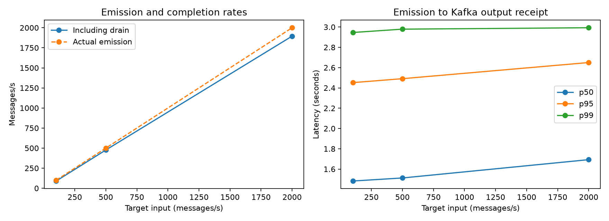

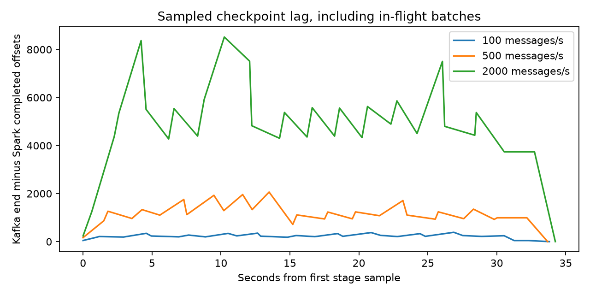

## Reproduce

With Java 17/21 and the optional streaming environment installed:

```bash
make kafka-up
make load-test
# Change the stage rates/duration; each stage must fit within 162,570 rows.
make load-test ARGS="--rates 100 500 2000 --duration 30 --drain-timeout 120"
```

Results are saved by batch ID. MLflow experiment:
`lendingclub_streaming_load_tests`; parent `eeef60a516fe4ab8a503eff7bbbcc256`, with one
child per measured stage. The query is stopped after drain. Kafka stays available
until `make kafka-down`. No source messages, topics or checkpoints are deleted.

[Full metrics](results/load_test/load-20261110T140041-076d41/stage_metrics.csv),
[manifest](results/load_test/load-20261110T140041-076d41/manifest.json), and
[verification](results/load_test_verification.json).
See the [Spark Kafka guide](https://spark.apache.org/docs/4.1.2/streaming/structured-streaming-kafka-integration.html)
for source/sink and offset semantics.

<!-- end-load-test-statistics -->

## Latest streaming verification: Kafka and PySpark

Completed **2026-11-10T00:56:18.394502+00:00**. This adds application replay, Spark JSON
validation, distributed scoring, score/invalid output topics and checkpoint
resume. The original model, feature list and threshold are unchanged.

| Check | Measured result |
| --- | --- |
| Real validation applications replayed | 100 |
| Deliberately invalid fixtures | 3 |
| Verified valid scores | 100 |
| Maximum absolute probability difference from direct scoring | 0.0 |
| Threshold flags matching direct scoring | 100/100 |
| Invalid records routed to loan-invalid | 3/3 |
| Duplicate output records in this replay | 0 |
| Source records after clean checkpoint restart | 0 |
| Output offsets changed after restart | 0 partitions |
| Streaming-environment tests passed | 102 |
| Spark micro-batch input records | 103 |
| Spark trigger execution time for this small batch | 6474 ms |
| Spark reported processed rows/second for this batch | 15.9 |

The last two values describe one startup-affected correctness batch, not sustained
throughput or end-to-end latency. No stress benchmark, failure injection or ELK
monitoring result is claimed. Output has at-least-once semantics; the absence of
duplicates in this run does not establish exactly-once delivery.

Environment: Python 3.14.9, Temurin Java 21.0.13+9, PySpark 4.1.2, Kafka 4.1.2.
Frozen risk threshold: 0.147852896338396. Replay source: first 100 rows of the
2014 prepared validation cohort; the messages omit outcomes and loan IDs.

MLflow experiment: `lendingclub_streaming_smoke`; run `fe86cfd3742d47ec8ad81f248e623566`.

[Complete manifest](results/streaming_latest.json),
[score parity verification](results/streaming/spark-verified-20261110/verification.json),
[restart verification](results/streaming/spark-verified-20261110/restart_verification.json),
[all output records](results/streaming/spark-verified-20261110/output_records.csv),
[original query progress](results/streaming/spark-verified-20261110/query_progress.json),
and [restart query progress](results/streaming/spark-verified-20261110/restart_progress.json).

<details><summary>Complete streaming manifest and source fingerprints</summary>

```json
{
  "status": "complete",
  "scope": "Kafka/PySpark correctness smoke test; not a stress benchmark",
  "completed_at_utc": "2026-11-10T00:56:18.394502+00:00",
  "replay_run_id": "spark-verified-20261110",
  "result_directory": "assets/results/streaming/spark-verified-20261110",
  "valid_rows": 100,
  "invalid_rows": 3,
  "maximum_probability_error": 0.0,
  "duplicate_output_records": 0,
  "restart_input_rows": 0,
  "restart_output_offsets_unchanged": true,
  "tests_passed": 102,
  "python": "3.14.9",
  "java": "Temurin 21.0.13+9",
  "kafka_image": "apache/kafka:4.1.2",
  "kafka_image_digest": "sha256:5cc2a2fd93fa2687b44015eee04fb2c3edd9e526bd64bf8bec5ff1e268772e0e",
  "spark_kafka_connector": "org.apache.spark:spark-sql-kafka-0-10_2.13:4.1.2",
  "versions": {
    "pyspark": "4.1.2",
    "confluent-kafka": "2.16.1",
    "pyarrow": "26.0.1",
    "pandas": "3.1.0",
    "numpy": "2.5.4",
    "scikit-learn": "1.9.1"
  },
  "source_sha256": {
    "scripts/15_replay_loans.py": "0fcee87408f778a5bec28e502b27c66fe887dea9ab4337ee282868823c682117",
    "scripts/16_stream_score.py": "ed1f39578e1251b6fd924195ef4f5a7317a9f04544ac1f68eb3c9b89d92e9416",
    "scripts/17_check_stream_scores.py": "43c15d77bd163fe7567f6b555ca3fa914f397de4517621d92c2a0bacf1bfb5cb",
    "util/streaming.py": "940aec522ed8f5aa729f8e97f37cc82bd5eabf2176eebc13a003ea10ddffa495",
    "docker-compose.yml": "d027bc64bf341f81b154adc1d6c498f34f3f1d49a8de0f46b85d63edabd8be00",
    "requirements-streaming.txt": "74e2ed1abc76800550bad829eb7af96de0d2df56af783d73599d78be456d35c8",
    "requirements-streaming.lock": "bcf3ef9777a243de87655cec81d03ac83847746e4af8be410779407c7eb70c19"
  },
  "incumbent_sha256": "beb4491348dfa7022290768ef79c8150fd7d14a722ef5b3ac78902fa9f0cc078",
  "replay_source_sha256": "c645fc9a7eebc4d8755155be63c8ffd44a1cd3b606f127ccb294d4b998a24fbc",
  "delivery_semantics": "at least once; stable event ID for downstream deduplication",
  "stress_testing_completed": false,
  "failure_injection_completed": false,
  "elk_monitoring_completed": false,
  "mlflow_experiment": "lendingclub_streaming_smoke",
  "mlflow_run_id": "fe86cfd3742d47ec8ad81f248e623566"
}
```

</details>

Snapshot assembled: **2026-11-08T14:17:16+00:00**. This is a static record of the completed data-analysis stage, assembled from existing result CSVs, local file metadata, and the clean Parquet schema. The download, cleaning, and EDA pipeline was **not rerun** to create this document.

Use this file for factual project answers. Counts are exact integers; displayed noninteger values are rounded to at most six decimal places. Linked CSVs retain the original exported precision. Future measurements are marked **Not measured** rather than assigned invented values or zeros. A static snapshot becomes stale when code, data, or results change; update this file after each completed project stage.

## Contents

1. [Quick answers](#1-quick-answers)
2. [Data provenance and scope](#2-data-provenance-and-scope)
3. [Rows, cleaning, schema, and missingness](#3-rows-cleaning-schema-and-missingness)
4. [Populations, outcomes, and time coverage](#4-populations-outcomes-and-time-coverage)
5. [Univariate statistics](#5-univariate-statistics)
6. [Bivariate statistics](#6-bivariate-statistics)
7. [Multivariate statistics](#7-multivariate-statistics)
8. [Figures, sampling, and display rules](#8-figures-sampling-and-display-rules)
9. [Model experiments and evaluation](#9-model-experiments-and-evaluation)
10. [Interpretability and bias evaluation](#10-interpretability-and-bias-evaluation)
11. [Kafka stress testing and ELK monitoring](#11-kafka-stress-testing-and-elk-monitoring)
12. [Artifacts, environment, and verification](#12-artifacts-environment-and-verification)
13. [Complete SQL histogram bins](#13-complete-sql-histogram-bins)
14. [Source fingerprints and update rules](#14-source-fingerprints-and-update-rules)
15. [Follow-up EDA](#15-follow-up-eda)
16. [EDA completion](#16-eda-completion)
17. [Model-data preparation](#17-model-data-preparation)
18. [Model experiments](#18-model-experiments)
19. [MLflow datasets and evaluations](#19-mlflow-datasets-and-evaluations)
20. [AUC improvement experiments](#20-auc-improvement-experiments)
21. [Validation hardening](#21-validation-hardening)
22. [Basel-style loss experiment](#22-basel-style-loss-experiment)
23. [ANN challengers](#23-ann-challengers)
24. [External teaching extract audit](#24-external-teaching-extract-audit)
25. [Logistic coefficient validation](#25-logistic-coefficient-validation)
26. [InterpretML and segment bias analysis](#26-interpretml-and-segment-bias-analysis)

## 1. Quick answers

| Statistic | Value |
| --- | --- |
| Completed stage | InterpretML and descriptive segment bias analysis complete (section 26); incumbent unchanged |
| Dataset | LendingClub accepted loans, June 2007–December 2018 |
| Raw rows | 2,260,701 |
| Raw columns | 151 |
| Rows excluded during cleaning | 33 |
| Excluded share of raw rows (%) | 0.00146 |
| Clean rows | 2,260,668 |
| Clean unique loan IDs | 2,260,668 |
| Clean columns | 26 |
| Duplicate valid numeric IDs in raw data | 0 |
| Development rows: issue year <= 2015 | 887,440 |
| Provisional validation rows: 2016 | 434,407 |
| Provisional later-test rows: 2017–2018 | 938,821 |
| Resolved development loans | 826,604 |
| Fully paid development loans | 674,302 |
| Charged-off development loans | 152,302 |
| Other / unresolved development loans | 60,836 |
| Charged off among resolved development loans (%) | 18.425026 |
| Resolved loans, all years | 1,345,310 |
| Other / unresolved loans, all years | 915,358 |
| Charged off among resolved loans, all years (%) | 19.962611 |
| Entirely missing source columns | 1 |
| Saved figure sets | 58 |
| Saved image files | 116 |
| Saved result CSVs | 208 |
| Deterministic scatterplot sample | 20,000 |
| Models trained / MLflow evaluation metrics | Four baseline pipelines (section 18); seven AUC trials (section 20) |
| Kafka stress-test performance | Not measured; streaming/stress-test stage not implemented |

The headline charged-off rate is a **resolved-loan share**, not a validated fixed-horizon probability of default or a model metric. The provisional split counts above include unresolved loans; they are not final model-training sample sizes.

## 2. Data provenance and scope

- Source: [All Lending Club loan data on Kaggle](https://www.kaggle.com/datasets/wordsforthewise/lending-club), handle `wordsforthewise/lending-club`.
- Download script: [`scripts/download_data.py`](../scripts/download_data.py).
- Downloaded filename: `accepted_2007_to_2018Q4.csv.gz`; extracted filename: `accepted_2007_to_2018Q4.csv`.
- Unit of analysis: one accepted loan record, keyed by numeric loan ID. Counts are loans, not distinct borrowers.
- First and last valid issue months: **2007-06-01** and **2018-12-01**. Dates parsed from month/year strings use the first day of that month; the source does not establish an exact daily origination date here.
- The script requests the latest Kaggle dataset version. An explicit dataset version number and raw-file content hash were not recorded at download time.
- Raw source is preserved. Rejected loans were not downloaded or analyzed.
- This is historical snapshot data. The report generation date is not the outcome observation date. An authoritative common outcome cutoff was not established during this stage.
- Detailed feature and outcome EDA uses loans issued through 2015. All-year missingness, cleaning audits, and status coverage were inspected. The later split is therefore reserved from detailed feature exploration, but is not completely unseen in every respect.

## 3. Rows, cleaning, schema, and missingness

### Raw row audit

| raw_rows | invalid_id_rows | duplicate_ids | invalid_issue_dates | first_issue_date | last_issue_date |
| --- | --- | --- | --- | --- | --- |
| 2,260,701 | 33 | 0 | 33 | 2007-06-01 | 2018-12-01 |

Source: [`01_raw_audit.csv`](results/01_raw_audit.csv).

Both invalid-ID and invalid-issue-date counts are 33. The union of those conditions removes 33 rows, so these are the same rows; do not add the two counts and report 66 removals. Duplicate-ID counts concern parsed numeric IDs, excluding invalid/missing IDs.

### Clean row and split reconciliation

| clean_rows | unique_ids | development_rows | validation_rows | later_test_rows |
| --- | --- | --- | --- | --- |
| 2,260,668 | 2,260,668 | 887,440 | 434,407 | 938,821 |

Source: [`cleaning_summary.csv`](results/cleaning_summary.csv).

Reconciliations:

- Raw minus excluded: 2,260,701 − 33 = **2,260,668**.
- Development + validation + later test: 887,440 + 434,407 + 938,821 = **2,260,668**.
- Clean rows equal unique clean IDs: **2,260,668**.

### Cleaning changes and parsing audit

Counts below are over the **raw source**, not development rows only. Checks can overlap and must not be summed as a distinct count of affected loans.

| check_name | affected_rows |
| --- | --- |
| nonpositive_income | 1,667 |
| negative_dti | 2 |
| negative_revol_util | 0 |
| credit_date_after_issue | 0 |
| income_parse_failures | 0 |
| dti_parse_failures | 0 |

Source: [`04_cleaning_audit.csv`](results/04_cleaning_audit.csv).

Cleaning rules implemented in [`03_clean_loans.sql`](../sql/03_clean_loans.sql):

- Read the raw CSV as text, then explicitly parse selected values with DuckDB `try_cast` / `try_strptime`. Unparseable values become NULL.
- Exclude rows with an unparseable loan ID or issue date. Do not deduplicate arbitrarily; the notebook stops if valid numeric IDs repeat.
- Strip surrounding whitespace from selected categories and turn empty category strings into NULL.
- Strip percent signs from interest rate values when present; rates remain in percentage points, not fractions.
- Extract numeric loan term in months.
- Convert `< 1 year` employment to 0; `10+ years` to 10. Employment is capped, not an exact duration for the last category. Missing employment stays missing.
- Annual income <= 0 becomes NULL; negative DTI and revolving utilization become NULL. Zero DTI/utilization remain valid.
- Keep high income, DTI, and utilization values. Some may be unusual or sentinel values; their meaning has not been resolved. No outlier deletion or winsorization was performed.
- FICO midpoint = `(fico_range_low + fico_range_high) / 2` at origination.
- Credit-history years = number of month boundaries between earliest credit month and issue month, divided by 12. A credit date after issue becomes NULL.
- Label `Charged Off` as 1 and `Fully Paid` as 0; every other status has a NULL outcome, including the 40 records whose literal status is `Default` and the historical policy-exception statuses.
- No imputation, scaling, model feature selection, or learned preprocessing was fitted.
- Exclude repayment, recovery, settlement, hardship outcome, and updated FICO fields from the focused analysis table.
- The numeric parsing audit explicitly checks income and DTI conversion failures; it is not an exhaustive per-field conversion-failure audit.

### Clean table schema

The analysis table includes identifiers and outcomes. The column count below is **not** the number of model predictors. `loan_status` and `charged_off` must never be predictors; `loan_id` is an identifier. Other fields still need a prediction-time availability review.

| Column | DuckDB type |
| --- | --- |
| loan_id | BIGINT |
| issue_date | DATE |
| loan_amnt | DOUBLE |
| int_rate | DOUBLE |
| installment | DOUBLE |
| term_months | INTEGER |
| grade | VARCHAR |
| sub_grade | VARCHAR |
| home_ownership | VARCHAR |
| verification_status | VARCHAR |
| application_type | VARCHAR |
| purpose | VARCHAR |
| addr_state | VARCHAR |
| loan_status | VARCHAR |
| emp_length_years | INTEGER |
| revol_bal | DOUBLE |
| open_acc | DOUBLE |
| delinq_2yrs | DOUBLE |
| pub_rec_bankruptcies | DOUBLE |
| fico_mid | DOUBLE |
| annual_inc | DOUBLE |
| dti | DOUBLE |
| revol_util | DOUBLE |
| credit_history_years | DOUBLE |
| charged_off | INTEGER |
| issue_year | BIGINT |

`loans` contains all clean years. `eda_loans` is a view with `issue_year <= 2015`. The Parquet export contains `loans`, not just the development population.

### Source missingness: every column

Denominator: **2,260,701 raw rows**. Both SQL NULL and whitespace-only/empty strings count as missing. Structural missingness (such as fields that apply only to joint loans) is mixed with ordinary missingness; these percentages do not justify blanket dropping or filling with zero.

| column_name | missing_count | missing_pct |
| --- | --- | --- |
| member_id | 2,260,701 | 100 |
| orig_projected_additional_accrued_interest | 2,252,050 | 99.617331 |
| deferral_term | 2,249,784 | 99.517097 |
| hardship_amount | 2,249,784 | 99.517097 |
| hardship_dpd | 2,249,784 | 99.517097 |
| hardship_end_date | 2,249,784 | 99.517097 |
| hardship_last_payment_amount | 2,249,784 | 99.517097 |
| hardship_length | 2,249,784 | 99.517097 |
| hardship_loan_status | 2,249,784 | 99.517097 |
| hardship_payoff_balance_amount | 2,249,784 | 99.517097 |
| hardship_reason | 2,249,784 | 99.517097 |
| hardship_start_date | 2,249,784 | 99.517097 |
| hardship_status | 2,249,784 | 99.517097 |
| hardship_type | 2,249,784 | 99.517097 |
| payment_plan_start_date | 2,249,784 | 99.517097 |
| debt_settlement_flag_date | 2,226,455 | 98.48516 |
| settlement_amount | 2,226,455 | 98.48516 |
| settlement_date | 2,226,455 | 98.48516 |
| settlement_percentage | 2,226,455 | 98.48516 |
| settlement_status | 2,226,455 | 98.48516 |
| settlement_term | 2,226,455 | 98.48516 |
| sec_app_mths_since_last_major_derog | 2,224,759 | 98.410139 |
| sec_app_revol_util | 2,154,517 | 95.30305 |
| revol_bal_joint | 2,152,681 | 95.221836 |
| sec_app_chargeoff_within_12_mths | 2,152,680 | 95.221792 |
| sec_app_collections_12_mths_ex_med | 2,152,680 | 95.221792 |
| sec_app_earliest_cr_line | 2,152,680 | 95.221792 |
| sec_app_fico_range_high | 2,152,680 | 95.221792 |
| sec_app_fico_range_low | 2,152,680 | 95.221792 |
| sec_app_inq_last_6mths | 2,152,680 | 95.221792 |
| sec_app_mort_acc | 2,152,680 | 95.221792 |
| sec_app_num_rev_accts | 2,152,680 | 95.221792 |
| sec_app_open_acc | 2,152,680 | 95.221792 |
| sec_app_open_act_il | 2,152,680 | 95.221792 |
| verification_status_joint | 2,144,971 | 94.880791 |
| dti_joint | 2,139,995 | 94.660683 |
| annual_inc_joint | 2,139,991 | 94.660506 |
| desc | 2,134,887 | 94.434735 |
| mths_since_last_record | 1,901,545 | 84.113069 |
| mths_since_recent_bc_dlq | 1,741,000 | 77.011511 |
| mths_since_last_major_derog | 1,679,926 | 74.30996 |
| mths_since_recent_revol_delinq | 1,520,342 | 67.25091 |
| next_pymnt_d | 1,345,343 | 59.509993 |
| mths_since_last_delinq | 1,158,535 | 51.246715 |
| il_util | 1,068,883 | 47.281042 |
| mths_since_rcnt_il | 909,957 | 40.251099 |
| all_util | 866,381 | 38.323555 |
| inq_last_12m | 866,163 | 38.313912 |
| open_acc_6m | 866,163 | 38.313912 |
| total_cu_tl | 866,163 | 38.313912 |
| inq_fi | 866,162 | 38.313868 |
| max_bal_bc | 866,162 | 38.313868 |
| open_act_il | 866,162 | 38.313868 |
| open_il_12m | 866,162 | 38.313868 |
| open_il_24m | 866,162 | 38.313868 |
| open_rv_12m | 866,162 | 38.313868 |
| open_rv_24m | 866,162 | 38.313868 |
| total_bal_il | 866,162 | 38.313868 |
| mths_since_recent_inq | 295,468 | 13.069751 |
| emp_title | 167,005 | 7.38731 |
| num_tl_120dpd_2m | 153,690 | 6.798334 |
| emp_length | 146,940 | 6.499754 |
| mo_sin_old_il_acct | 139,104 | 6.153136 |
| bc_util | 76,104 | 3.366389 |
| percent_bc_gt_75 | 75,412 | 3.335779 |
| bc_open_to_buy | 74,968 | 3.31614 |
| mths_since_recent_bc | 73,445 | 3.248771 |
| pct_tl_nvr_dlq | 70,464 | 3.116909 |
| avg_cur_bal | 70,379 | 3.113149 |
| mo_sin_old_rev_tl_op | 70,310 | 3.110097 |
| mo_sin_rcnt_rev_tl_op | 70,310 | 3.110097 |
| num_rev_accts | 70,310 | 3.110097 |
| mo_sin_rcnt_tl | 70,309 | 3.110053 |
| num_accts_ever_120_pd | 70,309 | 3.110053 |
| num_actv_bc_tl | 70,309 | 3.110053 |
| num_actv_rev_tl | 70,309 | 3.110053 |
| num_bc_tl | 70,309 | 3.110053 |
| num_il_tl | 70,309 | 3.110053 |
| num_op_rev_tl | 70,309 | 3.110053 |
| num_rev_tl_bal_gt_0 | 70,309 | 3.110053 |
| num_tl_30dpd | 70,309 | 3.110053 |
| num_tl_90g_dpd_24m | 70,309 | 3.110053 |
| num_tl_op_past_12m | 70,309 | 3.110053 |
| tot_coll_amt | 70,309 | 3.110053 |
| tot_cur_bal | 70,309 | 3.110053 |
| tot_hi_cred_lim | 70,309 | 3.110053 |
| total_il_high_credit_limit | 70,309 | 3.110053 |
| total_rev_hi_lim | 70,309 | 3.110053 |
| num_bc_sats | 58,623 | 2.593134 |
| num_sats | 58,623 | 2.593134 |
| acc_open_past_24mths | 50,063 | 2.21449 |
| mort_acc | 50,063 | 2.21449 |
| total_bal_ex_mort | 50,063 | 2.21449 |
| total_bc_limit | 50,063 | 2.21449 |
| title | 23,358 | 1.033219 |
| last_pymnt_d | 2,460 | 0.108816 |
| revol_util | 1,835 | 0.08117 |
| dti | 1,744 | 0.077144 |
| pub_rec_bankruptcies | 1,398 | 0.061839 |
| chargeoff_within_12_mths | 178 | 0.007874 |
| collections_12_mths_ex_med | 178 | 0.007874 |
| tax_liens | 138 | 0.006104 |
| last_credit_pull_d | 105 | 0.004645 |
| inq_last_6mths | 63 | 0.002787 |
| acc_now_delinq | 62 | 0.002743 |
| delinq_2yrs | 62 | 0.002743 |
| delinq_amnt | 62 | 0.002743 |
| earliest_cr_line | 62 | 0.002743 |
| open_acc | 62 | 0.002743 |
| pub_rec | 62 | 0.002743 |
| total_acc | 62 | 0.002743 |
| annual_inc | 37 | 0.001637 |
| zip_code | 34 | 0.001504 |
| addr_state | 33 | 0.00146 |
| application_type | 33 | 0.00146 |
| collection_recovery_fee | 33 | 0.00146 |
| debt_settlement_flag | 33 | 0.00146 |
| disbursement_method | 33 | 0.00146 |
| fico_range_high | 33 | 0.00146 |
| fico_range_low | 33 | 0.00146 |
| funded_amnt | 33 | 0.00146 |
| funded_amnt_inv | 33 | 0.00146 |
| grade | 33 | 0.00146 |
| hardship_flag | 33 | 0.00146 |
| home_ownership | 33 | 0.00146 |
| initial_list_status | 33 | 0.00146 |
| installment | 33 | 0.00146 |
| int_rate | 33 | 0.00146 |
| issue_d | 33 | 0.00146 |
| last_fico_range_high | 33 | 0.00146 |
| last_fico_range_low | 33 | 0.00146 |
| last_pymnt_amnt | 33 | 0.00146 |
| loan_amnt | 33 | 0.00146 |
| loan_status | 33 | 0.00146 |
| out_prncp | 33 | 0.00146 |
| out_prncp_inv | 33 | 0.00146 |
| policy_code | 33 | 0.00146 |
| purpose | 33 | 0.00146 |
| pymnt_plan | 33 | 0.00146 |
| recoveries | 33 | 0.00146 |
| revol_bal | 33 | 0.00146 |
| sub_grade | 33 | 0.00146 |
| term | 33 | 0.00146 |
| total_pymnt | 33 | 0.00146 |
| total_pymnt_inv | 33 | 0.00146 |
| total_rec_int | 33 | 0.00146 |
| total_rec_late_fee | 33 | 0.00146 |
| total_rec_prncp | 33 | 0.00146 |
| url | 33 | 0.00146 |
| verification_status | 33 | 0.00146 |
| id | 0 | 0 |

Source: [`02_raw_missingness.csv`](results/02_raw_missingness.csv).

## 4. Populations, outcomes, and time coverage

### Outcome definitions and denominators

- **Resolved**: exactly `Fully Paid` or `Charged Off`.
- **Charged-off share (%)**: 100 × charged-off loans / resolved loans in the stated group.
- **Outcome coverage (%)**: 100 × resolved loans / all clean loans in the stated group.
- **Other / unresolved**: all remaining statuses, including policy-exception statuses. It is a label-availability category, not a claim that every record is still active.
- A fully paid loan may have repaid early. A current/late/default-status loan is not automatically a negative label.
- Conditioning on resolved loans introduces selection bias and unequal follow-up. Before modeling, choose a horizon and maturity rule or a survival approach.

### All-year status counts

`pct_of_loans` uses all **2,260,668 clean loans**, not only resolved loans.

| loan_status | loans | pct_of_loans |
| --- | --- | --- |
| Fully Paid | 1,076,751 | 47.629771 |
| Current | 878,317 | 38.8521 |
| Charged Off | 268,559 | 11.87963 |
| Late (31-120 days) | 21,467 | 0.949587 |
| In Grace Period | 8,436 | 0.373164 |
| Late (16-30 days) | 4,349 | 0.192377 |
| Does not meet the credit policy. Status:Fully Paid | 1,988 | 0.087939 |
| Does not meet the credit policy. Status:Charged Off | 761 | 0.033663 |
| Default | 40 | 0.001769 |

Source: [`05_status_coverage.csv`](results/05_status_coverage.csv).

| Population | Total loans | Resolved | Other / unresolved | Coverage (%) | Charged-off share among resolved (%) |
| --- | --- | --- | --- | --- | --- |
| All clean years | 2,260,668 | 1,345,310 | 915,358 | 59.509402 | 19.962611 |
| Development through 2015 | 887,440 | 826,604 | 60,836 | 93.144776 | 18.425026 |

### Development outcome balance

| Outcome | Loans | Share of all development loans (%) |
| --- | --- | --- |
| Fully Paid | 674,302 | 75.982827 |
| Charged Off | 152,302 | 17.161949 |
| Other / unresolved | 60,836 | 6.855224 |

Source: [`development_outcomes.csv`](results/development_outcomes.csv).

Among resolved development loans, fully paid : charged off = **4.427401 : 1**. A classifier always predicting Fully Paid would have **81.574974% accuracy on that specific resolved development population**. This is arithmetic from label counts, not a trained model or a validation/test result.

### All-year cohort coverage by term

The exported cohort query also contains charged-off shares for later years. They are transcribed below for completeness, but are not holdout model evaluation results. `charged_off_pct` is conditional on resolution; `resolved_pct` is conditional on all loans in that year and term.

| issue_year | term_months | total_loans | resolved_loans | resolved_pct | charged_off_pct |
| --- | --- | --- | --- | --- | --- |
| 2,007 | 36 | 603 | 251 | 41.625207 | 17.928287 |
| 2,008 | 36 | 2,393 | 1,562 | 65.273715 | 15.81306 |
| 2,009 | 36 | 5,281 | 4,716 | 89.301269 | 12.59542 |
| 2,010 | 36 | 9,156 | 8,466 | 92.463958 | 9.945665 |
| 2,010 | 60 | 3,381 | 3,070 | 90.801538 | 21.009772 |
| 2,011 | 36 | 14,101 | 14,101 | 100 | 10.630452 |
| 2,011 | 60 | 7,620 | 7,620 | 100 | 23.595801 |
| 2,012 | 36 | 43,470 | 43,470 | 100 | 13.57948 |
| 2,012 | 60 | 9,897 | 9,897 | 100 | 27.695261 |
| 2,013 | 36 | 100,422 | 100,422 | 100 | 12.325984 |
| 2,013 | 60 | 34,392 | 34,382 | 99.970923 | 25.146879 |
| 2,014 | 36 | 162,570 | 162,570 | 100 | 13.726395 |
| 2,014 | 60 | 73,059 | 60,532 | 82.853584 | 31.133946 |
| 2,015 | 36 | 283,173 | 283,026 | 99.948088 | 14.886265 |
| 2,015 | 60 | 137,922 | 92,519 | 67.080669 | 36.393606 |
| 2,016 | 36 | 323,495 | 232,353 | 71.82584 | 19.845666 |
| 2,016 | 60 | 110,912 | 60,742 | 54.765941 | 36.432781 |
| 2,017 | 36 | 320,419 | 128,538 | 40.115599 | 20.010425 |
| 2,017 | 60 | 123,160 | 40,762 | 33.096785 | 32.939993 |
| 2,018 | 36 | 344,671 | 41,268 | 11.973157 | 13.240283 |
| 2,018 | 60 | 150,571 | 15,043 | 9.990636 | 22.621817 |

Source: [`09_cohorts.csv`](results/09_cohorts.csv).

### Cohort totals across terms

Derived from the preceding export. Charged-off counts are reconstructed by rounding `resolved_loans × charged_off_pct / 100`; every reconstructed value was checked to be within 0.000001 of an integer. Annual rates use combined counts, not an unweighted mean of term rates.

| Year | All loans | Resolved | Other / unresolved | Charged off | Coverage (%) | Charged off among resolved (%) |
| --- | --- | --- | --- | --- | --- | --- |
| 2,007 | 603 | 251 | 352 | 45 | 41.625207 | 17.928287 |
| 2,008 | 2,393 | 1,562 | 831 | 247 | 65.273715 | 15.81306 |
| 2,009 | 5,281 | 4,716 | 565 | 594 | 89.301269 | 12.59542 |
| 2,010 | 12,537 | 11,536 | 1,001 | 1,487 | 92.015634 | 12.890083 |
| 2,011 | 21,721 | 21,721 | 0 | 3,297 | 100 | 15.178859 |
| 2,012 | 53,367 | 53,367 | 0 | 8,644 | 100 | 16.197275 |
| 2,013 | 134,814 | 134,804 | 10 | 21,024 | 99.992582 | 15.595976 |
| 2,014 | 235,629 | 223,102 | 12,527 | 41,161 | 94.683592 | 18.449409 |
| 2,015 | 421,095 | 375,545 | 45,550 | 75,803 | 89.182963 | 20.184798 |
| 2,016 | 434,407 | 293,095 | 141,312 | 68,242 | 67.470137 | 23.283236 |
| 2,017 | 443,579 | 169,300 | 274,279 | 39,148 | 38.16682 | 23.123449 |
| 2,018 | 495,242 | 56,311 | 438,931 | 8,867 | 11.370401 | 15.746479 |

## 5. Univariate statistics

### Numeric summary: development loans only

All rows below use the **887,440 development loans**. Percentiles, minimum, and maximum exclude NULLs; no trimming is applied to the exported summary. `p01`, `p25`, `p75`, and `p99` are the 1st, 25th, 75th, and 99th percentiles, calculated using continuous quantiles. The middle value is the median, not the mean. Numeric means, standard deviations, skewness, and kurtosis were not exported at this stage.

Units: loan amount/income are USD; interest and revolving utilization are percentage points; DTI is the source debt-to-income ratio expressed on its percentage scale; FICO is a score midpoint; employment and credit history are years.

| feature | nonmissing | missing | minimum | p01 | p25 | median | p75 | p99 | maximum |
| --- | --- | --- | --- | --- | --- | --- | --- | --- | --- |
| annual_inc | 887,434 | 6 | 1,200 | 19,000 | 45,000 | 65,000 | 90,000 | 250,000 | 9,500,000 |
| credit_history_years | 887,411 | 29 | 0.5 | 4 | 11.25 | 14.833333 | 20.083333 | 39.5 | 71 |
| dti | 887,438 | 2 | 0 | 1.98 | 11.91 | 17.66 | 23.95 | 37.48 | 999 |
| emp_length_years | 842,605 | 44,835 | 0 | 0 | 3 | 6 | 10 | 10 | 10 |
| fico_mid | 887,440 | 0 | 612 | 662 | 672 | 692 | 712 | 797 | 847.5 |
| int_rate | 887,440 | 0 | 5.32 | 5.32 | 9.99 | 12.99 | 16.2 | 24.99 | 28.99 |
| loan_amnt | 887,440 | 0 | 500 | 1,800 | 8,000 | 13,000 | 20,000 | 35,000 | 35,000 |
| revol_util | 886,938 | 502 | 0 | 2.2 | 37.7 | 56 | 73.6 | 98.5 | 892.3 |

Source: [`06_numeric_summary.csv`](results/06_numeric_summary.csv).

### Development numeric missingness rates

| Feature | Nonmissing | Missing | Missing (%) |
| --- | --- | --- | --- |
| annual_inc | 887,434 | 6 | 0.000676 |
| credit_history_years | 887,411 | 29 | 0.003268 |
| dti | 887,438 | 2 | 0.000225 |
| emp_length_years | 842,605 | 44,835 | 5.052173 |
| fico_mid | 887,440 | 0 | 0 |
| int_rate | 887,440 | 0 | 0 |
| loan_amnt | 887,440 | 0 | 0 |
| revol_util | 886,938 | 502 | 0.056567 |

Interpretation reminders:

- Income median is $65,000, p99 is $250,000, and maximum is $9,500,000. A typical value and an extreme maximum answer different questions.
- DTI reaches 999 and utilization reaches 892.3. These were retained for investigation, not certified as realistic borrower values.
- Employment has a much larger missing share than the other summarized development features. A missingness indicator may be useful later, but none has been fitted here.

### Category counts and shares: development only

These proportions use **all development loans**, including unresolved loans. Missing categories are not emitted by the SQL UNPIVOT; do not interpret omission as an explicit missing category.

#### application_type

| Category | Total loans | Share of all development loans (%) |
| --- | --- | --- |
| Individual | 886,929 | 99.942419 |
| Joint App | 511 | 0.057581 |

#### grade

| Category | Total loans | Share of all development loans (%) |
| --- | --- | --- |
| A | 148,207 | 16.700509 |
| B | 254,553 | 28.683967 |
| C | 245,881 | 27.706775 |
| D | 139,554 | 15.725457 |
| E | 70,707 | 7.967525 |
| F | 23,049 | 2.597246 |
| G | 5,489 | 0.618521 |

#### home_ownership

| Category | Total loans | Share of all development loans (%) |
| --- | --- | --- |
| ANY | 3 | 0.000338 |
| MORTGAGE | 443,591 | 49.985464 |
| NONE | 50 | 0.005634 |
| OTHER | 182 | 0.020508 |
| OWN | 87,478 | 9.857342 |
| RENT | 356,136 | 40.130713 |

#### purpose

| Category | Total loans | Share of all development loans (%) |
| --- | --- | --- |
| car | 8,864 | 0.998828 |
| credit_card | 206,194 | 23.234698 |
| debt_consolidation | 524,253 | 59.074754 |
| educational | 423 | 0.047665 |
| home_improvement | 51,834 | 5.840846 |
| house | 3,707 | 0.417718 |
| major_purchase | 17,277 | 1.946836 |
| medical | 8,541 | 0.962431 |
| moving | 5,415 | 0.610182 |
| other | 42,896 | 4.833679 |
| renewable_energy | 575 | 0.064793 |
| small_business | 10,378 | 1.169431 |
| vacation | 4,736 | 0.53367 |
| wedding | 2,347 | 0.264469 |

#### verification_status

| Category | Total loans | Share of all development loans (%) |
| --- | --- | --- |
| Not Verified | 259,410 | 29.231272 |
| Source Verified | 336,925 | 37.965947 |
| Verified | 291,105 | 32.802781 |

Source: [`08_category_rates.csv`](results/08_category_rates.csv).

## 6. Bivariate statistics

### Outcome by category: development only

Rates use resolved loans, not total loans. Each table includes the exact denominator and charged-off count. Verification groups, purposes, and home-ownership groups differ in other variables; these are unadjusted associations, not causal effects or fairness measures.

### application_type: outcome comparison

| Category | Total loans | Resolved loans | Charged-off loans | Charged off among resolved (%) |
| --- | --- | --- | --- | --- |
| Individual | 886,929 | 826,203 | 152,203 | 18.421986 |
| Joint App | 511 | 401 | 99 | 24.688279 |

### grade: outcome comparison

| Category | Total loans | Resolved loans | Charged-off loans | Charged off among resolved (%) |
| --- | --- | --- | --- | --- |
| A | 148,207 | 146,430 | 8,154 | 5.568531 |
| B | 254,553 | 241,510 | 29,063 | 12.03387 |
| C | 245,881 | 225,234 | 45,872 | 20.366375 |
| D | 139,554 | 126,002 | 35,442 | 28.128125 |
| E | 70,707 | 61,870 | 22,739 | 36.752869 |
| F | 23,049 | 20,693 | 8,758 | 42.323491 |
| G | 5,489 | 4,865 | 2,274 | 46.742035 |

### home_ownership: outcome comparison

| Category | Total loans | Resolved loans | Charged-off loans | Charged off among resolved (%) |
| --- | --- | --- | --- | --- |
| ANY | 3 | 3 | 0 | 0 |
| MORTGAGE | 443,591 | 409,456 | 66,741 | 16.29992 |
| NONE | 50 | 45 | 7 | 15.555556 |
| OTHER | 182 | 144 | 27 | 18.75 |
| OWN | 87,478 | 81,421 | 15,464 | 18.992643 |
| RENT | 356,136 | 335,535 | 70,063 | 20.880981 |

### purpose: outcome comparison

| Category | Total loans | Resolved loans | Charged-off loans | Charged off among resolved (%) |
| --- | --- | --- | --- | --- |
| car | 8,864 | 8,473 | 1,135 | 13.395492 |
| credit_card | 206,194 | 190,950 | 29,519 | 15.459021 |
| debt_consolidation | 524,253 | 487,230 | 95,788 | 19.659709 |
| educational | 423 | 326 | 56 | 17.177914 |
| home_improvement | 51,834 | 48,295 | 7,954 | 16.469614 |
| house | 3,707 | 3,530 | 734 | 20.793201 |
| major_purchase | 17,277 | 16,264 | 2,641 | 16.238318 |
| medical | 8,541 | 8,164 | 1,580 | 19.353258 |
| moving | 5,415 | 5,223 | 1,105 | 21.156424 |
| other | 42,896 | 40,825 | 7,942 | 19.453766 |
| renewable_energy | 575 | 558 | 122 | 21.863799 |
| small_business | 10,378 | 9,833 | 2,651 | 26.960236 |
| vacation | 4,736 | 4,642 | 797 | 17.169324 |
| wedding | 2,347 | 2,291 | 278 | 12.134439 |

### verification_status: outcome comparison

| Category | Total loans | Resolved loans | Charged-off loans | Charged off among resolved (%) |
| --- | --- | --- | --- | --- |
| Not Verified | 259,410 | 244,096 | 32,799 | 13.436926 |
| Source Verified | 336,925 | 308,528 | 61,189 | 19.83256 |
| Verified | 291,105 | 273,980 | 58,314 | 21.284035 |

Source: [`08_category_rates.csv`](results/08_category_rates.csv).

### Numeric bands and outcomes: every exported band

Bands are based on **lower boundaries**. FICO width is 20 score points, DTI width is 5, and annual-income width is $20,000. For example, the income band 60,000 represents [60,000, 80,000). NULL feature values are excluded. The CSV includes all bands, including rare/extreme ones; the figure is filtered as described in section 8.

#### annual_inc: all numeric bands

| band | total_loans | resolved_loans | charged_off_loans | charged_off_pct |
| --- | --- | --- | --- | --- |
| 0 | 10,203 | 10,054 | 2,172 | 21.603342 |
| 20,000 | 129,427 | 124,014 | 26,780 | 21.594336 |
| 40,000 | 241,613 | 225,736 | 45,792 | 20.285643 |
| 60,000 | 203,741 | 188,689 | 35,120 | 18.612638 |
| 80,000 | 127,550 | 117,550 | 19,555 | 16.635474 |
| 100,000 | 69,334 | 63,724 | 9,473 | 14.865671 |
| 120,000 | 42,618 | 39,134 | 5,627 | 14.378801 |
| 140,000 | 23,738 | 21,724 | 3,061 | 14.090407 |
| 160,000 | 12,076 | 11,086 | 1,556 | 14.035721 |
| 180,000 | 7,063 | 6,482 | 845 | 13.0361 |
| 200,000 | 5,908 | 5,438 | 682 | 12.541376 |
| 220,000 | 3,181 | 2,941 | 388 | 13.192792 |
| 240,000 | 3,278 | 2,986 | 410 | 13.730743 |
| 260,000 | 1,377 | 1,249 | 147 | 11.769416 |
| 280,000 | 724 | 661 | 87 | 13.161876 |
| 300,000 | 1,464 | 1,363 | 173 | 12.69259 |
| 320,000 | 554 | 498 | 62 | 12.449799 |
| 340,000 | 684 | 632 | 68 | 10.759494 |
| 360,000 | 326 | 298 | 36 | 12.080537 |
| 380,000 | 194 | 178 | 26 | 14.606742 |
| 400,000 | 513 | 466 | 57 | 12.23176 |
| 420,000 | 186 | 168 | 18 | 10.714286 |
| 440,000 | 257 | 238 | 19 | 7.983193 |
| 460,000 | 84 | 77 | 6 | 7.792208 |
| 480,000 | 81 | 77 | 10 | 12.987013 |
| 500,000 | 258 | 236 | 24 | 10.169492 |
| 520,000 | 72 | 68 | 4 | 5.882353 |
| 540,000 | 111 | 95 | 15 | 15.789474 |
| 560,000 | 34 | 31 | 3 | 9.677419 |
| 580,000 | 25 | 21 | 3 | 14.285714 |
| 600,000 | 144 | 126 | 16 | 12.698413 |
| 620,000 | 27 | 24 | 3 | 12.5 |
| 640,000 | 66 | 61 | 3 | 4.918033 |
| 660,000 | 21 | 17 | 1 | 5.882353 |
| 680,000 | 9 | 8 | 1 | 12.5 |
| 700,000 | 64 | 57 | 6 | 10.526316 |
| 720,000 | 17 | 15 | 1 | 6.666667 |
| 740,000 | 55 | 51 | 6 | 11.764706 |
| 760,000 | 11 | 10 | 2 | 20 |
| 780,000 | 13 | 13 | 2 | 15.384615 |
| 800,000 | 36 | 32 | 6 | 18.75 |
| 820,000 | 9 | 8 | 1 | 12.5 |
| 840,000 | 28 | 26 | 3 | 11.538462 |
| 860,000 | 10 | 9 | 1 | 11.111111 |
| 880,000 | 4 | 4 | 0 | 0 |
| 900,000 | 23 | 21 | 2 | 9.52381 |
| 920,000 | 5 | 5 | 2 | 40 |
| 940,000 | 17 | 16 | 2 | 12.5 |
| 960,000 | 5 | 5 | 1 | 20 |
| 980,000 | 14 | 12 | 0 | 0 |
| 1,000,000 | 30 | 26 | 3 | 11.538462 |
| 1,020,000 | 1 | 1 | 1 | 100 |
| 1,040,000 | 3 | 3 | 0 | 0 |
| 1,080,000 | 3 | 3 | 0 | 0 |
| 1,100,000 | 16 | 16 | 1 | 6.25 |
| 1,120,000 | 2 | 2 | 0 | 0 |
| 1,140,000 | 1 | 0 | — | — |
| 1,160,000 | 1 | 1 | 0 | 0 |
| 1,200,000 | 17 | 16 | 1 | 6.25 |
| 1,220,000 | 1 | 1 | 0 | 0 |
| 1,240,000 | 11 | 10 | 2 | 20 |
| 1,280,000 | 1 | 1 | 0 | 0 |
| 1,300,000 | 7 | 7 | 1 | 14.285714 |
| 1,340,000 | 3 | 3 | 0 | 0 |
| 1,360,000 | 2 | 2 | 0 | 0 |
| 1,380,000 | 1 | 0 | — | — |
| 1,400,000 | 3 | 3 | 0 | 0 |
| 1,440,000 | 2 | 1 | 0 | 0 |
| 1,460,000 | 1 | 1 | 0 | 0 |
| 1,500,000 | 11 | 11 | 2 | 18.181818 |
| 1,600,000 | 1 | 1 | 0 | 0 |
| 1,640,000 | 1 | 1 | 1 | 100 |
| 1,700,000 | 2 | 2 | 0 | 0 |
| 1,740,000 | 1 | 1 | 0 | 0 |
| 1,780,000 | 1 | 1 | 0 | 0 |
| 1,800,000 | 2 | 2 | 0 | 0 |
| 1,840,000 | 1 | 1 | 0 | 0 |
| 1,900,000 | 3 | 2 | 0 | 0 |
| 1,940,000 | 1 | 1 | 0 | 0 |
| 2,000,000 | 5 | 5 | 0 | 0 |
| 2,020,000 | 1 | 1 | 0 | 0 |
| 2,100,000 | 2 | 1 | 1 | 100 |
| 2,140,000 | 1 | 1 | 1 | 100 |
| 2,240,000 | 1 | 1 | 0 | 0 |
| 2,300,000 | 2 | 2 | 0 | 0 |
| 2,500,000 | 1 | 1 | 0 | 0 |
| 2,540,000 | 1 | 1 | 1 | 100 |
| 2,840,000 | 1 | 1 | 0 | 0 |
| 3,000,000 | 2 | 2 | 1 | 50 |
| 3,120,000 | 1 | 1 | 0 | 0 |
| 3,200,000 | 1 | 1 | 1 | 100 |
| 3,900,000 | 1 | 1 | 0 | 0 |
| 3,960,000 | 1 | 1 | 0 | 0 |
| 4,000,000 | 1 | 1 | 0 | 0 |
| 4,300,000 | 2 | 2 | 1 | 50 |
| 4,560,000 | 1 | 0 | — | — |
| 4,640,000 | 1 | 1 | 0 | 0 |
| 4,680,000 | 1 | 1 | 0 | 0 |
| 4,800,000 | 1 | 1 | 1 | 100 |
| 4,900,000 | 1 | 1 | 0 | 0 |
| 5,000,000 | 4 | 3 | 0 | 0 |
| 6,000,000 | 4 | 3 | 0 | 0 |
| 6,100,000 | 1 | 1 | 0 | 0 |
| 7,000,000 | 2 | 2 | 0 | 0 |
| 7,140,000 | 1 | 1 | 0 | 0 |
| 7,440,000 | 1 | 1 | 0 | 0 |
| 7,500,000 | 1 | 1 | 1 | 100 |
| 7,600,000 | 1 | 1 | 0 | 0 |
| 8,120,000 | 1 | 1 | 0 | 0 |
| 8,240,000 | 1 | 1 | 0 | 0 |
| 8,500,000 | 1 | 1 | 0 | 0 |
| 8,700,000 | 2 | 2 | 1 | 50 |
| 8,900,000 | 1 | 1 | 1 | 100 |
| 9,000,000 | 1 | 1 | 0 | 0 |
| 9,500,000 | 1 | 1 | 1 | 100 |

#### dti: all numeric bands

| band | total_loans | resolved_loans | charged_off_loans | charged_off_pct |
| --- | --- | --- | --- | --- |
| 0 | 41,178 | 39,469 | 5,004 | 12.678304 |
| 5 | 116,616 | 111,138 | 15,164 | 13.644298 |
| 10 | 181,337 | 170,846 | 26,214 | 15.343643 |
| 15 | 194,139 | 181,373 | 32,217 | 17.762842 |
| 20 | 162,806 | 150,668 | 30,550 | 20.276369 |
| 25 | 110,118 | 101,300 | 23,260 | 22.9615 |
| 30 | 60,650 | 54,162 | 14,400 | 26.586906 |
| 35 | 20,506 | 17,577 | 5,477 | 31.160039 |
| 40 | 29 | 22 | 4 | 18.181818 |
| 45 | 17 | 14 | 4 | 28.571429 |
| 50 | 7 | 7 | 3 | 42.857143 |
| 55 | 8 | 5 | 1 | 20 |
| 60 | 5 | 4 | 2 | 50 |
| 65 | 4 | 4 | 1 | 25 |
| 70 | 4 | 1 | 0 | 0 |
| 75 | 1 | 0 | — | — |
| 80 | 2 | 2 | 0 | 0 |
| 85 | 1 | 1 | 0 | 0 |
| 90 | 1 | 1 | 0 | 0 |
| 100 | 2 | 2 | 0 | 0 |
| 120 | 1 | 1 | 0 | 0 |
| 125 | 1 | 1 | 0 | 0 |
| 135 | 2 | 1 | 0 | 0 |
| 380 | 1 | 1 | 0 | 0 |
| 670 | 1 | 1 | 0 | 0 |
| 995 | 1 | 1 | 0 | 0 |

#### fico_mid: all numeric bands

| band | total_loans | resolved_loans | charged_off_loans | charged_off_pct |
| --- | --- | --- | --- | --- |
| 600 | 3 | 0 | — | — |
| 620 | 14 | 2 | 0 | 0 |
| 640 | 472 | 0 | — | — |
| 660 | 306,372 | 286,809 | 66,674 | 23.24683 |
| 680 | 246,124 | 228,593 | 45,060 | 19.71189 |
| 700 | 164,484 | 151,880 | 23,865 | 15.713063 |
| 720 | 85,371 | 79,133 | 9,925 | 12.542176 |
| 740 | 41,469 | 39,097 | 3,914 | 10.010998 |
| 760 | 22,345 | 21,234 | 1,685 | 7.935387 |
| 780 | 12,822 | 12,256 | 785 | 6.405026 |
| 800 | 6,038 | 5,756 | 314 | 5.455177 |
| 820 | 1,729 | 1,654 | 70 | 4.232164 |
| 840 | 197 | 190 | 10 | 5.263158 |

Source: [`10_numeric_rates.csv`](results/10_numeric_rates.csv).

## 7. Multivariate statistics

### Grade × term × outcome: development only

`mean_interest_rate` is the mean over all available loans in the cell, including unresolved loans. `charged_off_pct` uses resolved loans only. Do not treat their denominators as interchangeable.

| grade | term_months | total_loans | resolved_loans | charged_off_pct | mean_interest_rate |
| --- | --- | --- | --- | --- | --- |
| A | 36 | 143,020 | 142,911 | 5.475436 | 7.215795 |
| A | 60 | 5,187 | 3,519 | 9.349247 | 7.997852 |
| B | 36 | 212,025 | 211,634 | 11.191963 | 10.863927 |
| B | 60 | 42,528 | 29,876 | 17.997724 | 10.655488 |
| C | 36 | 162,436 | 161,809 | 17.913095 | 13.921118 |
| C | 60 | 83,445 | 63,425 | 26.625148 | 14.090379 |
| D | 36 | 76,692 | 76,045 | 23.326977 | 17.160809 |
| D | 60 | 62,862 | 49,957 | 35.436475 | 17.187538 |
| E | 36 | 21,843 | 21,403 | 28.566089 | 19.764 |
| E | 60 | 48,864 | 40,467 | 41.082858 | 19.951345 |
| F | 36 | 4,467 | 4,263 | 32.817265 | 23.325301 |
| F | 60 | 18,582 | 16,430 | 44.790018 | 23.638221 |
| G | 36 | 686 | 519 | 39.884393 | 23.953732 |
| G | 60 | 4,803 | 4,346 | 47.560976 | 25.857402 |

Source: [`11_grade_term.csv`](results/11_grade_term.csv).

### Grade × issue year × outcome: development only

The figure masks rate cells with fewer than 200 resolved loans. This table retains every exported group and its counts, so rare cells remain auditable.

| issue_year | grade | total_loans | resolved_loans | resolved_pct | charged_off_pct |
| --- | --- | --- | --- | --- | --- |
| 2,007 | A | 78 | 57 | 73.076923 | 1.754386 |
| 2,007 | B | 98 | 61 | 62.244898 | 13.114754 |
| 2,007 | C | 141 | 75 | 53.191489 | 18.666667 |
| 2,007 | D | 99 | 37 | 37.373737 | 40.540541 |
| 2,007 | E | 100 | 14 | 14 | 35.714286 |
| 2,007 | F | 52 | 7 | 13.461538 | 28.571429 |
| 2,007 | G | 35 | 0 | 0 | — |
| 2,008 | A | 318 | 295 | 92.767296 | 5.762712 |
| 2,008 | B | 594 | 507 | 85.353535 | 14.595661 |
| 2,008 | C | 580 | 438 | 75.517241 | 17.808219 |
| 2,008 | D | 419 | 222 | 52.983294 | 24.324324 |
| 2,008 | E | 285 | 75 | 26.315789 | 16 |
| 2,008 | F | 111 | 21 | 18.918919 | 47.619048 |
| 2,008 | G | 86 | 4 | 4.651163 | 50 |
| 2,009 | A | 1,203 | 1,178 | 97.921862 | 6.706282 |
| 2,009 | B | 1,445 | 1,365 | 94.463668 | 11.428571 |
| 2,009 | C | 1,348 | 1,193 | 88.501484 | 14.752724 |
| 2,009 | D | 817 | 657 | 80.416157 | 17.199391 |
| 2,009 | E | 308 | 236 | 76.623377 | 21.610169 |
| 2,009 | F | 105 | 64 | 60.952381 | 17.1875 |
| 2,009 | G | 55 | 23 | 41.818182 | 34.782609 |
| 2,010 | A | 2,830 | 2,801 | 98.975265 | 4.748304 |
| 2,010 | B | 3,687 | 3,537 | 95.931652 | 11.393837 |
| 2,010 | C | 2,729 | 2,463 | 90.25284 | 14.819326 |
| 2,010 | D | 1,885 | 1,613 | 85.570292 | 18.784873 |
| 2,010 | E | 962 | 794 | 82.536383 | 23.425693 |
| 2,010 | F | 311 | 240 | 77.170418 | 30 |
| 2,010 | G | 133 | 88 | 66.165414 | 28.409091 |
| 2,011 | A | 5,754 | 5,754 | 100 | 6.465068 |
| 2,011 | B | 6,565 | 6,565 | 100 | 12.063976 |
| 2,011 | C | 3,942 | 3,942 | 100 | 18.340944 |
| 2,011 | D | 2,796 | 2,796 | 100 | 23.06867 |
| 2,011 | E | 1,739 | 1,739 | 100 | 27.084531 |
| 2,011 | F | 722 | 722 | 100 | 31.578947 |
| 2,011 | G | 203 | 203 | 100 | 32.512315 |
| 2,012 | A | 10,901 | 10,901 | 100 | 7.237868 |
| 2,012 | B | 18,507 | 18,507 | 100 | 12.968066 |
| 2,012 | C | 11,875 | 11,875 | 100 | 18.4 |
| 2,012 | D | 7,323 | 7,323 | 100 | 23.473986 |
| 2,012 | E | 3,185 | 3,185 | 100 | 30.706436 |
| 2,012 | F | 1,315 | 1,315 | 100 | 35.361217 |
| 2,012 | G | 261 | 261 | 100 | 41.37931 |
| 2,013 | A | 17,679 | 17,679 | 100 | 4.700492 |
| 2,013 | B | 44,116 | 44,115 | 99.997733 | 10.17341 |
| 2,013 | C | 38,134 | 38,130 | 99.989511 | 17.521637 |
| 2,013 | D | 20,569 | 20,566 | 99.985415 | 22.367014 |
| 2,013 | E | 9,059 | 9,059 | 100 | 28.502042 |
| 2,013 | F | 4,393 | 4,392 | 99.977237 | 34.836066 |
| 2,013 | G | 864 | 863 | 99.884259 | 36.152955 |
| 2,014 | A | 36,108 | 35,875 | 99.354714 | 5.427178 |
| 2,014 | B | 61,935 | 59,937 | 96.774037 | 11.366935 |
| 2,014 | C | 66,565 | 62,502 | 93.896192 | 19.517775 |
| 2,014 | D | 42,992 | 39,308 | 91.430964 | 27.304874 |
| 2,014 | E | 20,121 | 18,233 | 90.616769 | 35.633193 |
| 2,014 | F | 6,223 | 5,720 | 91.917082 | 39.265734 |
| 2,014 | G | 1,685 | 1,527 | 90.623145 | 47.544204 |
| 2,015 | A | 73,336 | 71,890 | 98.028254 | 5.543191 |
| 2,015 | B | 117,606 | 106,916 | 90.910328 | 13.027985 |
| 2,015 | C | 120,567 | 104,616 | 86.770012 | 22.416265 |
| 2,015 | D | 62,654 | 53,480 | 85.357679 | 32.273747 |
| 2,015 | E | 34,948 | 28,535 | 81.64988 | 41.902926 |
| 2,015 | F | 9,817 | 8,212 | 83.65081 | 51.071603 |
| 2,015 | G | 2,167 | 1,896 | 87.494232 | 54.166667 |

Source: [`12_grade_cohort.csv`](results/12_grade_cohort.csv).

### Pearson feature correlation matrix: development only

Calculated on untrimmed numeric values with pairwise NULL exclusion. These are Pearson linear correlations, not Spearman rank correlations, model coefficients, feature importances, or causal effects. Pairwise sample sizes were not exported. Diagonal values are 1 within floating-point precision; rounding displays them as 1.

| Feature | annual_inc | credit_history_years | dti | fico_mid | int_rate | loan_amnt | revol_util |
| --- | --- | --- | --- | --- | --- | --- | --- |
| annual_inc | 1 | 0.150729 | -0.175503 | 0.081159 | -0.072709 | 0.332697 | 0.036724 |
| credit_history_years | 0.150729 | 1 | 0.051626 | 0.10171 | -0.116078 | 0.186029 | 0.003422 |
| dti | -0.175503 | 0.051626 | 1 | -0.086243 | 0.162126 | 0.043177 | 0.177561 |
| fico_mid | 0.081159 | 0.10171 | -0.086243 | 1 | -0.431483 | 0.115446 | -0.441845 |
| int_rate | -0.072709 | -0.116078 | 0.162126 | -0.431483 | 1 | 0.144843 | 0.268987 |
| loan_amnt | 0.332697 | 0.186029 | 0.043177 | 0.115446 | 0.144843 | 1 | 0.119559 |
| revol_util | 0.036724 | 0.003422 | 0.177561 | -0.441845 | 0.268987 | 0.119559 | 1 |

Source: [`13_correlations.csv`](results/13_correlations.csv).

### Largest absolute correlations, excluding diagonal and mirrored pairs

| feature_x | feature_y | correlation |
| --- | --- | --- |
| fico_mid | revol_util | -0.441845 |
| fico_mid | int_rate | -0.431483 |
| annual_inc | loan_amnt | 0.332697 |
| int_rate | revol_util | 0.268987 |
| credit_history_years | loan_amnt | 0.186029 |
| dti | revol_util | 0.177561 |
| annual_inc | dti | -0.175503 |
| dti | int_rate | 0.162126 |
| annual_inc | credit_history_years | 0.150729 |
| int_rate | loan_amnt | 0.144843 |

## 8. Figures, sampling, and display rules

There are **11 figure sets**, each saved as PNG and SVG, for **22 image files**. PNG resolution is 160 DPI. Full-data distributions and rates are calculated in SQL; only the scatterplots are sampled.

| Figure | Scope / rule |
| --- | --- |
| [01_raw_missingness](figures/01_raw_missingness.png) | 25 source columns with the highest missing percentage; all raw rows. |
| [02_status_and_followup](figures/02_status_and_followup.png) | All-year status counts and outcome coverage by year/term. |
| [03_numeric_distributions](figures/03_numeric_distributions.png) | Development histograms. Income, DTI, and utilization views end at their development p99; no underlying rows are removed. |
| [04_category_counts](figures/04_category_counts.png) | Development grade, purpose, and home-ownership counts, including unresolved loans. |
| [05_outcomes_and_grade](figures/05_outcomes_and_grade.png) | Development outcome balance and resolved-loan charged-off share by grade, with denominators. |
| [06_category_outcomes](figures/06_category_outcomes.png) | Purpose/home-ownership charged-off shares with resolved denominators; dashed line is the overall development resolved-loan rate. |
| [07_numeric_outcomes](figures/07_numeric_outcomes.png) | FICO, DTI, and income band rates; at least 200 resolved loans per plotted band. Band lower bounds limited to 850, 60, and 200,000 respectively. |
| [08_grade_term_outcomes](figures/08_grade_term_outcomes.png) | Grade/term rate heatmap and resolved-count heatmap. Rate cells require 200 resolved loans. |
| [09_grade_cohort_outcomes](figures/09_grade_cohort_outcomes.png) | Development grade/year rates and coverage heatmaps. Rate cells require 200 resolved loans. |
| [10_feature_correlations](figures/10_feature_correlations.png) | Pearson correlations across seven development features; all available pairs, no trimming. |
| [11_sampled_relationships](figures/11_sampled_relationships.png) | FICO vs interest and income vs loan amount, colored by outcome. Deterministic sample of resolved development loans; income view ends at development p99. |

### Scatterplot sample

Selection SQL: `FROM eda_loans WHERE charged_off IS NOT NULL ORDER BY hash(loan_id, 42) LIMIT 20000`. This is a deterministic hash ordering, not class balancing or a stratified sample. It is repeatable for this dataset and DuckDB implementation; hash behavior is not guaranteed across engine versions. The full-data rates are not estimated from this sample.

| Label | Outcome | Sample loans | Share of sample (%) |
| --- | --- | --- | --- |
| 0 | Fully Paid | 16,304 | 81.52 |
| 1 | Charged Off | 3,696 | 18.48 |

Source: [`scatter_sample_counts.csv`](results/scatter_sample_counts.csv).

Histogram widths: loan amount $1,000; annual income $10,000; FICO midpoint 10 points; interest rate 1 percentage point; DTI and revolving utilization 5 points. A bin starts at `floor(value / width) × width`. Complete exported bin counts appear in section 13.

## 9. Model experiments and evaluation

**Historical EDA-stage snapshot.** The original metric register below predates training. Current measured model results, fitted pipelines, and selection decisions are recorded in section 18. An empty model folder is not evidence of measured zero-valued metrics.

The following is a record of missing measurements to fill after actual runs, not a claim that all listed evaluations have been configured.

| Measurement | Current value / status |
| --- | --- |
| Prediction target / horizon | Not finalized; EDA uses resolved-loan labels only |
| Final maturity / censoring rule | Not finalized |
| Final feature list and number of predictors | Not finalized |
| Final training / validation / test labeled row counts | Not measured; provisional all-loan split counts are in section 1 |
| Dataset version / fingerprint for training | Not recorded |
| MLflow experiment ID, run ID, model version | Not recorded |
| Algorithm, hyperparameters, seed, feature transforms | Not fitted |
| ROC-AUC | Not measured |
| PR-AUC / average precision | Not measured; record the exact definition, as these are not interchangeable |
| Accuracy, precision, recall, specificity, F1 | Not measured |
| Threshold and confusion matrix TP / FP / TN / FN | Not selected / measured |
| Brier score, log loss, calibration curve / error | Not measured |
| Baseline and improvement over baseline | No model comparison; only the arithmetic majority-label reference in section 4 |
| Approval / rejection rate and bad rate at a policy threshold | Not measured; hypothetical policy assumptions must be documented |
| Expected loss / cost / savings | Not estimated; no LGD, exposure, or decision-cost assumptions fixed |
| Training duration, memory, artifact size, inference latency | Not measured |
| Confidence intervals and performance by cohort | Not measured |

When results exist, record separate metrics for each model and each split, the positive class, probability/decision threshold, exact sample sizes, preprocessing version, MLflow run link/ID, and measurement date. Never present development EDA rates as test performance. Confidence intervals and significance tests were not computed in this EDA stage.

## 10. Interpretability and bias evaluation

**Current state: InterpretML and bias evaluation have not been run.** No feature weights, local explanations, subgroup error rates, or fairness conclusions have been measured.

| Measurement | Current value / status |
| --- | --- |
| InterpretML explainer / model / package version | Not measured |
| Global contributions / importances and direction of association | Not measured |
| Local prediction explanations and representative example IDs | Not measured |
| Subgroup definitions, protected-attribute availability, subgroup sample sizes | Not measured |
| Subgroup positive rate, predicted approval rate, actual outcome rate | Not measured |
| Subgroup TP / FP / TN / FN, TPR, FPR, FNR, precision, and calibration | Not measured |
| Between-group differences / ratios, uncertainty, and selected reference group | Not measured |
| Models with vs without assigned grade / interest rate | Not measured |

Explanations describe model behavior; they do not establish fairness. Home ownership, location, and loan-purpose charts are not protected-demographic fairness evaluations. Accepted-only data limits generalization and can introduce selection bias. A review must establish what attributes are actually available and suitable before choosing subgroup metrics.

## 11. Kafka stress testing and ELK monitoring

**Current state: Kafka, model serving, load generation, and ELK monitoring have not been implemented or benchmarked.** No traffic was generated; no stress-test metric has been recorded. No latency, throughput, reliability, or scaling claim can be made yet.

### Workload and infrastructure metadata

| Required context | Current value / status |
| --- | --- |
| Benchmark ID, timestamp, code revision, and selected model version | Not configured / recorded |
| CPU / memory allocation, host or container limits, hardware topology | Not configured / recorded |
| Kafka version, broker count, replication factor, partition count | Not configured / recorded |
| Producer configuration: acks, batching, compression, retries, idempotence | Not configured / recorded |
| Consumer groups, consumer count, concurrency, offset commit policy | Not configured / recorded |
| Application event schema, payload size distribution, event ID handling | Not configured / recorded |
| Offered event rate, ramp pattern, burst size, test duration, warm-up | Not configured / recorded |
| Latency clock source, timestamps, measurement boundaries, units | Not configured / recorded |
| Success criterion / latency SLO / tolerated error and loss rate | Not configured / recorded |

### Performance and reliability measurement register

| Measurement | Definition / reporting requirement | Current result |
| --- | --- | --- |
| Offered throughput (events/s) | Events attempted / measurement seconds | Not measured |
| Broker-acknowledged throughput (events/s) | Successfully acknowledged input events / measurement seconds | Not measured |
| Completed prediction throughput (events/s) | Successfully completed distinct predictions / measurement seconds | Not measured |
| End-to-end latency p50 / p90 / p95 / p99 / maximum (ms) | Quantiles from input event timestamp to published/available prediction; state the exact boundary | Not measured |
| Model-only inference latency (ms) | Separate scoring time from queue and transport delay | Not measured |
| Producer acknowledgement latency (ms) | Time to acknowledgement under the selected durability setting | Not measured |
| Consumer lag: average / p95 / maximum | Record units and aggregation: offset backlog per partition and/or event-time lag | Not measured |
| Event count reconciliation | Attempted, acknowledged, consumed, predicted, failed, retried, duplicate, and dead-letter counts | Not measured |
| Error / timeout rate (%) | Failures / explicitly defined attempted or acknowledged population; state denominator | Not measured |
| Duplicate and deduplication counts | Repeated event IDs observed and successfully suppressed | Not measured |
| Unaccounted acknowledged events / loss rate | Reconcile acknowledged unique inputs to terminal outputs after draining and accounting for in-flight events | Not measured |
| CPU / memory / network / disk utilization | Measure producer, brokers, consumers, and serving processes separately | Not measured |
| Maximum sustainable load | Highest sustained offered load meeting a declared latency/error/lag criterion | Not measured |
| Backlog drain time (s) | Time from traffic reduction/stop until lag reaches the declared baseline | Not measured |
| Failure recovery time (s) | Time from injected failure to the declared healthy state | Not measured |
| Post-restart replay / duplicate / missing counts | Record offset handling and idempotency behavior | Not measured |
| ELK ingestion delay and dropped log count | Application event timestamp to searchable log record; account for delivery gaps | Not measured |

### Scenario register

| Scenario | Status |
| --- | --- |
| Steady baseline traffic | Not run |
| Sustained load ramp | Not run |
| Sudden burst / overload | Not run |
| Consumer termination and restart | Not run |
| Broker interruption and recovery | Not run |
| Malformed application event | Not run |
| Duplicate event delivery / replay | Not run |
| Backlog drain after a burst | Not run |
| Long-running soak test | Not run |

ELK will store and visualize logs and calculated metrics; logging alone does not compute model drift, fairness, or predictive performance. Drift baselines/windows, thresholds, delayed-label coverage, alert rules, and dashboard links are **not configured**. Economic credit-risk stress scenarios are also **not designed or measured**; Kafka traffic testing evaluates serving-system behavior, not economic portfolio stress.

## 12. Artifacts, environment, and verification

### Execution settings

- Analysis engine: DuckDB; SQL files run from a marimo Python notebook.
- DuckDB configured memory limit: `1GB`; threads: `4`. These are settings, not measured peak memory or CPU usage.
- Source read: `header = true`, `all_varchar = true`, `sample_size = 20000`. The reader's sampling configuration is not a 20,000-row cap on analysis; the full CSV is processed.
- Clean export: Parquet with ZSTD compression.
- Plot style: seaborn `whitegrid`, colorblind palette; notebook figure DPI 110, saved PNG DPI 160.
- Total runtime, peak process memory, and SQL query durations were not captured.
- Installed versions below were inspected while assembling this reference; dependencies are not a complete pinned environment lockfile.

| Component | Installed version |
| --- | --- |
| Python | 3.14.9 |
| duckdb | 2.0.0 |
| marimo | 0.25.2 |
| pandas | 3.1.0 |
| matplotlib | 3.11.2 |
| seaborn | 0.13.2 |
| kagglehub | Not installed in the inspected environment |

### Artifact inventory and exact file sizes

| Artifact | Bytes | MiB (bytes / 1,048,576) |
| --- | --- | --- |
| [data/raw/accepted_2007_to_2018Q4.csv.gz](../data/raw/accepted_2007_to_2018Q4.csv.gz) | 392,582,231 | 374.395591 |
| [data/raw/accepted_2007_to_2018Q4.csv](../data/raw/accepted_2007_to_2018Q4.csv) | 1,675,133,810 | 1,597.532091 |
| [data/clean/lending_club.duckdb](../data/clean/lending_club.duckdb) | 154,152,960 | 147.011719 |
| [data/clean/loans.parquet](../data/clean/loans.parquet) | 49,162,607 | 46.885116 |
| [docs/data_analysis.html](../docs/data_analysis.html) | 4,429,065 | 4.223886 |
| [assets/figures/01_raw_missingness.png](figures/01_raw_missingness.png) | 139,405 | 0.132947 |
| [assets/figures/02_status_and_followup.png](figures/02_status_and_followup.png) | 148,210 | 0.141344 |
| [assets/figures/03_numeric_distributions.png](figures/03_numeric_distributions.png) | 190,714 | 0.181879 |
| [assets/figures/04_category_counts.png](figures/04_category_counts.png) | 104,085 | 0.099263 |
| [assets/figures/05_outcomes_and_grade.png](figures/05_outcomes_and_grade.png) | 96,043 | 0.091594 |
| [assets/figures/06_category_outcomes.png](figures/06_category_outcomes.png) | 139,544 | 0.13308 |
| [assets/figures/07_numeric_outcomes.png](figures/07_numeric_outcomes.png) | 154,156 | 0.147015 |
| [assets/figures/08_grade_term_outcomes.png](figures/08_grade_term_outcomes.png) | 115,665 | 0.110307 |
| [assets/figures/09_grade_cohort_outcomes.png](figures/09_grade_cohort_outcomes.png) | 223,633 | 0.213273 |
| [assets/figures/10_feature_correlations.png](figures/10_feature_correlations.png) | 126,013 | 0.120175 |
| [assets/figures/11_sampled_relationships.png](figures/11_sampled_relationships.png) | 756,753 | 0.721696 |
| [assets/figures/01_raw_missingness.svg](figures/01_raw_missingness.svg) | 78,645 | 0.075002 |
| [assets/figures/02_status_and_followup.svg](figures/02_status_and_followup.svg) | 69,971 | 0.06673 |
| [assets/figures/03_numeric_distributions.svg](figures/03_numeric_distributions.svg) | 129,404 | 0.123409 |
| [assets/figures/04_category_counts.svg](figures/04_category_counts.svg) | 65,884 | 0.062832 |
| [assets/figures/05_outcomes_and_grade.svg](figures/05_outcomes_and_grade.svg) | 57,101 | 0.054456 |
| [assets/figures/06_category_outcomes.svg](figures/06_category_outcomes.svg) | 75,154 | 0.071672 |
| [assets/figures/07_numeric_outcomes.svg](figures/07_numeric_outcomes.svg) | 61,487 | 0.058639 |
| [assets/figures/08_grade_term_outcomes.svg](figures/08_grade_term_outcomes.svg) | 63,919 | 0.060958 |
| [assets/figures/09_grade_cohort_outcomes.svg](figures/09_grade_cohort_outcomes.svg) | 121,965 | 0.116315 |
| [assets/figures/10_feature_correlations.svg](figures/10_feature_correlations.svg) | 72,978 | 0.069597 |
| [assets/figures/11_sampled_relationships.svg](figures/11_sampled_relationships.svg) | 541,879 | 0.516776 |
| [assets/results/.gitkeep](results/.gitkeep) | 0 | 0 |
| [assets/results/01_raw_audit.csv](results/01_raw_audit.csv) | 130 | 0.000124 |
| [assets/results/02_raw_missingness.csv](results/02_raw_missingness.csv) | 6,234 | 0.005945 |
| [assets/results/04_cleaning_audit.csv](results/04_cleaning_audit.csv) | 157 | 0.00015 |
| [assets/results/05_status_coverage.csv](results/05_status_coverage.csv) | 451 | 0.00043 |
| [assets/results/06_numeric_summary.csv](results/06_numeric_summary.csv) | 593 | 0.000566 |
| [assets/results/07_distributions.csv](results/07_distributions.csv) | 8,339 | 0.007953 |
| [assets/results/08_category_rates.csv](results/08_category_rates.csv) | 1,828 | 0.001743 |
| [assets/results/09_cohorts.csv](results/09_cohorts.csv) | 1,201 | 0.001145 |
| [assets/results/10_numeric_rates.csv](results/10_numeric_rates.csv) | 6,127 | 0.005843 |
| [assets/results/11_grade_term.csv](results/11_grade_term.csv) | 830 | 0.000792 |
| [assets/results/12_grade_cohort.csv](results/12_grade_cohort.csv) | 3,103 | 0.002959 |
| [assets/results/13_correlations.csv](results/13_correlations.csv) | 2,063 | 0.001967 |
| [assets/results/analysis_findings.md](results/analysis_findings.md) | 2,126 | 0.002028 |
| [assets/results/cleaning_summary.csv](results/cleaning_summary.csv) | 108 | 0.000103 |
| [assets/results/development_outcomes.csv](results/development_outcomes.csv) | 76 | 0.000072 |
| [assets/results/scatter_sample_counts.csv](results/scatter_sample_counts.csv) | 40 | 0.000038 |

Sizes are a local filesystem snapshot, not model inference costs or runtime measurements. The DuckDB database may change physical size after checkpointing without changing logical rows. Raw/clean data and model artifacts are ignored by Git; summary CSVs, figures, and the HTML report are available for the showcase.

### Completed verification

The previous analysis run completed all notebook cells and exported the HTML report successfully. Verification checked:

- Raw numeric IDs had zero duplicates before cleaning.
- Clean row count equaled distinct clean loan IDs.
- Clean DuckDB and Parquet row counts both equaled **2,260,668**.
- No non-NULL binary outcome contradicted its exact `Fully Paid` / `Charged Off` status.
- Each exported histogram's counts summed to that feature's nonmissing development count.
- All **11 PNG and 11 SVG** files were present.
- Representative grade/outcome and grade/term figures were visually inspected.
- Python syntax compilation and Git whitespace checks passed.

The standalone `marimo check` lint command did not finish in the environment (a bounded attempt timed out). This does not replace or negate the successful full notebook execution, but a lint pass is not claimed.

## 13. Complete SQL histogram bins

These are **every saved histogram bin**, not just the visible figure range. Columns are bin lower bound, width, and loan count. The upper bound is exclusive. Rows with NULL feature values have no numeric bin. Counts sum to the nonmissing totals in section 5.

### annual_inc: all histogram bins

| bin_start | width | loans |
| --- | --- | --- |
| 0 | 10,000 | 511 |
| 10,000 | 10,000 | 9,692 |
| 20,000 | 10,000 | 40,330 |
| 30,000 | 10,000 | 89,097 |
| 40,000 | 10,000 | 120,958 |
| 50,000 | 10,000 | 120,655 |
| 60,000 | 10,000 | 112,531 |
| 70,000 | 10,000 | 91,210 |
| 80,000 | 10,000 | 72,584 |
| 90,000 | 10,000 | 54,966 |
| 100,000 | 10,000 | 42,480 |
| 110,000 | 10,000 | 26,854 |
| 120,000 | 10,000 | 27,418 |
| 130,000 | 10,000 | 15,200 |
| 140,000 | 10,000 | 11,479 |
| 150,000 | 10,000 | 12,259 |
| 160,000 | 10,000 | 6,769 |
| 170,000 | 10,000 | 5,307 |
| 180,000 | 10,000 | 4,735 |
| 190,000 | 10,000 | 2,328 |
| 200,000 | 10,000 | 4,339 |
| 210,000 | 10,000 | 1,569 |
| 220,000 | 10,000 | 2,179 |
| 230,000 | 10,000 | 1,002 |
| 240,000 | 10,000 | 1,136 |
| 250,000 | 10,000 | 2,142 |
| 260,000 | 10,000 | 625 |
| 270,000 | 10,000 | 752 |
| 280,000 | 10,000 | 477 |
| 290,000 | 10,000 | 247 |
| 300,000 | 10,000 | 1,256 |
| 310,000 | 10,000 | 208 |
| 320,000 | 10,000 | 392 |
| 330,000 | 10,000 | 162 |
| 340,000 | 10,000 | 141 |
| 350,000 | 10,000 | 543 |
| 360,000 | 10,000 | 175 |
| 370,000 | 10,000 | 151 |
| 380,000 | 10,000 | 118 |
| 390,000 | 10,000 | 76 |
| 400,000 | 10,000 | 448 |
| 410,000 | 10,000 | 65 |
| 420,000 | 10,000 | 128 |
| 430,000 | 10,000 | 58 |
| 440,000 | 10,000 | 44 |
| 450,000 | 10,000 | 213 |
| 460,000 | 10,000 | 31 |
| 470,000 | 10,000 | 53 |
| 480,000 | 10,000 | 53 |
| 490,000 | 10,000 | 28 |
| 500,000 | 10,000 | 236 |
| 510,000 | 10,000 | 22 |
| 520,000 | 10,000 | 52 |
| 530,000 | 10,000 | 20 |
| 540,000 | 10,000 | 29 |
| 550,000 | 10,000 | 82 |
| 560,000 | 10,000 | 19 |
| 570,000 | 10,000 | 15 |
| 580,000 | 10,000 | 17 |
| 590,000 | 10,000 | 8 |
| 600,000 | 10,000 | 136 |
| 610,000 | 10,000 | 8 |
| 620,000 | 10,000 | 17 |
| 630,000 | 10,000 | 10 |
| 640,000 | 10,000 | 7 |
| 650,000 | 10,000 | 59 |
| 660,000 | 10,000 | 9 |
| 670,000 | 10,000 | 12 |
| 680,000 | 10,000 | 4 |
| 690,000 | 10,000 | 5 |
| 700,000 | 10,000 | 59 |
| 710,000 | 10,000 | 5 |
| 720,000 | 10,000 | 14 |
| 730,000 | 10,000 | 3 |
| 740,000 | 10,000 | 4 |
| 750,000 | 10,000 | 51 |
| 760,000 | 10,000 | 7 |
| 770,000 | 10,000 | 4 |
| 780,000 | 10,000 | 11 |
| 790,000 | 10,000 | 2 |
| 800,000 | 10,000 | 36 |
| 820,000 | 10,000 | 5 |
| 830,000 | 10,000 | 4 |
| 840,000 | 10,000 | 5 |
| 850,000 | 10,000 | 23 |
| 860,000 | 10,000 | 4 |
| 870,000 | 10,000 | 6 |
| 880,000 | 10,000 | 1 |
| 890,000 | 10,000 | 3 |
| 900,000 | 10,000 | 23 |
| 920,000 | 10,000 | 3 |
| 930,000 | 10,000 | 2 |
| 940,000 | 10,000 | 2 |
| 950,000 | 10,000 | 15 |
| 960,000 | 10,000 | 3 |
| 970,000 | 10,000 | 2 |
| 980,000 | 10,000 | 9 |
| 990,000 | 10,000 | 5 |
| 1,000,000 | 10,000 | 30 |
| 1,030,000 | 10,000 | 1 |
| 1,050,000 | 10,000 | 3 |
| 1,080,000 | 10,000 | 2 |
| 1,090,000 | 10,000 | 1 |
| 1,100,000 | 10,000 | 15 |
| 1,110,000 | 10,000 | 1 |
| 1,120,000 | 10,000 | 1 |
| 1,130,000 | 10,000 | 1 |
| 1,150,000 | 10,000 | 1 |
| 1,170,000 | 10,000 | 1 |
| 1,200,000 | 10,000 | 17 |
| 1,230,000 | 10,000 | 1 |
| 1,240,000 | 10,000 | 2 |
| 1,250,000 | 10,000 | 9 |
| 1,280,000 | 10,000 | 1 |
| 1,300,000 | 10,000 | 7 |
| 1,350,000 | 10,000 | 3 |
| 1,360,000 | 10,000 | 1 |
| 1,370,000 | 10,000 | 1 |
| 1,380,000 | 10,000 | 1 |
| 1,400,000 | 10,000 | 3 |
| 1,440,000 | 10,000 | 2 |
| 1,470,000 | 10,000 | 1 |
| 1,500,000 | 10,000 | 10 |
| 1,510,000 | 10,000 | 1 |
| 1,600,000 | 10,000 | 1 |
| 1,650,000 | 10,000 | 1 |
| 1,700,000 | 10,000 | 2 |
| 1,750,000 | 10,000 | 1 |
| 1,780,000 | 10,000 | 1 |
| 1,800,000 | 10,000 | 2 |
| 1,840,000 | 10,000 | 1 |
| 1,900,000 | 10,000 | 3 |
| 1,950,000 | 10,000 | 1 |
| 2,000,000 | 10,000 | 5 |
| 2,030,000 | 10,000 | 1 |
| 2,100,000 | 10,000 | 2 |
| 2,140,000 | 10,000 | 1 |
| 2,250,000 | 10,000 | 1 |
| 2,300,000 | 10,000 | 2 |
| 2,500,000 | 10,000 | 1 |
| 2,540,000 | 10,000 | 1 |
| 2,850,000 | 10,000 | 1 |
| 3,000,000 | 10,000 | 2 |
| 3,120,000 | 10,000 | 1 |
| 3,200,000 | 10,000 | 1 |
| 3,900,000 | 10,000 | 1 |
| 3,960,000 | 10,000 | 1 |
| 4,000,000 | 10,000 | 1 |
| 4,300,000 | 10,000 | 2 |
| 4,560,000 | 10,000 | 1 |
| 4,640,000 | 10,000 | 1 |
| 4,690,000 | 10,000 | 1 |
| 4,800,000 | 10,000 | 1 |
| 4,900,000 | 10,000 | 1 |
| 5,000,000 | 10,000 | 4 |
| 6,000,000 | 10,000 | 4 |
| 6,100,000 | 10,000 | 1 |
| 7,000,000 | 10,000 | 2 |
| 7,140,000 | 10,000 | 1 |
| 7,440,000 | 10,000 | 1 |
| 7,500,000 | 10,000 | 1 |
| 7,600,000 | 10,000 | 1 |
| 8,120,000 | 10,000 | 1 |
| 8,250,000 | 10,000 | 1 |
| 8,500,000 | 10,000 | 1 |
| 8,700,000 | 10,000 | 2 |
| 8,900,000 | 10,000 | 1 |
| 9,000,000 | 10,000 | 1 |
| 9,500,000 | 10,000 | 1 |

### dti: all histogram bins

| bin_start | width | loans |
| --- | --- | --- |
| 0 | 5 | 41,178 |
| 5 | 5 | 116,616 |
| 10 | 5 | 181,337 |
| 15 | 5 | 194,139 |
| 20 | 5 | 162,806 |
| 25 | 5 | 110,118 |
| 30 | 5 | 60,650 |
| 35 | 5 | 20,506 |
| 40 | 5 | 29 |
| 45 | 5 | 17 |
| 50 | 5 | 7 |
| 55 | 5 | 8 |
| 60 | 5 | 5 |
| 65 | 5 | 4 |
| 70 | 5 | 4 |
| 75 | 5 | 1 |
| 80 | 5 | 2 |
| 85 | 5 | 1 |
| 90 | 5 | 1 |
| 100 | 5 | 2 |
| 120 | 5 | 1 |
| 125 | 5 | 1 |
| 135 | 5 | 2 |
| 380 | 5 | 1 |
| 670 | 5 | 1 |
| 995 | 5 | 1 |

### fico_mid: all histogram bins

| bin_start | width | loans |
| --- | --- | --- |
| 610 | 10 | 3 |
| 620 | 10 | 3 |
| 630 | 10 | 11 |
| 640 | 10 | 214 |
| 650 | 10 | 258 |
| 660 | 10 | 156,961 |
| 670 | 10 | 149,411 |
| 680 | 10 | 131,730 |
| 690 | 10 | 114,394 |
| 700 | 10 | 93,024 |
| 710 | 10 | 71,460 |
| 720 | 10 | 50,869 |
| 730 | 10 | 34,502 |
| 740 | 10 | 23,723 |
| 750 | 10 | 17,746 |
| 760 | 10 | 12,628 |
| 770 | 10 | 9,717 |
| 780 | 10 | 7,418 |
| 790 | 10 | 5,404 |
| 800 | 10 | 3,816 |
| 810 | 10 | 2,222 |
| 820 | 10 | 1,221 |
| 830 | 10 | 508 |
| 840 | 10 | 197 |

### int_rate: all histogram bins

| bin_start | width | loans |
| --- | --- | --- |
| 5 | 1 | 12,794 |
| 6 | 1 | 49,858 |
| 7 | 1 | 61,934 |
| 8 | 1 | 46,702 |
| 9 | 1 | 64,229 |
| 10 | 1 | 58,839 |
| 11 | 1 | 61,728 |
| 12 | 1 | 94,518 |
| 13 | 1 | 90,522 |
| 14 | 1 | 66,656 |
| 15 | 1 | 56,327 |
| 16 | 1 | 50,875 |
| 17 | 1 | 45,964 |
| 18 | 1 | 39,996 |
| 19 | 1 | 27,876 |
| 20 | 1 | 15,280 |
| 21 | 1 | 12,496 |
| 22 | 1 | 9,075 |
| 23 | 1 | 7,722 |
| 24 | 1 | 7,558 |
| 25 | 1 | 4,850 |
| 26 | 1 | 809 |
| 27 | 1 | 581 |
| 28 | 1 | 251 |

### loan_amnt: all histogram bins

| bin_start | width | loans |
| --- | --- | --- |
| 0 | 1,000 | 33 |
| 1,000 | 1,000 | 9,589 |
| 2,000 | 1,000 | 16,140 |
| 3,000 | 1,000 | 23,395 |
| 4,000 | 1,000 | 26,364 |
| 5,000 | 1,000 | 43,179 |
| 6,000 | 1,000 | 43,182 |
| 7,000 | 1,000 | 35,930 |
| 8,000 | 1,000 | 45,434 |
| 9,000 | 1,000 | 30,517 |
| 10,000 | 1,000 | 79,060 |
| 11,000 | 1,000 | 23,856 |
| 12,000 | 1,000 | 63,825 |
| 13,000 | 1,000 | 19,207 |
| 14,000 | 1,000 | 28,657 |
| 15,000 | 1,000 | 57,111 |
| 16,000 | 1,000 | 34,321 |
| 17,000 | 1,000 | 15,359 |
| 18,000 | 1,000 | 30,630 |
| 19,000 | 1,000 | 13,869 |
| 20,000 | 1,000 | 54,036 |
| 21,000 | 1,000 | 18,549 |
| 22,000 | 1,000 | 11,929 |
| 23,000 | 1,000 | 7,842 |
| 24,000 | 1,000 | 27,629 |
| 25,000 | 1,000 | 27,995 |
| 26,000 | 1,000 | 5,382 |
| 27,000 | 1,000 | 5,517 |
| 28,000 | 1,000 | 17,776 |
| 29,000 | 1,000 | 3,911 |
| 30,000 | 1,000 | 19,158 |
| 31,000 | 1,000 | 2,507 |
| 32,000 | 1,000 | 4,597 |
| 33,000 | 1,000 | 2,843 |
| 34,000 | 1,000 | 1,743 |
| 35,000 | 1,000 | 36,368 |

### revol_util: all histogram bins

| bin_start | width | loans |
| --- | --- | --- |
| 0 | 5 | 15,095 |
| 5 | 5 | 14,640 |
| 10 | 5 | 19,303 |
| 15 | 5 | 25,538 |
| 20 | 5 | 32,030 |
| 25 | 5 | 39,673 |
| 30 | 5 | 47,094 |
| 35 | 5 | 53,216 |
| 40 | 5 | 57,230 |
| 45 | 5 | 61,833 |
| 50 | 5 | 64,394 |
| 55 | 5 | 65,164 |
| 60 | 5 | 64,409 |
| 65 | 5 | 62,374 |
| 70 | 5 | 58,859 |
| 75 | 5 | 53,790 |
| 80 | 5 | 48,207 |
| 85 | 5 | 41,457 |
| 90 | 5 | 34,669 |
| 95 | 5 | 24,177 |
| 100 | 5 | 3,225 |
| 105 | 5 | 300 |
| 110 | 5 | 119 |
| 115 | 5 | 47 |
| 120 | 5 | 27 |
| 125 | 5 | 26 |
| 130 | 5 | 16 |
| 135 | 5 | 4 |
| 140 | 5 | 4 |
| 145 | 5 | 3 |
| 150 | 5 | 5 |
| 155 | 5 | 1 |
| 160 | 5 | 1 |
| 165 | 5 | 1 |
| 175 | 5 | 1 |
| 180 | 5 | 3 |
| 190 | 5 | 1 |
| 365 | 5 | 1 |
| 890 | 5 | 1 |

Source: [`07_distributions.csv`](results/07_distributions.csv).

## 14. Source fingerprints and update rules

### Result CSV fingerprints

SHA-256 values below fingerprint the exported summaries used to assemble this file. They do not fingerprint the raw loan records. All **15 original result CSVs** are transcribed into the tables above, either directly or as an equivalent complete matrix. The separate findings Markdown is summarized by the interpretations and limitations in this reference.

| CSV | Records (excluding header) | SHA-256 |
| --- | --- | --- |
| 01_raw_audit.csv | 1 | a6732f72035dcc77fc2085bd5e109bee87c4c24c6ac4cf67cb7227ebb8087ea1 |
| 02_raw_missingness.csv | 151 | 2c5fca069ef1ee98dfca42bcf58a9ab29062682132d31d65e9fabf0317eba901 |
| 04_cleaning_audit.csv | 6 | 67ee7609043be09dc1591ce12801186adfe7d6b857c742ac96e4488a8c20cfbb |
| 05_status_coverage.csv | 9 | 326d91ac3f3390c2b9dce8f7158d14a58fb3a34302d0a9e3a91032f284e454df |
| 06_numeric_summary.csv | 8 | b4422375d04213c8f7e61daf43864e1dd17a15df2034697c7f91cc990c5272f8 |
| 07_distributions.csv | 318 | 2cbeac38b5d0fd043140bdd2aa3e91b3aca215d81f153120382e969e10caf64a |
| 08_category_rates.csv | 32 | 5bd4a5dcf33c8b241ae469b06fda6857ba32d01d3f86263a0a293125b12142c6 |
| 09_cohorts.csv | 21 | 966db3e84acb9a35ab60b0a9349979fe363a261be11ebbbb76c479929e74a6c8 |
| 10_numeric_rates.csv | 154 | 873125d7e9f1c3e2b3b8c225704a2649ed175387c1b947aeef051fd903bf0478 |
| 11_grade_term.csv | 14 | 525fe7c2d63799f529abb22206afb64ec731dfd03df3275c63c8284eb3144954 |
| 12_grade_cohort.csv | 63 | c706b6e6674e6cc6242042ecc35b929314416c636e8f1fdbad1cf2f8e1b1fe34 |
| 13_correlations.csv | 49 | 8a51d97151b83af1d154c219d0ed936ed652a0a7394eef0b43d94695bf9b26e4 |
| cleaning_summary.csv | 1 | abf0fcfe566875b3a1b107450f59f81d694c187eec6aa6cab4be3e6a621c79aa |
| development_outcomes.csv | 3 | aac3fdab806d74bc07764e88b3e57d3eaddfd7aa368b35dccd14f7a76a261c36 |
| scatter_sample_counts.csv | 2 | 5dab461b88361e15f9bc32718388433ae7e7d2056e6e10d5c28d0763b92caf29 |

### How to keep this file reliable

After a completed stage, update this file with the new values, source artifact paths, relevant dataset/model/code version, measurement date, units, and denominators. Keep pending results explicitly marked Not measured. Preserve the distinction between all loans, resolved loans, development loans, plotted samples, validation rows, and final test rows.

For model experiments, add one row per model/run/split rather than overwriting comparisons with only the best result. For stress tests, add one row per workload/scenario with offered load, infrastructure, duration, successful predictions, latency quantiles, lag, and failures. For subgroup metrics, include sample sizes and label availability. Report measured results only; projected targets and SLOs must be labeled as targets.

The original notebook remains the reproducible analysis source: [`scripts/01_data_analysis.py`](../scripts/01_data_analysis.py). This document is the factual reading reference; it does not trigger computation or refresh itself when the notebook changes.

<!-- deeper-eda-statistics -->

## 15. Follow-up EDA

Updated: 2026-11-08T15:10:49+00:00. The original statistics and artifact inventory in sections 2–14 describe the first EDA snapshot. Quick-answer artifact counts include this follow-up. No model or stress-test measurements have been added.

Source: [second marimo notebook](../notebooks/02_deeper_eda.py), [HTML report](../docs/deeper_eda.html). It reads the existing clean Parquet; it does not repeat raw-data cleaning.

### Follow-up interpretation

#### Scope

All analyses use clean development loans issued through 2015. The FICO/DTI grid
uses 36-month loans issued in 2011–2014. No model training or cleaning changes were made.

#### What the follow-up found

- Annual income above the development p99: 7,967 loans; above $1 million: 153.
- DTI above 100: 9 loans; exactly 999: 1. These counts overlap.
- Revolving utilization above 100%: 3,506 loans. These flags do not prove data errors, so records are retained.
- Missing employment length: 44,835 loans, with 23.65% charged off among 42,577 resolved loans. Present employment: 18.14% among 784,027 resolved loans. These are unadjusted associations.
- The FICO/DTI grid covers 320,563 loans with 100.00% ordinary outcome coverage. Its smaller population must not be confused with the full 887,440-loan development sample.
- Between 2007 and 2015, median principal changed from $6,000 to $14,000; the 60-month share changed from 0.00% to 32.75%. Borrower/loan mix is not constant over time.

#### How to read the outputs

Missingness percentages are after cleaning and use each issue year's total loans.
Outcome rates use ordinary Fully Paid / Charged Off loans only. Missingness,
affordability, and interaction rate plots require at least 200 resolved loans per
displayed group; the complete CSV tables retain smaller groups. The tail comparison
suppresses flagged-group rates below 200 resolved loans. No confidence intervals
or causal estimates were calculated. The income p99 is an exploratory development
cutoff, not a future training-time preprocessing rule.

Principal-to-income and installment-to-income are distinct ratios. Installment is
post-pricing information. Neither ratio measures all living costs or total household
debt service. Missing income is shown as its own group rather than filled with zero.

No extreme values were deleted, no new predictor set was selected, and no claim
about protected-group fairness or model performance follows from these charts.

#### Verification

Group totals reconcile to the development population. Tail, missingness, and
affordability outcome counts reconcile to the full development label counts.
The FICO/DTI grid reconciles independently to its narrower SQL population.


### Complete follow-up result tables

All six new CSVs are transcribed below. Counts are integers; display rounding is at most six decimal places. Percentages use the denominators stated above. No group is omitted from these tables.

#### Diagnostic tail groups

Source: [14_tail_investigation.csv](results/14_tail_investigation.csv). Records: 15. SHA-256: `0206be052ea55a5725da2f881c7095a8cf3c4d487c827a4540f125651620c996`.

| check_name | cutoff | value_group | loans | resolved_loans | charged_off_loans | charged_off_pct | minimum | median | maximum |
| --- | --- | --- | --- | --- | --- | --- | --- | --- | --- |
| dti_above_100 | 100 | flagged | 9 | 8 | 0 | 0 | 100.09 | 136.97 | 999 |
| dti_above_100 | 100 | missing | 2 | 2 | 1 | 50 | — | — | — |
| dti_above_100 | 100 | not_flagged | 887,429 | 826,594 | 152,301 | 18.425128 | 0 | 17.66 | 90 |
| dti_equals_999 | 999 | flagged | 1 | 1 | 0 | 0 | 999 | 999 | 999 |
| dti_equals_999 | 999 | missing | 2 | 2 | 1 | 50 | — | — | — |
| dti_equals_999 | 999 | not_flagged | 887,437 | 826,601 | 152,301 | 18.424972 | 0 | 17.66 | 672.52 |
| income_above_1m | 1,000,000 | flagged | 153 | 143 | 20 | 13.986014 | 1,007,787 | 1,473,000 | 9,500,000 |
| income_above_1m | 1,000,000 | missing | 6 | 2 | 1 | 50 | — | — | — |
| income_above_1m | 1,000,000 | not_flagged | 887,281 | 826,459 | 152,281 | 18.425717 | 1,200 | 65,000 | 1,000,000 |
| income_above_p99 | 250,000 | flagged | 7,967 | 7,285 | 875 | 12.010981 | 250,142 | 322,000 | 9,500,000 |
| income_above_p99 | 250,000 | missing | 6 | 2 | 1 | 50 | — | — | — |
| income_above_p99 | 250,000 | not_flagged | 879,467 | 819,317 | 151,426 | 18.48198 | 1,200 | 64,000 | 250,000 |
| utilization_above_100 | 100 | flagged | 3,506 | 3,075 | 783 | 25.463415 | 100.1 | 101.3 | 892.3 |
| utilization_above_100 | 100 | missing | 502 | 444 | 96 | 21.621622 | — | — | — |
| utilization_above_100 | 100 | not_flagged | 883,432 | 823,085 | 151,423 | 18.397006 | 0 | 55.8 | 100 |

#### Missingness by development year

Source: [15_missingness_by_year.csv](results/15_missingness_by_year.csv). Records: 54. SHA-256: `4e6c20b4cd9a22dc268b5b4cf559f63a49b89ec2732dd748951a5b9ba47167c5`.

| issue_year | feature | total_loans | missing_loans | missing_pct |
| --- | --- | --- | --- | --- |
| 2,007 | annual_inc | 603 | 4 | 0.66335 |
| 2,008 | annual_inc | 2,393 | 0 | 0 |
| 2,009 | annual_inc | 5,281 | 0 | 0 |
| 2,010 | annual_inc | 12,537 | 0 | 0 |
| 2,011 | annual_inc | 21,721 | 0 | 0 |
| 2,012 | annual_inc | 53,367 | 0 | 0 |
| 2,013 | annual_inc | 134,814 | 0 | 0 |
| 2,014 | annual_inc | 235,629 | 0 | 0 |
| 2,015 | annual_inc | 421,095 | 2 | 0.000475 |
| 2,007 | credit_history_years | 603 | 29 | 4.809287 |
| 2,008 | credit_history_years | 2,393 | 0 | 0 |
| 2,009 | credit_history_years | 5,281 | 0 | 0 |
| 2,010 | credit_history_years | 12,537 | 0 | 0 |
| 2,011 | credit_history_years | 21,721 | 0 | 0 |
| 2,012 | credit_history_years | 53,367 | 0 | 0 |
| 2,013 | credit_history_years | 134,814 | 0 | 0 |
| 2,014 | credit_history_years | 235,629 | 0 | 0 |
| 2,015 | credit_history_years | 421,095 | 0 | 0 |
| 2,007 | dti | 603 | 0 | 0 |
| 2,008 | dti | 2,393 | 0 | 0 |
| 2,009 | dti | 5,281 | 0 | 0 |
| 2,010 | dti | 12,537 | 0 | 0 |
| 2,011 | dti | 21,721 | 0 | 0 |
| 2,012 | dti | 53,367 | 0 | 0 |
| 2,013 | dti | 134,814 | 0 | 0 |
| 2,014 | dti | 235,629 | 0 | 0 |
| 2,015 | dti | 421,095 | 2 | 0.000475 |
| 2,007 | emp_length_years | 603 | 0 | 0 |
| 2,008 | emp_length_years | 2,393 | 0 | 0 |
| 2,009 | emp_length_years | 5,281 | 0 | 0 |
| 2,010 | emp_length_years | 12,537 | 353 | 2.815666 |
| 2,011 | emp_length_years | 21,721 | 759 | 3.494314 |
| 2,012 | emp_length_years | 53,367 | 1,925 | 3.607098 |
| 2,013 | emp_length_years | 134,814 | 5,962 | 4.422389 |
| 2,014 | emp_length_years | 235,629 | 12,019 | 5.100815 |
| 2,015 | emp_length_years | 421,095 | 23,817 | 5.655968 |
| 2,007 | pub_rec_bankruptcies | 603 | 583 | 96.68325 |
| 2,008 | pub_rec_bankruptcies | 2,393 | 779 | 32.55328 |
| 2,009 | pub_rec_bankruptcies | 5,281 | 3 | 0.056807 |
| 2,010 | pub_rec_bankruptcies | 12,537 | 0 | 0 |
| 2,011 | pub_rec_bankruptcies | 21,721 | 0 | 0 |
| 2,012 | pub_rec_bankruptcies | 53,367 | 0 | 0 |
| 2,013 | pub_rec_bankruptcies | 134,814 | 0 | 0 |
| 2,014 | pub_rec_bankruptcies | 235,629 | 0 | 0 |
| 2,015 | pub_rec_bankruptcies | 421,095 | 0 | 0 |
| 2,007 | revol_util | 603 | 32 | 5.306799 |
| 2,008 | revol_util | 2,393 | 12 | 0.501463 |
| 2,009 | revol_util | 5,281 | 16 | 0.302973 |
| 2,010 | revol_util | 12,537 | 21 | 0.167504 |
| 2,011 | revol_util | 21,721 | 9 | 0.041435 |
| 2,012 | revol_util | 53,367 | 47 | 0.088069 |
| 2,013 | revol_util | 134,814 | 78 | 0.057857 |
| 2,014 | revol_util | 235,629 | 125 | 0.053049 |
| 2,015 | revol_util | 421,095 | 162 | 0.038471 |

#### Missing versus present: outcomes and coverage

Source: [16_missingness_outcomes.csv](results/16_missingness_outcomes.csv). Records: 12. SHA-256: `0b726befff7731ba39c06ade9548f76a868ccb82a9adb3b3be8250db405f24bd`.

| feature | value_group | total_loans | resolved_loans | charged_off_loans | resolved_pct | charged_off_pct |
| --- | --- | --- | --- | --- | --- | --- |
| annual_inc | missing | 6 | 2 | 1 | 33.333333 | 50 |
| annual_inc | present | 887,434 | 826,602 | 152,301 | 93.14518 | 18.424949 |
| credit_history_years | missing | 29 | 0 | — | 0 | — |
| credit_history_years | present | 887,411 | 826,604 | 152,302 | 93.14782 | 18.425026 |
| dti | missing | 2 | 2 | 1 | 100 | 50 |
| dti | present | 887,438 | 826,602 | 152,301 | 93.144761 | 18.424949 |
| emp_length_years | missing | 44,835 | 42,577 | 10,070 | 94.963756 | 23.651267 |
| emp_length_years | present | 842,605 | 784,027 | 142,232 | 93.047988 | 18.141212 |
| pub_rec_bankruptcies | missing | 1,365 | 697 | 118 | 51.062271 | 16.929699 |
| pub_rec_bankruptcies | present | 886,075 | 825,907 | 152,184 | 93.209604 | 18.426288 |
| revol_util | missing | 502 | 444 | 96 | 88.446215 | 21.621622 |
| revol_util | present | 886,938 | 826,160 | 152,206 | 93.147435 | 18.423308 |

#### Affordability ratios and outcome bands

Source: [17_affordability.csv](results/17_affordability.csv). Records: 12. SHA-256: `d81ae6a28b03bc0f7081722cf04ffdd7eecb43bd9302e82c47e1fb7779b72f89`.

| metric | band_order | ratio_band | total_loans | resolved_loans | charged_off_loans | resolved_pct | charged_off_pct | median_ratio | maximum_ratio |
| --- | --- | --- | --- | --- | --- | --- | --- | --- | --- |
| installment_to_monthly_income | 1 | <10% | 629,555 | 585,685 | 94,879 | 93.031586 | 16.199664 | 0.059613 | 0.099999 |
| installment_to_monthly_income | 2 | 10-<20% | 254,939 | 238,024 | 56,676 | 93.365079 | 23.811044 | 0.125144 | 0.199993 |
| installment_to_monthly_income | 3 | 20-<30% | 2,905 | 2,871 | 743 | 98.829604 | 25.879485 | 0.20979 | 0.297558 |
| installment_to_monthly_income | 4 | 30-<50% | 26 | 15 | 2 | 57.692308 | 13.333333 | 0.377772 | 0.48209 |
| installment_to_monthly_income | 5 | 50%+ | 9 | 7 | 1 | 77.777778 | 14.285714 | 0.672169 | 4.4591 |
| installment_to_monthly_income | 6 | Missing | 6 | 2 | 1 | 33.333333 | 50 | — | — |
| principal_to_annual_income | 1 | <10% | 126,940 | 124,549 | 14,862 | 98.116433 | 11.932653 | 0.069444 | 0.099998 |
| principal_to_annual_income | 2 | 10-<20% | 281,819 | 268,710 | 39,227 | 95.348433 | 14.598266 | 0.15 | 0.2 |
| principal_to_annual_income | 3 | 20-<30% | 252,223 | 232,138 | 45,061 | 92.036809 | 19.411298 | 0.242857 | 0.299998 |
| principal_to_annual_income | 4 | 30-<50% | 221,319 | 196,936 | 51,907 | 88.982871 | 26.357294 | 0.359687 | 0.499999 |
| principal_to_annual_income | 5 | 50%+ | 5,133 | 4,269 | 1,244 | 83.167738 | 29.140314 | 0.5 | 10 |
| principal_to_annual_income | 6 | Missing | 6 | 2 | 1 | 33.333333 | 50 | — | — |

#### FICO and DTI: 2011–2014, 36-month loans

Source: [18_fico_dti_interaction.csv](results/18_fico_dti_interaction.csv). Records: 16. SHA-256: `6be9ad9637332829188c0a64a32f6312e907b9c29482a7b31dd8c48e39fe2c00`.

| fico_order | fico_band | dti_order | dti_band | total_loans | resolved_loans | charged_off_loans | resolved_pct | charged_off_pct |
| --- | --- | --- | --- | --- | --- | --- | --- | --- |
| 2 | 660-<680 | 1 | <10 | 22,282 | 22,282 | 2,947 | 100 | 13.225922 |
| 2 | 660-<680 | 2 | 10-<20 | 48,225 | 48,225 | 7,794 | 100 | 16.161742 |
| 2 | 660-<680 | 3 | 20-<30 | 31,693 | 31,693 | 6,495 | 100 | 20.493484 |
| 2 | 660-<680 | 4 | 30+ | 6,586 | 6,586 | 1,521 | 100 | 23.094443 |
| 3 | 680-<700 | 1 | <10 | 16,119 | 16,119 | 1,829 | 100 | 11.346858 |
| 3 | 680-<700 | 2 | 10-<20 | 40,138 | 40,138 | 5,187 | 100 | 12.922916 |
| 3 | 680-<700 | 3 | 20-<30 | 27,933 | 27,933 | 4,550 | 100 | 16.288977 |
| 3 | 680-<700 | 4 | 30+ | 5,760 | 5,760 | 1,086 | 100 | 18.854167 |
| 4 | 700-<740 | 1 | <10 | 16,897 | 16,897 | 1,464 | 100 | 8.66426 |
| 4 | 700-<740 | 2 | 10-<20 | 40,545 | 40,545 | 3,611 | 100 | 8.906154 |
| 4 | 700-<740 | 3 | 20-<30 | 27,032 | 27,032 | 3,080 | 100 | 11.393904 |
| 4 | 700-<740 | 4 | 30+ | 5,231 | 5,231 | 753 | 100 | 14.394953 |
| 5 | 740+ | 1 | <10 | 10,725 | 10,725 | 540 | 100 | 5.034965 |
| 5 | 740+ | 2 | 10-<20 | 13,733 | 13,733 | 698 | 100 | 5.082648 |
| 5 | 740+ | 3 | 20-<30 | 6,732 | 6,732 | 461 | 100 | 6.847891 |
| 5 | 740+ | 4 | 30+ | 932 | 932 | 79 | 100 | 8.476395 |

#### Development cohort composition

Source: [19_development_composition.csv](results/19_development_composition.csv). Records: 9. SHA-256: `8bb59ddc9a49e92bee47292d3bad3970e35b5babb640dca1e36562884fe3539e`.

| issue_year | total_loans | term_60_pct | grade_ab_pct | median_loan_amnt | median_annual_inc | median_dti | median_fico | median_int_rate | resolved_pct | charged_off_pct |
| --- | --- | --- | --- | --- | --- | --- | --- | --- | --- | --- |
| 2,007 | 603 | 0 | 29.187396 | 6,000 | 50,000 | 10 | 682 | 11.54 | 41.625207 | 17.928287 |
| 2,008 | 2,393 | 0 | 38.111158 | 7,500 | 52,500 | 13.1 | 692 | 11.91 | 65.273715 | 15.81306 |
| 2,009 | 5,281 | 0 | 50.142019 | 8,800 | 57,000 | 12.59 | 712 | 12.53 | 89.301269 | 12.59542 |
| 2,010 | 12,537 | 26.968174 | 51.982133 | 9,300 | 57,996 | 13.24 | 712 | 11.86 | 92.015634 | 12.890083 |
| 2,011 | 21,721 | 35.081258 | 56.7147 | 10,000 | 60,000 | 13.92 | 712 | 11.99 | 100 | 15.178859 |
| 2,012 | 53,367 | 18.545168 | 55.105215 | 12,000 | 60,000 | 16.48 | 697 | 13.67 | 100 | 16.197275 |
| 2,013 | 134,814 | 25.510704 | 45.837228 | 13,000 | 64,000 | 16.89 | 692 | 14.33 | 99.992582 | 15.595976 |
| 2,014 | 235,629 | 31.005946 | 41.609055 | 13,000 | 65,000 | 17.63 | 687 | 13.65 | 94.683592 | 18.449409 |
| 2,015 | 421,095 | 32.753179 | 45.344162 | 14,000 | 65,000 | 18.6 | 687 | 12.29 | 89.182963 | 20.184798 |

### Follow-up figure inventory

- [12_tail_investigation.png](figures/12_tail_investigation.png) · [12_tail_investigation.svg](figures/12_tail_investigation.svg)

- [13_missingness_by_year.png](figures/13_missingness_by_year.png) · [13_missingness_by_year.svg](figures/13_missingness_by_year.svg)

- [14_missingness_outcomes.png](figures/14_missingness_outcomes.png) · [14_missingness_outcomes.svg](figures/14_missingness_outcomes.svg)

- [15_affordability_outcomes.png](figures/15_affordability_outcomes.png) · [15_affordability_outcomes.svg](figures/15_affordability_outcomes.svg)

- [16_fico_dti_interaction.png](figures/16_fico_dti_interaction.png) · [16_fico_dti_interaction.svg](figures/16_fico_dti_interaction.svg)

- [17_development_composition.png](figures/17_development_composition.png) · [17_development_composition.svg](figures/17_development_composition.svg)

### Snapshot maintenance

This follow-up section is refreshed when the second notebook runs. The original sections retain their first-stage provenance; model and stress-test sections remain Not measured. The clean data is unchanged.

<!-- final-eda-statistics -->

## 16. EDA completion

Completed: 2026-11-08T15:19:48+00:00.

Final decisions: [EDA summary](../docs/eda_summary.md); [clean dictionary](../docs/data_dictionary.md); [HTML report](../docs/eda_completion.html). The original source and clean data are unchanged.

### Final benchmark and interpretation

36-month loans issued in 2011–2015 with exact Fully Paid / Charged Off status. Train 2011–2013, validation 2014, exploratory evaluation 2015. This supersedes the original 2016 / 2017–2018 proposal. EDA previously inspected these years. No fixed prediction horizon, deployment backtest, or pristine holdout claim is made.

### Verification

All 151 source and 26 clean columns accounted for; 14 candidate features recorded. All numeric/category/outcome and cohort totals reconcile. Sixteen source conversions have zero parse/nonfinite failures on valid development rows; all 15 clean-value checks pass. None of this certifies the economic meaning of extremes or source timing.

### Complete final-stage tables

All ten new result CSVs are transcribed below. Counts are exact; displayed noninteger values are rounded to six places. Numeric moments exclude NULLs. Category percentages use all development loans; outcome percentages use ordinary resolved loans. Dictionary dispositions are project judgments, not an official source dictionary.

#### 20_complete_numeric_profile

Source: [20_complete_numeric_profile.csv](results/20_complete_numeric_profile.csv). Records: 14. SHA-256: `817d95c0918e56ff0733a91fed2ad1a3743edadbb49a6fc7988c376eb824185d`.

| feature | nonmissing | missing | missing_pct | distinct_values | minimum | p01 | p25 | median | mean | standard_deviation | p75 | p99 | maximum | skewness | excess_kurtosis |
| --- | --- | --- | --- | --- | --- | --- | --- | --- | --- | --- | --- | --- | --- | --- | --- |
| annual_inc | 887,434 | 6 | 0.000676 | 49,388 | 1,200 | 19,000 | 45,000 | 65,000 | 75,026.445863 | 64,696.673972 | 90,000 | 250,000 | 9,500,000 | 44.478935 | 4,808.359191 |
| credit_history_years | 887,411 | 29 | 0.003268 | 728 | 0.5 | 4 | 11.25 | 14.833333 | 16.344135 | 7.463974 | 20.083333 | 39.5 | 71 | 1.064661 | 1.580715 |
| delinq_2yrs | 887,411 | 29 | 0.003268 | 29 | 0 | 0 | 0 | 0 | 0.314439 | 0.862233 | 0 | 4 | 39 | 5.473726 | 57.308357 |
| dti | 887,438 | 2 | 0.000225 | 4,085 | 0 | 1.98 | 11.91 | 17.66 | 18.134669 | 8.413134 | 23.95 | 37.48 | 999 | 2.643529 | 252.863814 |
| emp_length_years | 842,605 | 44,835 | 5.052173 | 11 | 0 | 0 | 3 | 6 | 6.008783 | 3.666145 | 10 | 10 | 10 | -0.243431 | -1.472534 |
| fico_mid | 887,440 | 0 | 0 | 48 | 612 | 662 | 672 | 692 | 696.943984 | 30.492781 | 712 | 797 | 847.5 | 1.299438 | 1.82563 |
| installment | 887,440 | 0 | 0 | 68,783 | 4.93 | 60.65 | 260.6375 | 382.55 | 436.691727 | 244.176822 | 572.59 | 1,184.86 | 1,445.46 | 0.937023 | 0.68628 |
| int_rate | 887,440 | 0 | 0 | 544 | 5.32 | 5.32 | 9.99 | 12.99 | 13.245226 | 4.382606 | 16.2 | 24.99 | 28.99 | 0.429265 | -0.155824 |
| loan_amnt | 887,440 | 0 | 0 | 1,372 | 500 | 1,800 | 8,000 | 13,000 | 14,755.167673 | 8,435.379336 | 20,000 | 35,000 | 35,000 | 0.681691 | -0.256685 |
| open_acc | 887,411 | 29 | 0.003268 | 77 | 0 | 3 | 8 | 11 | 11.548394 | 5.31725 | 14 | 28 | 90 | 1.249382 | 3.104 |
| pub_rec_bankruptcies | 886,075 | 1,365 | 0.153813 | 12 | 0 | 0 | 0 | 0 | 0.11927 | 0.359222 | 0 | 1 | 12 | 3.75523 | 24.497173 |
| revol_bal | 887,440 | 0 | 0 | 73,741 | 0 | 309 | 6,443 | 11,875 | 16,920.605872 | 22,426.235824 | 20,828 | 93,407.66 | 2,904,836 | 15.949428 | 985.921431 |
| revol_util | 886,938 | 502 | 0.056567 | 1,356 | 0 | 2.2 | 37.7 | 56 | 55.068132 | 23.834234 | 73.6 | 98.5 | 892.3 | -0.123885 | 1.027192 |
| term_months | 887,440 | 0 | 0 | 2 | 36 | 36 | 36 | 36 | 43.201055 | 10.998648 | 60 | 60 | 60 | 0.872645 | -1.238494 |

#### 21_complete_category_profile

Source: [21_complete_category_profile.csv](results/21_complete_category_profile.csv). Records: 118. SHA-256: `e8f857a53aeeb275fe7987bde58e58311cf31a77666d7179a536691b6713b59b`.

| feature | category | total_loans | pct_of_development | resolved_loans | charged_off_loans | charged_off_pct | rare_in_development |
| --- | --- | --- | --- | --- | --- | --- | --- |
| addr_state | CA | 129,527 | 14.595578 | 123,084 | 21,974 | 17.852848 | 0 |
| addr_state | NY | 74,089 | 8.348621 | 69,172 | 13,769 | 19.905453 | 0 |
| addr_state | TX | 71,139 | 8.016204 | 66,345 | 11,819 | 17.814455 | 0 |
| addr_state | FL | 60,941 | 6.867056 | 57,189 | 11,284 | 19.731067 | 0 |
| addr_state | IL | 35,477 | 3.997679 | 32,650 | 5,354 | 16.398162 | 0 |
| addr_state | NJ | 33,258 | 3.747634 | 30,786 | 5,991 | 19.460144 | 0 |
| addr_state | PA | 31,393 | 3.537479 | 28,864 | 5,573 | 19.307788 | 0 |
| addr_state | OH | 29,632 | 3.339043 | 27,208 | 5,353 | 19.67436 | 0 |
| addr_state | GA | 29,088 | 3.277743 | 26,823 | 4,550 | 16.963054 | 0 |
| addr_state | VA | 26,257 | 2.958735 | 24,291 | 4,561 | 18.776502 | 0 |
| addr_state | NC | 24,724 | 2.785991 | 22,893 | 4,429 | 19.346525 | 0 |
| addr_state | MI | 22,986 | 2.590147 | 21,430 | 3,978 | 18.562762 | 0 |
| addr_state | MD | 21,033 | 2.370076 | 19,376 | 3,743 | 19.317713 | 0 |
| addr_state | MA | 20,594 | 2.320608 | 19,121 | 3,267 | 17.085926 | 0 |
| addr_state | AZ | 20,412 | 2.300099 | 19,234 | 3,543 | 18.420505 | 0 |
| addr_state | WA | 19,435 | 2.190007 | 18,261 | 2,769 | 15.163463 | 0 |
| addr_state | CO | 18,807 | 2.119242 | 17,732 | 2,622 | 14.786826 | 0 |
| addr_state | MN | 15,957 | 1.798093 | 14,795 | 2,724 | 18.411626 | 0 |
| addr_state | MO | 14,208 | 1.60101 | 13,119 | 2,595 | 19.780471 | 0 |
| addr_state | IN | 13,791 | 1.554021 | 12,592 | 2,547 | 20.227128 | 0 |
| addr_state | CT | 13,532 | 1.524835 | 12,367 | 2,022 | 16.349964 | 0 |
| addr_state | TN | 12,888 | 1.452267 | 11,821 | 2,459 | 20.801963 | 0 |
| addr_state | NV | 12,445 | 1.402348 | 11,857 | 2,487 | 20.974952 | 0 |
| addr_state | WI | 11,575 | 1.304314 | 10,718 | 1,784 | 16.644896 | 0 |
| addr_state | AL | 11,204 | 1.262508 | 10,361 | 2,298 | 22.179326 | 0 |
| addr_state | OR | 10,894 | 1.227576 | 10,303 | 1,446 | 14.034747 | 0 |
| addr_state | SC | 10,640 | 1.198954 | 9,729 | 1,519 | 15.613115 | 0 |
| addr_state | LA | 10,588 | 1.193095 | 9,773 | 2,070 | 21.180804 | 0 |
| addr_state | KY | 8,550 | 0.963445 | 7,848 | 1,547 | 19.712029 | 0 |
| addr_state | OK | 8,086 | 0.91116 | 7,474 | 1,646 | 22.023013 | 0 |
| addr_state | KS | 7,927 | 0.893243 | 7,254 | 1,124 | 15.494899 | 0 |
| addr_state | AR | 6,640 | 0.74822 | 6,162 | 1,355 | 21.989614 | 0 |
| addr_state | UT | 6,265 | 0.705963 | 5,978 | 1,031 | 17.246571 | 0 |
| addr_state | NM | 4,941 | 0.55677 | 4,615 | 931 | 20.173348 | 0 |
| addr_state | HI | 4,570 | 0.514964 | 4,287 | 829 | 19.337532 | 0 |
| addr_state | WV | 4,386 | 0.494231 | 3,959 | 613 | 15.483708 | 0 |
| addr_state | NH | 4,294 | 0.483864 | 3,944 | 518 | 13.133874 | 0 |
| addr_state | RI | 3,894 | 0.43879 | 3,615 | 620 | 17.150761 | 0 |
| addr_state | MS | 3,819 | 0.430339 | 3,383 | 818 | 24.179722 | 0 |
| addr_state | MT | 2,559 | 0.288358 | 2,385 | 384 | 16.100629 | 0 |
| addr_state | DE | 2,511 | 0.282949 | 2,293 | 429 | 18.709115 | 0 |
| addr_state | DC | 2,433 | 0.274159 | 2,317 | 285 | 12.300388 | 0 |
| addr_state | AK | 2,205 | 0.248468 | 2,068 | 372 | 17.988395 | 0 |
| addr_state | WY | 2,028 | 0.228522 | 1,903 | 293 | 15.396742 | 0 |
| addr_state | SD | 1,815 | 0.204521 | 1,702 | 349 | 20.505288 | 0 |
| addr_state | VT | 1,797 | 0.202493 | 1,607 | 211 | 13.130056 | 0 |
| addr_state | NE | 1,176 | 0.132516 | 1,040 | 265 | 25.480769 | 0 |
| addr_state | ME | 525 | 0.059159 | 439 | 62 | 14.123007 | 0 |
| addr_state | ND | 479 | 0.053975 | 421 | 88 | 20.902613 | 0 |
| addr_state | IA | 14 | 0.001578 | 7 | 1 | 14.285714 | 1 |
| addr_state | ID | 12 | 0.001352 | 9 | 1 | 11.111111 | 1 |
| application_type | Individual | 886,929 | 99.942419 | 826,203 | 152,203 | 18.421986 | 0 |
| application_type | Joint App | 511 | 0.057581 | 401 | 99 | 24.688279 | 0 |
| grade | B | 254,553 | 28.683967 | 241,510 | 29,063 | 12.03387 | 0 |
| grade | C | 245,881 | 27.706775 | 225,234 | 45,872 | 20.366375 | 0 |
| grade | A | 148,207 | 16.700509 | 146,430 | 8,154 | 5.568531 | 0 |
| grade | D | 139,554 | 15.725457 | 126,002 | 35,442 | 28.128125 | 0 |
| grade | E | 70,707 | 7.967525 | 61,870 | 22,739 | 36.752869 | 0 |
| grade | F | 23,049 | 2.597246 | 20,693 | 8,758 | 42.323491 | 0 |
| grade | G | 5,489 | 0.618521 | 4,865 | 2,274 | 46.742035 | 0 |
| home_ownership | MORTGAGE | 443,591 | 49.985464 | 409,456 | 66,741 | 16.29992 | 0 |
| home_ownership | RENT | 356,136 | 40.130713 | 335,535 | 70,063 | 20.880981 | 0 |
| home_ownership | OWN | 87,478 | 9.857342 | 81,421 | 15,464 | 18.992643 | 0 |
| home_ownership | OTHER | 182 | 0.020508 | 144 | 27 | 18.75 | 1 |
| home_ownership | NONE | 50 | 0.005634 | 45 | 7 | 15.555556 | 1 |
| home_ownership | ANY | 3 | 0.000338 | 3 | 0 | 0 | 1 |
| purpose | debt_consolidation | 524,253 | 59.074754 | 487,230 | 95,788 | 19.659709 | 0 |
| purpose | credit_card | 206,194 | 23.234698 | 190,950 | 29,519 | 15.459021 | 0 |
| purpose | home_improvement | 51,834 | 5.840846 | 48,295 | 7,954 | 16.469614 | 0 |
| purpose | other | 42,896 | 4.833679 | 40,825 | 7,942 | 19.453766 | 0 |
| purpose | major_purchase | 17,277 | 1.946836 | 16,264 | 2,641 | 16.238318 | 0 |
| purpose | small_business | 10,378 | 1.169431 | 9,833 | 2,651 | 26.960236 | 0 |
| purpose | car | 8,864 | 0.998828 | 8,473 | 1,135 | 13.395492 | 0 |
| purpose | medical | 8,541 | 0.962431 | 8,164 | 1,580 | 19.353258 | 0 |
| purpose | moving | 5,415 | 0.610182 | 5,223 | 1,105 | 21.156424 | 0 |
| purpose | vacation | 4,736 | 0.53367 | 4,642 | 797 | 17.169324 | 0 |
| purpose | house | 3,707 | 0.417718 | 3,530 | 734 | 20.793201 | 0 |
| purpose | wedding | 2,347 | 0.264469 | 2,291 | 278 | 12.134439 | 0 |
| purpose | renewable_energy | 575 | 0.064793 | 558 | 122 | 21.863799 | 0 |
| purpose | educational | 423 | 0.047665 | 326 | 56 | 17.177914 | 0 |
| sub_grade | B3 | 56,327 | 6.347133 | 53,247 | 6,310 | 11.850433 | 0 |
| sub_grade | B4 | 55,629 | 6.26848 | 52,211 | 7,036 | 13.476087 | 0 |
| sub_grade | C1 | 53,393 | 6.016519 | 49,623 | 8,411 | 16.949802 | 0 |
| sub_grade | C2 | 52,241 | 5.886708 | 48,358 | 9,052 | 18.718723 | 0 |
| sub_grade | C3 | 50,167 | 5.653002 | 45,671 | 9,448 | 20.687088 | 0 |
| sub_grade | C4 | 48,860 | 5.505724 | 43,859 | 10,103 | 23.035181 | 0 |
| sub_grade | B5 | 48,839 | 5.503358 | 46,476 | 6,909 | 14.865737 | 0 |
| sub_grade | B2 | 48,783 | 5.497048 | 46,842 | 4,857 | 10.3689 | 0 |
| sub_grade | B1 | 44,975 | 5.067948 | 42,734 | 3,951 | 9.245566 | 0 |
| sub_grade | A5 | 44,818 | 5.050257 | 43,378 | 3,336 | 7.690534 | 0 |
| sub_grade | C5 | 41,220 | 4.644821 | 37,723 | 8,858 | 23.481696 | 0 |
| sub_grade | D1 | 36,239 | 4.083544 | 32,765 | 8,321 | 25.396002 | 0 |
| sub_grade | A4 | 34,531 | 3.89108 | 34,227 | 2,126 | 6.21147 | 0 |
| sub_grade | D2 | 29,804 | 3.358424 | 27,163 | 7,466 | 27.485918 | 0 |
| sub_grade | D3 | 26,560 | 2.992878 | 24,082 | 6,697 | 27.809152 | 0 |
| sub_grade | D4 | 25,560 | 2.880195 | 22,821 | 6,961 | 30.502607 | 0 |
| sub_grade | A3 | 23,458 | 2.643334 | 23,444 | 1,140 | 4.862651 | 0 |
| sub_grade | A1 | 22,915 | 2.582146 | 22,911 | 631 | 2.754136 | 0 |
| sub_grade | A2 | 22,485 | 2.533692 | 22,470 | 921 | 4.098798 | 0 |
| sub_grade | D5 | 21,391 | 2.410416 | 19,171 | 5,997 | 31.281623 | 0 |
| sub_grade | E1 | 18,269 | 2.058618 | 16,018 | 5,450 | 34.024223 | 0 |
| sub_grade | E2 | 17,004 | 1.916073 | 14,840 | 5,332 | 35.929919 | 0 |
| sub_grade | E3 | 14,135 | 1.592784 | 12,311 | 4,600 | 37.364958 | 0 |
| sub_grade | E4 | 11,724 | 1.321103 | 10,254 | 3,995 | 38.960406 | 0 |
| sub_grade | E5 | 9,575 | 1.078946 | 8,447 | 3,362 | 39.801113 | 0 |
| sub_grade | F1 | 7,219 | 0.813463 | 6,432 | 2,529 | 39.31903 | 0 |
| sub_grade | F2 | 5,393 | 0.607703 | 4,816 | 2,028 | 42.109635 | 0 |
| sub_grade | F3 | 4,433 | 0.499527 | 4,008 | 1,695 | 42.290419 | 0 |
| sub_grade | F4 | 3,410 | 0.384251 | 3,096 | 1,418 | 45.801034 | 0 |
| sub_grade | F5 | 2,594 | 0.292301 | 2,341 | 1,088 | 46.475865 | 0 |
| sub_grade | G1 | 1,871 | 0.210831 | 1,687 | 777 | 46.058091 | 0 |
| sub_grade | G2 | 1,398 | 0.157532 | 1,265 | 570 | 45.059289 | 0 |
| sub_grade | G3 | 981 | 0.110543 | 876 | 426 | 48.630137 | 0 |
| sub_grade | G4 | 663 | 0.074709 | 571 | 263 | 46.059545 | 0 |
| sub_grade | G5 | 576 | 0.064906 | 466 | 238 | 51.072961 | 0 |
| verification_status | Source Verified | 336,925 | 37.965947 | 308,528 | 61,189 | 19.83256 | 0 |
| verification_status | Verified | 291,105 | 32.802781 | 273,980 | 58,314 | 21.284035 | 0 |
| verification_status | Not Verified | 259,410 | 29.231272 | 244,096 | 32,799 | 13.436926 | 0 |

#### 22_numeric_by_outcome

Source: [22_numeric_by_outcome.csv](results/22_numeric_by_outcome.csv). Records: 24. SHA-256: `dee6090a681423230c41483621ee7c567ade27bad049c5889f6e3901b0e137c3`.

| feature | charged_off | group_loans | nonmissing | missing | minimum | p01 | p25 | median | mean | standard_deviation | p75 | p99 | maximum |
| --- | --- | --- | --- | --- | --- | --- | --- | --- | --- | --- | --- | --- | --- |
| annual_inc | 0 | 674,302 | 674,301 | 1 | 1,200 | 18,900 | 45,600 | 65,000 | 75,851.154601 | 64,376.906818 | 90,000 | 250,000 | 9,000,000 |
| annual_inc | 1 | 152,302 | 152,301 | 1 | 4,000 | 18,000 | 42,500 | 60,000 | 68,714.178928 | 65,738.997454 | 81,500 | 223,000 | 9,500,000 |
| credit_history_years | 0 | 674,302 | 674,302 | 0 | 3 | 4 | 11.25 | 14.916667 | 16.361061 | 7.468725 | 20.166667 | 39.5 | 71 |
| credit_history_years | 1 | 152,302 | 152,302 | 0 | 3 | 3.833333 | 10.833333 | 14.25 | 15.716639 | 7.317794 | 19.166667 | 39.416667 | 70.166667 |
| delinq_2yrs | 0 | 674,302 | 674,302 | 0 | 0 | 0 | 0 | 0 | 0.305126 | 0.845309 | 0 | 4 | 39 |
| delinq_2yrs | 1 | 152,302 | 152,302 | 0 | 0 | 0 | 0 | 0 | 0.339483 | 0.912316 | 0 | 4 | 27 |
| dti | 0 | 674,302 | 674,301 | 1 | 0 | 1.85 | 11.43 | 17.03 | 17.549498 | 8.301356 | 23.21 | 36.89 | 999 |
| dti | 1 | 152,302 | 152,301 | 1 | 0 | 2.48 | 13.6 | 19.62 | 19.842882 | 8.449486 | 25.97 | 38.26 | 67.5 |
| emp_length_years | 0 | 674,302 | 641,795 | 32,507 | 0 | 0 | 3 | 6 | 5.994198 | 3.662789 | 10 | 10 | 10 |
| emp_length_years | 1 | 152,302 | 142,232 | 10,070 | 0 | 0 | 3 | 6 | 5.945631 | 3.665192 | 10 | 10 | 10 |
| fico_mid | 0 | 674,302 | 674,302 | 0 | 627 | 662 | 677 | 692 | 698.839235 | 31.55839 | 717 | 802 | 847.5 |
| fico_mid | 1 | 152,302 | 152,302 | 0 | 662 | 662 | 672 | 682 | 688.953733 | 24.735238 | 702 | 772 | 847.5 |
| int_rate | 0 | 674,302 | 674,302 | 0 | 5.32 | 5.32 | 9.17 | 12.39 | 12.616406 | 4.24072 | 15.31 | 24.08 | 28.99 |
| int_rate | 1 | 152,302 | 152,302 | 0 | 5.32 | 6.62 | 12.49 | 15.31 | 15.468892 | 4.332833 | 18.25 | 25.83 | 28.99 |
| loan_amnt | 0 | 674,302 | 674,302 | 0 | 500 | 1,600 | 8,000 | 12,000 | 14,149.207736 | 8,350.730144 | 20,000 | 35,000 | 35,000 |
| loan_amnt | 1 | 152,302 | 152,302 | 0 | 900 | 2,000 | 9,500 | 14,400 | 15,489.484708 | 8,427.62589 | 20,000 | 35,000 | 35,000 |
| open_acc | 0 | 674,302 | 674,302 | 0 | 0 | 3 | 8 | 10 | 11.401666 | 5.236454 | 14 | 28 | 90 |
| open_acc | 1 | 152,302 | 152,302 | 0 | 0 | 3 | 8 | 11 | 11.878977 | 5.468953 | 15 | 29 | 76 |
| pub_rec_bankruptcies | 0 | 674,302 | 673,723 | 579 | 0 | 0 | 0 | 0 | 0.117565 | 0.355277 | 0 | 1 | 12 |
| pub_rec_bankruptcies | 1 | 152,302 | 152,184 | 118 | 0 | 0 | 0 | 0 | 0.140416 | 0.391223 | 0 | 1 | 11 |
| revol_bal | 0 | 674,302 | 674,302 | 0 | 0 | 291 | 6,295 | 11,623 | 16,721.630784 | 22,488.849712 | 20,497 | 94,177.91 | 2,904,836 |
| revol_bal | 1 | 152,302 | 152,302 | 0 | 0 | 350 | 6,312 | 11,438 | 15,601.437972 | 18,798.790111 | 19,604 | 74,434.94 | 1,746,716 |
| revol_util | 0 | 674,302 | 673,954 | 348 | 0 | 2 | 36.5 | 54.8 | 54.075777 | 23.957058 | 72.6 | 98.2 | 892.3 |
| revol_util | 1 | 152,302 | 152,206 | 96 | 0 | 3.2 | 41 | 58.7 | 57.519246 | 23.189908 | 75.5 | 98.9 | 366.6 |

#### 23_final_cohort_audit

Source: [23_final_cohort_audit.csv](results/23_final_cohort_audit.csv). Records: 15. SHA-256: `c7fe6171460c26ff8f6d1f5ec86ba232e9ecd74eb3a9040639a9a598119e8378`.

| issue_year | term_months | proposed_split | all_loans | eligible_resolved_loans | excluded_other_status | fully_paid | charged_off | resolved_pct | charged_off_pct |
| --- | --- | --- | --- | --- | --- | --- | --- | --- | --- |
| 2,007 | 36 | outside_benchmark | 603 | 251 | 352 | 206 | 45 | 41.625207 | 17.928287 |
| 2,008 | 36 | outside_benchmark | 2,393 | 1,562 | 831 | 1,315 | 247 | 65.273715 | 15.81306 |
| 2,009 | 36 | outside_benchmark | 5,281 | 4,716 | 565 | 4,122 | 594 | 89.301269 | 12.59542 |
| 2,010 | 36 | outside_benchmark | 9,156 | 8,466 | 690 | 7,624 | 842 | 92.463958 | 9.945665 |
| 2,010 | 60 | outside_benchmark | 3,381 | 3,070 | 311 | 2,425 | 645 | 90.801538 | 21.009772 |
| 2,011 | 36 | train | 14,101 | 14,101 | 0 | 12,602 | 1,499 | 100 | 10.630452 |
| 2,011 | 60 | outside_benchmark | 7,620 | 7,620 | 0 | 5,822 | 1,798 | 100 | 23.595801 |
| 2,012 | 36 | train | 43,470 | 43,470 | 0 | 37,567 | 5,903 | 100 | 13.57948 |
| 2,012 | 60 | outside_benchmark | 9,897 | 9,897 | 0 | 7,156 | 2,741 | 100 | 27.695261 |
| 2,013 | 36 | train | 100,422 | 100,422 | 0 | 88,044 | 12,378 | 100 | 12.325984 |
| 2,013 | 60 | outside_benchmark | 34,392 | 34,382 | 10 | 25,736 | 8,646 | 99.970923 | 25.146879 |
| 2,014 | 36 | validation | 162,570 | 162,570 | 0 | 140,255 | 22,315 | 100 | 13.726395 |
| 2,014 | 60 | outside_benchmark | 73,059 | 60,532 | 12,527 | 41,686 | 18,846 | 82.853584 | 31.133946 |
| 2,015 | 36 | exploratory_test | 283,173 | 283,026 | 147 | 240,894 | 42,132 | 99.948088 | 14.886265 |
| 2,015 | 60 | outside_benchmark | 137,922 | 92,519 | 45,403 | 58,848 | 33,671 | 67.080669 | 36.393606 |

#### 24_clean_value_checks

Source: [24_clean_value_checks.csv](results/24_clean_value_checks.csv). Records: 15. SHA-256: `994515322dbb348a18d41c683b1244943493e606f2b6ecbfa4efe86d20c726b6`.

| check_name | affected_loans |
| --- | --- |
| nonpositive_loan_amount | 0 |
| missing_loan_amount | 0 |
| interest_outside_0_to_100 | 0 |
| nonpositive_installment | 0 |
| unexpected_term | 0 |
| nonpositive_clean_income | 0 |
| negative_clean_dti | 0 |
| negative_clean_utilization | 0 |
| negative_revolving_balance | 0 |
| negative_open_accounts | 0 |
| negative_delinquencies | 0 |
| negative_bankruptcies | 0 |
| employment_outside_0_to_10 | 0 |
| fico_outside_300_to_850 | 0 |
| negative_credit_history | 0 |

#### 25_numeric_source_parsing

Source: [25_numeric_source_parsing.csv](results/25_numeric_source_parsing.csv). Records: 16. SHA-256: `3f4b05c5149ed412735eef73b407813b7aaae90e0c4d2db781bcb8342dd9b1e9`.

| feature | development_rows | nonblank_source_values | missing_source_values | parse_failures | nonfinite_values |
| --- | --- | --- | --- | --- | --- |
| annual_inc | 887,440 | 887,436 | 4 | 0 | 0 |
| delinq_2yrs | 887,440 | 887,411 | 29 | 0 | 0 |
| dti | 887,440 | 887,438 | 2 | 0 | 0 |
| earliest_cr_line | 887,440 | 887,411 | 29 | 0 | 0 |
| emp_length | 887,440 | 842,605 | 44,835 | 0 | 0 |
| fico_range_high | 887,440 | 887,440 | 0 | 0 | 0 |
| fico_range_low | 887,440 | 887,440 | 0 | 0 | 0 |
| installment | 887,440 | 887,440 | 0 | 0 | 0 |
| int_rate | 887,440 | 887,440 | 0 | 0 | 0 |
| issue_d | 887,440 | 887,440 | 0 | 0 | 0 |
| loan_amnt | 887,440 | 887,440 | 0 | 0 | 0 |
| open_acc | 887,440 | 887,411 | 29 | 0 | 0 |
| pub_rec_bankruptcies | 887,440 | 886,075 | 1,365 | 0 | 0 |
| revol_bal | 887,440 | 887,440 | 0 | 0 | 0 |
| revol_util | 887,440 | 886,938 | 502 | 0 | 0 |
| term | 887,440 | 887,440 | 0 | 0 | 0 |

#### eda_benchmark_splits

Source: [eda_benchmark_splits.csv](results/eda_benchmark_splits.csv). Records: 3. SHA-256: `3b1e3988df16b04c6cf49e4dfea991c632e501779c11c492d9c14b2a2db91dae`.

| proposed_split | all_loans | eligible_resolved_loans | excluded_other_status | fully_paid | charged_off | resolved_pct | charged_off_pct |
| --- | --- | --- | --- | --- | --- | --- | --- |
| train | 157,993 | 157,993 | 0 | 138,213 | 19,780 | 100 | 12.519542 |
| validation | 162,570 | 162,570 | 0 | 140,255 | 22,315 | 100 | 13.726395 |
| exploratory_test | 283,173 | 283,026 | 147 | 240,894 | 42,132 | 99.948088 | 14.886265 |

#### eda_clean_dictionary

Source: [eda_clean_dictionary.csv](results/eda_clean_dictionary.csv). Records: 26. SHA-256: `c8f70e7e311e03a4f50c1348709e3b45ef6a457fc033d21f555d7ad371010212`.

| column | source_fields | meaning | role | initial_feature_decision | reason_or_handling | column_type |
| --- | --- | --- | --- | --- | --- | --- |
| loan_id | id | Loan identifier | identifier | exclude | Join/audit key; never a risk predictor | BIGINT |
| issue_date | issue_d | Issue month parsed to its first day | split_metadata | exclude | Cohort assignment; no exact daily issue timestamp | DATE |
| issue_year | issue_d | Year of issue month | split_metadata | exclude | Time split and monitoring | BIGINT |
| loan_status | loan_status | Status in the source snapshot | outcome | exclude | Outcome information; direct target leakage | VARCHAR |
| charged_off | loan_status | 1 charged off, 0 fully paid, otherwise missing | target | exclude | Analysis label, never an input | INTEGER |
| term_months | term | Contract term in months | constant_in_benchmark | exclude | First benchmark fixes term to 36 months | INTEGER |
| grade | grade | Assigned LendingClub grade | underwriting_output | exclude | Existing underwriting output; defer to a separate ablation | VARCHAR |
| sub_grade | sub_grade | Assigned LendingClub subgrade | underwriting_output | exclude | Existing underwriting output; defer to a separate ablation | VARCHAR |
| int_rate | int_rate | Assigned interest rate in percentage points | underwriting_output | exclude | Pricing output; not independent borrower information | DOUBLE |
| installment | installment | Scheduled payment on the approved loan | underwriting_output | exclude | Depends on pricing and term | DOUBLE |
| verification_status | verification_status | Reported income-verification status | workflow_review | exclude | Availability depends on the scoring point in the workflow | VARCHAR |
| addr_state | addr_state | Reported state | geographic_review | exclude | Descriptive group review; excluding it does not prove fairness | VARCHAR |
| loan_amnt | loan_amnt | Loan principal in USD | candidate | candidate | Use only if requested principal is known at the chosen scoring point | DOUBLE |
| annual_inc | annual_inc | Reported annual income in USD | candidate | candidate | Keep missing; consider training-only log1p and missingness indicator | DOUBLE |
| dti | dti | Source debt-to-income measure | candidate | candidate | Keep extremes; investigate 999; consider a greater-than-100 flag | DOUBLE |
| revol_util | revol_util | Revolving utilization in percentage points | candidate | candidate | Keep values above 100; consider a high-utilization flag | DOUBLE |
| revol_bal | revol_bal | Reported revolving balance in USD | candidate | candidate | Keep zero; consider training-only log1p for linear models | DOUBLE |
| open_acc | open_acc | Reported open credit-account count | candidate | candidate | Preserve missing; fit imputation on training only if needed | DOUBLE |
| delinq_2yrs | delinq_2yrs | Reported delinquency count over the stated two-year window | candidate | candidate | Keep zero distinct from missing | DOUBLE |
| pub_rec_bankruptcies | pub_rec_bankruptcies | Reported public-record bankruptcy count | candidate | candidate | Keep zero distinct from missing | DOUBLE |
| emp_length_years | emp_length | Employment category converted to capped years | candidate | candidate | 0 is less than one year; 10 includes 10+; preserve missing | INTEGER |
| fico_mid | fico_range_low,fico_range_high | Midpoint of the source origination FICO range | candidate | candidate | Use original FICO bounds, never last_fico fields | DOUBLE |
| credit_history_years | earliest_cr_line,issue_d | Month-based credit-history length at issue | candidate | candidate | Derived at issue; scoring before issue needs an as-of application date | DOUBLE |
| home_ownership | home_ownership | Reported home-ownership category | candidate | candidate | Keep categories; training-only rare grouping and unknown handling | VARCHAR |
| purpose | purpose | Reported loan purpose | candidate | candidate | Training-only rare grouping and unknown handling | VARCHAR |
| application_type | application_type | Individual or joint application category | candidate | candidate | Joint group is small; co-applicant financial fields are not retained | VARCHAR |

#### eda_feature_decisions

Source: [eda_feature_decisions.csv](results/eda_feature_decisions.csv). Records: 26. SHA-256: `a9cbf9d21570eb71888ced5c1058c2614689338dc86a49edda44282441e7bee6`.

| column | initial_feature_decision | reason_or_handling |
| --- | --- | --- |
| loan_id | exclude | Join/audit key; never a risk predictor |
| issue_date | exclude | Cohort assignment; no exact daily issue timestamp |
| issue_year | exclude | Time split and monitoring |
| loan_status | exclude | Outcome information; direct target leakage |
| charged_off | exclude | Analysis label, never an input |
| term_months | exclude | First benchmark fixes term to 36 months |
| grade | exclude | Existing underwriting output; defer to a separate ablation |
| sub_grade | exclude | Existing underwriting output; defer to a separate ablation |
| int_rate | exclude | Pricing output; not independent borrower information |
| installment | exclude | Depends on pricing and term |
| verification_status | exclude | Availability depends on the scoring point in the workflow |
| addr_state | exclude | Descriptive group review; excluding it does not prove fairness |
| loan_amnt | candidate | Use only if requested principal is known at the chosen scoring point |
| annual_inc | candidate | Keep missing; consider training-only log1p and missingness indicator |
| dti | candidate | Keep extremes; investigate 999; consider a greater-than-100 flag |
| revol_util | candidate | Keep values above 100; consider a high-utilization flag |
| revol_bal | candidate | Keep zero; consider training-only log1p for linear models |
| open_acc | candidate | Preserve missing; fit imputation on training only if needed |
| delinq_2yrs | candidate | Keep zero distinct from missing |
| pub_rec_bankruptcies | candidate | Keep zero distinct from missing |
| emp_length_years | candidate | 0 is less than one year; 10 includes 10+; preserve missing |
| fico_mid | candidate | Use original FICO bounds, never last_fico fields |
| credit_history_years | candidate | Derived at issue; scoring before issue needs an as-of application date |
| home_ownership | candidate | Keep categories; training-only rare grouping and unknown handling |
| purpose | candidate | Training-only rare grouping and unknown handling |
| application_type | candidate | Joint group is small; co-applicant financial fields are not retained |

#### eda_source_column_audit

Source: [eda_source_column_audit.csv](results/eda_source_column_audit.csv). Records: 151. SHA-256: `244b38d10e129bbf2f41ad6f282397576ddb9fc6244e8c574fdf21daea385f04`.

| source_column | role | initial_decision | clean_mapping | raw_missing_count | raw_missing_pct | reason |
| --- | --- | --- | --- | --- | --- | --- |
| id | identifier | exclude_as_predictor | loan_id | 0 | 0 | Join/audit key; never a risk predictor |
| member_id | identifier | exclude |  | 2,260,701 | 100 | Entirely missing identifier in this source snapshot |
| loan_amnt | candidate_source | candidate_source | loan_amnt | 33 | 0.00146 | Use only if requested principal is known at the chosen scoring point |
| funded_amnt | funding_or_policy_workflow | exclude |  | 33 | 0.00146 | Funding/policy workflow field; not part of independent borrower features |
| funded_amnt_inv | funding_or_policy_workflow | exclude |  | 33 | 0.00146 | Funding/policy workflow field; not part of independent borrower features |
| term | constant_in_benchmark | exclude_as_predictor | term_months | 33 | 0.00146 | First benchmark fixes term to 36 months |
| int_rate | underwriting_output | exclude_as_predictor | int_rate | 33 | 0.00146 | Pricing output; not independent borrower information |
| installment | underwriting_output | exclude_as_predictor | installment | 33 | 0.00146 | Depends on pricing and term |
| grade | underwriting_output | exclude_as_predictor | grade | 33 | 0.00146 | Existing underwriting output; defer to a separate ablation |
| sub_grade | underwriting_output | exclude_as_predictor | sub_grade | 33 | 0.00146 | Existing underwriting output; defer to a separate ablation |
| emp_title | text_or_identifier | exclude |  | 167,005 | 7.38731 | Identifier, free text, or detailed geography; outside the focused numeric/category baseline |
| emp_length | candidate_source | candidate_source | emp_length_years | 146,940 | 6.499754 | 0 is less than one year; 10 includes 10+; preserve missing |
| home_ownership | candidate_source | candidate_source | home_ownership | 33 | 0.00146 | Keep categories; training-only rare grouping and unknown handling |
| annual_inc | candidate_source | candidate_source | annual_inc | 37 | 0.001637 | Keep missing; consider training-only log1p and missingness indicator |
| verification_status | workflow_review | exclude_as_predictor | verification_status | 33 | 0.00146 | Availability depends on the scoring point in the workflow |
| issue_d | split_and_derivation | exclude_raw_predictor | issue_date, issue_year, credit_history_years | 33 | 0.00146 | Cohort assignment; no exact daily issue timestamp; Time split and monitoring; Derived at issue; scoring before issue needs an as-of application date |
| loan_status | outcome | exclude | loan_status, charged_off | 33 | 0.00146 | Snapshot outcome; used only to define labels |
| pymnt_plan | post_origination_or_workflow | exclude |  | 33 | 0.00146 | Payment/performance or later workflow information; unavailable for the initial independent application-risk baseline |
| url | text_or_identifier | exclude |  | 33 | 0.00146 | Identifier, free text, or detailed geography; outside the focused numeric/category baseline |
| desc | text_or_identifier | exclude |  | 2,134,887 | 94.434735 | Identifier, free text, or detailed geography; outside the focused numeric/category baseline |
| purpose | candidate_source | candidate_source | purpose | 33 | 0.00146 | Training-only rare grouping and unknown handling |
| title | text_or_identifier | exclude |  | 23,358 | 1.033219 | Identifier, free text, or detailed geography; outside the focused numeric/category baseline |
| zip_code | text_or_identifier | exclude |  | 34 | 0.001504 | Identifier, free text, or detailed geography; outside the focused numeric/category baseline |
| addr_state | geographic_review | exclude_as_predictor | addr_state | 33 | 0.00146 | Descriptive group review; excluding it does not prove fairness |
| dti | candidate_source | candidate_source | dti | 1,744 | 0.077144 | Keep extremes; investigate 999; consider a greater-than-100 flag |
| delinq_2yrs | candidate_source | candidate_source | delinq_2yrs | 62 | 0.002743 | Keep zero distinct from missing |
| earliest_cr_line | candidate_source | candidate_source | credit_history_years | 62 | 0.002743 | Derived at issue; scoring before issue needs an as-of application date |
| fico_range_low | candidate_source | candidate_source | fico_mid | 33 | 0.00146 | Use original FICO bounds, never last_fico fields |
| fico_range_high | candidate_source | candidate_source | fico_mid | 33 | 0.00146 | Use original FICO bounds, never last_fico fields |
| inq_last_6mths | not_selected_needs_source_review | exclude |  | 63 | 0.002787 | Not retained in the focused clean table; meaning and as-of availability have not been source-certified |
| mths_since_last_delinq | not_selected_needs_source_review | exclude |  | 1,158,535 | 51.246715 | Not retained in the focused clean table; meaning and as-of availability have not been source-certified |
| mths_since_last_record | not_selected_needs_source_review | exclude |  | 1,901,545 | 84.113069 | Not retained in the focused clean table; meaning and as-of availability have not been source-certified |
| open_acc | candidate_source | candidate_source | open_acc | 62 | 0.002743 | Preserve missing; fit imputation on training only if needed |
| pub_rec | not_selected_needs_source_review | exclude |  | 62 | 0.002743 | Not retained in the focused clean table; meaning and as-of availability have not been source-certified |
| revol_bal | candidate_source | candidate_source | revol_bal | 33 | 0.00146 | Keep zero; consider training-only log1p for linear models |
| revol_util | candidate_source | candidate_source | revol_util | 1,835 | 0.08117 | Keep values above 100; consider a high-utilization flag |
| total_acc | not_selected_needs_source_review | exclude |  | 62 | 0.002743 | Not retained in the focused clean table; meaning and as-of availability have not been source-certified |
| initial_list_status | funding_or_policy_workflow | exclude |  | 33 | 0.00146 | Funding/policy workflow field; not part of independent borrower features |
| out_prncp | post_origination_or_workflow | exclude |  | 33 | 0.00146 | Payment/performance or later workflow information; unavailable for the initial independent application-risk baseline |
| out_prncp_inv | post_origination_or_workflow | exclude |  | 33 | 0.00146 | Payment/performance or later workflow information; unavailable for the initial independent application-risk baseline |
| total_pymnt | post_origination_or_workflow | exclude |  | 33 | 0.00146 | Payment/performance or later workflow information; unavailable for the initial independent application-risk baseline |
| total_pymnt_inv | post_origination_or_workflow | exclude |  | 33 | 0.00146 | Payment/performance or later workflow information; unavailable for the initial independent application-risk baseline |
| total_rec_prncp | post_origination_or_workflow | exclude |  | 33 | 0.00146 | Payment/performance or later workflow information; unavailable for the initial independent application-risk baseline |
| total_rec_int | post_origination_or_workflow | exclude |  | 33 | 0.00146 | Payment/performance or later workflow information; unavailable for the initial independent application-risk baseline |
| total_rec_late_fee | post_origination_or_workflow | exclude |  | 33 | 0.00146 | Payment/performance or later workflow information; unavailable for the initial independent application-risk baseline |
| recoveries | post_origination_or_workflow | exclude |  | 33 | 0.00146 | Payment/performance or later workflow information; unavailable for the initial independent application-risk baseline |
| collection_recovery_fee | post_origination_or_workflow | exclude |  | 33 | 0.00146 | Payment/performance or later workflow information; unavailable for the initial independent application-risk baseline |
| last_pymnt_d | post_origination_or_workflow | exclude |  | 2,460 | 0.108816 | Payment/performance or later workflow information; unavailable for the initial independent application-risk baseline |
| last_pymnt_amnt | post_origination_or_workflow | exclude |  | 33 | 0.00146 | Payment/performance or later workflow information; unavailable for the initial independent application-risk baseline |
| next_pymnt_d | post_origination_or_workflow | exclude |  | 1,345,343 | 59.509993 | Payment/performance or later workflow information; unavailable for the initial independent application-risk baseline |
| last_credit_pull_d | post_origination_or_workflow | exclude |  | 105 | 0.004645 | Payment/performance or later workflow information; unavailable for the initial independent application-risk baseline |
| last_fico_range_high | post_origination_or_workflow | exclude |  | 33 | 0.00146 | Payment/performance or later workflow information; unavailable for the initial independent application-risk baseline |
| last_fico_range_low | post_origination_or_workflow | exclude |  | 33 | 0.00146 | Payment/performance or later workflow information; unavailable for the initial independent application-risk baseline |
| collections_12_mths_ex_med | not_selected_needs_source_review | exclude |  | 178 | 0.007874 | Not retained in the focused clean table; meaning and as-of availability have not been source-certified |
| mths_since_last_major_derog | not_selected_needs_source_review | exclude |  | 1,679,926 | 74.30996 | Not retained in the focused clean table; meaning and as-of availability have not been source-certified |
| policy_code | funding_or_policy_workflow | exclude |  | 33 | 0.00146 | Funding/policy workflow field; not part of independent borrower features |
| application_type | candidate_source | candidate_source | application_type | 33 | 0.00146 | Joint group is small; co-applicant financial fields are not retained |
| annual_inc_joint | not_selected_needs_source_review | exclude |  | 2,139,991 | 94.660506 | Not retained in the focused clean table; meaning and as-of availability have not been source-certified |
| dti_joint | not_selected_needs_source_review | exclude |  | 2,139,995 | 94.660683 | Not retained in the focused clean table; meaning and as-of availability have not been source-certified |
| verification_status_joint | not_selected_needs_source_review | exclude |  | 2,144,971 | 94.880791 | Not retained in the focused clean table; meaning and as-of availability have not been source-certified |
| acc_now_delinq | not_selected_needs_source_review | exclude |  | 62 | 0.002743 | Not retained in the focused clean table; meaning and as-of availability have not been source-certified |
| tot_coll_amt | not_selected_needs_source_review | exclude |  | 70,309 | 3.110053 | Not retained in the focused clean table; meaning and as-of availability have not been source-certified |
| tot_cur_bal | not_selected_needs_source_review | exclude |  | 70,309 | 3.110053 | Not retained in the focused clean table; meaning and as-of availability have not been source-certified |
| open_acc_6m | not_selected_needs_source_review | exclude |  | 866,163 | 38.313912 | Not retained in the focused clean table; meaning and as-of availability have not been source-certified |
| open_act_il | not_selected_needs_source_review | exclude |  | 866,162 | 38.313868 | Not retained in the focused clean table; meaning and as-of availability have not been source-certified |
| open_il_12m | not_selected_needs_source_review | exclude |  | 866,162 | 38.313868 | Not retained in the focused clean table; meaning and as-of availability have not been source-certified |
| open_il_24m | not_selected_needs_source_review | exclude |  | 866,162 | 38.313868 | Not retained in the focused clean table; meaning and as-of availability have not been source-certified |
| mths_since_rcnt_il | not_selected_needs_source_review | exclude |  | 909,957 | 40.251099 | Not retained in the focused clean table; meaning and as-of availability have not been source-certified |
| total_bal_il | not_selected_needs_source_review | exclude |  | 866,162 | 38.313868 | Not retained in the focused clean table; meaning and as-of availability have not been source-certified |
| il_util | not_selected_needs_source_review | exclude |  | 1,068,883 | 47.281042 | Not retained in the focused clean table; meaning and as-of availability have not been source-certified |
| open_rv_12m | not_selected_needs_source_review | exclude |  | 866,162 | 38.313868 | Not retained in the focused clean table; meaning and as-of availability have not been source-certified |
| open_rv_24m | not_selected_needs_source_review | exclude |  | 866,162 | 38.313868 | Not retained in the focused clean table; meaning and as-of availability have not been source-certified |
| max_bal_bc | not_selected_needs_source_review | exclude |  | 866,162 | 38.313868 | Not retained in the focused clean table; meaning and as-of availability have not been source-certified |
| all_util | not_selected_needs_source_review | exclude |  | 866,381 | 38.323555 | Not retained in the focused clean table; meaning and as-of availability have not been source-certified |
| total_rev_hi_lim | not_selected_needs_source_review | exclude |  | 70,309 | 3.110053 | Not retained in the focused clean table; meaning and as-of availability have not been source-certified |
| inq_fi | not_selected_needs_source_review | exclude |  | 866,162 | 38.313868 | Not retained in the focused clean table; meaning and as-of availability have not been source-certified |
| total_cu_tl | not_selected_needs_source_review | exclude |  | 866,163 | 38.313912 | Not retained in the focused clean table; meaning and as-of availability have not been source-certified |
| inq_last_12m | not_selected_needs_source_review | exclude |  | 866,163 | 38.313912 | Not retained in the focused clean table; meaning and as-of availability have not been source-certified |
| acc_open_past_24mths | not_selected_needs_source_review | exclude |  | 50,063 | 2.21449 | Not retained in the focused clean table; meaning and as-of availability have not been source-certified |
| avg_cur_bal | not_selected_needs_source_review | exclude |  | 70,379 | 3.113149 | Not retained in the focused clean table; meaning and as-of availability have not been source-certified |
| bc_open_to_buy | not_selected_needs_source_review | exclude |  | 74,968 | 3.31614 | Not retained in the focused clean table; meaning and as-of availability have not been source-certified |
| bc_util | not_selected_needs_source_review | exclude |  | 76,104 | 3.366389 | Not retained in the focused clean table; meaning and as-of availability have not been source-certified |
| chargeoff_within_12_mths | not_selected_needs_source_review | exclude |  | 178 | 0.007874 | Not retained in the focused clean table; meaning and as-of availability have not been source-certified |
| delinq_amnt | not_selected_needs_source_review | exclude |  | 62 | 0.002743 | Not retained in the focused clean table; meaning and as-of availability have not been source-certified |
| mo_sin_old_il_acct | not_selected_needs_source_review | exclude |  | 139,104 | 6.153136 | Not retained in the focused clean table; meaning and as-of availability have not been source-certified |
| mo_sin_old_rev_tl_op | not_selected_needs_source_review | exclude |  | 70,310 | 3.110097 | Not retained in the focused clean table; meaning and as-of availability have not been source-certified |
| mo_sin_rcnt_rev_tl_op | not_selected_needs_source_review | exclude |  | 70,310 | 3.110097 | Not retained in the focused clean table; meaning and as-of availability have not been source-certified |
| mo_sin_rcnt_tl | not_selected_needs_source_review | exclude |  | 70,309 | 3.110053 | Not retained in the focused clean table; meaning and as-of availability have not been source-certified |
| mort_acc | not_selected_needs_source_review | exclude |  | 50,063 | 2.21449 | Not retained in the focused clean table; meaning and as-of availability have not been source-certified |
| mths_since_recent_bc | not_selected_needs_source_review | exclude |  | 73,445 | 3.248771 | Not retained in the focused clean table; meaning and as-of availability have not been source-certified |
| mths_since_recent_bc_dlq | not_selected_needs_source_review | exclude |  | 1,741,000 | 77.011511 | Not retained in the focused clean table; meaning and as-of availability have not been source-certified |
| mths_since_recent_inq | not_selected_needs_source_review | exclude |  | 295,468 | 13.069751 | Not retained in the focused clean table; meaning and as-of availability have not been source-certified |
| mths_since_recent_revol_delinq | not_selected_needs_source_review | exclude |  | 1,520,342 | 67.25091 | Not retained in the focused clean table; meaning and as-of availability have not been source-certified |
| num_accts_ever_120_pd | not_selected_needs_source_review | exclude |  | 70,309 | 3.110053 | Not retained in the focused clean table; meaning and as-of availability have not been source-certified |
| num_actv_bc_tl | not_selected_needs_source_review | exclude |  | 70,309 | 3.110053 | Not retained in the focused clean table; meaning and as-of availability have not been source-certified |
| num_actv_rev_tl | not_selected_needs_source_review | exclude |  | 70,309 | 3.110053 | Not retained in the focused clean table; meaning and as-of availability have not been source-certified |
| num_bc_sats | not_selected_needs_source_review | exclude |  | 58,623 | 2.593134 | Not retained in the focused clean table; meaning and as-of availability have not been source-certified |
| num_bc_tl | not_selected_needs_source_review | exclude |  | 70,309 | 3.110053 | Not retained in the focused clean table; meaning and as-of availability have not been source-certified |
| num_il_tl | not_selected_needs_source_review | exclude |  | 70,309 | 3.110053 | Not retained in the focused clean table; meaning and as-of availability have not been source-certified |
| num_op_rev_tl | not_selected_needs_source_review | exclude |  | 70,309 | 3.110053 | Not retained in the focused clean table; meaning and as-of availability have not been source-certified |
| num_rev_accts | not_selected_needs_source_review | exclude |  | 70,310 | 3.110097 | Not retained in the focused clean table; meaning and as-of availability have not been source-certified |
| num_rev_tl_bal_gt_0 | not_selected_needs_source_review | exclude |  | 70,309 | 3.110053 | Not retained in the focused clean table; meaning and as-of availability have not been source-certified |
| num_sats | not_selected_needs_source_review | exclude |  | 58,623 | 2.593134 | Not retained in the focused clean table; meaning and as-of availability have not been source-certified |
| num_tl_120dpd_2m | not_selected_needs_source_review | exclude |  | 153,690 | 6.798334 | Not retained in the focused clean table; meaning and as-of availability have not been source-certified |
| num_tl_30dpd | not_selected_needs_source_review | exclude |  | 70,309 | 3.110053 | Not retained in the focused clean table; meaning and as-of availability have not been source-certified |
| num_tl_90g_dpd_24m | not_selected_needs_source_review | exclude |  | 70,309 | 3.110053 | Not retained in the focused clean table; meaning and as-of availability have not been source-certified |
| num_tl_op_past_12m | not_selected_needs_source_review | exclude |  | 70,309 | 3.110053 | Not retained in the focused clean table; meaning and as-of availability have not been source-certified |
| pct_tl_nvr_dlq | not_selected_needs_source_review | exclude |  | 70,464 | 3.116909 | Not retained in the focused clean table; meaning and as-of availability have not been source-certified |
| percent_bc_gt_75 | not_selected_needs_source_review | exclude |  | 75,412 | 3.335779 | Not retained in the focused clean table; meaning and as-of availability have not been source-certified |
| pub_rec_bankruptcies | candidate_source | candidate_source | pub_rec_bankruptcies | 1,398 | 0.061839 | Keep zero distinct from missing |
| tax_liens | not_selected_needs_source_review | exclude |  | 138 | 0.006104 | Not retained in the focused clean table; meaning and as-of availability have not been source-certified |
| tot_hi_cred_lim | not_selected_needs_source_review | exclude |  | 70,309 | 3.110053 | Not retained in the focused clean table; meaning and as-of availability have not been source-certified |
| total_bal_ex_mort | not_selected_needs_source_review | exclude |  | 50,063 | 2.21449 | Not retained in the focused clean table; meaning and as-of availability have not been source-certified |
| total_bc_limit | not_selected_needs_source_review | exclude |  | 50,063 | 2.21449 | Not retained in the focused clean table; meaning and as-of availability have not been source-certified |
| total_il_high_credit_limit | not_selected_needs_source_review | exclude |  | 70,309 | 3.110053 | Not retained in the focused clean table; meaning and as-of availability have not been source-certified |
| revol_bal_joint | not_selected_needs_source_review | exclude |  | 2,152,681 | 95.221836 | Not retained in the focused clean table; meaning and as-of availability have not been source-certified |
| sec_app_fico_range_low | not_selected_needs_source_review | exclude |  | 2,152,680 | 95.221792 | Not retained in the focused clean table; meaning and as-of availability have not been source-certified |
| sec_app_fico_range_high | not_selected_needs_source_review | exclude |  | 2,152,680 | 95.221792 | Not retained in the focused clean table; meaning and as-of availability have not been source-certified |
| sec_app_earliest_cr_line | not_selected_needs_source_review | exclude |  | 2,152,680 | 95.221792 | Not retained in the focused clean table; meaning and as-of availability have not been source-certified |
| sec_app_inq_last_6mths | not_selected_needs_source_review | exclude |  | 2,152,680 | 95.221792 | Not retained in the focused clean table; meaning and as-of availability have not been source-certified |
| sec_app_mort_acc | not_selected_needs_source_review | exclude |  | 2,152,680 | 95.221792 | Not retained in the focused clean table; meaning and as-of availability have not been source-certified |
| sec_app_open_acc | not_selected_needs_source_review | exclude |  | 2,152,680 | 95.221792 | Not retained in the focused clean table; meaning and as-of availability have not been source-certified |
| sec_app_revol_util | not_selected_needs_source_review | exclude |  | 2,154,517 | 95.30305 | Not retained in the focused clean table; meaning and as-of availability have not been source-certified |
| sec_app_open_act_il | not_selected_needs_source_review | exclude |  | 2,152,680 | 95.221792 | Not retained in the focused clean table; meaning and as-of availability have not been source-certified |
| sec_app_num_rev_accts | not_selected_needs_source_review | exclude |  | 2,152,680 | 95.221792 | Not retained in the focused clean table; meaning and as-of availability have not been source-certified |
| sec_app_chargeoff_within_12_mths | not_selected_needs_source_review | exclude |  | 2,152,680 | 95.221792 | Not retained in the focused clean table; meaning and as-of availability have not been source-certified |
| sec_app_collections_12_mths_ex_med | not_selected_needs_source_review | exclude |  | 2,152,680 | 95.221792 | Not retained in the focused clean table; meaning and as-of availability have not been source-certified |
| sec_app_mths_since_last_major_derog | not_selected_needs_source_review | exclude |  | 2,224,759 | 98.410139 | Not retained in the focused clean table; meaning and as-of availability have not been source-certified |
| hardship_flag | post_origination_or_workflow | exclude |  | 33 | 0.00146 | Payment/performance or later workflow information; unavailable for the initial independent application-risk baseline |
| hardship_type | post_origination_or_workflow | exclude |  | 2,249,784 | 99.517097 | Payment/performance or later workflow information; unavailable for the initial independent application-risk baseline |
| hardship_reason | post_origination_or_workflow | exclude |  | 2,249,784 | 99.517097 | Payment/performance or later workflow information; unavailable for the initial independent application-risk baseline |
| hardship_status | post_origination_or_workflow | exclude |  | 2,249,784 | 99.517097 | Payment/performance or later workflow information; unavailable for the initial independent application-risk baseline |
| deferral_term | post_origination_or_workflow | exclude |  | 2,249,784 | 99.517097 | Payment/performance or later workflow information; unavailable for the initial independent application-risk baseline |
| hardship_amount | post_origination_or_workflow | exclude |  | 2,249,784 | 99.517097 | Payment/performance or later workflow information; unavailable for the initial independent application-risk baseline |
| hardship_start_date | post_origination_or_workflow | exclude |  | 2,249,784 | 99.517097 | Payment/performance or later workflow information; unavailable for the initial independent application-risk baseline |
| hardship_end_date | post_origination_or_workflow | exclude |  | 2,249,784 | 99.517097 | Payment/performance or later workflow information; unavailable for the initial independent application-risk baseline |
| payment_plan_start_date | post_origination_or_workflow | exclude |  | 2,249,784 | 99.517097 | Payment/performance or later workflow information; unavailable for the initial independent application-risk baseline |
| hardship_length | post_origination_or_workflow | exclude |  | 2,249,784 | 99.517097 | Payment/performance or later workflow information; unavailable for the initial independent application-risk baseline |
| hardship_dpd | post_origination_or_workflow | exclude |  | 2,249,784 | 99.517097 | Payment/performance or later workflow information; unavailable for the initial independent application-risk baseline |
| hardship_loan_status | post_origination_or_workflow | exclude |  | 2,249,784 | 99.517097 | Payment/performance or later workflow information; unavailable for the initial independent application-risk baseline |
| orig_projected_additional_accrued_interest | post_origination_or_workflow | exclude |  | 2,252,050 | 99.617331 | Payment/performance or later workflow information; unavailable for the initial independent application-risk baseline |
| hardship_payoff_balance_amount | post_origination_or_workflow | exclude |  | 2,249,784 | 99.517097 | Payment/performance or later workflow information; unavailable for the initial independent application-risk baseline |
| hardship_last_payment_amount | post_origination_or_workflow | exclude |  | 2,249,784 | 99.517097 | Payment/performance or later workflow information; unavailable for the initial independent application-risk baseline |
| disbursement_method | post_origination_or_workflow | exclude |  | 33 | 0.00146 | Payment/performance or later workflow information; unavailable for the initial independent application-risk baseline |
| debt_settlement_flag | post_origination_or_workflow | exclude |  | 33 | 0.00146 | Payment/performance or later workflow information; unavailable for the initial independent application-risk baseline |
| debt_settlement_flag_date | post_origination_or_workflow | exclude |  | 2,226,455 | 98.48516 | Payment/performance or later workflow information; unavailable for the initial independent application-risk baseline |
| settlement_status | post_origination_or_workflow | exclude |  | 2,226,455 | 98.48516 | Payment/performance or later workflow information; unavailable for the initial independent application-risk baseline |
| settlement_date | post_origination_or_workflow | exclude |  | 2,226,455 | 98.48516 | Payment/performance or later workflow information; unavailable for the initial independent application-risk baseline |
| settlement_amount | post_origination_or_workflow | exclude |  | 2,226,455 | 98.48516 | Payment/performance or later workflow information; unavailable for the initial independent application-risk baseline |
| settlement_percentage | post_origination_or_workflow | exclude |  | 2,226,455 | 98.48516 | Payment/performance or later workflow information; unavailable for the initial independent application-risk baseline |
| settlement_term | post_origination_or_workflow | exclude |  | 2,226,455 | 98.48516 | Payment/performance or later workflow information; unavailable for the initial independent application-risk baseline |

### Final-stage figures

- [18_outcome_boxplots.png](figures/18_outcome_boxplots.png) · [18_outcome_boxplots.svg](figures/18_outcome_boxplots.svg)

- [19_category_support.png](figures/19_category_support.png) · [19_category_support.svg](figures/19_category_support.svg)

- [20_benchmark_coverage.png](figures/20_benchmark_coverage.png) · [20_benchmark_coverage.svg](figures/20_benchmark_coverage.svg)

- [21_source_column_disposition.png](figures/21_source_column_disposition.png) · [21_source_column_disposition.svg](figures/21_source_column_disposition.svg)

<!-- model-data-statistics -->

## 17. Model-data preparation

Completed: 2026-11-08T15:27:11+00:00.

Full contract and limitations: [prepared dataset report](../docs/model_data.md). Source and output fingerprints: [manifest](results/model_data_manifest.json).

Prepared 603,589 loans and 13 predictors from 14 candidates. Training-only dropped columns: application_type. No preprocessing was fitted and no models were trained. Clean source SHA-256: `51e966cd9162ff4fd77c6dafd4afe7143dca4e97ee4053cabe07eaa2ac6d3e20`.

The target is the resolved-loan charged-off label, not fixed-horizon default. 2015 remains exploratory; this is not a historical deployment backtest.

### 27_training_feature_profile

Source: [27_training_feature_profile.csv](results/27_training_feature_profile.csv). SHA-256: `684e0dc6c5324e1973b1ab00e78a7b261db028f1b479ebaffc9e47fe4c859e99`.

| feature | train_rows | nonmissing | missing | distinct_nonmissing | retained |
| --- | --- | --- | --- | --- | --- |
| annual_inc | 157,993 | 157,993 | 0 | 13,325 | 1 |
| application_type | 157,993 | 157,993 | 0 | 1 | 0 |
| credit_history_years | 157,993 | 157,993 | 0 | 603 | 1 |
| delinq_2yrs | 157,993 | 157,993 | 0 | 19 | 1 |
| dti | 157,993 | 157,993 | 0 | 3,499 | 1 |
| emp_length_years | 157,993 | 150,714 | 7,279 | 11 | 1 |
| fico_mid | 157,993 | 157,993 | 0 | 38 | 1 |
| home_ownership | 157,993 | 157,993 | 0 | 5 | 1 |
| loan_amnt | 157,993 | 157,993 | 0 | 1,175 | 1 |
| open_acc | 157,993 | 157,993 | 0 | 53 | 1 |
| pub_rec_bankruptcies | 157,993 | 157,993 | 0 | 9 | 1 |
| purpose | 157,993 | 157,993 | 0 | 13 | 1 |
| revol_bal | 157,993 | 157,993 | 0 | 39,758 | 1 |
| revol_util | 157,993 | 157,889 | 104 | 1,101 | 1 |

### 28_model_split_summary

Source: [28_model_split_summary.csv](results/28_model_split_summary.csv). SHA-256: `15353a5a6f5d37dd0e32c6794687307c2d750ffde5ee1b47eb7f1856311a5c1e`.

| split | rows | unique_loan_ids | first_issue_month | last_issue_month | fully_paid | charged_off | charged_off_pct | label_mismatches | duplicate_ids_in_population |
| --- | --- | --- | --- | --- | --- | --- | --- | --- | --- |
| train | 157,993 | 157,993 | 2011-01-01 00:00:00 | 2013-12-01 00:00:00 | 138,213 | 19,780 | 12.519542 | 0 | 0 |
| validation | 162,570 | 162,570 | 2014-01-01 00:00:00 | 2014-12-01 00:00:00 | 140,255 | 22,315 | 13.726395 | 0 | 0 |
| exploratory_test | 283,026 | 283,026 | 2015-01-01 00:00:00 | 2015-12-01 00:00:00 | 240,894 | 42,132 | 14.886265 | 0 | 0 |

### 29_model_missingness

Source: [29_model_missingness.csv](results/29_model_missingness.csv). SHA-256: `2d60462c1dc0fdfbb68facbdb94c719f9c3d6d7ac0e64df934f48dc8ef425cfb`.

| split | feature | rows | missing | missing_pct |
| --- | --- | --- | --- | --- |
| exploratory_test | annual_inc | 283,026 | 2 | 0.000707 |
| exploratory_test | application_type | 283,026 | 0 | 0 |
| exploratory_test | credit_history_years | 283,026 | 0 | 0 |
| exploratory_test | delinq_2yrs | 283,026 | 0 | 0 |
| exploratory_test | dti | 283,026 | 2 | 0.000707 |
| exploratory_test | emp_length_years | 283,026 | 18,960 | 6.699031 |
| exploratory_test | fico_mid | 283,026 | 0 | 0 |
| exploratory_test | home_ownership | 283,026 | 0 | 0 |
| exploratory_test | loan_amnt | 283,026 | 0 | 0 |
| exploratory_test | open_acc | 283,026 | 0 | 0 |
| exploratory_test | pub_rec_bankruptcies | 283,026 | 0 | 0 |
| exploratory_test | purpose | 283,026 | 0 | 0 |
| exploratory_test | revol_bal | 283,026 | 0 | 0 |
| exploratory_test | revol_util | 283,026 | 126 | 0.044519 |
| train | annual_inc | 157,993 | 0 | 0 |
| train | application_type | 157,993 | 0 | 0 |
| train | credit_history_years | 157,993 | 0 | 0 |
| train | delinq_2yrs | 157,993 | 0 | 0 |
| train | dti | 157,993 | 0 | 0 |
| train | emp_length_years | 157,993 | 7,279 | 4.607166 |
| train | fico_mid | 157,993 | 0 | 0 |
| train | home_ownership | 157,993 | 0 | 0 |
| train | loan_amnt | 157,993 | 0 | 0 |
| train | open_acc | 157,993 | 0 | 0 |
| train | pub_rec_bankruptcies | 157,993 | 0 | 0 |
| train | purpose | 157,993 | 0 | 0 |
| train | revol_bal | 157,993 | 0 | 0 |
| train | revol_util | 157,993 | 104 | 0.065826 |
| validation | annual_inc | 162,570 | 0 | 0 |
| validation | application_type | 162,570 | 0 | 0 |
| validation | credit_history_years | 162,570 | 0 | 0 |
| validation | delinq_2yrs | 162,570 | 0 | 0 |
| validation | dti | 162,570 | 0 | 0 |
| validation | emp_length_years | 162,570 | 9,646 | 5.933444 |
| validation | fico_mid | 162,570 | 0 | 0 |
| validation | home_ownership | 162,570 | 0 | 0 |
| validation | loan_amnt | 162,570 | 0 | 0 |
| validation | open_acc | 162,570 | 0 | 0 |
| validation | pub_rec_bankruptcies | 162,570 | 0 | 0 |
| validation | purpose | 162,570 | 0 | 0 |
| validation | revol_bal | 162,570 | 0 | 0 |
| validation | revol_util | 162,570 | 77 | 0.047364 |

### 30_model_category_coverage

Source: [30_model_category_coverage.csv](results/30_model_category_coverage.csv). SHA-256: `3474dbddb35ff800d9c433fa645bb29b5a2a45943f53ae7c6fabb042c4a3e1c3`.

| split | feature | category | loans | seen_in_training |
| --- | --- | --- | --- | --- |
| exploratory_test | application_type | Individual | 282,787 | 1 |
| exploratory_test | application_type | Joint App | 239 | 0 |
| exploratory_test | home_ownership | ANY | 1 | 0 |
| exploratory_test | home_ownership | MORTGAGE | 129,762 | 1 |
| exploratory_test | home_ownership | OWN | 31,800 | 1 |
| exploratory_test | home_ownership | RENT | 121,463 | 1 |
| exploratory_test | purpose | car | 2,768 | 1 |
| exploratory_test | purpose | credit_card | 70,650 | 1 |
| exploratory_test | purpose | debt_consolidation | 160,983 | 1 |
| exploratory_test | purpose | educational | 1 | 0 |
| exploratory_test | purpose | home_improvement | 17,160 | 1 |
| exploratory_test | purpose | house | 1,004 | 1 |
| exploratory_test | purpose | major_purchase | 5,342 | 1 |
| exploratory_test | purpose | medical | 3,146 | 1 |
| exploratory_test | purpose | moving | 2,061 | 1 |
| exploratory_test | purpose | other | 15,227 | 1 |
| exploratory_test | purpose | renewable_energy | 185 | 1 |
| exploratory_test | purpose | small_business | 2,425 | 1 |
| exploratory_test | purpose | vacation | 2,071 | 1 |
| exploratory_test | purpose | wedding | 3 | 1 |
| train | application_type | Individual | 157,993 | 1 |
| train | home_ownership | MORTGAGE | 75,212 | 1 |
| train | home_ownership | NONE | 35 | 1 |
| train | home_ownership | OTHER | 40 | 1 |
| train | home_ownership | OWN | 13,339 | 1 |
| train | home_ownership | RENT | 69,367 | 1 |
| train | purpose | car | 2,187 | 1 |
| train | purpose | credit_card | 37,337 | 1 |
| train | purpose | debt_consolidation | 88,484 | 1 |
| train | purpose | home_improvement | 8,792 | 1 |
| train | purpose | house | 927 | 1 |
| train | purpose | major_purchase | 3,756 | 1 |
| train | purpose | medical | 1,621 | 1 |
| train | purpose | moving | 1,201 | 1 |
| train | purpose | other | 8,359 | 1 |
| train | purpose | renewable_energy | 152 | 1 |
| train | purpose | small_business | 2,613 | 1 |
| train | purpose | vacation | 1,045 | 1 |
| train | purpose | wedding | 1,519 | 1 |
| validation | application_type | Individual | 162,570 | 1 |
| validation | home_ownership | ANY | 1 | 0 |
| validation | home_ownership | MORTGAGE | 76,326 | 1 |
| validation | home_ownership | OWN | 16,493 | 1 |
| validation | home_ownership | RENT | 69,750 | 1 |
| validation | purpose | car | 1,516 | 1 |
| validation | purpose | credit_card | 40,100 | 1 |
| validation | purpose | debt_consolidation | 94,822 | 1 |
| validation | purpose | home_improvement | 8,654 | 1 |
| validation | purpose | house | 511 | 1 |
| validation | purpose | major_purchase | 2,888 | 1 |
| validation | purpose | medical | 1,885 | 1 |
| validation | purpose | moving | 1,133 | 1 |
| validation | purpose | other | 8,252 | 1 |
| validation | purpose | renewable_energy | 102 | 1 |
| validation | purpose | small_business | 1,634 | 1 |
| validation | purpose | vacation | 1,065 | 1 |
| validation | purpose | wedding | 8 | 1 |

### 31_model_unknown_categories

Source: [31_model_unknown_categories.csv](results/31_model_unknown_categories.csv). SHA-256: `b0e6db0632922d68584cca46917009067e3540ed5e98ff038cda711d40f19bfa`.

| split | feature | nonmissing_loans | unseen_category_loans | unseen_pct | unseen_categories |
| --- | --- | --- | --- | --- | --- |
| exploratory_test | application_type | 283,026 | 239 | 0.084445 | Joint App |
| exploratory_test | home_ownership | 283,026 | 1 | 0.000353 | ANY |
| exploratory_test | purpose | 283,026 | 1 | 0.000353 | educational |
| train | application_type | 157,993 | 0 | 0 | — |
| train | home_ownership | 157,993 | 0 | 0 | — |
| train | purpose | 157,993 | 0 | 0 | — |
| validation | application_type | 162,570 | 0 | 0 | — |
| validation | home_ownership | 162,570 | 1 | 0.000615 | ANY |
| validation | purpose | 162,570 | 0 | 0 | — |

### Prepared file inventory

| path | split | kind | rows | columns | bytes | sha256 |
| --- | --- | --- | --- | --- | --- | --- |
| data/clean/modeling/train.parquet | train | features_and_target | 157,993 | 14 | 2,051,149 | eac423f260cc81fd8eb9f11c1639e4cecd0f452b5ac8f9d57d12a788fb9d29c4 |
| data/clean/modeling/train_metadata.parquet | train | metadata | 157,993 | 4 | 239,324 | f7306739e7011bbc4493b9473090e3674446e8e73f3109b2127632f182052738 |
| data/clean/modeling/validation.parquet | validation | features_and_target | 162,570 | 14 | 2,119,125 | c645fc9a7eebc4d8755155be63c8ffd44a1cd3b606f127ccb294d4b998a24fbc |
| data/clean/modeling/validation_metadata.parquet | validation | metadata | 162,570 | 4 | 239,708 | 8703286db2f5e6143a9e9282224a14f42acd6b098fdbc9a981e774fd8309a0d2 |
| data/clean/modeling/exploratory_test.parquet | exploratory_test | features_and_target | 283,026 | 14 | 3,662,090 | 7d98e6c095b38287a1599aa241a061d8ca786a5894370e2ab6a4aeb16a553564 |
| data/clean/modeling/exploratory_test_metadata.parquet | exploratory_test | metadata | 283,026 | 4 | 394,587 | b94fdee9a5ae2d64badf43666f53d8f4f3c0c2c5f5100934a3f6aaeb15952c60 |

All six files are local and Git-ignored. Feature/target and metadata pairs share the same explicit issue-month/ID ordering. Nulls and tails are preserved. The manifest records 11 numeric and 2 categorical features; its exact lists are authoritative.

### Verification

EDA count/label reconciliation, unique IDs across splits, separated date ranges, exact output columns/row counts, and unchanged clean-source fingerprint passed. No MLflow, InterpretML, Kafka, or ELK measurements have been produced.

<!-- model-experiment-statistics -->

## 18. Model experiments

Completed: 2026-11-11T13:09:44+00:00.

Batch `6ccea4b79b8343cd971273181d93f680`; selected `hist_gradient_boosting`. Selection uses validation average precision; threshold maximizes validation F1 before exploratory scoring. No refitting on validation and no fixed-horizon/deployment claim.

[Report](../docs/model_experiments.md), [latest manifest](results/model_experiments_latest.json). All rates below are fractions, not percentages. Fit/prediction times are single wall-clock observations, not stress-test metrics.

### Run and artifact identifiers

| model | run_id | model_uri | train_average_precision | validation_average_precision | validation_roc_auc | train_roc_auc | train_gini | train_ks | validation_gini | validation_ks | validation_brier_score | validation_log_loss | fit_seconds | validation_batch_predict_seconds | model_bytes |
| --- | --- | --- | --- | --- | --- | --- | --- | --- | --- | --- | --- | --- | --- | --- | --- |
| hist_gradient_boosting | f64a19bc843546e380a742697cf0bf26 | models:/m-dc3900fe2e2e4bf093dea10d7c5250bc | 0.239525 | 0.216483 | 0.653889 | 0.684525 | 0.369051 | 0.265112 | 0.307779 | 0.222796 | 0.114375 | 0.382348 | 5.390043 | 2.407201 | 412,754 |
| random_forest | 736532a9047c44a6969455fdbdd89914 | models:/m-99c75b41427a4b89bb6693bf5b2e48d7 | 0.266368 | 0.213944 | 0.649133 | 0.711889 | 0.423779 | 0.307458 | 0.298265 | 0.216818 | 0.114923 | 0.384513 | 28.412081 | 2.801744 | 11,497,147 |
| logistic_regression | bc902aadabe74ecd828414077ff1f9e3 | models:/m-4bc0dd14ef2a45b4aa2abc5e76df4d85 | 0.199628 | 0.21028 | 0.646231 | 0.650936 | 0.301871 | 0.218646 | 0.292462 | 0.213711 | 0.114869 | 0.384341 | 2.407796 | 0.709517 | 7,242 |
| dummy_prior | f45285c555fd4585b30cbc8e018afe72 | models:/m-189e95283b334a11a20fcef059eb47a4 | 0.125195 | 0.137264 | 0.5 | 0.5 | 0 | 0 | 0 | 0 | 0.118568 | 0.400613 | 1.500485 | 0.628898 | 4,882 |

### All training and validation metrics at threshold 0.5

| model | split | rows | observed_positive_rate | mean_predicted_probability | threshold | roc_auc | gini | ks | average_precision | brier_score | log_loss | ece_10_uniform_bins | accuracy | balanced_accuracy | precision | recall | specificity | f1 | predicted_positive_rate | tn | fp | fn | tp |
| --- | --- | --- | --- | --- | --- | --- | --- | --- | --- | --- | --- | --- | --- | --- | --- | --- | --- | --- | --- | --- | --- | --- | --- |
| dummy_prior | train | 157,993 | 0.125195 | 0.125195 | 0.5 | 0.5 | 0 | 0 | 0.125195 | 0.109522 | 0.37715 | 0 | 0.874805 | 0.5 | 0 | 0 | 1 | 0 | 0 | 138,213 | 0 | 19,780 | 0 |
| dummy_prior | validation | 162,570 | 0.137264 | 0.125195 | 0.5 | 0.5 | 0 | 0 | 0.137264 | 0.118568 | 0.400613 | 0.012069 | 0.862736 | 0.5 | 0 | 0 | 1 | 0 | 0 | 140,255 | 0 | 22,315 | 0 |
| logistic_regression | train | 157,993 | 0.125195 | 0.125206 | 0.5 | 0.650936 | 0.301871 | 0.218646 | 0.199628 | 0.106127 | 0.36132 | 0.002319 | 0.874792 | 0.500101 | 0.416667 | 0.000253 | 0.999949 | 0.000505 | 0.000076 | 138,206 | 7 | 19,775 | 5 |
| logistic_regression | validation | 162,570 | 0.137264 | 0.132214 | 0.5 | 0.646231 | 0.292462 | 0.213711 | 0.21028 | 0.114869 | 0.384341 | 0.006675 | 0.862705 | 0.500152 | 0.391304 | 0.000403 | 0.9999 | 0.000806 | 0.000141 | 140,241 | 14 | 22,306 | 9 |
| random_forest | train | 157,993 | 0.125195 | 0.125167 | 0.5 | 0.711889 | 0.423779 | 0.307458 | 0.266368 | 0.103944 | 0.352131 | 0.019663 | 0.874805 | 0.5 | 0 | 0 | 1 | 0 | 0 | 138,213 | 0 | 19,780 | 0 |
| random_forest | validation | 162,570 | 0.137264 | 0.129408 | 0.5 | 0.649133 | 0.298265 | 0.216818 | 0.213944 | 0.114923 | 0.384513 | 0.013567 | 0.862736 | 0.5 | 0 | 0 | 1 | 0 | 0 | 140,255 | 0 | 22,315 | 0 |
| hist_gradient_boosting | train | 157,993 | 0.125195 | 0.125187 | 0.5 | 0.684525 | 0.369051 | 0.265112 | 0.239525 | 0.104177 | 0.353495 | 0.008189 | 0.874805 | 0.5 | 0 | 0 | 1 | 0 | 0 | 138,213 | 0 | 19,780 | 0 |
| hist_gradient_boosting | validation | 162,570 | 0.137264 | 0.131767 | 0.5 | 0.653889 | 0.307779 | 0.222796 | 0.216483 | 0.114375 | 0.382348 | 0.005851 | 0.862736 | 0.5 | 0 | 0 | 1 | 0 | 0 | 140,255 | 0 | 22,315 | 0 |

### Frozen-threshold and default-threshold evaluations

| model | split | policy | rows | observed_positive_rate | mean_predicted_probability | threshold | roc_auc | gini | ks | average_precision | brier_score | log_loss | ece_10_uniform_bins | accuracy | balanced_accuracy | precision | recall | specificity | f1 | predicted_positive_rate | tn | fp | fn | tp |
| --- | --- | --- | --- | --- | --- | --- | --- | --- | --- | --- | --- | --- | --- | --- | --- | --- | --- | --- | --- | --- | --- | --- | --- | --- |
| hist_gradient_boosting | validation | validation_f1 | 162,570 | 0.137264 | 0.131767 | 0.147853 | 0.653889 | 0.307779 | 0.222796 | 0.216483 | 0.114375 | 0.382348 | 0.005851 | 0.651689 | 0.607648 | 0.207851 | 0.546942 | 0.668354 | 0.301228 | 0.361198 | 93,740 | 46,515 | 10,110 | 12,205 |
| hist_gradient_boosting | exploratory_test | default_0.5 | 283,026 | 0.148863 | 0.132223 | 0.5 | 0.65435 | 0.308701 | 0.223789 | 0.235027 | 0.122279 | 0.402502 | 0.01664 | 0.851137 | 0.5 | 0 | 0 | 1 | 0 | 0 | 240,894 | 0 | 42,132 | 0 |
| hist_gradient_boosting | exploratory_test | validation_f1 | 283,026 | 0.148863 | 0.132223 | 0.147853 | 0.65435 | 0.308701 | 0.223789 | 0.235027 | 0.122279 | 0.402502 | 0.01664 | 0.650467 | 0.606918 | 0.22352 | 0.544906 | 0.668929 | 0.317005 | 0.362903 | 161,141 | 79,753 | 19,174 | 22,958 |

### Complete calibration bins

| bin | rows | mean_probability | observed_positive_rate | bin_lower | bin_upper | model | split |
| --- | --- | --- | --- | --- | --- | --- | --- |
| 1 | 162,570 | 0.125195 | 0.137264 | 0.1 | 0.2 | dummy_prior | validation |
| 0 | 53,522 | 0.069943 | 0.072363 | 0 | 0.1 | logistic_regression | validation |
| 1 | 87,824 | 0.142997 | 0.15153 | 0.1 | 0.2 | logistic_regression | validation |
| 2 | 19,082 | 0.233308 | 0.237187 | 0.2 | 0.3 | logistic_regression | validation |
| 3 | 1,898 | 0.333182 | 0.285037 | 0.3 | 0.4 | logistic_regression | validation |
| 4 | 221 | 0.429823 | 0.262443 | 0.4 | 0.5 | logistic_regression | validation |
| 5 | 19 | 0.525766 | 0.368421 | 0.5 | 0.6 | logistic_regression | validation |
| 6 | 3 | 0.635431 | 0.666667 | 0.6 | 0.7 | logistic_regression | validation |
| 7 | 1 | 0.712114 | 0 | 0.7 | 0.8 | logistic_regression | validation |
| 0 | 44,870 | 0.075431 | 0.065099 | 0 | 0.1 | random_forest | validation |
| 1 | 106,839 | 0.143105 | 0.154625 | 0.1 | 0.2 | random_forest | validation |
| 2 | 10,859 | 0.217648 | 0.264665 | 0.2 | 0.3 | random_forest | validation |
| 3 | 2 | 0.302169 | 0 | 0.3 | 0.4 | random_forest | validation |
| 0 | 56,022 | 0.069814 | 0.070008 | 0 | 0.1 | hist_gradient_boosting | validation |
| 1 | 83,144 | 0.143583 | 0.151917 | 0.1 | 0.2 | hist_gradient_boosting | validation |
| 2 | 22,039 | 0.232513 | 0.242434 | 0.2 | 0.3 | hist_gradient_boosting | validation |
| 3 | 1,333 | 0.325751 | 0.304576 | 0.3 | 0.4 | hist_gradient_boosting | validation |
| 4 | 32 | 0.423127 | 0.40625 | 0.4 | 0.5 | hist_gradient_boosting | validation |
| 0 | 97,697 | 0.069638 | 0.076686 | 0 | 0.1 | hist_gradient_boosting | exploratory_test |
| 1 | 143,382 | 0.143601 | 0.164916 | 0.1 | 0.2 | hist_gradient_boosting | exploratory_test |
| 2 | 39,387 | 0.233228 | 0.255694 | 0.2 | 0.3 | hist_gradient_boosting | exploratory_test |
| 3 | 2,491 | 0.326595 | 0.358491 | 0.3 | 0.4 | hist_gradient_boosting | exploratory_test |
| 4 | 69 | 0.428431 | 0.434783 | 0.4 | 0.5 | hist_gradient_boosting | exploratory_test |

### Configuration and reproducibility

```json
{
  "seed": 42,
  "thread_limit": 4,
  "features": [
    "loan_amnt",
    "annual_inc",
    "dti",
    "revol_util",
    "revol_bal",
    "open_acc",
    "delinq_2yrs",
    "pub_rec_bankruptcies",
    "emp_length_years",
    "fico_mid",
    "credit_history_years",
    "home_ownership",
    "purpose"
  ],
  "selected_threshold": 0.147852896338396,
  "threshold_rule": "maximum validation F1; ties choose lowest threshold",
  "versions": {
    "scikit-learn": "1.9.1",
    "mlflow": "3.18.0",
    "numpy": "2.5.4",
    "pandas": "3.1.0",
    "scipy": "1.18.1",
    "joblib": "1.6.0",
    "cloudpickle": "3.1.2",
    "threadpoolctl": "3.8.0"
  },
  "selected_model_uri": "models:/m-dc3900fe2e2e4bf093dea10d7c5250bc",
  "selected_run_id": "f64a19bc843546e380a742697cf0bf26",
  "selected_joblib_sha256": "beb4491348dfa7022290768ef79c8150fd7d14a722ef5b3ac78902fa9f0cc078",
  "data_manifest_sha256": "30c0f906e863958036341518c8ed53fccf3f558e1a371887c18880430bbdb2f9",
  "training_script_sha256": "4c01c7a4924f68fe26f204eeec1b4df0e2f610aadb7b51e382189532bb7c0683"
}
```

Full estimator and preprocessing parameters for every model are preserved under `configurations` in the linked experiment manifest and in each MLflow run. Numeric indicators cover all numeric features; all learned preprocessing was fitted only on training data. No oversampling or class weighting was used.

### Earlier failed attempts

| run_id | status | tags.mlflow.runName |
| --- | --- | --- |
| 6af601cdfa0e4a64b4782434a2365f14 | FAILED | logistic_regression |
| 18a7762e46144ccf86a18277cf2013f7 | FAILED | first_model_comparison |

Earlier failed run records are retained for transparency; the completed-batch comparisons above do not combine their results. The first logging attempt stopped on a duplicated class-weight parameter with inconsistent string values before logistic regression fitting.

### Saved result fingerprints

- [model_comparison.csv](results/experiments/6ccea4b79b8343cd971273181d93f680/model_comparison.csv): `948f9a8d68d1b99d88c6f6cbab5cb9ed2f7fe50649da26c06512820fe30e797b`

- [train_validation_metrics.csv](results/experiments/6ccea4b79b8343cd971273181d93f680/train_validation_metrics.csv): `94346390a901fa97ca0fc18096fbcde11c6159e3516621c31694ef7bf72b5f6d`

- [selected_model_metrics.csv](results/experiments/6ccea4b79b8343cd971273181d93f680/selected_model_metrics.csv): `abf0ca3f32f877e5b7fad32a873aafdaf737413259101fcc424b8ec231ce449d`

- [calibration_bins.csv](results/experiments/6ccea4b79b8343cd971273181d93f680/calibration_bins.csv): `ee49ee14a83c46b1f49f5422b1bb0712da090ad0d6bfedeba303c10c98d4588f`

- [curve_points.csv](results/experiments/6ccea4b79b8343cd971273181d93f680/curve_points.csv): `5607d4e637023739d6bbaf066ff1f0b2928b0052018067708e46c19d4bbc4196`

Curve-point files retain at most 256 points per model/curve. They are plotting data; scalar metrics and threshold choice use all predictions. Full bin counts, confusion matrices, batch timings, model sizes, versions, identifiers, and aggregate metrics are recorded above or in the manifest. Uncertainty, bias, interpretability, and stress-test metrics remain Not measured.

### Verification

Prepared dataset hashes matched; all four local pipelines reloaded with equivalent scores. Selected native and MLflow sklearn/pyfunc probability outputs matched. Model selection and threshold fitting used validation only; only the selected model scored the exploratory dataset.

<!-- mlflow-evaluation-visibility-statistics -->

## 19. MLflow datasets and evaluations

Completed: 2026-11-11T13:11:38+00:00. Parent run: `6ccea4b79b8343cd971273181d93f680`. Models, selection, and frozen threshold are unchanged.

### Dataset inputs on the comparison run

| dataset | digest | rows |
| --- | --- | --- |
| train | 3fc22603 | 157993 |
| validation | 722bf1f9 | 162570 |
| exploratory_test | 38c881ae | 283026 |

The full three Parquet datasets and their manifest are stored under the parent run's datasets/ artifacts. Parent previews are 200 rows each. Model metrics have explicit dataset name/digest associations, verified through MlflowClient.get_logged_model.

### All native evaluation metrics and identifiers

| model | split | evaluation_run_id | source_training_run_id | model_id | dataset_name | dataset_digest | decision_threshold | score | true_negatives | false_positives | false_negatives | true_positives | example_count | accuracy_score | recall_score | precision_score | f1_score | log_loss | roc_auc | precision_recall_auc |
| --- | --- | --- | --- | --- | --- | --- | --- | --- | --- | --- | --- | --- | --- | --- | --- | --- | --- | --- | --- | --- |
| dummy_prior | validation | a0d755b7d949420c850bc0cdb17d64a8 | f45285c555fd4585b30cbc8e018afe72 | m-189e95283b334a11a20fcef059eb47a4 | validation | 722bf1f9 | 0.5 | 0.862736 | 140255 | 0 | 22315 | 0 | 162570 | 0.862736 | 0 | 0 | 0 | 0.400613 | 0.5 | 0.137264 |
| logistic_regression | validation | fcc1cc31f70b4ba087a4398b3b44c5b0 | bc902aadabe74ecd828414077ff1f9e3 | m-4bc0dd14ef2a45b4aa2abc5e76df4d85 | validation | 722bf1f9 | 0.5 | 0.862705 | 140241 | 14 | 22306 | 9 | 162570 | 0.862705 | 0.000403 | 0.391304 | 0.000806 | 0.384341 | 0.646231 | 0.21028 |
| random_forest | validation | d413640a8782473c96a3a803db1dd139 | 736532a9047c44a6969455fdbdd89914 | m-99c75b41427a4b89bb6693bf5b2e48d7 | validation | 722bf1f9 | 0.5 | 0.862736 | 140255 | 0 | 22315 | 0 | 162570 | 0.862736 | 0 | 0 | 0 | 0.384513 | 0.649133 | 0.213944 |
| hist_gradient_boosting | validation | 436a568b45af4ca1aa84c7586164ea87 | f64a19bc843546e380a742697cf0bf26 | m-dc3900fe2e2e4bf093dea10d7c5250bc | validation | 722bf1f9 | 0.5 | 0.862736 | 140255 | 0 | 22315 | 0 | 162570 | 0.862736 | 0 | 0 | 0 | 0.382348 | 0.653889 | 0.216483 |
| hist_gradient_boosting | exploratory_test | 0db9dc0169ae4a608652a608d4898989 | f64a19bc843546e380a742697cf0bf26 | m-dc3900fe2e2e4bf093dea10d7c5250bc | exploratory_test | 38c881ae | 0.5 | 0.851137 | 240894 | 0 | 42132 | 0 | 283026 | 0.851137 | 0 | 0 | 0 | 0.402502 | 0.65435 | 0.235027 |

Source: [mlflow_native_evaluations.csv](results/experiments/6ccea4b79b8343cd971273181d93f680/mlflow_native_evaluations.csv). SHA-256: `9519e37c11d6df41370f1f90468d2886932b50a27e41256d55c4792c871a042f`.

Native metrics evaluate the full 162,570 validation rows for each model and 283,026 exploratory rows for the selected model. The classifier's default rule is 0.5; custom frozen-threshold metrics remain separate on the selected training run. Native binary precision_recall_auc matches this MLflow version's average precision; no selection was changed.

Each evaluation run has ROC, PR, lift, calibration, and confusion-matrix artifacts, a dataset input, model linkage, and a 1,000-row uniformly sampled evaluation table (seed 42). Sample rows are not the population used to compute metrics. No explanation/SHAP evaluation was enabled.

### Verification

All five evaluation runs finished successfully. Each has its full dataset input and a logged table artifact. All four logged models have dataset-linked train/validation metrics, and the selected model also has exploratory metrics. All three comparison dataset inputs are persisted. Original validation ROC-AUC values and cohort counts match; no retraining or policy change occurred. These checks concern classic ML evaluations, not the separate GenAI dataset/scorer system.

<!-- auc-improvement-statistics -->

## 20. AUC improvement experiments

Completed: 2026-11-11T19:42:16+00:00.

MLflow experiment `lendingclub_auc_ablation`, batch `921ccc76e18340b89e608c1fcced9526`. Validation only: 157,993 train / 162,570 validation rows. No 2015 scoring, no incumbent replacement, no target/cohort changes.

Best independent-scope ROC-AUC: 0.683258; separately scoped post-underwriting: 0.690065; original validation baseline: 0.653889. The 0.80 target was reached in independent scope: False; in post-underwriting scope: False.

Protocol v2 fits 2011–2012, stops on 2013, then refits 2011–2013 using a frozen tree count before comparing on 2014. No final refit eval_set is supplied. 2014 remains previously explored candidate-selection data. Added bureau fields have unverified exact as-of timing, and grade/subgrade/rate results require scoring after underwriting.

### Full comparison

| trial | feature_set | scoring_point | run_id | model_uri | feature_count | max_depth | min_child_weight | reg_lambda | train_roc_auc | validation_roc_auc | train_average_precision | validation_average_precision | validation_brier_score | validation_log_loss | validation_gini | validation_ks | best_iteration | selected_estimators | stopping_2013_auc | fit_seconds |
| --- | --- | --- | --- | --- | --- | --- | --- | --- | --- | --- | --- | --- | --- | --- | --- | --- | --- | --- | --- | --- |
| post_underwriting_shallow | post_underwriting | post_underwriting | c7ce2c8d54bf404cbaf7092903cf5213 | models:/m-981eb62193874f83b10f296b33bc61ff | 61 | 3 | 30 | 10 | 0.708713 | 0.690065 | 0.263211 | 0.24955 | 0.112306 | 0.374075 | 0.380131 | 0.279367 | 466 | 467 | 0.679069 | 353.80125 |
| post_underwriting_deep | post_underwriting | post_underwriting | e9da4160f2944624846ffdba13fda5f5 | models:/m-eac316ba468142d2b3303fa8ab17db07 | 61 | 7 | 100 | 30 | 0.727874 | 0.68996 | 0.28838 | 0.249193 | 0.11233 | 0.374088 | 0.379921 | 0.277057 | 175 | 176 | 0.679411 | 179.434837 |
| post_underwriting_regularized | post_underwriting | post_underwriting | 56687269ff904d30bc6fc0b8193f7088 | models:/m-79be88e20fec45f588b663f1f62867c3 | 61 | 5 | 100 | 20 | 0.71104 | 0.689326 | 0.266179 | 0.248583 | 0.112394 | 0.374325 | 0.378653 | 0.277141 | 191 | 192 | 0.679043 | 194.250964 |
| expanded_bureau_regularized | expanded_bureau | independent_risk_candidate | da21df80de5f4b8ea3900244c04df082 | models:/m-0eaa1674fc7843e68dda13feedc6ba84 | 58 | 5 | 100 | 20 | 0.72374 | 0.683258 | 0.283063 | 0.244568 | 0.112495 | 0.374871 | 0.366515 | 0.266477 | 334 | 335 | 0.67164 | 162.860481 |
| expanded_bureau_deep | expanded_bureau | independent_risk_candidate | 7533cb8b79d64264adfd75fa6aedcf47 | models:/m-3d3a4bd2d58441a1ba0106a5a75f4982 | 58 | 7 | 100 | 30 | 0.72878 | 0.68262 | 0.289768 | 0.243275 | 0.112548 | 0.375037 | 0.36524 | 0.267201 | 187 | 188 | 0.672002 | 107.949447 |
| expanded_bureau_shallow | expanded_bureau | independent_risk_candidate | edb739190f9d48c2a025f52d3301384a | models:/m-da4785639e9e4400a826f88826367e80 | 58 | 3 | 30 | 10 | 0.705816 | 0.682039 | 0.259148 | 0.243372 | 0.112575 | 0.375211 | 0.364077 | 0.264744 | 421 | 422 | 0.672849 | 203.812939 |
| base13_shallow | base13 | independent_risk_candidate | 3b25a59100484ff7a671c330064797d2 | models:/m-a159dd9733814919895e53024b8a6c4c | 13 | 3 | 30 | 10 | 0.672629 | 0.654746 | 0.223609 | 0.217557 | 0.114318 | 0.382094 | 0.309492 | 0.22481 | 371 | 372 | 0.64582 | 67.454953 |

### Complete feature profiles (both splits)

| split | feature | rows | nonmissing | missing | distinct_nonmissing | missing_pct |
| --- | --- | --- | --- | --- | --- | --- |
| train | acc_now_delinq | 157993 | 157993 | 0 | 6 | 0 |
| validation | acc_now_delinq | 162570 | 162570 | 0 | 5 | 0 |
| train | acc_open_past_24mths | 157993 | 137867 | 20126 | 31 | 12.738539 |
| validation | acc_open_past_24mths | 162570 | 162570 | 0 | 37 | 0 |
| train | annual_inc | 157993 | 157993 | 0 | 13325 | 0 |
| validation | annual_inc | 162570 | 162570 | 0 | 13261 | 0 |
| train | avg_cur_bal | 157993 | 121338 | 36655 | 37001 | 23.200395 |
| validation | avg_cur_bal | 162570 | 162565 | 5 | 40612 | 0.003076 |
| train | bc_open_to_buy | 157993 | 136643 | 21350 | 30152 | 13.513257 |
| validation | bc_open_to_buy | 162570 | 160811 | 1759 | 33073 | 1.081995 |
| train | bc_util | 157993 | 136580 | 21413 | 1177 | 13.553132 |
| validation | bc_util | 162570 | 160682 | 1888 | 1212 | 1.161346 |
| train | collections_12_mths_ex_med | 157993 | 157993 | 0 | 4 | 0 |
| validation | collections_12_mths_ex_med | 162570 | 162570 | 0 | 9 | 0 |
| train | credit_history_years | 157993 | 157993 | 0 | 603 | 0 |
| validation | credit_history_years | 162570 | 162570 | 0 | 635 | 0 |
| train | delinq_2yrs | 157993 | 157993 | 0 | 19 | 0 |
| validation | delinq_2yrs | 162570 | 162570 | 0 | 21 | 0 |
| train | dti | 157993 | 157993 | 0 | 3499 | 0 |
| validation | dti | 162570 | 162570 | 0 | 3978 | 0 |
| train | emp_length_years | 157993 | 150714 | 7279 | 11 | 4.607166 |
| validation | emp_length_years | 162570 | 152924 | 9646 | 11 | 5.933444 |
| train | fico_mid | 157993 | 157993 | 0 | 38 | 0 |
| validation | fico_mid | 162570 | 162570 | 0 | 38 | 0 |
| train | grade | 157993 | 157993 | 0 | 7 | 0 |
| validation | grade | 162570 | 162570 | 0 | 7 | 0 |
| train | high_dti_flag | 157993 | 157993 | 0 | 1 | 0 |
| validation | high_dti_flag | 162570 | 162570 | 0 | 1 | 0 |
| train | home_ownership | 157993 | 157993 | 0 | 5 | 0 |
| validation | home_ownership | 162570 | 162570 | 0 | 4 | 0 |
| train | inq_last_6mths | 157993 | 157993 | 0 | 9 | 0 |
| validation | inq_last_6mths | 162570 | 162570 | 0 | 7 | 0 |
| train | int_rate | 157993 | 157993 | 0 | 227 | 0 |
| validation | int_rate | 162570 | 162570 | 0 | 88 | 0 |
| train | loan_amnt | 157993 | 157993 | 0 | 1175 | 0 |
| validation | loan_amnt | 162570 | 162570 | 0 | 1245 | 0 |
| train | loan_to_income | 157993 | 157993 | 0 | 32148 | 0 |
| validation | loan_to_income | 162570 | 162570 | 0 | 33043 | 0 |
| train | mo_sin_old_il_acct | 157993 | 115962 | 42031 | 410 | 26.603077 |
| validation | mo_sin_old_il_acct | 162570 | 156639 | 5931 | 441 | 3.648275 |
| train | mo_sin_old_rev_tl_op | 157993 | 121341 | 36652 | 631 | 23.198496 |
| validation | mo_sin_old_rev_tl_op | 162570 | 162570 | 0 | 665 | 0 |
| train | mo_sin_rcnt_rev_tl_op | 157993 | 121341 | 36652 | 171 | 23.198496 |
| validation | mo_sin_rcnt_rev_tl_op | 162570 | 162570 | 0 | 193 | 0 |
| train | mo_sin_rcnt_tl | 157993 | 121342 | 36651 | 121 | 23.197863 |
| validation | mo_sin_rcnt_tl | 162570 | 162570 | 0 | 127 | 0 |
| train | mort_acc | 157993 | 137867 | 20126 | 28 | 12.738539 |
| validation | mort_acc | 162570 | 162570 | 0 | 29 | 0 |
| train | mths_since_last_delinq | 157993 | 66228 | 91765 | 126 | 58.081687 |
| validation | mths_since_last_delinq | 162570 | 83035 | 79535 | 122 | 48.923541 |
| train | mths_since_last_major_derog | 157993 | 25017 | 132976 | 131 | 84.165754 |
| validation | mths_since_last_major_derog | 162570 | 47552 | 115018 | 136 | 70.749831 |
| train | mths_since_last_record | 157993 | 14568 | 143425 | 120 | 90.779338 |
| validation | mths_since_last_record | 162570 | 30778 | 131792 | 122 | 81.067848 |
| train | mths_since_recent_bc | 157993 | 136797 | 21196 | 333 | 13.415784 |
| validation | mths_since_recent_bc | 162570 | 160960 | 1610 | 350 | 0.990343 |
| train | mths_since_recent_inq | 157993 | 121688 | 36305 | 25 | 22.978866 |
| validation | mths_since_recent_inq | 162570 | 147156 | 15414 | 26 | 9.481454 |
| train | num_accts_ever_120_pd | 157993 | 121342 | 36651 | 22 | 23.197863 |
| validation | num_accts_ever_120_pd | 162570 | 162570 | 0 | 27 | 0 |
| train | num_actv_bc_tl | 157993 | 121342 | 36651 | 26 | 23.197863 |
| validation | num_actv_bc_tl | 162570 | 162570 | 0 | 26 | 0 |
| train | num_actv_rev_tl | 157993 | 121342 | 36651 | 33 | 23.197863 |
| validation | num_actv_rev_tl | 162570 | 162570 | 0 | 37 | 0 |
| train | num_bc_sats | 157993 | 130916 | 27077 | 31 | 17.138101 |
| validation | num_bc_sats | 162570 | 162570 | 0 | 35 | 0 |
| train | num_bc_tl | 157993 | 121342 | 36651 | 49 | 23.197863 |
| validation | num_bc_tl | 162570 | 162570 | 0 | 54 | 0 |
| train | num_il_tl | 157993 | 121342 | 36651 | 59 | 23.197863 |
| validation | num_il_tl | 162570 | 162570 | 0 | 80 | 0 |
| train | num_op_rev_tl | 157993 | 121342 | 36651 | 46 | 23.197863 |
| validation | num_op_rev_tl | 162570 | 162570 | 0 | 53 | 0 |
| train | num_rev_accts | 157993 | 121342 | 36651 | 66 | 23.197863 |
| validation | num_rev_accts | 162570 | 162570 | 0 | 79 | 0 |
| train | num_rev_tl_bal_gt_0 | 157993 | 121342 | 36651 | 33 | 23.197863 |
| validation | num_rev_tl_bal_gt_0 | 162570 | 162570 | 0 | 36 | 0 |
| train | num_sats | 157993 | 130916 | 27077 | 53 | 17.138101 |
| validation | num_sats | 162570 | 162570 | 0 | 58 | 0 |
| train | num_tl_30dpd | 157993 | 121342 | 36651 | 5 | 23.197863 |
| validation | num_tl_30dpd | 162570 | 162570 | 0 | 5 | 0 |
| train | num_tl_90g_dpd_24m | 157993 | 121342 | 36651 | 18 | 23.197863 |
| validation | num_tl_90g_dpd_24m | 162570 | 162570 | 0 | 20 | 0 |
| train | num_tl_op_past_12m | 157993 | 121342 | 36651 | 21 | 23.197863 |
| validation | num_tl_op_past_12m | 162570 | 162570 | 0 | 22 | 0 |
| train | open_acc | 157993 | 157993 | 0 | 53 | 0 |
| validation | open_acc | 162570 | 162570 | 0 | 59 | 0 |
| train | over_limit_flag | 157993 | 157889 | 104 | 2 | 0.065826 |
| validation | over_limit_flag | 162570 | 162493 | 77 | 2 | 0.047364 |
| train | pct_tl_nvr_dlq | 157993 | 121228 | 36765 | 332 | 23.270018 |
| validation | pct_tl_nvr_dlq | 162570 | 162570 | 0 | 454 | 0 |
| train | percent_bc_gt_75 | 157993 | 136641 | 21352 | 134 | 13.514523 |
| validation | percent_bc_gt_75 | 162570 | 160712 | 1858 | 162 | 1.142892 |
| train | pub_rec | 157993 | 157993 | 0 | 14 | 0 |
| validation | pub_rec | 162570 | 162570 | 0 | 23 | 0 |
| train | pub_rec_bankruptcies | 157993 | 157993 | 0 | 9 | 0 |
| validation | pub_rec_bankruptcies | 162570 | 162570 | 0 | 9 | 0 |
| train | purpose | 157993 | 157993 | 0 | 13 | 0 |
| validation | purpose | 162570 | 162570 | 0 | 13 | 0 |
| train | revol_bal | 157993 | 157993 | 0 | 39758 | 0 |
| validation | revol_bal | 162570 | 162570 | 0 | 41185 | 0 |
| train | revol_util | 157993 | 157889 | 104 | 1101 | 0.065826 |
| validation | revol_util | 162570 | 162493 | 77 | 1126 | 0.047364 |
| train | revolving_balance_to_income | 157993 | 157993 | 0 | 135567 | 0 |
| validation | revolving_balance_to_income | 162570 | 162570 | 0 | 138410 | 0 |
| train | sub_grade | 157993 | 157993 | 0 | 35 | 0 |
| validation | sub_grade | 162570 | 162570 | 0 | 35 | 0 |
| train | tax_liens | 157993 | 157993 | 0 | 13 | 0 |
| validation | tax_liens | 162570 | 162570 | 0 | 22 | 0 |
| train | tot_coll_amt | 157993 | 121342 | 36651 | 2315 | 23.197863 |
| validation | tot_coll_amt | 162570 | 162570 | 0 | 4955 | 0 |
| train | tot_cur_bal | 157993 | 121342 | 36651 | 92391 | 23.197863 |
| validation | tot_cur_bal | 162570 | 162570 | 0 | 116245 | 0 |
| train | tot_hi_cred_lim | 157993 | 121342 | 36651 | 88800 | 23.197863 |
| validation | tot_hi_cred_lim | 162570 | 162570 | 0 | 114355 | 0 |
| train | total_acc | 157993 | 157993 | 0 | 85 | 0 |
| validation | total_acc | 162570 | 162570 | 0 | 110 | 0 |
| train | total_bal_ex_mort | 157993 | 137867 | 20126 | 69604 | 12.738539 |
| validation | total_bal_ex_mort | 162570 | 162570 | 0 | 80468 | 0 |
| train | total_bc_limit | 157993 | 137867 | 20126 | 8457 | 12.738539 |
| validation | total_bc_limit | 162570 | 162570 | 0 | 2527 | 0 |
| train | total_il_high_credit_limit | 157993 | 121342 | 36651 | 55592 | 23.197863 |
| validation | total_il_high_credit_limit | 162570 | 162570 | 0 | 70663 | 0 |
| train | total_rev_hi_lim | 157993 | 121342 | 36651 | 8571 | 23.197863 |
| validation | total_rev_hi_lim | 162570 | 162570 | 0 | 4822 | 0 |

### Feature-set availability audit

| feature_set | feature | role | availability | deployment_timing_review_required |
| --- | --- | --- | --- | --- |
| base13 | loan_amnt | existing_candidate | application_or_credit_snapshot_candidate; exact as-of timing not source-certified | True |
| base13 | annual_inc | existing_candidate | application_or_credit_snapshot_candidate; exact as-of timing not source-certified | True |
| base13 | dti | existing_candidate | application_or_credit_snapshot_candidate; exact as-of timing not source-certified | True |
| base13 | revol_util | existing_candidate | application_or_credit_snapshot_candidate; exact as-of timing not source-certified | True |
| base13 | revol_bal | existing_candidate | application_or_credit_snapshot_candidate; exact as-of timing not source-certified | True |
| base13 | open_acc | existing_candidate | application_or_credit_snapshot_candidate; exact as-of timing not source-certified | True |
| base13 | delinq_2yrs | existing_candidate | application_or_credit_snapshot_candidate; exact as-of timing not source-certified | True |
| base13 | pub_rec_bankruptcies | existing_candidate | application_or_credit_snapshot_candidate; exact as-of timing not source-certified | True |
| base13 | emp_length_years | existing_candidate | application_or_credit_snapshot_candidate; exact as-of timing not source-certified | True |
| base13 | fico_mid | existing_candidate | application_or_credit_snapshot_candidate; exact as-of timing not source-certified | True |
| base13 | credit_history_years | existing_candidate | application_or_credit_snapshot_candidate; exact as-of timing not source-certified | True |
| base13 | home_ownership | existing_candidate | application_or_credit_snapshot_candidate; exact as-of timing not source-certified | True |
| base13 | purpose | existing_candidate | application_or_credit_snapshot_candidate; exact as-of timing not source-certified | True |
| expanded_bureau | loan_amnt | existing_candidate | application_or_credit_snapshot_candidate; exact as-of timing not source-certified | True |
| expanded_bureau | annual_inc | existing_candidate | application_or_credit_snapshot_candidate; exact as-of timing not source-certified | True |
| expanded_bureau | dti | existing_candidate | application_or_credit_snapshot_candidate; exact as-of timing not source-certified | True |
| expanded_bureau | revol_util | existing_candidate | application_or_credit_snapshot_candidate; exact as-of timing not source-certified | True |
| expanded_bureau | revol_bal | existing_candidate | application_or_credit_snapshot_candidate; exact as-of timing not source-certified | True |
| expanded_bureau | open_acc | existing_candidate | application_or_credit_snapshot_candidate; exact as-of timing not source-certified | True |
| expanded_bureau | delinq_2yrs | existing_candidate | application_or_credit_snapshot_candidate; exact as-of timing not source-certified | True |
| expanded_bureau | pub_rec_bankruptcies | existing_candidate | application_or_credit_snapshot_candidate; exact as-of timing not source-certified | True |
| expanded_bureau | emp_length_years | existing_candidate | application_or_credit_snapshot_candidate; exact as-of timing not source-certified | True |
| expanded_bureau | fico_mid | existing_candidate | application_or_credit_snapshot_candidate; exact as-of timing not source-certified | True |
| expanded_bureau | credit_history_years | existing_candidate | application_or_credit_snapshot_candidate; exact as-of timing not source-certified | True |
| expanded_bureau | home_ownership | existing_candidate | application_or_credit_snapshot_candidate; exact as-of timing not source-certified | True |
| expanded_bureau | purpose | existing_candidate | application_or_credit_snapshot_candidate; exact as-of timing not source-certified | True |
| expanded_bureau | acc_now_delinq | additional_bureau_candidate | application_or_credit_snapshot_candidate; exact as-of timing not source-certified | True |
| expanded_bureau | acc_open_past_24mths | additional_bureau_candidate | application_or_credit_snapshot_candidate; exact as-of timing not source-certified | True |
| expanded_bureau | avg_cur_bal | additional_bureau_candidate | application_or_credit_snapshot_candidate; exact as-of timing not source-certified | True |
| expanded_bureau | bc_open_to_buy | additional_bureau_candidate | application_or_credit_snapshot_candidate; exact as-of timing not source-certified | True |
| expanded_bureau | bc_util | additional_bureau_candidate | application_or_credit_snapshot_candidate; exact as-of timing not source-certified | True |
| expanded_bureau | collections_12_mths_ex_med | additional_bureau_candidate | application_or_credit_snapshot_candidate; exact as-of timing not source-certified | True |
| expanded_bureau | inq_last_6mths | additional_bureau_candidate | application_or_credit_snapshot_candidate; exact as-of timing not source-certified | True |
| expanded_bureau | mo_sin_old_il_acct | additional_bureau_candidate | application_or_credit_snapshot_candidate; exact as-of timing not source-certified | True |
| expanded_bureau | mo_sin_old_rev_tl_op | additional_bureau_candidate | application_or_credit_snapshot_candidate; exact as-of timing not source-certified | True |
| expanded_bureau | mo_sin_rcnt_rev_tl_op | additional_bureau_candidate | application_or_credit_snapshot_candidate; exact as-of timing not source-certified | True |
| expanded_bureau | mo_sin_rcnt_tl | additional_bureau_candidate | application_or_credit_snapshot_candidate; exact as-of timing not source-certified | True |
| expanded_bureau | mort_acc | additional_bureau_candidate | application_or_credit_snapshot_candidate; exact as-of timing not source-certified | True |
| expanded_bureau | mths_since_last_delinq | additional_bureau_candidate | application_or_credit_snapshot_candidate; exact as-of timing not source-certified | True |
| expanded_bureau | mths_since_last_major_derog | additional_bureau_candidate | application_or_credit_snapshot_candidate; exact as-of timing not source-certified | True |
| expanded_bureau | mths_since_last_record | additional_bureau_candidate | application_or_credit_snapshot_candidate; exact as-of timing not source-certified | True |
| expanded_bureau | mths_since_recent_bc | additional_bureau_candidate | application_or_credit_snapshot_candidate; exact as-of timing not source-certified | True |
| expanded_bureau | mths_since_recent_inq | additional_bureau_candidate | application_or_credit_snapshot_candidate; exact as-of timing not source-certified | True |
| expanded_bureau | num_accts_ever_120_pd | additional_bureau_candidate | application_or_credit_snapshot_candidate; exact as-of timing not source-certified | True |
| expanded_bureau | num_actv_bc_tl | additional_bureau_candidate | application_or_credit_snapshot_candidate; exact as-of timing not source-certified | True |
| expanded_bureau | num_actv_rev_tl | additional_bureau_candidate | application_or_credit_snapshot_candidate; exact as-of timing not source-certified | True |
| expanded_bureau | num_bc_sats | additional_bureau_candidate | application_or_credit_snapshot_candidate; exact as-of timing not source-certified | True |
| expanded_bureau | num_bc_tl | additional_bureau_candidate | application_or_credit_snapshot_candidate; exact as-of timing not source-certified | True |
| expanded_bureau | num_il_tl | additional_bureau_candidate | application_or_credit_snapshot_candidate; exact as-of timing not source-certified | True |
| expanded_bureau | num_op_rev_tl | additional_bureau_candidate | application_or_credit_snapshot_candidate; exact as-of timing not source-certified | True |
| expanded_bureau | num_rev_accts | additional_bureau_candidate | application_or_credit_snapshot_candidate; exact as-of timing not source-certified | True |
| expanded_bureau | num_rev_tl_bal_gt_0 | additional_bureau_candidate | application_or_credit_snapshot_candidate; exact as-of timing not source-certified | True |
| expanded_bureau | num_sats | additional_bureau_candidate | application_or_credit_snapshot_candidate; exact as-of timing not source-certified | True |
| expanded_bureau | num_tl_30dpd | additional_bureau_candidate | application_or_credit_snapshot_candidate; exact as-of timing not source-certified | True |
| expanded_bureau | num_tl_90g_dpd_24m | additional_bureau_candidate | application_or_credit_snapshot_candidate; exact as-of timing not source-certified | True |
| expanded_bureau | num_tl_op_past_12m | additional_bureau_candidate | application_or_credit_snapshot_candidate; exact as-of timing not source-certified | True |
| expanded_bureau | pct_tl_nvr_dlq | additional_bureau_candidate | application_or_credit_snapshot_candidate; exact as-of timing not source-certified | True |
| expanded_bureau | percent_bc_gt_75 | additional_bureau_candidate | application_or_credit_snapshot_candidate; exact as-of timing not source-certified | True |
| expanded_bureau | pub_rec | additional_bureau_candidate | application_or_credit_snapshot_candidate; exact as-of timing not source-certified | True |
| expanded_bureau | tax_liens | additional_bureau_candidate | application_or_credit_snapshot_candidate; exact as-of timing not source-certified | True |
| expanded_bureau | tot_coll_amt | additional_bureau_candidate | application_or_credit_snapshot_candidate; exact as-of timing not source-certified | True |
| expanded_bureau | tot_cur_bal | additional_bureau_candidate | application_or_credit_snapshot_candidate; exact as-of timing not source-certified | True |
| expanded_bureau | tot_hi_cred_lim | additional_bureau_candidate | application_or_credit_snapshot_candidate; exact as-of timing not source-certified | True |
| expanded_bureau | total_acc | additional_bureau_candidate | application_or_credit_snapshot_candidate; exact as-of timing not source-certified | True |
| expanded_bureau | total_bal_ex_mort | additional_bureau_candidate | application_or_credit_snapshot_candidate; exact as-of timing not source-certified | True |
| expanded_bureau | total_bc_limit | additional_bureau_candidate | application_or_credit_snapshot_candidate; exact as-of timing not source-certified | True |
| expanded_bureau | total_il_high_credit_limit | additional_bureau_candidate | application_or_credit_snapshot_candidate; exact as-of timing not source-certified | True |
| expanded_bureau | total_rev_hi_lim | additional_bureau_candidate | application_or_credit_snapshot_candidate; exact as-of timing not source-certified | True |
| expanded_bureau | loan_to_income | derived_ratio_or_flag | application_or_credit_snapshot_candidate; exact as-of timing not source-certified | True |
| expanded_bureau | revolving_balance_to_income | derived_ratio_or_flag | application_or_credit_snapshot_candidate; exact as-of timing not source-certified | True |
| expanded_bureau | over_limit_flag | derived_ratio_or_flag | application_or_credit_snapshot_candidate; exact as-of timing not source-certified | True |
| post_underwriting | loan_amnt | existing_candidate | application_or_credit_snapshot_candidate; exact as-of timing not source-certified | True |
| post_underwriting | annual_inc | existing_candidate | application_or_credit_snapshot_candidate; exact as-of timing not source-certified | True |
| post_underwriting | dti | existing_candidate | application_or_credit_snapshot_candidate; exact as-of timing not source-certified | True |
| post_underwriting | revol_util | existing_candidate | application_or_credit_snapshot_candidate; exact as-of timing not source-certified | True |
| post_underwriting | revol_bal | existing_candidate | application_or_credit_snapshot_candidate; exact as-of timing not source-certified | True |
| post_underwriting | open_acc | existing_candidate | application_or_credit_snapshot_candidate; exact as-of timing not source-certified | True |
| post_underwriting | delinq_2yrs | existing_candidate | application_or_credit_snapshot_candidate; exact as-of timing not source-certified | True |
| post_underwriting | pub_rec_bankruptcies | existing_candidate | application_or_credit_snapshot_candidate; exact as-of timing not source-certified | True |
| post_underwriting | emp_length_years | existing_candidate | application_or_credit_snapshot_candidate; exact as-of timing not source-certified | True |
| post_underwriting | fico_mid | existing_candidate | application_or_credit_snapshot_candidate; exact as-of timing not source-certified | True |
| post_underwriting | credit_history_years | existing_candidate | application_or_credit_snapshot_candidate; exact as-of timing not source-certified | True |
| post_underwriting | home_ownership | existing_candidate | application_or_credit_snapshot_candidate; exact as-of timing not source-certified | True |
| post_underwriting | purpose | existing_candidate | application_or_credit_snapshot_candidate; exact as-of timing not source-certified | True |
| post_underwriting | acc_now_delinq | additional_bureau_candidate | application_or_credit_snapshot_candidate; exact as-of timing not source-certified | True |
| post_underwriting | acc_open_past_24mths | additional_bureau_candidate | application_or_credit_snapshot_candidate; exact as-of timing not source-certified | True |
| post_underwriting | avg_cur_bal | additional_bureau_candidate | application_or_credit_snapshot_candidate; exact as-of timing not source-certified | True |
| post_underwriting | bc_open_to_buy | additional_bureau_candidate | application_or_credit_snapshot_candidate; exact as-of timing not source-certified | True |
| post_underwriting | bc_util | additional_bureau_candidate | application_or_credit_snapshot_candidate; exact as-of timing not source-certified | True |
| post_underwriting | collections_12_mths_ex_med | additional_bureau_candidate | application_or_credit_snapshot_candidate; exact as-of timing not source-certified | True |
| post_underwriting | inq_last_6mths | additional_bureau_candidate | application_or_credit_snapshot_candidate; exact as-of timing not source-certified | True |
| post_underwriting | mo_sin_old_il_acct | additional_bureau_candidate | application_or_credit_snapshot_candidate; exact as-of timing not source-certified | True |
| post_underwriting | mo_sin_old_rev_tl_op | additional_bureau_candidate | application_or_credit_snapshot_candidate; exact as-of timing not source-certified | True |
| post_underwriting | mo_sin_rcnt_rev_tl_op | additional_bureau_candidate | application_or_credit_snapshot_candidate; exact as-of timing not source-certified | True |
| post_underwriting | mo_sin_rcnt_tl | additional_bureau_candidate | application_or_credit_snapshot_candidate; exact as-of timing not source-certified | True |
| post_underwriting | mort_acc | additional_bureau_candidate | application_or_credit_snapshot_candidate; exact as-of timing not source-certified | True |
| post_underwriting | mths_since_last_delinq | additional_bureau_candidate | application_or_credit_snapshot_candidate; exact as-of timing not source-certified | True |
| post_underwriting | mths_since_last_major_derog | additional_bureau_candidate | application_or_credit_snapshot_candidate; exact as-of timing not source-certified | True |
| post_underwriting | mths_since_last_record | additional_bureau_candidate | application_or_credit_snapshot_candidate; exact as-of timing not source-certified | True |
| post_underwriting | mths_since_recent_bc | additional_bureau_candidate | application_or_credit_snapshot_candidate; exact as-of timing not source-certified | True |
| post_underwriting | mths_since_recent_inq | additional_bureau_candidate | application_or_credit_snapshot_candidate; exact as-of timing not source-certified | True |
| post_underwriting | num_accts_ever_120_pd | additional_bureau_candidate | application_or_credit_snapshot_candidate; exact as-of timing not source-certified | True |
| post_underwriting | num_actv_bc_tl | additional_bureau_candidate | application_or_credit_snapshot_candidate; exact as-of timing not source-certified | True |
| post_underwriting | num_actv_rev_tl | additional_bureau_candidate | application_or_credit_snapshot_candidate; exact as-of timing not source-certified | True |
| post_underwriting | num_bc_sats | additional_bureau_candidate | application_or_credit_snapshot_candidate; exact as-of timing not source-certified | True |
| post_underwriting | num_bc_tl | additional_bureau_candidate | application_or_credit_snapshot_candidate; exact as-of timing not source-certified | True |
| post_underwriting | num_il_tl | additional_bureau_candidate | application_or_credit_snapshot_candidate; exact as-of timing not source-certified | True |
| post_underwriting | num_op_rev_tl | additional_bureau_candidate | application_or_credit_snapshot_candidate; exact as-of timing not source-certified | True |
| post_underwriting | num_rev_accts | additional_bureau_candidate | application_or_credit_snapshot_candidate; exact as-of timing not source-certified | True |
| post_underwriting | num_rev_tl_bal_gt_0 | additional_bureau_candidate | application_or_credit_snapshot_candidate; exact as-of timing not source-certified | True |
| post_underwriting | num_sats | additional_bureau_candidate | application_or_credit_snapshot_candidate; exact as-of timing not source-certified | True |
| post_underwriting | num_tl_30dpd | additional_bureau_candidate | application_or_credit_snapshot_candidate; exact as-of timing not source-certified | True |
| post_underwriting | num_tl_90g_dpd_24m | additional_bureau_candidate | application_or_credit_snapshot_candidate; exact as-of timing not source-certified | True |
| post_underwriting | num_tl_op_past_12m | additional_bureau_candidate | application_or_credit_snapshot_candidate; exact as-of timing not source-certified | True |
| post_underwriting | pct_tl_nvr_dlq | additional_bureau_candidate | application_or_credit_snapshot_candidate; exact as-of timing not source-certified | True |
| post_underwriting | percent_bc_gt_75 | additional_bureau_candidate | application_or_credit_snapshot_candidate; exact as-of timing not source-certified | True |
| post_underwriting | pub_rec | additional_bureau_candidate | application_or_credit_snapshot_candidate; exact as-of timing not source-certified | True |
| post_underwriting | tax_liens | additional_bureau_candidate | application_or_credit_snapshot_candidate; exact as-of timing not source-certified | True |
| post_underwriting | tot_coll_amt | additional_bureau_candidate | application_or_credit_snapshot_candidate; exact as-of timing not source-certified | True |
| post_underwriting | tot_cur_bal | additional_bureau_candidate | application_or_credit_snapshot_candidate; exact as-of timing not source-certified | True |
| post_underwriting | tot_hi_cred_lim | additional_bureau_candidate | application_or_credit_snapshot_candidate; exact as-of timing not source-certified | True |
| post_underwriting | total_acc | additional_bureau_candidate | application_or_credit_snapshot_candidate; exact as-of timing not source-certified | True |
| post_underwriting | total_bal_ex_mort | additional_bureau_candidate | application_or_credit_snapshot_candidate; exact as-of timing not source-certified | True |
| post_underwriting | total_bc_limit | additional_bureau_candidate | application_or_credit_snapshot_candidate; exact as-of timing not source-certified | True |
| post_underwriting | total_il_high_credit_limit | additional_bureau_candidate | application_or_credit_snapshot_candidate; exact as-of timing not source-certified | True |
| post_underwriting | total_rev_hi_lim | additional_bureau_candidate | application_or_credit_snapshot_candidate; exact as-of timing not source-certified | True |
| post_underwriting | loan_to_income | derived_ratio_or_flag | application_or_credit_snapshot_candidate; exact as-of timing not source-certified | True |
| post_underwriting | revolving_balance_to_income | derived_ratio_or_flag | application_or_credit_snapshot_candidate; exact as-of timing not source-certified | True |
| post_underwriting | over_limit_flag | derived_ratio_or_flag | application_or_credit_snapshot_candidate; exact as-of timing not source-certified | True |
| post_underwriting | grade | underwriting_output | after_underwriting | True |
| post_underwriting | sub_grade | underwriting_output | after_underwriting | True |
| post_underwriting | int_rate | underwriting_output | after_underwriting | True |

### Native evaluation metrics and IDs

| model | split | evaluation_run_id | source_training_run_id | model_id | dataset_name | dataset_digest | decision_threshold | score | true_negatives | false_positives | false_negatives | true_positives | example_count | accuracy_score | recall_score | precision_score | f1_score | log_loss | roc_auc | precision_recall_auc |
| --- | --- | --- | --- | --- | --- | --- | --- | --- | --- | --- | --- | --- | --- | --- | --- | --- | --- | --- | --- | --- |
| base13_shallow | validation | d95083bb15744738ab8e146c7900272f | 3b25a59100484ff7a671c330064797d2 | m-a159dd9733814919895e53024b8a6c4c | validation_base13 | 7b0440d0 | 0.5 | 0.86273 | 140254 | 1 | 22315 | 0 | 162570 | 0.86273 | 0 | 0 | 0 | 0.382094 | 0.654746 | 0.217557 |
| expanded_bureau_shallow | validation | fda7529c82c94d5b9a3985bb45195142 | edb739190f9d48c2a025f52d3301384a | m-da4785639e9e4400a826f88826367e80 | validation_expanded_bureau | e7edb5f9 | 0.5 | 0.862767 | 140224 | 31 | 22279 | 36 | 162570 | 0.862767 | 0.001613 | 0.537313 | 0.003217 | 0.375211 | 0.682039 | 0.243372 |
| expanded_bureau_regularized | validation | 9faaea3711c044979ae410daca0a4f07 | da21df80de5f4b8ea3900244c04df082 | m-0eaa1674fc7843e68dda13feedc6ba84 | validation_expanded_bureau | e7edb5f9 | 0.5 | 0.862736 | 140212 | 43 | 22272 | 43 | 162570 | 0.862736 | 0.001927 | 0.5 | 0.003839 | 0.374871 | 0.683258 | 0.244568 |
| expanded_bureau_deep | validation | 5145c79bccf04116a9df859e1b722ad0 | 7533cb8b79d64264adfd75fa6aedcf47 | m-3d3a4bd2d58441a1ba0106a5a75f4982 | validation_expanded_bureau | e7edb5f9 | 0.5 | 0.862742 | 140248 | 7 | 22307 | 8 | 162570 | 0.862742 | 0.000359 | 0.533333 | 0.000717 | 0.375037 | 0.68262 | 0.243275 |
| post_underwriting_shallow | validation | 393818248ecf485f8e9e3dd83501aec4 | c7ce2c8d54bf404cbaf7092903cf5213 | m-981eb62193874f83b10f296b33bc61ff | validation_post_underwriting | 7f86e93f | 0.5 | 0.862736 | 140241 | 14 | 22301 | 14 | 162570 | 0.862736 | 0.000627 | 0.5 | 0.001253 | 0.374075 | 0.690065 | 0.24955 |
| post_underwriting_regularized | validation | a3a677a923b843378442c3b5efee175c | 56687269ff904d30bc6fc0b8193f7088 | m-79be88e20fec45f588b663f1f62867c3 | validation_post_underwriting | 7f86e93f | 0.5 | 0.86273 | 140251 | 4 | 22312 | 3 | 162570 | 0.86273 | 0.000134 | 0.428571 | 0.000269 | 0.374325 | 0.689326 | 0.248583 |
| post_underwriting_deep | validation | a95cc70660324ba1a007a3c040cd0837 | e9da4160f2944624846ffdba13fda5f5 | m-eac316ba468142d2b3303fa8ab17db07 | validation_post_underwriting | 7f86e93f | 0.5 | 0.862742 | 140252 | 3 | 22311 | 4 | 162570 | 0.862742 | 0.000179 | 0.571429 | 0.000358 | 0.374088 | 0.68996 | 0.249193 |

### Dataset fingerprints

| dataset | path | sha256 | mlflow_digest | rows |
| --- | --- | --- | --- | --- |
| base13_inner_fit | data/clean/auc_experiments/921ccc76e18340b89e608c1fcced9526/base13_inner_fit.parquet | 1b7f88d9dfd8f76ca34d042e67a8a86c9502640b5ac66fa7617e06db93cd9a0c | f2d0b047 | 57571 |
| base13_stopping | data/clean/auc_experiments/921ccc76e18340b89e608c1fcced9526/base13_stopping.parquet | b45e39709318805a21419215b3a1d706e67db41e3c7b780e8c06542adde432ee | 342aece7 | 100422 |
| base13_train | data/clean/auc_experiments/921ccc76e18340b89e608c1fcced9526/base13_train.parquet | bc6257e5f8a2ac6ec11fe4be6fd577732f0d1c8b3f4430ed5495a01c548bd106 | 3fc22603 | 157993 |
| base13_validation | data/clean/auc_experiments/921ccc76e18340b89e608c1fcced9526/base13_validation.parquet | e033e8ea6598c7e07cd1f6a50c54fefa369c191701e54c1e80d83c653c81498c | 7b0440d0 | 162570 |
| expanded_bureau_inner_fit | data/clean/auc_experiments/921ccc76e18340b89e608c1fcced9526/expanded_bureau_inner_fit.parquet | 428770e346cf2a3e4298056a9dec14c04048d12fa185df61fde6a7a417a26100 | 5b877a45 | 57571 |
| expanded_bureau_stopping | data/clean/auc_experiments/921ccc76e18340b89e608c1fcced9526/expanded_bureau_stopping.parquet | 2af1c8b738d0382c5012977efe21263269fd8e86498ca024e21c665e0636635e | bde2673c | 100422 |
| expanded_bureau_train | data/clean/auc_experiments/921ccc76e18340b89e608c1fcced9526/expanded_bureau_train.parquet | 0a1a2c038dc0a29cd1df9e62122ba6e2180f50c7bfd72b6c3a53125a59100d0b | 7b8864dc | 157993 |
| expanded_bureau_validation | data/clean/auc_experiments/921ccc76e18340b89e608c1fcced9526/expanded_bureau_validation.parquet | a87dc81d9411cf894c4bd50b63a9d320f3b52b28b5a93e0dc7862870fe6b2730 | e7edb5f9 | 162570 |
| post_underwriting_inner_fit | data/clean/auc_experiments/921ccc76e18340b89e608c1fcced9526/post_underwriting_inner_fit.parquet | 288a254ac488caf09f0474b38272d03839cf0c031955d7c8025301184d7dae3a | 4665a8f9 | 57571 |
| post_underwriting_stopping | data/clean/auc_experiments/921ccc76e18340b89e608c1fcced9526/post_underwriting_stopping.parquet | c557466807bf7fc63d03a4a41b952d2918b7c37b416a8b62d7b9d1354477169b | a21821b7 | 100422 |
| post_underwriting_train | data/clean/auc_experiments/921ccc76e18340b89e608c1fcced9526/post_underwriting_train.parquet | ef7c5c981b5bc4760769f15d1a803d9d334d2ba06eb29e072ee299595dd8bba6 | 89ebc42f | 157993 |
| post_underwriting_validation | data/clean/auc_experiments/921ccc76e18340b89e608c1fcced9526/post_underwriting_validation.parquet | 84d7deb6be0eedb779b3584c57be4e2a4904dc5a6140b873226d1df3c9570d7c | 7f86e93f | 162570 |

### Configuration

```json
{
  "fixed_params": {
    "n_estimators": 1200,
    "learning_rate": 0.05,
    "subsample": 0.8,
    "colsample_bytree": 0.8,
    "early_stopping_rounds": 60,
    "eval_metric": "auc",
    "random_state": 42,
    "n_jobs": 4
  },
  "grid": [
    {
      "name": "shallow",
      "max_depth": 3,
      "min_child_weight": 30,
      "reg_lambda": 10
    },
    {
      "name": "regularized",
      "max_depth": 5,
      "min_child_weight": 100,
      "reg_lambda": 20
    },
    {
      "name": "deep",
      "max_depth": 7,
      "min_child_weight": 100,
      "reg_lambda": 30
    }
  ],
  "versions": {
    "xgboost-cpu": "3.4.1",
    "scikit-learn": "1.9.1",
    "numpy": "2.5.4",
    "pandas": "3.1.0",
    "mlflow": "3.18.0",
    "scipy": "1.18.1",
    "joblib": "1.6.0",
    "cloudpickle": "3.1.2",
    "threadpoolctl": "3.8.0"
  },
  "training_only_dropped_features": [
    "high_dti_flag"
  ],
  "raw_source_sha256": "3eae03c28fd9d2e8a076ebeb73507e8d4d0f44d90500decdb0936e0933d1f36a",
  "clean_source_sha256": "51e966cd9162ff4fd77c6dafd4afe7143dca4e97ee4053cabe07eaa2ac6d3e20",
  "script_sha256": "33e2a319d0297e0ea0f0030bbd49ff95f691ba681432c0c39c57f23527a2bd9d"
}
```

### Source fingerprints

- [auc_comparison.csv](results/auc_experiments/921ccc76e18340b89e608c1fcced9526/auc_comparison.csv): `0e57de9b6cbc6c6e9c2a810f153d05f78e53f325e12bbb6035c5c1ffe3bc4c15`

- [temporal_roles.csv](results/auc_experiments/921ccc76e18340b89e608c1fcced9526/temporal_roles.csv): `c738678d0189ce75852733f0a833d06281355657c6e2832f02545d52b72ccb0f`

- [feature_profile.csv](results/auc_experiments/921ccc76e18340b89e608c1fcced9526/feature_profile.csv): `6df4d211b9b7bf72197076302a2559b7362087bacc78c4d48abc07326ce64cd9`

- [stopping_learning_curves.csv](results/auc_experiments/921ccc76e18340b89e608c1fcced9526/stopping_learning_curves.csv): `1f0abfde2a06e726a9e69eb8f683aa98d1b5d4adb06e7c4af7daacd1ada3bba3`

- [native_evaluations.csv](results/auc_experiments/921ccc76e18340b89e608c1fcced9526/native_evaluations.csv): `cf79574b544d692ab98b8f15ba6e109c4809d5b3d1a29079db88659ff5f80029`

- [feature_availability.csv](results/auc_experiments/921ccc76e18340b89e608c1fcced9526/feature_availability.csv): `7f5eae9faf162c302c8573438c907360a56d0c1d424ef416f36297e5c94657e8`

- [protocol_comparison.csv](results/auc_experiments/921ccc76e18340b89e608c1fcced9526/protocol_comparison.csv): `993feaf494c51b53cb0a5c306158fb8b29922497fda1f2d89c521f09d5ae19d9`

### temporal_roles

| feature_set | role | rows | charged_off | positive_rate |
| --- | --- | --- | --- | --- |
| base13 | inner_fit | 57571 | 7402 | 0.128572 |
| base13 | stopping | 100422 | 12378 | 0.12326 |
| base13 | train | 157993 | 19780 | 0.125195 |
| base13 | validation | 162570 | 22315 | 0.137264 |
| expanded_bureau | inner_fit | 57571 | 7402 | 0.128572 |
| expanded_bureau | stopping | 100422 | 12378 | 0.12326 |
| expanded_bureau | train | 157993 | 19780 | 0.125195 |
| expanded_bureau | validation | 162570 | 22315 | 0.137264 |
| post_underwriting | inner_fit | 57571 | 7402 | 0.128572 |
| post_underwriting | stopping | 100422 | 12378 | 0.12326 |
| post_underwriting | train | 157993 | 19780 | 0.125195 |
| post_underwriting | validation | 162570 | 22315 | 0.137264 |

### protocol_comparison

| trial | validation_roc_auc_current | selected_estimators | validation_roc_auc_previous | auc_change |
| --- | --- | --- | --- | --- |
| post_underwriting_shallow | 0.690065 | 467 | 0.690065 | 0 |
| post_underwriting_deep | 0.68996 | 176 | 0.68996 | 0 |
| post_underwriting_regularized | 0.689326 | 192 | 0.689326 | 0 |
| expanded_bureau_regularized | 0.683258 | 335 | 0.683258 | 0 |
| expanded_bureau_deep | 0.68262 | 188 | 0.68262 | 0 |
| expanded_bureau_shallow | 0.682039 | 422 | 0.682039 | 0 |
| base13_shallow | 0.654746 | 372 | 0.654746 | 0 |

### stopping_learning_curves

| iteration | inner_fit_auc | stopping_2013_auc | trial |
| --- | --- | --- | --- |
| 1 | 0.629597 | 0.612429 | base13_shallow |
| 2 | 0.636653 | 0.615329 | base13_shallow |
| 3 | 0.641894 | 0.618145 | base13_shallow |
| 4 | 0.643437 | 0.619441 | base13_shallow |
| 5 | 0.644109 | 0.61988 | base13_shallow |
| 6 | 0.645002 | 0.622172 | base13_shallow |
| 7 | 0.645334 | 0.6232 | base13_shallow |
| 8 | 0.6458 | 0.62316 | base13_shallow |
| 9 | 0.64714 | 0.624618 | base13_shallow |
| 10 | 0.647994 | 0.624096 | base13_shallow |
| 11 | 0.649293 | 0.626364 | base13_shallow |
| 12 | 0.648784 | 0.626052 | base13_shallow |
| 13 | 0.649409 | 0.626133 | base13_shallow |
| 14 | 0.649611 | 0.626524 | base13_shallow |
| 15 | 0.650379 | 0.626999 | base13_shallow |
| 16 | 0.650715 | 0.627624 | base13_shallow |
| 17 | 0.651317 | 0.62821 | base13_shallow |
| 18 | 0.65135 | 0.628254 | base13_shallow |
| 19 | 0.65129 | 0.628348 | base13_shallow |
| 20 | 0.65179 | 0.629075 | base13_shallow |
| 21 | 0.652172 | 0.628875 | base13_shallow |
| 22 | 0.652254 | 0.628463 | base13_shallow |
| 23 | 0.652747 | 0.628908 | base13_shallow |
| 24 | 0.653225 | 0.629242 | base13_shallow |
| 25 | 0.653236 | 0.629156 | base13_shallow |
| 26 | 0.653798 | 0.629327 | base13_shallow |
| 27 | 0.653984 | 0.629569 | base13_shallow |
| 28 | 0.654568 | 0.630353 | base13_shallow |
| 29 | 0.654922 | 0.630597 | base13_shallow |
| 30 | 0.655425 | 0.630981 | base13_shallow |
| 31 | 0.655591 | 0.63122 | base13_shallow |
| 32 | 0.655999 | 0.631735 | base13_shallow |
| 33 | 0.656331 | 0.631927 | base13_shallow |
| 34 | 0.656787 | 0.632212 | base13_shallow |
| 35 | 0.657152 | 0.632392 | base13_shallow |
| 36 | 0.657251 | 0.63216 | base13_shallow |
| 37 | 0.657472 | 0.632196 | base13_shallow |
| 38 | 0.657635 | 0.632289 | base13_shallow |
| 39 | 0.657758 | 0.632136 | base13_shallow |
| 40 | 0.657961 | 0.632661 | base13_shallow |
| 41 | 0.658143 | 0.632781 | base13_shallow |
| 42 | 0.658438 | 0.632918 | base13_shallow |
| 43 | 0.658439 | 0.632758 | base13_shallow |
| 44 | 0.658773 | 0.632932 | base13_shallow |
| 45 | 0.658816 | 0.632906 | base13_shallow |
| 46 | 0.658985 | 0.633235 | base13_shallow |
| 47 | 0.659168 | 0.633226 | base13_shallow |
| 48 | 0.65931 | 0.633298 | base13_shallow |
| 49 | 0.659938 | 0.633646 | base13_shallow |
| 50 | 0.660452 | 0.634041 | base13_shallow |
| 51 | 0.660568 | 0.63413 | base13_shallow |
| 52 | 0.660848 | 0.634324 | base13_shallow |
| 53 | 0.661027 | 0.634316 | base13_shallow |
| 54 | 0.661149 | 0.634248 | base13_shallow |
| 55 | 0.661205 | 0.634382 | base13_shallow |
| 56 | 0.661728 | 0.634564 | base13_shallow |
| 57 | 0.662026 | 0.634767 | base13_shallow |
| 58 | 0.662249 | 0.634764 | base13_shallow |
| 59 | 0.66248 | 0.634928 | base13_shallow |
| 60 | 0.662673 | 0.635062 | base13_shallow |
| 61 | 0.663118 | 0.635329 | base13_shallow |
| 62 | 0.663287 | 0.635293 | base13_shallow |
| 63 | 0.663589 | 0.635563 | base13_shallow |
| 64 | 0.663751 | 0.635639 | base13_shallow |
| 65 | 0.663882 | 0.635699 | base13_shallow |
| 66 | 0.664113 | 0.635858 | base13_shallow |
| 67 | 0.664354 | 0.636121 | base13_shallow |
| 68 | 0.664436 | 0.636169 | base13_shallow |
| 69 | 0.664611 | 0.636278 | base13_shallow |
| 70 | 0.664905 | 0.636416 | base13_shallow |
| 71 | 0.665125 | 0.636582 | base13_shallow |
| 72 | 0.665416 | 0.636765 | base13_shallow |
| 73 | 0.66555 | 0.636889 | base13_shallow |
| 74 | 0.665751 | 0.637177 | base13_shallow |
| 75 | 0.665838 | 0.637285 | base13_shallow |
| 76 | 0.666028 | 0.637386 | base13_shallow |
| 77 | 0.666216 | 0.637498 | base13_shallow |
| 78 | 0.666362 | 0.637734 | base13_shallow |
| 79 | 0.666522 | 0.637811 | base13_shallow |
| 80 | 0.666652 | 0.637805 | base13_shallow |
| 81 | 0.666912 | 0.637959 | base13_shallow |
| 82 | 0.667029 | 0.637896 | base13_shallow |
| 83 | 0.667139 | 0.638041 | base13_shallow |
| 84 | 0.667317 | 0.638175 | base13_shallow |
| 85 | 0.667472 | 0.63827 | base13_shallow |
| 86 | 0.667597 | 0.638342 | base13_shallow |
| 87 | 0.667989 | 0.638495 | base13_shallow |
| 88 | 0.668073 | 0.638433 | base13_shallow |
| 89 | 0.668254 | 0.638609 | base13_shallow |
| 90 | 0.668397 | 0.6386 | base13_shallow |
| 91 | 0.668512 | 0.63867 | base13_shallow |
| 92 | 0.668624 | 0.638681 | base13_shallow |
| 93 | 0.668734 | 0.638599 | base13_shallow |
| 94 | 0.66887 | 0.63851 | base13_shallow |
| 95 | 0.66896 | 0.638584 | base13_shallow |
| 96 | 0.669051 | 0.638649 | base13_shallow |
| 97 | 0.669185 | 0.638719 | base13_shallow |
| 98 | 0.669271 | 0.638868 | base13_shallow |
| 99 | 0.669385 | 0.638826 | base13_shallow |
| 100 | 0.669544 | 0.638956 | base13_shallow |
| 101 | 0.669642 | 0.639033 | base13_shallow |
| 102 | 0.669765 | 0.639033 | base13_shallow |
| 103 | 0.670071 | 0.639328 | base13_shallow |
| 104 | 0.670341 | 0.639474 | base13_shallow |
| 105 | 0.670418 | 0.639524 | base13_shallow |
| 106 | 0.670485 | 0.639523 | base13_shallow |
| 107 | 0.670613 | 0.639568 | base13_shallow |
| 108 | 0.670888 | 0.639719 | base13_shallow |
| 109 | 0.670958 | 0.639824 | base13_shallow |
| 110 | 0.671072 | 0.639901 | base13_shallow |
| 111 | 0.671245 | 0.640024 | base13_shallow |
| 112 | 0.671381 | 0.640145 | base13_shallow |
| 113 | 0.671607 | 0.640278 | base13_shallow |
| 114 | 0.671736 | 0.640353 | base13_shallow |
| 115 | 0.671899 | 0.640469 | base13_shallow |
| 116 | 0.672052 | 0.640546 | base13_shallow |
| 117 | 0.672147 | 0.640598 | base13_shallow |
| 118 | 0.672202 | 0.64062 | base13_shallow |
| 119 | 0.672286 | 0.640742 | base13_shallow |
| 120 | 0.672401 | 0.640797 | base13_shallow |
| 121 | 0.672461 | 0.640801 | base13_shallow |
| 122 | 0.672536 | 0.6409 | base13_shallow |
| 123 | 0.672635 | 0.641043 | base13_shallow |
| 124 | 0.672695 | 0.641078 | base13_shallow |
| 125 | 0.672715 | 0.64116 | base13_shallow |
| 126 | 0.672807 | 0.641182 | base13_shallow |
| 127 | 0.672907 | 0.641297 | base13_shallow |
| 128 | 0.672982 | 0.641317 | base13_shallow |
| 129 | 0.673059 | 0.641297 | base13_shallow |
| 130 | 0.673111 | 0.641297 | base13_shallow |
| 131 | 0.673135 | 0.641289 | base13_shallow |
| 132 | 0.673491 | 0.641409 | base13_shallow |
| 133 | 0.673539 | 0.641371 | base13_shallow |
| 134 | 0.673617 | 0.641342 | base13_shallow |
| 135 | 0.67367 | 0.641393 | base13_shallow |
| 136 | 0.673926 | 0.64144 | base13_shallow |
| 137 | 0.674035 | 0.641584 | base13_shallow |
| 138 | 0.674161 | 0.641682 | base13_shallow |
| 139 | 0.674283 | 0.641786 | base13_shallow |
| 140 | 0.674387 | 0.641825 | base13_shallow |
| 141 | 0.674451 | 0.641889 | base13_shallow |
| 142 | 0.674536 | 0.641973 | base13_shallow |
| 143 | 0.674652 | 0.642 | base13_shallow |
| 144 | 0.674732 | 0.642037 | base13_shallow |
| 145 | 0.674854 | 0.642109 | base13_shallow |
| 146 | 0.674918 | 0.6422 | base13_shallow |
| 147 | 0.674994 | 0.642253 | base13_shallow |
| 148 | 0.675047 | 0.642277 | base13_shallow |
| 149 | 0.675142 | 0.642351 | base13_shallow |
| 150 | 0.675291 | 0.642291 | base13_shallow |
| 151 | 0.675375 | 0.642218 | base13_shallow |
| 152 | 0.675401 | 0.642218 | base13_shallow |
| 153 | 0.675639 | 0.642417 | base13_shallow |
| 154 | 0.675817 | 0.642669 | base13_shallow |
| 155 | 0.675972 | 0.642731 | base13_shallow |
| 156 | 0.676242 | 0.642805 | base13_shallow |
| 157 | 0.676354 | 0.64277 | base13_shallow |
| 158 | 0.676409 | 0.642803 | base13_shallow |
| 159 | 0.676583 | 0.642921 | base13_shallow |
| 160 | 0.676708 | 0.642977 | base13_shallow |
| 161 | 0.676809 | 0.642941 | base13_shallow |
| 162 | 0.676987 | 0.643025 | base13_shallow |
| 163 | 0.677136 | 0.643159 | base13_shallow |
| 164 | 0.677248 | 0.643234 | base13_shallow |
| 165 | 0.677421 | 0.643286 | base13_shallow |
| 166 | 0.677502 | 0.643275 | base13_shallow |
| 167 | 0.67755 | 0.643267 | base13_shallow |
| 168 | 0.677626 | 0.643272 | base13_shallow |
| 169 | 0.677664 | 0.643344 | base13_shallow |
| 170 | 0.677817 | 0.643365 | base13_shallow |
| 171 | 0.677933 | 0.643356 | base13_shallow |
| 172 | 0.678024 | 0.643391 | base13_shallow |
| 173 | 0.678052 | 0.643312 | base13_shallow |
| 174 | 0.678125 | 0.643359 | base13_shallow |
| 175 | 0.67815 | 0.643438 | base13_shallow |
| 176 | 0.678249 | 0.643547 | base13_shallow |
| 177 | 0.678297 | 0.643611 | base13_shallow |
| 178 | 0.678445 | 0.643597 | base13_shallow |
| 179 | 0.678526 | 0.643557 | base13_shallow |
| 180 | 0.678614 | 0.643577 | base13_shallow |
| 181 | 0.678683 | 0.643556 | base13_shallow |
| 182 | 0.67876 | 0.643556 | base13_shallow |
| 183 | 0.678839 | 0.643558 | base13_shallow |
| 184 | 0.678878 | 0.643567 | base13_shallow |
| 185 | 0.679024 | 0.643559 | base13_shallow |
| 186 | 0.679087 | 0.643511 | base13_shallow |
| 187 | 0.679161 | 0.643577 | base13_shallow |
| 188 | 0.679211 | 0.643577 | base13_shallow |
| 189 | 0.679245 | 0.643568 | base13_shallow |
| 190 | 0.679319 | 0.643643 | base13_shallow |
| 191 | 0.679396 | 0.643707 | base13_shallow |
| 192 | 0.679497 | 0.643776 | base13_shallow |
| 193 | 0.679589 | 0.643831 | base13_shallow |
| 194 | 0.679683 | 0.643902 | base13_shallow |
| 195 | 0.679724 | 0.643923 | base13_shallow |
| 196 | 0.679743 | 0.643975 | base13_shallow |
| 197 | 0.679795 | 0.643985 | base13_shallow |
| 198 | 0.679894 | 0.643882 | base13_shallow |
| 199 | 0.679997 | 0.643908 | base13_shallow |
| 200 | 0.680053 | 0.643898 | base13_shallow |
| 201 | 0.680097 | 0.643948 | base13_shallow |
| 202 | 0.680231 | 0.643972 | base13_shallow |
| 203 | 0.680365 | 0.644004 | base13_shallow |
| 204 | 0.680451 | 0.643998 | base13_shallow |
| 205 | 0.680508 | 0.643986 | base13_shallow |
| 206 | 0.680721 | 0.644018 | base13_shallow |
| 207 | 0.680775 | 0.643975 | base13_shallow |
| 208 | 0.680823 | 0.644015 | base13_shallow |
| 209 | 0.680956 | 0.644051 | base13_shallow |
| 210 | 0.681025 | 0.644029 | base13_shallow |
| 211 | 0.681039 | 0.64403 | base13_shallow |
| 212 | 0.68108 | 0.644008 | base13_shallow |
| 213 | 0.681121 | 0.64397 | base13_shallow |
| 214 | 0.681173 | 0.643961 | base13_shallow |
| 215 | 0.681267 | 0.644046 | base13_shallow |
| 216 | 0.681363 | 0.644048 | base13_shallow |
| 217 | 0.68144 | 0.644051 | base13_shallow |
| 218 | 0.68152 | 0.644101 | base13_shallow |
| 219 | 0.681546 | 0.644095 | base13_shallow |
| 220 | 0.681638 | 0.64412 | base13_shallow |
| 221 | 0.681702 | 0.644131 | base13_shallow |
| 222 | 0.681813 | 0.644151 | base13_shallow |
| 223 | 0.681931 | 0.644216 | base13_shallow |
| 224 | 0.681965 | 0.644251 | base13_shallow |
| 225 | 0.682129 | 0.644261 | base13_shallow |
| 226 | 0.682209 | 0.644223 | base13_shallow |
| 227 | 0.682323 | 0.644284 | base13_shallow |
| 228 | 0.682393 | 0.644365 | base13_shallow |
| 229 | 0.682486 | 0.64437 | base13_shallow |
| 230 | 0.682586 | 0.644409 | base13_shallow |
| 231 | 0.682634 | 0.644389 | base13_shallow |
| 232 | 0.68271 | 0.644367 | base13_shallow |
| 233 | 0.682779 | 0.644375 | base13_shallow |
| 234 | 0.682874 | 0.644421 | base13_shallow |
| 235 | 0.682961 | 0.644489 | base13_shallow |
| 236 | 0.683092 | 0.64454 | base13_shallow |
| 237 | 0.683142 | 0.644536 | base13_shallow |
| 238 | 0.683233 | 0.644521 | base13_shallow |
| 239 | 0.683325 | 0.644542 | base13_shallow |
| 240 | 0.683382 | 0.644588 | base13_shallow |
| 241 | 0.683478 | 0.644588 | base13_shallow |
| 242 | 0.683561 | 0.644583 | base13_shallow |
| 243 | 0.683646 | 0.644616 | base13_shallow |
| 244 | 0.683667 | 0.644623 | base13_shallow |
| 245 | 0.683692 | 0.644695 | base13_shallow |
| 246 | 0.683754 | 0.644711 | base13_shallow |
| 247 | 0.683804 | 0.644742 | base13_shallow |
| 248 | 0.683814 | 0.644792 | base13_shallow |
| 249 | 0.683864 | 0.644812 | base13_shallow |
| 250 | 0.683922 | 0.64482 | base13_shallow |
| 251 | 0.684009 | 0.644864 | base13_shallow |
| 252 | 0.684165 | 0.644915 | base13_shallow |
| 253 | 0.684206 | 0.644939 | base13_shallow |
| 254 | 0.684327 | 0.644964 | base13_shallow |
| 255 | 0.684366 | 0.644938 | base13_shallow |
| 256 | 0.684427 | 0.644972 | base13_shallow |
| 257 | 0.684453 | 0.644963 | base13_shallow |
| 258 | 0.68453 | 0.644925 | base13_shallow |
| 259 | 0.684653 | 0.644919 | base13_shallow |
| 260 | 0.684725 | 0.6449 | base13_shallow |
| 261 | 0.684795 | 0.644886 | base13_shallow |
| 262 | 0.684901 | 0.644918 | base13_shallow |
| 263 | 0.684936 | 0.644921 | base13_shallow |
| 264 | 0.684943 | 0.644946 | base13_shallow |
| 265 | 0.685074 | 0.644935 | base13_shallow |
| 266 | 0.685076 | 0.644928 | base13_shallow |
| 267 | 0.685144 | 0.644969 | base13_shallow |
| 268 | 0.68523 | 0.64494 | base13_shallow |
| 269 | 0.685291 | 0.644989 | base13_shallow |
| 270 | 0.685351 | 0.644958 | base13_shallow |
| 271 | 0.685516 | 0.645059 | base13_shallow |
| 272 | 0.685604 | 0.645058 | base13_shallow |
| 273 | 0.685639 | 0.645115 | base13_shallow |
| 274 | 0.685736 | 0.645138 | base13_shallow |
| 275 | 0.685765 | 0.645124 | base13_shallow |
| 276 | 0.685814 | 0.645072 | base13_shallow |
| 277 | 0.685853 | 0.64505 | base13_shallow |
| 278 | 0.685901 | 0.645052 | base13_shallow |
| 279 | 0.685995 | 0.645038 | base13_shallow |
| 280 | 0.686172 | 0.644977 | base13_shallow |
| 281 | 0.686268 | 0.645015 | base13_shallow |
| 282 | 0.686281 | 0.644972 | base13_shallow |
| 283 | 0.686358 | 0.645009 | base13_shallow |
| 284 | 0.68647 | 0.64504 | base13_shallow |
| 285 | 0.686497 | 0.64508 | base13_shallow |
| 286 | 0.686624 | 0.645086 | base13_shallow |
| 287 | 0.686632 | 0.645069 | base13_shallow |
| 288 | 0.686685 | 0.645001 | base13_shallow |
| 289 | 0.686778 | 0.64501 | base13_shallow |
| 290 | 0.686865 | 0.644997 | base13_shallow |
| 291 | 0.686894 | 0.645022 | base13_shallow |
| 292 | 0.686917 | 0.645056 | base13_shallow |
| 293 | 0.687019 | 0.645027 | base13_shallow |
| 294 | 0.687022 | 0.64501 | base13_shallow |
| 295 | 0.68713 | 0.64504 | base13_shallow |
| 296 | 0.687249 | 0.645125 | base13_shallow |
| 297 | 0.6873 | 0.645096 | base13_shallow |
| 298 | 0.687367 | 0.645159 | base13_shallow |
| 299 | 0.687401 | 0.645135 | base13_shallow |
| 300 | 0.687449 | 0.645167 | base13_shallow |
| 301 | 0.687541 | 0.645217 | base13_shallow |
| 302 | 0.687628 | 0.645208 | base13_shallow |
| 303 | 0.687814 | 0.645235 | base13_shallow |
| 304 | 0.687907 | 0.645283 | base13_shallow |
| 305 | 0.688046 | 0.645355 | base13_shallow |
| 306 | 0.688191 | 0.645376 | base13_shallow |
| 307 | 0.688259 | 0.645404 | base13_shallow |
| 308 | 0.68835 | 0.645391 | base13_shallow |
| 309 | 0.688461 | 0.645419 | base13_shallow |
| 310 | 0.688541 | 0.645357 | base13_shallow |
| 311 | 0.68858 | 0.64537 | base13_shallow |
| 312 | 0.68864 | 0.645346 | base13_shallow |
| 313 | 0.688714 | 0.645347 | base13_shallow |
| 314 | 0.688819 | 0.645375 | base13_shallow |
| 315 | 0.68889 | 0.645391 | base13_shallow |
| 316 | 0.68893 | 0.64542 | base13_shallow |
| 317 | 0.688983 | 0.645447 | base13_shallow |
| 318 | 0.688998 | 0.645431 | base13_shallow |
| 319 | 0.68902 | 0.64541 | base13_shallow |
| 320 | 0.689095 | 0.645536 | base13_shallow |
| 321 | 0.689211 | 0.645536 | base13_shallow |
| 322 | 0.689309 | 0.645543 | base13_shallow |
| 323 | 0.689373 | 0.645569 | base13_shallow |
| 324 | 0.689486 | 0.64564 | base13_shallow |
| 325 | 0.689674 | 0.645697 | base13_shallow |
| 326 | 0.689667 | 0.645674 | base13_shallow |
| 327 | 0.689713 | 0.645696 | base13_shallow |
| 328 | 0.689785 | 0.645756 | base13_shallow |
| 329 | 0.68985 | 0.645753 | base13_shallow |
| 330 | 0.689919 | 0.645747 | base13_shallow |
| 331 | 0.690032 | 0.645721 | base13_shallow |
| 332 | 0.690087 | 0.645691 | base13_shallow |
| 333 | 0.690163 | 0.645742 | base13_shallow |
| 334 | 0.690299 | 0.645705 | base13_shallow |
| 335 | 0.690308 | 0.645683 | base13_shallow |
| 336 | 0.690348 | 0.645705 | base13_shallow |
| 337 | 0.69041 | 0.645679 | base13_shallow |
| 338 | 0.69048 | 0.645688 | base13_shallow |
| 339 | 0.690526 | 0.645672 | base13_shallow |
| 340 | 0.690616 | 0.645675 | base13_shallow |
| 341 | 0.690676 | 0.645686 | base13_shallow |
| 342 | 0.690833 | 0.645692 | base13_shallow |
| 343 | 0.690843 | 0.645682 | base13_shallow |
| 344 | 0.6909 | 0.645699 | base13_shallow |
| 345 | 0.690935 | 0.645671 | base13_shallow |
| 346 | 0.69103 | 0.645625 | base13_shallow |
| 347 | 0.691048 | 0.645632 | base13_shallow |
| 348 | 0.691112 | 0.645622 | base13_shallow |
| 349 | 0.691117 | 0.645623 | base13_shallow |
| 350 | 0.691193 | 0.645627 | base13_shallow |
| 351 | 0.691212 | 0.645657 | base13_shallow |
| 352 | 0.691236 | 0.645665 | base13_shallow |
| 353 | 0.691301 | 0.645586 | base13_shallow |
| 354 | 0.691398 | 0.645568 | base13_shallow |
| 355 | 0.691526 | 0.645566 | base13_shallow |
| 356 | 0.691586 | 0.64558 | base13_shallow |
| 357 | 0.691736 | 0.645607 | base13_shallow |
| 358 | 0.691756 | 0.645605 | base13_shallow |
| 359 | 0.691807 | 0.645584 | base13_shallow |
| 360 | 0.691868 | 0.645581 | base13_shallow |
| 361 | 0.691949 | 0.645578 | base13_shallow |
| 362 | 0.692019 | 0.645531 | base13_shallow |
| 363 | 0.692041 | 0.645538 | base13_shallow |
| 364 | 0.692142 | 0.645549 | base13_shallow |
| 365 | 0.692324 | 0.645606 | base13_shallow |
| 366 | 0.692374 | 0.645606 | base13_shallow |
| 367 | 0.692468 | 0.645681 | base13_shallow |
| 368 | 0.692472 | 0.645673 | base13_shallow |
| 369 | 0.692532 | 0.64572 | base13_shallow |
| 370 | 0.692577 | 0.645721 | base13_shallow |
| 371 | 0.692623 | 0.645785 | base13_shallow |
| 372 | 0.692661 | 0.64582 | base13_shallow |
| 373 | 0.692784 | 0.645804 | base13_shallow |
| 374 | 0.692899 | 0.645723 | base13_shallow |
| 375 | 0.69294 | 0.645717 | base13_shallow |
| 376 | 0.693038 | 0.645713 | base13_shallow |
| 377 | 0.693074 | 0.64572 | base13_shallow |
| 378 | 0.693147 | 0.64573 | base13_shallow |
| 379 | 0.693269 | 0.645764 | base13_shallow |
| 380 | 0.693347 | 0.645726 | base13_shallow |
| 381 | 0.693454 | 0.645735 | base13_shallow |
| 382 | 0.693536 | 0.645739 | base13_shallow |
| 383 | 0.693645 | 0.645677 | base13_shallow |
| 384 | 0.693716 | 0.645686 | base13_shallow |
| 385 | 0.693781 | 0.645782 | base13_shallow |
| 386 | 0.693835 | 0.645753 | base13_shallow |
| 387 | 0.693892 | 0.645752 | base13_shallow |
| 388 | 0.693971 | 0.645797 | base13_shallow |
| 389 | 0.694035 | 0.645771 | base13_shallow |
| 390 | 0.694119 | 0.645783 | base13_shallow |
| 391 | 0.694175 | 0.645783 | base13_shallow |
| 392 | 0.694184 | 0.645765 | base13_shallow |
| 393 | 0.69421 | 0.645792 | base13_shallow |
| 394 | 0.694281 | 0.645767 | base13_shallow |
| 395 | 0.694339 | 0.645791 | base13_shallow |
| 396 | 0.694403 | 0.645799 | base13_shallow |
| 397 | 0.694468 | 0.645804 | base13_shallow |
| 398 | 0.694528 | 0.645794 | base13_shallow |
| 399 | 0.694582 | 0.645753 | base13_shallow |
| 400 | 0.694658 | 0.645618 | base13_shallow |
| 401 | 0.694725 | 0.645558 | base13_shallow |
| 402 | 0.694776 | 0.645556 | base13_shallow |
| 403 | 0.694805 | 0.645529 | base13_shallow |
| 404 | 0.694866 | 0.645566 | base13_shallow |
| 405 | 0.694908 | 0.645532 | base13_shallow |
| 406 | 0.69503 | 0.64553 | base13_shallow |
| 407 | 0.695149 | 0.645495 | base13_shallow |
| 408 | 0.695188 | 0.64557 | base13_shallow |
| 409 | 0.695227 | 0.645583 | base13_shallow |
| 410 | 0.695282 | 0.645639 | base13_shallow |
| 411 | 0.695323 | 0.645642 | base13_shallow |
| 412 | 0.695377 | 0.645655 | base13_shallow |
| 413 | 0.695421 | 0.645686 | base13_shallow |
| 414 | 0.695531 | 0.645587 | base13_shallow |
| 415 | 0.69562 | 0.645596 | base13_shallow |
| 416 | 0.695681 | 0.645561 | base13_shallow |
| 417 | 0.695751 | 0.645553 | base13_shallow |
| 418 | 0.69588 | 0.645689 | base13_shallow |
| 419 | 0.695952 | 0.645607 | base13_shallow |
| 420 | 0.696027 | 0.645593 | base13_shallow |
| 421 | 0.696161 | 0.645578 | base13_shallow |
| 422 | 0.696222 | 0.645562 | base13_shallow |
| 423 | 0.696276 | 0.645513 | base13_shallow |
| 424 | 0.696361 | 0.645474 | base13_shallow |
| 425 | 0.696462 | 0.64546 | base13_shallow |
| 426 | 0.696524 | 0.645469 | base13_shallow |
| 427 | 0.696585 | 0.645487 | base13_shallow |
| 428 | 0.696627 | 0.6455 | base13_shallow |
| 429 | 0.696738 | 0.645523 | base13_shallow |
| 430 | 0.696811 | 0.645482 | base13_shallow |
| 431 | 0.696925 | 0.645559 | base13_shallow |
| 432 | 0.696998 | 0.645546 | base13_shallow |
| 1 | 0.592704 | 0.572619 | expanded_bureau_shallow |
| 2 | 0.629764 | 0.602018 | expanded_bureau_shallow |
| 3 | 0.644319 | 0.615706 | expanded_bureau_shallow |
| 4 | 0.649936 | 0.626153 | expanded_bureau_shallow |
| 5 | 0.651255 | 0.625698 | expanded_bureau_shallow |
| 6 | 0.653507 | 0.628805 | expanded_bureau_shallow |
| 7 | 0.654569 | 0.630434 | expanded_bureau_shallow |
| 8 | 0.655049 | 0.633252 | expanded_bureau_shallow |
| 9 | 0.657054 | 0.634827 | expanded_bureau_shallow |
| 10 | 0.657797 | 0.635821 | expanded_bureau_shallow |
| 11 | 0.657565 | 0.635228 | expanded_bureau_shallow |
| 12 | 0.657663 | 0.63627 | expanded_bureau_shallow |
| 13 | 0.658524 | 0.636984 | expanded_bureau_shallow |
| 14 | 0.659449 | 0.637799 | expanded_bureau_shallow |
| 15 | 0.659752 | 0.63791 | expanded_bureau_shallow |
| 16 | 0.660393 | 0.638712 | expanded_bureau_shallow |
| 17 | 0.660557 | 0.638639 | expanded_bureau_shallow |
| 18 | 0.660818 | 0.638587 | expanded_bureau_shallow |
| 19 | 0.66163 | 0.639335 | expanded_bureau_shallow |
| 20 | 0.663007 | 0.640799 | expanded_bureau_shallow |
| 21 | 0.663911 | 0.642005 | expanded_bureau_shallow |
| 22 | 0.664856 | 0.642662 | expanded_bureau_shallow |
| 23 | 0.665352 | 0.642746 | expanded_bureau_shallow |
| 24 | 0.666592 | 0.644141 | expanded_bureau_shallow |
| 25 | 0.666681 | 0.644064 | expanded_bureau_shallow |
| 26 | 0.667172 | 0.644639 | expanded_bureau_shallow |
| 27 | 0.667475 | 0.645031 | expanded_bureau_shallow |
| 28 | 0.668178 | 0.645482 | expanded_bureau_shallow |
| 29 | 0.669152 | 0.646513 | expanded_bureau_shallow |
| 30 | 0.669787 | 0.646892 | expanded_bureau_shallow |
| 31 | 0.670432 | 0.647455 | expanded_bureau_shallow |
| 32 | 0.671044 | 0.648051 | expanded_bureau_shallow |
| 33 | 0.671925 | 0.648635 | expanded_bureau_shallow |
| 34 | 0.672682 | 0.649177 | expanded_bureau_shallow |
| 35 | 0.672948 | 0.649709 | expanded_bureau_shallow |
| 36 | 0.673384 | 0.650052 | expanded_bureau_shallow |
| 37 | 0.673992 | 0.650559 | expanded_bureau_shallow |
| 38 | 0.674324 | 0.650721 | expanded_bureau_shallow |
| 39 | 0.674638 | 0.650954 | expanded_bureau_shallow |
| 40 | 0.674942 | 0.650956 | expanded_bureau_shallow |
| 41 | 0.675146 | 0.651121 | expanded_bureau_shallow |
| 42 | 0.675578 | 0.651436 | expanded_bureau_shallow |
| 43 | 0.676086 | 0.651726 | expanded_bureau_shallow |
| 44 | 0.676682 | 0.652364 | expanded_bureau_shallow |
| 45 | 0.676836 | 0.652596 | expanded_bureau_shallow |
| 46 | 0.677581 | 0.652988 | expanded_bureau_shallow |
| 47 | 0.677984 | 0.653362 | expanded_bureau_shallow |
| 48 | 0.678514 | 0.653685 | expanded_bureau_shallow |
| 49 | 0.679216 | 0.654306 | expanded_bureau_shallow |
| 50 | 0.67968 | 0.654644 | expanded_bureau_shallow |
| 51 | 0.680312 | 0.65519 | expanded_bureau_shallow |
| 52 | 0.680722 | 0.6557 | expanded_bureau_shallow |
| 53 | 0.681343 | 0.656081 | expanded_bureau_shallow |
| 54 | 0.68174 | 0.656293 | expanded_bureau_shallow |
| 55 | 0.681967 | 0.656568 | expanded_bureau_shallow |
| 56 | 0.682054 | 0.656497 | expanded_bureau_shallow |
| 57 | 0.682277 | 0.656679 | expanded_bureau_shallow |
| 58 | 0.682465 | 0.657047 | expanded_bureau_shallow |
| 59 | 0.682912 | 0.657117 | expanded_bureau_shallow |
| 60 | 0.683379 | 0.657358 | expanded_bureau_shallow |
| 61 | 0.683739 | 0.657584 | expanded_bureau_shallow |
| 62 | 0.684313 | 0.657813 | expanded_bureau_shallow |
| 63 | 0.684659 | 0.658066 | expanded_bureau_shallow |
| 64 | 0.684959 | 0.658334 | expanded_bureau_shallow |
| 65 | 0.685353 | 0.658582 | expanded_bureau_shallow |
| 66 | 0.685725 | 0.658903 | expanded_bureau_shallow |
| 67 | 0.686138 | 0.659196 | expanded_bureau_shallow |
| 68 | 0.686265 | 0.659099 | expanded_bureau_shallow |
| 69 | 0.686529 | 0.659175 | expanded_bureau_shallow |
| 70 | 0.68667 | 0.659199 | expanded_bureau_shallow |
| 71 | 0.687123 | 0.659564 | expanded_bureau_shallow |
| 72 | 0.68752 | 0.659761 | expanded_bureau_shallow |
| 73 | 0.68779 | 0.659946 | expanded_bureau_shallow |
| 74 | 0.68803 | 0.660201 | expanded_bureau_shallow |
| 75 | 0.688158 | 0.660254 | expanded_bureau_shallow |
| 76 | 0.688487 | 0.660548 | expanded_bureau_shallow |
| 77 | 0.688722 | 0.66073 | expanded_bureau_shallow |
| 78 | 0.688921 | 0.661012 | expanded_bureau_shallow |
| 79 | 0.689195 | 0.661141 | expanded_bureau_shallow |
| 80 | 0.689554 | 0.661292 | expanded_bureau_shallow |
| 81 | 0.689807 | 0.66149 | expanded_bureau_shallow |
| 82 | 0.689985 | 0.6615 | expanded_bureau_shallow |
| 83 | 0.690147 | 0.661577 | expanded_bureau_shallow |
| 84 | 0.690285 | 0.661755 | expanded_bureau_shallow |
| 85 | 0.690628 | 0.661857 | expanded_bureau_shallow |
| 86 | 0.690843 | 0.662006 | expanded_bureau_shallow |
| 87 | 0.691058 | 0.662118 | expanded_bureau_shallow |
| 88 | 0.691218 | 0.662134 | expanded_bureau_shallow |
| 89 | 0.691491 | 0.66228 | expanded_bureau_shallow |
| 90 | 0.691656 | 0.662392 | expanded_bureau_shallow |
| 91 | 0.691874 | 0.66245 | expanded_bureau_shallow |
| 92 | 0.692019 | 0.662611 | expanded_bureau_shallow |
| 93 | 0.69216 | 0.662798 | expanded_bureau_shallow |
| 94 | 0.692366 | 0.662927 | expanded_bureau_shallow |
| 95 | 0.692493 | 0.663023 | expanded_bureau_shallow |
| 96 | 0.692603 | 0.663214 | expanded_bureau_shallow |
| 97 | 0.692903 | 0.663467 | expanded_bureau_shallow |
| 98 | 0.692968 | 0.663482 | expanded_bureau_shallow |
| 99 | 0.693145 | 0.66359 | expanded_bureau_shallow |
| 100 | 0.693276 | 0.6636 | expanded_bureau_shallow |
| 101 | 0.69348 | 0.663746 | expanded_bureau_shallow |
| 102 | 0.693598 | 0.663758 | expanded_bureau_shallow |
| 103 | 0.69384 | 0.663903 | expanded_bureau_shallow |
| 104 | 0.694021 | 0.664128 | expanded_bureau_shallow |
| 105 | 0.694243 | 0.664357 | expanded_bureau_shallow |
| 106 | 0.694339 | 0.664304 | expanded_bureau_shallow |
| 107 | 0.694429 | 0.664342 | expanded_bureau_shallow |
| 108 | 0.694578 | 0.664528 | expanded_bureau_shallow |
| 109 | 0.694779 | 0.664735 | expanded_bureau_shallow |
| 110 | 0.694938 | 0.664938 | expanded_bureau_shallow |
| 111 | 0.695084 | 0.664976 | expanded_bureau_shallow |
| 112 | 0.695278 | 0.665098 | expanded_bureau_shallow |
| 113 | 0.695534 | 0.665306 | expanded_bureau_shallow |
| 114 | 0.695749 | 0.665453 | expanded_bureau_shallow |
| 115 | 0.69586 | 0.665505 | expanded_bureau_shallow |
| 116 | 0.695987 | 0.66558 | expanded_bureau_shallow |
| 117 | 0.696131 | 0.665567 | expanded_bureau_shallow |
| 118 | 0.696229 | 0.665732 | expanded_bureau_shallow |
| 119 | 0.696388 | 0.665842 | expanded_bureau_shallow |
| 120 | 0.696563 | 0.665901 | expanded_bureau_shallow |
| 121 | 0.696754 | 0.665994 | expanded_bureau_shallow |
| 122 | 0.696882 | 0.666124 | expanded_bureau_shallow |
| 123 | 0.697053 | 0.666226 | expanded_bureau_shallow |
| 124 | 0.697215 | 0.666255 | expanded_bureau_shallow |
| 125 | 0.697291 | 0.666257 | expanded_bureau_shallow |
| 126 | 0.697441 | 0.666366 | expanded_bureau_shallow |
| 127 | 0.697535 | 0.666536 | expanded_bureau_shallow |
| 128 | 0.69777 | 0.666645 | expanded_bureau_shallow |
| 129 | 0.697868 | 0.666672 | expanded_bureau_shallow |
| 130 | 0.697994 | 0.666744 | expanded_bureau_shallow |
| 131 | 0.698065 | 0.666774 | expanded_bureau_shallow |
| 132 | 0.698283 | 0.666951 | expanded_bureau_shallow |
| 133 | 0.698415 | 0.666983 | expanded_bureau_shallow |
| 134 | 0.698471 | 0.667008 | expanded_bureau_shallow |
| 135 | 0.698586 | 0.667 | expanded_bureau_shallow |
| 136 | 0.698806 | 0.667046 | expanded_bureau_shallow |
| 137 | 0.698869 | 0.667103 | expanded_bureau_shallow |
| 138 | 0.698952 | 0.667142 | expanded_bureau_shallow |
| 139 | 0.699242 | 0.667278 | expanded_bureau_shallow |
| 140 | 0.699335 | 0.667313 | expanded_bureau_shallow |
| 141 | 0.699467 | 0.667414 | expanded_bureau_shallow |
| 142 | 0.699626 | 0.667503 | expanded_bureau_shallow |
| 143 | 0.699822 | 0.6676 | expanded_bureau_shallow |
| 144 | 0.699941 | 0.667637 | expanded_bureau_shallow |
| 145 | 0.700128 | 0.667738 | expanded_bureau_shallow |
| 146 | 0.700347 | 0.667903 | expanded_bureau_shallow |
| 147 | 0.700565 | 0.668073 | expanded_bureau_shallow |
| 148 | 0.700709 | 0.668205 | expanded_bureau_shallow |
| 149 | 0.700816 | 0.668213 | expanded_bureau_shallow |
| 150 | 0.700865 | 0.668175 | expanded_bureau_shallow |
| 151 | 0.700962 | 0.668205 | expanded_bureau_shallow |
| 152 | 0.701067 | 0.668347 | expanded_bureau_shallow |
| 153 | 0.701266 | 0.668479 | expanded_bureau_shallow |
| 154 | 0.701465 | 0.668699 | expanded_bureau_shallow |
| 155 | 0.701528 | 0.668759 | expanded_bureau_shallow |
| 156 | 0.701747 | 0.668837 | expanded_bureau_shallow |
| 157 | 0.701885 | 0.66883 | expanded_bureau_shallow |
| 158 | 0.701981 | 0.668923 | expanded_bureau_shallow |
| 159 | 0.702071 | 0.668953 | expanded_bureau_shallow |
| 160 | 0.702138 | 0.668921 | expanded_bureau_shallow |
| 161 | 0.702274 | 0.669017 | expanded_bureau_shallow |
| 162 | 0.702489 | 0.669051 | expanded_bureau_shallow |
| 163 | 0.702636 | 0.669127 | expanded_bureau_shallow |
| 164 | 0.702754 | 0.669072 | expanded_bureau_shallow |
| 165 | 0.702861 | 0.669112 | expanded_bureau_shallow |
| 166 | 0.703005 | 0.669095 | expanded_bureau_shallow |
| 167 | 0.703124 | 0.669117 | expanded_bureau_shallow |
| 168 | 0.703299 | 0.669135 | expanded_bureau_shallow |
| 169 | 0.70339 | 0.669142 | expanded_bureau_shallow |
| 170 | 0.703568 | 0.669213 | expanded_bureau_shallow |
| 171 | 0.703838 | 0.669274 | expanded_bureau_shallow |
| 172 | 0.703888 | 0.669286 | expanded_bureau_shallow |
| 173 | 0.703961 | 0.669354 | expanded_bureau_shallow |
| 174 | 0.704027 | 0.669462 | expanded_bureau_shallow |
| 175 | 0.704135 | 0.669496 | expanded_bureau_shallow |
| 176 | 0.704303 | 0.669529 | expanded_bureau_shallow |
| 177 | 0.704393 | 0.669542 | expanded_bureau_shallow |
| 178 | 0.704505 | 0.669508 | expanded_bureau_shallow |
| 179 | 0.704584 | 0.669613 | expanded_bureau_shallow |
| 180 | 0.704681 | 0.669581 | expanded_bureau_shallow |
| 181 | 0.704769 | 0.669612 | expanded_bureau_shallow |
| 182 | 0.704904 | 0.669684 | expanded_bureau_shallow |
| 183 | 0.705031 | 0.66973 | expanded_bureau_shallow |
| 184 | 0.705171 | 0.669774 | expanded_bureau_shallow |
| 185 | 0.705339 | 0.669694 | expanded_bureau_shallow |
| 186 | 0.705399 | 0.669682 | expanded_bureau_shallow |
| 187 | 0.705466 | 0.669736 | expanded_bureau_shallow |
| 188 | 0.705632 | 0.669825 | expanded_bureau_shallow |
| 189 | 0.705734 | 0.66986 | expanded_bureau_shallow |
| 190 | 0.705892 | 0.66986 | expanded_bureau_shallow |
| 191 | 0.705966 | 0.669927 | expanded_bureau_shallow |
| 192 | 0.70605 | 0.669911 | expanded_bureau_shallow |
| 193 | 0.706172 | 0.669882 | expanded_bureau_shallow |
| 194 | 0.706218 | 0.669815 | expanded_bureau_shallow |
| 195 | 0.7063 | 0.669831 | expanded_bureau_shallow |
| 196 | 0.706382 | 0.669841 | expanded_bureau_shallow |
| 197 | 0.706449 | 0.669891 | expanded_bureau_shallow |
| 198 | 0.706561 | 0.669959 | expanded_bureau_shallow |
| 199 | 0.706603 | 0.669937 | expanded_bureau_shallow |
| 200 | 0.706661 | 0.66994 | expanded_bureau_shallow |
| 201 | 0.706812 | 0.669999 | expanded_bureau_shallow |
| 202 | 0.706971 | 0.670046 | expanded_bureau_shallow |
| 203 | 0.707058 | 0.67003 | expanded_bureau_shallow |
| 204 | 0.707068 | 0.670031 | expanded_bureau_shallow |
| 205 | 0.707157 | 0.670032 | expanded_bureau_shallow |
| 206 | 0.70724 | 0.670077 | expanded_bureau_shallow |
| 207 | 0.707369 | 0.670095 | expanded_bureau_shallow |
| 208 | 0.707485 | 0.670202 | expanded_bureau_shallow |
| 209 | 0.707527 | 0.670207 | expanded_bureau_shallow |
| 210 | 0.707678 | 0.670195 | expanded_bureau_shallow |
| 211 | 0.707736 | 0.670158 | expanded_bureau_shallow |
| 212 | 0.707827 | 0.670168 | expanded_bureau_shallow |
| 213 | 0.707897 | 0.670172 | expanded_bureau_shallow |
| 214 | 0.707982 | 0.670121 | expanded_bureau_shallow |
| 215 | 0.708073 | 0.670147 | expanded_bureau_shallow |
| 216 | 0.708239 | 0.670149 | expanded_bureau_shallow |
| 217 | 0.708352 | 0.670163 | expanded_bureau_shallow |
| 218 | 0.708444 | 0.670184 | expanded_bureau_shallow |
| 219 | 0.70842 | 0.670173 | expanded_bureau_shallow |
| 220 | 0.70853 | 0.670108 | expanded_bureau_shallow |
| 221 | 0.70857 | 0.670067 | expanded_bureau_shallow |
| 222 | 0.70884 | 0.670099 | expanded_bureau_shallow |
| 223 | 0.708895 | 0.670117 | expanded_bureau_shallow |
| 224 | 0.708989 | 0.670179 | expanded_bureau_shallow |
| 225 | 0.709082 | 0.670178 | expanded_bureau_shallow |
| 226 | 0.70916 | 0.670147 | expanded_bureau_shallow |
| 227 | 0.709283 | 0.670158 | expanded_bureau_shallow |
| 228 | 0.709396 | 0.670227 | expanded_bureau_shallow |
| 229 | 0.709426 | 0.670249 | expanded_bureau_shallow |
| 230 | 0.709444 | 0.670267 | expanded_bureau_shallow |
| 231 | 0.70953 | 0.670283 | expanded_bureau_shallow |
| 232 | 0.709574 | 0.670351 | expanded_bureau_shallow |
| 233 | 0.709635 | 0.670398 | expanded_bureau_shallow |
| 234 | 0.709688 | 0.670476 | expanded_bureau_shallow |
| 235 | 0.709748 | 0.670508 | expanded_bureau_shallow |
| 236 | 0.709843 | 0.670518 | expanded_bureau_shallow |
| 237 | 0.709894 | 0.67055 | expanded_bureau_shallow |
| 238 | 0.709928 | 0.670553 | expanded_bureau_shallow |
| 239 | 0.71 | 0.670591 | expanded_bureau_shallow |
| 240 | 0.710107 | 0.670621 | expanded_bureau_shallow |
| 241 | 0.710243 | 0.670705 | expanded_bureau_shallow |
| 242 | 0.710335 | 0.670677 | expanded_bureau_shallow |
| 243 | 0.710498 | 0.670659 | expanded_bureau_shallow |
| 244 | 0.710543 | 0.670661 | expanded_bureau_shallow |
| 245 | 0.710713 | 0.670717 | expanded_bureau_shallow |
| 246 | 0.710871 | 0.670728 | expanded_bureau_shallow |
| 247 | 0.710951 | 0.670722 | expanded_bureau_shallow |
| 248 | 0.710993 | 0.670722 | expanded_bureau_shallow |
| 249 | 0.711049 | 0.670694 | expanded_bureau_shallow |
| 250 | 0.711149 | 0.670749 | expanded_bureau_shallow |
| 251 | 0.711261 | 0.670712 | expanded_bureau_shallow |
| 252 | 0.711389 | 0.670775 | expanded_bureau_shallow |
| 253 | 0.711438 | 0.670748 | expanded_bureau_shallow |
| 254 | 0.711557 | 0.670757 | expanded_bureau_shallow |
| 255 | 0.711631 | 0.670778 | expanded_bureau_shallow |
| 256 | 0.711699 | 0.670777 | expanded_bureau_shallow |
| 257 | 0.711764 | 0.670745 | expanded_bureau_shallow |
| 258 | 0.711818 | 0.670738 | expanded_bureau_shallow |
| 259 | 0.711955 | 0.670723 | expanded_bureau_shallow |
| 260 | 0.712023 | 0.670705 | expanded_bureau_shallow |
| 261 | 0.712155 | 0.670719 | expanded_bureau_shallow |
| 262 | 0.712209 | 0.670772 | expanded_bureau_shallow |
| 263 | 0.712321 | 0.67084 | expanded_bureau_shallow |
| 264 | 0.712427 | 0.67095 | expanded_bureau_shallow |
| 265 | 0.712522 | 0.670969 | expanded_bureau_shallow |
| 266 | 0.712574 | 0.671035 | expanded_bureau_shallow |
| 267 | 0.712636 | 0.671008 | expanded_bureau_shallow |
| 268 | 0.712646 | 0.671015 | expanded_bureau_shallow |
| 269 | 0.712728 | 0.67105 | expanded_bureau_shallow |
| 270 | 0.712796 | 0.671046 | expanded_bureau_shallow |
| 271 | 0.712913 | 0.671057 | expanded_bureau_shallow |
| 272 | 0.713026 | 0.671087 | expanded_bureau_shallow |
| 273 | 0.713127 | 0.671061 | expanded_bureau_shallow |
| 274 | 0.713221 | 0.671095 | expanded_bureau_shallow |
| 275 | 0.713232 | 0.671088 | expanded_bureau_shallow |
| 276 | 0.713296 | 0.671094 | expanded_bureau_shallow |
| 277 | 0.713351 | 0.671074 | expanded_bureau_shallow |
| 278 | 0.713397 | 0.671114 | expanded_bureau_shallow |
| 279 | 0.713482 | 0.671195 | expanded_bureau_shallow |
| 280 | 0.713645 | 0.671261 | expanded_bureau_shallow |
| 281 | 0.713803 | 0.671238 | expanded_bureau_shallow |
| 282 | 0.713897 | 0.671319 | expanded_bureau_shallow |
| 283 | 0.714036 | 0.671439 | expanded_bureau_shallow |
| 284 | 0.714121 | 0.671421 | expanded_bureau_shallow |
| 285 | 0.714194 | 0.67143 | expanded_bureau_shallow |
| 286 | 0.714282 | 0.671409 | expanded_bureau_shallow |
| 287 | 0.714364 | 0.671458 | expanded_bureau_shallow |
| 288 | 0.71446 | 0.671399 | expanded_bureau_shallow |
| 289 | 0.714576 | 0.671396 | expanded_bureau_shallow |
| 290 | 0.71469 | 0.671381 | expanded_bureau_shallow |
| 291 | 0.714753 | 0.671433 | expanded_bureau_shallow |
| 292 | 0.71481 | 0.67144 | expanded_bureau_shallow |
| 293 | 0.714884 | 0.671438 | expanded_bureau_shallow |
| 294 | 0.714954 | 0.671391 | expanded_bureau_shallow |
| 295 | 0.715008 | 0.671391 | expanded_bureau_shallow |
| 296 | 0.715092 | 0.671427 | expanded_bureau_shallow |
| 297 | 0.715259 | 0.671432 | expanded_bureau_shallow |
| 298 | 0.715317 | 0.67149 | expanded_bureau_shallow |
| 299 | 0.715372 | 0.671461 | expanded_bureau_shallow |
| 300 | 0.715436 | 0.671407 | expanded_bureau_shallow |
| 301 | 0.715558 | 0.671419 | expanded_bureau_shallow |
| 302 | 0.715645 | 0.671427 | expanded_bureau_shallow |
| 303 | 0.715771 | 0.671478 | expanded_bureau_shallow |
| 304 | 0.715898 | 0.671496 | expanded_bureau_shallow |
| 305 | 0.71591 | 0.671498 | expanded_bureau_shallow |
| 306 | 0.71596 | 0.671507 | expanded_bureau_shallow |
| 307 | 0.716015 | 0.671487 | expanded_bureau_shallow |
| 308 | 0.716009 | 0.671564 | expanded_bureau_shallow |
| 309 | 0.716158 | 0.671571 | expanded_bureau_shallow |
| 310 | 0.716255 | 0.671623 | expanded_bureau_shallow |
| 311 | 0.716316 | 0.671635 | expanded_bureau_shallow |
| 312 | 0.716365 | 0.671627 | expanded_bureau_shallow |
| 313 | 0.716433 | 0.67164 | expanded_bureau_shallow |
| 314 | 0.716565 | 0.671689 | expanded_bureau_shallow |
| 315 | 0.71668 | 0.671828 | expanded_bureau_shallow |
| 316 | 0.716751 | 0.671878 | expanded_bureau_shallow |
| 317 | 0.716858 | 0.67187 | expanded_bureau_shallow |
| 318 | 0.716948 | 0.671907 | expanded_bureau_shallow |
| 319 | 0.716978 | 0.671951 | expanded_bureau_shallow |
| 320 | 0.717034 | 0.671997 | expanded_bureau_shallow |
| 321 | 0.717184 | 0.672038 | expanded_bureau_shallow |
| 322 | 0.717315 | 0.672027 | expanded_bureau_shallow |
| 323 | 0.717369 | 0.672064 | expanded_bureau_shallow |
| 324 | 0.717476 | 0.672028 | expanded_bureau_shallow |
| 325 | 0.717501 | 0.672042 | expanded_bureau_shallow |
| 326 | 0.717575 | 0.672069 | expanded_bureau_shallow |
| 327 | 0.71765 | 0.672068 | expanded_bureau_shallow |
| 328 | 0.717734 | 0.672059 | expanded_bureau_shallow |
| 329 | 0.71785 | 0.672053 | expanded_bureau_shallow |
| 330 | 0.717939 | 0.672056 | expanded_bureau_shallow |
| 331 | 0.717978 | 0.672096 | expanded_bureau_shallow |
| 332 | 0.718086 | 0.672096 | expanded_bureau_shallow |
| 333 | 0.718145 | 0.672057 | expanded_bureau_shallow |
| 334 | 0.718263 | 0.672123 | expanded_bureau_shallow |
| 335 | 0.718384 | 0.672156 | expanded_bureau_shallow |
| 336 | 0.718398 | 0.672209 | expanded_bureau_shallow |
| 337 | 0.718497 | 0.672237 | expanded_bureau_shallow |
| 338 | 0.718532 | 0.672243 | expanded_bureau_shallow |
| 339 | 0.718548 | 0.67226 | expanded_bureau_shallow |
| 340 | 0.718625 | 0.672263 | expanded_bureau_shallow |
| 341 | 0.718707 | 0.672232 | expanded_bureau_shallow |
| 342 | 0.71878 | 0.672231 | expanded_bureau_shallow |
| 343 | 0.718864 | 0.67222 | expanded_bureau_shallow |
| 344 | 0.718951 | 0.672228 | expanded_bureau_shallow |
| 345 | 0.718986 | 0.672221 | expanded_bureau_shallow |
| 346 | 0.719056 | 0.67227 | expanded_bureau_shallow |
| 347 | 0.719089 | 0.672226 | expanded_bureau_shallow |
| 348 | 0.719187 | 0.672182 | expanded_bureau_shallow |
| 349 | 0.719224 | 0.672213 | expanded_bureau_shallow |
| 350 | 0.719302 | 0.672173 | expanded_bureau_shallow |
| 351 | 0.719344 | 0.672142 | expanded_bureau_shallow |
| 352 | 0.719356 | 0.672179 | expanded_bureau_shallow |
| 353 | 0.719396 | 0.672179 | expanded_bureau_shallow |
| 354 | 0.719494 | 0.672206 | expanded_bureau_shallow |
| 355 | 0.719638 | 0.672147 | expanded_bureau_shallow |
| 356 | 0.719695 | 0.672103 | expanded_bureau_shallow |
| 357 | 0.719837 | 0.672144 | expanded_bureau_shallow |
| 358 | 0.719941 | 0.672127 | expanded_bureau_shallow |
| 359 | 0.71997 | 0.672177 | expanded_bureau_shallow |
| 360 | 0.720052 | 0.672207 | expanded_bureau_shallow |
| 361 | 0.720146 | 0.672229 | expanded_bureau_shallow |
| 362 | 0.720211 | 0.672242 | expanded_bureau_shallow |
| 363 | 0.720264 | 0.672266 | expanded_bureau_shallow |
| 364 | 0.72031 | 0.672223 | expanded_bureau_shallow |
| 365 | 0.720524 | 0.672311 | expanded_bureau_shallow |
| 366 | 0.72061 | 0.672303 | expanded_bureau_shallow |
| 367 | 0.720734 | 0.672312 | expanded_bureau_shallow |
| 368 | 0.72075 | 0.672305 | expanded_bureau_shallow |
| 369 | 0.720784 | 0.672336 | expanded_bureau_shallow |
| 370 | 0.720834 | 0.67233 | expanded_bureau_shallow |
| 371 | 0.720887 | 0.672363 | expanded_bureau_shallow |
| 372 | 0.72097 | 0.672334 | expanded_bureau_shallow |
| 373 | 0.721117 | 0.672332 | expanded_bureau_shallow |
| 374 | 0.721205 | 0.672323 | expanded_bureau_shallow |
| 375 | 0.721274 | 0.672326 | expanded_bureau_shallow |
| 376 | 0.721394 | 0.672341 | expanded_bureau_shallow |
| 377 | 0.721445 | 0.672391 | expanded_bureau_shallow |
| 378 | 0.721601 | 0.672374 | expanded_bureau_shallow |
| 379 | 0.721726 | 0.672353 | expanded_bureau_shallow |
| 380 | 0.72174 | 0.672398 | expanded_bureau_shallow |
| 381 | 0.721756 | 0.672428 | expanded_bureau_shallow |
| 382 | 0.721878 | 0.672488 | expanded_bureau_shallow |
| 383 | 0.721949 | 0.67255 | expanded_bureau_shallow |
| 384 | 0.722043 | 0.672565 | expanded_bureau_shallow |
| 385 | 0.722095 | 0.6725 | expanded_bureau_shallow |
| 386 | 0.722198 | 0.672502 | expanded_bureau_shallow |
| 387 | 0.722273 | 0.672475 | expanded_bureau_shallow |
| 388 | 0.722369 | 0.672543 | expanded_bureau_shallow |
| 389 | 0.722437 | 0.672606 | expanded_bureau_shallow |
| 390 | 0.722523 | 0.67257 | expanded_bureau_shallow |
| 391 | 0.722588 | 0.672597 | expanded_bureau_shallow |
| 392 | 0.722658 | 0.672566 | expanded_bureau_shallow |
| 393 | 0.722689 | 0.672565 | expanded_bureau_shallow |
| 394 | 0.722819 | 0.672502 | expanded_bureau_shallow |
| 395 | 0.722853 | 0.672495 | expanded_bureau_shallow |
| 396 | 0.722895 | 0.672492 | expanded_bureau_shallow |
| 397 | 0.722938 | 0.672498 | expanded_bureau_shallow |
| 398 | 0.722989 | 0.672512 | expanded_bureau_shallow |
| 399 | 0.723113 | 0.67249 | expanded_bureau_shallow |
| 400 | 0.72314 | 0.672388 | expanded_bureau_shallow |
| 401 | 0.723227 | 0.672463 | expanded_bureau_shallow |
| 402 | 0.723232 | 0.672478 | expanded_bureau_shallow |
| 403 | 0.723276 | 0.672437 | expanded_bureau_shallow |
| 404 | 0.723357 | 0.672504 | expanded_bureau_shallow |
| 405 | 0.723421 | 0.672503 | expanded_bureau_shallow |
| 406 | 0.723468 | 0.672575 | expanded_bureau_shallow |
| 407 | 0.72352 | 0.67258 | expanded_bureau_shallow |
| 408 | 0.723534 | 0.672625 | expanded_bureau_shallow |
| 409 | 0.723659 | 0.672624 | expanded_bureau_shallow |
| 410 | 0.723699 | 0.672692 | expanded_bureau_shallow |
| 411 | 0.72376 | 0.672719 | expanded_bureau_shallow |
| 412 | 0.723816 | 0.672715 | expanded_bureau_shallow |
| 413 | 0.723871 | 0.672697 | expanded_bureau_shallow |
| 414 | 0.723975 | 0.67271 | expanded_bureau_shallow |
| 415 | 0.72408 | 0.672794 | expanded_bureau_shallow |
| 416 | 0.724225 | 0.672769 | expanded_bureau_shallow |
| 417 | 0.724284 | 0.672762 | expanded_bureau_shallow |
| 418 | 0.724407 | 0.672795 | expanded_bureau_shallow |
| 419 | 0.724509 | 0.67278 | expanded_bureau_shallow |
| 420 | 0.724553 | 0.672801 | expanded_bureau_shallow |
| 421 | 0.724634 | 0.672815 | expanded_bureau_shallow |
| 422 | 0.724674 | 0.672849 | expanded_bureau_shallow |
| 423 | 0.724747 | 0.672818 | expanded_bureau_shallow |
| 424 | 0.724887 | 0.672774 | expanded_bureau_shallow |
| 425 | 0.724974 | 0.672707 | expanded_bureau_shallow |
| 426 | 0.725099 | 0.67268 | expanded_bureau_shallow |
| 427 | 0.725163 | 0.672683 | expanded_bureau_shallow |
| 428 | 0.725207 | 0.672651 | expanded_bureau_shallow |
| 429 | 0.725364 | 0.672669 | expanded_bureau_shallow |
| 430 | 0.725442 | 0.67263 | expanded_bureau_shallow |
| 431 | 0.725527 | 0.672679 | expanded_bureau_shallow |
| 432 | 0.725619 | 0.672626 | expanded_bureau_shallow |
| 433 | 0.725738 | 0.67256 | expanded_bureau_shallow |
| 434 | 0.725734 | 0.672557 | expanded_bureau_shallow |
| 435 | 0.72586 | 0.672526 | expanded_bureau_shallow |
| 436 | 0.725913 | 0.672541 | expanded_bureau_shallow |
| 437 | 0.725953 | 0.672498 | expanded_bureau_shallow |
| 438 | 0.725986 | 0.672518 | expanded_bureau_shallow |
| 439 | 0.72603 | 0.672534 | expanded_bureau_shallow |
| 440 | 0.726072 | 0.672563 | expanded_bureau_shallow |
| 441 | 0.726156 | 0.672574 | expanded_bureau_shallow |
| 442 | 0.726204 | 0.672576 | expanded_bureau_shallow |
| 443 | 0.726284 | 0.672563 | expanded_bureau_shallow |
| 444 | 0.726319 | 0.672544 | expanded_bureau_shallow |
| 445 | 0.7264 | 0.672545 | expanded_bureau_shallow |
| 446 | 0.726437 | 0.672591 | expanded_bureau_shallow |
| 447 | 0.726535 | 0.672721 | expanded_bureau_shallow |
| 448 | 0.726643 | 0.672718 | expanded_bureau_shallow |
| 449 | 0.726691 | 0.672706 | expanded_bureau_shallow |
| 450 | 0.726742 | 0.672705 | expanded_bureau_shallow |
| 451 | 0.7268 | 0.672724 | expanded_bureau_shallow |
| 452 | 0.72691 | 0.672726 | expanded_bureau_shallow |
| 453 | 0.726951 | 0.672745 | expanded_bureau_shallow |
| 454 | 0.726967 | 0.672715 | expanded_bureau_shallow |
| 455 | 0.727044 | 0.672679 | expanded_bureau_shallow |
| 456 | 0.727109 | 0.672728 | expanded_bureau_shallow |
| 457 | 0.727179 | 0.672731 | expanded_bureau_shallow |
| 458 | 0.727276 | 0.6727 | expanded_bureau_shallow |
| 459 | 0.727325 | 0.672644 | expanded_bureau_shallow |
| 460 | 0.727367 | 0.672623 | expanded_bureau_shallow |
| 461 | 0.727408 | 0.672619 | expanded_bureau_shallow |
| 462 | 0.727473 | 0.6726 | expanded_bureau_shallow |
| 463 | 0.727532 | 0.672557 | expanded_bureau_shallow |
| 464 | 0.727622 | 0.672577 | expanded_bureau_shallow |
| 465 | 0.727647 | 0.672655 | expanded_bureau_shallow |
| 466 | 0.727744 | 0.672681 | expanded_bureau_shallow |
| 467 | 0.727794 | 0.672657 | expanded_bureau_shallow |
| 468 | 0.727876 | 0.672617 | expanded_bureau_shallow |
| 469 | 0.728045 | 0.672648 | expanded_bureau_shallow |
| 470 | 0.728128 | 0.672685 | expanded_bureau_shallow |
| 471 | 0.72818 | 0.672633 | expanded_bureau_shallow |
| 472 | 0.728247 | 0.672715 | expanded_bureau_shallow |
| 473 | 0.72829 | 0.672728 | expanded_bureau_shallow |
| 474 | 0.728378 | 0.672695 | expanded_bureau_shallow |
| 475 | 0.728479 | 0.672652 | expanded_bureau_shallow |
| 476 | 0.728501 | 0.672642 | expanded_bureau_shallow |
| 477 | 0.728551 | 0.672659 | expanded_bureau_shallow |
| 478 | 0.72861 | 0.672667 | expanded_bureau_shallow |
| 479 | 0.728656 | 0.6727 | expanded_bureau_shallow |
| 480 | 0.728728 | 0.67265 | expanded_bureau_shallow |
| 481 | 0.728739 | 0.672659 | expanded_bureau_shallow |
| 482 | 0.728778 | 0.672708 | expanded_bureau_shallow |
| 1 | 0.619248 | 0.591082 | expanded_bureau_regularized |
| 2 | 0.648939 | 0.616778 | expanded_bureau_regularized |
| 3 | 0.663376 | 0.632731 | expanded_bureau_regularized |
| 4 | 0.667526 | 0.638282 | expanded_bureau_regularized |
| 5 | 0.669972 | 0.639588 | expanded_bureau_regularized |
| 6 | 0.670027 | 0.64003 | expanded_bureau_regularized |
| 7 | 0.671776 | 0.641463 | expanded_bureau_regularized |
| 8 | 0.672226 | 0.642552 | expanded_bureau_regularized |
| 9 | 0.67531 | 0.645293 | expanded_bureau_regularized |
| 10 | 0.67593 | 0.645672 | expanded_bureau_regularized |
| 11 | 0.676448 | 0.645949 | expanded_bureau_regularized |
| 12 | 0.676438 | 0.64628 | expanded_bureau_regularized |
| 13 | 0.676969 | 0.647197 | expanded_bureau_regularized |
| 14 | 0.677488 | 0.647433 | expanded_bureau_regularized |
| 15 | 0.677645 | 0.647333 | expanded_bureau_regularized |
| 16 | 0.67815 | 0.648415 | expanded_bureau_regularized |
| 17 | 0.678551 | 0.648316 | expanded_bureau_regularized |
| 18 | 0.678838 | 0.648703 | expanded_bureau_regularized |
| 19 | 0.679225 | 0.649091 | expanded_bureau_regularized |
| 20 | 0.680307 | 0.649685 | expanded_bureau_regularized |
| 21 | 0.681702 | 0.651428 | expanded_bureau_regularized |
| 22 | 0.681913 | 0.651737 | expanded_bureau_regularized |
| 23 | 0.682562 | 0.652166 | expanded_bureau_regularized |
| 24 | 0.683442 | 0.652764 | expanded_bureau_regularized |
| 25 | 0.683693 | 0.652834 | expanded_bureau_regularized |
| 26 | 0.684138 | 0.653218 | expanded_bureau_regularized |
| 27 | 0.68428 | 0.653432 | expanded_bureau_regularized |
| 28 | 0.685131 | 0.653932 | expanded_bureau_regularized |
| 29 | 0.685511 | 0.654182 | expanded_bureau_regularized |
| 30 | 0.685865 | 0.654598 | expanded_bureau_regularized |
| 31 | 0.686056 | 0.654647 | expanded_bureau_regularized |
| 32 | 0.68686 | 0.655465 | expanded_bureau_regularized |
| 33 | 0.687499 | 0.655626 | expanded_bureau_regularized |
| 34 | 0.688313 | 0.656254 | expanded_bureau_regularized |
| 35 | 0.68874 | 0.656693 | expanded_bureau_regularized |
| 36 | 0.689465 | 0.657081 | expanded_bureau_regularized |
| 37 | 0.690087 | 0.657482 | expanded_bureau_regularized |
| 38 | 0.690342 | 0.657682 | expanded_bureau_regularized |
| 39 | 0.690383 | 0.65778 | expanded_bureau_regularized |
| 40 | 0.690892 | 0.65803 | expanded_bureau_regularized |
| 41 | 0.691222 | 0.658228 | expanded_bureau_regularized |
| 42 | 0.691653 | 0.658548 | expanded_bureau_regularized |
| 43 | 0.692062 | 0.658807 | expanded_bureau_regularized |
| 44 | 0.692414 | 0.659258 | expanded_bureau_regularized |
| 45 | 0.692663 | 0.65956 | expanded_bureau_regularized |
| 46 | 0.693212 | 0.660009 | expanded_bureau_regularized |
| 47 | 0.693777 | 0.660495 | expanded_bureau_regularized |
| 48 | 0.693898 | 0.660677 | expanded_bureau_regularized |
| 49 | 0.69441 | 0.660877 | expanded_bureau_regularized |
| 50 | 0.694688 | 0.661103 | expanded_bureau_regularized |
| 51 | 0.695152 | 0.661441 | expanded_bureau_regularized |
| 52 | 0.695341 | 0.661655 | expanded_bureau_regularized |
| 53 | 0.695683 | 0.661735 | expanded_bureau_regularized |
| 54 | 0.696056 | 0.661801 | expanded_bureau_regularized |
| 55 | 0.696271 | 0.662075 | expanded_bureau_regularized |
| 56 | 0.69655 | 0.662329 | expanded_bureau_regularized |
| 57 | 0.696714 | 0.662473 | expanded_bureau_regularized |
| 58 | 0.697089 | 0.662848 | expanded_bureau_regularized |
| 59 | 0.697397 | 0.663302 | expanded_bureau_regularized |
| 60 | 0.697722 | 0.663639 | expanded_bureau_regularized |
| 61 | 0.698048 | 0.663712 | expanded_bureau_regularized |
| 62 | 0.698292 | 0.663955 | expanded_bureau_regularized |
| 63 | 0.698562 | 0.664091 | expanded_bureau_regularized |
| 64 | 0.698682 | 0.664243 | expanded_bureau_regularized |
| 65 | 0.699014 | 0.664358 | expanded_bureau_regularized |
| 66 | 0.699321 | 0.664566 | expanded_bureau_regularized |
| 67 | 0.699789 | 0.664735 | expanded_bureau_regularized |
| 68 | 0.700157 | 0.664758 | expanded_bureau_regularized |
| 69 | 0.700462 | 0.664779 | expanded_bureau_regularized |
| 70 | 0.700805 | 0.664954 | expanded_bureau_regularized |
| 71 | 0.701094 | 0.665112 | expanded_bureau_regularized |
| 72 | 0.701438 | 0.665308 | expanded_bureau_regularized |
| 73 | 0.701606 | 0.665443 | expanded_bureau_regularized |
| 74 | 0.701752 | 0.665517 | expanded_bureau_regularized |
| 75 | 0.702013 | 0.665682 | expanded_bureau_regularized |
| 76 | 0.702286 | 0.665922 | expanded_bureau_regularized |
| 77 | 0.702407 | 0.666007 | expanded_bureau_regularized |
| 78 | 0.702504 | 0.666213 | expanded_bureau_regularized |
| 79 | 0.702752 | 0.666286 | expanded_bureau_regularized |
| 80 | 0.703029 | 0.666431 | expanded_bureau_regularized |
| 81 | 0.703391 | 0.666547 | expanded_bureau_regularized |
| 82 | 0.70353 | 0.666774 | expanded_bureau_regularized |
| 83 | 0.703771 | 0.666916 | expanded_bureau_regularized |
| 84 | 0.704114 | 0.666995 | expanded_bureau_regularized |
| 85 | 0.704405 | 0.667188 | expanded_bureau_regularized |
| 86 | 0.704703 | 0.667204 | expanded_bureau_regularized |
| 87 | 0.704994 | 0.667322 | expanded_bureau_regularized |
| 88 | 0.705123 | 0.667405 | expanded_bureau_regularized |
| 89 | 0.705357 | 0.667486 | expanded_bureau_regularized |
| 90 | 0.705527 | 0.667549 | expanded_bureau_regularized |
| 91 | 0.705705 | 0.667486 | expanded_bureau_regularized |
| 92 | 0.705874 | 0.667576 | expanded_bureau_regularized |
| 93 | 0.706124 | 0.667751 | expanded_bureau_regularized |
| 94 | 0.706257 | 0.667746 | expanded_bureau_regularized |
| 95 | 0.706396 | 0.667739 | expanded_bureau_regularized |
| 96 | 0.706754 | 0.668054 | expanded_bureau_regularized |
| 97 | 0.706885 | 0.668177 | expanded_bureau_regularized |
| 98 | 0.707012 | 0.6683 | expanded_bureau_regularized |
| 99 | 0.707254 | 0.668372 | expanded_bureau_regularized |
| 100 | 0.707387 | 0.668326 | expanded_bureau_regularized |
| 101 | 0.707575 | 0.668447 | expanded_bureau_regularized |
| 102 | 0.70767 | 0.668478 | expanded_bureau_regularized |
| 103 | 0.707858 | 0.668545 | expanded_bureau_regularized |
| 104 | 0.70794 | 0.668479 | expanded_bureau_regularized |
| 105 | 0.708072 | 0.668614 | expanded_bureau_regularized |
| 106 | 0.708176 | 0.668647 | expanded_bureau_regularized |
| 107 | 0.708192 | 0.668666 | expanded_bureau_regularized |
| 108 | 0.708321 | 0.668741 | expanded_bureau_regularized |
| 109 | 0.708479 | 0.668722 | expanded_bureau_regularized |
| 110 | 0.708619 | 0.668728 | expanded_bureau_regularized |
| 111 | 0.708702 | 0.668763 | expanded_bureau_regularized |
| 112 | 0.708943 | 0.668812 | expanded_bureau_regularized |
| 113 | 0.709398 | 0.669015 | expanded_bureau_regularized |
| 114 | 0.70984 | 0.669126 | expanded_bureau_regularized |
| 115 | 0.710086 | 0.669229 | expanded_bureau_regularized |
| 116 | 0.710222 | 0.669302 | expanded_bureau_regularized |
| 117 | 0.710387 | 0.669348 | expanded_bureau_regularized |
| 118 | 0.710516 | 0.669438 | expanded_bureau_regularized |
| 119 | 0.710849 | 0.669644 | expanded_bureau_regularized |
| 120 | 0.711036 | 0.669634 | expanded_bureau_regularized |
| 121 | 0.711194 | 0.669712 | expanded_bureau_regularized |
| 122 | 0.711303 | 0.669738 | expanded_bureau_regularized |
| 123 | 0.711421 | 0.669864 | expanded_bureau_regularized |
| 124 | 0.711622 | 0.669879 | expanded_bureau_regularized |
| 125 | 0.711759 | 0.669885 | expanded_bureau_regularized |
| 126 | 0.711864 | 0.669965 | expanded_bureau_regularized |
| 127 | 0.712026 | 0.669989 | expanded_bureau_regularized |
| 128 | 0.712229 | 0.670053 | expanded_bureau_regularized |
| 129 | 0.712264 | 0.670009 | expanded_bureau_regularized |
| 130 | 0.712357 | 0.669963 | expanded_bureau_regularized |
| 131 | 0.712455 | 0.669958 | expanded_bureau_regularized |
| 132 | 0.712649 | 0.670031 | expanded_bureau_regularized |
| 133 | 0.712729 | 0.670055 | expanded_bureau_regularized |
| 134 | 0.712773 | 0.670048 | expanded_bureau_regularized |
| 135 | 0.712912 | 0.670097 | expanded_bureau_regularized |
| 136 | 0.71311 | 0.670163 | expanded_bureau_regularized |
| 137 | 0.713277 | 0.670126 | expanded_bureau_regularized |
| 138 | 0.713383 | 0.670124 | expanded_bureau_regularized |
| 139 | 0.713417 | 0.670118 | expanded_bureau_regularized |
| 140 | 0.713527 | 0.670217 | expanded_bureau_regularized |
| 141 | 0.713597 | 0.670201 | expanded_bureau_regularized |
| 142 | 0.713634 | 0.6702 | expanded_bureau_regularized |
| 143 | 0.713785 | 0.670314 | expanded_bureau_regularized |
| 144 | 0.714086 | 0.670515 | expanded_bureau_regularized |
| 145 | 0.714378 | 0.670685 | expanded_bureau_regularized |
| 146 | 0.714571 | 0.670723 | expanded_bureau_regularized |
| 147 | 0.714806 | 0.670668 | expanded_bureau_regularized |
| 148 | 0.714889 | 0.670778 | expanded_bureau_regularized |
| 149 | 0.714967 | 0.670818 | expanded_bureau_regularized |
| 150 | 0.715045 | 0.670807 | expanded_bureau_regularized |
| 151 | 0.715303 | 0.670804 | expanded_bureau_regularized |
| 152 | 0.715409 | 0.670901 | expanded_bureau_regularized |
| 153 | 0.715635 | 0.670982 | expanded_bureau_regularized |
| 154 | 0.715851 | 0.671028 | expanded_bureau_regularized |
| 155 | 0.715955 | 0.671083 | expanded_bureau_regularized |
| 156 | 0.716082 | 0.671109 | expanded_bureau_regularized |
| 157 | 0.716211 | 0.671016 | expanded_bureau_regularized |
| 158 | 0.71627 | 0.671094 | expanded_bureau_regularized |
| 159 | 0.716469 | 0.671077 | expanded_bureau_regularized |
| 160 | 0.716579 | 0.671138 | expanded_bureau_regularized |
| 161 | 0.716744 | 0.671134 | expanded_bureau_regularized |
| 162 | 0.71696 | 0.671195 | expanded_bureau_regularized |
| 163 | 0.717099 | 0.671309 | expanded_bureau_regularized |
| 164 | 0.717206 | 0.671272 | expanded_bureau_regularized |
| 165 | 0.717315 | 0.671252 | expanded_bureau_regularized |
| 166 | 0.717351 | 0.671224 | expanded_bureau_regularized |
| 167 | 0.717477 | 0.671318 | expanded_bureau_regularized |
| 168 | 0.717623 | 0.671263 | expanded_bureau_regularized |
| 169 | 0.717702 | 0.671251 | expanded_bureau_regularized |
| 170 | 0.717918 | 0.671243 | expanded_bureau_regularized |
| 171 | 0.718394 | 0.671302 | expanded_bureau_regularized |
| 172 | 0.718533 | 0.671276 | expanded_bureau_regularized |
| 173 | 0.718634 | 0.671258 | expanded_bureau_regularized |
| 174 | 0.718836 | 0.671299 | expanded_bureau_regularized |
| 175 | 0.718885 | 0.671283 | expanded_bureau_regularized |
| 176 | 0.719047 | 0.671282 | expanded_bureau_regularized |
| 177 | 0.719257 | 0.671401 | expanded_bureau_regularized |
| 178 | 0.719417 | 0.671351 | expanded_bureau_regularized |
| 179 | 0.719443 | 0.671386 | expanded_bureau_regularized |
| 180 | 0.719573 | 0.671403 | expanded_bureau_regularized |
| 181 | 0.719919 | 0.671385 | expanded_bureau_regularized |
| 182 | 0.720075 | 0.671392 | expanded_bureau_regularized |
| 183 | 0.720221 | 0.671373 | expanded_bureau_regularized |
| 184 | 0.720354 | 0.671346 | expanded_bureau_regularized |
| 185 | 0.720551 | 0.671453 | expanded_bureau_regularized |
| 186 | 0.720792 | 0.671391 | expanded_bureau_regularized |
| 187 | 0.720981 | 0.671488 | expanded_bureau_regularized |
| 188 | 0.72106 | 0.671457 | expanded_bureau_regularized |
| 189 | 0.721218 | 0.671444 | expanded_bureau_regularized |
| 190 | 0.721423 | 0.671407 | expanded_bureau_regularized |
| 191 | 0.721482 | 0.671407 | expanded_bureau_regularized |
| 192 | 0.721638 | 0.671342 | expanded_bureau_regularized |
| 193 | 0.721725 | 0.671361 | expanded_bureau_regularized |
| 194 | 0.721745 | 0.671364 | expanded_bureau_regularized |
| 195 | 0.721848 | 0.671393 | expanded_bureau_regularized |
| 196 | 0.721886 | 0.671344 | expanded_bureau_regularized |
| 197 | 0.72195 | 0.671343 | expanded_bureau_regularized |
| 198 | 0.722028 | 0.671295 | expanded_bureau_regularized |
| 199 | 0.722163 | 0.671373 | expanded_bureau_regularized |
| 200 | 0.722236 | 0.671424 | expanded_bureau_regularized |
| 201 | 0.722383 | 0.671474 | expanded_bureau_regularized |
| 202 | 0.722629 | 0.671406 | expanded_bureau_regularized |
| 203 | 0.722682 | 0.671371 | expanded_bureau_regularized |
| 204 | 0.722695 | 0.671329 | expanded_bureau_regularized |
| 205 | 0.722777 | 0.671283 | expanded_bureau_regularized |
| 206 | 0.722943 | 0.671307 | expanded_bureau_regularized |
| 207 | 0.723119 | 0.671341 | expanded_bureau_regularized |
| 208 | 0.723236 | 0.671354 | expanded_bureau_regularized |
| 209 | 0.723299 | 0.671354 | expanded_bureau_regularized |
| 210 | 0.723562 | 0.671372 | expanded_bureau_regularized |
| 211 | 0.723662 | 0.671365 | expanded_bureau_regularized |
| 212 | 0.723737 | 0.671323 | expanded_bureau_regularized |
| 213 | 0.723839 | 0.671373 | expanded_bureau_regularized |
| 214 | 0.724008 | 0.671374 | expanded_bureau_regularized |
| 215 | 0.724109 | 0.671387 | expanded_bureau_regularized |
| 216 | 0.724221 | 0.671497 | expanded_bureau_regularized |
| 217 | 0.724356 | 0.671455 | expanded_bureau_regularized |
| 218 | 0.724436 | 0.671405 | expanded_bureau_regularized |
| 219 | 0.724443 | 0.671393 | expanded_bureau_regularized |
| 220 | 0.724479 | 0.671374 | expanded_bureau_regularized |
| 221 | 0.724685 | 0.671339 | expanded_bureau_regularized |
| 222 | 0.724717 | 0.6713 | expanded_bureau_regularized |
| 223 | 0.724824 | 0.671181 | expanded_bureau_regularized |
| 224 | 0.724874 | 0.671228 | expanded_bureau_regularized |
| 225 | 0.724908 | 0.671178 | expanded_bureau_regularized |
| 226 | 0.725089 | 0.671246 | expanded_bureau_regularized |
| 227 | 0.72535 | 0.671292 | expanded_bureau_regularized |
| 228 | 0.725489 | 0.671334 | expanded_bureau_regularized |
| 229 | 0.725649 | 0.671329 | expanded_bureau_regularized |
| 230 | 0.72567 | 0.671304 | expanded_bureau_regularized |
| 231 | 0.725741 | 0.671261 | expanded_bureau_regularized |
| 232 | 0.725796 | 0.671219 | expanded_bureau_regularized |
| 233 | 0.725826 | 0.671207 | expanded_bureau_regularized |
| 234 | 0.725965 | 0.671306 | expanded_bureau_regularized |
| 235 | 0.726048 | 0.671299 | expanded_bureau_regularized |
| 236 | 0.726251 | 0.671292 | expanded_bureau_regularized |
| 237 | 0.726307 | 0.671285 | expanded_bureau_regularized |
| 238 | 0.726476 | 0.671314 | expanded_bureau_regularized |
| 239 | 0.726784 | 0.671286 | expanded_bureau_regularized |
| 240 | 0.726909 | 0.671271 | expanded_bureau_regularized |
| 241 | 0.727051 | 0.671336 | expanded_bureau_regularized |
| 242 | 0.727203 | 0.671448 | expanded_bureau_regularized |
| 243 | 0.7273 | 0.671481 | expanded_bureau_regularized |
| 244 | 0.727401 | 0.671438 | expanded_bureau_regularized |
| 245 | 0.727694 | 0.671474 | expanded_bureau_regularized |
| 246 | 0.727865 | 0.671414 | expanded_bureau_regularized |
| 247 | 0.727929 | 0.671428 | expanded_bureau_regularized |
| 248 | 0.728028 | 0.671424 | expanded_bureau_regularized |
| 249 | 0.72809 | 0.671391 | expanded_bureau_regularized |
| 250 | 0.728135 | 0.671421 | expanded_bureau_regularized |
| 251 | 0.728245 | 0.671334 | expanded_bureau_regularized |
| 252 | 0.728491 | 0.671287 | expanded_bureau_regularized |
| 253 | 0.728617 | 0.671267 | expanded_bureau_regularized |
| 254 | 0.728669 | 0.671283 | expanded_bureau_regularized |
| 255 | 0.72889 | 0.671224 | expanded_bureau_regularized |
| 256 | 0.729014 | 0.671221 | expanded_bureau_regularized |
| 257 | 0.729162 | 0.671221 | expanded_bureau_regularized |
| 258 | 0.72929 | 0.671192 | expanded_bureau_regularized |
| 259 | 0.729398 | 0.671196 | expanded_bureau_regularized |
| 260 | 0.729435 | 0.671216 | expanded_bureau_regularized |
| 261 | 0.72953 | 0.671251 | expanded_bureau_regularized |
| 262 | 0.729663 | 0.671236 | expanded_bureau_regularized |
| 263 | 0.729817 | 0.671249 | expanded_bureau_regularized |
| 264 | 0.729873 | 0.671305 | expanded_bureau_regularized |
| 265 | 0.729936 | 0.67129 | expanded_bureau_regularized |
| 266 | 0.730047 | 0.67129 | expanded_bureau_regularized |
| 267 | 0.730177 | 0.671306 | expanded_bureau_regularized |
| 268 | 0.730326 | 0.671438 | expanded_bureau_regularized |
| 269 | 0.730459 | 0.671401 | expanded_bureau_regularized |
| 270 | 0.730625 | 0.671333 | expanded_bureau_regularized |
| 271 | 0.730807 | 0.671447 | expanded_bureau_regularized |
| 272 | 0.730888 | 0.671441 | expanded_bureau_regularized |
| 273 | 0.730989 | 0.671561 | expanded_bureau_regularized |
| 274 | 0.731143 | 0.671587 | expanded_bureau_regularized |
| 275 | 0.731197 | 0.671547 | expanded_bureau_regularized |
| 276 | 0.731224 | 0.671548 | expanded_bureau_regularized |
| 277 | 0.731389 | 0.671553 | expanded_bureau_regularized |
| 278 | 0.731493 | 0.67148 | expanded_bureau_regularized |
| 279 | 0.731682 | 0.671513 | expanded_bureau_regularized |
| 280 | 0.731995 | 0.671607 | expanded_bureau_regularized |
| 281 | 0.732141 | 0.671599 | expanded_bureau_regularized |
| 282 | 0.732295 | 0.671531 | expanded_bureau_regularized |
| 283 | 0.732452 | 0.671542 | expanded_bureau_regularized |
| 284 | 0.732635 | 0.671495 | expanded_bureau_regularized |
| 285 | 0.732746 | 0.671422 | expanded_bureau_regularized |
| 286 | 0.732836 | 0.671471 | expanded_bureau_regularized |
| 287 | 0.732857 | 0.671464 | expanded_bureau_regularized |
| 288 | 0.732995 | 0.671455 | expanded_bureau_regularized |
| 289 | 0.733223 | 0.671497 | expanded_bureau_regularized |
| 290 | 0.733367 | 0.671512 | expanded_bureau_regularized |
| 291 | 0.733471 | 0.671533 | expanded_bureau_regularized |
| 292 | 0.733536 | 0.671468 | expanded_bureau_regularized |
| 293 | 0.733621 | 0.671455 | expanded_bureau_regularized |
| 294 | 0.733705 | 0.671386 | expanded_bureau_regularized |
| 295 | 0.733811 | 0.671381 | expanded_bureau_regularized |
| 296 | 0.734012 | 0.67141 | expanded_bureau_regularized |
| 297 | 0.734138 | 0.671486 | expanded_bureau_regularized |
| 298 | 0.734248 | 0.67156 | expanded_bureau_regularized |
| 299 | 0.734295 | 0.671528 | expanded_bureau_regularized |
| 300 | 0.734366 | 0.671525 | expanded_bureau_regularized |
| 301 | 0.734472 | 0.671571 | expanded_bureau_regularized |
| 302 | 0.734554 | 0.67156 | expanded_bureau_regularized |
| 303 | 0.734606 | 0.671557 | expanded_bureau_regularized |
| 304 | 0.734796 | 0.671512 | expanded_bureau_regularized |
| 305 | 0.735051 | 0.671533 | expanded_bureau_regularized |
| 306 | 0.735121 | 0.671535 | expanded_bureau_regularized |
| 307 | 0.735283 | 0.671506 | expanded_bureau_regularized |
| 308 | 0.735411 | 0.671542 | expanded_bureau_regularized |
| 309 | 0.735507 | 0.671585 | expanded_bureau_regularized |
| 310 | 0.735597 | 0.6716 | expanded_bureau_regularized |
| 311 | 0.735623 | 0.6716 | expanded_bureau_regularized |
| 312 | 0.735735 | 0.67152 | expanded_bureau_regularized |
| 313 | 0.735769 | 0.671548 | expanded_bureau_regularized |
| 314 | 0.735878 | 0.671541 | expanded_bureau_regularized |
| 315 | 0.736064 | 0.671508 | expanded_bureau_regularized |
| 316 | 0.736295 | 0.671444 | expanded_bureau_regularized |
| 317 | 0.73642 | 0.671374 | expanded_bureau_regularized |
| 318 | 0.73664 | 0.671485 | expanded_bureau_regularized |
| 319 | 0.736785 | 0.671522 | expanded_bureau_regularized |
| 320 | 0.736897 | 0.671592 | expanded_bureau_regularized |
| 321 | 0.737005 | 0.671562 | expanded_bureau_regularized |
| 322 | 0.737194 | 0.671577 | expanded_bureau_regularized |
| 323 | 0.737305 | 0.671612 | expanded_bureau_regularized |
| 324 | 0.737514 | 0.671565 | expanded_bureau_regularized |
| 325 | 0.737544 | 0.671553 | expanded_bureau_regularized |
| 326 | 0.737593 | 0.671577 | expanded_bureau_regularized |
| 327 | 0.737701 | 0.671592 | expanded_bureau_regularized |
| 328 | 0.737772 | 0.671593 | expanded_bureau_regularized |
| 329 | 0.737955 | 0.671581 | expanded_bureau_regularized |
| 330 | 0.738023 | 0.671572 | expanded_bureau_regularized |
| 331 | 0.738056 | 0.671553 | expanded_bureau_regularized |
| 332 | 0.738174 | 0.671552 | expanded_bureau_regularized |
| 333 | 0.738458 | 0.6716 | expanded_bureau_regularized |
| 334 | 0.738601 | 0.671598 | expanded_bureau_regularized |
| 335 | 0.738627 | 0.67164 | expanded_bureau_regularized |
| 336 | 0.738733 | 0.671598 | expanded_bureau_regularized |
| 337 | 0.738824 | 0.671571 | expanded_bureau_regularized |
| 338 | 0.73895 | 0.671524 | expanded_bureau_regularized |
| 339 | 0.739041 | 0.671484 | expanded_bureau_regularized |
| 340 | 0.739137 | 0.67148 | expanded_bureau_regularized |
| 341 | 0.739234 | 0.671463 | expanded_bureau_regularized |
| 342 | 0.739314 | 0.671462 | expanded_bureau_regularized |
| 343 | 0.739361 | 0.671442 | expanded_bureau_regularized |
| 344 | 0.739446 | 0.671433 | expanded_bureau_regularized |
| 345 | 0.739543 | 0.67143 | expanded_bureau_regularized |
| 346 | 0.739706 | 0.671453 | expanded_bureau_regularized |
| 347 | 0.739769 | 0.671375 | expanded_bureau_regularized |
| 348 | 0.739892 | 0.671341 | expanded_bureau_regularized |
| 349 | 0.740029 | 0.671375 | expanded_bureau_regularized |
| 350 | 0.740213 | 0.671371 | expanded_bureau_regularized |
| 351 | 0.740208 | 0.671312 | expanded_bureau_regularized |
| 352 | 0.74026 | 0.671378 | expanded_bureau_regularized |
| 353 | 0.740457 | 0.671281 | expanded_bureau_regularized |
| 354 | 0.740559 | 0.671328 | expanded_bureau_regularized |
| 355 | 0.740747 | 0.671312 | expanded_bureau_regularized |
| 356 | 0.740817 | 0.671249 | expanded_bureau_regularized |
| 357 | 0.740949 | 0.671267 | expanded_bureau_regularized |
| 358 | 0.741165 | 0.671221 | expanded_bureau_regularized |
| 359 | 0.741367 | 0.671208 | expanded_bureau_regularized |
| 360 | 0.741449 | 0.671223 | expanded_bureau_regularized |
| 361 | 0.741575 | 0.671202 | expanded_bureau_regularized |
| 362 | 0.741617 | 0.671224 | expanded_bureau_regularized |
| 363 | 0.741801 | 0.671273 | expanded_bureau_regularized |
| 364 | 0.741902 | 0.671252 | expanded_bureau_regularized |
| 365 | 0.74221 | 0.671291 | expanded_bureau_regularized |
| 366 | 0.742274 | 0.671252 | expanded_bureau_regularized |
| 367 | 0.742331 | 0.671373 | expanded_bureau_regularized |
| 368 | 0.742414 | 0.67136 | expanded_bureau_regularized |
| 369 | 0.742559 | 0.67132 | expanded_bureau_regularized |
| 370 | 0.742659 | 0.671385 | expanded_bureau_regularized |
| 371 | 0.742734 | 0.671357 | expanded_bureau_regularized |
| 372 | 0.742904 | 0.671419 | expanded_bureau_regularized |
| 373 | 0.743176 | 0.671427 | expanded_bureau_regularized |
| 374 | 0.743316 | 0.671431 | expanded_bureau_regularized |
| 375 | 0.743475 | 0.671446 | expanded_bureau_regularized |
| 376 | 0.743583 | 0.671471 | expanded_bureau_regularized |
| 377 | 0.743701 | 0.671504 | expanded_bureau_regularized |
| 378 | 0.743929 | 0.671485 | expanded_bureau_regularized |
| 379 | 0.744085 | 0.671551 | expanded_bureau_regularized |
| 380 | 0.744164 | 0.67152 | expanded_bureau_regularized |
| 381 | 0.744402 | 0.671548 | expanded_bureau_regularized |
| 382 | 0.744524 | 0.671503 | expanded_bureau_regularized |
| 383 | 0.744602 | 0.671401 | expanded_bureau_regularized |
| 384 | 0.744671 | 0.671433 | expanded_bureau_regularized |
| 385 | 0.744741 | 0.671371 | expanded_bureau_regularized |
| 386 | 0.744941 | 0.671376 | expanded_bureau_regularized |
| 387 | 0.745035 | 0.671312 | expanded_bureau_regularized |
| 388 | 0.745162 | 0.671328 | expanded_bureau_regularized |
| 389 | 0.745209 | 0.67133 | expanded_bureau_regularized |
| 390 | 0.745261 | 0.671294 | expanded_bureau_regularized |
| 391 | 0.745368 | 0.671289 | expanded_bureau_regularized |
| 392 | 0.745477 | 0.671301 | expanded_bureau_regularized |
| 393 | 0.745554 | 0.671254 | expanded_bureau_regularized |
| 394 | 0.745635 | 0.671211 | expanded_bureau_regularized |
| 395 | 0.745685 | 0.671218 | expanded_bureau_regularized |
| 1 | 0.626742 | 0.592569 | expanded_bureau_deep |
| 2 | 0.653693 | 0.618862 | expanded_bureau_deep |
| 3 | 0.6672 | 0.632291 | expanded_bureau_deep |
| 4 | 0.671163 | 0.638322 | expanded_bureau_deep |
| 5 | 0.67325 | 0.64052 | expanded_bureau_deep |
| 6 | 0.674401 | 0.641631 | expanded_bureau_deep |
| 7 | 0.675871 | 0.642849 | expanded_bureau_deep |
| 8 | 0.676777 | 0.643975 | expanded_bureau_deep |
| 9 | 0.679908 | 0.646368 | expanded_bureau_deep |
| 10 | 0.680785 | 0.646894 | expanded_bureau_deep |
| 11 | 0.681184 | 0.647441 | expanded_bureau_deep |
| 12 | 0.681299 | 0.647703 | expanded_bureau_deep |
| 13 | 0.681754 | 0.648678 | expanded_bureau_deep |
| 14 | 0.682318 | 0.649261 | expanded_bureau_deep |
| 15 | 0.682749 | 0.649309 | expanded_bureau_deep |
| 16 | 0.683045 | 0.649987 | expanded_bureau_deep |
| 17 | 0.683526 | 0.650703 | expanded_bureau_deep |
| 18 | 0.68374 | 0.651058 | expanded_bureau_deep |
| 19 | 0.684471 | 0.651643 | expanded_bureau_deep |
| 20 | 0.685621 | 0.652263 | expanded_bureau_deep |
| 21 | 0.686699 | 0.65338 | expanded_bureau_deep |
| 22 | 0.686971 | 0.653547 | expanded_bureau_deep |
| 23 | 0.687716 | 0.654099 | expanded_bureau_deep |
| 24 | 0.689123 | 0.655306 | expanded_bureau_deep |
| 25 | 0.689577 | 0.655133 | expanded_bureau_deep |
| 26 | 0.690173 | 0.655563 | expanded_bureau_deep |
| 27 | 0.690496 | 0.655904 | expanded_bureau_deep |
| 28 | 0.691425 | 0.656436 | expanded_bureau_deep |
| 29 | 0.69197 | 0.656556 | expanded_bureau_deep |
| 30 | 0.69258 | 0.657099 | expanded_bureau_deep |
| 31 | 0.693156 | 0.657207 | expanded_bureau_deep |
| 32 | 0.694126 | 0.657905 | expanded_bureau_deep |
| 33 | 0.694503 | 0.658077 | expanded_bureau_deep |
| 34 | 0.695423 | 0.658599 | expanded_bureau_deep |
| 35 | 0.696006 | 0.658783 | expanded_bureau_deep |
| 36 | 0.696977 | 0.659233 | expanded_bureau_deep |
| 37 | 0.697616 | 0.659641 | expanded_bureau_deep |
| 38 | 0.697903 | 0.65985 | expanded_bureau_deep |
| 39 | 0.697993 | 0.659953 | expanded_bureau_deep |
| 40 | 0.698537 | 0.660287 | expanded_bureau_deep |
| 41 | 0.698984 | 0.660499 | expanded_bureau_deep |
| 42 | 0.699636 | 0.660841 | expanded_bureau_deep |
| 43 | 0.70002 | 0.660963 | expanded_bureau_deep |
| 44 | 0.70049 | 0.661343 | expanded_bureau_deep |
| 45 | 0.700922 | 0.661619 | expanded_bureau_deep |
| 46 | 0.701328 | 0.662012 | expanded_bureau_deep |
| 47 | 0.701737 | 0.662373 | expanded_bureau_deep |
| 48 | 0.70221 | 0.66257 | expanded_bureau_deep |
| 49 | 0.702773 | 0.662761 | expanded_bureau_deep |
| 50 | 0.702973 | 0.662919 | expanded_bureau_deep |
| 51 | 0.703502 | 0.663336 | expanded_bureau_deep |
| 52 | 0.703814 | 0.663601 | expanded_bureau_deep |
| 53 | 0.704285 | 0.663677 | expanded_bureau_deep |
| 54 | 0.704641 | 0.663839 | expanded_bureau_deep |
| 55 | 0.704891 | 0.663965 | expanded_bureau_deep |
| 56 | 0.705216 | 0.664238 | expanded_bureau_deep |
| 57 | 0.705547 | 0.664456 | expanded_bureau_deep |
| 58 | 0.705933 | 0.664773 | expanded_bureau_deep |
| 59 | 0.706431 | 0.664965 | expanded_bureau_deep |
| 60 | 0.706917 | 0.665266 | expanded_bureau_deep |
| 61 | 0.707153 | 0.665277 | expanded_bureau_deep |
| 62 | 0.707364 | 0.665567 | expanded_bureau_deep |
| 63 | 0.707712 | 0.66574 | expanded_bureau_deep |
| 64 | 0.7079 | 0.665966 | expanded_bureau_deep |
| 65 | 0.708318 | 0.666033 | expanded_bureau_deep |
| 66 | 0.708837 | 0.66625 | expanded_bureau_deep |
| 67 | 0.709296 | 0.666341 | expanded_bureau_deep |
| 68 | 0.70962 | 0.666374 | expanded_bureau_deep |
| 69 | 0.709939 | 0.666409 | expanded_bureau_deep |
| 70 | 0.710289 | 0.666591 | expanded_bureau_deep |
| 71 | 0.710515 | 0.666622 | expanded_bureau_deep |
| 72 | 0.710812 | 0.666813 | expanded_bureau_deep |
| 73 | 0.710917 | 0.666832 | expanded_bureau_deep |
| 74 | 0.711064 | 0.666862 | expanded_bureau_deep |
| 75 | 0.711438 | 0.667007 | expanded_bureau_deep |
| 76 | 0.711656 | 0.667118 | expanded_bureau_deep |
| 77 | 0.711911 | 0.667217 | expanded_bureau_deep |
| 78 | 0.712189 | 0.667409 | expanded_bureau_deep |
| 79 | 0.712584 | 0.667443 | expanded_bureau_deep |
| 80 | 0.712796 | 0.667462 | expanded_bureau_deep |
| 81 | 0.712998 | 0.667581 | expanded_bureau_deep |
| 82 | 0.713238 | 0.667849 | expanded_bureau_deep |
| 83 | 0.713534 | 0.667913 | expanded_bureau_deep |
| 84 | 0.713774 | 0.667949 | expanded_bureau_deep |
| 85 | 0.714157 | 0.668058 | expanded_bureau_deep |
| 86 | 0.714394 | 0.668114 | expanded_bureau_deep |
| 87 | 0.714856 | 0.668195 | expanded_bureau_deep |
| 88 | 0.715138 | 0.668271 | expanded_bureau_deep |
| 89 | 0.715277 | 0.668469 | expanded_bureau_deep |
| 90 | 0.715449 | 0.668557 | expanded_bureau_deep |
| 91 | 0.715602 | 0.668658 | expanded_bureau_deep |
| 92 | 0.715725 | 0.668702 | expanded_bureau_deep |
| 93 | 0.715906 | 0.668711 | expanded_bureau_deep |
| 94 | 0.716068 | 0.66866 | expanded_bureau_deep |
| 95 | 0.716295 | 0.668602 | expanded_bureau_deep |
| 96 | 0.716762 | 0.668862 | expanded_bureau_deep |
| 97 | 0.716868 | 0.668937 | expanded_bureau_deep |
| 98 | 0.71703 | 0.669177 | expanded_bureau_deep |
| 99 | 0.717218 | 0.669233 | expanded_bureau_deep |
| 100 | 0.717589 | 0.669333 | expanded_bureau_deep |
| 101 | 0.717848 | 0.669463 | expanded_bureau_deep |
| 102 | 0.718179 | 0.669444 | expanded_bureau_deep |
| 103 | 0.718358 | 0.669436 | expanded_bureau_deep |
| 104 | 0.718736 | 0.669502 | expanded_bureau_deep |
| 105 | 0.71889 | 0.669479 | expanded_bureau_deep |
| 106 | 0.719086 | 0.669512 | expanded_bureau_deep |
| 107 | 0.71922 | 0.669601 | expanded_bureau_deep |
| 108 | 0.719467 | 0.669555 | expanded_bureau_deep |
| 109 | 0.719651 | 0.66954 | expanded_bureau_deep |
| 110 | 0.71978 | 0.669552 | expanded_bureau_deep |
| 111 | 0.720011 | 0.669646 | expanded_bureau_deep |
| 112 | 0.720204 | 0.669741 | expanded_bureau_deep |
| 113 | 0.720642 | 0.669836 | expanded_bureau_deep |
| 114 | 0.7211 | 0.669895 | expanded_bureau_deep |
| 115 | 0.721477 | 0.669966 | expanded_bureau_deep |
| 116 | 0.721679 | 0.669988 | expanded_bureau_deep |
| 117 | 0.721906 | 0.670038 | expanded_bureau_deep |
| 118 | 0.721962 | 0.670106 | expanded_bureau_deep |
| 119 | 0.722409 | 0.670311 | expanded_bureau_deep |
| 120 | 0.722684 | 0.670287 | expanded_bureau_deep |
| 121 | 0.722901 | 0.670302 | expanded_bureau_deep |
| 122 | 0.723084 | 0.670401 | expanded_bureau_deep |
| 123 | 0.723213 | 0.670517 | expanded_bureau_deep |
| 124 | 0.723475 | 0.670469 | expanded_bureau_deep |
| 125 | 0.723561 | 0.670497 | expanded_bureau_deep |
| 126 | 0.723658 | 0.670599 | expanded_bureau_deep |
| 127 | 0.724009 | 0.670674 | expanded_bureau_deep |
| 128 | 0.724388 | 0.670728 | expanded_bureau_deep |
| 129 | 0.724482 | 0.670751 | expanded_bureau_deep |
| 130 | 0.724619 | 0.670781 | expanded_bureau_deep |
| 131 | 0.724723 | 0.670782 | expanded_bureau_deep |
| 132 | 0.724893 | 0.670884 | expanded_bureau_deep |
| 133 | 0.725014 | 0.670812 | expanded_bureau_deep |
| 134 | 0.725205 | 0.67081 | expanded_bureau_deep |
| 135 | 0.725387 | 0.670871 | expanded_bureau_deep |
| 136 | 0.725755 | 0.670922 | expanded_bureau_deep |
| 137 | 0.725946 | 0.670945 | expanded_bureau_deep |
| 138 | 0.726173 | 0.67091 | expanded_bureau_deep |
| 139 | 0.72642 | 0.670951 | expanded_bureau_deep |
| 140 | 0.726587 | 0.671008 | expanded_bureau_deep |
| 141 | 0.726736 | 0.670991 | expanded_bureau_deep |
| 142 | 0.726772 | 0.670979 | expanded_bureau_deep |
| 143 | 0.726902 | 0.671001 | expanded_bureau_deep |
| 144 | 0.727161 | 0.671012 | expanded_bureau_deep |
| 145 | 0.727526 | 0.671067 | expanded_bureau_deep |
| 146 | 0.727711 | 0.671132 | expanded_bureau_deep |
| 147 | 0.72808 | 0.67119 | expanded_bureau_deep |
| 148 | 0.728195 | 0.671314 | expanded_bureau_deep |
| 149 | 0.728557 | 0.671309 | expanded_bureau_deep |
| 150 | 0.728686 | 0.671284 | expanded_bureau_deep |
| 151 | 0.72897 | 0.671338 | expanded_bureau_deep |
| 152 | 0.729119 | 0.671477 | expanded_bureau_deep |
| 153 | 0.72944 | 0.67159 | expanded_bureau_deep |
| 154 | 0.729628 | 0.671681 | expanded_bureau_deep |
| 155 | 0.729724 | 0.671725 | expanded_bureau_deep |
| 156 | 0.730066 | 0.671654 | expanded_bureau_deep |
| 157 | 0.730298 | 0.671514 | expanded_bureau_deep |
| 158 | 0.730438 | 0.671652 | expanded_bureau_deep |
| 159 | 0.730482 | 0.671626 | expanded_bureau_deep |
| 160 | 0.730893 | 0.67173 | expanded_bureau_deep |
| 161 | 0.731134 | 0.671706 | expanded_bureau_deep |
| 162 | 0.731343 | 0.671728 | expanded_bureau_deep |
| 163 | 0.731629 | 0.671847 | expanded_bureau_deep |
| 164 | 0.731708 | 0.671758 | expanded_bureau_deep |
| 165 | 0.731811 | 0.671699 | expanded_bureau_deep |
| 166 | 0.731955 | 0.671666 | expanded_bureau_deep |
| 167 | 0.73215 | 0.671701 | expanded_bureau_deep |
| 168 | 0.732291 | 0.671693 | expanded_bureau_deep |
| 169 | 0.732581 | 0.671671 | expanded_bureau_deep |
| 170 | 0.732881 | 0.671721 | expanded_bureau_deep |
| 171 | 0.733195 | 0.671905 | expanded_bureau_deep |
| 172 | 0.733366 | 0.671952 | expanded_bureau_deep |
| 173 | 0.733489 | 0.671917 | expanded_bureau_deep |
| 174 | 0.733588 | 0.671925 | expanded_bureau_deep |
| 175 | 0.73365 | 0.671931 | expanded_bureau_deep |
| 176 | 0.733921 | 0.67192 | expanded_bureau_deep |
| 177 | 0.73403 | 0.671972 | expanded_bureau_deep |
| 178 | 0.734361 | 0.671933 | expanded_bureau_deep |
| 179 | 0.73457 | 0.671928 | expanded_bureau_deep |
| 180 | 0.734659 | 0.671967 | expanded_bureau_deep |
| 181 | 0.735005 | 0.672002 | expanded_bureau_deep |
| 182 | 0.735103 | 0.671928 | expanded_bureau_deep |
| 183 | 0.735403 | 0.671912 | expanded_bureau_deep |
| 184 | 0.735462 | 0.671872 | expanded_bureau_deep |
| 185 | 0.735684 | 0.671906 | expanded_bureau_deep |
| 186 | 0.735832 | 0.671878 | expanded_bureau_deep |
| 187 | 0.736046 | 0.671977 | expanded_bureau_deep |
| 188 | 0.736209 | 0.672002 | expanded_bureau_deep |
| 189 | 0.736405 | 0.671894 | expanded_bureau_deep |
| 190 | 0.736694 | 0.671826 | expanded_bureau_deep |
| 191 | 0.736823 | 0.671867 | expanded_bureau_deep |
| 192 | 0.737044 | 0.671764 | expanded_bureau_deep |
| 193 | 0.737195 | 0.671764 | expanded_bureau_deep |
| 194 | 0.737338 | 0.67174 | expanded_bureau_deep |
| 195 | 0.737548 | 0.671749 | expanded_bureau_deep |
| 196 | 0.737708 | 0.671731 | expanded_bureau_deep |
| 197 | 0.737793 | 0.671703 | expanded_bureau_deep |
| 198 | 0.737945 | 0.671682 | expanded_bureau_deep |
| 199 | 0.73825 | 0.671623 | expanded_bureau_deep |
| 200 | 0.738392 | 0.671669 | expanded_bureau_deep |
| 201 | 0.738539 | 0.671668 | expanded_bureau_deep |
| 202 | 0.738771 | 0.6717 | expanded_bureau_deep |
| 203 | 0.738933 | 0.671691 | expanded_bureau_deep |
| 204 | 0.739072 | 0.671617 | expanded_bureau_deep |
| 205 | 0.739119 | 0.671562 | expanded_bureau_deep |
| 206 | 0.739358 | 0.671588 | expanded_bureau_deep |
| 207 | 0.739594 | 0.671615 | expanded_bureau_deep |
| 208 | 0.739681 | 0.671606 | expanded_bureau_deep |
| 209 | 0.739742 | 0.671657 | expanded_bureau_deep |
| 210 | 0.740079 | 0.671662 | expanded_bureau_deep |
| 211 | 0.740153 | 0.671691 | expanded_bureau_deep |
| 212 | 0.740282 | 0.671609 | expanded_bureau_deep |
| 213 | 0.740503 | 0.67154 | expanded_bureau_deep |
| 214 | 0.740741 | 0.671506 | expanded_bureau_deep |
| 215 | 0.740879 | 0.67153 | expanded_bureau_deep |
| 216 | 0.741038 | 0.671625 | expanded_bureau_deep |
| 217 | 0.741196 | 0.671637 | expanded_bureau_deep |
| 218 | 0.741339 | 0.671572 | expanded_bureau_deep |
| 219 | 0.741381 | 0.671568 | expanded_bureau_deep |
| 220 | 0.741525 | 0.671521 | expanded_bureau_deep |
| 221 | 0.741731 | 0.671458 | expanded_bureau_deep |
| 222 | 0.741985 | 0.67139 | expanded_bureau_deep |
| 223 | 0.742287 | 0.671352 | expanded_bureau_deep |
| 224 | 0.742378 | 0.671422 | expanded_bureau_deep |
| 225 | 0.742424 | 0.6714 | expanded_bureau_deep |
| 226 | 0.742544 | 0.671455 | expanded_bureau_deep |
| 227 | 0.742688 | 0.671455 | expanded_bureau_deep |
| 228 | 0.742932 | 0.671512 | expanded_bureau_deep |
| 229 | 0.743161 | 0.67147 | expanded_bureau_deep |
| 230 | 0.743354 | 0.671496 | expanded_bureau_deep |
| 231 | 0.743501 | 0.671522 | expanded_bureau_deep |
| 232 | 0.743581 | 0.671588 | expanded_bureau_deep |
| 233 | 0.743697 | 0.671566 | expanded_bureau_deep |
| 234 | 0.743881 | 0.671657 | expanded_bureau_deep |
| 235 | 0.744041 | 0.671689 | expanded_bureau_deep |
| 236 | 0.744346 | 0.671655 | expanded_bureau_deep |
| 237 | 0.744549 | 0.671614 | expanded_bureau_deep |
| 238 | 0.744863 | 0.67162 | expanded_bureau_deep |
| 239 | 0.745083 | 0.671639 | expanded_bureau_deep |
| 240 | 0.745284 | 0.671531 | expanded_bureau_deep |
| 241 | 0.745385 | 0.671548 | expanded_bureau_deep |
| 242 | 0.745671 | 0.671554 | expanded_bureau_deep |
| 243 | 0.745774 | 0.671587 | expanded_bureau_deep |
| 244 | 0.745844 | 0.67158 | expanded_bureau_deep |
| 245 | 0.74614 | 0.671636 | expanded_bureau_deep |
| 246 | 0.746355 | 0.671604 | expanded_bureau_deep |
| 247 | 0.746497 | 0.671594 | expanded_bureau_deep |
| 248 | 0.746697 | 0.671589 | expanded_bureau_deep |
| 1 | 0.640701 | 0.6459 | post_underwriting_shallow |
| 2 | 0.645615 | 0.650572 | post_underwriting_shallow |
| 3 | 0.649189 | 0.653532 | post_underwriting_shallow |
| 4 | 0.652014 | 0.657666 | post_underwriting_shallow |
| 5 | 0.653925 | 0.65805 | post_underwriting_shallow |
| 6 | 0.65489 | 0.659402 | post_underwriting_shallow |
| 7 | 0.655734 | 0.660261 | post_underwriting_shallow |
| 8 | 0.657555 | 0.660109 | post_underwriting_shallow |
| 9 | 0.657828 | 0.661433 | post_underwriting_shallow |
| 10 | 0.658549 | 0.661472 | post_underwriting_shallow |
| 11 | 0.658954 | 0.661803 | post_underwriting_shallow |
| 12 | 0.659928 | 0.662816 | post_underwriting_shallow |
| 13 | 0.660013 | 0.662753 | post_underwriting_shallow |
| 14 | 0.660195 | 0.66289 | post_underwriting_shallow |
| 15 | 0.660676 | 0.663246 | post_underwriting_shallow |
| 16 | 0.661564 | 0.663468 | post_underwriting_shallow |
| 17 | 0.662053 | 0.66381 | post_underwriting_shallow |
| 18 | 0.662611 | 0.663745 | post_underwriting_shallow |
| 19 | 0.663077 | 0.663548 | post_underwriting_shallow |
| 20 | 0.663575 | 0.663213 | post_underwriting_shallow |
| 21 | 0.663876 | 0.662916 | post_underwriting_shallow |
| 22 | 0.664516 | 0.663803 | post_underwriting_shallow |
| 23 | 0.665473 | 0.663619 | post_underwriting_shallow |
| 24 | 0.665919 | 0.663873 | post_underwriting_shallow |
| 25 | 0.666089 | 0.664497 | post_underwriting_shallow |
| 26 | 0.666653 | 0.664975 | post_underwriting_shallow |
| 27 | 0.667517 | 0.665517 | post_underwriting_shallow |
| 28 | 0.668103 | 0.665597 | post_underwriting_shallow |
| 29 | 0.668468 | 0.66573 | post_underwriting_shallow |
| 30 | 0.669026 | 0.665818 | post_underwriting_shallow |
| 31 | 0.669229 | 0.666035 | post_underwriting_shallow |
| 32 | 0.669745 | 0.666473 | post_underwriting_shallow |
| 33 | 0.670273 | 0.66686 | post_underwriting_shallow |
| 34 | 0.670914 | 0.666956 | post_underwriting_shallow |
| 35 | 0.671835 | 0.6672 | post_underwriting_shallow |
| 36 | 0.672196 | 0.667363 | post_underwriting_shallow |
| 37 | 0.672569 | 0.667454 | post_underwriting_shallow |
| 38 | 0.673144 | 0.667978 | post_underwriting_shallow |
| 39 | 0.673675 | 0.668163 | post_underwriting_shallow |
| 40 | 0.67444 | 0.668505 | post_underwriting_shallow |
| 41 | 0.675073 | 0.668679 | post_underwriting_shallow |
| 42 | 0.675372 | 0.668889 | post_underwriting_shallow |
| 43 | 0.675864 | 0.669141 | post_underwriting_shallow |
| 44 | 0.676486 | 0.669269 | post_underwriting_shallow |
| 45 | 0.676799 | 0.669325 | post_underwriting_shallow |
| 46 | 0.677089 | 0.6696 | post_underwriting_shallow |
| 47 | 0.677477 | 0.66978 | post_underwriting_shallow |
| 48 | 0.677947 | 0.670032 | post_underwriting_shallow |
| 49 | 0.678084 | 0.670081 | post_underwriting_shallow |
| 50 | 0.678438 | 0.670025 | post_underwriting_shallow |
| 51 | 0.67892 | 0.670167 | post_underwriting_shallow |
| 52 | 0.679383 | 0.670282 | post_underwriting_shallow |
| 53 | 0.679621 | 0.670304 | post_underwriting_shallow |
| 54 | 0.679875 | 0.670477 | post_underwriting_shallow |
| 55 | 0.680319 | 0.67058 | post_underwriting_shallow |
| 56 | 0.680816 | 0.67062 | post_underwriting_shallow |
| 57 | 0.681107 | 0.670764 | post_underwriting_shallow |
| 58 | 0.681587 | 0.671015 | post_underwriting_shallow |
| 59 | 0.681927 | 0.671124 | post_underwriting_shallow |
| 60 | 0.682377 | 0.671332 | post_underwriting_shallow |
| 61 | 0.682604 | 0.671342 | post_underwriting_shallow |
| 62 | 0.683127 | 0.671539 | post_underwriting_shallow |
| 63 | 0.683465 | 0.671533 | post_underwriting_shallow |
| 64 | 0.68367 | 0.671696 | post_underwriting_shallow |
| 65 | 0.683959 | 0.672018 | post_underwriting_shallow |
| 66 | 0.684387 | 0.672238 | post_underwriting_shallow |
| 67 | 0.684613 | 0.672332 | post_underwriting_shallow |
| 68 | 0.68493 | 0.67235 | post_underwriting_shallow |
| 69 | 0.685296 | 0.672514 | post_underwriting_shallow |
| 70 | 0.685588 | 0.6725 | post_underwriting_shallow |
| 71 | 0.685977 | 0.672641 | post_underwriting_shallow |
| 72 | 0.68629 | 0.672608 | post_underwriting_shallow |
| 73 | 0.686517 | 0.672669 | post_underwriting_shallow |
| 74 | 0.686742 | 0.672795 | post_underwriting_shallow |
| 75 | 0.687048 | 0.673018 | post_underwriting_shallow |
| 76 | 0.687387 | 0.673148 | post_underwriting_shallow |
| 77 | 0.687488 | 0.673085 | post_underwriting_shallow |
| 78 | 0.687655 | 0.673042 | post_underwriting_shallow |
| 79 | 0.687973 | 0.673086 | post_underwriting_shallow |
| 80 | 0.68825 | 0.673058 | post_underwriting_shallow |
| 81 | 0.688467 | 0.673168 | post_underwriting_shallow |
| 82 | 0.688657 | 0.67305 | post_underwriting_shallow |
| 83 | 0.688866 | 0.673129 | post_underwriting_shallow |
| 84 | 0.689204 | 0.673359 | post_underwriting_shallow |
| 85 | 0.689333 | 0.67345 | post_underwriting_shallow |
| 86 | 0.689577 | 0.673427 | post_underwriting_shallow |
| 87 | 0.689736 | 0.6734 | post_underwriting_shallow |
| 88 | 0.68985 | 0.673402 | post_underwriting_shallow |
| 89 | 0.690071 | 0.673433 | post_underwriting_shallow |
| 90 | 0.690329 | 0.673336 | post_underwriting_shallow |
| 91 | 0.690579 | 0.673373 | post_underwriting_shallow |
| 92 | 0.690862 | 0.673574 | post_underwriting_shallow |
| 93 | 0.691059 | 0.673589 | post_underwriting_shallow |
| 94 | 0.691213 | 0.673609 | post_underwriting_shallow |
| 95 | 0.691357 | 0.673644 | post_underwriting_shallow |
| 96 | 0.691568 | 0.673733 | post_underwriting_shallow |
| 97 | 0.691799 | 0.673832 | post_underwriting_shallow |
| 98 | 0.691933 | 0.673955 | post_underwriting_shallow |
| 99 | 0.692112 | 0.673994 | post_underwriting_shallow |
| 100 | 0.69228 | 0.674019 | post_underwriting_shallow |
| 101 | 0.692642 | 0.674221 | post_underwriting_shallow |
| 102 | 0.692737 | 0.674203 | post_underwriting_shallow |
| 103 | 0.692965 | 0.67435 | post_underwriting_shallow |
| 104 | 0.693078 | 0.67433 | post_underwriting_shallow |
| 105 | 0.693229 | 0.674418 | post_underwriting_shallow |
| 106 | 0.693354 | 0.674404 | post_underwriting_shallow |
| 107 | 0.693468 | 0.674467 | post_underwriting_shallow |
| 108 | 0.693685 | 0.674579 | post_underwriting_shallow |
| 109 | 0.693941 | 0.674635 | post_underwriting_shallow |
| 110 | 0.694083 | 0.674773 | post_underwriting_shallow |
| 111 | 0.694242 | 0.674861 | post_underwriting_shallow |
| 112 | 0.694435 | 0.674947 | post_underwriting_shallow |
| 113 | 0.69463 | 0.675092 | post_underwriting_shallow |
| 114 | 0.694779 | 0.67503 | post_underwriting_shallow |
| 115 | 0.694952 | 0.675054 | post_underwriting_shallow |
| 116 | 0.695121 | 0.675054 | post_underwriting_shallow |
| 117 | 0.695254 | 0.67502 | post_underwriting_shallow |
| 118 | 0.695332 | 0.675059 | post_underwriting_shallow |
| 119 | 0.695529 | 0.675235 | post_underwriting_shallow |
| 120 | 0.695684 | 0.675249 | post_underwriting_shallow |
| 121 | 0.695793 | 0.675242 | post_underwriting_shallow |
| 122 | 0.695954 | 0.675258 | post_underwriting_shallow |
| 123 | 0.696099 | 0.675347 | post_underwriting_shallow |
| 124 | 0.696269 | 0.675347 | post_underwriting_shallow |
| 125 | 0.696396 | 0.675386 | post_underwriting_shallow |
| 126 | 0.696482 | 0.67538 | post_underwriting_shallow |
| 127 | 0.696696 | 0.675464 | post_underwriting_shallow |
| 128 | 0.696849 | 0.675449 | post_underwriting_shallow |
| 129 | 0.696922 | 0.675522 | post_underwriting_shallow |
| 130 | 0.697052 | 0.675542 | post_underwriting_shallow |
| 131 | 0.697153 | 0.675522 | post_underwriting_shallow |
| 132 | 0.697298 | 0.675652 | post_underwriting_shallow |
| 133 | 0.697443 | 0.675628 | post_underwriting_shallow |
| 134 | 0.697556 | 0.675606 | post_underwriting_shallow |
| 135 | 0.69776 | 0.675548 | post_underwriting_shallow |
| 136 | 0.697833 | 0.675565 | post_underwriting_shallow |
| 137 | 0.697916 | 0.675622 | post_underwriting_shallow |
| 138 | 0.698035 | 0.675618 | post_underwriting_shallow |
| 139 | 0.698247 | 0.675703 | post_underwriting_shallow |
| 140 | 0.698306 | 0.675701 | post_underwriting_shallow |
| 141 | 0.698446 | 0.675766 | post_underwriting_shallow |
| 142 | 0.69854 | 0.675746 | post_underwriting_shallow |
| 143 | 0.698661 | 0.675735 | post_underwriting_shallow |
| 144 | 0.698788 | 0.675699 | post_underwriting_shallow |
| 145 | 0.698932 | 0.675776 | post_underwriting_shallow |
| 146 | 0.69915 | 0.67585 | post_underwriting_shallow |
| 147 | 0.699332 | 0.675862 | post_underwriting_shallow |
| 148 | 0.69948 | 0.675954 | post_underwriting_shallow |
| 149 | 0.699595 | 0.676017 | post_underwriting_shallow |
| 150 | 0.699671 | 0.676038 | post_underwriting_shallow |
| 151 | 0.69974 | 0.676043 | post_underwriting_shallow |
| 152 | 0.699828 | 0.676113 | post_underwriting_shallow |
| 153 | 0.699955 | 0.676195 | post_underwriting_shallow |
| 154 | 0.700246 | 0.676391 | post_underwriting_shallow |
| 155 | 0.700393 | 0.676398 | post_underwriting_shallow |
| 156 | 0.70061 | 0.676438 | post_underwriting_shallow |
| 157 | 0.700715 | 0.676445 | post_underwriting_shallow |
| 158 | 0.700817 | 0.676456 | post_underwriting_shallow |
| 159 | 0.700933 | 0.676476 | post_underwriting_shallow |
| 160 | 0.701023 | 0.676499 | post_underwriting_shallow |
| 161 | 0.701159 | 0.676497 | post_underwriting_shallow |
| 162 | 0.701271 | 0.676475 | post_underwriting_shallow |
| 163 | 0.701316 | 0.676515 | post_underwriting_shallow |
| 164 | 0.701408 | 0.676531 | post_underwriting_shallow |
| 165 | 0.701482 | 0.676519 | post_underwriting_shallow |
| 166 | 0.701566 | 0.676551 | post_underwriting_shallow |
| 167 | 0.701692 | 0.676523 | post_underwriting_shallow |
| 168 | 0.701831 | 0.676515 | post_underwriting_shallow |
| 169 | 0.701936 | 0.676623 | post_underwriting_shallow |
| 170 | 0.702136 | 0.676686 | post_underwriting_shallow |
| 171 | 0.702258 | 0.676657 | post_underwriting_shallow |
| 172 | 0.70237 | 0.676671 | post_underwriting_shallow |
| 173 | 0.7024 | 0.67671 | post_underwriting_shallow |
| 174 | 0.702615 | 0.676813 | post_underwriting_shallow |
| 175 | 0.702737 | 0.676802 | post_underwriting_shallow |
| 176 | 0.702896 | 0.676791 | post_underwriting_shallow |
| 177 | 0.70302 | 0.67679 | post_underwriting_shallow |
| 178 | 0.703113 | 0.676778 | post_underwriting_shallow |
| 179 | 0.703248 | 0.676818 | post_underwriting_shallow |
| 180 | 0.703331 | 0.676915 | post_underwriting_shallow |
| 181 | 0.703421 | 0.676896 | post_underwriting_shallow |
| 182 | 0.703598 | 0.676958 | post_underwriting_shallow |
| 183 | 0.703713 | 0.676973 | post_underwriting_shallow |
| 184 | 0.703775 | 0.67693 | post_underwriting_shallow |
| 185 | 0.703923 | 0.676932 | post_underwriting_shallow |
| 186 | 0.703965 | 0.676947 | post_underwriting_shallow |
| 187 | 0.704107 | 0.676953 | post_underwriting_shallow |
| 188 | 0.704149 | 0.676948 | post_underwriting_shallow |
| 189 | 0.704241 | 0.676932 | post_underwriting_shallow |
| 190 | 0.704381 | 0.676909 | post_underwriting_shallow |
| 191 | 0.704441 | 0.676944 | post_underwriting_shallow |
| 192 | 0.704512 | 0.677028 | post_underwriting_shallow |
| 193 | 0.70464 | 0.677041 | post_underwriting_shallow |
| 194 | 0.704783 | 0.677134 | post_underwriting_shallow |
| 195 | 0.704925 | 0.677119 | post_underwriting_shallow |
| 196 | 0.705014 | 0.677081 | post_underwriting_shallow |
| 197 | 0.705102 | 0.677112 | post_underwriting_shallow |
| 198 | 0.705174 | 0.677079 | post_underwriting_shallow |
| 199 | 0.705266 | 0.677113 | post_underwriting_shallow |
| 200 | 0.7053 | 0.677107 | post_underwriting_shallow |
| 201 | 0.705415 | 0.677146 | post_underwriting_shallow |
| 202 | 0.705603 | 0.677228 | post_underwriting_shallow |
| 203 | 0.705688 | 0.677239 | post_underwriting_shallow |
| 204 | 0.705833 | 0.677277 | post_underwriting_shallow |
| 205 | 0.705884 | 0.677272 | post_underwriting_shallow |
| 206 | 0.705974 | 0.677272 | post_underwriting_shallow |
| 207 | 0.706078 | 0.677329 | post_underwriting_shallow |
| 208 | 0.706208 | 0.67735 | post_underwriting_shallow |
| 209 | 0.706254 | 0.677351 | post_underwriting_shallow |
| 210 | 0.706353 | 0.677439 | post_underwriting_shallow |
| 211 | 0.70648 | 0.677478 | post_underwriting_shallow |
| 212 | 0.706545 | 0.677503 | post_underwriting_shallow |
| 213 | 0.706617 | 0.677479 | post_underwriting_shallow |
| 214 | 0.706649 | 0.677491 | post_underwriting_shallow |
| 215 | 0.706701 | 0.677542 | post_underwriting_shallow |
| 216 | 0.706819 | 0.677496 | post_underwriting_shallow |
| 217 | 0.70694 | 0.677458 | post_underwriting_shallow |
| 218 | 0.706978 | 0.677452 | post_underwriting_shallow |
| 219 | 0.706967 | 0.677438 | post_underwriting_shallow |
| 220 | 0.707079 | 0.67747 | post_underwriting_shallow |
| 221 | 0.707178 | 0.677527 | post_underwriting_shallow |
| 222 | 0.707369 | 0.677548 | post_underwriting_shallow |
| 223 | 0.707473 | 0.677642 | post_underwriting_shallow |
| 224 | 0.707591 | 0.6777 | post_underwriting_shallow |
| 225 | 0.707635 | 0.677714 | post_underwriting_shallow |
| 226 | 0.707782 | 0.677768 | post_underwriting_shallow |
| 227 | 0.70793 | 0.677862 | post_underwriting_shallow |
| 228 | 0.708022 | 0.677906 | post_underwriting_shallow |
| 229 | 0.708088 | 0.677948 | post_underwriting_shallow |
| 230 | 0.708137 | 0.67794 | post_underwriting_shallow |
| 231 | 0.708233 | 0.677937 | post_underwriting_shallow |
| 232 | 0.708343 | 0.677951 | post_underwriting_shallow |
| 233 | 0.708414 | 0.677999 | post_underwriting_shallow |
| 234 | 0.708474 | 0.677989 | post_underwriting_shallow |
| 235 | 0.708592 | 0.678004 | post_underwriting_shallow |
| 236 | 0.70862 | 0.677955 | post_underwriting_shallow |
| 237 | 0.708731 | 0.677954 | post_underwriting_shallow |
| 238 | 0.708857 | 0.677999 | post_underwriting_shallow |
| 239 | 0.70894 | 0.677978 | post_underwriting_shallow |
| 240 | 0.709126 | 0.678084 | post_underwriting_shallow |
| 241 | 0.709259 | 0.678068 | post_underwriting_shallow |
| 242 | 0.709392 | 0.678136 | post_underwriting_shallow |
| 243 | 0.70954 | 0.678139 | post_underwriting_shallow |
| 244 | 0.709606 | 0.678156 | post_underwriting_shallow |
| 245 | 0.709693 | 0.678171 | post_underwriting_shallow |
| 246 | 0.70982 | 0.678074 | post_underwriting_shallow |
| 247 | 0.709895 | 0.67809 | post_underwriting_shallow |
| 248 | 0.70992 | 0.678093 | post_underwriting_shallow |
| 249 | 0.709991 | 0.67812 | post_underwriting_shallow |
| 250 | 0.710046 | 0.678136 | post_underwriting_shallow |
| 251 | 0.71011 | 0.678131 | post_underwriting_shallow |
| 252 | 0.710232 | 0.678143 | post_underwriting_shallow |
| 253 | 0.710297 | 0.678214 | post_underwriting_shallow |
| 254 | 0.71041 | 0.678237 | post_underwriting_shallow |
| 255 | 0.710551 | 0.678219 | post_underwriting_shallow |
| 256 | 0.710592 | 0.678183 | post_underwriting_shallow |
| 257 | 0.710697 | 0.678166 | post_underwriting_shallow |
| 258 | 0.710778 | 0.678182 | post_underwriting_shallow |
| 259 | 0.710892 | 0.678253 | post_underwriting_shallow |
| 260 | 0.711019 | 0.678243 | post_underwriting_shallow |
| 261 | 0.711115 | 0.678228 | post_underwriting_shallow |
| 262 | 0.711143 | 0.678184 | post_underwriting_shallow |
| 263 | 0.711186 | 0.678225 | post_underwriting_shallow |
| 264 | 0.71127 | 0.678272 | post_underwriting_shallow |
| 265 | 0.711298 | 0.678254 | post_underwriting_shallow |
| 266 | 0.711406 | 0.678275 | post_underwriting_shallow |
| 267 | 0.711456 | 0.678281 | post_underwriting_shallow |
| 268 | 0.711543 | 0.6783 | post_underwriting_shallow |
| 269 | 0.71161 | 0.678327 | post_underwriting_shallow |
| 270 | 0.711682 | 0.678325 | post_underwriting_shallow |
| 271 | 0.711823 | 0.67836 | post_underwriting_shallow |
| 272 | 0.711905 | 0.678323 | post_underwriting_shallow |
| 273 | 0.711986 | 0.678293 | post_underwriting_shallow |
| 274 | 0.712085 | 0.678332 | post_underwriting_shallow |
| 275 | 0.712112 | 0.678334 | post_underwriting_shallow |
| 276 | 0.712171 | 0.678334 | post_underwriting_shallow |
| 277 | 0.712181 | 0.678355 | post_underwriting_shallow |
| 278 | 0.712217 | 0.678343 | post_underwriting_shallow |
| 279 | 0.712316 | 0.678316 | post_underwriting_shallow |
| 280 | 0.712437 | 0.678299 | post_underwriting_shallow |
| 281 | 0.71248 | 0.678269 | post_underwriting_shallow |
| 282 | 0.712575 | 0.678295 | post_underwriting_shallow |
| 283 | 0.712681 | 0.678287 | post_underwriting_shallow |
| 284 | 0.712785 | 0.678276 | post_underwriting_shallow |
| 285 | 0.712891 | 0.678295 | post_underwriting_shallow |
| 286 | 0.71304 | 0.67829 | post_underwriting_shallow |
| 287 | 0.713141 | 0.678337 | post_underwriting_shallow |
| 288 | 0.713265 | 0.678346 | post_underwriting_shallow |
| 289 | 0.713454 | 0.678444 | post_underwriting_shallow |
| 290 | 0.713571 | 0.678467 | post_underwriting_shallow |
| 291 | 0.713658 | 0.678472 | post_underwriting_shallow |
| 292 | 0.713682 | 0.678412 | post_underwriting_shallow |
| 293 | 0.713755 | 0.678268 | post_underwriting_shallow |
| 294 | 0.713806 | 0.678242 | post_underwriting_shallow |
| 295 | 0.713922 | 0.678184 | post_underwriting_shallow |
| 296 | 0.714058 | 0.6783 | post_underwriting_shallow |
| 297 | 0.714192 | 0.678272 | post_underwriting_shallow |
| 298 | 0.71426 | 0.678288 | post_underwriting_shallow |
| 299 | 0.714324 | 0.678312 | post_underwriting_shallow |
| 300 | 0.71441 | 0.678322 | post_underwriting_shallow |
| 301 | 0.714475 | 0.678343 | post_underwriting_shallow |
| 302 | 0.714538 | 0.678369 | post_underwriting_shallow |
| 303 | 0.714632 | 0.678397 | post_underwriting_shallow |
| 304 | 0.714752 | 0.678457 | post_underwriting_shallow |
| 305 | 0.714791 | 0.678471 | post_underwriting_shallow |
| 306 | 0.714819 | 0.678441 | post_underwriting_shallow |
| 307 | 0.714999 | 0.678406 | post_underwriting_shallow |
| 308 | 0.715085 | 0.678429 | post_underwriting_shallow |
| 309 | 0.715159 | 0.678442 | post_underwriting_shallow |
| 310 | 0.715259 | 0.678433 | post_underwriting_shallow |
| 311 | 0.715337 | 0.678391 | post_underwriting_shallow |
| 312 | 0.715369 | 0.67836 | post_underwriting_shallow |
| 313 | 0.715506 | 0.678381 | post_underwriting_shallow |
| 314 | 0.715607 | 0.678429 | post_underwriting_shallow |
| 315 | 0.715681 | 0.678396 | post_underwriting_shallow |
| 316 | 0.715718 | 0.678408 | post_underwriting_shallow |
| 317 | 0.715771 | 0.6784 | post_underwriting_shallow |
| 318 | 0.715897 | 0.678418 | post_underwriting_shallow |
| 319 | 0.715936 | 0.678446 | post_underwriting_shallow |
| 320 | 0.716051 | 0.678387 | post_underwriting_shallow |
| 321 | 0.716172 | 0.678435 | post_underwriting_shallow |
| 322 | 0.716314 | 0.678651 | post_underwriting_shallow |
| 323 | 0.716431 | 0.678619 | post_underwriting_shallow |
| 324 | 0.716557 | 0.678649 | post_underwriting_shallow |
| 325 | 0.716617 | 0.678627 | post_underwriting_shallow |
| 326 | 0.716666 | 0.678609 | post_underwriting_shallow |
| 327 | 0.716727 | 0.678608 | post_underwriting_shallow |
| 328 | 0.71681 | 0.678613 | post_underwriting_shallow |
| 329 | 0.716922 | 0.678577 | post_underwriting_shallow |
| 330 | 0.717013 | 0.678587 | post_underwriting_shallow |
| 331 | 0.717145 | 0.678621 | post_underwriting_shallow |
| 332 | 0.71718 | 0.67865 | post_underwriting_shallow |
| 333 | 0.717343 | 0.678729 | post_underwriting_shallow |
| 334 | 0.717449 | 0.678815 | post_underwriting_shallow |
| 335 | 0.717604 | 0.67886 | post_underwriting_shallow |
| 336 | 0.717624 | 0.678883 | post_underwriting_shallow |
| 337 | 0.717718 | 0.678888 | post_underwriting_shallow |
| 338 | 0.71776 | 0.678938 | post_underwriting_shallow |
| 339 | 0.717804 | 0.678928 | post_underwriting_shallow |
| 340 | 0.717911 | 0.678892 | post_underwriting_shallow |
| 341 | 0.71801 | 0.678898 | post_underwriting_shallow |
| 342 | 0.718083 | 0.678883 | post_underwriting_shallow |
| 343 | 0.71814 | 0.678875 | post_underwriting_shallow |
| 344 | 0.718211 | 0.678876 | post_underwriting_shallow |
| 345 | 0.718268 | 0.678829 | post_underwriting_shallow |
| 346 | 0.718293 | 0.678855 | post_underwriting_shallow |
| 347 | 0.718334 | 0.678831 | post_underwriting_shallow |
| 348 | 0.718369 | 0.678894 | post_underwriting_shallow |
| 349 | 0.718423 | 0.67889 | post_underwriting_shallow |
| 350 | 0.718496 | 0.678891 | post_underwriting_shallow |
| 351 | 0.718545 | 0.678862 | post_underwriting_shallow |
| 352 | 0.718557 | 0.678842 | post_underwriting_shallow |
| 353 | 0.718582 | 0.678832 | post_underwriting_shallow |
| 354 | 0.718729 | 0.678823 | post_underwriting_shallow |
| 355 | 0.71889 | 0.678809 | post_underwriting_shallow |
| 356 | 0.718971 | 0.678804 | post_underwriting_shallow |
| 357 | 0.719094 | 0.678788 | post_underwriting_shallow |
| 358 | 0.71922 | 0.678806 | post_underwriting_shallow |
| 359 | 0.719282 | 0.67885 | post_underwriting_shallow |
| 360 | 0.71939 | 0.678821 | post_underwriting_shallow |
| 361 | 0.719452 | 0.678804 | post_underwriting_shallow |
| 362 | 0.719491 | 0.678741 | post_underwriting_shallow |
| 363 | 0.719563 | 0.678757 | post_underwriting_shallow |
| 364 | 0.719648 | 0.678673 | post_underwriting_shallow |
| 365 | 0.719842 | 0.678728 | post_underwriting_shallow |
| 366 | 0.71991 | 0.678698 | post_underwriting_shallow |
| 367 | 0.719978 | 0.678687 | post_underwriting_shallow |
| 368 | 0.720073 | 0.678693 | post_underwriting_shallow |
| 369 | 0.720132 | 0.678689 | post_underwriting_shallow |
| 370 | 0.720202 | 0.678694 | post_underwriting_shallow |
| 371 | 0.720242 | 0.678689 | post_underwriting_shallow |
| 372 | 0.720313 | 0.678652 | post_underwriting_shallow |
| 373 | 0.72036 | 0.678645 | post_underwriting_shallow |
| 374 | 0.720394 | 0.678656 | post_underwriting_shallow |
| 375 | 0.72047 | 0.678665 | post_underwriting_shallow |
| 376 | 0.72053 | 0.678707 | post_underwriting_shallow |
| 377 | 0.720604 | 0.678784 | post_underwriting_shallow |
| 378 | 0.720758 | 0.678798 | post_underwriting_shallow |
| 379 | 0.720894 | 0.67882 | post_underwriting_shallow |
| 380 | 0.720889 | 0.678847 | post_underwriting_shallow |
| 381 | 0.720945 | 0.678855 | post_underwriting_shallow |
| 382 | 0.720996 | 0.678897 | post_underwriting_shallow |
| 383 | 0.72107 | 0.678864 | post_underwriting_shallow |
| 384 | 0.721131 | 0.678872 | post_underwriting_shallow |
| 385 | 0.721189 | 0.678924 | post_underwriting_shallow |
| 386 | 0.721298 | 0.678953 | post_underwriting_shallow |
| 387 | 0.721356 | 0.678958 | post_underwriting_shallow |
| 388 | 0.721498 | 0.678912 | post_underwriting_shallow |
| 389 | 0.721585 | 0.67888 | post_underwriting_shallow |
| 390 | 0.721646 | 0.678892 | post_underwriting_shallow |
| 391 | 0.72173 | 0.678917 | post_underwriting_shallow |
| 392 | 0.721807 | 0.678907 | post_underwriting_shallow |
| 393 | 0.721823 | 0.678897 | post_underwriting_shallow |
| 394 | 0.721941 | 0.678846 | post_underwriting_shallow |
| 395 | 0.722018 | 0.678848 | post_underwriting_shallow |
| 396 | 0.722069 | 0.678857 | post_underwriting_shallow |
| 397 | 0.722115 | 0.678842 | post_underwriting_shallow |
| 398 | 0.722142 | 0.678851 | post_underwriting_shallow |
| 399 | 0.722175 | 0.678842 | post_underwriting_shallow |
| 400 | 0.722256 | 0.678796 | post_underwriting_shallow |
| 401 | 0.722276 | 0.678767 | post_underwriting_shallow |
| 402 | 0.722297 | 0.67874 | post_underwriting_shallow |
| 403 | 0.722359 | 0.67873 | post_underwriting_shallow |
| 404 | 0.722472 | 0.67877 | post_underwriting_shallow |
| 405 | 0.722603 | 0.678774 | post_underwriting_shallow |
| 406 | 0.72263 | 0.678755 | post_underwriting_shallow |
| 407 | 0.722678 | 0.678756 | post_underwriting_shallow |
| 408 | 0.722723 | 0.678718 | post_underwriting_shallow |
| 409 | 0.722757 | 0.678772 | post_underwriting_shallow |
| 410 | 0.722798 | 0.678866 | post_underwriting_shallow |
| 411 | 0.72289 | 0.678813 | post_underwriting_shallow |
| 412 | 0.722952 | 0.678832 | post_underwriting_shallow |
| 413 | 0.723014 | 0.678783 | post_underwriting_shallow |
| 414 | 0.72312 | 0.678759 | post_underwriting_shallow |
| 415 | 0.723217 | 0.678812 | post_underwriting_shallow |
| 416 | 0.723319 | 0.678801 | post_underwriting_shallow |
| 417 | 0.723425 | 0.678793 | post_underwriting_shallow |
| 418 | 0.723518 | 0.678814 | post_underwriting_shallow |
| 419 | 0.723641 | 0.678796 | post_underwriting_shallow |
| 420 | 0.7237 | 0.678815 | post_underwriting_shallow |
| 421 | 0.72379 | 0.678837 | post_underwriting_shallow |
| 422 | 0.723826 | 0.678887 | post_underwriting_shallow |
| 423 | 0.723847 | 0.678946 | post_underwriting_shallow |
| 424 | 0.723988 | 0.678932 | post_underwriting_shallow |
| 425 | 0.724095 | 0.678917 | post_underwriting_shallow |
| 426 | 0.724132 | 0.678874 | post_underwriting_shallow |
| 427 | 0.724139 | 0.678889 | post_underwriting_shallow |
| 428 | 0.724186 | 0.678896 | post_underwriting_shallow |
| 429 | 0.724219 | 0.678908 | post_underwriting_shallow |
| 430 | 0.724286 | 0.678916 | post_underwriting_shallow |
| 431 | 0.72436 | 0.67896 | post_underwriting_shallow |
| 432 | 0.72446 | 0.678914 | post_underwriting_shallow |
| 433 | 0.724541 | 0.678857 | post_underwriting_shallow |
| 434 | 0.724571 | 0.678848 | post_underwriting_shallow |
| 435 | 0.724726 | 0.678883 | post_underwriting_shallow |
| 436 | 0.724759 | 0.678935 | post_underwriting_shallow |
| 437 | 0.724795 | 0.678905 | post_underwriting_shallow |
| 438 | 0.724828 | 0.678927 | post_underwriting_shallow |
| 439 | 0.724892 | 0.678878 | post_underwriting_shallow |
| 440 | 0.72495 | 0.678907 | post_underwriting_shallow |
| 441 | 0.724998 | 0.678914 | post_underwriting_shallow |
| 442 | 0.725057 | 0.678884 | post_underwriting_shallow |
| 443 | 0.725146 | 0.678876 | post_underwriting_shallow |
| 444 | 0.725204 | 0.678862 | post_underwriting_shallow |
| 445 | 0.725291 | 0.678892 | post_underwriting_shallow |
| 446 | 0.725411 | 0.678885 | post_underwriting_shallow |
| 447 | 0.725491 | 0.678978 | post_underwriting_shallow |
| 448 | 0.725577 | 0.678983 | post_underwriting_shallow |
| 449 | 0.725593 | 0.678982 | post_underwriting_shallow |
| 450 | 0.725666 | 0.678935 | post_underwriting_shallow |
| 451 | 0.725726 | 0.678911 | post_underwriting_shallow |
| 452 | 0.725826 | 0.678924 | post_underwriting_shallow |
| 453 | 0.725888 | 0.67891 | post_underwriting_shallow |
| 454 | 0.725941 | 0.67891 | post_underwriting_shallow |
| 455 | 0.725991 | 0.678895 | post_underwriting_shallow |
| 456 | 0.726059 | 0.678948 | post_underwriting_shallow |
| 457 | 0.726106 | 0.678939 | post_underwriting_shallow |
| 458 | 0.72625 | 0.67895 | post_underwriting_shallow |
| 459 | 0.726312 | 0.678899 | post_underwriting_shallow |
| 460 | 0.726311 | 0.678947 | post_underwriting_shallow |
| 461 | 0.726339 | 0.678946 | post_underwriting_shallow |
| 462 | 0.726473 | 0.679003 | post_underwriting_shallow |
| 463 | 0.726531 | 0.678996 | post_underwriting_shallow |
| 464 | 0.726614 | 0.679026 | post_underwriting_shallow |
| 465 | 0.726649 | 0.679026 | post_underwriting_shallow |
| 466 | 0.726738 | 0.679034 | post_underwriting_shallow |
| 467 | 0.726813 | 0.679069 | post_underwriting_shallow |
| 468 | 0.726861 | 0.678972 | post_underwriting_shallow |
| 469 | 0.726913 | 0.67895 | post_underwriting_shallow |
| 470 | 0.727016 | 0.67899 | post_underwriting_shallow |
| 471 | 0.727059 | 0.678973 | post_underwriting_shallow |
| 472 | 0.727175 | 0.678975 | post_underwriting_shallow |
| 473 | 0.727209 | 0.679006 | post_underwriting_shallow |
| 474 | 0.727283 | 0.678953 | post_underwriting_shallow |
| 475 | 0.727315 | 0.678956 | post_underwriting_shallow |
| 476 | 0.727341 | 0.678965 | post_underwriting_shallow |
| 477 | 0.727373 | 0.678958 | post_underwriting_shallow |
| 478 | 0.727446 | 0.678945 | post_underwriting_shallow |
| 479 | 0.727518 | 0.678917 | post_underwriting_shallow |
| 480 | 0.727648 | 0.678911 | post_underwriting_shallow |
| 481 | 0.727713 | 0.678903 | post_underwriting_shallow |
| 482 | 0.727752 | 0.678898 | post_underwriting_shallow |
| 483 | 0.72782 | 0.678916 | post_underwriting_shallow |
| 484 | 0.727862 | 0.678866 | post_underwriting_shallow |
| 485 | 0.727909 | 0.678903 | post_underwriting_shallow |
| 486 | 0.727992 | 0.678915 | post_underwriting_shallow |
| 487 | 0.728081 | 0.678891 | post_underwriting_shallow |
| 488 | 0.728194 | 0.678916 | post_underwriting_shallow |
| 489 | 0.728276 | 0.678898 | post_underwriting_shallow |
| 490 | 0.728348 | 0.678862 | post_underwriting_shallow |
| 491 | 0.728387 | 0.678872 | post_underwriting_shallow |
| 492 | 0.728455 | 0.678895 | post_underwriting_shallow |
| 493 | 0.728592 | 0.678935 | post_underwriting_shallow |
| 494 | 0.728688 | 0.67896 | post_underwriting_shallow |
| 495 | 0.728809 | 0.67894 | post_underwriting_shallow |
| 496 | 0.72889 | 0.678933 | post_underwriting_shallow |
| 497 | 0.72903 | 0.678907 | post_underwriting_shallow |
| 498 | 0.729088 | 0.678917 | post_underwriting_shallow |
| 499 | 0.729181 | 0.678972 | post_underwriting_shallow |
| 500 | 0.72922 | 0.678973 | post_underwriting_shallow |
| 501 | 0.729271 | 0.678946 | post_underwriting_shallow |
| 502 | 0.729288 | 0.678967 | post_underwriting_shallow |
| 503 | 0.729355 | 0.678977 | post_underwriting_shallow |
| 504 | 0.729445 | 0.678952 | post_underwriting_shallow |
| 505 | 0.729539 | 0.678925 | post_underwriting_shallow |
| 506 | 0.729574 | 0.678945 | post_underwriting_shallow |
| 507 | 0.729653 | 0.678953 | post_underwriting_shallow |
| 508 | 0.729734 | 0.678925 | post_underwriting_shallow |
| 509 | 0.729807 | 0.678912 | post_underwriting_shallow |
| 510 | 0.729842 | 0.678885 | post_underwriting_shallow |
| 511 | 0.729888 | 0.67885 | post_underwriting_shallow |
| 512 | 0.729939 | 0.678849 | post_underwriting_shallow |
| 513 | 0.730048 | 0.678771 | post_underwriting_shallow |
| 514 | 0.730108 | 0.678771 | post_underwriting_shallow |
| 515 | 0.73012 | 0.678767 | post_underwriting_shallow |
| 516 | 0.730171 | 0.678774 | post_underwriting_shallow |
| 517 | 0.730239 | 0.678765 | post_underwriting_shallow |
| 518 | 0.730265 | 0.678752 | post_underwriting_shallow |
| 519 | 0.730356 | 0.678755 | post_underwriting_shallow |
| 520 | 0.730414 | 0.678767 | post_underwriting_shallow |
| 521 | 0.730615 | 0.678757 | post_underwriting_shallow |
| 522 | 0.730624 | 0.678732 | post_underwriting_shallow |
| 523 | 0.730734 | 0.678725 | post_underwriting_shallow |
| 524 | 0.730786 | 0.67869 | post_underwriting_shallow |
| 525 | 0.730851 | 0.678681 | post_underwriting_shallow |
| 526 | 0.730867 | 0.678656 | post_underwriting_shallow |
| 527 | 0.730895 | 0.678682 | post_underwriting_shallow |
| 1 | 0.656261 | 0.649329 | post_underwriting_regularized |
| 2 | 0.661273 | 0.652668 | post_underwriting_regularized |
| 3 | 0.664924 | 0.654655 | post_underwriting_regularized |
| 4 | 0.668818 | 0.657789 | post_underwriting_regularized |
| 5 | 0.670112 | 0.658088 | post_underwriting_regularized |
| 6 | 0.67179 | 0.660782 | post_underwriting_regularized |
| 7 | 0.673108 | 0.661603 | post_underwriting_regularized |
| 8 | 0.6734 | 0.66278 | post_underwriting_regularized |
| 9 | 0.674243 | 0.664206 | post_underwriting_regularized |
| 10 | 0.674913 | 0.664175 | post_underwriting_regularized |
| 11 | 0.675689 | 0.665311 | post_underwriting_regularized |
| 12 | 0.676779 | 0.665638 | post_underwriting_regularized |
| 13 | 0.677118 | 0.666293 | post_underwriting_regularized |
| 14 | 0.677393 | 0.66665 | post_underwriting_regularized |
| 15 | 0.678191 | 0.66695 | post_underwriting_regularized |
| 16 | 0.678829 | 0.667119 | post_underwriting_regularized |
| 17 | 0.679417 | 0.667444 | post_underwriting_regularized |
| 18 | 0.679722 | 0.667558 | post_underwriting_regularized |
| 19 | 0.680356 | 0.667629 | post_underwriting_regularized |
| 20 | 0.680671 | 0.667249 | post_underwriting_regularized |
| 21 | 0.681203 | 0.667492 | post_underwriting_regularized |
| 22 | 0.682151 | 0.667893 | post_underwriting_regularized |
| 23 | 0.682239 | 0.667793 | post_underwriting_regularized |
| 24 | 0.682698 | 0.667966 | post_underwriting_regularized |
| 25 | 0.682986 | 0.668257 | post_underwriting_regularized |
| 26 | 0.683746 | 0.668785 | post_underwriting_regularized |
| 27 | 0.684018 | 0.669123 | post_underwriting_regularized |
| 28 | 0.684917 | 0.669235 | post_underwriting_regularized |
| 29 | 0.685442 | 0.66943 | post_underwriting_regularized |
| 30 | 0.686111 | 0.669835 | post_underwriting_regularized |
| 31 | 0.686457 | 0.669849 | post_underwriting_regularized |
| 32 | 0.686797 | 0.670069 | post_underwriting_regularized |
| 33 | 0.68748 | 0.670437 | post_underwriting_regularized |
| 34 | 0.688042 | 0.670613 | post_underwriting_regularized |
| 35 | 0.688589 | 0.670693 | post_underwriting_regularized |
| 36 | 0.688918 | 0.670839 | post_underwriting_regularized |
| 37 | 0.689167 | 0.671109 | post_underwriting_regularized |
| 38 | 0.689794 | 0.671455 | post_underwriting_regularized |
| 39 | 0.690097 | 0.671475 | post_underwriting_regularized |
| 40 | 0.690557 | 0.67173 | post_underwriting_regularized |
| 41 | 0.691144 | 0.6719 | post_underwriting_regularized |
| 42 | 0.691763 | 0.672124 | post_underwriting_regularized |
| 43 | 0.692161 | 0.672221 | post_underwriting_regularized |
| 44 | 0.692525 | 0.672343 | post_underwriting_regularized |
| 45 | 0.692896 | 0.672459 | post_underwriting_regularized |
| 46 | 0.693279 | 0.67269 | post_underwriting_regularized |
| 47 | 0.693791 | 0.672746 | post_underwriting_regularized |
| 48 | 0.694143 | 0.672859 | post_underwriting_regularized |
| 49 | 0.69435 | 0.672858 | post_underwriting_regularized |
| 50 | 0.694639 | 0.672829 | post_underwriting_regularized |
| 51 | 0.694941 | 0.673131 | post_underwriting_regularized |
| 52 | 0.695195 | 0.673274 | post_underwriting_regularized |
| 53 | 0.695543 | 0.67342 | post_underwriting_regularized |
| 54 | 0.695748 | 0.673435 | post_underwriting_regularized |
| 55 | 0.69618 | 0.673759 | post_underwriting_regularized |
| 56 | 0.696764 | 0.673788 | post_underwriting_regularized |
| 57 | 0.697054 | 0.673942 | post_underwriting_regularized |
| 58 | 0.697623 | 0.67415 | post_underwriting_regularized |
| 59 | 0.698003 | 0.674293 | post_underwriting_regularized |
| 60 | 0.698348 | 0.67442 | post_underwriting_regularized |
| 61 | 0.698556 | 0.674365 | post_underwriting_regularized |
| 62 | 0.698837 | 0.674508 | post_underwriting_regularized |
| 63 | 0.699124 | 0.674579 | post_underwriting_regularized |
| 64 | 0.69943 | 0.674763 | post_underwriting_regularized |
| 65 | 0.699741 | 0.674906 | post_underwriting_regularized |
| 66 | 0.700041 | 0.675132 | post_underwriting_regularized |
| 67 | 0.700282 | 0.67525 | post_underwriting_regularized |
| 68 | 0.700583 | 0.67528 | post_underwriting_regularized |
| 69 | 0.701104 | 0.675352 | post_underwriting_regularized |
| 70 | 0.701473 | 0.67541 | post_underwriting_regularized |
| 71 | 0.701838 | 0.675501 | post_underwriting_regularized |
| 72 | 0.702257 | 0.675647 | post_underwriting_regularized |
| 73 | 0.702417 | 0.675724 | post_underwriting_regularized |
| 74 | 0.702592 | 0.675812 | post_underwriting_regularized |
| 75 | 0.702768 | 0.675902 | post_underwriting_regularized |
| 76 | 0.702942 | 0.676008 | post_underwriting_regularized |
| 77 | 0.703105 | 0.675993 | post_underwriting_regularized |
| 78 | 0.703206 | 0.67602 | post_underwriting_regularized |
| 79 | 0.703541 | 0.675998 | post_underwriting_regularized |
| 80 | 0.703744 | 0.67597 | post_underwriting_regularized |
| 81 | 0.703847 | 0.676058 | post_underwriting_regularized |
| 82 | 0.704023 | 0.676166 | post_underwriting_regularized |
| 83 | 0.704109 | 0.67622 | post_underwriting_regularized |
| 84 | 0.704384 | 0.676301 | post_underwriting_regularized |
| 85 | 0.704558 | 0.67639 | post_underwriting_regularized |
| 86 | 0.704942 | 0.67659 | post_underwriting_regularized |
| 87 | 0.705164 | 0.676643 | post_underwriting_regularized |
| 88 | 0.705478 | 0.676641 | post_underwriting_regularized |
| 89 | 0.705661 | 0.676719 | post_underwriting_regularized |
| 90 | 0.705815 | 0.676646 | post_underwriting_regularized |
| 91 | 0.705966 | 0.676624 | post_underwriting_regularized |
| 92 | 0.706148 | 0.676641 | post_underwriting_regularized |
| 93 | 0.706298 | 0.676695 | post_underwriting_regularized |
| 94 | 0.706538 | 0.676692 | post_underwriting_regularized |
| 95 | 0.706686 | 0.676717 | post_underwriting_regularized |
| 96 | 0.706908 | 0.676882 | post_underwriting_regularized |
| 97 | 0.707094 | 0.676928 | post_underwriting_regularized |
| 98 | 0.707324 | 0.677017 | post_underwriting_regularized |
| 99 | 0.707487 | 0.677048 | post_underwriting_regularized |
| 100 | 0.707783 | 0.677 | post_underwriting_regularized |
| 101 | 0.708102 | 0.677153 | post_underwriting_regularized |
| 102 | 0.708226 | 0.677231 | post_underwriting_regularized |
| 103 | 0.708451 | 0.677322 | post_underwriting_regularized |
| 104 | 0.708674 | 0.677217 | post_underwriting_regularized |
| 105 | 0.708723 | 0.677227 | post_underwriting_regularized |
| 106 | 0.708899 | 0.677176 | post_underwriting_regularized |
| 107 | 0.70904 | 0.677273 | post_underwriting_regularized |
| 108 | 0.709136 | 0.677228 | post_underwriting_regularized |
| 109 | 0.709323 | 0.677244 | post_underwriting_regularized |
| 110 | 0.709445 | 0.677267 | post_underwriting_regularized |
| 111 | 0.709503 | 0.67733 | post_underwriting_regularized |
| 112 | 0.709758 | 0.677357 | post_underwriting_regularized |
| 113 | 0.709947 | 0.677312 | post_underwriting_regularized |
| 114 | 0.710044 | 0.677416 | post_underwriting_regularized |
| 115 | 0.710323 | 0.67751 | post_underwriting_regularized |
| 116 | 0.710453 | 0.677546 | post_underwriting_regularized |
| 117 | 0.710878 | 0.677685 | post_underwriting_regularized |
| 118 | 0.710935 | 0.677609 | post_underwriting_regularized |
| 119 | 0.711265 | 0.677653 | post_underwriting_regularized |
| 120 | 0.711443 | 0.677692 | post_underwriting_regularized |
| 121 | 0.711491 | 0.677667 | post_underwriting_regularized |
| 122 | 0.711643 | 0.677659 | post_underwriting_regularized |
| 123 | 0.711914 | 0.677788 | post_underwriting_regularized |
| 124 | 0.712043 | 0.677809 | post_underwriting_regularized |
| 125 | 0.712339 | 0.677812 | post_underwriting_regularized |
| 126 | 0.712411 | 0.677839 | post_underwriting_regularized |
| 127 | 0.712522 | 0.677833 | post_underwriting_regularized |
| 128 | 0.712625 | 0.677796 | post_underwriting_regularized |
| 129 | 0.712741 | 0.677843 | post_underwriting_regularized |
| 130 | 0.712823 | 0.677859 | post_underwriting_regularized |
| 131 | 0.713018 | 0.677877 | post_underwriting_regularized |
| 132 | 0.713088 | 0.67788 | post_underwriting_regularized |
| 133 | 0.71316 | 0.677918 | post_underwriting_regularized |
| 134 | 0.713184 | 0.677917 | post_underwriting_regularized |
| 135 | 0.713471 | 0.677936 | post_underwriting_regularized |
| 136 | 0.713538 | 0.677977 | post_underwriting_regularized |
| 137 | 0.713781 | 0.678085 | post_underwriting_regularized |
| 138 | 0.713884 | 0.678064 | post_underwriting_regularized |
| 139 | 0.714119 | 0.678133 | post_underwriting_regularized |
| 140 | 0.714222 | 0.678168 | post_underwriting_regularized |
| 141 | 0.714313 | 0.67816 | post_underwriting_regularized |
| 142 | 0.714356 | 0.678126 | post_underwriting_regularized |
| 143 | 0.714464 | 0.678156 | post_underwriting_regularized |
| 144 | 0.714528 | 0.678153 | post_underwriting_regularized |
| 145 | 0.714713 | 0.678199 | post_underwriting_regularized |
| 146 | 0.714955 | 0.67816 | post_underwriting_regularized |
| 147 | 0.715088 | 0.678129 | post_underwriting_regularized |
| 148 | 0.715209 | 0.678201 | post_underwriting_regularized |
| 149 | 0.715372 | 0.678283 | post_underwriting_regularized |
| 150 | 0.715479 | 0.67833 | post_underwriting_regularized |
| 151 | 0.715685 | 0.678276 | post_underwriting_regularized |
| 152 | 0.715952 | 0.678322 | post_underwriting_regularized |
| 153 | 0.716189 | 0.678434 | post_underwriting_regularized |
| 154 | 0.716471 | 0.678461 | post_underwriting_regularized |
| 155 | 0.716664 | 0.678382 | post_underwriting_regularized |
| 156 | 0.716854 | 0.678414 | post_underwriting_regularized |
| 157 | 0.716953 | 0.678419 | post_underwriting_regularized |
| 158 | 0.716963 | 0.678478 | post_underwriting_regularized |
| 159 | 0.717113 | 0.678517 | post_underwriting_regularized |
| 160 | 0.717225 | 0.678474 | post_underwriting_regularized |
| 161 | 0.717385 | 0.678452 | post_underwriting_regularized |
| 162 | 0.717526 | 0.678506 | post_underwriting_regularized |
| 163 | 0.717743 | 0.678527 | post_underwriting_regularized |
| 164 | 0.717804 | 0.67847 | post_underwriting_regularized |
| 165 | 0.717988 | 0.678459 | post_underwriting_regularized |
| 166 | 0.718041 | 0.678492 | post_underwriting_regularized |
| 167 | 0.718276 | 0.678529 | post_underwriting_regularized |
| 168 | 0.718366 | 0.678523 | post_underwriting_regularized |
| 169 | 0.718427 | 0.678537 | post_underwriting_regularized |
| 170 | 0.718686 | 0.678554 | post_underwriting_regularized |
| 171 | 0.718908 | 0.678619 | post_underwriting_regularized |
| 172 | 0.719015 | 0.678625 | post_underwriting_regularized |
| 173 | 0.719144 | 0.678681 | post_underwriting_regularized |
| 174 | 0.719441 | 0.678758 | post_underwriting_regularized |
| 175 | 0.719653 | 0.678798 | post_underwriting_regularized |
| 176 | 0.719913 | 0.678896 | post_underwriting_regularized |
| 177 | 0.720174 | 0.678977 | post_underwriting_regularized |
| 178 | 0.720299 | 0.678982 | post_underwriting_regularized |
| 179 | 0.720338 | 0.678939 | post_underwriting_regularized |
| 180 | 0.720445 | 0.678952 | post_underwriting_regularized |
| 181 | 0.720696 | 0.678951 | post_underwriting_regularized |
| 182 | 0.72081 | 0.678972 | post_underwriting_regularized |
| 183 | 0.720889 | 0.678978 | post_underwriting_regularized |
| 184 | 0.720971 | 0.678933 | post_underwriting_regularized |
| 185 | 0.721074 | 0.678921 | post_underwriting_regularized |
| 186 | 0.721399 | 0.678995 | post_underwriting_regularized |
| 187 | 0.721585 | 0.679038 | post_underwriting_regularized |
| 188 | 0.721639 | 0.679021 | post_underwriting_regularized |
| 189 | 0.721694 | 0.678982 | post_underwriting_regularized |
| 190 | 0.721989 | 0.678979 | post_underwriting_regularized |
| 191 | 0.722195 | 0.679013 | post_underwriting_regularized |
| 192 | 0.722386 | 0.679043 | post_underwriting_regularized |
| 193 | 0.722489 | 0.679017 | post_underwriting_regularized |
| 194 | 0.722543 | 0.678996 | post_underwriting_regularized |
| 195 | 0.722641 | 0.678939 | post_underwriting_regularized |
| 196 | 0.722714 | 0.678939 | post_underwriting_regularized |
| 197 | 0.722759 | 0.678941 | post_underwriting_regularized |
| 198 | 0.722883 | 0.678891 | post_underwriting_regularized |
| 199 | 0.722995 | 0.678925 | post_underwriting_regularized |
| 200 | 0.723123 | 0.678948 | post_underwriting_regularized |
| 201 | 0.723263 | 0.678982 | post_underwriting_regularized |
| 202 | 0.723447 | 0.678994 | post_underwriting_regularized |
| 203 | 0.723508 | 0.678918 | post_underwriting_regularized |
| 204 | 0.72366 | 0.6789 | post_underwriting_regularized |
| 205 | 0.723793 | 0.678896 | post_underwriting_regularized |
| 206 | 0.723951 | 0.678926 | post_underwriting_regularized |
| 207 | 0.724107 | 0.678908 | post_underwriting_regularized |
| 208 | 0.724163 | 0.678849 | post_underwriting_regularized |
| 209 | 0.724336 | 0.67887 | post_underwriting_regularized |
| 210 | 0.724482 | 0.678879 | post_underwriting_regularized |
| 211 | 0.724653 | 0.678915 | post_underwriting_regularized |
| 212 | 0.724741 | 0.678855 | post_underwriting_regularized |
| 213 | 0.724767 | 0.678885 | post_underwriting_regularized |
| 214 | 0.724833 | 0.678915 | post_underwriting_regularized |
| 215 | 0.724864 | 0.678938 | post_underwriting_regularized |
| 216 | 0.725017 | 0.678929 | post_underwriting_regularized |
| 217 | 0.725246 | 0.678933 | post_underwriting_regularized |
| 218 | 0.725336 | 0.678938 | post_underwriting_regularized |
| 219 | 0.725367 | 0.67892 | post_underwriting_regularized |
| 220 | 0.725588 | 0.678882 | post_underwriting_regularized |
| 221 | 0.725804 | 0.678847 | post_underwriting_regularized |
| 222 | 0.725861 | 0.678855 | post_underwriting_regularized |
| 223 | 0.72605 | 0.678929 | post_underwriting_regularized |
| 224 | 0.726149 | 0.679002 | post_underwriting_regularized |
| 225 | 0.72619 | 0.679023 | post_underwriting_regularized |
| 226 | 0.726313 | 0.678971 | post_underwriting_regularized |
| 227 | 0.726459 | 0.678961 | post_underwriting_regularized |
| 228 | 0.726533 | 0.679019 | post_underwriting_regularized |
| 229 | 0.726674 | 0.678993 | post_underwriting_regularized |
| 230 | 0.72675 | 0.678989 | post_underwriting_regularized |
| 231 | 0.726799 | 0.678939 | post_underwriting_regularized |
| 232 | 0.726815 | 0.678893 | post_underwriting_regularized |
| 233 | 0.726878 | 0.678939 | post_underwriting_regularized |
| 234 | 0.727085 | 0.678951 | post_underwriting_regularized |
| 235 | 0.727178 | 0.678915 | post_underwriting_regularized |
| 236 | 0.727299 | 0.678838 | post_underwriting_regularized |
| 237 | 0.727431 | 0.678868 | post_underwriting_regularized |
| 238 | 0.727607 | 0.678849 | post_underwriting_regularized |
| 239 | 0.727784 | 0.678863 | post_underwriting_regularized |
| 240 | 0.728066 | 0.678838 | post_underwriting_regularized |
| 241 | 0.728145 | 0.678856 | post_underwriting_regularized |
| 242 | 0.728312 | 0.678988 | post_underwriting_regularized |
| 243 | 0.728577 | 0.678926 | post_underwriting_regularized |
| 244 | 0.72867 | 0.678891 | post_underwriting_regularized |
| 245 | 0.728814 | 0.678983 | post_underwriting_regularized |
| 246 | 0.728874 | 0.678967 | post_underwriting_regularized |
| 247 | 0.728943 | 0.678929 | post_underwriting_regularized |
| 248 | 0.729075 | 0.678972 | post_underwriting_regularized |
| 249 | 0.729149 | 0.678951 | post_underwriting_regularized |
| 250 | 0.729255 | 0.678945 | post_underwriting_regularized |
| 251 | 0.729317 | 0.678919 | post_underwriting_regularized |
| 252 | 0.729664 | 0.678965 | post_underwriting_regularized |
| 1 | 0.658878 | 0.651411 | post_underwriting_deep |
| 2 | 0.664684 | 0.653742 | post_underwriting_deep |
| 3 | 0.66754 | 0.655526 | post_underwriting_deep |
| 4 | 0.671146 | 0.658983 | post_underwriting_deep |
| 5 | 0.673055 | 0.659793 | post_underwriting_deep |
| 6 | 0.675245 | 0.661443 | post_underwriting_deep |
| 7 | 0.676589 | 0.662843 | post_underwriting_deep |
| 8 | 0.678507 | 0.664245 | post_underwriting_deep |
| 9 | 0.679842 | 0.665163 | post_underwriting_deep |
| 10 | 0.680531 | 0.665143 | post_underwriting_deep |
| 11 | 0.681519 | 0.666098 | post_underwriting_deep |
| 12 | 0.682879 | 0.6666 | post_underwriting_deep |
| 13 | 0.683166 | 0.667225 | post_underwriting_deep |
| 14 | 0.683691 | 0.667553 | post_underwriting_deep |
| 15 | 0.684747 | 0.668184 | post_underwriting_deep |
| 16 | 0.685497 | 0.66832 | post_underwriting_deep |
| 17 | 0.686428 | 0.668571 | post_underwriting_deep |
| 18 | 0.686736 | 0.669155 | post_underwriting_deep |
| 19 | 0.687471 | 0.669302 | post_underwriting_deep |
| 20 | 0.687925 | 0.669467 | post_underwriting_deep |
| 21 | 0.688535 | 0.669633 | post_underwriting_deep |
| 22 | 0.689395 | 0.669956 | post_underwriting_deep |
| 23 | 0.689753 | 0.670008 | post_underwriting_deep |
| 24 | 0.690301 | 0.670169 | post_underwriting_deep |
| 25 | 0.690818 | 0.670448 | post_underwriting_deep |
| 26 | 0.691538 | 0.670758 | post_underwriting_deep |
| 27 | 0.69179 | 0.670946 | post_underwriting_deep |
| 28 | 0.69253 | 0.671044 | post_underwriting_deep |
| 29 | 0.693052 | 0.671194 | post_underwriting_deep |
| 30 | 0.693411 | 0.67142 | post_underwriting_deep |
| 31 | 0.693887 | 0.671537 | post_underwriting_deep |
| 32 | 0.694181 | 0.67172 | post_underwriting_deep |
| 33 | 0.694983 | 0.672153 | post_underwriting_deep |
| 34 | 0.695686 | 0.672332 | post_underwriting_deep |
| 35 | 0.696335 | 0.672378 | post_underwriting_deep |
| 36 | 0.696794 | 0.67218 | post_underwriting_deep |
| 37 | 0.69709 | 0.672464 | post_underwriting_deep |
| 38 | 0.697699 | 0.672649 | post_underwriting_deep |
| 39 | 0.698133 | 0.672527 | post_underwriting_deep |
| 40 | 0.698715 | 0.672767 | post_underwriting_deep |
| 41 | 0.699156 | 0.672945 | post_underwriting_deep |
| 42 | 0.699559 | 0.672885 | post_underwriting_deep |
| 43 | 0.699968 | 0.67303 | post_underwriting_deep |
| 44 | 0.700579 | 0.673133 | post_underwriting_deep |
| 45 | 0.700866 | 0.673154 | post_underwriting_deep |
| 46 | 0.701223 | 0.673296 | post_underwriting_deep |
| 47 | 0.701625 | 0.673569 | post_underwriting_deep |
| 48 | 0.702083 | 0.673668 | post_underwriting_deep |
| 49 | 0.702512 | 0.673637 | post_underwriting_deep |
| 50 | 0.702956 | 0.6737 | post_underwriting_deep |
| 51 | 0.703414 | 0.673795 | post_underwriting_deep |
| 52 | 0.703844 | 0.673953 | post_underwriting_deep |
| 53 | 0.704217 | 0.674125 | post_underwriting_deep |
| 54 | 0.704433 | 0.674132 | post_underwriting_deep |
| 55 | 0.704793 | 0.674287 | post_underwriting_deep |
| 56 | 0.705484 | 0.674414 | post_underwriting_deep |
| 57 | 0.705725 | 0.67454 | post_underwriting_deep |
| 58 | 0.706304 | 0.674692 | post_underwriting_deep |
| 59 | 0.706865 | 0.674949 | post_underwriting_deep |
| 60 | 0.707265 | 0.675171 | post_underwriting_deep |
| 61 | 0.707621 | 0.675158 | post_underwriting_deep |
| 62 | 0.707937 | 0.675301 | post_underwriting_deep |
| 63 | 0.70817 | 0.675425 | post_underwriting_deep |
| 64 | 0.708274 | 0.67547 | post_underwriting_deep |
| 65 | 0.708624 | 0.675583 | post_underwriting_deep |
| 66 | 0.709022 | 0.675677 | post_underwriting_deep |
| 67 | 0.709234 | 0.675774 | post_underwriting_deep |
| 68 | 0.709653 | 0.675839 | post_underwriting_deep |
| 69 | 0.710154 | 0.675826 | post_underwriting_deep |
| 70 | 0.710599 | 0.675942 | post_underwriting_deep |
| 71 | 0.711049 | 0.675959 | post_underwriting_deep |
| 72 | 0.71121 | 0.676029 | post_underwriting_deep |
| 73 | 0.711441 | 0.676149 | post_underwriting_deep |
| 74 | 0.711759 | 0.676269 | post_underwriting_deep |
| 75 | 0.71199 | 0.676356 | post_underwriting_deep |
| 76 | 0.712152 | 0.676425 | post_underwriting_deep |
| 77 | 0.712329 | 0.676378 | post_underwriting_deep |
| 78 | 0.712485 | 0.676398 | post_underwriting_deep |
| 79 | 0.712953 | 0.676382 | post_underwriting_deep |
| 80 | 0.713267 | 0.676356 | post_underwriting_deep |
| 81 | 0.7134 | 0.676381 | post_underwriting_deep |
| 82 | 0.713685 | 0.676505 | post_underwriting_deep |
| 83 | 0.713947 | 0.676558 | post_underwriting_deep |
| 84 | 0.714208 | 0.676564 | post_underwriting_deep |
| 85 | 0.714465 | 0.676601 | post_underwriting_deep |
| 86 | 0.714692 | 0.676607 | post_underwriting_deep |
| 87 | 0.714852 | 0.676678 | post_underwriting_deep |
| 88 | 0.714999 | 0.676693 | post_underwriting_deep |
| 89 | 0.715209 | 0.676778 | post_underwriting_deep |
| 90 | 0.715335 | 0.67672 | post_underwriting_deep |
| 91 | 0.71553 | 0.676735 | post_underwriting_deep |
| 92 | 0.71572 | 0.676857 | post_underwriting_deep |
| 93 | 0.716106 | 0.676922 | post_underwriting_deep |
| 94 | 0.716256 | 0.676924 | post_underwriting_deep |
| 95 | 0.716691 | 0.676994 | post_underwriting_deep |
| 96 | 0.717144 | 0.677168 | post_underwriting_deep |
| 97 | 0.717318 | 0.677206 | post_underwriting_deep |
| 98 | 0.717539 | 0.677208 | post_underwriting_deep |
| 99 | 0.717686 | 0.677225 | post_underwriting_deep |
| 100 | 0.717963 | 0.677211 | post_underwriting_deep |
| 101 | 0.718285 | 0.677274 | post_underwriting_deep |
| 102 | 0.718367 | 0.677284 | post_underwriting_deep |
| 103 | 0.71864 | 0.677281 | post_underwriting_deep |
| 104 | 0.719033 | 0.677193 | post_underwriting_deep |
| 105 | 0.719137 | 0.677171 | post_underwriting_deep |
| 106 | 0.71939 | 0.677199 | post_underwriting_deep |
| 107 | 0.719719 | 0.677309 | post_underwriting_deep |
| 108 | 0.719892 | 0.677462 | post_underwriting_deep |
| 109 | 0.720133 | 0.677449 | post_underwriting_deep |
| 110 | 0.720288 | 0.677486 | post_underwriting_deep |
| 111 | 0.720404 | 0.677552 | post_underwriting_deep |
| 112 | 0.720718 | 0.677613 | post_underwriting_deep |
| 113 | 0.721001 | 0.677557 | post_underwriting_deep |
| 114 | 0.721296 | 0.677641 | post_underwriting_deep |
| 115 | 0.721674 | 0.677688 | post_underwriting_deep |
| 116 | 0.721958 | 0.677693 | post_underwriting_deep |
| 117 | 0.72244 | 0.677787 | post_underwriting_deep |
| 118 | 0.722495 | 0.677751 | post_underwriting_deep |
| 119 | 0.722893 | 0.67778 | post_underwriting_deep |
| 120 | 0.72316 | 0.677794 | post_underwriting_deep |
| 121 | 0.723281 | 0.677763 | post_underwriting_deep |
| 122 | 0.723397 | 0.677876 | post_underwriting_deep |
| 123 | 0.72356 | 0.67793 | post_underwriting_deep |
| 124 | 0.723793 | 0.677895 | post_underwriting_deep |
| 125 | 0.723926 | 0.677855 | post_underwriting_deep |
| 126 | 0.724084 | 0.677891 | post_underwriting_deep |
| 127 | 0.724469 | 0.678008 | post_underwriting_deep |
| 128 | 0.724775 | 0.677977 | post_underwriting_deep |
| 129 | 0.724875 | 0.67797 | post_underwriting_deep |
| 130 | 0.725208 | 0.678077 | post_underwriting_deep |
| 131 | 0.725374 | 0.678085 | post_underwriting_deep |
| 132 | 0.725671 | 0.678157 | post_underwriting_deep |
| 133 | 0.72585 | 0.678207 | post_underwriting_deep |
| 134 | 0.725973 | 0.678174 | post_underwriting_deep |
| 135 | 0.726194 | 0.678201 | post_underwriting_deep |
| 136 | 0.726281 | 0.678245 | post_underwriting_deep |
| 137 | 0.726504 | 0.678372 | post_underwriting_deep |
| 138 | 0.726572 | 0.678377 | post_underwriting_deep |
| 139 | 0.726863 | 0.678372 | post_underwriting_deep |
| 140 | 0.727015 | 0.678415 | post_underwriting_deep |
| 141 | 0.727142 | 0.678446 | post_underwriting_deep |
| 142 | 0.727202 | 0.678409 | post_underwriting_deep |
| 143 | 0.727278 | 0.678489 | post_underwriting_deep |
| 144 | 0.727376 | 0.678629 | post_underwriting_deep |
| 145 | 0.727858 | 0.678673 | post_underwriting_deep |
| 146 | 0.72812 | 0.678691 | post_underwriting_deep |
| 147 | 0.728312 | 0.678756 | post_underwriting_deep |
| 148 | 0.728455 | 0.678824 | post_underwriting_deep |
| 149 | 0.728583 | 0.678859 | post_underwriting_deep |
| 150 | 0.728756 | 0.67889 | post_underwriting_deep |
| 151 | 0.728901 | 0.678793 | post_underwriting_deep |
| 152 | 0.72923 | 0.678845 | post_underwriting_deep |
| 153 | 0.729594 | 0.678987 | post_underwriting_deep |
| 154 | 0.730006 | 0.67906 | post_underwriting_deep |
| 155 | 0.730247 | 0.679117 | post_underwriting_deep |
| 156 | 0.730431 | 0.679157 | post_underwriting_deep |
| 157 | 0.730532 | 0.679109 | post_underwriting_deep |
| 158 | 0.730651 | 0.679238 | post_underwriting_deep |
| 159 | 0.730835 | 0.679262 | post_underwriting_deep |
| 160 | 0.730966 | 0.679194 | post_underwriting_deep |
| 161 | 0.731319 | 0.679219 | post_underwriting_deep |
| 162 | 0.731468 | 0.679222 | post_underwriting_deep |
| 163 | 0.731779 | 0.679248 | post_underwriting_deep |
| 164 | 0.731897 | 0.679205 | post_underwriting_deep |
| 165 | 0.732083 | 0.679184 | post_underwriting_deep |
| 166 | 0.732223 | 0.679182 | post_underwriting_deep |
| 167 | 0.732415 | 0.679221 | post_underwriting_deep |
| 168 | 0.732523 | 0.6792 | post_underwriting_deep |
| 169 | 0.732663 | 0.679216 | post_underwriting_deep |
| 170 | 0.733001 | 0.679254 | post_underwriting_deep |
| 171 | 0.733128 | 0.679231 | post_underwriting_deep |
| 172 | 0.733281 | 0.679204 | post_underwriting_deep |
| 173 | 0.733423 | 0.679324 | post_underwriting_deep |
| 174 | 0.733726 | 0.679387 | post_underwriting_deep |
| 175 | 0.733847 | 0.679353 | post_underwriting_deep |
| 176 | 0.734123 | 0.679411 | post_underwriting_deep |
| 177 | 0.734481 | 0.679392 | post_underwriting_deep |
| 178 | 0.734659 | 0.679343 | post_underwriting_deep |
| 179 | 0.735002 | 0.679373 | post_underwriting_deep |
| 180 | 0.735134 | 0.679335 | post_underwriting_deep |
| 181 | 0.735429 | 0.679293 | post_underwriting_deep |
| 182 | 0.735606 | 0.679286 | post_underwriting_deep |
| 183 | 0.735744 | 0.67921 | post_underwriting_deep |
| 184 | 0.735963 | 0.679219 | post_underwriting_deep |
| 185 | 0.736218 | 0.679158 | post_underwriting_deep |
| 186 | 0.736392 | 0.679145 | post_underwriting_deep |
| 187 | 0.736583 | 0.679153 | post_underwriting_deep |
| 188 | 0.736685 | 0.67919 | post_underwriting_deep |
| 189 | 0.736907 | 0.679217 | post_underwriting_deep |
| 190 | 0.737233 | 0.67918 | post_underwriting_deep |
| 191 | 0.7374 | 0.679229 | post_underwriting_deep |
| 192 | 0.737599 | 0.67921 | post_underwriting_deep |
| 193 | 0.737714 | 0.679187 | post_underwriting_deep |
| 194 | 0.737783 | 0.679141 | post_underwriting_deep |
| 195 | 0.737948 | 0.679084 | post_underwriting_deep |
| 196 | 0.738003 | 0.679023 | post_underwriting_deep |
| 197 | 0.738071 | 0.679044 | post_underwriting_deep |
| 198 | 0.738204 | 0.679089 | post_underwriting_deep |
| 199 | 0.738322 | 0.679109 | post_underwriting_deep |
| 200 | 0.738444 | 0.679137 | post_underwriting_deep |
| 201 | 0.73856 | 0.679207 | post_underwriting_deep |
| 202 | 0.738847 | 0.679207 | post_underwriting_deep |
| 203 | 0.739026 | 0.679159 | post_underwriting_deep |
| 204 | 0.739179 | 0.679086 | post_underwriting_deep |
| 205 | 0.739332 | 0.679133 | post_underwriting_deep |
| 206 | 0.739561 | 0.679102 | post_underwriting_deep |
| 207 | 0.739941 | 0.679162 | post_underwriting_deep |
| 208 | 0.740059 | 0.679092 | post_underwriting_deep |
| 209 | 0.740218 | 0.67912 | post_underwriting_deep |
| 210 | 0.740374 | 0.679071 | post_underwriting_deep |
| 211 | 0.740629 | 0.679123 | post_underwriting_deep |
| 212 | 0.740691 | 0.67907 | post_underwriting_deep |
| 213 | 0.74074 | 0.679073 | post_underwriting_deep |
| 214 | 0.740944 | 0.679142 | post_underwriting_deep |
| 215 | 0.741153 | 0.679082 | post_underwriting_deep |
| 216 | 0.741204 | 0.6791 | post_underwriting_deep |
| 217 | 0.741418 | 0.679055 | post_underwriting_deep |
| 218 | 0.741543 | 0.679025 | post_underwriting_deep |
| 219 | 0.741602 | 0.679058 | post_underwriting_deep |
| 220 | 0.741895 | 0.679022 | post_underwriting_deep |
| 221 | 0.74211 | 0.679006 | post_underwriting_deep |
| 222 | 0.742187 | 0.679025 | post_underwriting_deep |
| 223 | 0.742345 | 0.679066 | post_underwriting_deep |
| 224 | 0.742489 | 0.679131 | post_underwriting_deep |
| 225 | 0.742717 | 0.679089 | post_underwriting_deep |
| 226 | 0.742836 | 0.67908 | post_underwriting_deep |
| 227 | 0.742992 | 0.679038 | post_underwriting_deep |
| 228 | 0.74329 | 0.679019 | post_underwriting_deep |
| 229 | 0.743454 | 0.67899 | post_underwriting_deep |
| 230 | 0.743571 | 0.678992 | post_underwriting_deep |
| 231 | 0.743721 | 0.678991 | post_underwriting_deep |
| 232 | 0.743791 | 0.678946 | post_underwriting_deep |
| 233 | 0.74385 | 0.678954 | post_underwriting_deep |
| 234 | 0.744197 | 0.678864 | post_underwriting_deep |
| 235 | 0.744481 | 0.678823 | post_underwriting_deep |
| 236 | 0.744554 | 0.678858 | post_underwriting_deep |

### Temporal protocol details

```json
{
  "base13_shallow": {
    "inner_fit_rows": 57571,
    "stopping_rows": 100422,
    "refit_rows": 157993,
    "selected_estimators": 372,
    "stopping_best_iteration": 371,
    "stopping_best_auc": 0.6458199259335652,
    "stopping_rounds_run": 432,
    "max_estimators": 1200,
    "patience": 60,
    "refit_used_eval_set": false,
    "final_boosted_rounds": 372
  },
  "expanded_bureau_shallow": {
    "inner_fit_rows": 57571,
    "stopping_rows": 100422,
    "refit_rows": 157993,
    "selected_estimators": 422,
    "stopping_best_iteration": 421,
    "stopping_best_auc": 0.6728485084159253,
    "stopping_rounds_run": 482,
    "max_estimators": 1200,
    "patience": 60,
    "refit_used_eval_set": false,
    "final_boosted_rounds": 422
  },
  "expanded_bureau_regularized": {
    "inner_fit_rows": 57571,
    "stopping_rows": 100422,
    "refit_rows": 157993,
    "selected_estimators": 335,
    "stopping_best_iteration": 334,
    "stopping_best_auc": 0.6716399292568642,
    "stopping_rounds_run": 395,
    "max_estimators": 1200,
    "patience": 60,
    "refit_used_eval_set": false,
    "final_boosted_rounds": 335
  },
  "expanded_bureau_deep": {
    "inner_fit_rows": 57571,
    "stopping_rows": 100422,
    "refit_rows": 157993,
    "selected_estimators": 188,
    "stopping_best_iteration": 187,
    "stopping_best_auc": 0.6720019047344085,
    "stopping_rounds_run": 248,
    "max_estimators": 1200,
    "patience": 60,
    "refit_used_eval_set": false,
    "final_boosted_rounds": 188
  },
  "post_underwriting_shallow": {
    "inner_fit_rows": 57571,
    "stopping_rows": 100422,
    "refit_rows": 157993,
    "selected_estimators": 467,
    "stopping_best_iteration": 466,
    "stopping_best_auc": 0.6790687197456516,
    "stopping_rounds_run": 527,
    "max_estimators": 1200,
    "patience": 60,
    "refit_used_eval_set": false,
    "final_boosted_rounds": 467
  },
  "post_underwriting_regularized": {
    "inner_fit_rows": 57571,
    "stopping_rows": 100422,
    "refit_rows": 157993,
    "selected_estimators": 192,
    "stopping_best_iteration": 191,
    "stopping_best_auc": 0.6790431170855324,
    "stopping_rounds_run": 252,
    "max_estimators": 1200,
    "patience": 60,
    "refit_used_eval_set": false,
    "final_boosted_rounds": 192
  },
  "post_underwriting_deep": {
    "inner_fit_rows": 57571,
    "stopping_rows": 100422,
    "refit_rows": 157993,
    "selected_estimators": 176,
    "stopping_best_iteration": 175,
    "stopping_best_auc": 0.6794111491309972,
    "stopping_rounds_run": 236,
    "max_estimators": 1200,
    "patience": 60,
    "refit_used_eval_set": false,
    "final_boosted_rounds": 176
  }
}
```

[Full report](../docs/auc_improvement.md). Earlier model/threshold results remain unchanged. No new exploratory-test, bias, stress-test, or production metrics are implied.

<!-- validation-hardening-statistics -->

## 21. Validation hardening


This is a retrospective analysis of charged-off versus fully-paid, resolved 36-month loans. The data has already been explored. There is no fresh holdout, fixed-horizon regulatory PD, or point-in-time deployment backtest. No 2015 rows are read by this stage.

## Exact historical diagnostics

Original saved models, unchanged inputs. KS uses every distinct score threshold and is the maximum absolute TPR–FPR difference; Gini = 2 × AUC − 1. Threshold metrics use 0.5.

| model | split | rows | observed_positive_rate | mean_predicted_probability | threshold | roc_auc | gini | ks | average_precision | brier_score | log_loss | ece_10_uniform_bins | accuracy | balanced_accuracy | precision | recall | specificity | f1 | predicted_positive_rate | tn | fp | fn | tp |
| --- | --- | --- | --- | --- | --- | --- | --- | --- | --- | --- | --- | --- | --- | --- | --- | --- | --- | --- | --- | --- | --- | --- | --- |
| dummy_prior | train | 157993 | 0.125195 | 0.125195 | 0.5 | 0.5 | 0 | 0 | 0.125195 | 0.109522 | 0.37715 | 0 | 0.874805 | 0.5 | 0 | 0 | 1 | 0 | 0 | 138213 | 0 | 19780 | 0 |
| dummy_prior | validation | 162570 | 0.137264 | 0.125195 | 0.5 | 0.5 | 0 | 0 | 0.137264 | 0.118568 | 0.400613 | 0.012069 | 0.862736 | 0.5 | 0 | 0 | 1 | 0 | 0 | 140255 | 0 | 22315 | 0 |
| logistic_regression | train | 157993 | 0.125195 | 0.125206 | 0.5 | 0.650936 | 0.301871 | 0.218646 | 0.199628 | 0.106127 | 0.36132 | 0.002319 | 0.874792 | 0.500101 | 0.416667 | 0.000253 | 0.999949 | 0.000505 | 0.000076 | 138206 | 7 | 19775 | 5 |
| logistic_regression | validation | 162570 | 0.137264 | 0.132214 | 0.5 | 0.646231 | 0.292462 | 0.213711 | 0.21028 | 0.114869 | 0.384341 | 0.006675 | 0.862705 | 0.500152 | 0.391304 | 0.000403 | 0.9999 | 0.000806 | 0.000141 | 140241 | 14 | 22306 | 9 |
| random_forest | train | 157993 | 0.125195 | 0.125167 | 0.5 | 0.711889 | 0.423779 | 0.307458 | 0.266368 | 0.103944 | 0.352131 | 0.019663 | 0.874805 | 0.5 | 0 | 0 | 1 | 0 | 0 | 138213 | 0 | 19780 | 0 |
| random_forest | validation | 162570 | 0.137264 | 0.129408 | 0.5 | 0.649133 | 0.298265 | 0.216818 | 0.213944 | 0.114923 | 0.384513 | 0.013567 | 0.862736 | 0.5 | 0 | 0 | 1 | 0 | 0 | 140255 | 0 | 22315 | 0 |
| hist_gradient_boosting | train | 157993 | 0.125195 | 0.125187 | 0.5 | 0.684525 | 0.369051 | 0.265112 | 0.239525 | 0.104177 | 0.353495 | 0.008189 | 0.874805 | 0.5 | 0 | 0 | 1 | 0 | 0 | 138213 | 0 | 19780 | 0 |
| hist_gradient_boosting | validation | 162570 | 0.137264 | 0.131767 | 0.5 | 0.653889 | 0.307779 | 0.222796 | 0.216483 | 0.114375 | 0.382348 | 0.005851 | 0.862736 | 0.5 | 0 | 0 | 1 | 0 | 0 | 140255 | 0 | 22315 | 0 |

## Paired AUC uncertainty

500 stratified loan-level bootstrap resamples, seed 42; identical sampled loans for both original models. Intervals are 2.5th/97.5th percentiles, conditional on the fitted models and observed class counts. They exclude model fitting and selection uncertainty, year-to-year variation, and possible borrower clustering. They are not a significance claim after model selection.

| comparison | metric | estimate | lower_95 | upper_95 |
| --- | --- | --- | --- | --- |
| logistic_regression | roc_auc | 0.646231 | 0.642467 | 0.650918 |
| logistic_regression | gini | 0.292462 | 0.284933 | 0.301835 |
| hist_gradient_boosting | roc_auc | 0.653889 | 0.649973 | 0.657992 |
| hist_gradient_boosting | gini | 0.307779 | 0.299945 | 0.315983 |
| boosting_minus_logistic | auc_difference | 0.007659 | 0.005913 | 0.009094 |

## Separate-year calibration

Both base models use the original fixed settings, refitted on 2011–2012 only. A frozen estimator receives sigmoid calibration using 2013 only; both versions are evaluated on 2014. This differs from the historical 2011–2013 training protocol, so compare raw and sigmoid within the table below. A calibration method can worsen later-cohort predictions. No model is promoted.

| role | rows | positives | positive_rate | first_issue_date | last_issue_date | dataset_digest |
| --- | --- | --- | --- | --- | --- | --- |
| model_fit | 57571 | 7402 | 0.128572 | 2011-01-01 | 2012-12-01 | f2d0b047 |
| calibration | 100422 | 12378 | 0.12326 | 2013-01-01 | 2013-12-01 | 342aece7 |
| evaluation | 162570 | 22315 | 0.137264 | 2014-01-01 | 2014-12-01 | 722bf1f9 |

| model | version | rows | observed_positive_rate | mean_predicted_probability | threshold | roc_auc | gini | ks | average_precision | brier_score | log_loss | ece_10_uniform_bins | accuracy | balanced_accuracy | precision | recall | specificity | f1 | predicted_positive_rate | tn | fp | fn | tp |
| --- | --- | --- | --- | --- | --- | --- | --- | --- | --- | --- | --- | --- | --- | --- | --- | --- | --- | --- | --- | --- | --- | --- | --- |
| logistic_regression | raw | 162570 | 0.137264 | 0.144645 | 0.5 | 0.639135 | 0.278269 | 0.203654 | 0.204675 | 0.115308 | 0.385851 | 0.007381 | 0.862687 | 0.500198 | 0.375 | 0.000538 | 0.999857 | 0.001074 | 0.000197 | 140235 | 20 | 22303 | 12 |
| logistic_regression | sigmoid | 162570 | 0.137264 | 0.128976 | 0.5 | 0.639135 | 0.278269 | 0.203654 | 0.204675 | 0.115251 | 0.385862 | 0.009377 | 0.862711 | 0.500042 | 0.3 | 0.000134 | 0.99995 | 0.000269 | 0.000062 | 140248 | 7 | 22312 | 3 |
| hist_gradient_boosting | raw | 162570 | 0.137264 | 0.143733 | 0.5 | 0.64165 | 0.283299 | 0.20478 | 0.20503 | 0.115216 | 0.385312 | 0.006469 | 0.862693 | 0.500069 | 0.294118 | 0.000224 | 0.999914 | 0.000448 | 0.000105 | 140243 | 12 | 22310 | 5 |
| hist_gradient_boosting | sigmoid | 162570 | 0.137264 | 0.129437 | 0.5 | 0.64165 | 0.283299 | 0.20478 | 0.20503 | 0.115126 | 0.38525 | 0.008678 | 0.862742 | 0.500041 | 0.666667 | 0.00009 | 0.999993 | 0.000179 | 0.000018 | 140254 | 1 | 22313 | 2 |

hist_gradient_boosting: sigmoid minus raw Brier change -0.000090; log-loss change -0.000062; ECE change +0.002209. Calibrated mean probability 12.9437%, observed rate 13.7264%.

logistic_regression: sigmoid minus raw Brier change -0.000057; log-loss change +0.000011; ECE change +0.001997. Calibrated mean probability 12.8976%, observed rate 13.7264%.

Negative Brier, log-loss, and ECE changes indicate improvement. Assess these together before choosing a calibration policy.

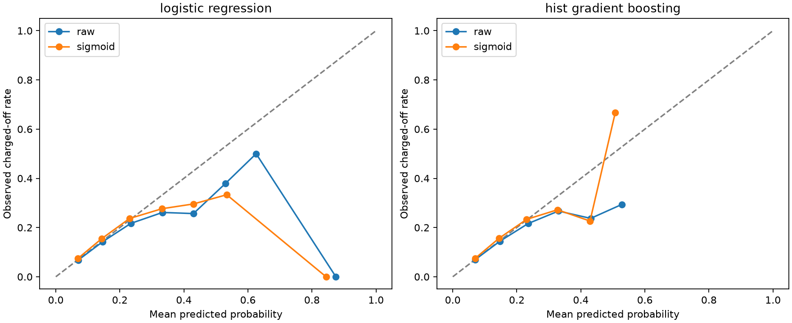

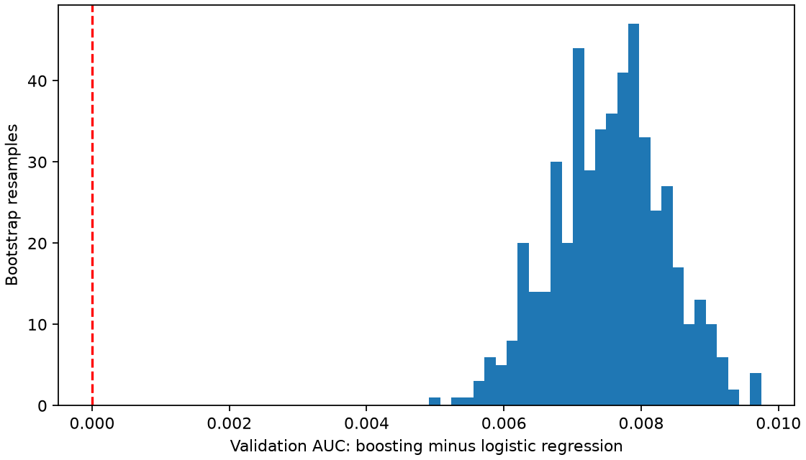

Calibration curves show all occupied uniform-width bins, including sparse bins; counts are saved in calibration_bins.csv. Interpret the tails using those counts.

## Controls and artifacts

Shared feature policy rejects post-origination fields before preparation/training, including when a denied field is accidentally added to an allowlist. This enforces the selected vocabulary; it cannot certify source timestamps. Expanded bureau fields remain research candidates.

The coefficient CSV describes the historical logistic pipeline's transformed coordinates (including scaling, log transforms, missing flags, and one-hot categories). These are not scorecard points or causal effects.

All CSVs and the hashed manifest: [assets/results/validation_hardening/e7ebdf9092274ee3b039af91de5b5acb](../assets/results/validation_hardening/e7ebdf9092274ee3b039af91de5b5acb/manifest.json). MLflow stores the three full role datasets, four model versions, dataset-linked metrics, and four native classifier evaluations. The incumbent model remains unchanged.

Reproduce with `make validate` after the core workflow. Use `make all RAW_DATA=/path/to/accepted.csv` for a headless core run, or a `.csv.gz` file for local decompression.

Calibration follows the [scikit-learn guidance on disjoint fitting and calibration data](https://scikit-learn.org/stable/modules/calibration.html). Dependency locking uses [uv hash-locked requirements](https://docs.astral.sh/uv/pip/compile/).


### historical_exact_metrics

| model | split | rows | observed_positive_rate | mean_predicted_probability | threshold | roc_auc | gini | ks | average_precision | brier_score | log_loss | ece_10_uniform_bins | accuracy | balanced_accuracy | precision | recall | specificity | f1 | predicted_positive_rate | tn | fp | fn | tp |
| --- | --- | --- | --- | --- | --- | --- | --- | --- | --- | --- | --- | --- | --- | --- | --- | --- | --- | --- | --- | --- | --- | --- | --- |
| dummy_prior | train | 157993 | 0.125195 | 0.125195 | 0.5 | 0.5 | 0 | 0 | 0.125195 | 0.109522 | 0.37715 | 0 | 0.874805 | 0.5 | 0 | 0 | 1 | 0 | 0 | 138213 | 0 | 19780 | 0 |
| dummy_prior | validation | 162570 | 0.137264 | 0.125195 | 0.5 | 0.5 | 0 | 0 | 0.137264 | 0.118568 | 0.400613 | 0.012069 | 0.862736 | 0.5 | 0 | 0 | 1 | 0 | 0 | 140255 | 0 | 22315 | 0 |
| logistic_regression | train | 157993 | 0.125195 | 0.125206 | 0.5 | 0.650936 | 0.301871 | 0.218646 | 0.199628 | 0.106127 | 0.36132 | 0.002319 | 0.874792 | 0.500101 | 0.416667 | 0.000253 | 0.999949 | 0.000505 | 0.000076 | 138206 | 7 | 19775 | 5 |
| logistic_regression | validation | 162570 | 0.137264 | 0.132214 | 0.5 | 0.646231 | 0.292462 | 0.213711 | 0.21028 | 0.114869 | 0.384341 | 0.006675 | 0.862705 | 0.500152 | 0.391304 | 0.000403 | 0.9999 | 0.000806 | 0.000141 | 140241 | 14 | 22306 | 9 |
| random_forest | train | 157993 | 0.125195 | 0.125167 | 0.5 | 0.711889 | 0.423779 | 0.307458 | 0.266368 | 0.103944 | 0.352131 | 0.019663 | 0.874805 | 0.5 | 0 | 0 | 1 | 0 | 0 | 138213 | 0 | 19780 | 0 |
| random_forest | validation | 162570 | 0.137264 | 0.129408 | 0.5 | 0.649133 | 0.298265 | 0.216818 | 0.213944 | 0.114923 | 0.384513 | 0.013567 | 0.862736 | 0.5 | 0 | 0 | 1 | 0 | 0 | 140255 | 0 | 22315 | 0 |
| hist_gradient_boosting | train | 157993 | 0.125195 | 0.125187 | 0.5 | 0.684525 | 0.369051 | 0.265112 | 0.239525 | 0.104177 | 0.353495 | 0.008189 | 0.874805 | 0.5 | 0 | 0 | 1 | 0 | 0 | 138213 | 0 | 19780 | 0 |
| hist_gradient_boosting | validation | 162570 | 0.137264 | 0.131767 | 0.5 | 0.653889 | 0.307779 | 0.222796 | 0.216483 | 0.114375 | 0.382348 | 0.005851 | 0.862736 | 0.5 | 0 | 0 | 1 | 0 | 0 | 140255 | 0 | 22315 | 0 |

### paired_auc_bootstrap

| resample | auc_a | auc_b | delta_b_minus_a |
| --- | --- | --- | --- |
| 0 | 0.644809 | 0.651252 | 0.006443 |
| 1 | 0.644012 | 0.652466 | 0.008454 |
| 2 | 0.645481 | 0.653429 | 0.007948 |
| 3 | 0.646213 | 0.653786 | 0.007573 |
| 4 | 0.650878 | 0.657496 | 0.006617 |
| 5 | 0.644949 | 0.652036 | 0.007088 |
| 6 | 0.647095 | 0.654498 | 0.007403 |
| 7 | 0.645388 | 0.65385 | 0.008463 |
| 8 | 0.646559 | 0.653525 | 0.006965 |
| 9 | 0.646876 | 0.65368 | 0.006804 |
| 10 | 0.64495 | 0.652346 | 0.007396 |
| 11 | 0.645422 | 0.652954 | 0.007531 |
| 12 | 0.648042 | 0.655708 | 0.007666 |
| 13 | 0.645437 | 0.653378 | 0.00794 |
| 14 | 0.648827 | 0.655341 | 0.006514 |
| 15 | 0.644695 | 0.651667 | 0.006971 |
| 16 | 0.645627 | 0.653306 | 0.00768 |
| 17 | 0.646104 | 0.653509 | 0.007405 |
| 18 | 0.646628 | 0.654347 | 0.007719 |
| 19 | 0.645194 | 0.652977 | 0.007783 |
| 20 | 0.646241 | 0.652985 | 0.006744 |
| 21 | 0.645732 | 0.653126 | 0.007394 |
| 22 | 0.645653 | 0.653984 | 0.008332 |
| 23 | 0.647946 | 0.653776 | 0.00583 |
| 24 | 0.646908 | 0.653383 | 0.006475 |
| 25 | 0.651622 | 0.659805 | 0.008182 |
| 26 | 0.645027 | 0.652186 | 0.00716 |
| 27 | 0.644367 | 0.653458 | 0.009091 |
| 28 | 0.642367 | 0.650016 | 0.007648 |
| 29 | 0.64611 | 0.653472 | 0.007362 |
| 30 | 0.646614 | 0.655663 | 0.009048 |
| 31 | 0.64267 | 0.650352 | 0.007682 |
| 32 | 0.64392 | 0.651499 | 0.007579 |
| 33 | 0.644454 | 0.65222 | 0.007767 |
| 34 | 0.645964 | 0.653104 | 0.00714 |
| 35 | 0.644899 | 0.652118 | 0.007219 |
| 36 | 0.648634 | 0.654707 | 0.006073 |
| 37 | 0.646634 | 0.653856 | 0.007223 |
| 38 | 0.645489 | 0.653345 | 0.007857 |
| 39 | 0.646193 | 0.652471 | 0.006278 |
| 40 | 0.644129 | 0.651565 | 0.007435 |
| 41 | 0.645436 | 0.653633 | 0.008196 |
| 42 | 0.646866 | 0.655041 | 0.008175 |
| 43 | 0.643091 | 0.651513 | 0.008422 |
| 44 | 0.643894 | 0.651246 | 0.007353 |
| 45 | 0.64298 | 0.652337 | 0.009358 |
| 46 | 0.644495 | 0.652626 | 0.008131 |
| 47 | 0.650646 | 0.657609 | 0.006963 |
| 48 | 0.649006 | 0.655754 | 0.006748 |
| 49 | 0.648882 | 0.654669 | 0.005787 |
| 50 | 0.645164 | 0.65348 | 0.008316 |
| 51 | 0.649652 | 0.657462 | 0.00781 |
| 52 | 0.648392 | 0.655555 | 0.007163 |
| 53 | 0.643782 | 0.651438 | 0.007656 |
| 54 | 0.649187 | 0.656957 | 0.00777 |
| 55 | 0.647253 | 0.655403 | 0.00815 |
| 56 | 0.646212 | 0.653105 | 0.006893 |
| 57 | 0.645729 | 0.65283 | 0.007101 |
| 58 | 0.646458 | 0.653743 | 0.007285 |
| 59 | 0.648526 | 0.656609 | 0.008083 |
| 60 | 0.646811 | 0.65326 | 0.006449 |
| 61 | 0.650943 | 0.657206 | 0.006263 |
| 62 | 0.648047 | 0.655738 | 0.007691 |
| 63 | 0.644186 | 0.65183 | 0.007644 |
| 64 | 0.648691 | 0.655763 | 0.007072 |
| 65 | 0.647903 | 0.65488 | 0.006977 |
| 66 | 0.646243 | 0.655025 | 0.008782 |
| 67 | 0.646389 | 0.654025 | 0.007636 |
| 68 | 0.643997 | 0.651068 | 0.007071 |
| 69 | 0.644091 | 0.652423 | 0.008332 |
| 70 | 0.6447 | 0.652558 | 0.007858 |
| 71 | 0.646641 | 0.652845 | 0.006204 |
| 72 | 0.646004 | 0.652819 | 0.006815 |
| 73 | 0.643758 | 0.652756 | 0.008997 |
| 74 | 0.644341 | 0.653196 | 0.008856 |
| 75 | 0.646097 | 0.654546 | 0.008449 |
| 76 | 0.645367 | 0.653612 | 0.008245 |
| 77 | 0.644167 | 0.651838 | 0.007671 |
| 78 | 0.644926 | 0.652199 | 0.007273 |
| 79 | 0.642288 | 0.651152 | 0.008864 |
| 80 | 0.646395 | 0.654874 | 0.008478 |
| 81 | 0.644385 | 0.652083 | 0.007698 |
| 82 | 0.648418 | 0.655704 | 0.007286 |
| 83 | 0.64747 | 0.655245 | 0.007774 |
| 84 | 0.650036 | 0.657195 | 0.007159 |
| 85 | 0.645298 | 0.651757 | 0.006458 |
| 86 | 0.648077 | 0.656263 | 0.008186 |
| 87 | 0.650037 | 0.65693 | 0.006893 |
| 88 | 0.642876 | 0.650787 | 0.007911 |
| 89 | 0.644164 | 0.652618 | 0.008455 |
| 90 | 0.645554 | 0.653014 | 0.00746 |
| 91 | 0.646692 | 0.653721 | 0.007029 |
| 92 | 0.642354 | 0.649147 | 0.006794 |
| 93 | 0.64524 | 0.652264 | 0.007024 |
| 94 | 0.644038 | 0.651597 | 0.00756 |
| 95 | 0.646736 | 0.65372 | 0.006984 |
| 96 | 0.649075 | 0.656087 | 0.007011 |
| 97 | 0.642933 | 0.651089 | 0.008156 |
| 98 | 0.644894 | 0.652706 | 0.007812 |
| 99 | 0.643463 | 0.650907 | 0.007444 |
| 100 | 0.646199 | 0.653688 | 0.007489 |
| 101 | 0.640184 | 0.64928 | 0.009096 |
| 102 | 0.64898 | 0.657052 | 0.008073 |
| 103 | 0.647078 | 0.653914 | 0.006836 |
| 104 | 0.644914 | 0.654022 | 0.009109 |
| 105 | 0.645091 | 0.653379 | 0.008288 |
| 106 | 0.647378 | 0.65413 | 0.006752 |
| 107 | 0.6488 | 0.655832 | 0.007032 |
| 108 | 0.650362 | 0.657984 | 0.007622 |
| 109 | 0.646886 | 0.654024 | 0.007138 |
| 110 | 0.646509 | 0.65427 | 0.007761 |
| 111 | 0.645873 | 0.653029 | 0.007156 |
| 112 | 0.649781 | 0.657676 | 0.007895 |
| 113 | 0.643169 | 0.649934 | 0.006765 |
| 114 | 0.645865 | 0.652223 | 0.006358 |
| 115 | 0.648007 | 0.655954 | 0.007947 |
| 116 | 0.6451 | 0.652993 | 0.007892 |
| 117 | 0.64898 | 0.656748 | 0.007768 |
| 118 | 0.646353 | 0.653641 | 0.007289 |
| 119 | 0.644955 | 0.653662 | 0.008707 |
| 120 | 0.647922 | 0.655334 | 0.007412 |
| 121 | 0.648946 | 0.657742 | 0.008796 |
| 122 | 0.646997 | 0.654207 | 0.00721 |
| 123 | 0.651539 | 0.658057 | 0.006518 |
| 124 | 0.645041 | 0.652153 | 0.007113 |
| 125 | 0.648292 | 0.655487 | 0.007196 |
| 126 | 0.644366 | 0.651798 | 0.007432 |
| 127 | 0.645291 | 0.653332 | 0.008042 |
| 128 | 0.646997 | 0.656679 | 0.009683 |
| 129 | 0.646021 | 0.652458 | 0.006437 |
| 130 | 0.646115 | 0.653668 | 0.007553 |
| 131 | 0.649573 | 0.657221 | 0.007649 |
| 132 | 0.645369 | 0.652777 | 0.007408 |
| 133 | 0.646664 | 0.654464 | 0.0078 |
| 134 | 0.64811 | 0.656701 | 0.008591 |
| 135 | 0.643869 | 0.650181 | 0.006312 |
| 136 | 0.647583 | 0.656403 | 0.00882 |
| 137 | 0.647574 | 0.655205 | 0.007632 |
| 138 | 0.64533 | 0.652924 | 0.007594 |
| 139 | 0.65035 | 0.657999 | 0.00765 |
| 140 | 0.647728 | 0.654819 | 0.007091 |
| 141 | 0.644737 | 0.651927 | 0.007189 |
| 142 | 0.646931 | 0.65478 | 0.00785 |
| 143 | 0.645134 | 0.652924 | 0.007789 |
| 144 | 0.64438 | 0.65218 | 0.0078 |
| 145 | 0.645253 | 0.653184 | 0.007931 |
| 146 | 0.648726 | 0.655534 | 0.006808 |
| 147 | 0.642403 | 0.65005 | 0.007647 |
| 148 | 0.647555 | 0.653118 | 0.005563 |
| 149 | 0.646942 | 0.654827 | 0.007885 |
| 150 | 0.645507 | 0.651759 | 0.006252 |
| 151 | 0.644579 | 0.65235 | 0.007771 |
| 152 | 0.649783 | 0.657243 | 0.00746 |
| 153 | 0.647545 | 0.655396 | 0.007851 |
| 154 | 0.645345 | 0.651987 | 0.006642 |
| 155 | 0.646057 | 0.654017 | 0.00796 |
| 156 | 0.647362 | 0.654537 | 0.007176 |
| 157 | 0.645626 | 0.653506 | 0.00788 |
| 158 | 0.648981 | 0.657696 | 0.008715 |
| 159 | 0.64832 | 0.654584 | 0.006264 |
| 160 | 0.646085 | 0.654565 | 0.00848 |
| 161 | 0.649042 | 0.655759 | 0.006717 |
| 162 | 0.644187 | 0.651819 | 0.007632 |
| 163 | 0.646792 | 0.654323 | 0.00753 |
| 164 | 0.647414 | 0.654527 | 0.007113 |
| 165 | 0.646959 | 0.652742 | 0.005782 |
| 166 | 0.642693 | 0.651559 | 0.008866 |
| 167 | 0.646282 | 0.653657 | 0.007376 |
| 168 | 0.643844 | 0.651676 | 0.007833 |
| 169 | 0.642656 | 0.650259 | 0.007603 |
| 170 | 0.645274 | 0.653572 | 0.008298 |
| 171 | 0.65015 | 0.657426 | 0.007276 |
| 172 | 0.643738 | 0.651726 | 0.007987 |
| 173 | 0.650349 | 0.657322 | 0.006974 |
| 174 | 0.645415 | 0.652735 | 0.007319 |
| 175 | 0.64527 | 0.65298 | 0.00771 |
| 176 | 0.64596 | 0.653694 | 0.007734 |
| 177 | 0.644274 | 0.652583 | 0.008309 |
| 178 | 0.645511 | 0.653672 | 0.008162 |
| 179 | 0.647789 | 0.655582 | 0.007793 |
| 180 | 0.647096 | 0.655007 | 0.007911 |
| 181 | 0.645979 | 0.651921 | 0.005941 |
| 182 | 0.647143 | 0.65325 | 0.006107 |
| 183 | 0.643242 | 0.652981 | 0.009739 |
| 184 | 0.645766 | 0.652809 | 0.007043 |
| 185 | 0.648414 | 0.654783 | 0.006369 |
| 186 | 0.644628 | 0.65294 | 0.008312 |
| 187 | 0.647673 | 0.656923 | 0.00925 |
| 188 | 0.643816 | 0.650646 | 0.006831 |
| 189 | 0.649563 | 0.656955 | 0.007392 |
| 190 | 0.644919 | 0.651758 | 0.006839 |
| 191 | 0.643661 | 0.651657 | 0.007997 |
| 192 | 0.644928 | 0.653941 | 0.009013 |
| 193 | 0.647441 | 0.653786 | 0.006345 |
| 194 | 0.649685 | 0.657253 | 0.007568 |
| 195 | 0.646561 | 0.652907 | 0.006346 |
| 196 | 0.648518 | 0.657388 | 0.00887 |
| 197 | 0.647403 | 0.655098 | 0.007694 |
| 198 | 0.648669 | 0.65638 | 0.007711 |
| 199 | 0.644526 | 0.652105 | 0.007579 |
| 200 | 0.645035 | 0.653266 | 0.008231 |
| 201 | 0.643793 | 0.651065 | 0.007272 |
| 202 | 0.641601 | 0.648584 | 0.006983 |
| 203 | 0.649322 | 0.656484 | 0.007162 |
| 204 | 0.651579 | 0.658909 | 0.00733 |
| 205 | 0.646747 | 0.654756 | 0.008009 |
| 206 | 0.647848 | 0.65553 | 0.007682 |
| 207 | 0.64284 | 0.650841 | 0.008001 |
| 208 | 0.644433 | 0.65242 | 0.007987 |
| 209 | 0.645647 | 0.652446 | 0.006799 |
| 210 | 0.646642 | 0.653695 | 0.007053 |
| 211 | 0.643748 | 0.651309 | 0.00756 |
| 212 | 0.646022 | 0.652926 | 0.006904 |
| 213 | 0.643775 | 0.651746 | 0.007971 |
| 214 | 0.644372 | 0.650655 | 0.006283 |
| 215 | 0.64423 | 0.652769 | 0.008539 |
| 216 | 0.651236 | 0.659434 | 0.008198 |
| 217 | 0.644251 | 0.651762 | 0.007511 |
| 218 | 0.646363 | 0.654925 | 0.008562 |
| 219 | 0.651104 | 0.658076 | 0.006972 |
| 220 | 0.645077 | 0.652867 | 0.00779 |
| 221 | 0.646188 | 0.653566 | 0.007378 |
| 222 | 0.647178 | 0.656105 | 0.008927 |
| 223 | 0.645967 | 0.65383 | 0.007863 |
| 224 | 0.645679 | 0.65248 | 0.006801 |
| 225 | 0.646328 | 0.6528 | 0.006471 |
| 226 | 0.652384 | 0.658636 | 0.006252 |
| 227 | 0.645723 | 0.654068 | 0.008345 |
| 228 | 0.646433 | 0.654525 | 0.008092 |
| 229 | 0.64728 | 0.654092 | 0.006812 |
| 230 | 0.645273 | 0.653624 | 0.008351 |
| 231 | 0.64603 | 0.653573 | 0.007543 |
| 232 | 0.646698 | 0.653986 | 0.007288 |
| 233 | 0.644809 | 0.651857 | 0.007048 |
| 234 | 0.645736 | 0.652793 | 0.007056 |
| 235 | 0.645127 | 0.652959 | 0.007832 |
| 236 | 0.647238 | 0.656165 | 0.008928 |
| 237 | 0.647655 | 0.654658 | 0.007003 |
| 238 | 0.645409 | 0.653284 | 0.007875 |
| 239 | 0.648016 | 0.654899 | 0.006883 |
| 240 | 0.647169 | 0.653721 | 0.006552 |
| 241 | 0.64539 | 0.652263 | 0.006872 |
| 242 | 0.647537 | 0.6563 | 0.008763 |
| 243 | 0.647078 | 0.65453 | 0.007451 |
| 244 | 0.646878 | 0.653905 | 0.007027 |
| 245 | 0.649872 | 0.655878 | 0.006005 |
| 246 | 0.643147 | 0.650268 | 0.007121 |
| 247 | 0.644416 | 0.652774 | 0.008358 |
| 248 | 0.64896 | 0.65387 | 0.00491 |
| 249 | 0.645279 | 0.6528 | 0.00752 |
| 250 | 0.645941 | 0.653153 | 0.007213 |
| 251 | 0.644795 | 0.653846 | 0.009051 |
| 252 | 0.647549 | 0.656188 | 0.008639 |
| 253 | 0.644808 | 0.651866 | 0.007058 |
| 254 | 0.642568 | 0.650482 | 0.007914 |
| 255 | 0.647528 | 0.655559 | 0.008031 |
| 256 | 0.645965 | 0.654065 | 0.008099 |
| 257 | 0.648543 | 0.656583 | 0.00804 |
| 258 | 0.650056 | 0.657405 | 0.007349 |
| 259 | 0.643575 | 0.649778 | 0.006203 |
| 260 | 0.645078 | 0.65243 | 0.007352 |
| 261 | 0.651527 | 0.658029 | 0.006502 |
| 262 | 0.646448 | 0.653884 | 0.007435 |
| 263 | 0.646035 | 0.654384 | 0.00835 |
| 264 | 0.649906 | 0.656369 | 0.006462 |
| 265 | 0.64876 | 0.655413 | 0.006653 |
| 266 | 0.647753 | 0.656533 | 0.00878 |
| 267 | 0.643278 | 0.651099 | 0.007821 |
| 268 | 0.646546 | 0.654965 | 0.008419 |
| 269 | 0.647876 | 0.654751 | 0.006875 |
| 270 | 0.648078 | 0.653711 | 0.005634 |
| 271 | 0.647946 | 0.655561 | 0.007615 |
| 272 | 0.644224 | 0.651035 | 0.006811 |
| 273 | 0.647239 | 0.655912 | 0.008673 |
| 274 | 0.647038 | 0.655045 | 0.008006 |
| 275 | 0.64536 | 0.653239 | 0.00788 |
| 276 | 0.644834 | 0.651566 | 0.006732 |
| 277 | 0.645357 | 0.652446 | 0.007089 |
| 278 | 0.648482 | 0.655188 | 0.006706 |
| 279 | 0.644241 | 0.651929 | 0.007688 |
| 280 | 0.645571 | 0.652857 | 0.007286 |
| 281 | 0.645879 | 0.654024 | 0.008146 |
| 282 | 0.646224 | 0.653622 | 0.007398 |
| 283 | 0.649055 | 0.655775 | 0.00672 |
| 284 | 0.64651 | 0.653621 | 0.007111 |
| 285 | 0.648592 | 0.656335 | 0.007743 |
| 286 | 0.647366 | 0.654581 | 0.007215 |
| 287 | 0.647527 | 0.652838 | 0.005311 |
| 288 | 0.642901 | 0.650504 | 0.007603 |
| 289 | 0.647563 | 0.655688 | 0.008125 |
| 290 | 0.644858 | 0.65278 | 0.007922 |
| 291 | 0.648326 | 0.656176 | 0.00785 |
| 292 | 0.648352 | 0.655662 | 0.007309 |
| 293 | 0.644495 | 0.653092 | 0.008597 |
| 294 | 0.646723 | 0.65383 | 0.007107 |
| 295 | 0.643725 | 0.652758 | 0.009033 |
| 296 | 0.645917 | 0.653259 | 0.007342 |
| 297 | 0.649481 | 0.657508 | 0.008028 |
| 298 | 0.648149 | 0.654593 | 0.006443 |
| 299 | 0.647958 | 0.656046 | 0.008088 |
| 300 | 0.642717 | 0.650807 | 0.008089 |
| 301 | 0.646062 | 0.653084 | 0.007022 |
| 302 | 0.64762 | 0.653968 | 0.006348 |
| 303 | 0.644218 | 0.65201 | 0.007791 |
| 304 | 0.646018 | 0.655149 | 0.009131 |
| 305 | 0.643695 | 0.649572 | 0.005877 |
| 306 | 0.641182 | 0.649863 | 0.008681 |
| 307 | 0.647324 | 0.654408 | 0.007084 |
| 308 | 0.644525 | 0.651939 | 0.007414 |
| 309 | 0.645653 | 0.652941 | 0.007288 |
| 310 | 0.644613 | 0.652809 | 0.008196 |
| 311 | 0.644408 | 0.653256 | 0.008848 |
| 312 | 0.643738 | 0.652416 | 0.008678 |
| 313 | 0.644836 | 0.653314 | 0.008478 |
| 314 | 0.646595 | 0.653669 | 0.007073 |
| 315 | 0.641456 | 0.648812 | 0.007355 |
| 316 | 0.647969 | 0.657072 | 0.009102 |
| 317 | 0.64725 | 0.65537 | 0.00812 |
| 318 | 0.648724 | 0.656296 | 0.007572 |
| 319 | 0.651166 | 0.657329 | 0.006163 |
| 320 | 0.650876 | 0.656359 | 0.005483 |
| 321 | 0.645731 | 0.652055 | 0.006324 |
| 322 | 0.643222 | 0.651503 | 0.008281 |
| 323 | 0.643958 | 0.650295 | 0.006337 |
| 324 | 0.645114 | 0.651957 | 0.006843 |
| 325 | 0.647724 | 0.655646 | 0.007922 |
| 326 | 0.647138 | 0.654133 | 0.006995 |
| 327 | 0.643641 | 0.652663 | 0.009022 |
| 328 | 0.651156 | 0.658087 | 0.006931 |
| 329 | 0.645773 | 0.654109 | 0.008336 |
| 330 | 0.643828 | 0.651882 | 0.008054 |
| 331 | 0.646497 | 0.653715 | 0.007218 |
| 332 | 0.648307 | 0.655461 | 0.007153 |
| 333 | 0.646598 | 0.653298 | 0.0067 |
| 334 | 0.646848 | 0.653581 | 0.006733 |
| 335 | 0.64688 | 0.655441 | 0.008561 |
| 336 | 0.645631 | 0.654103 | 0.008472 |
| 337 | 0.646384 | 0.65411 | 0.007727 |
| 338 | 0.647851 | 0.656544 | 0.008693 |
| 339 | 0.646813 | 0.654092 | 0.007279 |
| 340 | 0.647663 | 0.65503 | 0.007367 |
| 341 | 0.65089 | 0.65757 | 0.00668 |
| 342 | 0.643973 | 0.651372 | 0.007399 |
| 343 | 0.64712 | 0.655309 | 0.008189 |
| 344 | 0.646753 | 0.654763 | 0.008009 |
| 345 | 0.650105 | 0.656744 | 0.006639 |
| 346 | 0.644139 | 0.652494 | 0.008355 |
| 347 | 0.646761 | 0.654734 | 0.007973 |
| 348 | 0.644054 | 0.652671 | 0.008617 |
| 349 | 0.644895 | 0.652168 | 0.007273 |
| 350 | 0.646923 | 0.654802 | 0.007879 |
| 351 | 0.647321 | 0.655291 | 0.00797 |
| 352 | 0.643919 | 0.651425 | 0.007505 |
| 353 | 0.646155 | 0.654435 | 0.00828 |
| 354 | 0.64983 | 0.65668 | 0.00685 |
| 355 | 0.644217 | 0.649835 | 0.005618 |
| 356 | 0.644112 | 0.651264 | 0.007152 |
| 357 | 0.646894 | 0.654412 | 0.007518 |
| 358 | 0.646299 | 0.654678 | 0.008379 |
| 359 | 0.645369 | 0.653527 | 0.008158 |
| 360 | 0.647047 | 0.65492 | 0.007873 |
| 361 | 0.645164 | 0.651794 | 0.006631 |
| 362 | 0.645722 | 0.65403 | 0.008308 |
| 363 | 0.645165 | 0.652608 | 0.007443 |
| 364 | 0.648241 | 0.656085 | 0.007845 |
| 365 | 0.645796 | 0.653538 | 0.007742 |
| 366 | 0.650337 | 0.657006 | 0.006669 |
| 367 | 0.648586 | 0.656128 | 0.007541 |
| 368 | 0.645322 | 0.653153 | 0.007831 |
| 369 | 0.64628 | 0.652144 | 0.005864 |
| 370 | 0.646464 | 0.65403 | 0.007566 |
| 371 | 0.648288 | 0.656738 | 0.00845 |
| 372 | 0.644422 | 0.652201 | 0.00778 |
| 373 | 0.646859 | 0.653597 | 0.006738 |
| 374 | 0.646204 | 0.653364 | 0.00716 |
| 375 | 0.644813 | 0.65256 | 0.007747 |
| 376 | 0.645671 | 0.653606 | 0.007935 |
| 377 | 0.641426 | 0.649643 | 0.008217 |
| 378 | 0.646522 | 0.654754 | 0.008232 |
| 379 | 0.64686 | 0.654881 | 0.008022 |
| 380 | 0.644497 | 0.653506 | 0.009009 |
| 381 | 0.642743 | 0.64935 | 0.006608 |
| 382 | 0.646269 | 0.654594 | 0.008325 |
| 383 | 0.647846 | 0.655695 | 0.007849 |
| 384 | 0.647102 | 0.653791 | 0.006689 |
| 385 | 0.64421 | 0.651947 | 0.007737 |
| 386 | 0.644817 | 0.652495 | 0.007678 |
| 387 | 0.647564 | 0.655526 | 0.007962 |
| 388 | 0.646983 | 0.654991 | 0.008008 |
| 389 | 0.647038 | 0.654104 | 0.007065 |
| 390 | 0.647748 | 0.655722 | 0.007974 |
| 391 | 0.646475 | 0.652575 | 0.006099 |
| 392 | 0.647862 | 0.65545 | 0.007588 |
| 393 | 0.647335 | 0.655148 | 0.007812 |
| 394 | 0.646538 | 0.653584 | 0.007047 |
| 395 | 0.644725 | 0.652635 | 0.00791 |
| 396 | 0.64536 | 0.65349 | 0.008129 |
| 397 | 0.646359 | 0.653354 | 0.006995 |
| 398 | 0.649372 | 0.65581 | 0.006438 |
| 399 | 0.646151 | 0.654032 | 0.007882 |
| 400 | 0.643578 | 0.651726 | 0.008148 |
| 401 | 0.644843 | 0.652829 | 0.007986 |
| 402 | 0.646362 | 0.653563 | 0.007201 |
| 403 | 0.647401 | 0.654395 | 0.006994 |
| 404 | 0.646251 | 0.65457 | 0.00832 |
| 405 | 0.647453 | 0.654902 | 0.007449 |
| 406 | 0.64911 | 0.655409 | 0.006299 |
| 407 | 0.647954 | 0.655786 | 0.007831 |
| 408 | 0.648133 | 0.654219 | 0.006086 |
| 409 | 0.648308 | 0.654393 | 0.006086 |
| 410 | 0.6464 | 0.656148 | 0.009747 |
| 411 | 0.646475 | 0.653296 | 0.006821 |
| 412 | 0.645496 | 0.652097 | 0.0066 |
| 413 | 0.648166 | 0.655428 | 0.007261 |
| 414 | 0.645401 | 0.65298 | 0.007579 |
| 415 | 0.645243 | 0.653065 | 0.007823 |
| 416 | 0.645769 | 0.652836 | 0.007066 |
| 417 | 0.645989 | 0.653017 | 0.007027 |
| 418 | 0.646027 | 0.654935 | 0.008907 |
| 419 | 0.646945 | 0.655027 | 0.008082 |
| 420 | 0.645728 | 0.654265 | 0.008537 |
| 421 | 0.647819 | 0.655687 | 0.007868 |
| 422 | 0.644924 | 0.653957 | 0.009033 |
| 423 | 0.6475 | 0.654782 | 0.007282 |
| 424 | 0.644253 | 0.652252 | 0.007999 |
| 425 | 0.645586 | 0.653702 | 0.008116 |
| 426 | 0.644963 | 0.653409 | 0.008447 |
| 427 | 0.645624 | 0.652155 | 0.006531 |
| 428 | 0.645682 | 0.654246 | 0.008564 |
| 429 | 0.652245 | 0.659457 | 0.007213 |
| 430 | 0.645304 | 0.653342 | 0.008038 |
| 431 | 0.646324 | 0.654769 | 0.008445 |
| 432 | 0.647405 | 0.656036 | 0.008631 |
| 433 | 0.646394 | 0.654686 | 0.008292 |
| 434 | 0.645734 | 0.654069 | 0.008335 |
| 435 | 0.648334 | 0.656952 | 0.008618 |
| 436 | 0.647268 | 0.65373 | 0.006463 |
| 437 | 0.642537 | 0.650099 | 0.007561 |
| 438 | 0.646913 | 0.655068 | 0.008156 |
| 439 | 0.647724 | 0.655623 | 0.007899 |
| 440 | 0.649353 | 0.656792 | 0.007439 |
| 441 | 0.645679 | 0.653691 | 0.008012 |
| 442 | 0.644785 | 0.652252 | 0.007467 |
| 443 | 0.641412 | 0.65066 | 0.009249 |
| 444 | 0.645666 | 0.653389 | 0.007723 |
| 445 | 0.647925 | 0.654271 | 0.006346 |
| 446 | 0.644351 | 0.652543 | 0.008192 |
| 447 | 0.647424 | 0.655172 | 0.007748 |
| 448 | 0.648489 | 0.654396 | 0.005907 |
| 449 | 0.640604 | 0.649092 | 0.008488 |
| 450 | 0.647241 | 0.654543 | 0.007302 |
| 451 | 0.64341 | 0.651535 | 0.008125 |
| 452 | 0.645675 | 0.653487 | 0.007812 |
| 453 | 0.64769 | 0.654706 | 0.007017 |
| 454 | 0.644116 | 0.652083 | 0.007966 |
| 455 | 0.647231 | 0.653571 | 0.006339 |
| 456 | 0.64589 | 0.653412 | 0.007522 |
| 457 | 0.64572 | 0.65383 | 0.00811 |
| 458 | 0.644739 | 0.653217 | 0.008478 |
| 459 | 0.642322 | 0.651079 | 0.008756 |
| 460 | 0.645025 | 0.651568 | 0.006543 |
| 461 | 0.647764 | 0.655329 | 0.007564 |
| 462 | 0.644624 | 0.651333 | 0.006709 |
| 463 | 0.645276 | 0.653128 | 0.007851 |
| 464 | 0.648371 | 0.655506 | 0.007135 |
| 465 | 0.64957 | 0.657396 | 0.007825 |
| 466 | 0.643292 | 0.650395 | 0.007103 |
| 467 | 0.6463 | 0.655114 | 0.008814 |
| 468 | 0.64462 | 0.650812 | 0.006192 |
| 469 | 0.647796 | 0.655683 | 0.007886 |
| 470 | 0.6441 | 0.651905 | 0.007805 |
| 471 | 0.650878 | 0.65819 | 0.007312 |
| 472 | 0.645669 | 0.651647 | 0.005978 |
| 473 | 0.650195 | 0.655988 | 0.005793 |
| 474 | 0.648093 | 0.654705 | 0.006612 |
| 475 | 0.651371 | 0.658745 | 0.007374 |
| 476 | 0.645411 | 0.652214 | 0.006804 |
| 477 | 0.648865 | 0.657001 | 0.008136 |
| 478 | 0.646429 | 0.65298 | 0.006551 |
| 479 | 0.647529 | 0.654689 | 0.00716 |
| 480 | 0.647571 | 0.655144 | 0.007573 |
| 481 | 0.649623 | 0.65589 | 0.006267 |
| 482 | 0.644118 | 0.652027 | 0.007909 |
| 483 | 0.647524 | 0.654648 | 0.007124 |
| 484 | 0.648097 | 0.654914 | 0.006817 |
| 485 | 0.64561 | 0.655023 | 0.009413 |
| 486 | 0.64411 | 0.653815 | 0.009704 |
| 487 | 0.64148 | 0.650044 | 0.008564 |
| 488 | 0.652017 | 0.658198 | 0.006181 |
| 489 | 0.648392 | 0.65571 | 0.007318 |
| 490 | 0.643541 | 0.649874 | 0.006333 |
| 491 | 0.646235 | 0.653598 | 0.007363 |
| 492 | 0.64611 | 0.655362 | 0.009252 |
| 493 | 0.643994 | 0.652418 | 0.008424 |
| 494 | 0.647523 | 0.654361 | 0.006838 |
| 495 | 0.646248 | 0.654073 | 0.007826 |
| 496 | 0.648527 | 0.655613 | 0.007086 |
| 497 | 0.646309 | 0.652228 | 0.005919 |
| 498 | 0.64448 | 0.651194 | 0.006714 |
| 499 | 0.647905 | 0.656284 | 0.00838 |

### auc_confidence_intervals

| comparison | metric | estimate | lower_95 | upper_95 |
| --- | --- | --- | --- | --- |
| logistic_regression | roc_auc | 0.646231 | 0.642467 | 0.650918 |
| logistic_regression | gini | 0.292462 | 0.284933 | 0.301835 |
| hist_gradient_boosting | roc_auc | 0.653889 | 0.649973 | 0.657992 |
| hist_gradient_boosting | gini | 0.307779 | 0.299945 | 0.315983 |
| boosting_minus_logistic | auc_difference | 0.007659 | 0.005913 | 0.009094 |

### calibration_metrics

| model | version | rows | observed_positive_rate | mean_predicted_probability | threshold | roc_auc | gini | ks | average_precision | brier_score | log_loss | ece_10_uniform_bins | accuracy | balanced_accuracy | precision | recall | specificity | f1 | predicted_positive_rate | tn | fp | fn | tp |
| --- | --- | --- | --- | --- | --- | --- | --- | --- | --- | --- | --- | --- | --- | --- | --- | --- | --- | --- | --- | --- | --- | --- | --- |
| logistic_regression | raw | 162570 | 0.137264 | 0.144645 | 0.5 | 0.639135 | 0.278269 | 0.203654 | 0.204675 | 0.115308 | 0.385851 | 0.007381 | 0.862687 | 0.500198 | 0.375 | 0.000538 | 0.999857 | 0.001074 | 0.000197 | 140235 | 20 | 22303 | 12 |
| logistic_regression | sigmoid | 162570 | 0.137264 | 0.128976 | 0.5 | 0.639135 | 0.278269 | 0.203654 | 0.204675 | 0.115251 | 0.385862 | 0.009377 | 0.862711 | 0.500042 | 0.3 | 0.000134 | 0.99995 | 0.000269 | 0.000062 | 140248 | 7 | 22312 | 3 |
| hist_gradient_boosting | raw | 162570 | 0.137264 | 0.143733 | 0.5 | 0.64165 | 0.283299 | 0.20478 | 0.20503 | 0.115216 | 0.385312 | 0.006469 | 0.862693 | 0.500069 | 0.294118 | 0.000224 | 0.999914 | 0.000448 | 0.000105 | 140243 | 12 | 22310 | 5 |
| hist_gradient_boosting | sigmoid | 162570 | 0.137264 | 0.129437 | 0.5 | 0.64165 | 0.283299 | 0.20478 | 0.20503 | 0.115126 | 0.38525 | 0.008678 | 0.862742 | 0.500041 | 0.666667 | 0.00009 | 0.999993 | 0.000179 | 0.000018 | 140254 | 1 | 22313 | 2 |

### calibration_bins

| bin | rows | mean_probability | observed_positive_rate | bin_lower | bin_upper | model | version |
| --- | --- | --- | --- | --- | --- | --- | --- |
| 0 | 43662 | 0.069693 | 0.067335 | 0 | 0.1 | logistic_regression | raw |
| 1 | 88249 | 0.146547 | 0.142551 | 0.1 | 0.2 | logistic_regression | raw |
| 2 | 27392 | 0.234218 | 0.216815 | 0.2 | 0.3 | logistic_regression | raw |
| 3 | 2939 | 0.333072 | 0.261313 | 0.3 | 0.4 | logistic_regression | raw |
| 4 | 296 | 0.429816 | 0.256757 | 0.4 | 0.5 | logistic_regression | raw |
| 5 | 29 | 0.529896 | 0.37931 | 0.5 | 0.6 | logistic_regression | raw |
| 6 | 2 | 0.625567 | 0.5 | 0.6 | 0.7 | logistic_regression | raw |
| 8 | 1 | 0.874572 | 0 | 0.8 | 0.9 | logistic_regression | raw |
| 0 | 54879 | 0.069499 | 0.074965 | 0 | 0.1 | logistic_regression | sigmoid |
| 1 | 89336 | 0.142921 | 0.154417 | 0.1 | 0.2 | logistic_regression | sigmoid |
| 2 | 16927 | 0.230403 | 0.236841 | 0.2 | 0.3 | logistic_regression | sigmoid |
| 3 | 1320 | 0.331674 | 0.276515 | 0.3 | 0.4 | logistic_regression | sigmoid |
| 4 | 98 | 0.430033 | 0.295918 | 0.4 | 0.5 | logistic_regression | sigmoid |
| 5 | 9 | 0.533645 | 0.333333 | 0.5 | 0.6 | logistic_regression | sigmoid |
| 8 | 1 | 0.843962 | 0 | 0.8 | 0.9 | logistic_regression | sigmoid |
| 0 | 48822 | 0.069532 | 0.069108 | 0 | 0.1 | hist_gradient_boosting | raw |
| 1 | 80687 | 0.146662 | 0.144001 | 0.1 | 0.2 | hist_gradient_boosting | raw |
| 2 | 29579 | 0.235434 | 0.216302 | 0.2 | 0.3 | hist_gradient_boosting | raw |
| 3 | 3250 | 0.330094 | 0.267077 | 0.3 | 0.4 | hist_gradient_boosting | raw |
| 4 | 215 | 0.430686 | 0.237209 | 0.4 | 0.5 | hist_gradient_boosting | raw |
| 5 | 17 | 0.528324 | 0.294118 | 0.5 | 0.6 | hist_gradient_boosting | raw |
| 0 | 57013 | 0.069722 | 0.074597 | 0 | 0.1 | hist_gradient_boosting | sigmoid |
| 1 | 85642 | 0.144295 | 0.156162 | 0.1 | 0.2 | hist_gradient_boosting | sigmoid |
| 2 | 18790 | 0.230766 | 0.233262 | 0.2 | 0.3 | hist_gradient_boosting | sigmoid |
| 3 | 1069 | 0.326877 | 0.272217 | 0.3 | 0.4 | hist_gradient_boosting | sigmoid |
| 4 | 53 | 0.428592 | 0.226415 | 0.4 | 0.5 | hist_gradient_boosting | sigmoid |
| 5 | 3 | 0.507373 | 0.666667 | 0.5 | 0.6 | hist_gradient_boosting | sigmoid |

### cohort_roles

| role | rows | positives | positive_rate | first_issue_date | last_issue_date | dataset_digest |
| --- | --- | --- | --- | --- | --- | --- |
| model_fit | 57571 | 7402 | 0.128572 | 2011-01-01 | 2012-12-01 | f2d0b047 |
| calibration | 100422 | 12378 | 0.12326 | 2013-01-01 | 2013-12-01 | 342aece7 |
| evaluation | 162570 | 22315 | 0.137264 | 2014-01-01 | 2014-12-01 | 722bf1f9 |

### mlflow_native_evaluations

| model | split | evaluation_run_id | source_training_run_id | model_id | dataset_name | dataset_digest | decision_threshold | score | true_negatives | false_positives | false_negatives | true_positives | example_count | accuracy_score | recall_score | precision_score | f1_score | log_loss | roc_auc | precision_recall_auc |
| --- | --- | --- | --- | --- | --- | --- | --- | --- | --- | --- | --- | --- | --- | --- | --- | --- | --- | --- | --- | --- |
| logistic_regression_raw | validation | 0a5ba9587cf64b868aa65f3171c4d5f9 | 3bbedb28ce104c8293c66bbf5fc0840e | m-07fc69b51d154727a011c759d05a8587 | evaluation_loans | 722bf1f9 | 0.5 | 0.862687 | 140235 | 20 | 22303 | 12 | 162570 | 0.862687 | 0.000538 | 0.375 | 0.001074 | 0.385851 | 0.639135 | 0.204675 |
| logistic_regression_sigmoid | validation | 280c575872db42829bec6e6f99988833 | 6c535d47af6f49e19b79110966428aba | m-349e1e9718c842deb824cb4b2a9a2c49 | evaluation_loans | 722bf1f9 | 0.5 | 0.862711 | 140248 | 7 | 22312 | 3 | 162570 | 0.862711 | 0.000134 | 0.3 | 0.000269 | 0.385862 | 0.639135 | 0.204675 |
| hist_gradient_boosting_raw | validation | 1e2e07b54d5b4fb2b5f002060a539989 | 9e5d3d8bd7124b7dbb73058c105ba480 | m-8996719959994e30853637bf13ca0b36 | evaluation_loans | 722bf1f9 | 0.5 | 0.862693 | 140243 | 12 | 22310 | 5 | 162570 | 0.862693 | 0.000224 | 0.294118 | 0.000448 | 0.385312 | 0.64165 | 0.20503 |
| hist_gradient_boosting_sigmoid | validation | e3deefaabcdf4e5e87006708efdd0065 | dda8b215da314838b0783c20b2414124 | m-ca258d42cd6f4b539871bbe52fdae1a7 | evaluation_loans | 722bf1f9 | 0.5 | 0.862742 | 140254 | 1 | 22313 | 2 | 162570 | 0.862742 | 0.00009 | 0.666667 | 0.000179 | 0.38525 | 0.64165 | 0.20503 |

### logistic_coefficients

| transformed_feature | coefficient |
| --- | --- |
| numeric__loan_amnt | 0.17579 |
| numeric__dti | 0.10686 |
| numeric__revol_util | 0.082465 |
| numeric__open_acc | 0.085205 |
| numeric__delinq_2yrs | -0.018985 |
| numeric__pub_rec_bankruptcies | -0.043006 |
| numeric__emp_length_years | 0.02401 |
| numeric__fico_mid | -0.383836 |
| numeric__credit_history_years | -0.023221 |
| log_numeric__annual_inc | -0.294973 |
| log_numeric__revol_bal | -0.123783 |
| missing_flags__missingindicator_loan_amnt | 0 |
| missing_flags__missingindicator_annual_inc | 0 |
| missing_flags__missingindicator_dti | 0 |
| missing_flags__missingindicator_revol_util | -0.035718 |
| missing_flags__missingindicator_revol_bal | 0 |
| missing_flags__missingindicator_open_acc | 0 |
| missing_flags__missingindicator_delinq_2yrs | 0 |
| missing_flags__missingindicator_pub_rec_bankruptcies | 0 |
| missing_flags__missingindicator_emp_length_years | 0.308442 |
| missing_flags__missingindicator_fico_mid | 0 |
| missing_flags__missingindicator_credit_history_years | 0 |
| categories__home_ownership_MORTGAGE | -0.512519 |
| categories__home_ownership_NONE | -0.003868 |
| categories__home_ownership_OTHER | -0.007369 |
| categories__home_ownership_OWN | -0.455311 |
| categories__home_ownership_RENT | -0.34078 |
| categories__purpose_car | -0.302869 |
| categories__purpose_credit_card | -0.53244 |
| categories__purpose_debt_consolidation | -0.321476 |
| categories__purpose_home_improvement | -0.167456 |
| categories__purpose_house | -0.063623 |
| categories__purpose_major_purchase | -0.371686 |
| categories__purpose_medical | 0.062173 |
| categories__purpose_moving | -0.023051 |
| categories__purpose_other | 0.037381 |
| categories__purpose_renewable_energy | 0.015272 |
| categories__purpose_small_business | 0.606318 |
| categories__purpose_vacation | -0.048306 |
| categories__purpose_wedding | -0.210084 |
| intercept | -1.327954 |

### Full validation manifest

```json
{
  "status": "complete",
  "batch_run_id": "e7ebdf9092274ee3b039af91de5b5acb",
  "experiment_id": "3",
  "experiment_name": "lendingclub_validation_hardening",
  "features": [
    "loan_amnt",
    "annual_inc",
    "dti",
    "revol_util",
    "revol_bal",
    "open_acc",
    "delinq_2yrs",
    "pub_rec_bankruptcies",
    "emp_length_years",
    "fico_mid",
    "credit_history_years",
    "home_ownership",
    "purpose"
  ],
  "selected_model": "",
  "model_uris": {
    "logistic_regression_raw": "models:/m-07fc69b51d154727a011c759d05a8587",
    "logistic_regression_sigmoid": "models:/m-349e1e9718c842deb824cb4b2a9a2c49",
    "hist_gradient_boosting_raw": "models:/m-8996719959994e30853637bf13ca0b36",
    "hist_gradient_boosting_sigmoid": "models:/m-ca258d42cd6f4b539871bbe52fdae1a7"
  },
  "run_ids": {
    "logistic_regression_raw": "3bbedb28ce104c8293c66bbf5fc0840e",
    "logistic_regression_sigmoid": "6c535d47af6f49e19b79110966428aba",
    "hist_gradient_boosting_raw": "9e5d3d8bd7124b7dbb73058c105ba480",
    "hist_gradient_boosting_sigmoid": "dda8b215da314838b0783c20b2414124"
  },
  "seed": 42,
  "bootstrap_resamples": 500,
  "feature_policy": {
    "policy_version": 1,
    "policy_sha256": "7924dba2b6559db00d47a23da048fa6edd4b3a7a41d05390ab439582e6162f6a",
    "scope": "independent_baseline",
    "features": [
      "loan_amnt",
      "annual_inc",
      "dti",
      "revol_util",
      "revol_bal",
      "open_acc",
      "delinq_2yrs",
      "pub_rec_bankruptcies",
      "emp_length_years",
      "fico_mid",
      "credit_history_years",
      "home_ownership",
      "purpose"
    ],
    "scope_note": "Original candidate fields; requested/approved amount and issue-time history require application-time verification.",
    "deployment_approved": false
  },
  "input_sha256": {
    "data/clean/modeling/train.parquet": "eac423f260cc81fd8eb9f11c1639e4cecd0f452b5ac8f9d57d12a788fb9d29c4",
    "data/clean/modeling/train_metadata.parquet": "f7306739e7011bbc4493b9473090e3674446e8e73f3109b2127632f182052738",
    "data/clean/modeling/validation.parquet": "c645fc9a7eebc4d8755155be63c8ffd44a1cd3b606f127ccb294d4b998a24fbc",
    "data/clean/modeling/validation_metadata.parquet": "8703286db2f5e6143a9e9282224a14f42acd6b098fdbc9a981e774fd8309a0d2"
  },
  "versions": {
    "scikit-learn": "1.9.1",
    "mlflow": "3.18.0",
    "numpy": "2.5.4",
    "pandas": "3.1.0",
    "scipy": "1.18.1",
    "joblib": "1.6.0",
    "cloudpickle": "3.1.2",
    "threadpoolctl": "3.8.0"
  },
  "historical_batch_id": "6ccea4b79b8343cd971273181d93f680",
  "exploratory_2015_read": false,
  "deployment_backtest": false,
  "data_previously_explored": true,
  "result_directory": "assets/results/validation_hardening/e7ebdf9092274ee3b039af91de5b5acb",
  "figure_directory": "assets/figures/validation_hardening/e7ebdf9092274ee3b039af91de5b5acb",
  "model_directory": "models/validation_hardening/e7ebdf9092274ee3b039af91de5b5acb",
  "completed_at_utc": "2026-11-11T19:48:44.250363+00:00",
  "incumbent_sha256": "beb4491348dfa7022290768ef79c8150fd7d14a722ef5b3ac78902fa9f0cc078",
  "incumbent_unchanged": true,
  "historical_model_sha256": {
    "models/experiments/6ccea4b79b8343cd971273181d93f680/dummy_prior.joblib": "8c6938429a36c91a8d7a048fd65b19a9da2593b96f41502d70f1eea1a5b131f7",
    "models/experiments/6ccea4b79b8343cd971273181d93f680/logistic_regression.joblib": "7c70538e2601b9c56c448c5f12de9b51639c9f9fecae01c24c5a7a3ad42fe211",
    "models/experiments/6ccea4b79b8343cd971273181d93f680/random_forest.joblib": "975ef4500cfd0ef1df8e5ed943294334d22d29ac24e64cb5da20ece6be2c4082",
    "models/experiments/6ccea4b79b8343cd971273181d93f680/hist_gradient_boosting.joblib": "beb4491348dfa7022290768ef79c8150fd7d14a722ef5b3ac78902fa9f0cc078"
  },
  "source_sha256": {
    "scripts/08_validate_models.py": "ad4b2b297f51c11ceb72bd69f87e8872911eec03d367ff73eb8368c5f79260f4",
    "requirements.txt": "ca693c4b26f6942ec5f594e470065af6ca33ed839028212714bd98c7970420fc",
    "requirements.lock": "83d70a8e91f04287833f0a46385915a59d6dbe489d7eb211fc2e2f13f743f510",
    "util/ann.py": "a2350788ed70f83a2fad4a12916f78a9b598b999731b5486b605ddadef9df56e",
    "util/basel.py": "0c64a313abbd995135b721be5cd16ce627b88ccce70b806a6ffe1d4fac701354",
    "util/calibration.py": "3747c86cebea481223ee6207d81305a5898fb5f65a42db6e0896334bb63abf5c",
    "util/coefficient_review.py": "39b14eb12b9a5ba8bc88221559f86077f1f11f752db272a644653a0c58bf8889",
    "util/explanation_input.py": "55de10ed36773bd1d99e75dd6e860489841f12fc79296e70fbf57fd858132346",
    "util/feature_policy.py": "8f26c1916f5bc001ee3b6b12e0e8d71fdface344faddb4504abbab5800ed5dde",
    "util/interpretation.py": "c54249dd5897f45cd48cc80d59f9085e8fcfe42f8443c339c76f00431b11cdff",
    "util/load_test.py": "645b9dd8ddeef4770165870bef11fe48744543b930e3823ef083985509342f74",
    "util/logging.py": "44153f54a69ecb62d6c9ba710a7c11807300afa7da30ad4a6d8cf5a782c84eec",
    "util/metrics.py": "d02f8d735d3e6300e887e28494be21b87dba7a4fafe4b85c3fdd7521dfd5687c",
    "util/mlflow_evaluation.py": "c776696cec7b805f82f95f574ad122eff62df94bf14b98733d9ab7e84f6f5481",
    "util/modeling.py": "6e12d00dfe607844d008f5ad011e643dff776d33d69adc6e1eda01d96594b835",
    "util/risk_scope.py": "c46036e7a41fb27951656c4a5d8f5fffe3981af9cde083daa64be153d8745a36",
    "util/score_store.py": "9a1092113b7058156b54e529986b007d141a7726e0198213f51bc69a7e70a7f5",
    "util/segment_audit.py": "7d25b59c4392d3f1f61f9c38c9ebe12bf3416cac6868459e8c85974013440aff",
    "util/streaming.py": "940aec522ed8f5aa729f8e97f37cc82bd5eabf2176eebc13a003ea10ddffa495",
    "util/temporal_xgboost.py": "6ff37543804fead4ddabc68f219d6f1d9d4cbd9c5c1ebb19fe8a91105aece9a3",
    "util/validation.py": "dfad932f43a678b2eff1bf2a68bb90f86635d662b59505db6875adfb910dd036"
  },
  "results_sha256": {
    "paired_auc_bootstrap.csv": "db4847c126322cb03bd9469e44be67724ee0719c5b62219d270579c8fb90809f",
    "mlflow_native_evaluations.csv": "7f3335051c0c67990b504b9efa1ddaff058cbbb87b2d959c35d07c309c62bba7",
    "logistic_coefficients.csv": "0dfe1d885015f8d8f8de31ff9e98562f35a33cb08b3d25b30924509fc6687987",
    "historical_exact_metrics.csv": "94346390a901fa97ca0fc18096fbcde11c6159e3516621c31694ef7bf72b5f6d",
    "auc_confidence_intervals.csv": "a973717e07e7ee2fd3a0111b05b7a0a388c66f2e3cee0ef209ecde5e0a9be45f",
    "calibration_metrics.csv": "f72959c7b5e762b7d2e70b7cab30a8d93100c9fb6af5bf4d9257a49d76250cc3",
    "calibration_bins.csv": "f225e2dc51867a885ad919f0ad65e1044862a29be54b12018186f66cb1185745",
    "cohort_roles.csv": "3fc62d792ca04cb7935f279c382718aabbfe3a8e020cf1c6a5587b556556fb57"
  },
  "model_sha256": {
    "logistic_regression_raw.joblib": "e0496e5513a2d68a46b87ace5d9b1f079b34831bb8832b5328f934c01072426d",
    "hist_gradient_boosting_sigmoid.joblib": "730fb66c5b9cd35fe141a0bc5429e839059afaeb89eab8665885451649ced8d9",
    "logistic_regression_sigmoid.joblib": "e2a684b3d5fc37f3db71045469dfac121cda1dfdd355b3f055cd3dc022a0048a",
    "hist_gradient_boosting_raw.joblib": "a2145001594bcc79fde974bb6caf4add8bd2d32694461204ab5a7e8b5fc74127"
  },
  "execution_script_sha256": "ad4b2b297f51c11ceb72bd69f87e8872911eec03d367ff73eb8368c5f79260f4"
}
```


<!-- validation-hardening-verification -->

### Reproducibility verification

72 tests passed in the isolated Python 3.14.9 environment; zero failures and zero dependency conflicts. The full headless core workflow completed on the real CSV in a separate checkout. It began with 70 tests; the two added preparation-export tests subsequently passed with the final suite. All six prepared artifact hashes matched exactly. Historical metrics (8 rows), bootstrap samples (500 rows), intervals (5 rows), and calibration metrics (4 rows) reproduced at relative tolerance 1e-9 and absolute tolerance 1e-12. All three HTML exports, four logged models, and four native evaluation runs were verified. Each native evaluation used 162,570 rows. The incumbent hash was unchanged. The optional seven-trial AUC search was not rerun.

The initial hardening logging attempt failed under the default serializer; its failed run is retained. The successful rerun uses explicit cloudpickle. Execution and later report-only source hashes are distinguished in the manifest.

[Verification details](../docs/reproducibility.md); [machine-readable evidence](results/validation_hardening_verification.json).

```json
{
  "completed_at_utc": "2026-11-08T23:18:11.119016+00:00",
  "status": "passed",
  "python": "3.14.9",
  "platform": "Linux x86_64",
  "isolated_environment": true,
  "dependency_conflicts": 0,
  "lock_sha256": "1bcb9cd2e3a18ae6f87b35f9403d2130c2c9da661a7322cc0f55e2b116e94825",
  "pytest_tests_passed": 72,
  "pytest_failures": 0,
  "end_to_end_command": "make all ENV_DIR=<verified isolated environment> BOOTSTRAP_PYTHON=<Python 3.14>",
  "end_to_end_exit_code": 0,
  "end_to_end_initial_tests_passed": 70,
  "end_to_end_note": "The two additional prepared-data export tests were run separately after the workflow began; the final complete test suite has 72 passing tests.",
  "download_mode": "existing local accepted-loans CSV; no Kaggle network request",
  "marimo_headless_exports_passed": 3,
  "prepared_artifact_hashes_identical": true,
  "reproduced_tables": [
    "historical_exact_metrics",
    "auc_confidence_intervals",
    "calibration_metrics",
    "paired_auc_bootstrap"
  ],
  "comparison_relative_tolerance": 1e-09,
  "comparison_absolute_tolerance": 1e-12,
  "reference_validation_batch_id": "b55ad4d088e54ccb98600fb06dbb40b1",
  "verification_validation_batch_id": "886ff59147994320b18ffc434938766f",
  "native_evaluations_verified": 4,
  "logged_models_verified": 4,
  "incumbent_unchanged": true,
  "optional_seven_trial_auc_search_rerun": false,
  "workflow_execution_source_sha256": {
    "scripts/01_data_analysis.py": "e74e91216f4524497cb7ed10e94f522db4b1b887e6dae4bc8acad56347e2f2f5",
    "scripts/02_deeper_eda.py": "e12691c61ec6391e552d77a32ea99dbaa2d524f45f61aab782f8cb50c07e8c38",
    "scripts/03_complete_eda.py": "8b8d7270b71850e10d212c2115483f2cececc63c5ab4de84c28a1350dcbd7262",
    "scripts/04_prepare_model_data.py": "6b771a6a6e63ddb33832e4dab7a170cf1435bdc39cfdb31884aea979bcdc6d21",
    "scripts/05_train_models.py": "9eb6221904ff17128058a75f31d94be67b3506d443a6817e8345b63b104a723e",
    "scripts/06_log_mlflow_evaluations.py": "b5fce1c04ad3b97465d2baedfe541e358e4c8c3951cb1ef8947781cbfaaea8ac",
    "scripts/07_improve_auc.py": "9110b478b42eaa47a3ff936c21ed5e7ee576308bd4585b29d91d55fc90e79824",
    "scripts/08_validate_models.py": "7d01ee34a5b23fdefd08d3b10ac7226b68477f8d27201cc746a6cfede5461cfa",
    "scripts/download_data.py": "d2abcffa1b3e8b66c40d6f13725ef1abc60af9beae32e0d3763849f87472616e",
    "scripts/run_project.py": "baa71d968d528bc049f03ba7399ed304cbd50dded532b805cdbf4389880af090",
    "scripts/setup_environment.py": "20ef15b3cbe837c29f4acb222dd06d0ab4dd3c1934b1ac76895ba25fa6537316"
  },
  "final_source_sha256": {
    "scripts/01_data_analysis.py": "e74e91216f4524497cb7ed10e94f522db4b1b887e6dae4bc8acad56347e2f2f5",
    "scripts/02_deeper_eda.py": "e12691c61ec6391e552d77a32ea99dbaa2d524f45f61aab782f8cb50c07e8c38",
    "scripts/03_complete_eda.py": "8b8d7270b71850e10d212c2115483f2cececc63c5ab4de84c28a1350dcbd7262",
    "scripts/04_prepare_model_data.py": "6b771a6a6e63ddb33832e4dab7a170cf1435bdc39cfdb31884aea979bcdc6d21",
    "scripts/05_train_models.py": "9eb6221904ff17128058a75f31d94be67b3506d443a6817e8345b63b104a723e",
    "scripts/06_log_mlflow_evaluations.py": "b5fce1c04ad3b97465d2baedfe541e358e4c8c3951cb1ef8947781cbfaaea8ac",
    "scripts/07_improve_auc.py": "9110b478b42eaa47a3ff936c21ed5e7ee576308bd4585b29d91d55fc90e79824",
    "scripts/08_validate_models.py": "34e3be3c4c298f15e3a6266aba3aa515373e88b7aa61265c952d1f5f11837a25",
    "scripts/download_data.py": "d2abcffa1b3e8b66c40d6f13725ef1abc60af9beae32e0d3763849f87472616e",
    "scripts/run_project.py": "baa71d968d528bc049f03ba7399ed304cbd50dded532b805cdbf4389880af090",
    "scripts/setup_environment.py": "20ef15b3cbe837c29f4acb222dd06d0ab4dd3c1934b1ac76895ba25fa6537316",
    "util/calibration.py": "3747c86cebea481223ee6207d81305a5898fb5f65a42db6e0896334bb63abf5c",
    "util/feature_policy.py": "8f26c1916f5bc001ee3b6b12e0e8d71fdface344faddb4504abbab5800ed5dde",
    "util/metrics.py": "d02f8d735d3e6300e887e28494be21b87dba7a4fafe4b85c3fdd7521dfd5687c",
    "util/mlflow_evaluation.py": "45225a16ba776a20f68452eefa6ff0c0aa59f855f393eb2222daf3a99ec1d11b",
    "util/modeling.py": "6e12d00dfe607844d008f5ad011e643dff776d33d69adc6e1eda01d96594b835",
    "util/validation.py": "dfad932f43a678b2eff1bf2a68bb90f86635d662b59505db6875adfb910dd036",
    "tests/conftest.py": "e48c9961bacb37d532f9dd3141e18c9c2c6b556156616aa4253c8e1d65193ff9",
    "tests/test_calibration.py": "98a5a04b27cd6a2640970ca5892fdb7cf5e74ea0d3ca444665bd3d25767e4346",
    "tests/test_feature_policy.py": "ab8abc37d0c854113ea554d25fb434db72afa3d476c70c5b7e6e4b51a970f644",
    "tests/test_metrics.py": "f0cb48a48ca21ac6aa4af4b571e85cc7ec40891b9b62d935ab5754075f1d6825",
    "tests/test_modeling.py": "f22e4b80b520e2464e148750b1aa2c006e28a21414f4221d3cbbbeca7b95e5c7",
    "tests/test_prepared_data.py": "a0190a2a32267c72c2cfa2f4b36dc0a6646e95c73f8eaf08d3e835579dd03123",
    "tests/test_sql_pipeline.py": "2969fbc5baa76f521d1bf5440864301ac4222a3ef0741b7afdffbca9c99cf259",
    "tests/test_validation.py": "510bdf1a0bf9c172838214f650c0e9a00873e37cb2aadd0331b9972e9480b4e7",
    "tests/test_workflow.py": "06b0ded14dd524395f6a5dace99379ca64c1512b310c4852edb3fcf7348e8838"
  }
}
```

### Fresh committed-script execution verification

The committed validation script was rerun unchanged; its file hash, HEAD hash, execution hash and source-manifest hash match exactly. The previous seven comparable numerical tables reproduced, all 72 tests passed again, and the incumbent remains unchanged.

[Fresh verification record](results/validation_hardening_fresh_verification.json).

```json
{
  "completed_at_utc": "2026-11-09T00:12:18.581388+00:00",
  "status": "passed",
  "command": ".venv-locked/bin/python scripts/08_validate_models.py",
  "exit_code": 0,
  "git_commit": "5a40d18930df12c0db0caef8998801be07286251",
  "script_sha256": "34e3be3c4c298f15e3a6266aba3aa515373e88b7aa61265c952d1f5f11837a25",
  "committed_script_sha256": "34e3be3c4c298f15e3a6266aba3aa515373e88b7aa61265c952d1f5f11837a25",
  "execution_script_sha256": "34e3be3c4c298f15e3a6266aba3aa515373e88b7aa61265c952d1f5f11837a25",
  "all_three_script_hashes_match": true,
  "script_modified_during_or_after_run": false,
  "batch_run_id": "62955be6d71845418f95174c621c98d2",
  "reference_previous_batch_id": "b55ad4d088e54ccb98600fb06dbb40b1",
  "previous_numeric_tables_reproduced": true,
  "relative_tolerance": 1e-09,
  "absolute_tolerance": 1e-12,
  "result_hashes_verified": 8,
  "saved_model_hashes_verified": 4,
  "logged_models_loaded": 4,
  "finished_native_evaluations": 4,
  "native_evaluation_rows_each": 162570,
  "tests_passed": 72,
  "test_failures": 0,
  "incumbent_unchanged": true,
  "xgboost_research_retrained": false,
  "basel_or_scorecard_layers_added": false
}
```

<!-- basel-loss-statistics -->

## 22. Basel-style loss experiment


## Risk terminology and interpretation

The classifier estimates lifetime charge-off probability in the resolved
36-month cohort: Charged Off = 1 and Fully Paid = 0. Other statuses are excluded.
This is conditional on the selected accepted-loan population and observed final
status. It is neither a 12-month forecast nor a Basel default probability.

EAD and LGD refer to retrospective snapshot proxies, not default-event EAD or
discounted economic LGD. The lifetime snapshot-loss proxy multiplies the
classifier score by predicted snapshot LGD and snapshot EAD. It is not a
regulatory one-year expected loss estimate.

Capital and RWA are illustrative sensitivities using explicitly assumed
one-year PDs, separate from the classifier score. The current capital scenarios
do not use or annualise the classifier prediction. The approximation
1 - (1 - p_lifetime) ** (1 / 3) would require constant annual hazard; it would
not establish a regulatory default definition or validate a 12-month PD.

Legacy names containing `pd`, `basel`, `expected_loss` or `default` are retained
for artifact/API compatibility. They do not change these definitions.


This experiment adds separate EAD and LGD models, lifetime snapshot-loss proxies, and illustrative CRE31.16 other-retail capital calculations. It is not a regulatory model. The incumbent lifetime charge-off classifier is unchanged. Fit: 2011–2013; selection/evaluation: already-explored 2014. No 2015 rows are used.

## Targets and exclusions

On charged-off loans only, snapshot EAD = funded amount − principal received; LGD = 1 − net recoveries / snapshot EAD. Positive funded amounts, nonnegative source inputs, positive EAD, and LGD in [0,1] define this bounded experiment. Out-of-range targets are quarantined and counted, not silently clipped. LGD above one can represent costs rather than a parsing error. Fully-paid rows have zero observed loss and do not train EAD/LGD.

Snapshot principal and recoveries are not event-time EAD or discounted economic loss. Recovery dates, indirect costs and unresolved recovery tails are unavailable. The fitted sample therefore has retrospective selection and recovery-maturity limitations.

## Component models

Mean baselines and fixed gradient-boosting regressors use the same 13 origination predictors. All preprocessing is fitted on eligible training defaults only. Outcome fields form targets and dollar diagnostics; they never enter classifier or loss-proxy predictor matrices. Predictions are explicitly bounded to [0,1] for composition; raw regression errors and clipping counts are also saved. Native MLflow regression evaluations use raw predictions. Selection uses validation bounded MAE.

## Expected loss and capital interpretation

Lifetime snapshot-loss proxy = unchanged lifetime charge-off score × predicted snapshot LGD × predicted snapshot EAD. EAD prediction = funded amount × predicted EAD ratio. Multiplying conditional EAD and LGD means ignores residual dependence; validation dollar errors expose this approximation. The observed loss comparator uses the same eligible portfolio and snapshot convention.

Capital uses explicitly assumed one-year PD scenarios, never the lifetime charge-off score. CRE31.16 correlation R = 0.03w + 0.16(1−w), w = (1−exp(−35PD))/(1−exp(−35)); K = LGD × [Phi((Phi^-1(PD)+sqrt(R)Phi^-1(0.999))/sqrt(1−R))−PD]; capital = K × EAD and RWA = 12.5 × capital. Scenario one-year EL uses the assumed PD. The scenario treats the loans as a hypothetical performing portfolio at origination; it does not apply the performing-exposure formula to their realised default state. Other-retail eligibility is assumed for illustration. No regulatory parameter floors, output floor, buffers, provisions adjustment, downturn-LGD validation or approval requirements are implemented. These are sensitivities, not a measured regulatory capital requirement.

## loss audit

| split | rows | charged_off_rows | missing_source | invalid_funded | bad_or_missing_loss_inputs | nonpositive_default_ead | negative_lgd | lgd_above_one | eligible_defaults | eligible_portfolio_rows |
| --- | --- | --- | --- | --- | --- | --- | --- | --- | --- | --- |
| train | 157993 | 19,780 | 0 | 0 | 0 | 0 | 23 | 0 | 19757 | 157970 |
| validation | 162570 | 22,315 | 0 | 0 | 0 | 0 | 7 | 0 | 22308 | 162563 |

## component metrics

| model | component | split | rows | raw_mae | bounded_mae | bounded_rmse | bounded_r2 | observed_mean | predicted_mean | predictions_clipped |
| --- | --- | --- | --- | --- | --- | --- | --- | --- | --- | --- |
| ead_mean | ead | train | 19757 | 0.206835 | 0.206835 | 0.244875 | 0 | 0.581648 | 0.581648 | 0 |
| ead_mean | ead | validation | 22308 | 0.203347 | 0.203347 | 0.241757 | -0.002078 | 0.570639 | 0.581648 | 0 |
| ead_boosting | ead | train | 19757 | 0.197543 | 0.197543 | 0.23467 | 0.081607 | 0.581648 | 0.581647 | 0 |
| ead_boosting | ead | validation | 22308 | 0.20203 | 0.20203 | 0.240937 | 0.00471 | 0.570639 | 0.582187 | 0 |
| lgd_mean | lgd | train | 19757 | 0.075662 | 0.075662 | 0.115712 | 0 | 0.893671 | 0.893671 | 0 |
| lgd_mean | lgd | validation | 22308 | 0.075857 | 0.075857 | 0.121128 | -0.00192 | 0.888369 | 0.893671 | 0 |
| lgd_boosting | lgd | train | 19757 | 0.072064 | 0.072064 | 0.110748 | 0.083959 | 0.893671 | 0.893677 | 0 |
| lgd_boosting | lgd | validation | 22308 | 0.076627 | 0.076627 | 0.121075 | -0.001047 | 0.888369 | 0.890492 | 0 |

## portfolio loss metrics

| method | ead_model | lgd_model | rows | observed_loss_proxy_total | expected_loss_proxy_total | portfolio_relative_error | loan_dollar_mae | loan_dollar_rmse |
| --- | --- | --- | --- | --- | --- | --- | --- | --- |
| mean_baseline | ead_mean | lgd_mean | 162563 | 136,945,537.9234 | 133,599,891.551034 | -0.02443 | 1,397.946728 | 2,722.01205 |
| boosting | ead_boosting | lgd_boosting | 162563 | 136,945,537.9234 | 131,383,513.104929 | -0.040615 | 1,384.1923 | 2,721.567036 |
| selected_components | ead_boosting | lgd_mean | 162563 | 136,945,537.9234 | 132,522,640.713809 | -0.032297 | 1,389.339737 | 2,721.321381 |

## loss deciles

| loss_decile | rows | expected_loss | observed_loss | mean_pd |
| --- | --- | --- | --- | --- |
| 1 | 16257 | 2,428,841.747448 | 2,174,280.5277 | 0.079452 |
| 2 | 16256 | 4,508,409.6393 | 4,390,934.1213 | 0.096169 |
| 3 | 16256 | 6,122,390.034093 | 6,242,610.5267 | 0.107181 |
| 4 | 16256 | 7,698,848.741259 | 7,324,709.1903 | 0.115385 |
| 5 | 16257 | 9,411,279.960759 | 9,328,621.7788 | 0.123669 |
| 6 | 16256 | 11,417,064.818844 | 11,623,728.9321 | 0.131949 |
| 7 | 16256 | 13,861,467.037322 | 13,994,687.3703 | 0.141604 |
| 8 | 16256 | 17,161,402.234201 | 17,962,841.2281 | 0.154841 |
| 9 | 16256 | 22,285,763.725126 | 23,963,009.122399 | 0.17125 |
| 10 | 16257 | 37,627,172.775456 | 39,940,115.1257 | 0.196187 |

## capital sensitivity

| pd_one_year_assumed | lgd | ead | correlation | capital_ratio | capital | risk_weight | rwa | expected_loss_one_year_scenario |
| --- | --- | --- | --- | --- | --- | --- | --- | --- |
| 0.005 | 0.25 | 10,000 | 0.139129 | 0.014383 | 143.827503 | 0.179784 | 1,797.843792 | 12.5 |
| 0.005 | 0.45 | 10,000 | 0.139129 | 0.025889 | 258.889506 | 0.323612 | 3,236.118826 | 22.5 |
| 0.005 | 0.65 | 10,000 | 0.139129 | 0.037395 | 373.951509 | 0.467439 | 4,674.39386 | 32.5 |
| 0.005 | 0.85 | 10,000 | 0.139129 | 0.048901 | 489.013512 | 0.611267 | 6,112.668894 | 42.5 |
| 0.01 | 0.25 | 10,000 | 0.121609 | 0.020343 | 203.434332 | 0.254293 | 2,542.929144 | 25 |
| 0.01 | 0.45 | 10,000 | 0.121609 | 0.036618 | 366.181797 | 0.457727 | 4,577.272459 | 45 |
| 0.01 | 0.65 | 10,000 | 0.121609 | 0.052893 | 528.929262 | 0.661162 | 6,611.615774 | 65 |
| 0.01 | 0.85 | 10,000 | 0.121609 | 0.069168 | 691.676727 | 0.864596 | 8,645.959089 | 85 |
| 0.03 | 0.25 | 10,000 | 0.075492 | 0.027907 | 279.074938 | 0.348844 | 3,488.436726 | 75 |
| 0.03 | 0.45 | 10,000 | 0.075492 | 0.050233 | 502.334889 | 0.627919 | 6,279.186107 | 135 |
| 0.03 | 0.65 | 10,000 | 0.075492 | 0.072559 | 725.594839 | 0.906994 | 9,069.935488 | 195 |
| 0.03 | 0.85 | 10,000 | 0.075492 | 0.094885 | 948.85479 | 1.186068 | 11,860.684869 | 255 |
| 0.05 | 0.25 | 10,000 | 0.052591 | 0.029518 | 295.178526 | 0.368973 | 3,689.73158 | 125 |
| 0.05 | 0.45 | 10,000 | 0.052591 | 0.053132 | 531.321348 | 0.664152 | 6,641.516844 | 225 |
| 0.05 | 0.65 | 10,000 | 0.052591 | 0.076746 | 767.464169 | 0.95933 | 9,593.302108 | 325 |
| 0.05 | 0.85 | 10,000 | 0.052591 | 0.100361 | 1,003.60699 | 1.254509 | 12,545.087372 | 425 |

## portfolio capital scenarios

| pd_one_year_assumed | lgd_addition | rows | predicted_ead_total | capital | rwa | scenario_one_year_el |
| --- | --- | --- | --- | --- | --- | --- |
| 0.01 | 0 | 162563 | 1,158,431,639.276366 | 84,242,742.978985 | 1,053,034,287.23731 | 10,352,572.050028 |
| 0.01 | 0.1 | 162563 | 1,158,431,639.276366 | 93,669,333.624738 | 1,170,866,670.309225 | 11,511,003.689305 |
| 0.03 | 0 | 162563 | 1,158,431,639.276366 | 115,565,736.162523 | 1,444,571,702.031539 | 31,057,716.150085 |
| 0.03 | 0.1 | 162563 | 1,158,431,639.276366 | 128,497,305.683603 | 1,606,216,321.04504 | 34,533,011.067914 |
| 0.05 | 0 | 162563 | 1,158,431,639.276366 | 122,234,278.485012 | 1,527,928,481.062648 | 51,762,860.250142 |
| 0.05 | 0.1 | 162563 | 1,158,431,639.276366 | 135,912,044.253449 | 1,698,900,553.168111 | 57,555,018.446523 |

## pd unchanged check

| stage | rows | observed_positive_rate | mean_predicted_probability | threshold | roc_auc | gini | ks | average_precision | brier_score | log_loss | ece_10_uniform_bins | accuracy | balanced_accuracy | precision | recall | specificity | f1 | predicted_positive_rate | tn | fp | fn | tp |
| --- | --- | --- | --- | --- | --- | --- | --- | --- | --- | --- | --- | --- | --- | --- | --- | --- | --- | --- | --- | --- | --- | --- |
| before_loss_layers | 162570 | 0.137264 | 0.131767 | 0.5 | 0.653889 | 0.307779 | 0.222796 | 0.216483 | 0.114375 | 0.382348 | 0.005851 | 0.862736 | 0.5 | 0 | 0 | 1 | 0 | 0 | 140255 | 0 | 22315 | 0 |
| after_loss_layers | 162570 | 0.137264 | 0.131767 | 0.5 | 0.653889 | 0.307779 | 0.222796 | 0.216483 | 0.114375 | 0.382348 | 0.005851 | 0.862736 | 0.5 | 0 | 0 | 1 | 0 | 0 | 140255 | 0 | 22315 | 0 |

## native regression evaluations

| model | evaluation_run_id | native_validation_score | native_validation_example_count | native_validation_mean_absolute_error | native_validation_mean_squared_error | native_validation_root_mean_squared_error | native_validation_sum_on_target | native_validation_mean_on_target | native_validation_r2_score | native_validation_max_error | native_validation_mean_absolute_percentage_error |
| --- | --- | --- | --- | --- | --- | --- | --- | --- | --- | --- | --- |
| ead_mean | fb7489bb77684bdabae3ab9445eae066 | -0.002078 | 22308 | 0.203347 | 0.058446 | 0.241757 | 12,729.808506 | 0.570639 | -0.002078 | 0.581632 | 2.525249 |
| ead_boosting | a55b2504fcfa4d7aa2a02f31b29cd59b | 0.00471 | 22308 | 0.20203 | 0.058051 | 0.240937 | 12,729.808506 | 0.570639 | 0.00471 | 0.669205 | 2.427968 |
| lgd_mean | 74164b169f8848579c19fc2838c68c1f | -0.00192 | 22308 | 0.075857 | 0.014672 | 0.121128 | 19,817.742847 | 0.888369 | -0.00192 | 0.893671 | 180,416,805,933.865601 |
| lgd_boosting | 9e0abb2f41b24eb186af4900c10886d7 | -0.001047 | 22308 | 0.076627 | 0.014659 | 0.121075 | 19,817.742847 | 0.888369 | -0.001047 | 0.936367 | 189,036,413,367.717377 |

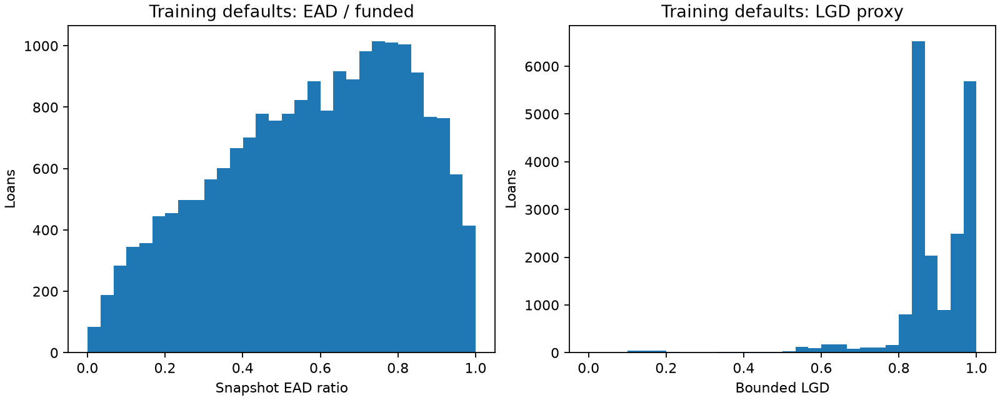

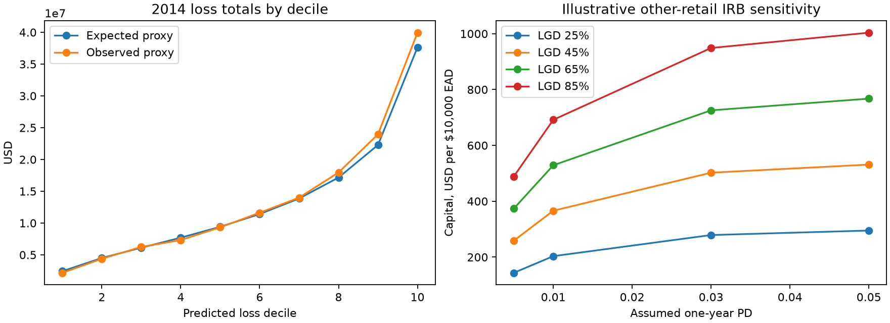

Sources: [BIS CRE31.16 risk-weight functions](https://www.bis.org/committees/bcbs/basel-framework/standard/cre/31/inforce/2023-01-01/published/2020-03-27), [BIS CRE36 economic-loss requirements](https://www.bis.org/committees/bcbs/basel-framework/standard/cre/36/inforce/2023-01-01/published/2022-12-08).

MLflow experiment: `lendingclub_basel_loss_proxies`, batch `bc7fbb6777cd4365b1a93a4d97fd872f`. [Full manifest](../assets/results/basel_loss/bc7fbb6777cd4365b1a93a4d97fd872f/manifest.json). The local model directory contains four component pipelines and the selected loss-model bundle.


### Full loss experiment manifest

```json
{
  "status": "complete",
  "batch_run_id": "bc7fbb6777cd4365b1a93a4d97fd872f",
  "experiment_id": "4",
  "experiment_name": "lendingclub_basel_loss_proxies",
  "features": [
    "loan_amnt",
    "annual_inc",
    "dti",
    "revol_util",
    "revol_bal",
    "open_acc",
    "delinq_2yrs",
    "pub_rec_bankruptcies",
    "emp_length_years",
    "fico_mid",
    "credit_history_years",
    "home_ownership",
    "purpose"
  ],
  "feature_policy": {
    "policy_version": 1,
    "policy_sha256": "7924dba2b6559db00d47a23da048fa6edd4b3a7a41d05390ab439582e6162f6a",
    "scope": "independent_baseline",
    "features": [
      "loan_amnt",
      "annual_inc",
      "dti",
      "revol_util",
      "revol_bal",
      "open_acc",
      "delinq_2yrs",
      "pub_rec_bankruptcies",
      "emp_length_years",
      "fico_mid",
      "credit_history_years",
      "home_ownership",
      "purpose"
    ],
    "scope_note": "Original candidate fields; requested/approved amount and issue-time history require application-time verification.",
    "deployment_approved": false
  },
  "seed": 42,
  "target_scope": "bounded_snapshot_loss_proxies_on_charged_off_loans",
  "train_years": [
    2011,
    2012,
    2013
  ],
  "validation_years": [
    2014
  ],
  "test_2015_read": false,
  "regulatory_compliance_claim": false,
  "one_year_pd_estimated": false,
  "capital_pd_source": "explicit scenario assumptions",
  "prediction_bounds": "clip regressor predictions to [0,1]; raw and bounded metrics both saved",
  "loss_field_scope": "targets, exposure scaling, audit and retrospective dollar evaluation only",
  "selection_rule": "lowest 2014 bounded MAE per component; exploratory selection cohort",
  "ead_formula": "funded_amnt - total_rec_prncp; snapshot proxy, not observed default-event EAD",
  "lgd_formula": "1 - (recoveries - collection_recovery_fee) / snapshot_ead_proxy",
  "el_formula": "lifetime charge-off score * predicted snapshot LGD * predicted snapshot EAD",
  "el_assumption": "product of conditional means ignores residual EAD/LGD dependence",
  "pd_source_run_id": "f64a19bc843546e380a742697cf0bf26",
  "pd_joblib_sha256": "beb4491348dfa7022290768ef79c8150fd7d14a722ef5b3ac78902fa9f0cc078",
  "input_sha256": {
    "data/clean/modeling/train.parquet": "eac423f260cc81fd8eb9f11c1639e4cecd0f452b5ac8f9d57d12a788fb9d29c4",
    "data/clean/modeling/train_metadata.parquet": "f7306739e7011bbc4493b9473090e3674446e8e73f3109b2127632f182052738",
    "data/clean/modeling/validation.parquet": "c645fc9a7eebc4d8755155be63c8ffd44a1cd3b606f127ccb294d4b998a24fbc",
    "data/clean/modeling/validation_metadata.parquet": "8703286db2f5e6143a9e9282224a14f42acd6b098fdbc9a981e774fd8309a0d2"
  },
  "raw_source_sha256": "3eae03c28fd9d2e8a076ebeb73507e8d4d0f44d90500decdb0936e0933d1f36a",
  "versions": {
    "scikit-learn": "1.9.1",
    "numpy": "2.5.4",
    "pandas": "3.1.0",
    "scipy": "1.18.1",
    "joblib": "1.6.0",
    "mlflow": "3.18.0",
    "cloudpickle": "3.1.2"
  },
  "result_directory": "assets/results/basel_loss/bc7fbb6777cd4365b1a93a4d97fd872f",
  "model_directory": "models/basel_loss/bc7fbb6777cd4365b1a93a4d97fd872f",
  "figure_directory": "assets/figures/basel_loss/bc7fbb6777cd4365b1a93a4d97fd872f",
  "model_uris": {
    "ead_mean": "models:/m-05bbe941cbbb4ef59aa64836699289f1",
    "ead_boosting": "models:/m-80058cb3e8744faeb1c232aed99af1a9",
    "lgd_mean": "models:/m-eeb50e6c21664338b5f7863e5860dab1",
    "lgd_boosting": "models:/m-ab1088810235482a87a8b9832b9aa063"
  },
  "run_ids": {
    "ead_mean": "1b8fe236a459480ba74f2ff30f646bb2",
    "ead_boosting": "f022c883346241dbb13f81fa970b832b",
    "lgd_mean": "7df09403f1074b9c9eae252facea30e3",
    "lgd_boosting": "a403b195fd65431a8d5b3d37a9a62aa8"
  },
  "completed_at_utc": "2026-11-11T19:50:12.728870+00:00",
  "selected_components": {
    "ead": "ead_boosting",
    "lgd": "lgd_mean"
  },
  "execution_script_sha256": "fc7ff8624d00e7f196cd28659e896daec6209693cac6d02e7bbb733f7c77c491",
  "pd_predictions_identical": true,
  "source_sha256": {
    "scripts/09_basel_loss_experiment.py": "fc7ff8624d00e7f196cd28659e896daec6209693cac6d02e7bbb733f7c77c491",
    "util/basel.py": "0c64a313abbd995135b721be5cd16ce627b88ccce70b806a6ffe1d4fac701354",
    "util/modeling.py": "6e12d00dfe607844d008f5ad011e643dff776d33d69adc6e1eda01d96594b835",
    "util/feature_policy.json": "7924dba2b6559db00d47a23da048fa6edd4b3a7a41d05390ab439582e6162f6a",
    "sql/34_loss_population.sql": "95a41ae840b4fbb9a60ac922e7c728b751c1c9ff518c9c5499e42db742a04c94",
    "sql/35_loss_audit.sql": "426ffef9f7035e71bf6a8a1e9010fd9b78e897360cc1036dca4a5f57337655bc",
    "requirements.lock": "83d70a8e91f04287833f0a46385915a59d6dbe489d7eb211fc2e2f13f743f510"
  },
  "results_sha256": {
    "loss_deciles.csv": "db584a2002e5e2fb9d28b56333393fbc91ae087b3735670effe9a7152fd9440c",
    "portfolio_loss_metrics.csv": "699bb5b28150ea84ccfa4d4de101d70401bd82a34265eeba9333c64a29080b0a",
    "pd_unchanged_check.csv": "bca65f300de6a340bc7e8bef95d71409efe6c05ed9ebacc8d19d27c71275aaf3",
    "portfolio_capital_scenarios.csv": "70c46ceafae27eb46ffa655b97700e77416cdd05ce8cd5cca9452116266489dd",
    "component_metrics.csv": "22bcca2c37ee7b232d0773e063f62de56039776949e82fdf8609a724d0d62109",
    "native_regression_evaluations.csv": "ad21d62085c744fee52aef71b9078c6e51655742d66e7da17a54d5e0daf0d3a9",
    "capital_sensitivity.csv": "21f4c2f4303e15c19f1820a7888f084c98a7d6691c0b686c24dd4249ac9f437b",
    "loss_audit.csv": "2ead4e83837a30ce4a3f757f4db27f951c4411a539914cb032af79d0425f1ad0"
  },
  "model_sha256": {
    "lgd_mean.joblib": "502c15f1b6a28b013ed1f51a9520df696ad1b0c19af8406a3ea9cd3f15ee03a0",
    "ead_mean.joblib": "a631a552c400146f0d08737b9b40951996c61810c8a3ebc6e6e519ae4de31d70",
    "lgd_boosting.joblib": "a74619a24daed33fa192da13540794e542ce0ac749e1e57f70b968204e56206f",
    "loss_model_bundle.joblib": "1082067bb0b813d60660234a4ca836ee57f8060529bf8cde217b767ef76f38b6",
    "ead_boosting.joblib": "447b8f352cbdaa9326fdc35eeaabf778f19bbe813d8c639230641006fddb1d5a"
  },
  "dataset_sha256": {
    "ead_validation.parquet": "12dd33edfd1e274711f64bb261968b26d9d623f2149f2bd8afe648dbcde2ee07",
    "lgd_validation.parquet": "b7a3a1cdfb3db2dc0324441cd31398f047012cb06f8a2bd3cbbfa132d313c4b5",
    "validation_loss_scores.parquet": "03810e2baa2fa756531d54f23e1e7c8e4e752246863efb07f31704b55b41f80c",
    "lgd_train.parquet": "3b733f9b6b06fef09f3a8d78f5b1c363d764ffe18c6b56df7e39e69ddd05ce25",
    "ead_train.parquet": "05d0192acc5646c51dd184d95412a132c59e27a05a6dcab616a84ea975a647c7"
  }
}
```

<!-- ann-experiment-statistics -->

## 23. ANN challengers


## Risk terminology and interpretation

The classifier estimates lifetime charge-off probability in the resolved
36-month cohort: Charged Off = 1 and Fully Paid = 0. Other statuses are excluded.
This is conditional on the selected accepted-loan population and observed final
status. It is neither a 12-month forecast nor a Basel default probability.

EAD and LGD refer to retrospective snapshot proxies, not default-event EAD or
discounted economic LGD. The lifetime snapshot-loss proxy multiplies the
classifier score by predicted snapshot LGD and snapshot EAD. It is not a
regulatory one-year expected loss estimate.

Capital and RWA are illustrative sensitivities using explicitly assumed
one-year PDs, separate from the classifier score. The current capital scenarios
do not use or annualise the classifier prediction. The approximation
1 - (1 - p_lifetime) ** (1 / 3) would require constant annual hazard; it would
not establish a regulatory default definition or validate a 12-month PD.

Legacy names containing `pd`, `basel`, `expected_loss` or `default` are retained
for artifact/API compatibility. They do not change these definitions.


Two multilayer-perceptron classifiers (32 and 64→32 hidden units) and two 32→16 regressors test whether neural networks improve charge-off discrimination or snapshot loss proxies. They use the same 13 origination predictors as the original benchmark. No PyTorch/TensorFlow dependency is added.

## Protocol

Preprocessing is median imputation, training-only scaling, log1p for income/revolving balance, numeric missing flags, and one-hot categories. Each stopping fit learns preprocessing on 2011–2012 only. Stopping uses 2013 ROC-AUC for charge-off classification and bounded MAE for losses, with at most 60 epochs and patience 8. The chosen epoch budget is frozen, then preprocessing and network are refitted from scratch on 2011–2013. 2014 selects the ANN charge-off classifier candidate by average precision and compares loss components by bounded MAE. 2014 does not select the stopping epoch. Losses train only on the identical eligible defaulted population used in the snapshot-loss proxy experiment. Only origination features reach neural-network inputs.

All networks use ReLU, Adam, alpha 0.01, learning rate 0.001, batch size 1024 and seed 42. Only one seed is studied; these are selection-influenced research results on already-explored cohorts. There is no new holdout claim. No 2015 rows are read, and incumbent classifier/loss-proxy artifacts remain unchanged. The stopping cohort is subsequently included in the fixed-budget refit; it is not an independent final evaluation.

## Loss composition

Compare the reference bundle, ANN charge-off classifier alone, ANN loss components alone, and all-ANN composition on the same eligible portfolio. Regressor predictions are explicitly bounded to [0,1] for loss composition. Raw errors/clipping counts are saved, while native regression evaluations use raw outputs. Expected-loss outputs retain the snapshot and residual-dependence limitations from the loss report. No capital assumptions or one-year-PD claims change.

## pd comparison

| model | split | rows | observed_positive_rate | mean_predicted_probability | threshold | roc_auc | gini | ks | average_precision | brier_score | log_loss | ece_10_uniform_bins | accuracy | balanced_accuracy | precision | recall | specificity | f1 | predicted_positive_rate | tn | fp | fn | tp |
| --- | --- | --- | --- | --- | --- | --- | --- | --- | --- | --- | --- | --- | --- | --- | --- | --- | --- | --- | --- | --- | --- | --- | --- |
| logistic_regression | validation | 162570 | 0.137264 | 0.132214 | 0.5 | 0.646231 | 0.292462 | 0.213711 | 0.21028 | 0.114869 | 0.384341 | 0.006675 | 0.862705 | 0.500152 | 0.391304 | 0.000403 | 0.9999 | 0.000806 | 0.000141 | 140241 | 14 | 22306 | 9 |
| hist_gradient_boosting | validation | 162570 | 0.137264 | 0.131767 | 0.5 | 0.653889 | 0.307779 | 0.222796 | 0.216483 | 0.114375 | 0.382348 | 0.005851 | 0.862736 | 0.5 | 0 | 0 | 1 | 0 | 0 | 140255 | 0 | 22315 | 0 |
| ann_pd_32 | validation | 162570 | 0.137264 | 0.130107 | 0.5 | 0.649693 | 0.299385 | 0.218697 | 0.213183 | 0.11473 | 0.383848 | 0.009889 | 0.862675 | 0.500134 | 0.321429 | 0.000403 | 0.999865 | 0.000806 | 0.000172 | 140236 | 19 | 22306 | 9 |
| ann_pd_64x32 | validation | 162570 | 0.137264 | 0.133349 | 0.5 | 0.651546 | 0.303092 | 0.22013 | 0.214436 | 0.114563 | 0.383005 | 0.007148 | 0.862736 | 0.500094 | 0.5 | 0.000224 | 0.999964 | 0.000448 | 0.000062 | 140250 | 5 | 22310 | 5 |

## loss comparison

| model | component | split | rows | raw_mae | bounded_mae | bounded_rmse | bounded_r2 | observed_mean | predicted_mean | predictions_clipped |
| --- | --- | --- | --- | --- | --- | --- | --- | --- | --- | --- |
| ead_mean | ead | validation | 22308 | 0.203347 | 0.203347 | 0.241757 | -0.002078 | 0.570639 | 0.581648 | 0 |
| ead_boosting | ead | validation | 22308 | 0.20203 | 0.20203 | 0.240937 | 0.00471 | 0.570639 | 0.582187 | 0 |
| lgd_mean | lgd | validation | 22308 | 0.075857 | 0.075857 | 0.121128 | -0.00192 | 0.888369 | 0.893671 | 0 |
| lgd_boosting | lgd | validation | 22308 | 0.076627 | 0.076627 | 0.121075 | -0.001047 | 0.888369 | 0.890492 | 0 |
| ann_ead_32x16 | ead | validation | 22308 | 0.203652 | 0.203635 | 0.244141 | -0.021937 | 0.570639 | 0.58841 | 3 |
| ann_lgd_32x16 | lgd | validation | 22308 | 0.082214 | 0.081999 | 0.125664 | -0.078371 | 0.888369 | 0.892065 | 153 |

## portfolio loss comparison

| method | rows | observed_loss_proxy_total | expected_loss_proxy_total | portfolio_relative_error | loan_dollar_mae | loan_dollar_rmse |
| --- | --- | --- | --- | --- | --- | --- |
| reference | 162563 | 136,945,537.9234 | 132,522,640.713809 | -0.032297 | 1,389.339737 | 2,721.321381 |
| ann_pd_only | 162563 | 136,945,537.9234 | 137,173,944.365377 | 0.001668 | 1,405.987787 | 2,724.590109 |
| ann_loss_only | 162563 | 136,945,537.9234 | 133,024,482.287243 | -0.028632 | 1,391.408369 | 2,723.561003 |
| all_ann | 162563 | 136,945,537.9234 | 137,626,396.467126 | 0.004972 | 1,407.897945 | 2,727.01213 |

## dataset roles

| component | role | rows | target_mean | dataset_digest |
| --- | --- | --- | --- | --- |
| pd | inner_fit | 57571 | 0.128572 | f2d0b047 |
| pd | stopping | 100422 | 0.12326 | 342aece7 |
| pd | train | 157993 | 0.125195 | 3fc22603 |
| pd | validation | 162570 | 0.137264 | 722bf1f9 |
| ead | inner_fit | 7388 | 0.588688 | e3f2b341 |
| ead | stopping | 12369 | 0.577443 | f3a9d8ec |
| ead | train | 19757 | 0.581648 | 1b5669f3 |
| ead | validation | 22308 | 0.570639 | d74c3112 |
| lgd | inner_fit | 7388 | 0.90526 | 356568e9 |
| lgd | stopping | 12369 | 0.886749 | 29d553a8 |
| lgd | train | 19757 | 0.893671 | 9521301c |
| lgd | validation | 22308 | 0.888369 | c160f33c |

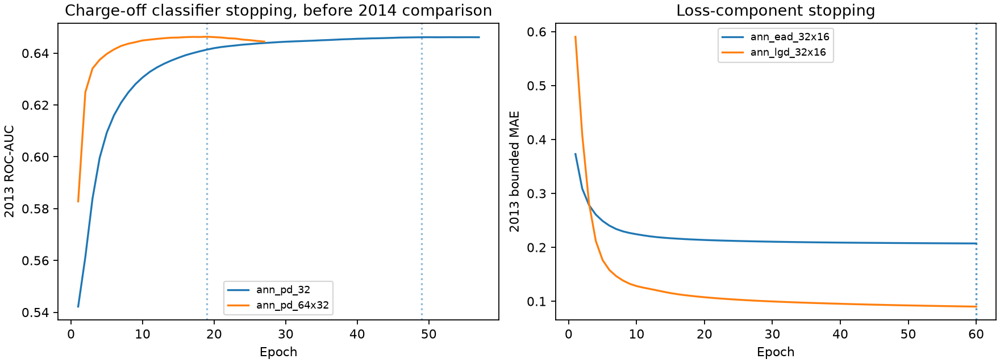

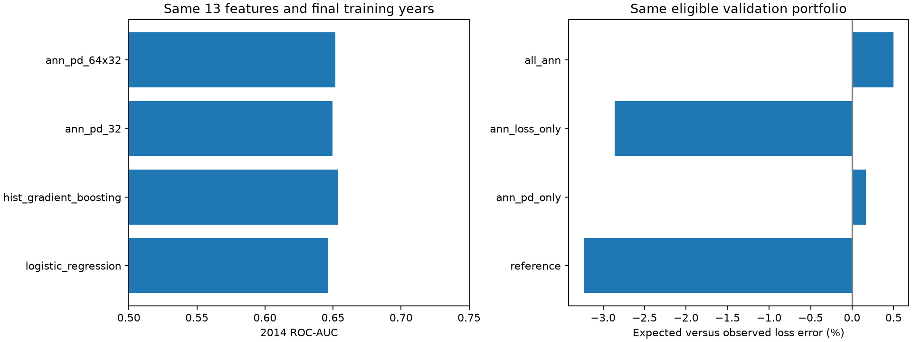

MLflow experiment `lendingclub_ann_challengers`, batch `fd10b18ae1ca40f18ddcdec526bfcc6b`. [Manifest and complete CSVs](../assets/results/ann_experiments/fd10b18ae1ca40f18ddcdec526bfcc6b/manifest.json).

References: [MLPClassifier](https://scikit-learn.org/stable/modules/generated/sklearn.neural_network.MLPClassifier.html), [MLPRegressor](https://scikit-learn.org/stable/modules/generated/sklearn.neural_network.MLPRegressor.html).


### pd_metrics

| model | split | rows | observed_positive_rate | mean_predicted_probability | threshold | roc_auc | gini | ks | average_precision | brier_score | log_loss | ece_10_uniform_bins | accuracy | balanced_accuracy | precision | recall | specificity | f1 | predicted_positive_rate | tn | fp | fn | tp |
| --- | --- | --- | --- | --- | --- | --- | --- | --- | --- | --- | --- | --- | --- | --- | --- | --- | --- | --- | --- | --- | --- | --- | --- |
| ann_pd_32 | train | 157993 | 0.125195 | 0.124422 | 0.5 | 0.668877 | 0.337754 | 0.244005 | 0.218647 | 0.105035 | 0.356831 | 0.00229 | 0.874843 | 0.500368 | 0.615385 | 0.000809 | 0.999928 | 0.001616 | 0.000165 | 138203 | 10 | 19764 | 16 |
| ann_pd_32 | validation | 162570 | 0.137264 | 0.130107 | 0.5 | 0.649693 | 0.299385 | 0.218697 | 0.213183 | 0.11473 | 0.383848 | 0.009889 | 0.862675 | 0.500134 | 0.321429 | 0.000403 | 0.999865 | 0.000806 | 0.000172 | 140236 | 19 | 22306 | 9 |
| ann_pd_64x32 | train | 157993 | 0.125195 | 0.126661 | 0.5 | 0.672132 | 0.344264 | 0.247654 | 0.223552 | 0.104798 | 0.355953 | 0.002515 | 0.874798 | 0.500061 | 0.428571 | 0.000152 | 0.999971 | 0.000303 | 0.000044 | 138209 | 4 | 19777 | 3 |
| ann_pd_64x32 | validation | 162570 | 0.137264 | 0.133349 | 0.5 | 0.651546 | 0.303092 | 0.22013 | 0.214436 | 0.114563 | 0.383005 | 0.007148 | 0.862736 | 0.500094 | 0.5 | 0.000224 | 0.999964 | 0.000448 | 0.000062 | 140250 | 5 | 22310 | 5 |

### pd_comparison

| model | split | rows | observed_positive_rate | mean_predicted_probability | threshold | roc_auc | gini | ks | average_precision | brier_score | log_loss | ece_10_uniform_bins | accuracy | balanced_accuracy | precision | recall | specificity | f1 | predicted_positive_rate | tn | fp | fn | tp |
| --- | --- | --- | --- | --- | --- | --- | --- | --- | --- | --- | --- | --- | --- | --- | --- | --- | --- | --- | --- | --- | --- | --- | --- |
| logistic_regression | validation | 162570 | 0.137264 | 0.132214 | 0.5 | 0.646231 | 0.292462 | 0.213711 | 0.21028 | 0.114869 | 0.384341 | 0.006675 | 0.862705 | 0.500152 | 0.391304 | 0.000403 | 0.9999 | 0.000806 | 0.000141 | 140241 | 14 | 22306 | 9 |
| hist_gradient_boosting | validation | 162570 | 0.137264 | 0.131767 | 0.5 | 0.653889 | 0.307779 | 0.222796 | 0.216483 | 0.114375 | 0.382348 | 0.005851 | 0.862736 | 0.5 | 0 | 0 | 1 | 0 | 0 | 140255 | 0 | 22315 | 0 |
| ann_pd_32 | validation | 162570 | 0.137264 | 0.130107 | 0.5 | 0.649693 | 0.299385 | 0.218697 | 0.213183 | 0.11473 | 0.383848 | 0.009889 | 0.862675 | 0.500134 | 0.321429 | 0.000403 | 0.999865 | 0.000806 | 0.000172 | 140236 | 19 | 22306 | 9 |
| ann_pd_64x32 | validation | 162570 | 0.137264 | 0.133349 | 0.5 | 0.651546 | 0.303092 | 0.22013 | 0.214436 | 0.114563 | 0.383005 | 0.007148 | 0.862736 | 0.500094 | 0.5 | 0.000224 | 0.999964 | 0.000448 | 0.000062 | 140250 | 5 | 22310 | 5 |

### loss_metrics

| model | component | split | rows | raw_mae | bounded_mae | bounded_rmse | bounded_r2 | observed_mean | predicted_mean | predictions_clipped |
| --- | --- | --- | --- | --- | --- | --- | --- | --- | --- | --- |
| ann_ead_32x16 | ead | train | 19757 | 0.200801 | 0.200801 | 0.239756 | 0.041368 | 0.581648 | 0.589094 | 0 |
| ann_ead_32x16 | ead | validation | 22308 | 0.203652 | 0.203635 | 0.244141 | -0.021937 | 0.570639 | 0.58841 | 3 |
| ann_lgd_32x16 | lgd | train | 19757 | 0.076868 | 0.076758 | 0.116711 | -0.017336 | 0.893671 | 0.894396 | 97 |
| ann_lgd_32x16 | lgd | validation | 22308 | 0.082214 | 0.081999 | 0.125664 | -0.078371 | 0.888369 | 0.892065 | 153 |

### loss_comparison

| model | component | split | rows | raw_mae | bounded_mae | bounded_rmse | bounded_r2 | observed_mean | predicted_mean | predictions_clipped |
| --- | --- | --- | --- | --- | --- | --- | --- | --- | --- | --- |
| ead_mean | ead | validation | 22308 | 0.203347 | 0.203347 | 0.241757 | -0.002078 | 0.570639 | 0.581648 | 0 |
| ead_boosting | ead | validation | 22308 | 0.20203 | 0.20203 | 0.240937 | 0.00471 | 0.570639 | 0.582187 | 0 |
| lgd_mean | lgd | validation | 22308 | 0.075857 | 0.075857 | 0.121128 | -0.00192 | 0.888369 | 0.893671 | 0 |
| lgd_boosting | lgd | validation | 22308 | 0.076627 | 0.076627 | 0.121075 | -0.001047 | 0.888369 | 0.890492 | 0 |
| ann_ead_32x16 | ead | validation | 22308 | 0.203652 | 0.203635 | 0.244141 | -0.021937 | 0.570639 | 0.58841 | 3 |
| ann_lgd_32x16 | lgd | validation | 22308 | 0.082214 | 0.081999 | 0.125664 | -0.078371 | 0.888369 | 0.892065 | 153 |

### learning_curves

| phase | epoch | training_objective | stopping_metric | stopping_value | model | component |
| --- | --- | --- | --- | --- | --- | --- |
| stopping_2013 | 1 | 0.656889 | roc_auc | 0.542186 | ann_pd_32 | pd |
| stopping_2013 | 2 | 0.432657 | roc_auc | 0.561331 | ann_pd_32 | pd |
| stopping_2013 | 3 | 0.386812 | roc_auc | 0.583836 | ann_pd_32 | pd |
| stopping_2013 | 4 | 0.377457 | roc_auc | 0.599577 | ann_pd_32 | pd |
| stopping_2013 | 5 | 0.373956 | roc_auc | 0.609341 | ann_pd_32 | pd |
| stopping_2013 | 6 | 0.37187 | roc_auc | 0.615997 | ann_pd_32 | pd |
| stopping_2013 | 7 | 0.370418 | roc_auc | 0.6209 | ann_pd_32 | pd |
| stopping_2013 | 8 | 0.369331 | roc_auc | 0.624823 | ann_pd_32 | pd |
| stopping_2013 | 9 | 0.368473 | roc_auc | 0.628038 | ann_pd_32 | pd |
| stopping_2013 | 10 | 0.367779 | roc_auc | 0.630614 | ann_pd_32 | pd |
| stopping_2013 | 11 | 0.367217 | roc_auc | 0.632757 | ann_pd_32 | pd |
| stopping_2013 | 12 | 0.366751 | roc_auc | 0.634477 | ann_pd_32 | pd |
| stopping_2013 | 13 | 0.366348 | roc_auc | 0.635906 | ann_pd_32 | pd |
| stopping_2013 | 14 | 0.366006 | roc_auc | 0.637128 | ann_pd_32 | pd |
| stopping_2013 | 15 | 0.365701 | roc_auc | 0.638203 | ann_pd_32 | pd |
| stopping_2013 | 16 | 0.365423 | roc_auc | 0.639194 | ann_pd_32 | pd |
| stopping_2013 | 17 | 0.365168 | roc_auc | 0.639983 | ann_pd_32 | pd |
| stopping_2013 | 18 | 0.364935 | roc_auc | 0.640707 | ann_pd_32 | pd |
| stopping_2013 | 19 | 0.364717 | roc_auc | 0.641355 | ann_pd_32 | pd |
| stopping_2013 | 20 | 0.36451 | roc_auc | 0.641928 | ann_pd_32 | pd |
| stopping_2013 | 21 | 0.364325 | roc_auc | 0.64236 | ann_pd_32 | pd |
| stopping_2013 | 22 | 0.364146 | roc_auc | 0.642682 | ann_pd_32 | pd |
| stopping_2013 | 23 | 0.363978 | roc_auc | 0.642966 | ann_pd_32 | pd |
| stopping_2013 | 24 | 0.363822 | roc_auc | 0.643268 | ann_pd_32 | pd |
| stopping_2013 | 25 | 0.363682 | roc_auc | 0.643476 | ann_pd_32 | pd |
| stopping_2013 | 26 | 0.363543 | roc_auc | 0.643718 | ann_pd_32 | pd |
| stopping_2013 | 27 | 0.363411 | roc_auc | 0.643899 | ann_pd_32 | pd |
| stopping_2013 | 28 | 0.363285 | roc_auc | 0.644074 | ann_pd_32 | pd |
| stopping_2013 | 29 | 0.363166 | roc_auc | 0.644253 | ann_pd_32 | pd |
| stopping_2013 | 30 | 0.363051 | roc_auc | 0.644396 | ann_pd_32 | pd |
| stopping_2013 | 31 | 0.362937 | roc_auc | 0.644517 | ann_pd_32 | pd |
| stopping_2013 | 32 | 0.362827 | roc_auc | 0.644621 | ann_pd_32 | pd |
| stopping_2013 | 33 | 0.362727 | roc_auc | 0.644728 | ann_pd_32 | pd |
| stopping_2013 | 34 | 0.362627 | roc_auc | 0.644832 | ann_pd_32 | pd |
| stopping_2013 | 35 | 0.362523 | roc_auc | 0.644967 | ann_pd_32 | pd |
| stopping_2013 | 36 | 0.362424 | roc_auc | 0.645067 | ann_pd_32 | pd |
| stopping_2013 | 37 | 0.362326 | roc_auc | 0.645196 | ann_pd_32 | pd |
| stopping_2013 | 38 | 0.362228 | roc_auc | 0.645333 | ann_pd_32 | pd |
| stopping_2013 | 39 | 0.362133 | roc_auc | 0.645421 | ann_pd_32 | pd |
| stopping_2013 | 40 | 0.362038 | roc_auc | 0.645538 | ann_pd_32 | pd |
| stopping_2013 | 41 | 0.361947 | roc_auc | 0.645609 | ann_pd_32 | pd |
| stopping_2013 | 42 | 0.361859 | roc_auc | 0.645706 | ann_pd_32 | pd |
| stopping_2013 | 43 | 0.361773 | roc_auc | 0.645749 | ann_pd_32 | pd |
| stopping_2013 | 44 | 0.361689 | roc_auc | 0.645828 | ann_pd_32 | pd |
| stopping_2013 | 45 | 0.361609 | roc_auc | 0.645905 | ann_pd_32 | pd |
| stopping_2013 | 46 | 0.361527 | roc_auc | 0.646005 | ann_pd_32 | pd |
| stopping_2013 | 47 | 0.361451 | roc_auc | 0.646045 | ann_pd_32 | pd |
| stopping_2013 | 48 | 0.361373 | roc_auc | 0.646093 | ann_pd_32 | pd |
| stopping_2013 | 49 | 0.361299 | roc_auc | 0.646129 | ann_pd_32 | pd |
| stopping_2013 | 50 | 0.361225 | roc_auc | 0.646148 | ann_pd_32 | pd |
| stopping_2013 | 51 | 0.361153 | roc_auc | 0.646124 | ann_pd_32 | pd |
| stopping_2013 | 52 | 0.361079 | roc_auc | 0.646132 | ann_pd_32 | pd |
| stopping_2013 | 53 | 0.361007 | roc_auc | 0.646151 | ann_pd_32 | pd |
| stopping_2013 | 54 | 0.360939 | roc_auc | 0.646135 | ann_pd_32 | pd |
| stopping_2013 | 55 | 0.360874 | roc_auc | 0.646147 | ann_pd_32 | pd |
| stopping_2013 | 56 | 0.360812 | roc_auc | 0.64615 | ann_pd_32 | pd |
| stopping_2013 | 57 | 0.360753 | roc_auc | 0.646128 | ann_pd_32 | pd |
| refit_2011_2013 | 1 | 0.500288 | — | — | ann_pd_32 | pd |
| refit_2011_2013 | 2 | 0.3715 | — | — | ann_pd_32 | pd |
| refit_2011_2013 | 3 | 0.366157 | — | — | ann_pd_32 | pd |
| refit_2011_2013 | 4 | 0.364037 | — | — | ann_pd_32 | pd |
| refit_2011_2013 | 5 | 0.362818 | — | — | ann_pd_32 | pd |
| refit_2011_2013 | 6 | 0.362016 | — | — | ann_pd_32 | pd |
| refit_2011_2013 | 7 | 0.361443 | — | — | ann_pd_32 | pd |
| refit_2011_2013 | 8 | 0.361003 | — | — | ann_pd_32 | pd |
| refit_2011_2013 | 9 | 0.360647 | — | — | ann_pd_32 | pd |
| refit_2011_2013 | 10 | 0.360363 | — | — | ann_pd_32 | pd |
| refit_2011_2013 | 11 | 0.360128 | — | — | ann_pd_32 | pd |
| refit_2011_2013 | 12 | 0.359918 | — | — | ann_pd_32 | pd |
| refit_2011_2013 | 13 | 0.359737 | — | — | ann_pd_32 | pd |
| refit_2011_2013 | 14 | 0.359576 | — | — | ann_pd_32 | pd |
| refit_2011_2013 | 15 | 0.359429 | — | — | ann_pd_32 | pd |
| refit_2011_2013 | 16 | 0.359298 | — | — | ann_pd_32 | pd |
| refit_2011_2013 | 17 | 0.359178 | — | — | ann_pd_32 | pd |
| refit_2011_2013 | 18 | 0.359073 | — | — | ann_pd_32 | pd |
| refit_2011_2013 | 19 | 0.358973 | — | — | ann_pd_32 | pd |
| refit_2011_2013 | 20 | 0.358878 | — | — | ann_pd_32 | pd |
| refit_2011_2013 | 21 | 0.358788 | — | — | ann_pd_32 | pd |
| refit_2011_2013 | 22 | 0.358709 | — | — | ann_pd_32 | pd |
| refit_2011_2013 | 23 | 0.358638 | — | — | ann_pd_32 | pd |
| refit_2011_2013 | 24 | 0.35857 | — | — | ann_pd_32 | pd |
| refit_2011_2013 | 25 | 0.358505 | — | — | ann_pd_32 | pd |
| refit_2011_2013 | 26 | 0.358441 | — | — | ann_pd_32 | pd |
| refit_2011_2013 | 27 | 0.358381 | — | — | ann_pd_32 | pd |
| refit_2011_2013 | 28 | 0.358319 | — | — | ann_pd_32 | pd |
| refit_2011_2013 | 29 | 0.358256 | — | — | ann_pd_32 | pd |
| refit_2011_2013 | 30 | 0.358193 | — | — | ann_pd_32 | pd |
| refit_2011_2013 | 31 | 0.358132 | — | — | ann_pd_32 | pd |
| refit_2011_2013 | 32 | 0.358076 | — | — | ann_pd_32 | pd |
| refit_2011_2013 | 33 | 0.358023 | — | — | ann_pd_32 | pd |
| refit_2011_2013 | 34 | 0.357974 | — | — | ann_pd_32 | pd |
| refit_2011_2013 | 35 | 0.357926 | — | — | ann_pd_32 | pd |
| refit_2011_2013 | 36 | 0.35788 | — | — | ann_pd_32 | pd |
| refit_2011_2013 | 37 | 0.357837 | — | — | ann_pd_32 | pd |
| refit_2011_2013 | 38 | 0.357796 | — | — | ann_pd_32 | pd |
| refit_2011_2013 | 39 | 0.357756 | — | — | ann_pd_32 | pd |
| refit_2011_2013 | 40 | 0.357717 | — | — | ann_pd_32 | pd |
| refit_2011_2013 | 41 | 0.357677 | — | — | ann_pd_32 | pd |
| refit_2011_2013 | 42 | 0.357639 | — | — | ann_pd_32 | pd |
| refit_2011_2013 | 43 | 0.357603 | — | — | ann_pd_32 | pd |
| refit_2011_2013 | 44 | 0.35757 | — | — | ann_pd_32 | pd |
| refit_2011_2013 | 45 | 0.357536 | — | — | ann_pd_32 | pd |
| refit_2011_2013 | 46 | 0.357504 | — | — | ann_pd_32 | pd |
| refit_2011_2013 | 47 | 0.357473 | — | — | ann_pd_32 | pd |
| refit_2011_2013 | 48 | 0.357442 | — | — | ann_pd_32 | pd |
| refit_2011_2013 | 49 | 0.357416 | — | — | ann_pd_32 | pd |
| stopping_2013 | 1 | 0.470333 | roc_auc | 0.582791 | ann_pd_64x32 | pd |
| stopping_2013 | 2 | 0.374657 | roc_auc | 0.624911 | ann_pd_64x32 | pd |
| stopping_2013 | 3 | 0.369037 | roc_auc | 0.634058 | ann_pd_64x32 | pd |
| stopping_2013 | 4 | 0.367008 | roc_auc | 0.637428 | ann_pd_64x32 | pd |
| stopping_2013 | 5 | 0.365901 | roc_auc | 0.639715 | ann_pd_64x32 | pd |
| stopping_2013 | 6 | 0.365149 | roc_auc | 0.641424 | ann_pd_64x32 | pd |
| stopping_2013 | 7 | 0.364558 | roc_auc | 0.64278 | ann_pd_64x32 | pd |
| stopping_2013 | 8 | 0.364078 | roc_auc | 0.643637 | ann_pd_64x32 | pd |
| stopping_2013 | 9 | 0.363675 | roc_auc | 0.644235 | ann_pd_64x32 | pd |
| stopping_2013 | 10 | 0.363326 | roc_auc | 0.644894 | ann_pd_64x32 | pd |
| stopping_2013 | 11 | 0.363015 | roc_auc | 0.645199 | ann_pd_64x32 | pd |
| stopping_2013 | 12 | 0.36273 | roc_auc | 0.645492 | ann_pd_64x32 | pd |
| stopping_2013 | 13 | 0.362458 | roc_auc | 0.645758 | ann_pd_64x32 | pd |
| stopping_2013 | 14 | 0.362197 | roc_auc | 0.645954 | ann_pd_64x32 | pd |
| stopping_2013 | 15 | 0.361934 | roc_auc | 0.646019 | ann_pd_64x32 | pd |
| stopping_2013 | 16 | 0.361683 | roc_auc | 0.646175 | ann_pd_64x32 | pd |
| stopping_2013 | 17 | 0.361417 | roc_auc | 0.646252 | ann_pd_64x32 | pd |
| stopping_2013 | 18 | 0.36117 | roc_auc | 0.646234 | ann_pd_64x32 | pd |
| stopping_2013 | 19 | 0.360906 | roc_auc | 0.646321 | ann_pd_64x32 | pd |
| stopping_2013 | 20 | 0.360648 | roc_auc | 0.646178 | ann_pd_64x32 | pd |
| stopping_2013 | 21 | 0.360406 | roc_auc | 0.646022 | ann_pd_64x32 | pd |
| stopping_2013 | 22 | 0.360154 | roc_auc | 0.645741 | ann_pd_64x32 | pd |
| stopping_2013 | 23 | 0.359902 | roc_auc | 0.645609 | ann_pd_64x32 | pd |
| stopping_2013 | 24 | 0.359663 | roc_auc | 0.64522 | ann_pd_64x32 | pd |
| stopping_2013 | 25 | 0.359419 | roc_auc | 0.645013 | ann_pd_64x32 | pd |
| stopping_2013 | 26 | 0.359174 | roc_auc | 0.644713 | ann_pd_64x32 | pd |
| stopping_2013 | 27 | 0.358941 | roc_auc | 0.644456 | ann_pd_64x32 | pd |
| refit_2011_2013 | 1 | 0.403087 | — | — | ann_pd_64x32 | pd |
| refit_2011_2013 | 2 | 0.362673 | — | — | ann_pd_64x32 | pd |
| refit_2011_2013 | 3 | 0.361114 | — | — | ann_pd_64x32 | pd |
| refit_2011_2013 | 4 | 0.36039 | — | — | ann_pd_64x32 | pd |
| refit_2011_2013 | 5 | 0.359933 | — | — | ann_pd_64x32 | pd |
| refit_2011_2013 | 6 | 0.359577 | — | — | ann_pd_64x32 | pd |
| refit_2011_2013 | 7 | 0.359291 | — | — | ann_pd_64x32 | pd |
| refit_2011_2013 | 8 | 0.359039 | — | — | ann_pd_64x32 | pd |
| refit_2011_2013 | 9 | 0.358804 | — | — | ann_pd_64x32 | pd |
| refit_2011_2013 | 10 | 0.35857 | — | — | ann_pd_64x32 | pd |
| refit_2011_2013 | 11 | 0.35836 | — | — | ann_pd_64x32 | pd |
| refit_2011_2013 | 12 | 0.358169 | — | — | ann_pd_64x32 | pd |
| refit_2011_2013 | 13 | 0.357975 | — | — | ann_pd_64x32 | pd |
| refit_2011_2013 | 14 | 0.357798 | — | — | ann_pd_64x32 | pd |
| refit_2011_2013 | 15 | 0.357638 | — | — | ann_pd_64x32 | pd |
| refit_2011_2013 | 16 | 0.357471 | — | — | ann_pd_64x32 | pd |
| refit_2011_2013 | 17 | 0.357312 | — | — | ann_pd_64x32 | pd |
| refit_2011_2013 | 18 | 0.35716 | — | — | ann_pd_64x32 | pd |
| refit_2011_2013 | 19 | 0.357007 | — | — | ann_pd_64x32 | pd |
| stopping_2013 | 1 | 0.20084 | bounded_mae | 0.37298 | ann_ead_32x16 | ead |
| stopping_2013 | 2 | 0.109522 | bounded_mae | 0.308739 | ann_ead_32x16 | ead |
| stopping_2013 | 3 | 0.075423 | bounded_mae | 0.278309 | ann_ead_32x16 | ead |
| stopping_2013 | 4 | 0.059039 | bounded_mae | 0.260602 | ann_ead_32x16 | ead |
| stopping_2013 | 5 | 0.051104 | bounded_mae | 0.248847 | ann_ead_32x16 | ead |
| stopping_2013 | 6 | 0.046946 | bounded_mae | 0.240202 | ann_ead_32x16 | ead |
| stopping_2013 | 7 | 0.043784 | bounded_mae | 0.233896 | ann_ead_32x16 | ead |
| stopping_2013 | 8 | 0.041482 | bounded_mae | 0.229549 | ann_ead_32x16 | ead |
| stopping_2013 | 9 | 0.039926 | bounded_mae | 0.226527 | ann_ead_32x16 | ead |
| stopping_2013 | 10 | 0.038747 | bounded_mae | 0.224224 | ann_ead_32x16 | ead |
| stopping_2013 | 11 | 0.037782 | bounded_mae | 0.222164 | ann_ead_32x16 | ead |
| stopping_2013 | 12 | 0.036969 | bounded_mae | 0.220343 | ann_ead_32x16 | ead |
| stopping_2013 | 13 | 0.036283 | bounded_mae | 0.218897 | ann_ead_32x16 | ead |
| stopping_2013 | 14 | 0.035706 | bounded_mae | 0.217773 | ann_ead_32x16 | ead |
| stopping_2013 | 15 | 0.035217 | bounded_mae | 0.216858 | ann_ead_32x16 | ead |
| stopping_2013 | 16 | 0.034802 | bounded_mae | 0.216039 | ann_ead_32x16 | ead |
| stopping_2013 | 17 | 0.034435 | bounded_mae | 0.215315 | ann_ead_32x16 | ead |
| stopping_2013 | 18 | 0.03411 | bounded_mae | 0.214676 | ann_ead_32x16 | ead |
| stopping_2013 | 19 | 0.033823 | bounded_mae | 0.214117 | ann_ead_32x16 | ead |
| stopping_2013 | 20 | 0.033569 | bounded_mae | 0.213616 | ann_ead_32x16 | ead |
| stopping_2013 | 21 | 0.033339 | bounded_mae | 0.213162 | ann_ead_32x16 | ead |
| stopping_2013 | 22 | 0.033131 | bounded_mae | 0.212756 | ann_ead_32x16 | ead |
| stopping_2013 | 23 | 0.032937 | bounded_mae | 0.212391 | ann_ead_32x16 | ead |
| stopping_2013 | 24 | 0.032758 | bounded_mae | 0.212055 | ann_ead_32x16 | ead |
| stopping_2013 | 25 | 0.03259 | bounded_mae | 0.211739 | ann_ead_32x16 | ead |
| stopping_2013 | 26 | 0.032432 | bounded_mae | 0.211444 | ann_ead_32x16 | ead |
| stopping_2013 | 27 | 0.032283 | bounded_mae | 0.211161 | ann_ead_32x16 | ead |
| stopping_2013 | 28 | 0.032144 | bounded_mae | 0.210889 | ann_ead_32x16 | ead |
| stopping_2013 | 29 | 0.032013 | bounded_mae | 0.210645 | ann_ead_32x16 | ead |
| stopping_2013 | 30 | 0.03189 | bounded_mae | 0.210421 | ann_ead_32x16 | ead |
| stopping_2013 | 31 | 0.031774 | bounded_mae | 0.210197 | ann_ead_32x16 | ead |
| stopping_2013 | 32 | 0.031665 | bounded_mae | 0.209981 | ann_ead_32x16 | ead |
| stopping_2013 | 33 | 0.031563 | bounded_mae | 0.209798 | ann_ead_32x16 | ead |
| stopping_2013 | 34 | 0.031467 | bounded_mae | 0.209626 | ann_ead_32x16 | ead |
| stopping_2013 | 35 | 0.031376 | bounded_mae | 0.20946 | ann_ead_32x16 | ead |
| stopping_2013 | 36 | 0.031288 | bounded_mae | 0.209302 | ann_ead_32x16 | ead |
| stopping_2013 | 37 | 0.031204 | bounded_mae | 0.209153 | ann_ead_32x16 | ead |
| stopping_2013 | 38 | 0.031123 | bounded_mae | 0.209006 | ann_ead_32x16 | ead |
| stopping_2013 | 39 | 0.031045 | bounded_mae | 0.208871 | ann_ead_32x16 | ead |
| stopping_2013 | 40 | 0.03097 | bounded_mae | 0.208752 | ann_ead_32x16 | ead |
| stopping_2013 | 41 | 0.0309 | bounded_mae | 0.208637 | ann_ead_32x16 | ead |
| stopping_2013 | 42 | 0.030831 | bounded_mae | 0.208535 | ann_ead_32x16 | ead |
| stopping_2013 | 43 | 0.030764 | bounded_mae | 0.20843 | ann_ead_32x16 | ead |
| stopping_2013 | 44 | 0.030698 | bounded_mae | 0.208339 | ann_ead_32x16 | ead |
| stopping_2013 | 45 | 0.030635 | bounded_mae | 0.208259 | ann_ead_32x16 | ead |
| stopping_2013 | 46 | 0.030575 | bounded_mae | 0.208164 | ann_ead_32x16 | ead |
| stopping_2013 | 47 | 0.030517 | bounded_mae | 0.208072 | ann_ead_32x16 | ead |
| stopping_2013 | 48 | 0.030461 | bounded_mae | 0.207988 | ann_ead_32x16 | ead |
| stopping_2013 | 49 | 0.030407 | bounded_mae | 0.207908 | ann_ead_32x16 | ead |
| stopping_2013 | 50 | 0.030355 | bounded_mae | 0.207822 | ann_ead_32x16 | ead |
| stopping_2013 | 51 | 0.030303 | bounded_mae | 0.207744 | ann_ead_32x16 | ead |
| stopping_2013 | 52 | 0.030252 | bounded_mae | 0.207681 | ann_ead_32x16 | ead |
| stopping_2013 | 53 | 0.030204 | bounded_mae | 0.207606 | ann_ead_32x16 | ead |
| stopping_2013 | 54 | 0.030156 | bounded_mae | 0.207538 | ann_ead_32x16 | ead |
| stopping_2013 | 55 | 0.03011 | bounded_mae | 0.207478 | ann_ead_32x16 | ead |
| stopping_2013 | 56 | 0.030063 | bounded_mae | 0.207419 | ann_ead_32x16 | ead |
| stopping_2013 | 57 | 0.03002 | bounded_mae | 0.20735 | ann_ead_32x16 | ead |
| stopping_2013 | 58 | 0.029977 | bounded_mae | 0.20729 | ann_ead_32x16 | ead |
| stopping_2013 | 59 | 0.029936 | bounded_mae | 0.207234 | ann_ead_32x16 | ead |
| stopping_2013 | 60 | 0.029896 | bounded_mae | 0.207175 | ann_ead_32x16 | ead |
| refit_2011_2013 | 1 | 0.138417 | — | — | ann_ead_32x16 | ead |
| refit_2011_2013 | 2 | 0.056757 | — | — | ann_ead_32x16 | ead |
| refit_2011_2013 | 3 | 0.043316 | — | — | ann_ead_32x16 | ead |
| refit_2011_2013 | 4 | 0.038556 | — | — | ann_ead_32x16 | ead |
| refit_2011_2013 | 5 | 0.036324 | — | — | ann_ead_32x16 | ead |
| refit_2011_2013 | 6 | 0.03495 | — | — | ann_ead_32x16 | ead |
| refit_2011_2013 | 7 | 0.034045 | — | — | ann_ead_32x16 | ead |
| refit_2011_2013 | 8 | 0.03341 | — | — | ann_ead_32x16 | ead |
| refit_2011_2013 | 9 | 0.032929 | — | — | ann_ead_32x16 | ead |
| refit_2011_2013 | 10 | 0.032546 | — | — | ann_ead_32x16 | ead |
| refit_2011_2013 | 11 | 0.032231 | — | — | ann_ead_32x16 | ead |
| refit_2011_2013 | 12 | 0.031962 | — | — | ann_ead_32x16 | ead |
| refit_2011_2013 | 13 | 0.031728 | — | — | ann_ead_32x16 | ead |
| refit_2011_2013 | 14 | 0.031518 | — | — | ann_ead_32x16 | ead |
| refit_2011_2013 | 15 | 0.031329 | — | — | ann_ead_32x16 | ead |
| refit_2011_2013 | 16 | 0.031158 | — | — | ann_ead_32x16 | ead |
| refit_2011_2013 | 17 | 0.031002 | — | — | ann_ead_32x16 | ead |
| refit_2011_2013 | 18 | 0.030861 | — | — | ann_ead_32x16 | ead |
| refit_2011_2013 | 19 | 0.030732 | — | — | ann_ead_32x16 | ead |
| refit_2011_2013 | 20 | 0.030615 | — | — | ann_ead_32x16 | ead |
| refit_2011_2013 | 21 | 0.030509 | — | — | ann_ead_32x16 | ead |
| refit_2011_2013 | 22 | 0.030413 | — | — | ann_ead_32x16 | ead |
| refit_2011_2013 | 23 | 0.030322 | — | — | ann_ead_32x16 | ead |
| refit_2011_2013 | 24 | 0.030239 | — | — | ann_ead_32x16 | ead |
| refit_2011_2013 | 25 | 0.030163 | — | — | ann_ead_32x16 | ead |
| refit_2011_2013 | 26 | 0.030091 | — | — | ann_ead_32x16 | ead |
| refit_2011_2013 | 27 | 0.030024 | — | — | ann_ead_32x16 | ead |
| refit_2011_2013 | 28 | 0.02996 | — | — | ann_ead_32x16 | ead |
| refit_2011_2013 | 29 | 0.029898 | — | — | ann_ead_32x16 | ead |
| refit_2011_2013 | 30 | 0.02984 | — | — | ann_ead_32x16 | ead |
| refit_2011_2013 | 31 | 0.029786 | — | — | ann_ead_32x16 | ead |
| refit_2011_2013 | 32 | 0.029736 | — | — | ann_ead_32x16 | ead |
| refit_2011_2013 | 33 | 0.029689 | — | — | ann_ead_32x16 | ead |
| refit_2011_2013 | 34 | 0.029645 | — | — | ann_ead_32x16 | ead |
| refit_2011_2013 | 35 | 0.029605 | — | — | ann_ead_32x16 | ead |
| refit_2011_2013 | 36 | 0.029566 | — | — | ann_ead_32x16 | ead |
| refit_2011_2013 | 37 | 0.029527 | — | — | ann_ead_32x16 | ead |
| refit_2011_2013 | 38 | 0.029491 | — | — | ann_ead_32x16 | ead |
| refit_2011_2013 | 39 | 0.029456 | — | — | ann_ead_32x16 | ead |
| refit_2011_2013 | 40 | 0.029425 | — | — | ann_ead_32x16 | ead |
| refit_2011_2013 | 41 | 0.029395 | — | — | ann_ead_32x16 | ead |
| refit_2011_2013 | 42 | 0.029367 | — | — | ann_ead_32x16 | ead |
| refit_2011_2013 | 43 | 0.02934 | — | — | ann_ead_32x16 | ead |
| refit_2011_2013 | 44 | 0.029315 | — | — | ann_ead_32x16 | ead |
| refit_2011_2013 | 45 | 0.029292 | — | — | ann_ead_32x16 | ead |
| refit_2011_2013 | 46 | 0.029268 | — | — | ann_ead_32x16 | ead |
| refit_2011_2013 | 47 | 0.029245 | — | — | ann_ead_32x16 | ead |
| refit_2011_2013 | 48 | 0.029223 | — | — | ann_ead_32x16 | ead |
| refit_2011_2013 | 49 | 0.029202 | — | — | ann_ead_32x16 | ead |
| refit_2011_2013 | 50 | 0.02918 | — | — | ann_ead_32x16 | ead |
| refit_2011_2013 | 51 | 0.029159 | — | — | ann_ead_32x16 | ead |
| refit_2011_2013 | 52 | 0.029139 | — | — | ann_ead_32x16 | ead |
| refit_2011_2013 | 53 | 0.02912 | — | — | ann_ead_32x16 | ead |
| refit_2011_2013 | 54 | 0.029101 | — | — | ann_ead_32x16 | ead |
| refit_2011_2013 | 55 | 0.029081 | — | — | ann_ead_32x16 | ead |
| refit_2011_2013 | 56 | 0.029065 | — | — | ann_ead_32x16 | ead |
| refit_2011_2013 | 57 | 0.029048 | — | — | ann_ead_32x16 | ead |
| refit_2011_2013 | 58 | 0.029033 | — | — | ann_ead_32x16 | ead |
| refit_2011_2013 | 59 | 0.029017 | — | — | ann_ead_32x16 | ead |
| refit_2011_2013 | 60 | 0.029001 | — | — | ann_ead_32x16 | ead |
| stopping_2013 | 1 | 0.372328 | bounded_mae | 0.59047 | ann_lgd_32x16 | lgd |
| stopping_2013 | 2 | 0.1944 | bounded_mae | 0.408542 | ann_lgd_32x16 | lgd |
| stopping_2013 | 3 | 0.107345 | bounded_mae | 0.281528 | ann_lgd_32x16 | lgd |
| stopping_2013 | 4 | 0.067051 | bounded_mae | 0.211632 | ann_lgd_32x16 | lgd |
| stopping_2013 | 5 | 0.044881 | bounded_mae | 0.17632 | ann_lgd_32x16 | lgd |
| stopping_2013 | 6 | 0.033243 | bounded_mae | 0.157846 | ann_lgd_32x16 | lgd |
| stopping_2013 | 7 | 0.027612 | bounded_mae | 0.146608 | ann_lgd_32x16 | lgd |
| stopping_2013 | 8 | 0.024209 | bounded_mae | 0.138383 | ann_lgd_32x16 | lgd |
| stopping_2013 | 9 | 0.021619 | bounded_mae | 0.132302 | ann_lgd_32x16 | lgd |
| stopping_2013 | 10 | 0.019641 | bounded_mae | 0.128124 | ann_lgd_32x16 | lgd |
| stopping_2013 | 11 | 0.018151 | bounded_mae | 0.125226 | ann_lgd_32x16 | lgd |
| stopping_2013 | 12 | 0.016981 | bounded_mae | 0.122741 | ann_lgd_32x16 | lgd |
| stopping_2013 | 13 | 0.016023 | bounded_mae | 0.120172 | ann_lgd_32x16 | lgd |
| stopping_2013 | 14 | 0.015219 | bounded_mae | 0.117546 | ann_lgd_32x16 | lgd |
| stopping_2013 | 15 | 0.014532 | bounded_mae | 0.115136 | ann_lgd_32x16 | lgd |
| stopping_2013 | 16 | 0.013939 | bounded_mae | 0.113114 | ann_lgd_32x16 | lgd |
| stopping_2013 | 17 | 0.013418 | bounded_mae | 0.111435 | ann_lgd_32x16 | lgd |
| stopping_2013 | 18 | 0.012957 | bounded_mae | 0.109973 | ann_lgd_32x16 | lgd |
| stopping_2013 | 19 | 0.012548 | bounded_mae | 0.108653 | ann_lgd_32x16 | lgd |
| stopping_2013 | 20 | 0.01218 | bounded_mae | 0.107451 | ann_lgd_32x16 | lgd |
| stopping_2013 | 21 | 0.011848 | bounded_mae | 0.106354 | ann_lgd_32x16 | lgd |
| stopping_2013 | 22 | 0.011548 | bounded_mae | 0.105352 | ann_lgd_32x16 | lgd |
| stopping_2013 | 23 | 0.011278 | bounded_mae | 0.104436 | ann_lgd_32x16 | lgd |
| stopping_2013 | 24 | 0.011032 | bounded_mae | 0.103592 | ann_lgd_32x16 | lgd |
| stopping_2013 | 25 | 0.010809 | bounded_mae | 0.102804 | ann_lgd_32x16 | lgd |
| stopping_2013 | 26 | 0.010604 | bounded_mae | 0.102077 | ann_lgd_32x16 | lgd |
| stopping_2013 | 27 | 0.010414 | bounded_mae | 0.101396 | ann_lgd_32x16 | lgd |
| stopping_2013 | 28 | 0.010237 | bounded_mae | 0.100759 | ann_lgd_32x16 | lgd |
| stopping_2013 | 29 | 0.010074 | bounded_mae | 0.100164 | ann_lgd_32x16 | lgd |
| stopping_2013 | 30 | 0.009924 | bounded_mae | 0.099622 | ann_lgd_32x16 | lgd |
| stopping_2013 | 31 | 0.009784 | bounded_mae | 0.099102 | ann_lgd_32x16 | lgd |
| stopping_2013 | 32 | 0.009653 | bounded_mae | 0.098593 | ann_lgd_32x16 | lgd |
| stopping_2013 | 33 | 0.009531 | bounded_mae | 0.098114 | ann_lgd_32x16 | lgd |
| stopping_2013 | 34 | 0.009415 | bounded_mae | 0.097662 | ann_lgd_32x16 | lgd |
| stopping_2013 | 35 | 0.009306 | bounded_mae | 0.097227 | ann_lgd_32x16 | lgd |
| stopping_2013 | 36 | 0.009204 | bounded_mae | 0.09681 | ann_lgd_32x16 | lgd |
| stopping_2013 | 37 | 0.009106 | bounded_mae | 0.096411 | ann_lgd_32x16 | lgd |
| stopping_2013 | 38 | 0.009014 | bounded_mae | 0.096031 | ann_lgd_32x16 | lgd |
| stopping_2013 | 39 | 0.008925 | bounded_mae | 0.095658 | ann_lgd_32x16 | lgd |
| stopping_2013 | 40 | 0.008841 | bounded_mae | 0.095295 | ann_lgd_32x16 | lgd |
| stopping_2013 | 41 | 0.008761 | bounded_mae | 0.094945 | ann_lgd_32x16 | lgd |
| stopping_2013 | 42 | 0.008685 | bounded_mae | 0.0946 | ann_lgd_32x16 | lgd |
| stopping_2013 | 43 | 0.008612 | bounded_mae | 0.094264 | ann_lgd_32x16 | lgd |
| stopping_2013 | 44 | 0.008544 | bounded_mae | 0.093941 | ann_lgd_32x16 | lgd |
| stopping_2013 | 45 | 0.008478 | bounded_mae | 0.093634 | ann_lgd_32x16 | lgd |
| stopping_2013 | 46 | 0.008415 | bounded_mae | 0.093343 | ann_lgd_32x16 | lgd |
| stopping_2013 | 47 | 0.008355 | bounded_mae | 0.093061 | ann_lgd_32x16 | lgd |
| stopping_2013 | 48 | 0.008298 | bounded_mae | 0.092783 | ann_lgd_32x16 | lgd |
| stopping_2013 | 49 | 0.008243 | bounded_mae | 0.09252 | ann_lgd_32x16 | lgd |
| stopping_2013 | 50 | 0.00819 | bounded_mae | 0.092271 | ann_lgd_32x16 | lgd |
| stopping_2013 | 51 | 0.008138 | bounded_mae | 0.092026 | ann_lgd_32x16 | lgd |
| stopping_2013 | 52 | 0.00809 | bounded_mae | 0.091792 | ann_lgd_32x16 | lgd |
| stopping_2013 | 53 | 0.008044 | bounded_mae | 0.091562 | ann_lgd_32x16 | lgd |
| stopping_2013 | 54 | 0.007999 | bounded_mae | 0.091334 | ann_lgd_32x16 | lgd |
| stopping_2013 | 55 | 0.007957 | bounded_mae | 0.091107 | ann_lgd_32x16 | lgd |
| stopping_2013 | 56 | 0.007916 | bounded_mae | 0.090894 | ann_lgd_32x16 | lgd |
| stopping_2013 | 57 | 0.007878 | bounded_mae | 0.090691 | ann_lgd_32x16 | lgd |
| stopping_2013 | 58 | 0.00784 | bounded_mae | 0.090485 | ann_lgd_32x16 | lgd |
| stopping_2013 | 59 | 0.007803 | bounded_mae | 0.090286 | ann_lgd_32x16 | lgd |
| stopping_2013 | 60 | 0.007769 | bounded_mae | 0.090091 | ann_lgd_32x16 | lgd |
| refit_2011_2013 | 1 | 0.245674 | — | — | ann_lgd_32x16 | lgd |
| refit_2011_2013 | 2 | 0.061728 | — | — | ann_lgd_32x16 | lgd |
| refit_2011_2013 | 3 | 0.028785 | — | — | ann_lgd_32x16 | lgd |
| refit_2011_2013 | 4 | 0.020925 | — | — | ann_lgd_32x16 | lgd |
| refit_2011_2013 | 5 | 0.017232 | — | — | ann_lgd_32x16 | lgd |
| refit_2011_2013 | 6 | 0.01512 | — | — | ann_lgd_32x16 | lgd |
| refit_2011_2013 | 7 | 0.013699 | — | — | ann_lgd_32x16 | lgd |
| refit_2011_2013 | 8 | 0.012681 | — | — | ann_lgd_32x16 | lgd |
| refit_2011_2013 | 9 | 0.011921 | — | — | ann_lgd_32x16 | lgd |
| refit_2011_2013 | 10 | 0.011336 | — | — | ann_lgd_32x16 | lgd |
| refit_2011_2013 | 11 | 0.01087 | — | — | ann_lgd_32x16 | lgd |
| refit_2011_2013 | 12 | 0.010488 | — | — | ann_lgd_32x16 | lgd |
| refit_2011_2013 | 13 | 0.010166 | — | — | ann_lgd_32x16 | lgd |
| refit_2011_2013 | 14 | 0.009891 | — | — | ann_lgd_32x16 | lgd |
| refit_2011_2013 | 15 | 0.009652 | — | — | ann_lgd_32x16 | lgd |
| refit_2011_2013 | 16 | 0.009443 | — | — | ann_lgd_32x16 | lgd |
| refit_2011_2013 | 17 | 0.009257 | — | — | ann_lgd_32x16 | lgd |
| refit_2011_2013 | 18 | 0.009089 | — | — | ann_lgd_32x16 | lgd |
| refit_2011_2013 | 19 | 0.008937 | — | — | ann_lgd_32x16 | lgd |
| refit_2011_2013 | 20 | 0.008798 | — | — | ann_lgd_32x16 | lgd |
| refit_2011_2013 | 21 | 0.008673 | — | — | ann_lgd_32x16 | lgd |
| refit_2011_2013 | 22 | 0.008559 | — | — | ann_lgd_32x16 | lgd |
| refit_2011_2013 | 23 | 0.008455 | — | — | ann_lgd_32x16 | lgd |
| refit_2011_2013 | 24 | 0.008359 | — | — | ann_lgd_32x16 | lgd |
| refit_2011_2013 | 25 | 0.00827 | — | — | ann_lgd_32x16 | lgd |
| refit_2011_2013 | 26 | 0.008187 | — | — | ann_lgd_32x16 | lgd |
| refit_2011_2013 | 27 | 0.00811 | — | — | ann_lgd_32x16 | lgd |
| refit_2011_2013 | 28 | 0.008039 | — | — | ann_lgd_32x16 | lgd |
| refit_2011_2013 | 29 | 0.007974 | — | — | ann_lgd_32x16 | lgd |
| refit_2011_2013 | 30 | 0.007913 | — | — | ann_lgd_32x16 | lgd |
| refit_2011_2013 | 31 | 0.007856 | — | — | ann_lgd_32x16 | lgd |
| refit_2011_2013 | 32 | 0.007805 | — | — | ann_lgd_32x16 | lgd |
| refit_2011_2013 | 33 | 0.007755 | — | — | ann_lgd_32x16 | lgd |
| refit_2011_2013 | 34 | 0.007709 | — | — | ann_lgd_32x16 | lgd |
| refit_2011_2013 | 35 | 0.007666 | — | — | ann_lgd_32x16 | lgd |
| refit_2011_2013 | 36 | 0.007625 | — | — | ann_lgd_32x16 | lgd |
| refit_2011_2013 | 37 | 0.007586 | — | — | ann_lgd_32x16 | lgd |
| refit_2011_2013 | 38 | 0.00755 | — | — | ann_lgd_32x16 | lgd |
| refit_2011_2013 | 39 | 0.007515 | — | — | ann_lgd_32x16 | lgd |
| refit_2011_2013 | 40 | 0.007482 | — | — | ann_lgd_32x16 | lgd |
| refit_2011_2013 | 41 | 0.00745 | — | — | ann_lgd_32x16 | lgd |
| refit_2011_2013 | 42 | 0.007419 | — | — | ann_lgd_32x16 | lgd |
| refit_2011_2013 | 43 | 0.00739 | — | — | ann_lgd_32x16 | lgd |
| refit_2011_2013 | 44 | 0.007363 | — | — | ann_lgd_32x16 | lgd |
| refit_2011_2013 | 45 | 0.007336 | — | — | ann_lgd_32x16 | lgd |
| refit_2011_2013 | 46 | 0.007311 | — | — | ann_lgd_32x16 | lgd |
| refit_2011_2013 | 47 | 0.007287 | — | — | ann_lgd_32x16 | lgd |
| refit_2011_2013 | 48 | 0.007264 | — | — | ann_lgd_32x16 | lgd |
| refit_2011_2013 | 49 | 0.007242 | — | — | ann_lgd_32x16 | lgd |
| refit_2011_2013 | 50 | 0.007221 | — | — | ann_lgd_32x16 | lgd |
| refit_2011_2013 | 51 | 0.007199 | — | — | ann_lgd_32x16 | lgd |
| refit_2011_2013 | 52 | 0.007179 | — | — | ann_lgd_32x16 | lgd |
| refit_2011_2013 | 53 | 0.007158 | — | — | ann_lgd_32x16 | lgd |
| refit_2011_2013 | 54 | 0.007139 | — | — | ann_lgd_32x16 | lgd |
| refit_2011_2013 | 55 | 0.007121 | — | — | ann_lgd_32x16 | lgd |
| refit_2011_2013 | 56 | 0.007103 | — | — | ann_lgd_32x16 | lgd |
| refit_2011_2013 | 57 | 0.007087 | — | — | ann_lgd_32x16 | lgd |
| refit_2011_2013 | 58 | 0.00707 | — | — | ann_lgd_32x16 | lgd |
| refit_2011_2013 | 59 | 0.007055 | — | — | ann_lgd_32x16 | lgd |
| refit_2011_2013 | 60 | 0.007039 | — | — | ann_lgd_32x16 | lgd |

### portfolio_loss_comparison

| method | rows | observed_loss_proxy_total | expected_loss_proxy_total | portfolio_relative_error | loan_dollar_mae | loan_dollar_rmse |
| --- | --- | --- | --- | --- | --- | --- |
| reference | 162563 | 136,945,537.9234 | 132,522,640.713809 | -0.032297 | 1,389.339737 | 2,721.321381 |
| ann_pd_only | 162563 | 136,945,537.9234 | 137,173,944.365377 | 0.001668 | 1,405.987787 | 2,724.590109 |
| ann_loss_only | 162563 | 136,945,537.9234 | 133,024,482.287243 | -0.028632 | 1,391.408369 | 2,723.561003 |
| all_ann | 162563 | 136,945,537.9234 | 137,626,396.467126 | 0.004972 | 1,407.897945 | 2,727.01213 |

### dataset_roles

| component | role | rows | target_mean | dataset_digest |
| --- | --- | --- | --- | --- |
| pd | inner_fit | 57571 | 0.128572 | f2d0b047 |
| pd | stopping | 100422 | 0.12326 | 342aece7 |
| pd | train | 157993 | 0.125195 | 3fc22603 |
| pd | validation | 162570 | 0.137264 | 722bf1f9 |
| ead | inner_fit | 7388 | 0.588688 | e3f2b341 |
| ead | stopping | 12369 | 0.577443 | f3a9d8ec |
| ead | train | 19757 | 0.581648 | 1b5669f3 |
| ead | validation | 22308 | 0.570639 | d74c3112 |
| lgd | inner_fit | 7388 | 0.90526 | 356568e9 |
| lgd | stopping | 12369 | 0.886749 | 29d553a8 |
| lgd | train | 19757 | 0.893671 | 9521301c |
| lgd | validation | 22308 | 0.888369 | c160f33c |

### native_evaluations

| component | model | split | evaluation_run_id | source_training_run_id | model_id | dataset_name | dataset_digest | decision_threshold | score | true_negatives | false_positives | false_negatives | true_positives | example_count | accuracy_score | recall_score | precision_score | f1_score | log_loss | roc_auc | precision_recall_auc | native_validation_score | native_validation_example_count | native_validation_mean_absolute_error | native_validation_mean_squared_error | native_validation_root_mean_squared_error | native_validation_sum_on_target | native_validation_mean_on_target | native_validation_r2_score | native_validation_max_error | native_validation_mean_absolute_percentage_error |
| --- | --- | --- | --- | --- | --- | --- | --- | --- | --- | --- | --- | --- | --- | --- | --- | --- | --- | --- | --- | --- | --- | --- | --- | --- | --- | --- | --- | --- | --- | --- | --- |
| pd | ann_pd_32 | validation | 91bc7259812b46e88b9e4eb1e2caeac5 | 50b94b7f150b4293afdb3426fbb08cdd | m-37e9f607d5a2447eab15bb653594dedd | ann_pd_validation | 722bf1f9 | 0.5 | 0.862675 | 140,236 | 19 | 22,306 | 9 | 162,570 | 0.862675 | 0.000403 | 0.321429 | 0.000806 | 0.383848 | 0.649693 | 0.213183 | — | — | — | — | — | — | — | — | — | — |
| pd | ann_pd_64x32 | validation | 9e7d30ce85544671816d6ad212467d1d | 7e960fa6411e4f31ae9d4d2c0103b384 | m-b3feca10428740fabe23a618de5d9c1c | ann_pd_validation | 722bf1f9 | 0.5 | 0.862736 | 140,250 | 5 | 22,310 | 5 | 162,570 | 0.862736 | 0.000224 | 0.5 | 0.000448 | 0.383005 | 0.651546 | 0.214436 | — | — | — | — | — | — | — | — | — | — |
| ead | ann_ead_32x16 | — | 3c4e39f1bd9d4c92b53a527747440824 | — | — | — | — | — | — | — | — | — | — | — | — | — | — | — | — | — | — | -0.022078 | 22,308 | 0.203652 | 0.059613 | 0.244158 | 12,729.808506 | 0.570639 | -0.022078 | 0.761891 | 2.577918 |
| lgd | ann_lgd_32x16 | — | 81e0256dc7ea49f18c05ddab7b3f7775 | — | — | — | — | — | — | — | — | — | — | — | — | — | — | — | — | — | — | -0.082298 | 22,308 | 0.082214 | 0.015849 | 0.125893 | 19,817.742847 | 0.888369 | -0.082298 | 0.926943 | 187,133,817,827.799316 |

### Full ANN manifest

```json
{
  "status": "complete",
  "experiment_name": "lendingclub_ann_challengers",
  "experiment_id": "5",
  "batch_run_id": "fd10b18ae1ca40f18ddcdec526bfcc6b",
  "features": [
    "loan_amnt",
    "annual_inc",
    "dti",
    "revol_util",
    "revol_bal",
    "open_acc",
    "delinq_2yrs",
    "pub_rec_bankruptcies",
    "emp_length_years",
    "fico_mid",
    "credit_history_years",
    "home_ownership",
    "purpose"
  ],
  "feature_policy": {
    "policy_version": 1,
    "policy_sha256": "7924dba2b6559db00d47a23da048fa6edd4b3a7a41d05390ab439582e6162f6a",
    "scope": "independent_baseline",
    "features": [
      "loan_amnt",
      "annual_inc",
      "dti",
      "revol_util",
      "revol_bal",
      "open_acc",
      "delinq_2yrs",
      "pub_rec_bankruptcies",
      "emp_length_years",
      "fico_mid",
      "credit_history_years",
      "home_ownership",
      "purpose"
    ],
    "scope_note": "Original candidate fields; requested/approved amount and issue-time history require application-time verification.",
    "deployment_approved": false
  },
  "seed": 42,
  "selected_model": "",
  "model_uris": {
    "ann_pd_32": "models:/m-37e9f607d5a2447eab15bb653594dedd",
    "ann_pd_64x32": "models:/m-b3feca10428740fabe23a618de5d9c1c",
    "ann_ead_32x16": "models:/m-4d7f18049b7d4e099af7c8a290109fab",
    "ann_lgd_32x16": "models:/m-92b5b7891e7f4b7d9208da5fdfcf7873"
  },
  "run_ids": {
    "ann_pd_32": "50b94b7f150b4293afdb3426fbb08cdd",
    "ann_pd_64x32": "7e960fa6411e4f31ae9d4d2c0103b384",
    "ann_ead_32x16": "de95763f88ea477eb9a9dbfb36f4be2f",
    "ann_lgd_32x16": "c3d464dae8f243a99c47d0238de79fa7"
  },
  "versions": {
    "scikit-learn": "1.9.1",
    "mlflow": "3.18.0",
    "numpy": "2.5.4",
    "pandas": "3.1.0",
    "scipy": "1.18.1",
    "joblib": "1.6.0",
    "cloudpickle": "3.1.2"
  },
  "input_sha256": {
    "data/clean/modeling/train.parquet": "eac423f260cc81fd8eb9f11c1639e4cecd0f452b5ac8f9d57d12a788fb9d29c4",
    "data/clean/modeling/train_metadata.parquet": "f7306739e7011bbc4493b9473090e3674446e8e73f3109b2127632f182052738",
    "data/clean/modeling/validation.parquet": "c645fc9a7eebc4d8755155be63c8ffd44a1cd3b606f127ccb294d4b998a24fbc",
    "data/clean/modeling/validation_metadata.parquet": "8703286db2f5e6143a9e9282224a14f42acd6b098fdbc9a981e774fd8309a0d2"
  },
  "raw_source_sha256": "3eae03c28fd9d2e8a076ebeb73507e8d4d0f44d90500decdb0936e0933d1f36a",
  "pd_reference_batch_id": "6ccea4b79b8343cd971273181d93f680",
  "loss_reference_batch_id": "bc7fbb6777cd4365b1a93a4d97fd872f",
  "pd_incumbent_sha256": "beb4491348dfa7022290768ef79c8150fd7d14a722ef5b3ac78902fa9f0cc078",
  "loss_reference_bundle_sha256": "1082067bb0b813d60660234a4ca836ee57f8060529bf8cde217b767ef76f38b6",
  "epoch_selection": "fit 2011-2012; stop on 2013 AUC or bounded MAE; refit 2011-2013 for fixed selected epochs",
  "model_selection": "2014 average precision for charge-off classification, bounded MAE for each loss component",
  "test_2015_read": false,
  "data_previously_explored": true,
  "single_seed_research": true,
  "incumbent_replaced": false,
  "capital_scope_changed": false,
  "result_directory": "assets/results/ann_experiments/fd10b18ae1ca40f18ddcdec526bfcc6b",
  "model_directory": "models/ann_experiments/fd10b18ae1ca40f18ddcdec526bfcc6b",
  "figure_directory": "assets/figures/ann_experiments/fd10b18ae1ca40f18ddcdec526bfcc6b",
  "completed_at_utc": "2026-11-11T20:57:23.663813+00:00",
  "selected_ann_pd": "ann_pd_64x32",
  "temporal_settings": {
    "ann_pd_32": {
      "hidden_layers": [
        32
      ],
      "selected_epochs": 49,
      "stopping_epochs_run": 57,
      "stopping_best_value": 0.6461291985802513,
      "inner_fit_rows": 57571,
      "stopping_rows": 100422,
      "refit_rows": 157993,
      "max_epochs": 60,
      "patience": 8,
      "improvement_tolerance": 0.0001,
      "seed": 42,
      "parameters": {
        "hidden_layer_sizes": [
          32
        ],
        "activation": "relu",
        "solver": "adam",
        "alpha": 0.01,
        "learning_rate_init": 0.001,
        "batch_size": 1024,
        "shuffle": true,
        "early_stopping": false,
        "random_state": 42
      }
    },
    "ann_pd_64x32": {
      "hidden_layers": [
        64,
        32
      ],
      "selected_epochs": 19,
      "stopping_epochs_run": 27,
      "stopping_best_value": 0.6463206321896705,
      "inner_fit_rows": 57571,
      "stopping_rows": 100422,
      "refit_rows": 157993,
      "max_epochs": 60,
      "patience": 8,
      "improvement_tolerance": 0.0001,
      "seed": 42,
      "parameters": {
        "hidden_layer_sizes": [
          64,
          32
        ],
        "activation": "relu",
        "solver": "adam",
        "alpha": 0.01,
        "learning_rate_init": 0.001,
        "batch_size": 1024,
        "shuffle": true,
        "early_stopping": false,
        "random_state": 42
      }
    },
    "ann_ead_32x16": {
      "hidden_layers": [
        32,
        16
      ],
      "selected_epochs": 60,
      "stopping_epochs_run": 60,
      "stopping_best_value": 0.20717494325235167,
      "inner_fit_rows": 7388,
      "stopping_rows": 12369,
      "refit_rows": 19757,
      "max_epochs": 60,
      "patience": 8,
      "improvement_tolerance": 1e-05,
      "seed": 42,
      "parameters": {
        "hidden_layer_sizes": [
          32,
          16
        ],
        "activation": "relu",
        "solver": "adam",
        "alpha": 0.01,
        "learning_rate_init": 0.001,
        "batch_size": 1024,
        "shuffle": true,
        "early_stopping": false,
        "random_state": 42
      }
    },
    "ann_lgd_32x16": {
      "hidden_layers": [
        32,
        16
      ],
      "selected_epochs": 60,
      "stopping_epochs_run": 60,
      "stopping_best_value": 0.0900913182756327,
      "inner_fit_rows": 7388,
      "stopping_rows": 12369,
      "refit_rows": 19757,
      "max_epochs": 60,
      "patience": 8,
      "improvement_tolerance": 1e-05,
      "seed": 42,
      "parameters": {
        "hidden_layer_sizes": [
          32,
          16
        ],
        "activation": "relu",
        "solver": "adam",
        "alpha": 0.01,
        "learning_rate_init": 0.001,
        "batch_size": 1024,
        "shuffle": true,
        "early_stopping": false,
        "random_state": 42
      }
    }
  },
  "execution_script_sha256": "885fd06d6f63b784c0e6f513e6e3463a58e80e113c6bf078638f107156d74067",
  "source_sha256": {
    "scripts/11_ann_experiments.py": "885fd06d6f63b784c0e6f513e6e3463a58e80e113c6bf078638f107156d74067",
    "util/ann.py": "a2350788ed70f83a2fad4a12916f78a9b598b999731b5486b605ddadef9df56e",
    "util/modeling.py": "6e12d00dfe607844d008f5ad011e643dff776d33d69adc6e1eda01d96594b835",
    "util/basel.py": "0c64a313abbd995135b721be5cd16ce627b88ccce70b806a6ffe1d4fac701354",
    "util/metrics.py": "d02f8d735d3e6300e887e28494be21b87dba7a4fafe4b85c3fdd7521dfd5687c",
    "util/feature_policy.json": "7924dba2b6559db00d47a23da048fa6edd4b3a7a41d05390ab439582e6162f6a",
    "requirements.lock": "83d70a8e91f04287833f0a46385915a59d6dbe489d7eb211fc2e2f13f743f510"
  },
  "results_sha256": {
    "loss_metrics.csv": "35f0082848b69ece564371d80ad0bce4313dfda7f386d72f8099503606f631cb",
    "pd_comparison.csv": "14dfdfc5ff841ddedf7618d0a73639e53eaea77b6efba13ad8ea267ae64b30f2",
    "pd_metrics.csv": "e9e104ed509477d8915f53746f2628b73b94ca4e4e22c007f4cf58d12a8133fa",
    "loss_comparison.csv": "74ed8eba4b45f149209fb6e1a3d1ee6e717be0ccabfca4761ed071e6534cce00",
    "portfolio_loss_comparison.csv": "108d7fc89c99424bd0b4a240f79ccb57e107eecdc9eb5013a51715e7d21a8bf9",
    "dataset_roles.csv": "87b72a4650d23ccdcf25b4fbc6df3faff06228cc3dd2d4a28edd58bf70cdf6a0",
    "native_evaluations.csv": "2030257afb3b8025f80f6029cfbacbad08d7bd7a164f75b4d1df48c5e47b742a",
    "learning_curves.csv": "0b0e29905b2b15b7f2be8fae15bd15d7b31fcbcd0c0caa84a169193dddcfd3b7"
  },
  "model_sha256": {
    "ann_lgd_32x16.joblib": "48d5063b3c5ebe50c5d3543567adf484739c7b7a8190c8ea75697ed45aedd827",
    "ann_pd_32.joblib": "e354334653e5463560b452ffc1fef735e0fd936806cf34dce54006565b517228",
    "ann_pd_64x32.joblib": "66e76669e1b8a983dcb80584d163ecdc1cac5d464d1c0a73eaf9823783cc4569",
    "ann_loss_bundle.joblib": "9edefe3c42c2ec462c461e92e72baa4f538e2a3eef4d22cc2d994365a4a93fd1",
    "ann_ead_32x16.joblib": "4d0ecf66f38078b8867e7a1d8e9549f2f900730d18db3924af828bc08d3a1956"
  },
  "dataset_sha256": {
    "ead_validation.parquet": "12dd33edfd1e274711f64bb261968b26d9d623f2149f2bd8afe648dbcde2ee07",
    "pd_validation.parquet": "712e7f7796ba1ab9195336ae8cf8c5d5d950be9bb3db0fbfb082c0b14306a133",
    "lgd_stopping.parquet": "78315754bf904e3b3a59f8fb3b1a9c0765a30faa9e6d2ffa8b844c20d5d91cf5",
    "pd_stopping.parquet": "72900cb083a0b105a53980206cd7af0c8aadcba40c2ae84da77c2ffed8812aa7",
    "lgd_validation.parquet": "b7a3a1cdfb3db2dc0324441cd31398f047012cb06f8a2bd3cbbfa132d313c4b5",
    "lgd_train.parquet": "3b733f9b6b06fef09f3a8d78f5b1c363d764ffe18c6b56df7e39e69ddd05ce25",
    "pd_inner_fit.parquet": "705a7a02ef6f48a77cc650fe871d185cb3203b1eaf7717607f4829c231a82dea",
    "ead_stopping.parquet": "81d83cbf6491ceafe3c246c77b61b66b050978fcb64c1aa333bf45ad5ac0b95b",
    "pd_train.parquet": "a8991d6ed3f598a627be6ecd646ad58e4765896e6017b7f0a805269633cc8201",
    "ead_inner_fit.parquet": "2e769ea58944cc4bfdde1d0bd658b8eff6ed2f726417c67df80a3224f5c11e4d",
    "ead_train.parquet": "05d0192acc5646c51dd184d95412a132c59e27a05a6dcab616a84ea975a647c7",
    "lgd_inner_fit.parquet": "6c79ae3e068a7ac8b2b67c5655d695336b67fa790cf3e19dc14a1a6588d41dfd"
  }
}
```


<!-- teaching-extract-audit-statistics -->

## 24. External teaching extract audit


Measured on a public copy of `lending_club_loan_two.csv`: 396,030 rows, 27 columns, charged-off share 19.6129%, 10 postcodes. [Pinned source](https://raw.githubusercontent.com/dicksondurosakin/Loan-Prediction/9efa1b357ab5b4c10e96e4a49aace5364c2d682d/lending_club_loan_two.csv); SHA-256 `fb1dd172c4a3bbc9c2db55ea0863c266e76008e937ff970af89902ba65e140fb`. The reviewer supplied no file hash, so exact identity with their upload is unverified. No claim is made to have inspected their 120 notebook cells.

## What was tested

Postcodes are the final five digits of address, preserving leading zeros. The crosstab uses all rows as a descriptive audit. Postcode-only probabilities are learned on the training partition, then scored on the held-out partition.

The controlled XGBoost ablation uses an identical stratified random 80/20 split (seed 42), fixed 300-tree settings, and train-only imputation/one-hot encoding. It uses 14 numeric and 8 categorical origination/underwriting features, including grade and interest rate, with postcode as the sole additional column in the second model. Direct address, employment title, loan title and outcome fields are excluded from predictors. Employment length and credit-history age are derived deterministically. There is no early stopping or tuning on the holdout.

This is a diagnostic of this teaching extract, not a reproduction of the unseen notebook's XGBoost settings or an estimate of how much of its exact 0.905 result is caused by postcode. A strong target association does not reveal how the added addresses were constructed. It does make this postcode-based result unsuitable as a real-world benchmark for the project.

## postcode status counts

| audit_postcode | Charged Off | Fully Paid | rows | charged_off_rate |
| --- | --- | --- | --- | --- |
| 00813 | 0 | 45824 | 45824 | 0 |
| 05113 | 0 | 45402 | 45402 | 0 |
| 11650 | 11226 | 0 | 11226 | 1 |
| 22690 | 10954 | 45573 | 56527 | 0.193784 |
| 29597 | 0 | 45471 | 45471 | 0 |
| 30723 | 11021 | 45525 | 56546 | 0.194903 |
| 48052 | 11192 | 44725 | 55917 | 0.200154 |
| 70466 | 11148 | 45837 | 56985 | 0.19563 |
| 86630 | 10981 | 0 | 10981 | 1 |
| 93700 | 11151 | 0 | 11151 | 1 |

## score comparison

| model | rows | observed_positive_rate | mean_predicted_probability | threshold | roc_auc | gini | ks | average_precision | brier_score | log_loss | ece_10_uniform_bins | accuracy | balanced_accuracy | precision | recall | specificity | f1 | predicted_positive_rate | tn | fp | fn | tp |
| --- | --- | --- | --- | --- | --- | --- | --- | --- | --- | --- | --- | --- | --- | --- | --- | --- | --- | --- | --- | --- | --- | --- |
| postcode_rate_only | 79206 | 0.196134 | 0.197386 | 0.5 | 0.839645 | 0.67929 | 0.43958 | 0.648067 | 0.089547 | 0.281644 | 0.001252 | 0.888847 | 0.71664 | 1 | 0.43328 | 1 | 0.604599 | 0.084981 | 63671 | 0 | 8804 | 6731 |
| xgboost_without_postcode | 79206 | 0.196134 | 0.196134 | 0.5 | 0.720239 | 0.440477 | 0.325019 | 0.388707 | 0.141352 | 0.444722 | 0.004106 | 0.807628 | 0.529252 | 0.577847 | 0.071194 | 0.98731 | 0.126769 | 0.024165 | 62863 | 808 | 14429 | 1106 |
| xgboost_with_postcode | 79206 | 0.196134 | 0.196947 | 0.5 | 0.907122 | 0.814244 | 0.606579 | 0.782005 | 0.080906 | 0.255262 | 0.004119 | 0.890526 | 0.727953 | 0.961166 | 0.460444 | 0.995461 | 0.622623 | 0.093958 | 63382 | 289 | 8382 | 7153 |

## schema comparison

| teaching_column | present_in_project_source |
| --- | --- |
| loan_amnt | True |
| term | True |
| int_rate | True |
| installment | True |
| grade | True |
| sub_grade | True |
| emp_title | True |
| emp_length | True |
| home_ownership | True |
| annual_inc | True |
| verification_status | True |
| issue_d | True |
| loan_status | True |
| purpose | True |
| title | True |
| dti | True |
| earliest_cr_line | True |
| open_acc | True |
| pub_rec | True |
| revol_bal | True |
| revol_util | True |
| total_acc | True |
| initial_list_status | True |
| application_type | True |
| mort_acc | True |
| pub_rec_bankruptcies | True |
| address | False |

## native evaluations

| model | split | evaluation_run_id | source_training_run_id | model_id | dataset_name | dataset_digest | decision_threshold | score | true_negatives | false_positives | false_negatives | true_positives | example_count | accuracy_score | recall_score | precision_score | f1_score | log_loss | roc_auc | precision_recall_auc |
| --- | --- | --- | --- | --- | --- | --- | --- | --- | --- | --- | --- | --- | --- | --- | --- | --- | --- | --- | --- | --- |
| xgboost_without_postcode | test | 6c02d1d5eb184624a1aa6feaec9b4880 | 02f4d580e39c467ca47c888ed4b83e09 | m-06e0fff21f1747cfb89feb0ff3ea782c | teaching_xgboost_without_postcode_test | ae8b3401 | 0.5 | 0.807628 | 62863 | 808 | 14429 | 1106 | 79206 | 0.807628 | 0.071194 | 0.577847 | 0.126769 | 0.444722 | 0.720239 | 0.388707 |
| xgboost_with_postcode | test | ca1230c0f32e45c1aecb10de535e4ed4 | d73edd725dd14614811de8857e5fb20e | m-35ba9182295f4d74affb97a3afa6bb46 | teaching_xgboost_with_postcode_test | 7c66283d | 0.5 | 0.890526 | 63382 | 289 | 8382 | 7153 | 79206 | 0.890526 | 0.460444 | 0.961166 | 0.622623 | 0.255262 | 0.907122 | 0.782005 |

## Corrections to the comparison

Our all-status charged-off share is 11.8796%, but among ordinary Fully Paid/Charged Off loans it is 19.9626%, comparable in population definition to this teaching file's resolved-only share. The project model cohorts still differ: 2014 validation is 13.7264% charged off and exploratory 2015 is 14.8863%. Comparing a resolved-only share against all statuses is misleading.

ROC-AUC computed on hard 0/1 predictions is mathematically defined and equals balanced accuracy for a binary decision rule. It is not the probability-score ranking AUC used by our experiments. Our 0.6913 research result is also selection-influenced: 2014 was reused for early stopping and candidate selection. Only the original selected model has the separately reported 2015 exploratory AUC of 0.6544. No fresh-holdout claim is appropriate.

The current project data, feature policy, model artifacts, and model selection remain unchanged. The downloaded teaching file and audit model/data artifacts are ignored by Git. MLflow experiment: `lendingclub_teaching_extract_audit`, batch `6191324074c14b32a83b0430e4c16078`.

[Scikit-learn score-based ROC-AUC documentation](https://scikit-learn.org/stable/modules/generated/sklearn.metrics.roc_auc_score.html).


### Full audit manifest

```json
{
  "status": "complete",
  "batch_run_id": "6191324074c14b32a83b0430e4c16078",
  "experiment_id": "6",
  "experiment_name": "lendingclub_teaching_extract_audit",
  "source": {
    "repository": "dicksondurosakin/Loan-Prediction",
    "commit": "9efa1b357ab5b4c10e96e4a49aace5364c2d682d",
    "url": "https://raw.githubusercontent.com/dicksondurosakin/Loan-Prediction/9efa1b357ab5b4c10e96e4a49aace5364c2d682d/lending_club_loan_two.csv",
    "sha256": "fb1dd172c4a3bbc9c2db55ea0863c266e76008e937ff970af89902ba65e140fb",
    "bytes": 99561334,
    "matches_reviewers_exact_file": "not established; reviewer hash unavailable"
  },
  "rows": 396030,
  "columns": 27,
  "source_columns": [
    "loan_amnt",
    "term",
    "int_rate",
    "installment",
    "grade",
    "sub_grade",
    "emp_title",
    "emp_length",
    "home_ownership",
    "annual_inc",
    "verification_status",
    "issue_d",
    "loan_status",
    "purpose",
    "title",
    "dti",
    "earliest_cr_line",
    "open_acc",
    "pub_rec",
    "revol_bal",
    "revol_util",
    "total_acc",
    "initial_list_status",
    "application_type",
    "mort_acc",
    "pub_rec_bankruptcies",
    "address"
  ],
  "charged_off_rows": 77673,
  "charged_off_rate": 0.1961290811302174,
  "postcode_values": 10,
  "train_rows": 316824,
  "test_rows": 79206,
  "split": "stratified random 80/20, seed 42",
  "notebook_exact_reproduction": false,
  "reviewers_exact_file_identity_verified": false,
  "construction_mechanism_verified": false,
  "production_feature_policy_changed": false,
  "xgboost_parameters": {
    "n_estimators": 300,
    "max_depth": 4,
    "learning_rate": 0.05,
    "min_child_weight": 10,
    "subsample": 0.8,
    "colsample_bytree": 0.8,
    "reg_lambda": 10,
    "tree_method": "hist",
    "n_jobs": 4,
    "random_state": 42,
    "eval_metric": "auc"
  },
  "incumbent_sha256": "beb4491348dfa7022290768ef79c8150fd7d14a722ef5b3ac78902fa9f0cc078",
  "result_directory": "assets/results/teaching_extract_audit/6191324074c14b32a83b0430e4c16078",
  "model_directory": "models/teaching_extract_audit/6191324074c14b32a83b0430e4c16078",
  "model_uris": {
    "xgboost_without_postcode": "models:/m-06e0fff21f1747cfb89feb0ff3ea782c",
    "xgboost_with_postcode": "models:/m-35ba9182295f4d74affb97a3afa6bb46"
  },
  "run_ids": {
    "xgboost_without_postcode": "02f4d580e39c467ca47c888ed4b83e09",
    "xgboost_with_postcode": "d73edd725dd14614811de8857e5fb20e"
  },
  "selected_model": "",
  "completed_at_utc": "2026-11-09T01:09:33.525004+00:00",
  "pure_paid_postcodes": [
    "00813",
    "05113",
    "29597"
  ],
  "pure_charged_off_postcodes": [
    "11650",
    "86630",
    "93700"
  ],
  "postcode_only_heldout_auc": 0.8396448472288981,
  "controlled_postcode_auc_gain": 0.18688335424727232,
  "execution_script_sha256": "69e7c7677c6cb64e140bc3558b32bc0dd91fe054b5f652f823d26cea5b338d13",
  "incumbent_unchanged": true,
  "results_sha256": {
    "postcode_status_counts.csv": "3bae4e1aaebc3198daa1617b2d8a4206ab3baf941571d629abcd9a29067e33fb",
    "native_evaluations.csv": "812c0ed61ed99ae2248524279e809cad8bb40530ee403d955d4449b87fdd09ab",
    "schema_comparison.csv": "03322ee554c42576564a0b21054d3ef5c1ad3033167b7dc261fdf926193a91f4",
    "score_comparison.csv": "9445c60597b0b62c95dd14624e6b759084a8e0ed67b25d99cbb2432c6f15eb86"
  }
}
```

### External teaching-audit verification

```json
{
  "completed_at_utc": "2026-11-09T01:11:12.868691+00:00",
  "status": "passed",
  "batch_run_id": "6191324074c14b32a83b0430e4c16078",
  "source_csv_sha256": "fb1dd172c4a3bbc9c2db55ea0863c266e76008e937ff970af89902ba65e140fb",
  "source_commit": "9efa1b357ab5b4c10e96e4a49aace5364c2d682d",
  "script_sha256": "69e7c7677c6cb64e140bc3558b32bc0dd91fe054b5f652f823d26cea5b338d13",
  "source_and_script_hashes_verified": true,
  "download_bytes": 99561334,
  "rows": 396030,
  "columns": 27,
  "postcode_values": 10,
  "pure_paid_postcodes": [
    "00813",
    "05113",
    "29597"
  ],
  "pure_charged_off_postcodes": [
    "11650",
    "86630",
    "93700"
  ],
  "holdout_rows": 79206,
  "postcode_only_auc": 0.8396448472288981,
  "xgboost_without_postcode_auc": 0.7202387042575645,
  "xgboost_with_postcode_auc": 0.9071220585048368,
  "postcode_auc_gain": 0.18688335424727232,
  "native_evaluations_finished": 2,
  "local_logged_models_match_full_holdout_predictions": true,
  "tests_passed": 85,
  "test_failures": 0,
  "incumbent_unchanged": true,
  "project_feature_policy_unchanged": true,
  "reviewer_file_identity_verified": false,
  "reviewer_notebook_exactly_reproduced": false,
  "model_sha256": {
    "xgboost_without_postcode.joblib": "19b7ea8bd8fbfea5f3928dbdf04f5565d8dee956a5cff4ae74b5727293155b0a",
    "xgboost_with_postcode.joblib": "5380c486a05cb66afb6ed3d36aae2558439a8b8d7c074da076bdf20ce57b6353"
  },
  "dataset_sha256": {
    "xgboost_without_postcode_test.parquet": "b8064e7fb16669f17e6b2a9a92f51354923ce4b8bf9abd03599377fe63052560",
    "xgboost_with_postcode_test.parquet": "dc12ed5235cff1cf6e4220b77b38e6abe3e63b82cef5a9a7f70bc217690d4a15",
    "xgboost_without_postcode_train.parquet": "9dc726fe4779f1bb2b29bcd9b76b3d6a6d396ebb65a5520d26c3026a1ff7f75e",
    "xgboost_with_postcode_train.parquet": "b5f7ab54c5a99de7ed7f1987ad2882ee1c90b1e2cfafeec8df2443d424648a51"
  }
}
```

<!-- coefficient-validation-statistics -->

## 25. Logistic coefficient validation


This review investigates the two questioned negative logistic coefficients using only 2011–2013 training data. Four feature-removal variants are compared on the already-explored 2014 cohort. No 2015 rows are read, no model is promoted, and no coefficients are forced to have a preferred sign. Positive class is Charged Off.

## What the signs mean

The original logistic pipeline uses scaled numeric inputs and log1p for annual income and revolving balance. Coefficients are conditional associations within accepted, resolved loans. A negative coefficient does not establish that delinquency or bankruptcy protects against loss. Year-specific estimates use different training scales; signs are comparable, while raw magnitudes also depend on those scales. The CSV includes coefficients per transformed input unit.

Univariate fits, observed outcome buckets and FICO-stratified slices give context. Correlation and conditional/marginal sign changes are diagnostics, not proof of a causal explanation.

## Bootstrap protocol

200 resamples, seed 42, stratified by training issue year × outcome. Every resample refits imputation, scaling, encoding and regularized logistic regression. Intervals use empirical 2.5th/97.5th percentiles; sign fractions and estimable counts are saved. They condition on observed year/class counts and omit repeated-borrower dependence, macroeconomic uncertainty, and model-selection uncertainty. They are not unpenalized inferential p-values.

## univariate vs adjusted

| feature | univariate_standardized_coefficient | adjusted_standardized_coefficient | univariate_input_includes_missing_flag_if_needed |
| --- | --- | --- | --- |
| delinq_2yrs | 0.016058 | -0.018985 | True |
| pub_rec_bankruptcies | 0.012118 | -0.043006 | True |

## coefficient summary

| feature | point_coefficient | estimable_resamples | median | lower_95 | upper_95 | negative_fraction | positive_fraction |
| --- | --- | --- | --- | --- | --- | --- | --- |
| annual_inc | -0.294973 | 200 | -0.295362 | -0.318646 | -0.275914 | 1 | 0 |
| credit_history_years | -0.023221 | 200 | -0.024471 | -0.042613 | -0.00584 | 0.995 | 0.005 |
| delinq_2yrs | -0.018985 | 200 | -0.019517 | -0.034436 | -0.004122 | 0.985 | 0.015 |
| dti | 0.10686 | 200 | 0.107409 | 0.090059 | 0.126546 | 0 | 1 |
| emp_length_years | 0.02401 | 200 | 0.024554 | 0.008725 | 0.041595 | 0 | 1 |
| fico_mid | -0.383836 | 200 | -0.384017 | -0.405821 | -0.360347 | 1 | 0 |
| loan_amnt | 0.17579 | 200 | 0.175143 | 0.157625 | 0.194308 | 0 | 1 |
| open_acc | 0.085205 | 200 | 0.085349 | 0.066102 | 0.103458 | 0 | 1 |
| pub_rec_bankruptcies | -0.043006 | 200 | -0.043608 | -0.055997 | -0.027713 | 1 | 0 |
| revol_bal | -0.123783 | 200 | -0.12456 | -0.144027 | -0.102735 | 1 | 0 |
| revol_util | 0.082465 | 200 | 0.083382 | 0.062111 | 0.105791 | 0 | 1 |

## year coefficients

| feature | coefficient_standardized | coefficient_per_transformed_unit | input_transform | training_scale | estimable | fit_year | rows |
| --- | --- | --- | --- | --- | --- | --- | --- |
| loan_amnt | 0.094894 | 0.000015 | identity | 6,476.663273 | True | 2011 | 14101 |
| annual_inc | -0.372836 | -0.673245 | log1p | 0.553789 | True | 2011 | 14101 |
| dti | 0.026252 | 0.003897 | identity | 6.736156 | True | 2011 | 14101 |
| revol_util | 0.226929 | 0.008049 | identity | 28.195001 | True | 2011 | 14101 |
| revol_bal | -0.116259 | -0.064679 | log1p | 1.797468 | True | 2011 | 14101 |
| open_acc | 0.063071 | 0.014576 | identity | 4.326948 | True | 2011 | 14101 |
| delinq_2yrs | 0.022527 | 0.044815 | identity | 0.50267 | True | 2011 | 14101 |
| pub_rec_bankruptcies | 0.014601 | 0.07136 | identity | 0.204612 | True | 2011 | 14101 |
| emp_length_years | 0.058329 | 0.016949 | identity | 3.441466 | True | 2011 | 14101 |
| fico_mid | -0.412496 | -0.011435 | identity | 36.074024 | True | 2011 | 14101 |
| credit_history_years | 0.00619 | 0.000881 | identity | 7.022532 | True | 2011 | 14101 |
| loan_amnt | 0.208508 | 0.000029 | identity | 7,081.085313 | True | 2012 | 43470 |
| annual_inc | -0.287186 | -0.548894 | log1p | 0.523208 | True | 2012 | 43470 |
| dti | 0.062146 | 0.008168 | identity | 7.608557 | True | 2012 | 43470 |
| revol_util | 0.084877 | 0.003504 | identity | 24.221328 | True | 2012 | 43470 |
| revol_bal | -0.177292 | -0.151619 | log1p | 1.169326 | True | 2012 | 43470 |
| open_acc | 0.07934 | 0.017941 | identity | 4.422348 | True | 2012 | 43470 |
| delinq_2yrs | -0.032543 | -0.05109 | identity | 0.636979 | True | 2012 | 43470 |
| pub_rec_bankruptcies | 0.021986 | 0.143584 | identity | 0.153119 | True | 2012 | 43470 |
| emp_length_years | 0.031177 | 0.008982 | identity | 3.471016 | True | 2012 | 43470 |
| fico_mid | -0.42133 | -0.013032 | identity | 32.330593 | True | 2012 | 43470 |
| credit_history_years | 0.019873 | 0.002907 | identity | 6.836622 | True | 2012 | 43470 |
| loan_amnt | 0.174274 | 0.000024 | identity | 7,355.510725 | True | 2013 | 100422 |
| annual_inc | -0.283878 | -0.545774 | log1p | 0.520137 | True | 2013 | 100422 |
| dti | 0.139054 | 0.018225 | identity | 7.629728 | True | 2013 | 100422 |
| revol_util | 0.051989 | 0.002295 | identity | 22.657352 | True | 2013 | 100422 |
| revol_bal | -0.102488 | -0.101092 | log1p | 1.013802 | True | 2013 | 100422 |
| open_acc | 0.0852 | 0.018396 | identity | 4.631446 | True | 2013 | 100422 |
| delinq_2yrs | -0.018288 | -0.024983 | identity | 0.732023 | True | 2013 | 100422 |
| pub_rec_bankruptcies | -0.055851 | -0.166417 | identity | 0.335611 | True | 2013 | 100422 |
| emp_length_years | 0.016433 | 0.004711 | identity | 3.48817 | True | 2013 | 100422 |
| fico_mid | -0.364593 | -0.012479 | identity | 29.21575 | True | 2013 | 100422 |
| credit_history_years | -0.039213 | -0.005418 | identity | 7.236835 | True | 2013 | 100422 |

## ablation metrics

| model | removed | rows | observed_positive_rate | mean_predicted_probability | threshold | roc_auc | gini | ks | average_precision | brier_score | log_loss | ece_10_uniform_bins | accuracy | balanced_accuracy | precision | recall | specificity | f1 | predicted_positive_rate | tn | fp | fn | tp |
| --- | --- | --- | --- | --- | --- | --- | --- | --- | --- | --- | --- | --- | --- | --- | --- | --- | --- | --- | --- | --- | --- | --- | --- |
| full_reference_refit |  | 162570 | 0.137264 | 0.132214 | 0.5 | 0.646231 | 0.292462 | 0.213711 | 0.21028 | 0.114869 | 0.384341 | 0.006675 | 0.862705 | 0.500152 | 0.391304 | 0.000403 | 0.9999 | 0.000806 | 0.000141 | 140241 | 14 | 22306 | 9 |
| drop_delinq | delinq_2yrs | 162570 | 0.137264 | 0.132421 | 0.5 | 0.646438 | 0.292877 | 0.214507 | 0.21039 | 0.114856 | 0.384276 | 0.006469 | 0.862699 | 0.500148 | 0.375 | 0.000403 | 0.999893 | 0.000806 | 0.000148 | 140240 | 15 | 22306 | 9 |
| drop_bankruptcies | pub_rec_bankruptcies | 162570 | 0.137264 | 0.132985 | 0.5 | 0.646646 | 0.293291 | 0.21389 | 0.210386 | 0.114846 | 0.384219 | 0.006178 | 0.862687 | 0.500141 | 0.346154 | 0.000403 | 0.999879 | 0.000806 | 0.00016 | 140238 | 17 | 22306 | 9 |
| drop_both | delinq_2yrs,pub_rec_bankruptcies | 162570 | 0.137264 | 0.133059 | 0.5 | 0.646776 | 0.293552 | 0.214307 | 0.210494 | 0.114838 | 0.384179 | 0.006026 | 0.862687 | 0.500141 | 0.346154 | 0.000403 | 0.999879 | 0.000806 | 0.00016 | 140238 | 17 | 22306 | 9 |

## ablation auc interval

| comparison | point_difference | lower_95 | upper_95 |
| --- | --- | --- | --- |
| drop_both_minus_full_logistic | 0.000545 | 0.000061 | 0.000995 |

## limitations

| item | status | finding |
| --- | --- | --- |
| target | limitation | Charged-off versus fully-paid among resolved 36-month accepted loans; no fixed one-year default horizon. |
| test | limitation | 2015 was previously explored and is not read in this review; no fresh holdout exists. |
| label timing | limitation | Snapshot training labels may not have been known at later origination dates; not a point-in-time backtest. |
| bureau timing | limitation | Added bureau-field collection/update times remain uncertified; expanded results are research only. |
| logistic interpretation | reviewed | Year, bootstrap, univariate and removal checks recorded; negative conditional coefficients are not causal protective effects or scorecard approval. |
| loss targets | proxy only | EAD is residual snapshot principal; LGD uses snapshot net recoveries without event-time/discounted economic-loss validation. |
| capital | illustrative only | Capital uses assumed one-year PD scenarios; no regulatory floors, buffers, downturn-LGD validation or compliance claim. |

## Use decision

Keep the incumbent histogram-boosting model unchanged. The plain logistic baseline is not a WoE scorecard and this review does not certify monotonic economic interpretation. If a model requires monotonic delinquency/bankruptcy effects, that requirement must be enforced and validated in a separate constrained model; do not relabel conditional negative effects as beneficial borrower behaviour. Feature-removal comparisons and their paired interval show the discrimination trade-off, without turning 2014 into a fresh holdout.

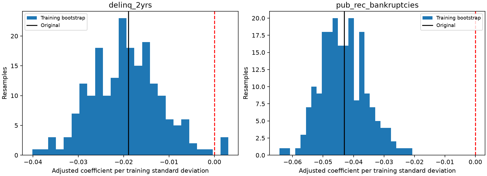

[Scikit-learn coefficient-interpretation guidance](https://scikit-learn.org/stable/auto_examples/inspection/plot_linear_model_coefficient_interpretation.html). MLflow experiment `lendingclub_coefficient_validation`, batch `ada1537bb4c646d9baadfa73f78e09c0`. [Full CSVs and manifest](../assets/results/validation_review/ada1537bb4c646d9baadfa73f78e09c0/manifest.json).


### point_coefficients

| feature | coefficient_standardized | coefficient_per_transformed_unit | input_transform | training_scale | estimable |
| --- | --- | --- | --- | --- | --- |
| loan_amnt | 0.17579 | 0.000024 | identity | 7,267.86234 | True |
| annual_inc | -0.294973 | -0.5618 | log1p | 0.525051 | True |
| dti | 0.10686 | 0.014049 | identity | 7.606191 | True |
| revol_util | 0.082465 | 0.003471 | identity | 23.759141 | True |
| revol_bal | -0.123783 | -0.106562 | log1p | 1.161603 | True |
| open_acc | 0.085205 | 0.018617 | identity | 4.576824 | True |
| delinq_2yrs | -0.018985 | -0.027516 | identity | 0.689943 | True |
| pub_rec_bankruptcies | -0.043006 | -0.148714 | identity | 0.289184 | True |
| emp_length_years | 0.02401 | 0.006876 | identity | 3.491885 | True |
| fico_mid | -0.383836 | -0.012245 | identity | 31.346181 | True |
| credit_history_years | -0.023221 | -0.003251 | identity | 7.142185 | True |

### year_coefficients

| feature | coefficient_standardized | coefficient_per_transformed_unit | input_transform | training_scale | estimable | fit_year | rows |
| --- | --- | --- | --- | --- | --- | --- | --- |
| loan_amnt | 0.094894 | 0.000015 | identity | 6,476.663273 | True | 2011 | 14101 |
| annual_inc | -0.372836 | -0.673245 | log1p | 0.553789 | True | 2011 | 14101 |
| dti | 0.026252 | 0.003897 | identity | 6.736156 | True | 2011 | 14101 |
| revol_util | 0.226929 | 0.008049 | identity | 28.195001 | True | 2011 | 14101 |
| revol_bal | -0.116259 | -0.064679 | log1p | 1.797468 | True | 2011 | 14101 |
| open_acc | 0.063071 | 0.014576 | identity | 4.326948 | True | 2011 | 14101 |
| delinq_2yrs | 0.022527 | 0.044815 | identity | 0.50267 | True | 2011 | 14101 |
| pub_rec_bankruptcies | 0.014601 | 0.07136 | identity | 0.204612 | True | 2011 | 14101 |
| emp_length_years | 0.058329 | 0.016949 | identity | 3.441466 | True | 2011 | 14101 |
| fico_mid | -0.412496 | -0.011435 | identity | 36.074024 | True | 2011 | 14101 |
| credit_history_years | 0.00619 | 0.000881 | identity | 7.022532 | True | 2011 | 14101 |
| loan_amnt | 0.208508 | 0.000029 | identity | 7,081.085313 | True | 2012 | 43470 |
| annual_inc | -0.287186 | -0.548894 | log1p | 0.523208 | True | 2012 | 43470 |
| dti | 0.062146 | 0.008168 | identity | 7.608557 | True | 2012 | 43470 |
| revol_util | 0.084877 | 0.003504 | identity | 24.221328 | True | 2012 | 43470 |
| revol_bal | -0.177292 | -0.151619 | log1p | 1.169326 | True | 2012 | 43470 |
| open_acc | 0.07934 | 0.017941 | identity | 4.422348 | True | 2012 | 43470 |
| delinq_2yrs | -0.032543 | -0.05109 | identity | 0.636979 | True | 2012 | 43470 |
| pub_rec_bankruptcies | 0.021986 | 0.143584 | identity | 0.153119 | True | 2012 | 43470 |
| emp_length_years | 0.031177 | 0.008982 | identity | 3.471016 | True | 2012 | 43470 |
| fico_mid | -0.42133 | -0.013032 | identity | 32.330593 | True | 2012 | 43470 |
| credit_history_years | 0.019873 | 0.002907 | identity | 6.836622 | True | 2012 | 43470 |
| loan_amnt | 0.174274 | 0.000024 | identity | 7,355.510725 | True | 2013 | 100422 |
| annual_inc | -0.283878 | -0.545774 | log1p | 0.520137 | True | 2013 | 100422 |
| dti | 0.139054 | 0.018225 | identity | 7.629728 | True | 2013 | 100422 |
| revol_util | 0.051989 | 0.002295 | identity | 22.657352 | True | 2013 | 100422 |
| revol_bal | -0.102488 | -0.101092 | log1p | 1.013802 | True | 2013 | 100422 |
| open_acc | 0.0852 | 0.018396 | identity | 4.631446 | True | 2013 | 100422 |
| delinq_2yrs | -0.018288 | -0.024983 | identity | 0.732023 | True | 2013 | 100422 |
| pub_rec_bankruptcies | -0.055851 | -0.166417 | identity | 0.335611 | True | 2013 | 100422 |
| emp_length_years | 0.016433 | 0.004711 | identity | 3.48817 | True | 2013 | 100422 |
| fico_mid | -0.364593 | -0.012479 | identity | 29.21575 | True | 2013 | 100422 |
| credit_history_years | -0.039213 | -0.005418 | identity | 7.236835 | True | 2013 | 100422 |

### univariate_vs_adjusted

| feature | univariate_standardized_coefficient | adjusted_standardized_coefficient | univariate_input_includes_missing_flag_if_needed |
| --- | --- | --- | --- |
| delinq_2yrs | 0.016058 | -0.018985 | True |
| pub_rec_bankruptcies | 0.012118 | -0.043006 | True |

### training_outcome_buckets

| feature | cohort | value_bucket | rows | charged_off | charged_off_rate |
| --- | --- | --- | --- | --- | --- |
| delinq_2yrs | FICO_660 | 0 | 34603 | 6037 | 0.174465 |
| delinq_2yrs | FICO_660 | 1 | 7324 | 1096 | 0.149645 |
| delinq_2yrs | FICO_660 | 2 | 2223 | 344 | 0.154746 |
| delinq_2yrs | FICO_660 | 3+ | 1457 | 211 | 0.144818 |
| delinq_2yrs | FICO_680 | 0 | 38328 | 5421 | 0.141437 |
| delinq_2yrs | FICO_680 | 1 | 5302 | 630 | 0.118823 |
| delinq_2yrs | FICO_680 | 2 | 1455 | 175 | 0.120275 |
| delinq_2yrs | FICO_680 | 3+ | 775 | 103 | 0.132903 |
| delinq_2yrs | FICO_700 | 0 | 28365 | 2985 | 0.105235 |
| delinq_2yrs | FICO_700 | 1 | 2544 | 265 | 0.104167 |
| delinq_2yrs | FICO_700 | 2 | 593 | 58 | 0.097808 |
| delinq_2yrs | FICO_700 | 3+ | 272 | 31 | 0.113971 |
| delinq_2yrs | FICO_720 | 0 | 15380 | 1336 | 0.086866 |
| delinq_2yrs | FICO_720 | 1 | 1004 | 64 | 0.063745 |
| delinq_2yrs | FICO_720 | 2 | 178 | 14 | 0.078652 |
| delinq_2yrs | FICO_720 | 3+ | 50 | 4 | 0.08 |
| delinq_2yrs | FICO_740 | 0 | 8262 | 550 | 0.06657 |
| delinq_2yrs | FICO_740 | 1 | 375 | 28 | 0.074667 |
| delinq_2yrs | FICO_740 | 2 | 41 | 1 | 0.02439 |
| delinq_2yrs | FICO_740 | 3+ | 9 | 2 | 0.222222 |
| delinq_2yrs | FICO_760 | 0 | 4729 | 245 | 0.051808 |
| delinq_2yrs | FICO_760 | 1 | 122 | 5 | 0.040984 |
| delinq_2yrs | FICO_760 | 2 | 11 | 0 | 0 |
| delinq_2yrs | FICO_760 | 3+ | 4 | 2 | 0.5 |
| delinq_2yrs | FICO_780 | 0 | 2830 | 121 | 0.042756 |
| delinq_2yrs | FICO_780 | 1 | 29 | 4 | 0.137931 |
| delinq_2yrs | FICO_780 | 2 | 3 | 0 | 0 |
| delinq_2yrs | FICO_780 | 3+ | 1 | 0 | 0 |
| delinq_2yrs | FICO_800 | 0 | 1322 | 39 | 0.029501 |
| delinq_2yrs | FICO_800 | 1 | 7 | 1 | 0.142857 |
| delinq_2yrs | FICO_800 | 2 | 1 | 1 | 1 |
| delinq_2yrs | FICO_820 | 0 | 353 | 6 | 0.016997 |
| delinq_2yrs | FICO_820 | 1 | 2 | 0 | 0 |
| delinq_2yrs | FICO_840 | 0 | 39 | 1 | 0.025641 |
| delinq_2yrs | pooled | 0 | 134211 | 16741 | 0.124736 |
| delinq_2yrs | pooled | 1 | 16709 | 2093 | 0.125262 |
| delinq_2yrs | pooled | 2 | 4505 | 593 | 0.131632 |
| delinq_2yrs | pooled | 3+ | 2568 | 353 | 0.137461 |
| delinq_2yrs | year_2011 | 0 | 12601 | 1290 | 0.102373 |
| delinq_2yrs | year_2011 | 1 | 1153 | 152 | 0.13183 |
| delinq_2yrs | year_2011 | 2 | 234 | 42 | 0.179487 |
| delinq_2yrs | year_2011 | 3+ | 113 | 15 | 0.132743 |
| delinq_2yrs | year_2012 | 0 | 37654 | 5083 | 0.134992 |
| delinq_2yrs | year_2012 | 1 | 4181 | 590 | 0.141115 |
| delinq_2yrs | year_2012 | 2 | 1060 | 142 | 0.133962 |
| delinq_2yrs | year_2012 | 3+ | 575 | 88 | 0.153043 |
| delinq_2yrs | year_2013 | 0 | 83956 | 10368 | 0.123493 |
| delinq_2yrs | year_2013 | 1 | 11375 | 1351 | 0.118769 |
| delinq_2yrs | year_2013 | 2 | 3211 | 409 | 0.127375 |
| delinq_2yrs | year_2013 | 3+ | 1880 | 250 | 0.132979 |
| pub_rec_bankruptcies | FICO_660 | 0 | 38835 | 6729 | 0.173272 |
| pub_rec_bankruptcies | FICO_660 | 1 | 6574 | 934 | 0.142075 |
| pub_rec_bankruptcies | FICO_660 | 2 | 157 | 19 | 0.121019 |
| pub_rec_bankruptcies | FICO_660 | 3+ | 41 | 6 | 0.146341 |
| pub_rec_bankruptcies | FICO_680 | 0 | 42198 | 5864 | 0.138964 |
| pub_rec_bankruptcies | FICO_680 | 1 | 3614 | 462 | 0.127836 |
| pub_rec_bankruptcies | FICO_680 | 2 | 42 | 2 | 0.047619 |
| pub_rec_bankruptcies | FICO_680 | 3+ | 6 | 1 | 0.166667 |
| pub_rec_bankruptcies | FICO_700 | 0 | 29875 | 3132 | 0.104837 |
| pub_rec_bankruptcies | FICO_700 | 1 | 1885 | 206 | 0.109284 |
| pub_rec_bankruptcies | FICO_700 | 2 | 9 | 1 | 0.111111 |
| pub_rec_bankruptcies | FICO_700 | 3+ | 5 | 0 | 0 |
| pub_rec_bankruptcies | FICO_720 | 0 | 16068 | 1363 | 0.084827 |
| pub_rec_bankruptcies | FICO_720 | 1 | 542 | 55 | 0.101476 |
| pub_rec_bankruptcies | FICO_720 | 2 | 1 | 0 | 0 |
| pub_rec_bankruptcies | FICO_720 | 3+ | 1 | 0 | 0 |
| pub_rec_bankruptcies | FICO_740 | 0 | 8606 | 578 | 0.067162 |
| pub_rec_bankruptcies | FICO_740 | 1 | 80 | 3 | 0.0375 |
| pub_rec_bankruptcies | FICO_740 | 2 | 1 | 0 | 0 |
| pub_rec_bankruptcies | FICO_760 | 0 | 4860 | 252 | 0.051852 |
| pub_rec_bankruptcies | FICO_760 | 1 | 6 | 0 | 0 |
| pub_rec_bankruptcies | FICO_780 | 0 | 2863 | 125 | 0.04366 |
| pub_rec_bankruptcies | FICO_800 | 0 | 1330 | 41 | 0.030827 |
| pub_rec_bankruptcies | FICO_820 | 0 | 355 | 6 | 0.016901 |
| pub_rec_bankruptcies | FICO_840 | 0 | 39 | 1 | 0.025641 |
| pub_rec_bankruptcies | pooled | 0 | 145029 | 18091 | 0.124741 |
| pub_rec_bankruptcies | pooled | 1 | 12701 | 1660 | 0.130698 |
| pub_rec_bankruptcies | pooled | 2 | 210 | 22 | 0.104762 |
| pub_rec_bankruptcies | pooled | 3+ | 53 | 7 | 0.132075 |
| pub_rec_bankruptcies | year_2011 | 0 | 13490 | 1407 | 0.104299 |
| pub_rec_bankruptcies | year_2011 | 1 | 609 | 91 | 0.149425 |
| pub_rec_bankruptcies | year_2011 | 2 | 2 | 1 | 0.5 |
| pub_rec_bankruptcies | year_2012 | 0 | 42490 | 5736 | 0.134996 |
| pub_rec_bankruptcies | year_2012 | 1 | 968 | 164 | 0.169421 |
| pub_rec_bankruptcies | year_2012 | 2 | 10 | 2 | 0.2 |
| pub_rec_bankruptcies | year_2012 | 3+ | 2 | 1 | 0.5 |
| pub_rec_bankruptcies | year_2013 | 0 | 89049 | 10948 | 0.122944 |
| pub_rec_bankruptcies | year_2013 | 1 | 11124 | 1405 | 0.126303 |
| pub_rec_bankruptcies | year_2013 | 2 | 198 | 19 | 0.09596 |
| pub_rec_bankruptcies | year_2013 | 3+ | 51 | 6 | 0.117647 |

### spearman_correlations

| other_feature | delinq_2yrs | pub_rec_bankruptcies |
| --- | --- | --- |
| loan_amnt | 0.013112 | -0.075373 |
| annual_inc | 0.097295 | -0.062626 |
| dti | -0.003816 | -0.041289 |
| revol_util | -0.019064 | -0.043248 |
| revol_bal | -0.042229 | -0.149795 |
| open_acc | 0.066449 | -0.038447 |
| delinq_2yrs | 1 | -0.040225 |
| pub_rec_bankruptcies | -0.040225 | 1 |
| emp_length_years | 0.042382 | 0.05545 |
| fico_mid | -0.204566 | -0.181381 |
| credit_history_years | 0.124564 | 0.086008 |

### coefficient_bootstrap

| feature | coefficient_standardized | coefficient_per_transformed_unit | input_transform | training_scale | estimable | resample |
| --- | --- | --- | --- | --- | --- | --- |
| loan_amnt | 0.17343 | 0.000024 | identity | 7,276.311024 | True | 0 |
| annual_inc | -0.283402 | -0.540913 | log1p | 0.523933 | True | 0 |
| dti | 0.093509 | 0.0123 | identity | 7.60216 | True | 0 |
| revol_util | 0.092627 | 0.003896 | identity | 23.773462 | True | 0 |
| revol_bal | -0.127882 | -0.110609 | log1p | 1.156162 | True | 0 |
| open_acc | 0.093054 | 0.020323 | identity | 4.578882 | True | 0 |
| delinq_2yrs | -0.022087 | -0.032632 | identity | 0.676855 | True | 0 |
| pub_rec_bankruptcies | -0.029378 | -0.101226 | identity | 0.290221 | True | 0 |
| emp_length_years | 0.025858 | 0.007408 | identity | 3.49032 | True | 0 |
| fico_mid | -0.371662 | -0.011902 | identity | 31.226311 | True | 0 |
| credit_history_years | -0.0269 | -0.003757 | identity | 7.160035 | True | 0 |
| loan_amnt | 0.169961 | 0.000023 | identity | 7,272.736332 | True | 1 |
| annual_inc | -0.318674 | -0.607749 | log1p | 0.524352 | True | 1 |
| dti | 0.107637 | 0.01411 | identity | 7.628331 | True | 1 |
| revol_util | 0.081144 | 0.003409 | identity | 23.800788 | True | 1 |
| revol_bal | -0.120877 | -0.10428 | log1p | 1.159159 | True | 1 |
| open_acc | 0.075888 | 0.016666 | identity | 4.55349 | True | 1 |
| delinq_2yrs | -0.009377 | -0.013722 | identity | 0.683392 | True | 1 |
| pub_rec_bankruptcies | -0.035382 | -0.122129 | identity | 0.28971 | True | 1 |
| emp_length_years | 0.022124 | 0.006348 | identity | 3.485255 | True | 1 |
| fico_mid | -0.384346 | -0.012249 | identity | 31.377115 | True | 1 |
| credit_history_years | -0.00669 | -0.000939 | identity | 7.127449 | True | 1 |
| loan_amnt | 0.182669 | 0.000025 | identity | 7,287.548357 | True | 2 |
| annual_inc | -0.276413 | -0.52482 | log1p | 0.526681 | True | 2 |
| dti | 0.116564 | 0.015324 | identity | 7.60675 | True | 2 |
| revol_util | 0.078091 | 0.003284 | identity | 23.776341 | True | 2 |
| revol_bal | -0.137692 | -0.11755 | log1p | 1.17135 | True | 2 |
| open_acc | 0.087556 | 0.019178 | identity | 4.565341 | True | 2 |
| delinq_2yrs | -0.018599 | -0.026537 | identity | 0.700862 | True | 2 |
| pub_rec_bankruptcies | -0.049584 | -0.169137 | identity | 0.293157 | True | 2 |
| emp_length_years | 0.033819 | 0.009717 | identity | 3.480276 | True | 2 |
| fico_mid | -0.38763 | -0.012379 | identity | 31.314495 | True | 2 |
| credit_history_years | -0.015452 | -0.002166 | identity | 7.132485 | True | 2 |
| loan_amnt | 0.165058 | 0.000023 | identity | 7,258.202135 | True | 3 |
| annual_inc | -0.305263 | -0.583539 | log1p | 0.523124 | True | 3 |
| dti | 0.10937 | 0.014397 | identity | 7.59681 | True | 3 |
| revol_util | 0.081396 | 0.003418 | identity | 23.812586 | True | 3 |
| revol_bal | -0.118809 | -0.101259 | log1p | 1.173316 | True | 3 |
| open_acc | 0.085547 | 0.018656 | identity | 4.585396 | True | 3 |
| delinq_2yrs | -0.030955 | -0.044472 | identity | 0.696043 | True | 3 |
| pub_rec_bankruptcies | -0.042223 | -0.145716 | identity | 0.289763 | True | 3 |
| emp_length_years | 0.030966 | 0.008868 | identity | 3.492035 | True | 3 |
| fico_mid | -0.403264 | -0.012865 | identity | 31.345095 | True | 3 |
| credit_history_years | -0.013777 | -0.001942 | identity | 7.092622 | True | 3 |
| loan_amnt | 0.161402 | 0.000022 | identity | 7,279.07689 | True | 4 |
| annual_inc | -0.287691 | -0.548644 | log1p | 0.524368 | True | 4 |
| dti | 0.11146 | 0.014645 | identity | 7.610954 | True | 4 |
| revol_util | 0.089395 | 0.003768 | identity | 23.722622 | True | 4 |
| revol_bal | -0.124128 | -0.107135 | log1p | 1.158611 | True | 4 |
| open_acc | 0.073646 | 0.01604 | identity | 4.591491 | True | 4 |
| delinq_2yrs | -0.028696 | -0.041458 | identity | 0.692166 | True | 4 |
| pub_rec_bankruptcies | -0.047817 | -0.165574 | identity | 0.288796 | True | 4 |
| emp_length_years | 0.012909 | 0.003694 | identity | 3.494084 | True | 4 |
| fico_mid | -0.380205 | -0.012154 | identity | 31.283187 | True | 4 |
| credit_history_years | -0.023365 | -0.003273 | identity | 7.139148 | True | 4 |
| loan_amnt | 0.189541 | 0.000026 | identity | 7,265.703611 | True | 5 |
| annual_inc | -0.305693 | -0.58341 | log1p | 0.523977 | True | 5 |
| dti | 0.090039 | 0.011836 | identity | 7.607051 | True | 5 |
| revol_util | 0.096509 | 0.004065 | identity | 23.739434 | True | 5 |
| revol_bal | -0.12229 | -0.105643 | log1p | 1.157585 | True | 5 |
| open_acc | 0.112785 | 0.024647 | identity | 4.575944 | True | 5 |
| delinq_2yrs | -0.029804 | -0.042484 | identity | 0.701522 | True | 5 |
| pub_rec_bankruptcies | -0.043181 | -0.148777 | identity | 0.290237 | True | 5 |
| emp_length_years | 0.017447 | 0.004986 | identity | 3.499488 | True | 5 |
| fico_mid | -0.394879 | -0.012596 | identity | 31.348459 | True | 5 |
| credit_history_years | -0.014413 | -0.002018 | identity | 7.141974 | True | 5 |
| loan_amnt | 0.184392 | 0.000025 | identity | 7,275.634415 | True | 6 |
| annual_inc | -0.295235 | -0.562252 | log1p | 0.525093 | True | 6 |
| dti | 0.104559 | 0.013739 | identity | 7.610351 | True | 6 |
| revol_util | 0.080077 | 0.003374 | identity | 23.735711 | True | 6 |
| revol_bal | -0.115191 | -0.099273 | log1p | 1.160353 | True | 6 |
| open_acc | 0.084296 | 0.0184 | identity | 4.581223 | True | 6 |
| delinq_2yrs | -0.028774 | -0.041246 | identity | 0.697627 | True | 6 |
| pub_rec_bankruptcies | -0.020687 | -0.072013 | identity | 0.287265 | True | 6 |
| emp_length_years | 0.020197 | 0.005785 | identity | 3.49134 | True | 6 |
| fico_mid | -0.394052 | -0.01258 | identity | 31.323 | True | 6 |
| credit_history_years | -0.018782 | -0.00262 | identity | 7.169893 | True | 6 |
| loan_amnt | 0.167177 | 0.000023 | identity | 7,305.99795 | True | 7 |
| annual_inc | -0.287156 | -0.546275 | log1p | 0.525661 | True | 7 |
| dti | 0.100486 | 0.01318 | identity | 7.624189 | True | 7 |
| revol_util | 0.088046 | 0.003708 | identity | 23.744024 | True | 7 |
| revol_bal | -0.120337 | -0.102552 | log1p | 1.173423 | True | 7 |
| open_acc | 0.095708 | 0.020944 | identity | 4.569685 | True | 7 |
| delinq_2yrs | -0.020914 | -0.029705 | identity | 0.70405 | True | 7 |
| pub_rec_bankruptcies | -0.036725 | -0.126421 | identity | 0.290495 | True | 7 |
| emp_length_years | 0.026091 | 0.007474 | identity | 3.490771 | True | 7 |
| fico_mid | -0.387807 | -0.012375 | identity | 31.337392 | True | 7 |
| credit_history_years | -0.026247 | -0.003663 | identity | 7.164805 | True | 7 |
| loan_amnt | 0.164706 | 0.000023 | identity | 7,276.758563 | True | 8 |
| annual_inc | -0.29144 | -0.553705 | log1p | 0.526346 | True | 8 |
| dti | 0.120392 | 0.015803 | identity | 7.618404 | True | 8 |
| revol_util | 0.065225 | 0.002743 | identity | 23.774446 | True | 8 |
| revol_bal | -0.117324 | -0.100193 | log1p | 1.170983 | True | 8 |
| open_acc | 0.072376 | 0.015778 | identity | 4.587142 | True | 8 |
| delinq_2yrs | -0.026828 | -0.039023 | identity | 0.687506 | True | 8 |
| pub_rec_bankruptcies | -0.054513 | -0.189659 | identity | 0.287426 | True | 8 |
| emp_length_years | 0.02477 | 0.007099 | identity | 3.489253 | True | 8 |
| fico_mid | -0.401561 | -0.012777 | identity | 31.427435 | True | 8 |
| credit_history_years | -0.015068 | -0.002103 | identity | 7.166202 | True | 8 |
| loan_amnt | 0.16569 | 0.000023 | identity | 7,274.930607 | True | 9 |
| annual_inc | -0.288232 | -0.548276 | log1p | 0.525705 | True | 9 |
| dti | 0.132424 | 0.017358 | identity | 7.628988 | True | 9 |
| revol_util | 0.082603 | 0.003477 | identity | 23.75571 | True | 9 |
| revol_bal | -0.127006 | -0.108182 | log1p | 1.174006 | True | 9 |
| open_acc | 0.076224 | 0.016657 | identity | 4.576036 | True | 9 |
| delinq_2yrs | -0.014685 | -0.021612 | identity | 0.679449 | True | 9 |
| pub_rec_bankruptcies | -0.036066 | -0.126139 | identity | 0.285924 | True | 9 |
| emp_length_years | 0.018703 | 0.005354 | identity | 3.493461 | True | 9 |
| fico_mid | -0.382074 | -0.012141 | identity | 31.469223 | True | 9 |
| credit_history_years | -0.013521 | -0.001901 | identity | 7.112316 | True | 9 |
| loan_amnt | 0.178293 | 0.000025 | identity | 7,267.232871 | True | 10 |
| annual_inc | -0.272418 | -0.519727 | log1p | 0.524155 | True | 10 |
| dti | 0.092999 | 0.012208 | identity | 7.618025 | True | 10 |
| revol_util | 0.090747 | 0.003823 | identity | 23.73758 | True | 10 |
| revol_bal | -0.124659 | -0.108309 | log1p | 1.150965 | True | 10 |
| open_acc | 0.079933 | 0.017491 | identity | 4.569922 | True | 10 |
| delinq_2yrs | -0.030979 | -0.044314 | identity | 0.699086 | True | 10 |
| pub_rec_bankruptcies | -0.04529 | -0.155647 | identity | 0.290979 | True | 10 |
| emp_length_years | 0.017897 | 0.005134 | identity | 3.485751 | True | 10 |
| fico_mid | -0.390332 | -0.012432 | identity | 31.396682 | True | 10 |
| credit_history_years | -0.017934 | -0.002516 | identity | 7.127211 | True | 10 |
| loan_amnt | 0.17426 | 0.000024 | identity | 7,284.632656 | True | 11 |
| annual_inc | -0.272101 | -0.519918 | log1p | 0.523354 | True | 11 |
| dti | 0.119809 | 0.015762 | identity | 7.601075 | True | 11 |
| revol_util | 0.09256 | 0.003901 | identity | 23.728034 | True | 11 |
| revol_bal | -0.119112 | -0.102535 | log1p | 1.161671 | True | 11 |
| open_acc | 0.076706 | 0.016784 | identity | 4.570258 | True | 11 |
| delinq_2yrs | -0.021467 | -0.03085 | identity | 0.695847 | True | 11 |
| pub_rec_bankruptcies | -0.0406 | -0.141203 | identity | 0.287528 | True | 11 |
| emp_length_years | 0.024729 | 0.007089 | identity | 3.488365 | True | 11 |
| fico_mid | -0.383333 | -0.012263 | identity | 31.260064 | True | 11 |
| credit_history_years | -0.045338 | -0.006341 | identity | 7.149758 | True | 11 |
| loan_amnt | 0.191407 | 0.000026 | identity | 7,257.707477 | True | 12 |
| annual_inc | -0.302818 | -0.575202 | log1p | 0.526455 | True | 12 |
| dti | 0.100787 | 0.013223 | identity | 7.62219 | True | 12 |
| revol_util | 0.075403 | 0.003171 | identity | 23.77646 | True | 12 |
| revol_bal | -0.109329 | -0.093184 | log1p | 1.173258 | True | 12 |
| open_acc | 0.06189 | 0.013521 | identity | 4.57739 | True | 12 |
| delinq_2yrs | -0.029342 | -0.042776 | identity | 0.685946 | True | 12 |
| pub_rec_bankruptcies | -0.036242 | -0.125074 | identity | 0.289763 | True | 12 |
| emp_length_years | 0.026363 | 0.007547 | identity | 3.493009 | True | 12 |
| fico_mid | -0.38504 | -0.012247 | identity | 31.440602 | True | 12 |
| credit_history_years | -0.019728 | -0.002752 | identity | 7.169684 | True | 12 |
| loan_amnt | 0.181006 | 0.000025 | identity | 7,273.755625 | True | 13 |
| annual_inc | -0.310817 | -0.59046 | log1p | 0.526398 | True | 13 |
| dti | 0.117101 | 0.015383 | identity | 7.612131 | True | 13 |
| revol_util | 0.069134 | 0.002906 | identity | 23.793489 | True | 13 |
| revol_bal | -0.093556 | -0.080309 | log1p | 1.164948 | True | 13 |
| open_acc | 0.066105 | 0.014421 | identity | 4.583909 | True | 13 |
| delinq_2yrs | -0.012517 | -0.018241 | identity | 0.686203 | True | 13 |
| pub_rec_bankruptcies | -0.037814 | -0.130299 | identity | 0.290213 | True | 13 |
| emp_length_years | 0.020151 | 0.005773 | identity | 3.490687 | True | 13 |
| fico_mid | -0.384595 | -0.012243 | identity | 31.412289 | True | 13 |
| credit_history_years | -0.010131 | -0.001423 | identity | 7.117176 | True | 13 |
| loan_amnt | 0.166779 | 0.000023 | identity | 7,268.878739 | True | 14 |
| annual_inc | -0.281229 | -0.535013 | log1p | 0.525649 | True | 14 |
| dti | 0.110646 | 0.014545 | identity | 7.607183 | True | 14 |
| revol_util | 0.054829 | 0.002312 | identity | 23.718171 | True | 14 |
| revol_bal | -0.10509 | -0.090849 | log1p | 1.156748 | True | 14 |
| open_acc | 0.071418 | 0.015612 | identity | 4.57465 | True | 14 |
| delinq_2yrs | -0.015997 | -0.022957 | identity | 0.696803 | True | 14 |
| pub_rec_bankruptcies | -0.042022 | -0.145877 | identity | 0.288061 | True | 14 |
| emp_length_years | 0.022694 | 0.006494 | identity | 3.494555 | True | 14 |
| fico_mid | -0.395046 | -0.012579 | identity | 31.404161 | True | 14 |
| credit_history_years | -0.029664 | -0.004139 | identity | 7.16737 | True | 14 |
| loan_amnt | 0.174009 | 0.000024 | identity | 7,256.354862 | True | 15 |
| annual_inc | -0.276051 | -0.52643 | log1p | 0.524383 | True | 15 |
| dti | 0.109136 | 0.014361 | identity | 7.599284 | True | 15 |
| revol_util | 0.079119 | 0.003333 | identity | 23.739946 | True | 15 |
| revol_bal | -0.112401 | -0.096861 | log1p | 1.160437 | True | 15 |
| open_acc | 0.086223 | 0.018816 | identity | 4.582317 | True | 15 |
| delinq_2yrs | -0.01284 | -0.018214 | identity | 0.704969 | True | 15 |
| pub_rec_bankruptcies | -0.048246 | -0.168419 | identity | 0.286467 | True | 15 |
| emp_length_years | 0.000472 | 0.000135 | identity | 3.490291 | True | 15 |
| fico_mid | -0.40027 | -0.012782 | identity | 31.314832 | True | 15 |
| credit_history_years | -0.03034 | -0.004253 | identity | 7.134007 | True | 15 |
| loan_amnt | 0.164843 | 0.000023 | identity | 7,275.997833 | True | 16 |
| annual_inc | -0.287144 | -0.548404 | log1p | 0.523599 | True | 16 |
| dti | 0.112551 | 0.014764 | identity | 7.623267 | True | 16 |
| revol_util | 0.073796 | 0.003111 | identity | 23.71828 | True | 16 |
| revol_bal | -0.116288 | -0.100979 | log1p | 1.151607 | True | 16 |
| open_acc | 0.090185 | 0.01975 | identity | 4.566312 | True | 16 |
| delinq_2yrs | -0.013374 | -0.019488 | identity | 0.686254 | True | 16 |
| pub_rec_bankruptcies | -0.038266 | -0.133047 | identity | 0.287611 | True | 16 |
| emp_length_years | 0.024218 | 0.00693 | identity | 3.494819 | True | 16 |
| fico_mid | -0.383336 | -0.012253 | identity | 31.286215 | True | 16 |
| credit_history_years | -0.03484 | -0.00489 | identity | 7.124037 | True | 16 |
| loan_amnt | 0.181828 | 0.000025 | identity | 7,247.49726 | True | 17 |
| annual_inc | -0.306005 | -0.581904 | log1p | 0.525868 | True | 17 |
| dti | 0.116953 | 0.015365 | identity | 7.611869 | True | 17 |
| revol_util | 0.084113 | 0.003536 | identity | 23.789033 | True | 17 |
| revol_bal | -0.129307 | -0.110751 | log1p | 1.167551 | True | 17 |
| open_acc | 0.079931 | 0.017482 | identity | 4.572209 | True | 17 |
| delinq_2yrs | -0.022647 | -0.032981 | identity | 0.686665 | True | 17 |
| pub_rec_bankruptcies | -0.050687 | -0.176184 | identity | 0.287695 | True | 17 |
| emp_length_years | 0.020968 | 0.006011 | identity | 3.488006 | True | 17 |
| fico_mid | -0.381547 | -0.01212 | identity | 31.481748 | True | 17 |
| credit_history_years | -0.018406 | -0.002572 | identity | 7.156399 | True | 17 |
| loan_amnt | 0.181639 | 0.000025 | identity | 7,261.68567 | True | 18 |
| annual_inc | -0.304311 | -0.580534 | log1p | 0.524191 | True | 18 |
| dti | 0.100446 | 0.013225 | identity | 7.595044 | True | 18 |
| revol_util | 0.093008 | 0.003919 | identity | 23.733851 | True | 18 |
| revol_bal | -0.133501 | -0.114288 | log1p | 1.168116 | True | 18 |
| open_acc | 0.111771 | 0.024391 | identity | 4.582508 | True | 18 |
| delinq_2yrs | -0.012175 | -0.017613 | identity | 0.69126 | True | 18 |
| pub_rec_bankruptcies | -0.058006 | -0.200881 | identity | 0.288757 | True | 18 |
| emp_length_years | 0.026714 | 0.007652 | identity | 3.491233 | True | 18 |
| fico_mid | -0.373 | -0.011923 | identity | 31.285284 | True | 18 |
| credit_history_years | -0.025868 | -0.003636 | identity | 7.115464 | True | 18 |
| loan_amnt | 0.19081 | 0.000026 | identity | 7,259.716319 | True | 19 |
| annual_inc | -0.299026 | -0.5691 | log1p | 0.525437 | True | 19 |
| dti | 0.09335 | 0.012268 | identity | 7.609332 | True | 19 |
| revol_util | 0.070528 | 0.002963 | identity | 23.801568 | True | 19 |
| revol_bal | -0.122831 | -0.105636 | log1p | 1.162781 | True | 19 |
| open_acc | 0.090374 | 0.019724 | identity | 4.581791 | True | 19 |
| delinq_2yrs | -0.024629 | -0.034986 | identity | 0.703955 | True | 19 |
| pub_rec_bankruptcies | -0.042403 | -0.146191 | identity | 0.29005 | True | 19 |
| emp_length_years | 0.0251 | 0.007192 | identity | 3.490174 | True | 19 |
| fico_mid | -0.404981 | -0.012853 | identity | 31.509337 | True | 19 |
| credit_history_years | -0.016139 | -0.002268 | identity | 7.114615 | True | 19 |
| loan_amnt | 0.18477 | 0.000025 | identity | 7,279.559646 | True | 20 |
| annual_inc | -0.308007 | -0.586242 | log1p | 0.525392 | True | 20 |
| dti | 0.105616 | 0.013868 | identity | 7.615807 | True | 20 |
| revol_util | 0.068971 | 0.002906 | identity | 23.732129 | True | 20 |
| revol_bal | -0.126029 | -0.109026 | log1p | 1.155948 | True | 20 |
| open_acc | 0.092036 | 0.020141 | identity | 4.569561 | True | 20 |
| delinq_2yrs | -0.018989 | -0.02758 | identity | 0.688523 | True | 20 |
| pub_rec_bankruptcies | -0.0452 | -0.156382 | identity | 0.289032 | True | 20 |
| emp_length_years | 0.012787 | 0.003664 | identity | 3.489809 | True | 20 |
| fico_mid | -0.394775 | -0.012648 | identity | 31.211747 | True | 20 |
| credit_history_years | -0.01693 | -0.002376 | identity | 7.125179 | True | 20 |
| loan_amnt | 0.174042 | 0.000024 | identity | 7,246.362185 | True | 21 |
| annual_inc | -0.305124 | -0.581572 | log1p | 0.524655 | True | 21 |
| dti | 0.122891 | 0.016129 | identity | 7.619463 | True | 21 |
| revol_util | 0.064607 | 0.002716 | identity | 23.78623 | True | 21 |
| revol_bal | -0.111103 | -0.0943 | log1p | 1.178182 | True | 21 |
| open_acc | 0.066283 | 0.014425 | identity | 4.594957 | True | 21 |
| delinq_2yrs | -0.014584 | -0.02124 | identity | 0.686634 | True | 21 |
| pub_rec_bankruptcies | -0.055975 | -0.191318 | identity | 0.292573 | True | 21 |
| emp_length_years | 0.013344 | 0.003829 | identity | 3.48458 | True | 21 |
| fico_mid | -0.380744 | -0.012099 | identity | 31.467871 | True | 21 |
| credit_history_years | -0.016407 | -0.002295 | identity | 7.147665 | True | 21 |
| loan_amnt | 0.168321 | 0.000023 | identity | 7,217.994045 | True | 22 |
| annual_inc | -0.291218 | -0.554105 | log1p | 0.525564 | True | 22 |
| dti | 0.109092 | 0.014306 | identity | 7.625524 | True | 22 |
| revol_util | 0.077944 | 0.003275 | identity | 23.798911 | True | 22 |
| revol_bal | -0.112404 | -0.096647 | log1p | 1.163034 | True | 22 |
| open_acc | 0.086055 | 0.018755 | identity | 4.588439 | True | 22 |
| delinq_2yrs | -0.020581 | -0.029927 | identity | 0.687699 | True | 22 |
| pub_rec_bankruptcies | -0.053488 | -0.186491 | identity | 0.286814 | True | 22 |
| emp_length_years | 0.038437 | 0.011004 | identity | 3.493039 | True | 22 |
| fico_mid | -0.390751 | -0.012527 | identity | 31.192888 | True | 22 |
| credit_history_years | -0.016806 | -0.002365 | identity | 7.105108 | True | 22 |
| loan_amnt | 0.147262 | 0.00002 | identity | 7,279.352484 | True | 23 |
| annual_inc | -0.284916 | -0.541593 | log1p | 0.526071 | True | 23 |
| dti | 0.095401 | 0.012528 | identity | 7.615035 | True | 23 |
| revol_util | 0.096091 | 0.004046 | identity | 23.749709 | True | 23 |
| revol_bal | -0.134516 | -0.116012 | log1p | 1.159499 | True | 23 |
| open_acc | 0.093481 | 0.02042 | identity | 4.577848 | True | 23 |
| delinq_2yrs | -0.014101 | -0.020854 | identity | 0.676147 | True | 23 |
| pub_rec_bankruptcies | -0.040362 | -0.140116 | identity | 0.288064 | True | 23 |
| emp_length_years | 0.0161 | 0.004618 | identity | 3.486529 | True | 23 |
| fico_mid | -0.384726 | -0.012302 | identity | 31.272604 | True | 23 |
| credit_history_years | -0.002928 | -0.000409 | identity | 7.160114 | True | 23 |
| loan_amnt | 0.159383 | 0.000022 | identity | 7,253.30047 | True | 24 |
| annual_inc | -0.278381 | -0.532562 | log1p | 0.522721 | True | 24 |
| dti | 0.118905 | 0.015636 | identity | 7.604619 | True | 24 |
| revol_util | 0.085524 | 0.003598 | identity | 23.771816 | True | 24 |
| revol_bal | -0.128919 | -0.110253 | log1p | 1.169302 | True | 24 |
| open_acc | 0.073367 | 0.015988 | identity | 4.58904 | True | 24 |
| delinq_2yrs | -0.029157 | -0.042738 | identity | 0.682227 | True | 24 |
| pub_rec_bankruptcies | -0.034 | -0.116571 | identity | 0.291663 | True | 24 |
| emp_length_years | 0.018225 | 0.005213 | identity | 3.4963 | True | 24 |
| fico_mid | -0.393908 | -0.01258 | identity | 31.313078 | True | 24 |
| credit_history_years | -0.024801 | -0.003461 | identity | 7.16625 | True | 24 |
| loan_amnt | 0.172896 | 0.000024 | identity | 7,268.109332 | True | 25 |
| annual_inc | -0.282256 | -0.53649 | log1p | 0.526117 | True | 25 |
| dti | 0.11547 | 0.015176 | identity | 7.608679 | True | 25 |
| revol_util | 0.067686 | 0.002848 | identity | 23.764096 | True | 25 |
| revol_bal | -0.132191 | -0.113712 | log1p | 1.162509 | True | 25 |
| open_acc | 0.083455 | 0.018223 | identity | 4.579529 | True | 25 |
| delinq_2yrs | -0.023989 | -0.034777 | identity | 0.689789 | True | 25 |
| pub_rec_bankruptcies | -0.046971 | -0.161529 | identity | 0.290791 | True | 25 |
| emp_length_years | 0.031933 | 0.009139 | identity | 3.494322 | True | 25 |
| fico_mid | -0.389194 | -0.012406 | identity | 31.370724 | True | 25 |
| credit_history_years | -0.023834 | -0.003338 | identity | 7.139315 | True | 25 |
| loan_amnt | 0.162723 | 0.000022 | identity | 7,266.356323 | True | 26 |
| annual_inc | -0.285251 | -0.54303 | log1p | 0.525295 | True | 26 |
| dti | 0.099162 | 0.013055 | identity | 7.595921 | True | 26 |
| revol_util | 0.072169 | 0.003043 | identity | 23.714644 | True | 26 |
| revol_bal | -0.107718 | -0.093016 | log1p | 1.158067 | True | 26 |
| open_acc | 0.085231 | 0.018623 | identity | 4.576666 | True | 26 |
| delinq_2yrs | -0.019358 | -0.028047 | identity | 0.690186 | True | 26 |
| pub_rec_bankruptcies | -0.041264 | -0.143322 | identity | 0.287908 | True | 26 |
| emp_length_years | 0.018413 | 0.005268 | identity | 3.495251 | True | 26 |
| fico_mid | -0.368264 | -0.011755 | identity | 31.328744 | True | 26 |
| credit_history_years | -0.027777 | -0.003893 | identity | 7.134972 | True | 26 |
| loan_amnt | 0.184353 | 0.000025 | identity | 7,275.619133 | True | 27 |
| annual_inc | -0.314758 | -0.600164 | log1p | 0.524453 | True | 27 |
| dti | 0.098301 | 0.012924 | identity | 7.605996 | True | 27 |
| revol_util | 0.103269 | 0.004341 | identity | 23.78933 | True | 27 |
| revol_bal | -0.132838 | -0.114336 | log1p | 1.161817 | True | 27 |
| open_acc | 0.100101 | 0.021828 | identity | 4.585837 | True | 27 |
| delinq_2yrs | -0.0285 | -0.041713 | identity | 0.683235 | True | 27 |
| pub_rec_bankruptcies | -0.043962 | -0.150005 | identity | 0.293069 | True | 27 |
| emp_length_years | 0.028943 | 0.008262 | identity | 3.503253 | True | 27 |
| fico_mid | -0.374418 | -0.011927 | identity | 31.39352 | True | 27 |
| credit_history_years | -0.021293 | -0.002988 | identity | 7.125546 | True | 27 |
| loan_amnt | 0.175027 | 0.000024 | identity | 7,269.589267 | True | 28 |
| annual_inc | -0.295422 | -0.563666 | log1p | 0.524109 | True | 28 |
| dti | 0.101751 | 0.013377 | identity | 7.606309 | True | 28 |
| revol_util | 0.072078 | 0.003033 | identity | 23.763332 | True | 28 |
| revol_bal | -0.115967 | -0.100115 | log1p | 1.158339 | True | 28 |
| open_acc | 0.076266 | 0.016724 | identity | 4.560262 | True | 28 |
| delinq_2yrs | -0.028423 | -0.041375 | identity | 0.686949 | True | 28 |
| pub_rec_bankruptcies | -0.047947 | -0.166981 | identity | 0.287137 | True | 28 |
| emp_length_years | 0.025545 | 0.007305 | identity | 3.496998 | True | 28 |
| fico_mid | -0.371639 | -0.01184 | identity | 31.389546 | True | 28 |
| credit_history_years | -0.019618 | -0.002746 | identity | 7.145318 | True | 28 |
| loan_amnt | 0.195964 | 0.000027 | identity | 7,277.60083 | True | 29 |
| annual_inc | -0.318645 | -0.609541 | log1p | 0.522762 | True | 29 |
| dti | 0.098568 | 0.012944 | identity | 7.614974 | True | 29 |
| revol_util | 0.082457 | 0.003469 | identity | 23.771086 | True | 29 |
| revol_bal | -0.12796 | -0.110952 | log1p | 1.153299 | True | 29 |
| open_acc | 0.082364 | 0.018014 | identity | 4.572128 | True | 29 |
| delinq_2yrs | -0.019455 | -0.027831 | identity | 0.699058 | True | 29 |
| pub_rec_bankruptcies | -0.035222 | -0.121704 | identity | 0.289409 | True | 29 |
| emp_length_years | 0.019786 | 0.005662 | identity | 3.494712 | True | 29 |
| fico_mid | -0.404352 | -0.012877 | identity | 31.400036 | True | 29 |
| credit_history_years | -0.016222 | -0.002275 | identity | 7.130006 | True | 29 |
| loan_amnt | 0.172503 | 0.000024 | identity | 7,264.620358 | True | 30 |
| annual_inc | -0.293841 | -0.561602 | log1p | 0.523219 | True | 30 |
| dti | 0.109862 | 0.014462 | identity | 7.596503 | True | 30 |
| revol_util | 0.116792 | 0.004928 | identity | 23.698951 | True | 30 |
| revol_bal | -0.1478 | -0.12738 | log1p | 1.160303 | True | 30 |
| open_acc | 0.106649 | 0.023296 | identity | 4.578047 | True | 30 |
| delinq_2yrs | -0.024688 | -0.036103 | identity | 0.683811 | True | 30 |
| pub_rec_bankruptcies | -0.030166 | -0.104803 | identity | 0.287838 | True | 30 |
| emp_length_years | 0.024294 | 0.006963 | identity | 3.488872 | True | 30 |
| fico_mid | -0.375683 | -0.012013 | identity | 31.273188 | True | 30 |
| credit_history_years | -0.035303 | -0.004957 | identity | 7.121488 | True | 30 |
| loan_amnt | 0.181257 | 0.000025 | identity | 7,252.078625 | True | 31 |
| annual_inc | -0.296617 | -0.564479 | log1p | 0.525471 | True | 31 |
| dti | 0.110889 | 0.01461 | identity | 7.589986 | True | 31 |
| revol_util | 0.087678 | 0.003684 | identity | 23.799836 | True | 31 |
| revol_bal | -0.134673 | -0.115257 | log1p | 1.168463 | True | 31 |
| open_acc | 0.088879 | 0.019384 | identity | 4.585166 | True | 31 |
| delinq_2yrs | -0.021097 | -0.030875 | identity | 0.683315 | True | 31 |
| pub_rec_bankruptcies | -0.048336 | -0.167157 | identity | 0.289166 | True | 31 |
| emp_length_years | 0.036755 | 0.010525 | identity | 3.49231 | True | 31 |
| fico_mid | -0.377788 | -0.012036 | identity | 31.387044 | True | 31 |
| credit_history_years | -0.022012 | -0.003083 | identity | 7.140263 | True | 31 |
| loan_amnt | 0.179707 | 0.000025 | identity | 7,260.139315 | True | 32 |
| annual_inc | -0.305748 | -0.582193 | log1p | 0.525166 | True | 32 |
| dti | 0.112181 | 0.014747 | identity | 7.606816 | True | 32 |
| revol_util | 0.091145 | 0.003841 | identity | 23.73141 | True | 32 |
| revol_bal | -0.140859 | -0.120961 | log1p | 1.164501 | True | 32 |
| open_acc | 0.086857 | 0.018972 | identity | 4.578074 | True | 32 |
| delinq_2yrs | -0.016177 | -0.023791 | identity | 0.679962 | True | 32 |
| pub_rec_bankruptcies | -0.046142 | -0.160527 | identity | 0.287444 | True | 32 |
| emp_length_years | 0.025856 | 0.007409 | identity | 3.489904 | True | 32 |
| fico_mid | -0.376763 | -0.012049 | identity | 31.268879 | True | 32 |
| credit_history_years | -0.020216 | -0.002834 | identity | 7.134162 | True | 32 |
| loan_amnt | 0.166119 | 0.000023 | identity | 7,231.494645 | True | 33 |
| annual_inc | -0.295525 | -0.563381 | log1p | 0.524556 | True | 33 |
| dti | 0.110545 | 0.014556 | identity | 7.594593 | True | 33 |
| revol_util | 0.0806 | 0.003384 | identity | 23.819509 | True | 33 |
| revol_bal | -0.118163 | -0.10121 | log1p | 1.167506 | True | 33 |
| open_acc | 0.083708 | 0.018256 | identity | 4.58516 | True | 33 |
| delinq_2yrs | -0.01988 | -0.028865 | identity | 0.688704 | True | 33 |
| pub_rec_bankruptcies | -0.047594 | -0.165411 | identity | 0.287733 | True | 33 |
| emp_length_years | 0.018596 | 0.005332 | identity | 3.487838 | True | 33 |
| fico_mid | -0.396558 | -0.012571 | identity | 31.544857 | True | 33 |
| credit_history_years | -0.027424 | -0.003838 | identity | 7.145224 | True | 33 |
| loan_amnt | 0.174831 | 0.000024 | identity | 7,266.936662 | True | 34 |
| annual_inc | -0.272567 | -0.518127 | log1p | 0.526064 | True | 34 |
| dti | 0.117539 | 0.015441 | identity | 7.611985 | True | 34 |
| revol_util | 0.05626 | 0.002372 | identity | 23.716991 | True | 34 |
| revol_bal | -0.110302 | -0.095996 | log1p | 1.149023 | True | 34 |
| open_acc | 0.072022 | 0.015697 | identity | 4.588143 | True | 34 |
| delinq_2yrs | -0.005188 | -0.007477 | identity | 0.693842 | True | 34 |
| pub_rec_bankruptcies | -0.054281 | -0.189472 | identity | 0.286486 | True | 34 |
| emp_length_years | 0.026263 | 0.007515 | identity | 3.494732 | True | 34 |
| fico_mid | -0.39213 | -0.012535 | identity | 31.283002 | True | 34 |
| credit_history_years | -0.030748 | -0.004315 | identity | 7.125205 | True | 34 |
| loan_amnt | 0.174913 | 0.000024 | identity | 7,261.450664 | True | 35 |
| annual_inc | -0.272822 | -0.518428 | log1p | 0.526249 | True | 35 |
| dti | 0.116405 | 0.015344 | identity | 7.58641 | True | 35 |
| revol_util | 0.068804 | 0.002892 | identity | 23.78935 | True | 35 |
| revol_bal | -0.132397 | -0.115518 | log1p | 1.146114 | True | 35 |
| open_acc | 0.079583 | 0.017341 | identity | 4.589421 | True | 35 |
| delinq_2yrs | -0.020017 | -0.029119 | identity | 0.687438 | True | 35 |
| pub_rec_bankruptcies | -0.049113 | -0.170554 | identity | 0.287964 | True | 35 |
| emp_length_years | 0.021912 | 0.006285 | identity | 3.486546 | True | 35 |
| fico_mid | -0.390711 | -0.012454 | identity | 31.373019 | True | 35 |
| credit_history_years | -0.050316 | -0.007058 | identity | 7.128639 | True | 35 |
| loan_amnt | 0.178099 | 0.000025 | identity | 7,268.846513 | True | 36 |
| annual_inc | -0.284222 | -0.540544 | log1p | 0.525807 | True | 36 |
| dti | 0.113056 | 0.014855 | identity | 7.610397 | True | 36 |
| revol_util | 0.076422 | 0.003216 | identity | 23.759897 | True | 36 |
| revol_bal | -0.129868 | -0.113234 | log1p | 1.146905 | True | 36 |
| open_acc | 0.083885 | 0.01833 | identity | 4.576278 | True | 36 |
| delinq_2yrs | -0.002948 | -0.004282 | identity | 0.688555 | True | 36 |
| pub_rec_bankruptcies | -0.043641 | -0.151757 | identity | 0.28757 | True | 36 |
| emp_length_years | 0.010144 | 0.002907 | identity | 3.490002 | True | 36 |
| fico_mid | -0.380404 | -0.0121 | identity | 31.437517 | True | 36 |
| credit_history_years | -0.028337 | -0.003971 | identity | 7.135077 | True | 36 |
| loan_amnt | 0.173393 | 0.000024 | identity | 7,245.048404 | True | 37 |
| annual_inc | -0.276071 | -0.526635 | log1p | 0.524217 | True | 37 |
| dti | 0.104536 | 0.01372 | identity | 7.61923 | True | 37 |
| revol_util | 0.080433 | 0.003385 | identity | 23.763721 | True | 37 |
| revol_bal | -0.141793 | -0.122582 | log1p | 1.156724 | True | 37 |
| open_acc | 0.083694 | 0.018364 | identity | 4.557512 | True | 37 |
| delinq_2yrs | -0.008463 | -0.012608 | identity | 0.67124 | True | 37 |
| pub_rec_bankruptcies | -0.050631 | -0.175707 | identity | 0.288156 | True | 37 |
| emp_length_years | 0.017983 | 0.005152 | identity | 3.490456 | True | 37 |
| fico_mid | -0.400354 | -0.012765 | identity | 31.362687 | True | 37 |
| credit_history_years | -0.021119 | -0.002948 | identity | 7.163418 | True | 37 |
| loan_amnt | 0.182574 | 0.000025 | identity | 7,254.838251 | True | 38 |
| annual_inc | -0.315141 | -0.601577 | log1p | 0.523859 | True | 38 |
| dti | 0.096527 | 0.012688 | identity | 7.607569 | True | 38 |
| revol_util | 0.093999 | 0.003963 | identity | 23.716967 | True | 38 |
| revol_bal | -0.117076 | -0.101332 | log1p | 1.155379 | True | 38 |
| open_acc | 0.080836 | 0.017637 | identity | 4.583328 | True | 38 |
| delinq_2yrs | -0.018574 | -0.026771 | identity | 0.693814 | True | 38 |
| pub_rec_bankruptcies | -0.029531 | -0.102202 | identity | 0.28895 | True | 38 |
| emp_length_years | 0.025412 | 0.007276 | identity | 3.492525 | True | 38 |
| fico_mid | -0.374172 | -0.011963 | identity | 31.276581 | True | 38 |
| credit_history_years | -0.028999 | -0.004051 | identity | 7.158714 | True | 38 |
| loan_amnt | 0.17991 | 0.000025 | identity | 7,254.153302 | True | 39 |
| annual_inc | -0.288067 | -0.550773 | log1p | 0.523023 | True | 39 |
| dti | 0.10333 | 0.013584 | identity | 7.606641 | True | 39 |
| revol_util | 0.083126 | 0.003496 | identity | 23.775378 | True | 39 |
| revol_bal | -0.137109 | -0.117986 | log1p | 1.16208 | True | 39 |
| open_acc | 0.091653 | 0.020111 | identity | 4.557373 | True | 39 |
| delinq_2yrs | -0.026604 | -0.038481 | identity | 0.69136 | True | 39 |
| pub_rec_bankruptcies | -0.052663 | -0.180908 | identity | 0.291103 | True | 39 |
| emp_length_years | 0.036266 | 0.010395 | identity | 3.488688 | True | 39 |
| fico_mid | -0.383283 | -0.012231 | identity | 31.335846 | True | 39 |
| credit_history_years | -0.025924 | -0.003624 | identity | 7.152926 | True | 39 |
| loan_amnt | 0.17885 | 0.000025 | identity | 7,248.9119 | True | 40 |
| annual_inc | -0.291083 | -0.556052 | log1p | 0.523481 | True | 40 |
| dti | 0.113409 | 0.014914 | identity | 7.604284 | True | 40 |
| revol_util | 0.096663 | 0.004068 | identity | 23.762785 | True | 40 |
| revol_bal | -0.128325 | -0.109516 | log1p | 1.17174 | True | 40 |
| open_acc | 0.100318 | 0.021863 | identity | 4.588473 | True | 40 |
| delinq_2yrs | -0.020005 | -0.029 | identity | 0.689829 | True | 40 |
| pub_rec_bankruptcies | -0.032288 | -0.111164 | identity | 0.290453 | True | 40 |
| emp_length_years | 0.016041 | 0.004607 | identity | 3.482187 | True | 40 |
| fico_mid | -0.37261 | -0.011842 | identity | 31.464387 | True | 40 |
| credit_history_years | -0.005212 | -0.000731 | identity | 7.125912 | True | 40 |
| loan_amnt | 0.176225 | 0.000024 | identity | 7,241.779339 | True | 41 |
| annual_inc | -0.291306 | -0.55365 | log1p | 0.526156 | True | 41 |
| dti | 0.111158 | 0.014637 | identity | 7.594424 | True | 41 |
| revol_util | 0.099717 | 0.0042 | identity | 23.742564 | True | 41 |
| revol_bal | -0.124096 | -0.10673 | log1p | 1.162713 | True | 41 |
| open_acc | 0.084654 | 0.018484 | identity | 4.579921 | True | 41 |
| delinq_2yrs | -0.015405 | -0.022565 | identity | 0.682714 | True | 41 |
| pub_rec_bankruptcies | -0.049301 | -0.170951 | identity | 0.288391 | True | 41 |
| emp_length_years | 0.016716 | 0.004783 | identity | 3.494521 | True | 41 |
| fico_mid | -0.364721 | -0.011668 | identity | 31.257915 | True | 41 |
| credit_history_years | -0.018568 | -0.002592 | identity | 7.162111 | True | 41 |
| loan_amnt | 0.170908 | 0.000024 | identity | 7,236.113854 | True | 42 |
| annual_inc | -0.302679 | -0.579196 | log1p | 0.522586 | True | 42 |
| dti | 0.10309 | 0.013553 | identity | 7.6064 | True | 42 |
| revol_util | 0.071491 | 0.00301 | identity | 23.754849 | True | 42 |
| revol_bal | -0.110989 | -0.095273 | log1p | 1.164951 | True | 42 |
| open_acc | 0.083882 | 0.018383 | identity | 4.563118 | True | 42 |
| delinq_2yrs | -0.01668 | -0.024364 | identity | 0.6846 | True | 42 |
| pub_rec_bankruptcies | -0.04532 | -0.157113 | identity | 0.288456 | True | 42 |
| emp_length_years | 0.028342 | 0.008121 | identity | 3.490172 | True | 42 |
| fico_mid | -0.38799 | -0.012371 | identity | 31.363589 | True | 42 |
| credit_history_years | -0.014243 | -0.001994 | identity | 7.142184 | True | 42 |
| loan_amnt | 0.182067 | 0.000025 | identity | 7,262.144768 | True | 43 |
| annual_inc | -0.292148 | -0.557347 | log1p | 0.524177 | True | 43 |
| dti | 0.118962 | 0.015693 | identity | 7.58077 | True | 43 |
| revol_util | 0.095633 | 0.004033 | identity | 23.711236 | True | 43 |
| revol_bal | -0.126367 | -0.109484 | log1p | 1.154209 | True | 43 |
| open_acc | 0.082876 | 0.018185 | identity | 4.557493 | True | 43 |
| delinq_2yrs | -0.01927 | -0.028064 | identity | 0.686652 | True | 43 |
| pub_rec_bankruptcies | -0.030369 | -0.104695 | identity | 0.290072 | True | 43 |
| emp_length_years | 0.027881 | 0.007977 | identity | 3.494984 | True | 43 |
| fico_mid | -0.394966 | -0.012598 | identity | 31.351558 | True | 43 |
| credit_history_years | -0.021901 | -0.003071 | identity | 7.132278 | True | 43 |
| loan_amnt | 0.180111 | 0.000025 | identity | 7,304.228436 | True | 44 |
| annual_inc | -0.311164 | -0.590843 | log1p | 0.526644 | True | 44 |
| dti | 0.111984 | 0.014687 | identity | 7.624628 | True | 44 |
| revol_util | 0.068215 | 0.002873 | identity | 23.746866 | True | 44 |
| revol_bal | -0.114494 | -0.098565 | log1p | 1.161613 | True | 44 |
| open_acc | 0.074878 | 0.016373 | identity | 4.57341 | True | 44 |
| delinq_2yrs | -0.02738 | -0.039298 | identity | 0.69674 | True | 44 |
| pub_rec_bankruptcies | -0.049925 | -0.173887 | identity | 0.287111 | True | 44 |
| emp_length_years | 0.025071 | 0.007181 | identity | 3.491175 | True | 44 |
| fico_mid | -0.406535 | -0.012984 | identity | 31.309488 | True | 44 |
| credit_history_years | -0.023408 | -0.003277 | identity | 7.142319 | True | 44 |
| loan_amnt | 0.183728 | 0.000025 | identity | 7,259.111158 | True | 45 |
| annual_inc | -0.309654 | -0.589271 | log1p | 0.525486 | True | 45 |
| dti | 0.106161 | 0.013968 | identity | 7.600464 | True | 45 |
| revol_util | 0.084693 | 0.003568 | identity | 23.736082 | True | 45 |
| revol_bal | -0.127802 | -0.109162 | log1p | 1.170754 | True | 45 |
| open_acc | 0.084194 | 0.018439 | identity | 4.566034 | True | 45 |
| delinq_2yrs | -0.024338 | -0.035488 | identity | 0.685823 | True | 45 |
| pub_rec_bankruptcies | -0.046476 | -0.161564 | identity | 0.287664 | True | 45 |
| emp_length_years | 0.029356 | 0.008409 | identity | 3.490941 | True | 45 |
| fico_mid | -0.384003 | -0.012248 | identity | 31.351584 | True | 45 |
| credit_history_years | 0.00106 | 0.000149 | identity | 7.132167 | True | 45 |
| loan_amnt | 0.183018 | 0.000025 | identity | 7,261.648708 | True | 46 |
| annual_inc | -0.293824 | -0.559838 | log1p | 0.524837 | True | 46 |
| dti | 0.100253 | 0.013163 | identity | 7.616471 | True | 46 |
| revol_util | 0.083561 | 0.003515 | identity | 23.771563 | True | 46 |
| revol_bal | -0.115216 | -0.099291 | log1p | 1.160381 | True | 46 |
| open_acc | 0.075216 | 0.016443 | identity | 4.57446 | True | 46 |
| delinq_2yrs | -0.026359 | -0.037653 | identity | 0.700033 | True | 46 |
| pub_rec_bankruptcies | -0.037703 | -0.132442 | identity | 0.284679 | True | 46 |
| emp_length_years | 0.022771 | 0.006514 | identity | 3.495736 | True | 46 |
| fico_mid | -0.377108 | -0.012024 | identity | 31.361646 | True | 46 |
| credit_history_years | -0.03878 | -0.00543 | identity | 7.141789 | True | 46 |
| loan_amnt | 0.188461 | 0.000026 | identity | 7,242.438686 | True | 47 |
| annual_inc | -0.302548 | -0.577856 | log1p | 0.523569 | True | 47 |
| dti | 0.116045 | 0.015225 | identity | 7.621902 | True | 47 |
| revol_util | 0.080447 | 0.00338 | identity | 23.798913 | True | 47 |
| revol_bal | -0.121646 | -0.104735 | log1p | 1.161461 | True | 47 |
| open_acc | 0.086394 | 0.018834 | identity | 4.58721 | True | 47 |
| delinq_2yrs | -0.004152 | -0.006146 | identity | 0.675578 | True | 47 |
| pub_rec_bankruptcies | -0.039168 | -0.13373 | identity | 0.292889 | True | 47 |
| emp_length_years | 0.010087 | 0.00289 | identity | 3.490256 | True | 47 |
| fico_mid | -0.35461 | -0.01128 | identity | 31.436977 | True | 47 |
| credit_history_years | -0.024084 | -0.003382 | identity | 7.121191 | True | 47 |
| loan_amnt | 0.175921 | 0.000024 | identity | 7,252.620715 | True | 48 |
| annual_inc | -0.313551 | -0.596889 | log1p | 0.525308 | True | 48 |
| dti | 0.103607 | 0.013596 | identity | 7.620244 | True | 48 |
| revol_util | 0.090851 | 0.003822 | identity | 23.768494 | True | 48 |
| revol_bal | -0.110469 | -0.095471 | log1p | 1.157093 | True | 48 |
| open_acc | 0.091012 | 0.019848 | identity | 4.585498 | True | 48 |
| delinq_2yrs | -0.019338 | -0.028192 | identity | 0.685945 | True | 48 |
| pub_rec_bankruptcies | -0.044665 | -0.153951 | identity | 0.290124 | True | 48 |
| emp_length_years | 0.021368 | 0.006116 | identity | 3.493554 | True | 48 |
| fico_mid | -0.371353 | -0.011858 | identity | 31.317688 | True | 48 |
| credit_history_years | -0.037838 | -0.005314 | identity | 7.12045 | True | 48 |
| loan_amnt | 0.163317 | 0.000022 | identity | 7,271.145299 | True | 49 |
| annual_inc | -0.287157 | -0.545572 | log1p | 0.526341 | True | 49 |
| dti | 0.109148 | 0.014309 | identity | 7.628064 | True | 49 |
| revol_util | 0.077587 | 0.003269 | identity | 23.734938 | True | 49 |
| revol_bal | -0.120352 | -0.103772 | log1p | 1.159765 | True | 49 |
| open_acc | 0.07893 | 0.01719 | identity | 4.591478 | True | 49 |
| delinq_2yrs | 0.002815 | 0.004059 | identity | 0.693577 | True | 49 |
| pub_rec_bankruptcies | -0.050566 | -0.174278 | identity | 0.290149 | True | 49 |
| emp_length_years | 0.025115 | 0.0072 | identity | 3.488309 | True | 49 |
| fico_mid | -0.373436 | -0.011933 | identity | 31.294122 | True | 49 |
| credit_history_years | -0.029969 | -0.004179 | identity | 7.17162 | True | 49 |
| loan_amnt | 0.185593 | 0.000026 | identity | 7,276.439467 | True | 50 |
| annual_inc | -0.28663 | -0.545937 | log1p | 0.525024 | True | 50 |
| dti | 0.112252 | 0.014748 | identity | 7.61139 | True | 50 |
| revol_util | 0.083262 | 0.0035 | identity | 23.791797 | True | 50 |
| revol_bal | -0.136088 | -0.116881 | log1p | 1.164335 | True | 50 |
| open_acc | 0.077293 | 0.016924 | identity | 4.567121 | True | 50 |
| delinq_2yrs | -0.016145 | -0.023765 | identity | 0.679342 | True | 50 |
| pub_rec_bankruptcies | -0.040592 | -0.140674 | identity | 0.288553 | True | 50 |
| emp_length_years | 0.022839 | 0.006533 | identity | 3.495961 | True | 50 |
| fico_mid | -0.378085 | -0.012036 | identity | 31.411986 | True | 50 |
| credit_history_years | -0.027784 | -0.003891 | identity | 7.140567 | True | 50 |
| loan_amnt | 0.179699 | 0.000025 | identity | 7,255.144933 | True | 51 |
| annual_inc | -0.287516 | -0.549027 | log1p | 0.523683 | True | 51 |
| dti | 0.12847 | 0.016929 | identity | 7.588601 | True | 51 |
| revol_util | 0.078763 | 0.00331 | identity | 23.797452 | True | 51 |
| revol_bal | -0.126679 | -0.10905 | log1p | 1.161667 | True | 51 |
| open_acc | 0.065055 | 0.014248 | identity | 4.565966 | True | 51 |
| delinq_2yrs | -0.037398 | -0.053577 | identity | 0.698025 | True | 51 |
| pub_rec_bankruptcies | -0.045823 | -0.159945 | identity | 0.286492 | True | 51 |
| emp_length_years | 0.024825 | 0.007107 | identity | 3.492759 | True | 51 |
| fico_mid | -0.387684 | -0.012344 | identity | 31.407244 | True | 51 |
| credit_history_years | -0.02281 | -0.003198 | identity | 7.132227 | True | 51 |
| loan_amnt | 0.176526 | 0.000024 | identity | 7,281.86196 | True | 52 |
| annual_inc | -0.291492 | -0.556259 | log1p | 0.524022 | True | 52 |
| dti | 0.130262 | 0.017144 | identity | 7.598148 | True | 52 |
| revol_util | 0.082045 | 0.003455 | identity | 23.745536 | True | 52 |
| revol_bal | -0.130561 | -0.112063 | log1p | 1.165073 | True | 52 |
| open_acc | 0.09003 | 0.019729 | identity | 4.56324 | True | 52 |
| delinq_2yrs | -0.015347 | -0.022214 | identity | 0.690882 | True | 52 |
| pub_rec_bankruptcies | -0.03685 | -0.127779 | identity | 0.288391 | True | 52 |
| emp_length_years | 0.033182 | 0.009509 | identity | 3.489552 | True | 52 |
| fico_mid | -0.378185 | -0.012061 | identity | 31.356497 | True | 52 |
| credit_history_years | -0.022144 | -0.003101 | identity | 7.140879 | True | 52 |
| loan_amnt | 0.176991 | 0.000024 | identity | 7,263.386532 | True | 53 |
| annual_inc | -0.288355 | -0.548578 | log1p | 0.525641 | True | 53 |
| dti | 0.100205 | 0.013154 | identity | 7.617662 | True | 53 |
| revol_util | 0.086203 | 0.00363 | identity | 23.745703 | True | 53 |
| revol_bal | -0.132977 | -0.114479 | log1p | 1.161585 | True | 53 |
| open_acc | 0.081616 | 0.017769 | identity | 4.593264 | True | 53 |
| delinq_2yrs | -0.010941 | -0.015888 | identity | 0.68865 | True | 53 |
| pub_rec_bankruptcies | -0.040328 | -0.140218 | identity | 0.287607 | True | 53 |
| emp_length_years | 0.031732 | 0.009097 | identity | 3.488027 | True | 53 |
| fico_mid | -0.380216 | -0.012093 | identity | 31.44073 | True | 53 |
| credit_history_years | -0.015933 | -0.002234 | identity | 7.133179 | True | 53 |
| loan_amnt | 0.170121 | 0.000023 | identity | 7,305.051349 | True | 54 |
| annual_inc | -0.296674 | -0.562308 | log1p | 0.5276 | True | 54 |
| dti | 0.106661 | 0.014015 | identity | 7.610479 | True | 54 |
| revol_util | 0.098286 | 0.00414 | identity | 23.738397 | True | 54 |
| revol_bal | -0.127564 | -0.11008 | log1p | 1.158831 | True | 54 |
| open_acc | 0.085739 | 0.018663 | identity | 4.594161 | True | 54 |
| delinq_2yrs | -0.020014 | -0.028975 | identity | 0.690734 | True | 54 |
| pub_rec_bankruptcies | -0.040582 | -0.141521 | identity | 0.286757 | True | 54 |
| emp_length_years | 0.029149 | 0.00834 | identity | 3.49517 | True | 54 |
| fico_mid | -0.366562 | -0.011754 | identity | 31.185524 | True | 54 |
| credit_history_years | -0.031156 | -0.004354 | identity | 7.156329 | True | 54 |
| loan_amnt | 0.18267 | 0.000025 | identity | 7,250.604219 | True | 55 |
| annual_inc | -0.298926 | -0.568916 | log1p | 0.525432 | True | 55 |
| dti | 0.104339 | 0.013723 | identity | 7.603457 | True | 55 |
| revol_util | 0.067232 | 0.002828 | identity | 23.771516 | True | 55 |
| revol_bal | -0.119796 | -0.103633 | log1p | 1.15596 | True | 55 |
| open_acc | 0.093668 | 0.020394 | identity | 4.592827 | True | 55 |
| delinq_2yrs | -0.024112 | -0.035253 | identity | 0.683988 | True | 55 |
| pub_rec_bankruptcies | -0.039434 | -0.135691 | identity | 0.290614 | True | 55 |
| emp_length_years | 0.016839 | 0.004822 | identity | 3.492392 | True | 55 |
| fico_mid | -0.407683 | -0.013025 | identity | 31.300751 | True | 55 |
| credit_history_years | -0.020553 | -0.002877 | identity | 7.144588 | True | 55 |
| loan_amnt | 0.190381 | 0.000026 | identity | 7,263.400886 | True | 56 |
| annual_inc | -0.308436 | -0.587012 | log1p | 0.525435 | True | 56 |
| dti | 0.101354 | 0.013312 | identity | 7.614015 | True | 56 |
| revol_util | 0.07497 | 0.003155 | identity | 23.765144 | True | 56 |
| revol_bal | -0.114451 | -0.09823 | log1p | 1.165135 | True | 56 |
| open_acc | 0.097946 | 0.021381 | identity | 4.58105 | True | 56 |
| delinq_2yrs | -0.025624 | -0.036695 | identity | 0.698294 | True | 56 |
| pub_rec_bankruptcies | -0.05686 | -0.19574 | identity | 0.290489 | True | 56 |
| emp_length_years | 0.017768 | 0.005093 | identity | 3.489086 | True | 56 |
| fico_mid | -0.400433 | -0.012803 | identity | 31.277264 | True | 56 |
| credit_history_years | -0.027492 | -0.003835 | identity | 7.168325 | True | 56 |
| loan_amnt | 0.16351 | 0.000023 | identity | 7,247.101505 | True | 57 |
| annual_inc | -0.283939 | -0.54104 | log1p | 0.524802 | True | 57 |
| dti | 0.105659 | 0.013871 | identity | 7.617104 | True | 57 |
| revol_util | 0.066348 | 0.002802 | identity | 23.676676 | True | 57 |
| revol_bal | -0.11687 | -0.101159 | log1p | 1.155311 | True | 57 |
| open_acc | 0.082469 | 0.018075 | identity | 4.562628 | True | 57 |
| delinq_2yrs | -0.019774 | -0.028717 | identity | 0.68858 | True | 57 |
| pub_rec_bankruptcies | -0.036843 | -0.126365 | identity | 0.291557 | True | 57 |
| emp_length_years | 0.033877 | 0.009696 | identity | 3.493867 | True | 57 |
| fico_mid | -0.390674 | -0.012504 | identity | 31.244727 | True | 57 |
| credit_history_years | -0.024491 | -0.003436 | identity | 7.127105 | True | 57 |
| loan_amnt | 0.184759 | 0.000025 | identity | 7,280.228684 | True | 58 |
| annual_inc | -0.299286 | -0.569363 | log1p | 0.525651 | True | 58 |
| dti | 0.109291 | 0.014339 | identity | 7.621968 | True | 58 |
| revol_util | 0.073337 | 0.003087 | identity | 23.755034 | True | 58 |
| revol_bal | -0.111711 | -0.096044 | log1p | 1.16312 | True | 58 |
| open_acc | 0.069057 | 0.015137 | identity | 4.562249 | True | 58 |
| delinq_2yrs | -0.007707 | -0.011137 | identity | 0.69208 | True | 58 |
| pub_rec_bankruptcies | -0.05034 | -0.174548 | identity | 0.288404 | True | 58 |
| emp_length_years | 0.032168 | 0.009221 | identity | 3.48849 | True | 58 |
| fico_mid | -0.386071 | -0.012339 | identity | 31.288575 | True | 58 |
| credit_history_years | -0.035182 | -0.004947 | identity | 7.112374 | True | 58 |
| loan_amnt | 0.174498 | 0.000024 | identity | 7,301.080365 | True | 59 |
| annual_inc | -0.309761 | -0.589435 | log1p | 0.525522 | True | 59 |
| dti | 0.102629 | 0.013493 | identity | 7.606028 | True | 59 |
| revol_util | 0.073594 | 0.003098 | identity | 23.756564 | True | 59 |
| revol_bal | -0.109287 | -0.093565 | log1p | 1.16803 | True | 59 |
| open_acc | 0.093007 | 0.020406 | identity | 4.557908 | True | 59 |
| delinq_2yrs | -0.017276 | -0.025365 | identity | 0.681116 | True | 59 |
| pub_rec_bankruptcies | -0.027231 | -0.09301 | identity | 0.292781 | True | 59 |
| emp_length_years | 0.020754 | 0.005945 | identity | 3.490894 | True | 59 |
| fico_mid | -0.374697 | -0.012005 | identity | 31.212289 | True | 59 |
| credit_history_years | -0.003837 | -0.000538 | identity | 7.137479 | True | 59 |
| loan_amnt | 0.183027 | 0.000025 | identity | 7,258.706862 | True | 60 |
| annual_inc | -0.320343 | -0.610388 | log1p | 0.524818 | True | 60 |
| dti | 0.109916 | 0.014488 | identity | 7.586603 | True | 60 |
| revol_util | 0.080297 | 0.003375 | identity | 23.788372 | True | 60 |
| revol_bal | -0.134321 | -0.116002 | log1p | 1.157913 | True | 60 |
| open_acc | 0.102118 | 0.02232 | identity | 4.575075 | True | 60 |
| delinq_2yrs | -0.005934 | -0.008697 | identity | 0.682368 | True | 60 |
| pub_rec_bankruptcies | -0.036504 | -0.126272 | identity | 0.289092 | True | 60 |
| emp_length_years | 0.029362 | 0.008406 | identity | 3.493053 | True | 60 |
| fico_mid | -0.38194 | -0.012174 | identity | 31.372795 | True | 60 |
| credit_history_years | -0.020601 | -0.002874 | identity | 7.166947 | True | 60 |
| loan_amnt | 0.169053 | 0.000023 | identity | 7,267.645581 | True | 61 |
| annual_inc | -0.281763 | -0.535737 | log1p | 0.525934 | True | 61 |
| dti | 0.108088 | 0.014189 | identity | 7.617986 | True | 61 |
| revol_util | 0.082703 | 0.003482 | identity | 23.75283 | True | 61 |
| revol_bal | -0.130081 | -0.112515 | log1p | 1.156122 | True | 61 |
| open_acc | 0.082146 | 0.017916 | identity | 4.585081 | True | 61 |
| delinq_2yrs | -0.021197 | -0.031027 | identity | 0.683154 | True | 61 |
| pub_rec_bankruptcies | -0.045946 | -0.157909 | identity | 0.290964 | True | 61 |
| emp_length_years | 0.01151 | 0.003292 | identity | 3.496921 | True | 61 |
| fico_mid | -0.36995 | -0.011815 | identity | 31.311996 | True | 61 |
| credit_history_years | -0.013522 | -0.001891 | identity | 7.152702 | True | 61 |
| loan_amnt | 0.171265 | 0.000024 | identity | 7,249.232045 | True | 62 |
| annual_inc | -0.28514 | -0.544502 | log1p | 0.523672 | True | 62 |
| dti | 0.109576 | 0.014408 | identity | 7.604989 | True | 62 |
| revol_util | 0.092524 | 0.003895 | identity | 23.755261 | True | 62 |
| revol_bal | -0.122198 | -0.105447 | log1p | 1.158859 | True | 62 |
| open_acc | 0.083492 | 0.018235 | identity | 4.578692 | True | 62 |
| delinq_2yrs | -0.035113 | -0.051771 | identity | 0.678234 | True | 62 |
| pub_rec_bankruptcies | -0.048639 | -0.168167 | identity | 0.289227 | True | 62 |
| emp_length_years | 0.037577 | 0.010756 | identity | 3.493756 | True | 62 |
| fico_mid | -0.38257 | -0.012248 | identity | 31.234571 | True | 62 |
| credit_history_years | -0.029159 | -0.004091 | identity | 7.12777 | True | 62 |
| loan_amnt | 0.193131 | 0.000027 | identity | 7,262.918235 | True | 63 |
| annual_inc | -0.315725 | -0.60071 | log1p | 0.525586 | True | 63 |
| dti | 0.092312 | 0.012145 | identity | 7.601054 | True | 63 |
| revol_util | 0.097634 | 0.004114 | identity | 23.734557 | True | 63 |
| revol_bal | -0.151864 | -0.130603 | log1p | 1.162792 | True | 63 |
| open_acc | 0.098366 | 0.021456 | identity | 4.584552 | True | 63 |
| delinq_2yrs | -0.015388 | -0.022596 | identity | 0.681013 | True | 63 |
| pub_rec_bankruptcies | -0.052623 | -0.182112 | identity | 0.288958 | True | 63 |
| emp_length_years | 0.012278 | 0.003521 | identity | 3.487559 | True | 63 |
| fico_mid | -0.372259 | -0.011908 | identity | 31.262266 | True | 63 |
| credit_history_years | -0.014414 | -0.002021 | identity | 7.131672 | True | 63 |
| loan_amnt | 0.192411 | 0.000027 | identity | 7,254.163193 | True | 64 |
| annual_inc | -0.295504 | -0.563452 | log1p | 0.524452 | True | 64 |
| dti | 0.095028 | 0.012452 | identity | 7.6313 | True | 64 |
| revol_util | 0.083053 | 0.003494 | identity | 23.769259 | True | 64 |
| revol_bal | -0.134917 | -0.115454 | log1p | 1.168578 | True | 64 |
| open_acc | 0.089434 | 0.019552 | identity | 4.574156 | True | 64 |
| delinq_2yrs | -0.018505 | -0.026305 | identity | 0.703501 | True | 64 |
| pub_rec_bankruptcies | -0.048795 | -0.167908 | identity | 0.290603 | True | 64 |
| emp_length_years | 0.02438 | 0.006982 | identity | 3.491663 | True | 64 |
| fico_mid | -0.380827 | -0.012141 | identity | 31.365938 | True | 64 |
| credit_history_years | -0.022701 | -0.003169 | identity | 7.162492 | True | 64 |
| loan_amnt | 0.159512 | 0.000022 | identity | 7,290.140985 | True | 65 |
| annual_inc | -0.287185 | -0.5461 | log1p | 0.525884 | True | 65 |
| dti | 0.105628 | 0.013889 | identity | 7.605141 | True | 65 |
| revol_util | 0.103731 | 0.004359 | identity | 23.798905 | True | 65 |
| revol_bal | -0.123388 | -0.107314 | log1p | 1.149781 | True | 65 |
| open_acc | 0.092926 | 0.02038 | identity | 4.559748 | True | 65 |
| delinq_2yrs | -0.02042 | -0.029914 | identity | 0.682608 | True | 65 |
| pub_rec_bankruptcies | -0.043944 | -0.15227 | identity | 0.28859 | True | 65 |
| emp_length_years | 0.028859 | 0.008263 | identity | 3.49257 | True | 65 |
| fico_mid | -0.365745 | -0.01162 | identity | 31.474977 | True | 65 |
| credit_history_years | -0.033428 | -0.004676 | identity | 7.14864 | True | 65 |
| loan_amnt | 0.187868 | 0.000026 | identity | 7,284.724466 | True | 66 |
| annual_inc | -0.295723 | -0.563224 | log1p | 0.525054 | True | 66 |
| dti | 0.104817 | 0.013754 | identity | 7.620633 | True | 66 |
| revol_util | 0.094325 | 0.00397 | identity | 23.761347 | True | 66 |
| revol_bal | -0.130301 | -0.112328 | log1p | 1.160012 | True | 66 |
| open_acc | 0.085812 | 0.018701 | identity | 4.588662 | True | 66 |
| delinq_2yrs | -0.019681 | -0.028369 | identity | 0.693732 | True | 66 |
| pub_rec_bankruptcies | -0.041404 | -0.14567 | identity | 0.284234 | True | 66 |
| emp_length_years | 0.022297 | 0.006386 | identity | 3.491223 | True | 66 |
| fico_mid | -0.379407 | -0.012093 | identity | 31.374263 | True | 66 |
| credit_history_years | -0.029005 | -0.004061 | identity | 7.142601 | True | 66 |
| loan_amnt | 0.173009 | 0.000024 | identity | 7,267.643032 | True | 67 |
| annual_inc | -0.303803 | -0.577388 | log1p | 0.526167 | True | 67 |
| dti | 0.1046 | 0.013734 | identity | 7.616388 | True | 67 |
| revol_util | 0.07031 | 0.002959 | identity | 23.76354 | True | 67 |
| revol_bal | -0.126982 | -0.108289 | log1p | 1.172631 | True | 67 |
| open_acc | 0.096475 | 0.021062 | identity | 4.5805 | True | 67 |
| delinq_2yrs | -0.034419 | -0.050101 | identity | 0.686987 | True | 67 |
| pub_rec_bankruptcies | -0.042808 | -0.1489 | identity | 0.287495 | True | 67 |
| emp_length_years | 0.025209 | 0.007212 | identity | 3.495596 | True | 67 |
| fico_mid | -0.410368 | -0.013093 | identity | 31.341996 | True | 67 |
| credit_history_years | -0.034055 | -0.004782 | identity | 7.121301 | True | 67 |
| loan_amnt | 0.157764 | 0.000022 | identity | 7,228.895077 | True | 68 |
| annual_inc | -0.288299 | -0.549876 | log1p | 0.524299 | True | 68 |
| dti | 0.119326 | 0.015679 | identity | 7.610678 | True | 68 |
| revol_util | 0.06736 | 0.002831 | identity | 23.792953 | True | 68 |
| revol_bal | -0.104673 | -0.089415 | log1p | 1.170634 | True | 68 |
| open_acc | 0.065956 | 0.014413 | identity | 4.576086 | True | 68 |
| delinq_2yrs | -0.017031 | -0.024939 | identity | 0.682935 | True | 68 |
| pub_rec_bankruptcies | -0.037691 | -0.130288 | identity | 0.289293 | True | 68 |
| emp_length_years | 0.01572 | 0.004497 | identity | 3.49563 | True | 68 |
| fico_mid | -0.389231 | -0.012404 | identity | 31.379975 | True | 68 |
| credit_history_years | -0.018774 | -0.00262 | identity | 7.167176 | True | 68 |
| loan_amnt | 0.166367 | 0.000023 | identity | 7,248.055237 | True | 69 |
| annual_inc | -0.281626 | -0.536485 | log1p | 0.524946 | True | 69 |
| dti | 0.107427 | 0.014129 | identity | 7.603249 | True | 69 |
| revol_util | 0.091201 | 0.00384 | identity | 23.751988 | True | 69 |
| revol_bal | -0.129853 | -0.112617 | log1p | 1.15305 | True | 69 |
| open_acc | 0.07583 | 0.016524 | identity | 4.588988 | True | 69 |
| delinq_2yrs | -0.013543 | -0.019458 | identity | 0.696009 | True | 69 |
| pub_rec_bankruptcies | -0.036321 | -0.124955 | identity | 0.29067 | True | 69 |
| emp_length_years | 0.042012 | 0.012016 | identity | 3.496349 | True | 69 |
| fico_mid | -0.388431 | -0.012369 | identity | 31.403438 | True | 69 |
| credit_history_years | -0.031741 | -0.004431 | identity | 7.163128 | True | 69 |
| loan_amnt | 0.170847 | 0.000024 | identity | 7,260.170104 | True | 70 |
| annual_inc | -0.296264 | -0.5649 | log1p | 0.524454 | True | 70 |
| dti | 0.116397 | 0.015336 | identity | 7.589611 | True | 70 |
| revol_util | 0.092686 | 0.003901 | identity | 23.758785 | True | 70 |
| revol_bal | -0.126585 | -0.108945 | log1p | 1.161908 | True | 70 |
| open_acc | 0.075008 | 0.016397 | identity | 4.574605 | True | 70 |
| delinq_2yrs | -0.0268 | -0.038398 | identity | 0.697944 | True | 70 |
| pub_rec_bankruptcies | -0.060861 | -0.211543 | identity | 0.2877 | True | 70 |
| emp_length_years | 0.016283 | 0.004665 | identity | 3.490737 | True | 70 |
| fico_mid | -0.389503 | -0.012434 | identity | 31.325599 | True | 70 |
| credit_history_years | -0.023526 | -0.003292 | identity | 7.146611 | True | 70 |
| loan_amnt | 0.172033 | 0.000024 | identity | 7,264.607837 | True | 71 |
| annual_inc | -0.293689 | -0.558621 | log1p | 0.52574 | True | 71 |
| dti | 0.126844 | 0.016718 | identity | 7.587125 | True | 71 |
| revol_util | 0.074097 | 0.003116 | identity | 23.779689 | True | 71 |
| revol_bal | -0.125228 | -0.108371 | log1p | 1.155548 | True | 71 |
| open_acc | 0.080704 | 0.017685 | identity | 4.563482 | True | 71 |
| delinq_2yrs | -0.02603 | -0.037491 | identity | 0.694295 | True | 71 |
| pub_rec_bankruptcies | -0.049217 | -0.171283 | identity | 0.287343 | True | 71 |
| emp_length_years | 0.028776 | 0.008236 | identity | 3.494134 | True | 71 |
| fico_mid | -0.393301 | -0.012541 | identity | 31.361009 | True | 71 |
| credit_history_years | -0.01644 | -0.002306 | identity | 7.130137 | True | 71 |
| loan_amnt | 0.173365 | 0.000024 | identity | 7,249.735673 | True | 72 |
| annual_inc | -0.286719 | -0.545687 | log1p | 0.525429 | True | 72 |
| dti | 0.11426 | 0.015022 | identity | 7.606083 | True | 72 |
| revol_util | 0.10575 | 0.004452 | identity | 23.755094 | True | 72 |
| revol_bal | -0.133038 | -0.114905 | log1p | 1.157812 | True | 72 |
| open_acc | 0.097289 | 0.021286 | identity | 4.570495 | True | 72 |
| delinq_2yrs | -0.031214 | -0.045659 | identity | 0.683634 | True | 72 |
| pub_rec_bankruptcies | -0.040599 | -0.141016 | identity | 0.2879 | True | 72 |
| emp_length_years | 0.01874 | 0.005365 | identity | 3.49311 | True | 72 |
| fico_mid | -0.384285 | -0.012241 | identity | 31.392776 | True | 72 |
| credit_history_years | -0.037759 | -0.005278 | identity | 7.153914 | True | 72 |
| loan_amnt | 0.175429 | 0.000024 | identity | 7,253.600516 | True | 73 |
| annual_inc | -0.290907 | -0.553579 | log1p | 0.525503 | True | 73 |
| dti | 0.116721 | 0.015347 | identity | 7.605302 | True | 73 |
| revol_util | 0.078009 | 0.00329 | identity | 23.712109 | True | 73 |
| revol_bal | -0.114058 | -0.096859 | log1p | 1.177574 | True | 73 |
| open_acc | 0.075386 | 0.016472 | identity | 4.576648 | True | 73 |
| delinq_2yrs | -0.01848 | -0.026429 | identity | 0.699219 | True | 73 |
| pub_rec_bankruptcies | -0.033254 | -0.114602 | identity | 0.290169 | True | 73 |
| emp_length_years | 0.021756 | 0.00623 | identity | 3.491989 | True | 73 |
| fico_mid | -0.370134 | -0.011808 | identity | 31.347206 | True | 73 |
| credit_history_years | -0.026568 | -0.003706 | identity | 7.168037 | True | 73 |
| loan_amnt | 0.171134 | 0.000024 | identity | 7,249.28029 | True | 74 |
| annual_inc | -0.283446 | -0.539179 | log1p | 0.5257 | True | 74 |
| dti | 0.113037 | 0.014855 | identity | 7.609428 | True | 74 |
| revol_util | 0.065239 | 0.002747 | identity | 23.74833 | True | 74 |
| revol_bal | -0.129311 | -0.111288 | log1p | 1.161948 | True | 74 |
| open_acc | 0.090288 | 0.019752 | identity | 4.571075 | True | 74 |
| delinq_2yrs | -0.022987 | -0.033405 | identity | 0.688145 | True | 74 |
| pub_rec_bankruptcies | -0.043727 | -0.150942 | identity | 0.289696 | True | 74 |
| emp_length_years | 0.041929 | 0.012001 | identity | 3.493622 | True | 74 |
| fico_mid | -0.383138 | -0.012263 | identity | 31.243257 | True | 74 |
| credit_history_years | -0.03246 | -0.004538 | identity | 7.153034 | True | 74 |
| loan_amnt | 0.162358 | 0.000022 | identity | 7,262.312815 | True | 75 |
| annual_inc | -0.306498 | -0.581932 | log1p | 0.526691 | True | 75 |
| dti | 0.102071 | 0.013419 | identity | 7.606555 | True | 75 |
| revol_util | 0.078526 | 0.003309 | identity | 23.729304 | True | 75 |
| revol_bal | -0.104602 | -0.090369 | log1p | 1.157499 | True | 75 |
| open_acc | 0.077521 | 0.016964 | identity | 4.569619 | True | 75 |
| delinq_2yrs | -0.021389 | -0.031053 | identity | 0.688796 | True | 75 |
| pub_rec_bankruptcies | -0.0425 | -0.145647 | identity | 0.291801 | True | 75 |
| emp_length_years | 0.025443 | 0.007287 | identity | 3.491422 | True | 75 |
| fico_mid | -0.376742 | -0.012042 | identity | 31.285639 | True | 75 |
| credit_history_years | -0.02603 | -0.003633 | identity | 7.165249 | True | 75 |
| loan_amnt | 0.168941 | 0.000023 | identity | 7,268.422736 | True | 76 |
| annual_inc | -0.277029 | -0.525795 | log1p | 0.526877 | True | 76 |
| dti | 0.10216 | 0.013426 | identity | 7.608916 | True | 76 |
| revol_util | 0.088518 | 0.003733 | identity | 23.712171 | True | 76 |
| revol_bal | -0.124773 | -0.108725 | log1p | 1.147599 | True | 76 |
| open_acc | 0.091753 | 0.020082 | identity | 4.568905 | True | 76 |
| delinq_2yrs | -0.018518 | -0.026775 | identity | 0.691635 | True | 76 |
| pub_rec_bankruptcies | -0.043485 | -0.150979 | identity | 0.288021 | True | 76 |
| emp_length_years | 0.025281 | 0.007238 | identity | 3.492951 | True | 76 |
| fico_mid | -0.379431 | -0.012124 | identity | 31.296616 | True | 76 |
| credit_history_years | -0.032576 | -0.004554 | identity | 7.153414 | True | 76 |
| loan_amnt | 0.175028 | 0.000024 | identity | 7,262.479623 | True | 77 |
| annual_inc | -0.289549 | -0.551682 | log1p | 0.524848 | True | 77 |
| dti | 0.112891 | 0.014862 | identity | 7.595801 | True | 77 |
| revol_util | 0.07617 | 0.003212 | identity | 23.7111 | True | 77 |
| revol_bal | -0.125348 | -0.109678 | log1p | 1.142872 | True | 77 |
| open_acc | 0.087837 | 0.019186 | identity | 4.578149 | True | 77 |
| delinq_2yrs | -0.025438 | -0.036893 | identity | 0.689506 | True | 77 |
| pub_rec_bankruptcies | -0.043371 | -0.148878 | identity | 0.291321 | True | 77 |
| emp_length_years | 0.023883 | 0.006848 | identity | 3.487671 | True | 77 |
| fico_mid | -0.405538 | -0.012957 | identity | 31.298494 | True | 77 |
| credit_history_years | -0.024542 | -0.003449 | identity | 7.116604 | True | 77 |
| loan_amnt | 0.17056 | 0.000024 | identity | 7,252.086491 | True | 78 |
| annual_inc | -0.286446 | -0.546679 | log1p | 0.523976 | True | 78 |
| dti | 0.126538 | 0.016659 | identity | 7.595882 | True | 78 |
| revol_util | 0.060232 | 0.002539 | identity | 23.727269 | True | 78 |
| revol_bal | -0.125693 | -0.109194 | log1p | 1.151097 | True | 78 |
| open_acc | 0.078981 | 0.017338 | identity | 4.555256 | True | 78 |
| delinq_2yrs | -0.014735 | -0.021437 | identity | 0.687368 | True | 78 |
| pub_rec_bankruptcies | -0.064343 | -0.222825 | identity | 0.288758 | True | 78 |
| emp_length_years | 0.03319 | 0.009521 | identity | 3.485957 | True | 78 |
| fico_mid | -0.39038 | -0.012468 | identity | 31.311137 | True | 78 |
| credit_history_years | -0.024678 | -0.003472 | identity | 7.107219 | True | 78 |
| loan_amnt | 0.174917 | 0.000024 | identity | 7,268.545894 | True | 79 |
| annual_inc | -0.304289 | -0.579548 | log1p | 0.525045 | True | 79 |
| dti | 0.101074 | 0.013282 | identity | 7.610009 | True | 79 |
| revol_util | 0.04312 | 0.001814 | identity | 23.777038 | True | 79 |
| revol_bal | -0.095358 | -0.08208 | log1p | 1.161772 | True | 79 |
| open_acc | 0.063198 | 0.013775 | identity | 4.587994 | True | 79 |
| delinq_2yrs | -0.025759 | -0.037403 | identity | 0.688679 | True | 79 |
| pub_rec_bankruptcies | -0.054686 | -0.189297 | identity | 0.288891 | True | 79 |
| emp_length_years | 0.004118 | 0.001181 | identity | 3.487088 | True | 79 |
| fico_mid | -0.394427 | -0.012551 | identity | 31.425802 | True | 79 |
| credit_history_years | -0.027477 | -0.003848 | identity | 7.141106 | True | 79 |
| loan_amnt | 0.172487 | 0.000024 | identity | 7,239.896158 | True | 80 |
| annual_inc | -0.290406 | -0.554683 | log1p | 0.523553 | True | 80 |
| dti | 0.110226 | 0.014492 | identity | 7.605942 | True | 80 |
| revol_util | 0.091245 | 0.003835 | identity | 23.790162 | True | 80 |
| revol_bal | -0.113157 | -0.097272 | log1p | 1.163308 | True | 80 |
| open_acc | 0.074222 | 0.01623 | identity | 4.573095 | True | 80 |
| delinq_2yrs | -0.011431 | -0.016858 | identity | 0.678076 | True | 80 |
| pub_rec_bankruptcies | -0.045331 | -0.156655 | identity | 0.289369 | True | 80 |
| emp_length_years | 0.023722 | 0.00678 | identity | 3.498653 | True | 80 |
| fico_mid | -0.359474 | -0.011474 | identity | 31.328854 | True | 80 |
| credit_history_years | -0.035249 | -0.004923 | identity | 7.159674 | True | 80 |
| loan_amnt | 0.197608 | 0.000027 | identity | 7,245.233507 | True | 81 |
| annual_inc | -0.312596 | -0.597412 | log1p | 0.52325 | True | 81 |
| dti | 0.106042 | 0.01395 | identity | 7.601327 | True | 81 |
| revol_util | 0.089389 | 0.003765 | identity | 23.742801 | True | 81 |
| revol_bal | -0.1315 | -0.11317 | log1p | 1.161966 | True | 81 |
| open_acc | 0.098982 | 0.021508 | identity | 4.602045 | True | 81 |
| delinq_2yrs | -0.022052 | -0.032286 | identity | 0.683012 | True | 81 |
| pub_rec_bankruptcies | -0.049116 | -0.169933 | identity | 0.289034 | True | 81 |
| emp_length_years | 0.014871 | 0.004254 | identity | 3.495636 | True | 81 |
| fico_mid | -0.385638 | -0.012304 | identity | 31.342581 | True | 81 |
| credit_history_years | -0.032416 | -0.004546 | identity | 7.130391 | True | 81 |
| loan_amnt | 0.165635 | 0.000023 | identity | 7,267.375027 | True | 82 |
| annual_inc | -0.282471 | -0.537464 | log1p | 0.525563 | True | 82 |
| dti | 0.116031 | 0.015265 | identity | 7.601 | True | 82 |
| revol_util | 0.086368 | 0.003645 | identity | 23.692407 | True | 82 |
| revol_bal | -0.114188 | -0.098483 | log1p | 1.159468 | True | 82 |
| open_acc | 0.089732 | 0.019635 | identity | 4.569936 | True | 82 |
| delinq_2yrs | -0.025398 | -0.037057 | identity | 0.685379 | True | 82 |
| pub_rec_bankruptcies | -0.053287 | -0.183334 | identity | 0.290658 | True | 82 |
| emp_length_years | 0.01951 | 0.005593 | identity | 3.48855 | True | 82 |
| fico_mid | -0.394784 | -0.012616 | identity | 31.291749 | True | 82 |
| credit_history_years | -0.027877 | -0.003901 | identity | 7.146375 | True | 82 |
| loan_amnt | 0.157986 | 0.000022 | identity | 7,266.874464 | True | 83 |
| annual_inc | -0.311489 | -0.591344 | log1p | 0.526747 | True | 83 |
| dti | 0.111952 | 0.014692 | identity | 7.619723 | True | 83 |
| revol_util | 0.087414 | 0.003682 | identity | 23.741923 | True | 83 |
| revol_bal | -0.118042 | -0.102457 | log1p | 1.152114 | True | 83 |
| open_acc | 0.094017 | 0.020544 | identity | 4.576443 | True | 83 |
| delinq_2yrs | -0.028656 | -0.041808 | identity | 0.685424 | True | 83 |
| pub_rec_bankruptcies | -0.043139 | -0.150499 | identity | 0.286639 | True | 83 |
| emp_length_years | 0.013059 | 0.003748 | identity | 3.484792 | True | 83 |
| fico_mid | -0.380037 | -0.01212 | identity | 31.356728 | True | 83 |
| credit_history_years | -0.018595 | -0.0026 | identity | 7.150984 | True | 83 |
| loan_amnt | 0.182575 | 0.000025 | identity | 7,255.434953 | True | 84 |
| annual_inc | -0.311013 | -0.590909 | log1p | 0.526329 | True | 84 |
| dti | 0.111609 | 0.014634 | identity | 7.626775 | True | 84 |
| revol_util | 0.091326 | 0.003845 | identity | 23.751103 | True | 84 |
| revol_bal | -0.125091 | -0.107731 | log1p | 1.16115 | True | 84 |
| open_acc | 0.088878 | 0.01939 | identity | 4.583675 | True | 84 |
| delinq_2yrs | -0.015754 | -0.023089 | identity | 0.682338 | True | 84 |
| pub_rec_bankruptcies | -0.035124 | -0.119405 | identity | 0.294162 | True | 84 |
| emp_length_years | 0.027632 | 0.007909 | identity | 3.49358 | True | 84 |
| fico_mid | -0.371264 | -0.0119 | identity | 31.199746 | True | 84 |
| credit_history_years | -0.02445 | -0.00344 | identity | 7.106697 | True | 84 |
| loan_amnt | 0.169181 | 0.000023 | identity | 7,267.246105 | True | 85 |
| annual_inc | -0.297881 | -0.567214 | log1p | 0.525165 | True | 85 |
| dti | 0.091578 | 0.012077 | identity | 7.582667 | True | 85 |
| revol_util | 0.098315 | 0.004142 | identity | 23.734773 | True | 85 |
| revol_bal | -0.111215 | -0.095774 | log1p | 1.161215 | True | 85 |
| open_acc | 0.10081 | 0.022075 | identity | 4.566679 | True | 85 |
| delinq_2yrs | -0.032114 | -0.046599 | identity | 0.689165 | True | 85 |
| pub_rec_bankruptcies | -0.047127 | -0.163415 | identity | 0.288388 | True | 85 |
| emp_length_years | 0.037516 | 0.010732 | identity | 3.495749 | True | 85 |
| fico_mid | -0.38398 | -0.012213 | identity | 31.43937 | True | 85 |
| credit_history_years | -0.046074 | -0.00645 | identity | 7.143229 | True | 85 |
| loan_amnt | 0.166032 | 0.000023 | identity | 7,258.891798 | True | 86 |
| annual_inc | -0.289903 | -0.553022 | log1p | 0.524216 | True | 86 |
| dti | 0.109111 | 0.014312 | identity | 7.623538 | True | 86 |
| revol_util | 0.092119 | 0.003882 | identity | 23.728586 | True | 86 |
| revol_bal | -0.118389 | -0.102869 | log1p | 1.150879 | True | 86 |
| open_acc | 0.085414 | 0.018689 | identity | 4.570333 | True | 86 |
| delinq_2yrs | -0.012832 | -0.018415 | identity | 0.696826 | True | 86 |
| pub_rec_bankruptcies | -0.029097 | -0.101095 | identity | 0.287816 | True | 86 |
| emp_length_years | 0.033288 | 0.009531 | identity | 3.492633 | True | 86 |
| fico_mid | -0.386856 | -0.012379 | identity | 31.250668 | True | 86 |
| credit_history_years | -0.04008 | -0.005614 | identity | 7.139318 | True | 86 |
| loan_amnt | 0.186873 | 0.000026 | identity | 7,251.187289 | True | 87 |
| annual_inc | -0.296295 | -0.566338 | log1p | 0.523177 | True | 87 |
| dti | 0.112109 | 0.01475 | identity | 7.60075 | True | 87 |
| revol_util | 0.075633 | 0.003186 | identity | 23.740141 | True | 87 |
| revol_bal | -0.139266 | -0.120335 | log1p | 1.157314 | True | 87 |
| open_acc | 0.085886 | 0.018837 | identity | 4.559514 | True | 87 |
| delinq_2yrs | -0.021195 | -0.030815 | identity | 0.687802 | True | 87 |
| pub_rec_bankruptcies | -0.054768 | -0.187747 | identity | 0.291709 | True | 87 |
| emp_length_years | 0.038296 | 0.010977 | identity | 3.488774 | True | 87 |
| fico_mid | -0.39241 | -0.012576 | identity | 31.201881 | True | 87 |
| credit_history_years | -0.027734 | -0.00392 | identity | 7.075693 | True | 87 |
| loan_amnt | 0.193012 | 0.000027 | identity | 7,271.334761 | True | 88 |
| annual_inc | -0.328358 | -0.626295 | log1p | 0.524286 | True | 88 |
| dti | 0.095195 | 0.012563 | identity | 7.577542 | True | 88 |
| revol_util | 0.098046 | 0.004133 | identity | 23.720393 | True | 88 |
| revol_bal | -0.134006 | -0.115363 | log1p | 1.161603 | True | 88 |
| open_acc | 0.094614 | 0.020731 | identity | 4.56392 | True | 88 |
| delinq_2yrs | -0.017057 | -0.024884 | identity | 0.685463 | True | 88 |
| pub_rec_bankruptcies | -0.040745 | -0.142301 | identity | 0.286329 | True | 88 |
| emp_length_years | 0.021291 | 0.006098 | identity | 3.491353 | True | 88 |
| fico_mid | -0.379595 | -0.012146 | identity | 31.252568 | True | 88 |
| credit_history_years | -0.025793 | -0.003611 | identity | 7.142877 | True | 88 |
| loan_amnt | 0.180973 | 0.000025 | identity | 7,260.713033 | True | 89 |
| annual_inc | -0.280054 | -0.532656 | log1p | 0.52577 | True | 89 |
| dti | 0.103037 | 0.013551 | identity | 7.603895 | True | 89 |
| revol_util | 0.097289 | 0.004099 | identity | 23.73315 | True | 89 |
| revol_bal | -0.134342 | -0.117476 | log1p | 1.143569 | True | 89 |
| open_acc | 0.088173 | 0.019326 | identity | 4.562346 | True | 89 |
| delinq_2yrs | -0.027319 | -0.039526 | identity | 0.691173 | True | 89 |
| pub_rec_bankruptcies | -0.036782 | -0.128029 | identity | 0.287296 | True | 89 |
| emp_length_years | 0.022585 | 0.006471 | identity | 3.490417 | True | 89 |
| fico_mid | -0.371339 | -0.011843 | identity | 31.354724 | True | 89 |
| credit_history_years | -0.042598 | -0.005972 | identity | 7.133278 | True | 89 |
| loan_amnt | 0.188653 | 0.000026 | identity | 7,255.187492 | True | 90 |
| annual_inc | -0.300827 | -0.574184 | log1p | 0.523921 | True | 90 |
| dti | 0.097174 | 0.012767 | identity | 7.611141 | True | 90 |
| revol_util | 0.092356 | 0.003894 | identity | 23.720119 | True | 90 |
| revol_bal | -0.124303 | -0.107535 | log1p | 1.155936 | True | 90 |
| open_acc | 0.094546 | 0.02069 | identity | 4.569738 | True | 90 |
| delinq_2yrs | -0.03517 | -0.05066 | identity | 0.69424 | True | 90 |
| pub_rec_bankruptcies | -0.027623 | -0.095833 | identity | 0.288241 | True | 90 |
| emp_length_years | 0.022205 | 0.006371 | identity | 3.485138 | True | 90 |
| fico_mid | -0.385262 | -0.012269 | identity | 31.400626 | True | 90 |
| credit_history_years | -0.026497 | -0.003712 | identity | 7.138759 | True | 90 |
| loan_amnt | 0.176323 | 0.000024 | identity | 7,270.239166 | True | 91 |
| annual_inc | -0.304251 | -0.580157 | log1p | 0.524429 | True | 91 |
| dti | 0.126357 | 0.016623 | identity | 7.601511 | True | 91 |
| revol_util | 0.081541 | 0.003441 | identity | 23.698803 | True | 91 |
| revol_bal | -0.124986 | -0.107174 | log1p | 1.166194 | True | 91 |
| open_acc | 0.078226 | 0.017075 | identity | 4.581316 | True | 91 |
| delinq_2yrs | -0.024003 | -0.034166 | identity | 0.702539 | True | 91 |
| pub_rec_bankruptcies | -0.041643 | -0.141619 | identity | 0.294051 | True | 91 |
| emp_length_years | 0.024567 | 0.007026 | identity | 3.496403 | True | 91 |
| fico_mid | -0.394071 | -0.012574 | identity | 31.339442 | True | 91 |
| credit_history_years | -0.015466 | -0.002171 | identity | 7.123594 | True | 91 |
| loan_amnt | 0.165969 | 0.000023 | identity | 7,273.958713 | True | 92 |
| annual_inc | -0.275993 | -0.525124 | log1p | 0.525576 | True | 92 |
| dti | 0.114731 | 0.015046 | identity | 7.625407 | True | 92 |
| revol_util | 0.081673 | 0.003432 | identity | 23.797165 | True | 92 |
| revol_bal | -0.130475 | -0.112992 | log1p | 1.154729 | True | 92 |
| open_acc | 0.076059 | 0.016687 | identity | 4.557863 | True | 92 |
| delinq_2yrs | -0.019506 | -0.028412 | identity | 0.686561 | True | 92 |
| pub_rec_bankruptcies | -0.048311 | -0.167016 | identity | 0.289258 | True | 92 |
| emp_length_years | 0.020826 | 0.005963 | identity | 3.49254 | True | 92 |
| fico_mid | -0.400047 | -0.012752 | identity | 31.370739 | True | 92 |
| credit_history_years | -0.021554 | -0.003012 | identity | 7.155106 | True | 92 |
| loan_amnt | 0.169239 | 0.000023 | identity | 7,278.286034 | True | 93 |
| annual_inc | -0.295096 | -0.563159 | log1p | 0.524001 | True | 93 |
| dti | 0.115047 | 0.015124 | identity | 7.607063 | True | 93 |
| revol_util | 0.078508 | 0.003307 | identity | 23.740953 | True | 93 |
| revol_bal | -0.119108 | -0.102498 | log1p | 1.16205 | True | 93 |
| open_acc | 0.076526 | 0.01672 | identity | 4.576939 | True | 93 |
| delinq_2yrs | -0.01974 | -0.029196 | identity | 0.676129 | True | 93 |
| pub_rec_bankruptcies | -0.033739 | -0.117334 | identity | 0.287547 | True | 93 |
| emp_length_years | 0.025261 | 0.007243 | identity | 3.487418 | True | 93 |
| fico_mid | -0.373834 | -0.011927 | identity | 31.343657 | True | 93 |
| credit_history_years | -0.01768 | -0.002468 | identity | 7.163835 | True | 93 |
| loan_amnt | 0.190494 | 0.000026 | identity | 7,277.562671 | True | 94 |
| annual_inc | -0.308202 | -0.585446 | log1p | 0.52644 | True | 94 |
| dti | 0.087448 | 0.011512 | identity | 7.5962 | True | 94 |
| revol_util | 0.096235 | 0.004053 | identity | 23.743802 | True | 94 |
| revol_bal | -0.134764 | -0.115424 | log1p | 1.167563 | True | 94 |
| open_acc | 0.089014 | 0.019436 | identity | 4.579929 | True | 94 |
| delinq_2yrs | -0.0169 | -0.024393 | identity | 0.69281 | True | 94 |
| pub_rec_bankruptcies | -0.037462 | -0.131167 | identity | 0.285606 | True | 94 |
| emp_length_years | 0.028592 | 0.00819 | identity | 3.491138 | True | 94 |
| fico_mid | -0.363935 | -0.011647 | identity | 31.247062 | True | 94 |
| credit_history_years | -0.023458 | -0.003277 | identity | 7.157553 | True | 94 |
| loan_amnt | 0.184189 | 0.000025 | identity | 7,271.241673 | True | 95 |
| annual_inc | -0.305512 | -0.58207 | log1p | 0.524871 | True | 95 |
| dti | 0.112363 | 0.014768 | identity | 7.60865 | True | 95 |
| revol_util | 0.074207 | 0.00313 | identity | 23.708071 | True | 95 |
| revol_bal | -0.126944 | -0.109207 | log1p | 1.162414 | True | 95 |
| open_acc | 0.089736 | 0.019569 | identity | 4.585665 | True | 95 |
| delinq_2yrs | -0.025567 | -0.037319 | identity | 0.685087 | True | 95 |
| pub_rec_bankruptcies | -0.043287 | -0.148827 | identity | 0.290857 | True | 95 |
| emp_length_years | 0.015187 | 0.004346 | identity | 3.49417 | True | 95 |
| fico_mid | -0.394222 | -0.012586 | identity | 31.322318 | True | 95 |
| credit_history_years | -0.019623 | -0.002744 | identity | 7.150583 | True | 95 |
| loan_amnt | 0.178944 | 0.000025 | identity | 7,286.751056 | True | 96 |
| annual_inc | -0.297038 | -0.564718 | log1p | 0.525993 | True | 96 |
| dti | 0.115523 | 0.01518 | identity | 7.610215 | True | 96 |
| revol_util | 0.060078 | 0.002529 | identity | 23.753585 | True | 96 |
| revol_bal | -0.114411 | -0.097896 | log1p | 1.168698 | True | 96 |
| open_acc | 0.089499 | 0.019647 | identity | 4.555285 | True | 96 |
| delinq_2yrs | -0.014907 | -0.021671 | identity | 0.68787 | True | 96 |
| pub_rec_bankruptcies | -0.032212 | -0.111231 | identity | 0.289601 | True | 96 |
| emp_length_years | 0.027333 | 0.007828 | identity | 3.491676 | True | 96 |
| fico_mid | -0.395744 | -0.01267 | identity | 31.233606 | True | 96 |
| credit_history_years | -0.047697 | -0.006719 | identity | 7.099103 | True | 96 |
| loan_amnt | 0.181737 | 0.000025 | identity | 7,285.740836 | True | 97 |
| annual_inc | -0.282421 | -0.536251 | log1p | 0.526658 | True | 97 |
| dti | 0.11975 | 0.015741 | identity | 7.607566 | True | 97 |
| revol_util | 0.06216 | 0.002613 | identity | 23.787692 | True | 97 |
| revol_bal | -0.113779 | -0.097139 | log1p | 1.171302 | True | 97 |
| open_acc | 0.06916 | 0.01515 | identity | 4.565119 | True | 97 |
| delinq_2yrs | -0.011475 | -0.016737 | identity | 0.685594 | True | 97 |
| pub_rec_bankruptcies | -0.05018 | -0.173757 | identity | 0.288797 | True | 97 |
| emp_length_years | 0.022614 | 0.006469 | identity | 3.495789 | True | 97 |
| fico_mid | -0.387452 | -0.012358 | identity | 31.351839 | True | 97 |
| credit_history_years | -0.036195 | -0.005065 | identity | 7.146192 | True | 97 |
| loan_amnt | 0.181832 | 0.000025 | identity | 7,282.566664 | True | 98 |
| annual_inc | -0.302453 | -0.57673 | log1p | 0.524427 | True | 98 |
| dti | 0.111074 | 0.014616 | identity | 7.599577 | True | 98 |
| revol_util | 0.069925 | 0.002945 | identity | 23.743635 | True | 98 |
| revol_bal | -0.119177 | -0.102489 | log1p | 1.162819 | True | 98 |
| open_acc | 0.085343 | 0.018579 | identity | 4.593444 | True | 98 |
| delinq_2yrs | -0.010064 | -0.014491 | identity | 0.694533 | True | 98 |
| pub_rec_bankruptcies | -0.03812 | -0.132022 | identity | 0.288737 | True | 98 |
| emp_length_years | 0.028603 | 0.008209 | identity | 3.484388 | True | 98 |
| fico_mid | -0.382546 | -0.012213 | identity | 31.323994 | True | 98 |
| credit_history_years | -0.010517 | -0.001467 | identity | 7.170746 | True | 98 |
| loan_amnt | 0.175733 | 0.000024 | identity | 7,293.185965 | True | 99 |
| annual_inc | -0.294853 | -0.559581 | log1p | 0.526918 | True | 99 |
| dti | 0.123069 | 0.016195 | identity | 7.599217 | True | 99 |
| revol_util | 0.099672 | 0.004197 | identity | 23.749109 | True | 99 |
| revol_bal | -0.129086 | -0.110937 | log1p | 1.163599 | True | 99 |
| open_acc | 0.081058 | 0.017738 | identity | 4.569593 | True | 99 |
| delinq_2yrs | -0.006339 | -0.008999 | identity | 0.704409 | True | 99 |
| pub_rec_bankruptcies | -0.03676 | -0.127735 | identity | 0.287779 | True | 99 |
| emp_length_years | 0.012624 | 0.003615 | identity | 3.492617 | True | 99 |
| fico_mid | -0.380993 | -0.012142 | identity | 31.377949 | True | 99 |
| credit_history_years | -0.026678 | -0.003742 | identity | 7.129233 | True | 99 |
| loan_amnt | 0.15902 | 0.000022 | identity | 7,275.447943 | True | 100 |
| annual_inc | -0.28232 | -0.536595 | log1p | 0.526131 | True | 100 |
| dti | 0.11591 | 0.01524 | identity | 7.605748 | True | 100 |
| revol_util | 0.084953 | 0.003576 | identity | 23.757116 | True | 100 |
| revol_bal | -0.117407 | -0.10039 | log1p | 1.169506 | True | 100 |
| open_acc | 0.079648 | 0.01746 | identity | 4.561725 | True | 100 |
| delinq_2yrs | -0.016914 | -0.024415 | identity | 0.692779 | True | 100 |
| pub_rec_bankruptcies | -0.044022 | -0.152625 | identity | 0.288433 | True | 100 |
| emp_length_years | 0.024812 | 0.00712 | identity | 3.484684 | True | 100 |
| fico_mid | -0.370905 | -0.011893 | identity | 31.187166 | True | 100 |
| credit_history_years | -0.026815 | -0.003751 | identity | 7.148214 | True | 100 |
| loan_amnt | 0.162919 | 0.000022 | identity | 7,241.41245 | True | 101 |
| annual_inc | -0.278448 | -0.531281 | log1p | 0.524107 | True | 101 |
| dti | 0.109291 | 0.014372 | identity | 7.604593 | True | 101 |
| revol_util | 0.090674 | 0.003815 | identity | 23.769475 | True | 101 |
| revol_bal | -0.128187 | -0.110346 | log1p | 1.16169 | True | 101 |
| open_acc | 0.089858 | 0.019646 | identity | 4.573801 | True | 101 |
| delinq_2yrs | -0.024519 | -0.035678 | identity | 0.687232 | True | 101 |
| pub_rec_bankruptcies | -0.048904 | -0.168292 | identity | 0.290592 | True | 101 |
| emp_length_years | 0.032433 | 0.009285 | identity | 3.493097 | True | 101 |
| fico_mid | -0.381513 | -0.012186 | identity | 31.307646 | True | 101 |
| credit_history_years | -0.038127 | -0.005354 | identity | 7.120638 | True | 101 |
| loan_amnt | 0.172999 | 0.000024 | identity | 7,284.265972 | True | 102 |
| annual_inc | -0.332844 | -0.634402 | log1p | 0.524658 | True | 102 |
| dti | 0.107813 | 0.014148 | identity | 7.620393 | True | 102 |
| revol_util | 0.084378 | 0.003554 | identity | 23.739962 | True | 102 |
| revol_bal | -0.123818 | -0.106135 | log1p | 1.166617 | True | 102 |
| open_acc | 0.101294 | 0.021974 | identity | 4.60977 | True | 102 |
| delinq_2yrs | -0.008266 | -0.01205 | identity | 0.685964 | True | 102 |
| pub_rec_bankruptcies | -0.045108 | -0.154715 | identity | 0.291556 | True | 102 |
| emp_length_years | 0.045001 | 0.012869 | identity | 3.496805 | True | 102 |
| fico_mid | -0.385355 | -0.012342 | identity | 31.222425 | True | 102 |
| credit_history_years | -0.010818 | -0.001516 | identity | 7.134214 | True | 102 |
| loan_amnt | 0.170486 | 0.000023 | identity | 7,264.772077 | True | 103 |
| annual_inc | -0.315551 | -0.600304 | log1p | 0.525652 | True | 103 |
| dti | 0.11167 | 0.014667 | identity | 7.613896 | True | 103 |
| revol_util | 0.082765 | 0.003483 | identity | 23.75994 | True | 103 |
| revol_bal | -0.117158 | -0.099896 | log1p | 1.172805 | True | 103 |
| open_acc | 0.103868 | 0.022776 | identity | 4.560381 | True | 103 |
| delinq_2yrs | -0.009484 | -0.01374 | identity | 0.690252 | True | 103 |
| pub_rec_bankruptcies | -0.040178 | -0.138674 | identity | 0.28973 | True | 103 |
| emp_length_years | 0.019391 | 0.00556 | identity | 3.487842 | True | 103 |
| fico_mid | -0.390477 | -0.01244 | identity | 31.389447 | True | 103 |
| credit_history_years | -0.013779 | -0.001927 | identity | 7.149271 | True | 103 |
| loan_amnt | 0.169605 | 0.000023 | identity | 7,284.018112 | True | 104 |
| annual_inc | -0.284988 | -0.541554 | log1p | 0.526241 | True | 104 |
| dti | 0.109117 | 0.014352 | identity | 7.602917 | True | 104 |
| revol_util | 0.09598 | 0.004033 | identity | 23.796066 | True | 104 |
| revol_bal | -0.134152 | -0.115602 | log1p | 1.160461 | True | 104 |
| open_acc | 0.082248 | 0.018021 | identity | 4.564068 | True | 104 |
| delinq_2yrs | -0.026716 | -0.038069 | identity | 0.701781 | True | 104 |
| pub_rec_bankruptcies | -0.034426 | -0.119314 | identity | 0.288533 | True | 104 |
| emp_length_years | 0.028798 | 0.008231 | identity | 3.498971 | True | 104 |
| fico_mid | -0.379777 | -0.012106 | identity | 31.371646 | True | 104 |
| credit_history_years | -0.021804 | -0.003049 | identity | 7.151863 | True | 104 |
| loan_amnt | 0.162324 | 0.000022 | identity | 7,245.776385 | True | 105 |
| annual_inc | -0.300832 | -0.573466 | log1p | 0.524585 | True | 105 |
| dti | 0.098251 | 0.012875 | identity | 7.630923 | True | 105 |
| revol_util | 0.087149 | 0.003659 | identity | 23.815551 | True | 105 |
| revol_bal | -0.101555 | -0.086998 | log1p | 1.167322 | True | 105 |
| open_acc | 0.076226 | 0.016607 | identity | 4.589934 | True | 105 |
| delinq_2yrs | -0.028073 | -0.040642 | identity | 0.690742 | True | 105 |
| pub_rec_bankruptcies | -0.048036 | -0.165685 | identity | 0.289921 | True | 105 |
| emp_length_years | 0.024216 | 0.006931 | identity | 3.493982 | True | 105 |
| fico_mid | -0.379892 | -0.012114 | identity | 31.360572 | True | 105 |
| credit_history_years | -0.022184 | -0.003119 | identity | 7.113029 | True | 105 |
| loan_amnt | 0.170737 | 0.000024 | identity | 7,251.0351 | True | 106 |
| annual_inc | -0.287939 | -0.548576 | log1p | 0.524883 | True | 106 |
| dti | 0.098682 | 0.012966 | identity | 7.610684 | True | 106 |
| revol_util | 0.072501 | 0.003048 | identity | 23.787882 | True | 106 |
| revol_bal | -0.104909 | -0.091094 | log1p | 1.151649 | True | 106 |
| open_acc | 0.072646 | 0.015909 | identity | 4.566384 | True | 106 |
| delinq_2yrs | -0.015351 | -0.022633 | identity | 0.678262 | True | 106 |
| pub_rec_bankruptcies | -0.045375 | -0.155353 | identity | 0.292079 | True | 106 |
| emp_length_years | 0.028293 | 0.008105 | identity | 3.49089 | True | 106 |
| fico_mid | -0.390382 | -0.012405 | identity | 31.470526 | True | 106 |
| credit_history_years | -0.033611 | -0.004688 | identity | 7.169804 | True | 106 |
| loan_amnt | 0.150729 | 0.000021 | identity | 7,271.744234 | True | 107 |
| annual_inc | -0.269036 | -0.512205 | log1p | 0.525251 | True | 107 |
| dti | 0.114989 | 0.015128 | identity | 7.601218 | True | 107 |
| revol_util | 0.072666 | 0.003048 | identity | 23.841271 | True | 107 |
| revol_bal | -0.113565 | -0.097532 | log1p | 1.164391 | True | 107 |
| open_acc | 0.072064 | 0.015802 | identity | 4.560489 | True | 107 |
| delinq_2yrs | -0.013853 | -0.019782 | identity | 0.700306 | True | 107 |
| pub_rec_bankruptcies | -0.050116 | -0.173419 | identity | 0.288989 | True | 107 |
| emp_length_years | 0.028991 | 0.008306 | identity | 3.490368 | True | 107 |
| fico_mid | -0.38557 | -0.01228 | identity | 31.397403 | True | 107 |
| credit_history_years | -0.027316 | -0.00382 | identity | 7.150161 | True | 107 |
| loan_amnt | 0.184878 | 0.000025 | identity | 7,285.267141 | True | 108 |
| annual_inc | -0.29329 | -0.559243 | log1p | 0.52444 | True | 108 |
| dti | 0.112411 | 0.014784 | identity | 7.603705 | True | 108 |
| revol_util | 0.085916 | 0.003618 | identity | 23.744307 | True | 108 |
| revol_bal | -0.1208 | -0.103863 | log1p | 1.163077 | True | 108 |
| open_acc | 0.072674 | 0.015904 | identity | 4.569477 | True | 108 |
| delinq_2yrs | 0.002015 | 0.002949 | identity | 0.683312 | True | 108 |
| pub_rec_bankruptcies | -0.036617 | -0.127351 | identity | 0.287531 | True | 108 |
| emp_length_years | 0.039201 | 0.011242 | identity | 3.486945 | True | 108 |
| fico_mid | -0.364164 | -0.01162 | identity | 31.339575 | True | 108 |
| credit_history_years | -0.019504 | -0.002743 | identity | 7.110688 | True | 108 |
| loan_amnt | 0.178874 | 0.000025 | identity | 7,274.587412 | True | 109 |
| annual_inc | -0.287111 | -0.547388 | log1p | 0.524512 | True | 109 |
| dti | 0.112342 | 0.014754 | identity | 7.614155 | True | 109 |
| revol_util | 0.065259 | 0.002751 | identity | 23.722457 | True | 109 |
| revol_bal | -0.132975 | -0.11435 | log1p | 1.162876 | True | 109 |
| open_acc | 0.084153 | 0.018318 | identity | 4.594105 | True | 109 |
| delinq_2yrs | -0.020931 | -0.029956 | identity | 0.698716 | True | 109 |
| pub_rec_bankruptcies | -0.047885 | -0.164116 | identity | 0.291776 | True | 109 |
| emp_length_years | 0.032324 | 0.009257 | identity | 3.491707 | True | 109 |
| fico_mid | -0.388027 | -0.012358 | identity | 31.399113 | True | 109 |
| credit_history_years | -0.030007 | -0.004209 | identity | 7.129717 | True | 109 |
| loan_amnt | 0.167835 | 0.000023 | identity | 7,281.308297 | True | 110 |
| annual_inc | -0.325999 | -0.620183 | log1p | 0.525649 | True | 110 |
| dti | 0.103658 | 0.013651 | identity | 7.59344 | True | 110 |
| revol_util | 0.080823 | 0.003401 | identity | 23.765211 | True | 110 |
| revol_bal | -0.109681 | -0.093722 | log1p | 1.170277 | True | 110 |
| open_acc | 0.089449 | 0.019611 | identity | 4.561224 | True | 110 |
| delinq_2yrs | -0.022434 | -0.031982 | identity | 0.701458 | True | 110 |
| pub_rec_bankruptcies | -0.040003 | -0.137602 | identity | 0.290714 | True | 110 |
| emp_length_years | 0.024541 | 0.007032 | identity | 3.489874 | True | 110 |
| fico_mid | -0.401822 | -0.012799 | identity | 31.394514 | True | 110 |
| credit_history_years | -0.025552 | -0.003573 | identity | 7.151232 | True | 110 |
| loan_amnt | 0.177821 | 0.000024 | identity | 7,270.533988 | True | 111 |
| annual_inc | -0.282742 | -0.539922 | log1p | 0.523671 | True | 111 |
| dti | 0.107412 | 0.014097 | identity | 7.619585 | True | 111 |
| revol_util | 0.083061 | 0.003498 | identity | 23.745328 | True | 111 |
| revol_bal | -0.141458 | -0.123134 | log1p | 1.148813 | True | 111 |
| open_acc | 0.091831 | 0.020104 | identity | 4.567696 | True | 111 |
| delinq_2yrs | -0.019592 | -0.028779 | identity | 0.680777 | True | 111 |
| pub_rec_bankruptcies | -0.033071 | -0.114288 | identity | 0.289369 | True | 111 |
| emp_length_years | 0.029089 | 0.008317 | identity | 3.497281 | True | 111 |
| fico_mid | -0.374764 | -0.011986 | identity | 31.265772 | True | 111 |
| credit_history_years | -0.018429 | -0.002583 | identity | 7.13378 | True | 111 |
| loan_amnt | 0.180173 | 0.000025 | identity | 7,261.493248 | True | 112 |
| annual_inc | -0.304002 | -0.578291 | log1p | 0.52569 | True | 112 |
| dti | 0.101437 | 0.013306 | identity | 7.623085 | True | 112 |
| revol_util | 0.081625 | 0.003435 | identity | 23.761366 | True | 112 |
| revol_bal | -0.111254 | -0.096625 | log1p | 1.151405 | True | 112 |
| open_acc | 0.079326 | 0.017294 | identity | 4.58692 | True | 112 |
| delinq_2yrs | -0.015732 | -0.022842 | identity | 0.688717 | True | 112 |
| pub_rec_bankruptcies | -0.036765 | -0.126862 | identity | 0.289801 | True | 112 |
| emp_length_years | 0.02447 | 0.007015 | identity | 3.48805 | True | 112 |
| fico_mid | -0.393329 | -0.012552 | identity | 31.336573 | True | 112 |
| credit_history_years | -0.023168 | -0.003243 | identity | 7.143838 | True | 112 |
| loan_amnt | 0.176761 | 0.000024 | identity | 7,275.544 | True | 113 |
| annual_inc | -0.306094 | -0.581361 | log1p | 0.526513 | True | 113 |
| dti | 0.128932 | 0.017007 | identity | 7.581252 | True | 113 |
| revol_util | 0.093293 | 0.003926 | identity | 23.76113 | True | 113 |
| revol_bal | -0.142448 | -0.121208 | log1p | 1.175242 | True | 113 |
| open_acc | 0.08395 | 0.018385 | identity | 4.566319 | True | 113 |
| delinq_2yrs | -0.015793 | -0.023529 | identity | 0.671222 | True | 113 |
| pub_rec_bankruptcies | -0.037123 | -0.126905 | identity | 0.292524 | True | 113 |
| emp_length_years | 0.025834 | 0.0074 | identity | 3.490978 | True | 113 |
| fico_mid | -0.383756 | -0.012247 | identity | 31.333696 | True | 113 |
| credit_history_years | -0.008559 | -0.001195 | identity | 7.161827 | True | 113 |
| loan_amnt | 0.157653 | 0.000022 | identity | 7,253.685457 | True | 114 |
| annual_inc | -0.288877 | -0.552113 | log1p | 0.523221 | True | 114 |
| dti | 0.098113 | 0.012889 | identity | 7.612039 | True | 114 |
| revol_util | 0.10252 | 0.004305 | identity | 23.813458 | True | 114 |
| revol_bal | -0.12467 | -0.107952 | log1p | 1.154871 | True | 114 |
| open_acc | 0.087496 | 0.019112 | identity | 4.578039 | True | 114 |
| delinq_2yrs | -0.02658 | -0.037637 | identity | 0.706228 | True | 114 |
| pub_rec_bankruptcies | -0.042151 | -0.142807 | identity | 0.295163 | True | 114 |
| emp_length_years | 0.026165 | 0.007485 | identity | 3.495893 | True | 114 |
| fico_mid | -0.357959 | -0.011421 | identity | 31.341805 | True | 114 |
| credit_history_years | -0.027761 | -0.003893 | identity | 7.131375 | True | 114 |
| loan_amnt | 0.184305 | 0.000025 | identity | 7,248.183126 | True | 115 |
| annual_inc | -0.315199 | -0.598881 | log1p | 0.526314 | True | 115 |
| dti | 0.10576 | 0.013883 | identity | 7.617731 | True | 115 |
| revol_util | 0.079698 | 0.003351 | identity | 23.782613 | True | 115 |
| revol_bal | -0.13319 | -0.113791 | log1p | 1.170478 | True | 115 |
| open_acc | 0.087946 | 0.01918 | identity | 4.585195 | True | 115 |
| delinq_2yrs | -0.01909 | -0.027418 | identity | 0.696279 | True | 115 |
| pub_rec_bankruptcies | -0.045462 | -0.157294 | identity | 0.289028 | True | 115 |
| emp_length_years | 0.028811 | 0.008231 | identity | 3.500181 | True | 115 |
| fico_mid | -0.398381 | -0.012682 | identity | 31.411879 | True | 115 |
| credit_history_years | -0.028304 | -0.003972 | identity | 7.126392 | True | 115 |
| loan_amnt | 0.158658 | 0.000022 | identity | 7,286.255225 | True | 116 |
| annual_inc | -0.28269 | -0.538489 | log1p | 0.524969 | True | 116 |
| dti | 0.108939 | 0.014355 | identity | 7.589127 | True | 116 |
| revol_util | 0.092555 | 0.003898 | identity | 23.746642 | True | 116 |
| revol_bal | -0.120537 | -0.103996 | log1p | 1.159057 | True | 116 |
| open_acc | 0.094762 | 0.020719 | identity | 4.57366 | True | 116 |
| delinq_2yrs | -0.015787 | -0.022744 | identity | 0.694097 | True | 116 |
| pub_rec_bankruptcies | -0.027715 | -0.095931 | identity | 0.288906 | True | 116 |
| emp_length_years | 0.027652 | 0.007927 | identity | 3.48819 | True | 116 |
| fico_mid | -0.368872 | -0.011766 | identity | 31.350571 | True | 116 |
| credit_history_years | -0.023189 | -0.003247 | identity | 7.142744 | True | 116 |
| loan_amnt | 0.194291 | 0.000027 | identity | 7,272.022851 | True | 117 |
| annual_inc | -0.2992 | -0.570144 | log1p | 0.52478 | True | 117 |
| dti | 0.093086 | 0.012234 | identity | 7.608841 | True | 117 |
| revol_util | 0.095558 | 0.004023 | identity | 23.75428 | True | 117 |
| revol_bal | -0.12675 | -0.108815 | log1p | 1.164828 | True | 117 |
| open_acc | 0.09222 | 0.02007 | identity | 4.595033 | True | 117 |
| delinq_2yrs | -0.020413 | -0.029362 | identity | 0.695229 | True | 117 |
| pub_rec_bankruptcies | -0.053823 | -0.184099 | identity | 0.292359 | True | 117 |
| emp_length_years | 0.025915 | 0.007435 | identity | 3.485368 | True | 117 |
| fico_mid | -0.388935 | -0.01238 | identity | 31.416453 | True | 117 |
| credit_history_years | -0.030181 | -0.004233 | identity | 7.129519 | True | 117 |
| loan_amnt | 0.174501 | 0.000024 | identity | 7,275.608608 | True | 118 |
| annual_inc | -0.286696 | -0.546445 | log1p | 0.524657 | True | 118 |
| dti | 0.112792 | 0.014862 | identity | 7.589443 | True | 118 |
| revol_util | 0.093017 | 0.003906 | identity | 23.814976 | True | 118 |
| revol_bal | -0.130884 | -0.112467 | log1p | 1.16375 | True | 118 |
| open_acc | 0.073053 | 0.015937 | identity | 4.583894 | True | 118 |
| delinq_2yrs | -0.025856 | -0.036443 | identity | 0.709487 | True | 118 |
| pub_rec_bankruptcies | -0.048119 | -0.16585 | identity | 0.290139 | True | 118 |
| emp_length_years | 0.019337 | 0.005539 | identity | 3.490911 | True | 118 |
| fico_mid | -0.376725 | -0.011987 | identity | 31.428369 | True | 118 |
| credit_history_years | -0.011636 | -0.001633 | identity | 7.124983 | True | 118 |
| loan_amnt | 0.175138 | 0.000024 | identity | 7,267.414759 | True | 119 |
| annual_inc | -0.285141 | -0.545245 | log1p | 0.522959 | True | 119 |
| dti | 0.123177 | 0.016195 | identity | 7.606001 | True | 119 |
| revol_util | 0.08281 | 0.003485 | identity | 23.762366 | True | 119 |
| revol_bal | -0.130552 | -0.112283 | log1p | 1.162703 | True | 119 |
| open_acc | 0.082178 | 0.018042 | identity | 4.554721 | True | 119 |
| delinq_2yrs | -0.018065 | -0.026633 | identity | 0.678319 | True | 119 |
| pub_rec_bankruptcies | -0.038333 | -0.131522 | identity | 0.29146 | True | 119 |
| emp_length_years | 0.021169 | 0.00606 | identity | 3.493242 | True | 119 |
| fico_mid | -0.384481 | -0.012308 | identity | 31.237603 | True | 119 |
| credit_history_years | -0.020844 | -0.002925 | identity | 7.126239 | True | 119 |
| loan_amnt | 0.186138 | 0.000026 | identity | 7,261.458522 | True | 120 |
| annual_inc | -0.29855 | -0.570316 | log1p | 0.523482 | True | 120 |
| dti | 0.099289 | 0.013064 | identity | 7.600399 | True | 120 |
| revol_util | 0.087076 | 0.003662 | identity | 23.779433 | True | 120 |
| revol_bal | -0.12605 | -0.108113 | log1p | 1.165909 | True | 120 |
| open_acc | 0.087782 | 0.019088 | identity | 4.598905 | True | 120 |
| delinq_2yrs | -0.020241 | -0.029959 | identity | 0.67562 | True | 120 |
| pub_rec_bankruptcies | -0.052788 | -0.183833 | identity | 0.287155 | True | 120 |
| emp_length_years | 0.033198 | 0.00952 | identity | 3.487242 | True | 120 |
| fico_mid | -0.376148 | -0.011953 | identity | 31.467931 | True | 120 |
| credit_history_years | -0.036205 | -0.00508 | identity | 7.12745 | True | 120 |
| loan_amnt | 0.185638 | 0.000026 | identity | 7,266.851441 | True | 121 |
| annual_inc | -0.302597 | -0.574444 | log1p | 0.526765 | True | 121 |
| dti | 0.104937 | 0.013789 | identity | 7.610014 | True | 121 |
| revol_util | 0.09186 | 0.003853 | identity | 23.842157 | True | 121 |
| revol_bal | -0.129714 | -0.11133 | log1p | 1.165138 | True | 121 |
| open_acc | 0.090935 | 0.019809 | identity | 4.590479 | True | 121 |
| delinq_2yrs | -0.02493 | -0.036294 | identity | 0.686902 | True | 121 |
| pub_rec_bankruptcies | -0.031516 | -0.109145 | identity | 0.28875 | True | 121 |
| emp_length_years | 0.008727 | 0.002504 | identity | 3.484922 | True | 121 |
| fico_mid | -0.392974 | -0.012467 | identity | 31.520278 | True | 121 |
| credit_history_years | -0.015486 | -0.002169 | identity | 7.141296 | True | 121 |
| loan_amnt | 0.185844 | 0.000026 | identity | 7,276.517343 | True | 122 |
| annual_inc | -0.293131 | -0.558424 | log1p | 0.524925 | True | 122 |
| dti | 0.095779 | 0.01258 | identity | 7.613747 | True | 122 |
| revol_util | 0.090865 | 0.003817 | identity | 23.803401 | True | 122 |
| revol_bal | -0.126719 | -0.107948 | log1p | 1.173893 | True | 122 |
| open_acc | 0.097511 | 0.021289 | identity | 4.580342 | True | 122 |
| delinq_2yrs | -0.014812 | -0.021587 | identity | 0.68617 | True | 122 |
| pub_rec_bankruptcies | -0.038967 | -0.133816 | identity | 0.2912 | True | 122 |
| emp_length_years | 0.021228 | 0.00608 | identity | 3.491471 | True | 122 |
| fico_mid | -0.378111 | -0.012079 | identity | 31.30443 | True | 122 |
| credit_history_years | -0.024381 | -0.003408 | identity | 7.154932 | True | 122 |
| loan_amnt | 0.182859 | 0.000025 | identity | 7,278.299356 | True | 123 |
| annual_inc | -0.306459 | -0.582978 | log1p | 0.525678 | True | 123 |
| dti | 0.099815 | 0.01312 | identity | 7.607623 | True | 123 |
| revol_util | 0.083521 | 0.003529 | identity | 23.668735 | True | 123 |
| revol_bal | -0.134724 | -0.117479 | log1p | 1.146796 | True | 123 |
| open_acc | 0.092326 | 0.020213 | identity | 4.567717 | True | 123 |
| delinq_2yrs | -0.017799 | -0.025891 | identity | 0.687452 | True | 123 |
| pub_rec_bankruptcies | -0.04016 | -0.137778 | identity | 0.291484 | True | 123 |
| emp_length_years | 0.028336 | 0.00812 | identity | 3.489533 | True | 123 |
| fico_mid | -0.375555 | -0.012049 | identity | 31.16792 | True | 123 |
| credit_history_years | -0.033034 | -0.004641 | identity | 7.118156 | True | 123 |
| loan_amnt | 0.172315 | 0.000024 | identity | 7,258.035002 | True | 124 |
| annual_inc | -0.297438 | -0.567319 | log1p | 0.524287 | True | 124 |
| dti | 0.091083 | 0.011988 | identity | 7.598023 | True | 124 |
| revol_util | 0.072059 | 0.003024 | identity | 23.826418 | True | 124 |
| revol_bal | -0.133362 | -0.114437 | log1p | 1.165382 | True | 124 |
| open_acc | 0.081722 | 0.017848 | identity | 4.57879 | True | 124 |
| delinq_2yrs | -0.006162 | -0.009148 | identity | 0.673614 | True | 124 |
| pub_rec_bankruptcies | -0.035817 | -0.124331 | identity | 0.288076 | True | 124 |
| emp_length_years | 0.020921 | 0.005993 | identity | 3.490941 | True | 124 |
| fico_mid | -0.374171 | -0.011941 | identity | 31.333937 | True | 124 |
| credit_history_years | -0.023839 | -0.003333 | identity | 7.151534 | True | 124 |
| loan_amnt | 0.190398 | 0.000026 | identity | 7,325.788116 | True | 125 |
| annual_inc | -0.305023 | -0.580405 | log1p | 0.525535 | True | 125 |
| dti | 0.111538 | 0.01468 | identity | 7.598215 | True | 125 |
| revol_util | 0.085059 | 0.003567 | identity | 23.848271 | True | 125 |
| revol_bal | -0.124114 | -0.106135 | log1p | 1.169391 | True | 125 |
| open_acc | 0.088829 | 0.019402 | identity | 4.57841 | True | 125 |
| delinq_2yrs | -0.025156 | -0.036603 | identity | 0.687263 | True | 125 |
| pub_rec_bankruptcies | -0.046056 | -0.158983 | identity | 0.289692 | True | 125 |
| emp_length_years | 0.023263 | 0.006664 | identity | 3.490979 | True | 125 |
| fico_mid | -0.393687 | -0.012498 | identity | 31.498946 | True | 125 |
| credit_history_years | -0.017166 | -0.002398 | identity | 7.158967 | True | 125 |
| loan_amnt | 0.173616 | 0.000024 | identity | 7,265.216334 | True | 126 |
| annual_inc | -0.283263 | -0.540234 | log1p | 0.524334 | True | 126 |
| dti | 0.107405 | 0.014118 | identity | 7.607794 | True | 126 |
| revol_util | 0.086821 | 0.003647 | identity | 23.803027 | True | 126 |
| revol_bal | -0.129143 | -0.111848 | log1p | 1.154627 | True | 126 |
| open_acc | 0.105878 | 0.023146 | identity | 4.574297 | True | 126 |
| delinq_2yrs | -0.023026 | -0.033274 | identity | 0.691997 | True | 126 |
| pub_rec_bankruptcies | -0.040632 | -0.141015 | identity | 0.288138 | True | 126 |
| emp_length_years | 0.031929 | 0.009143 | identity | 3.492112 | True | 126 |
| fico_mid | -0.382382 | -0.012145 | identity | 31.485573 | True | 126 |
| credit_history_years | -0.032349 | -0.004525 | identity | 7.148985 | True | 126 |
| loan_amnt | 0.177423 | 0.000024 | identity | 7,246.378038 | True | 127 |
| annual_inc | -0.300964 | -0.574455 | log1p | 0.523913 | True | 127 |
| dti | 0.10382 | 0.01366 | identity | 7.600301 | True | 127 |
| revol_util | 0.094629 | 0.003986 | identity | 23.743217 | True | 127 |
| revol_bal | -0.123198 | -0.106027 | log1p | 1.161948 | True | 127 |
| open_acc | 0.08841 | 0.019355 | identity | 4.567786 | True | 127 |
| delinq_2yrs | -0.032574 | -0.046788 | identity | 0.696196 | True | 127 |
| pub_rec_bankruptcies | -0.025374 | -0.087367 | identity | 0.290436 | True | 127 |
| emp_length_years | 0.025397 | 0.007257 | identity | 3.499371 | True | 127 |
| fico_mid | -0.380384 | -0.012141 | identity | 31.329297 | True | 127 |
| credit_history_years | -0.013221 | -0.001858 | identity | 7.115842 | True | 127 |
| loan_amnt | 0.169281 | 0.000023 | identity | 7,269.67466 | True | 128 |
| annual_inc | -0.288727 | -0.549163 | log1p | 0.525759 | True | 128 |
| dti | 0.117861 | 0.015469 | identity | 7.619379 | True | 128 |
| revol_util | 0.09591 | 0.004041 | identity | 23.734474 | True | 128 |
| revol_bal | -0.144006 | -0.123726 | log1p | 1.163912 | True | 128 |
| open_acc | 0.091605 | 0.020043 | identity | 4.570418 | True | 128 |
| delinq_2yrs | -0.021459 | -0.031865 | identity | 0.673431 | True | 128 |
| pub_rec_bankruptcies | -0.054821 | -0.18885 | identity | 0.29029 | True | 128 |
| emp_length_years | 0.048023 | 0.013778 | identity | 3.485547 | True | 128 |
| fico_mid | -0.36794 | -0.011744 | identity | 31.329606 | True | 128 |
| credit_history_years | -0.040903 | -0.005719 | identity | 7.152317 | True | 128 |
| loan_amnt | 0.179406 | 0.000025 | identity | 7,258.920944 | True | 129 |
| annual_inc | -0.294041 | -0.561583 | log1p | 0.523592 | True | 129 |
| dti | 0.119836 | 0.015754 | identity | 7.60681 | True | 129 |
| revol_util | 0.075817 | 0.003192 | identity | 23.749694 | True | 129 |
| revol_bal | -0.124459 | -0.106737 | log1p | 1.166033 | True | 129 |
| open_acc | 0.060627 | 0.013226 | identity | 4.583969 | True | 129 |
| delinq_2yrs | -0.028153 | -0.040733 | identity | 0.691144 | True | 129 |
| pub_rec_bankruptcies | -0.043561 | -0.152098 | identity | 0.286398 | True | 129 |
| emp_length_years | 0.031329 | 0.008954 | identity | 3.498887 | True | 129 |
| fico_mid | -0.38141 | -0.012142 | identity | 31.411424 | True | 129 |
| credit_history_years | -0.000664 | -0.000093 | identity | 7.120685 | True | 129 |
| loan_amnt | 0.178888 | 0.000025 | identity | 7,271.25052 | True | 130 |
| annual_inc | -0.30748 | -0.583622 | log1p | 0.526848 | True | 130 |
| dti | 0.089169 | 0.011697 | identity | 7.623269 | True | 130 |
| revol_util | 0.092777 | 0.003901 | identity | 23.784665 | True | 130 |
| revol_bal | -0.119541 | -0.102473 | log1p | 1.16656 | True | 130 |
| open_acc | 0.09466 | 0.020706 | identity | 4.571546 | True | 130 |
| delinq_2yrs | -0.015969 | -0.023245 | identity | 0.686969 | True | 130 |
| pub_rec_bankruptcies | -0.04017 | -0.137341 | identity | 0.292484 | True | 130 |
| emp_length_years | 0.023134 | 0.006631 | identity | 3.48874 | True | 130 |
| fico_mid | -0.379371 | -0.012123 | identity | 31.29435 | True | 130 |
| credit_history_years | -0.018401 | -0.002577 | identity | 7.13993 | True | 130 |
| loan_amnt | 0.180015 | 0.000025 | identity | 7,278.782542 | True | 131 |
| annual_inc | -0.295513 | -0.563358 | log1p | 0.524556 | True | 131 |
| dti | 0.116386 | 0.015272 | identity | 7.620695 | True | 131 |
| revol_util | 0.067939 | 0.002858 | identity | 23.771029 | True | 131 |
| revol_bal | -0.124392 | -0.106702 | log1p | 1.165788 | True | 131 |
| open_acc | 0.085352 | 0.018704 | identity | 4.563242 | True | 131 |
| delinq_2yrs | -0.014282 | -0.020962 | identity | 0.681354 | True | 131 |
| pub_rec_bankruptcies | -0.053558 | -0.186047 | identity | 0.287872 | True | 131 |
| emp_length_years | 0.019715 | 0.005645 | identity | 3.49235 | True | 131 |
| fico_mid | -0.398481 | -0.012689 | identity | 31.402947 | True | 131 |
| credit_history_years | -0.021383 | -0.00299 | identity | 7.151476 | True | 131 |
| loan_amnt | 0.169894 | 0.000023 | identity | 7,289.562411 | True | 132 |
| annual_inc | -0.293283 | -0.557581 | log1p | 0.525992 | True | 132 |
| dti | 0.114507 | 0.015066 | identity | 7.600504 | True | 132 |
| revol_util | 0.085134 | 0.003576 | identity | 23.80517 | True | 132 |
| revol_bal | -0.116788 | -0.100272 | log1p | 1.164708 | True | 132 |
| open_acc | 0.077104 | 0.016851 | identity | 4.57552 | True | 132 |
| delinq_2yrs | -0.01308 | -0.019156 | identity | 0.68281 | True | 132 |
| pub_rec_bankruptcies | -0.044178 | -0.154092 | identity | 0.286701 | True | 132 |
| emp_length_years | 0.004137 | 0.001184 | identity | 3.493309 | True | 132 |
| fico_mid | -0.37245 | -0.011839 | identity | 31.458555 | True | 132 |
| credit_history_years | -0.02199 | -0.003074 | identity | 7.153177 | True | 132 |
| loan_amnt | 0.166151 | 0.000023 | identity | 7,258.155644 | True | 133 |
| annual_inc | -0.283314 | -0.539492 | log1p | 0.525149 | True | 133 |
| dti | 0.110658 | 0.014583 | identity | 7.588358 | True | 133 |
| revol_util | 0.076818 | 0.003243 | identity | 23.683752 | True | 133 |
| revol_bal | -0.12458 | -0.108159 | log1p | 1.151818 | True | 133 |
| open_acc | 0.093521 | 0.020385 | identity | 4.587784 | True | 133 |
| delinq_2yrs | -0.013562 | -0.019711 | identity | 0.688057 | True | 133 |
| pub_rec_bankruptcies | -0.057239 | -0.19798 | identity | 0.289117 | True | 133 |
| emp_length_years | 0.022645 | 0.006499 | identity | 3.484573 | True | 133 |
| fico_mid | -0.384827 | -0.012313 | identity | 31.254724 | True | 133 |
| credit_history_years | -0.035475 | -0.004959 | identity | 7.154018 | True | 133 |
| loan_amnt | 0.197754 | 0.000027 | identity | 7,281.367987 | True | 134 |
| annual_inc | -0.297382 | -0.566144 | log1p | 0.525276 | True | 134 |
| dti | 0.093933 | 0.012343 | identity | 7.610269 | True | 134 |
| revol_util | 0.084537 | 0.003555 | identity | 23.776606 | True | 134 |
| revol_bal | -0.135337 | -0.116146 | log1p | 1.165234 | True | 134 |
| open_acc | 0.086839 | 0.01898 | identity | 4.57528 | True | 134 |
| delinq_2yrs | -0.018352 | -0.026395 | identity | 0.695303 | True | 134 |
| pub_rec_bankruptcies | -0.048757 | -0.168316 | identity | 0.289673 | True | 134 |
| emp_length_years | 0.024866 | 0.007124 | identity | 3.490374 | True | 134 |
| fico_mid | -0.382925 | -0.012285 | identity | 31.169209 | True | 134 |
| credit_history_years | -0.03044 | -0.004263 | identity | 7.140282 | True | 134 |
| loan_amnt | 0.177422 | 0.000024 | identity | 7,252.741802 | True | 135 |
| annual_inc | -0.27678 | -0.527613 | log1p | 0.524588 | True | 135 |
| dti | 0.119242 | 0.015697 | identity | 7.596573 | True | 135 |
| revol_util | 0.075836 | 0.003202 | identity | 23.682503 | True | 135 |
| revol_bal | -0.131184 | -0.11365 | log1p | 1.154279 | True | 135 |
| open_acc | 0.078695 | 0.017141 | identity | 4.591059 | True | 135 |
| delinq_2yrs | -0.019223 | -0.028347 | identity | 0.678125 | True | 135 |
| pub_rec_bankruptcies | -0.053134 | -0.181608 | identity | 0.292576 | True | 135 |
| emp_length_years | 0.021977 | 0.006296 | identity | 3.490611 | True | 135 |
| fico_mid | -0.405803 | -0.01295 | identity | 31.336201 | True | 135 |
| credit_history_years | -0.020798 | -0.002909 | identity | 7.148445 | True | 135 |
| loan_amnt | 0.174518 | 0.000024 | identity | 7,278.871696 | True | 136 |
| annual_inc | -0.315468 | -0.600007 | log1p | 0.525774 | True | 136 |
| dti | 0.097237 | 0.012786 | identity | 7.604938 | True | 136 |
| revol_util | 0.066822 | 0.002821 | identity | 23.689852 | True | 136 |
| revol_bal | -0.102571 | -0.089024 | log1p | 1.152177 | True | 136 |
| open_acc | 0.086517 | 0.018805 | identity | 4.600653 | True | 136 |
| delinq_2yrs | -0.023033 | -0.033554 | identity | 0.686456 | True | 136 |
| pub_rec_bankruptcies | -0.045853 | -0.160023 | identity | 0.286541 | True | 136 |
| emp_length_years | 0.024628 | 0.007048 | identity | 3.494612 | True | 136 |
| fico_mid | -0.397055 | -0.012662 | identity | 31.358857 | True | 136 |
| credit_history_years | -0.020748 | -0.002904 | identity | 7.14352 | True | 136 |
| loan_amnt | 0.167052 | 0.000023 | identity | 7,272.827201 | True | 137 |
| annual_inc | -0.288654 | -0.548197 | log1p | 0.526552 | True | 137 |
| dti | 0.099717 | 0.013091 | identity | 7.616995 | True | 137 |
| revol_util | 0.093905 | 0.003968 | identity | 23.66499 | True | 137 |
| revol_bal | -0.125795 | -0.107995 | log1p | 1.164823 | True | 137 |
| open_acc | 0.086898 | 0.018956 | identity | 4.584258 | True | 137 |
| delinq_2yrs | -0.01804 | -0.026052 | identity | 0.692463 | True | 137 |
| pub_rec_bankruptcies | -0.049628 | -0.17152 | identity | 0.289343 | True | 137 |
| emp_length_years | 0.017954 | 0.005136 | identity | 3.495754 | True | 137 |
| fico_mid | -0.39402 | -0.012586 | identity | 31.305897 | True | 137 |
| credit_history_years | -0.018335 | -0.002567 | identity | 7.1432 | True | 137 |
| loan_amnt | 0.186094 | 0.000026 | identity | 7,232.842354 | True | 138 |
| annual_inc | -0.312802 | -0.596833 | log1p | 0.524102 | True | 138 |
| dti | 0.100385 | 0.013196 | identity | 7.606942 | True | 138 |
| revol_util | 0.109739 | 0.004617 | identity | 23.766342 | True | 138 |
| revol_bal | -0.137766 | -0.118248 | log1p | 1.165065 | True | 138 |
| open_acc | 0.0974 | 0.021337 | identity | 4.564768 | True | 138 |
| delinq_2yrs | -0.02874 | -0.04161 | identity | 0.690717 | True | 138 |
| pub_rec_bankruptcies | -0.042271 | -0.145786 | identity | 0.289954 | True | 138 |
| emp_length_years | 0.018355 | 0.005259 | identity | 3.490162 | True | 138 |
| fico_mid | -0.373541 | -0.011915 | identity | 31.351807 | True | 138 |
| credit_history_years | -0.015925 | -0.002236 | identity | 7.122626 | True | 138 |
| loan_amnt | 0.181963 | 0.000025 | identity | 7,262.158691 | True | 139 |
| annual_inc | -0.296084 | -0.564376 | log1p | 0.524621 | True | 139 |
| dti | 0.109882 | 0.014434 | identity | 7.612838 | True | 139 |
| revol_util | 0.072924 | 0.003066 | identity | 23.783444 | True | 139 |
| revol_bal | -0.130319 | -0.111672 | log1p | 1.166984 | True | 139 |
| open_acc | 0.088586 | 0.019363 | identity | 4.575064 | True | 139 |
| delinq_2yrs | -0.014502 | -0.021348 | identity | 0.679352 | True | 139 |
| pub_rec_bankruptcies | -0.049041 | -0.169324 | identity | 0.289626 | True | 139 |
| emp_length_years | 0.011254 | 0.003221 | identity | 3.493909 | True | 139 |
| fico_mid | -0.405113 | -0.012922 | identity | 31.349613 | True | 139 |
| credit_history_years | -0.025197 | -0.003526 | identity | 7.145221 | True | 139 |
| loan_amnt | 0.175279 | 0.000024 | identity | 7,271.455996 | True | 140 |
| annual_inc | -0.295976 | -0.563397 | log1p | 0.525342 | True | 140 |
| dti | 0.094866 | 0.012479 | identity | 7.601894 | True | 140 |
| revol_util | 0.078779 | 0.003315 | identity | 23.762218 | True | 140 |
| revol_bal | -0.126483 | -0.108354 | log1p | 1.167319 | True | 140 |
| open_acc | 0.078375 | 0.017102 | identity | 4.582688 | True | 140 |
| delinq_2yrs | -0.017052 | -0.024183 | identity | 0.70513 | True | 140 |
| pub_rec_bankruptcies | -0.045179 | -0.156665 | identity | 0.288378 | True | 140 |
| emp_length_years | 0.031585 | 0.009039 | identity | 3.494354 | True | 140 |
| fico_mid | -0.385731 | -0.012313 | identity | 31.32753 | True | 140 |
| credit_history_years | -0.030706 | -0.004282 | identity | 7.170647 | True | 140 |
| loan_amnt | 0.154672 | 0.000021 | identity | 7,275.750313 | True | 141 |
| annual_inc | -0.294691 | -0.560968 | log1p | 0.525325 | True | 141 |
| dti | 0.100063 | 0.01319 | identity | 7.586061 | True | 141 |
| revol_util | 0.070476 | 0.00296 | identity | 23.811744 | True | 141 |
| revol_bal | -0.100296 | -0.085779 | log1p | 1.169231 | True | 141 |
| open_acc | 0.079726 | 0.017428 | identity | 4.574625 | True | 141 |
| delinq_2yrs | -0.010939 | -0.015839 | identity | 0.690643 | True | 141 |
| pub_rec_bankruptcies | -0.047475 | -0.162382 | identity | 0.292367 | True | 141 |
| emp_length_years | 0.03441 | 0.009848 | identity | 3.494243 | True | 141 |
| fico_mid | -0.36536 | -0.011644 | identity | 31.377641 | True | 141 |
| credit_history_years | -0.033528 | -0.004682 | identity | 7.16106 | True | 141 |
| loan_amnt | 0.156544 | 0.000022 | identity | 7,251.707496 | True | 142 |
| annual_inc | -0.282622 | -0.539218 | log1p | 0.524132 | True | 142 |
| dti | 0.107111 | 0.014078 | identity | 7.608232 | True | 142 |
| revol_util | 0.079463 | 0.003343 | identity | 23.771632 | True | 142 |
| revol_bal | -0.127049 | -0.109781 | log1p | 1.157295 | True | 142 |
| open_acc | 0.080351 | 0.017568 | identity | 4.573577 | True | 142 |
| delinq_2yrs | -0.019991 | -0.028863 | identity | 0.692609 | True | 142 |
| pub_rec_bankruptcies | -0.048245 | -0.166649 | identity | 0.2895 | True | 142 |
| emp_length_years | 0.029226 | 0.008366 | identity | 3.493528 | True | 142 |
| fico_mid | -0.37876 | -0.012039 | identity | 31.459991 | True | 142 |
| credit_history_years | -0.025492 | -0.003573 | identity | 7.134068 | True | 142 |
| loan_amnt | 0.176963 | 0.000024 | identity | 7,280.742802 | True | 143 |
| annual_inc | -0.302109 | -0.577236 | log1p | 0.523372 | True | 143 |
| dti | 0.103958 | 0.013626 | identity | 7.629561 | True | 143 |
| revol_util | 0.089812 | 0.003786 | identity | 23.72189 | True | 143 |
| revol_bal | -0.123018 | -0.106166 | log1p | 1.15874 | True | 143 |
| open_acc | 0.090274 | 0.019714 | identity | 4.57913 | True | 143 |
| delinq_2yrs | -0.020652 | -0.030194 | identity | 0.683966 | True | 143 |
| pub_rec_bankruptcies | -0.042713 | -0.146539 | identity | 0.291476 | True | 143 |
| emp_length_years | 0.020405 | 0.005854 | identity | 3.485859 | True | 143 |
| fico_mid | -0.39051 | -0.012497 | identity | 31.249167 | True | 143 |
| credit_history_years | -0.020177 | -0.002817 | identity | 7.163317 | True | 143 |
| loan_amnt | 0.185224 | 0.000025 | identity | 7,271.030883 | True | 144 |
| annual_inc | -0.280776 | -0.535645 | log1p | 0.524183 | True | 144 |
| dti | 0.108498 | 0.014272 | identity | 7.601987 | True | 144 |
| revol_util | 0.081206 | 0.003418 | identity | 23.761425 | True | 144 |
| revol_bal | -0.148476 | -0.128331 | log1p | 1.15698 | True | 144 |
| open_acc | 0.082397 | 0.017997 | identity | 4.578434 | True | 144 |
| delinq_2yrs | -0.028541 | -0.040557 | identity | 0.703726 | True | 144 |
| pub_rec_bankruptcies | -0.045167 | -0.158571 | identity | 0.284835 | True | 144 |
| emp_length_years | 0.023149 | 0.00663 | identity | 3.491459 | True | 144 |
| fico_mid | -0.382791 | -0.012236 | identity | 31.284718 | True | 144 |
| credit_history_years | -0.040203 | -0.005634 | identity | 7.13593 | True | 144 |
| loan_amnt | 0.168962 | 0.000023 | identity | 7,249.423674 | True | 145 |
| annual_inc | -0.287097 | -0.54679 | log1p | 0.52506 | True | 145 |
| dti | 0.114889 | 0.015128 | identity | 7.594641 | True | 145 |
| revol_util | 0.074315 | 0.00313 | identity | 23.745247 | True | 145 |
| revol_bal | -0.127353 | -0.10994 | log1p | 1.158387 | True | 145 |
| open_acc | 0.087395 | 0.019145 | identity | 4.564796 | True | 145 |
| delinq_2yrs | -0.008667 | -0.012636 | identity | 0.685918 | True | 145 |
| pub_rec_bankruptcies | -0.048492 | -0.166643 | identity | 0.290991 | True | 145 |
| emp_length_years | 0.031795 | 0.0091 | identity | 3.49394 | True | 145 |
| fico_mid | -0.38169 | -0.012132 | identity | 31.461661 | True | 145 |
| credit_history_years | -0.007358 | -0.001027 | identity | 7.166195 | True | 145 |
| loan_amnt | 0.176041 | 0.000024 | identity | 7,225.320241 | True | 146 |
| annual_inc | -0.28548 | -0.544465 | log1p | 0.524331 | True | 146 |
| dti | 0.107427 | 0.014123 | identity | 7.606661 | True | 146 |
| revol_util | 0.080337 | 0.003376 | identity | 23.798175 | True | 146 |
| revol_bal | -0.138184 | -0.117426 | log1p | 1.176781 | True | 146 |
| open_acc | 0.086408 | 0.018858 | identity | 4.582103 | True | 146 |
| delinq_2yrs | -0.02461 | -0.035995 | identity | 0.683705 | True | 146 |
| pub_rec_bankruptcies | -0.051302 | -0.177071 | identity | 0.289727 | True | 146 |
| emp_length_years | 0.015637 | 0.004479 | identity | 3.491405 | True | 146 |
| fico_mid | -0.391739 | -0.012453 | identity | 31.456865 | True | 146 |
| credit_history_years | -0.035671 | -0.004996 | identity | 7.140594 | True | 146 |
| loan_amnt | 0.185719 | 0.000026 | identity | 7,262.584591 | True | 147 |
| annual_inc | -0.285677 | -0.542864 | log1p | 0.526241 | True | 147 |
| dti | 0.11289 | 0.01484 | identity | 7.607121 | True | 147 |
| revol_util | 0.083773 | 0.003524 | identity | 23.775222 | True | 147 |
| revol_bal | -0.11294 | -0.096662 | log1p | 1.168397 | True | 147 |
| open_acc | 0.082443 | 0.018077 | identity | 4.560769 | True | 147 |
| delinq_2yrs | -0.026376 | -0.038558 | identity | 0.68406 | True | 147 |
| pub_rec_bankruptcies | -0.04731 | -0.164605 | identity | 0.287418 | True | 147 |
| emp_length_years | 0.022064 | 0.006325 | identity | 3.488269 | True | 147 |
| fico_mid | -0.414382 | -0.013208 | identity | 31.373297 | True | 147 |
| credit_history_years | -0.020571 | -0.002893 | identity | 7.109472 | True | 147 |
| loan_amnt | 0.165177 | 0.000023 | identity | 7,265.088211 | True | 148 |
| annual_inc | -0.299351 | -0.570584 | log1p | 0.524639 | True | 148 |
| dti | 0.118549 | 0.015623 | identity | 7.588098 | True | 148 |
| revol_util | 0.087884 | 0.003698 | identity | 23.762285 | True | 148 |
| revol_bal | -0.117777 | -0.101646 | log1p | 1.158703 | True | 148 |
| open_acc | 0.087013 | 0.019014 | identity | 4.57618 | True | 148 |
| delinq_2yrs | -0.009697 | -0.014233 | identity | 0.68129 | True | 148 |
| pub_rec_bankruptcies | -0.036837 | -0.127878 | identity | 0.288059 | True | 148 |
| emp_length_years | 0.017187 | 0.004917 | identity | 3.495662 | True | 148 |
| fico_mid | -0.37564 | -0.012025 | identity | 31.239402 | True | 148 |
| credit_history_years | -0.018045 | -0.002521 | identity | 7.158753 | True | 148 |
| loan_amnt | 0.177313 | 0.000024 | identity | 7,275.268099 | True | 149 |
| annual_inc | -0.315962 | -0.60203 | log1p | 0.524827 | True | 149 |
| dti | 0.093 | 0.012249 | identity | 7.592533 | True | 149 |
| revol_util | 0.109475 | 0.004616 | identity | 23.718627 | True | 149 |
| revol_bal | -0.122083 | -0.105192 | log1p | 1.160573 | True | 149 |
| open_acc | 0.086223 | 0.018878 | identity | 4.567492 | True | 149 |
| delinq_2yrs | -0.019582 | -0.028437 | identity | 0.688605 | True | 149 |
| pub_rec_bankruptcies | -0.032415 | -0.113561 | identity | 0.285442 | True | 149 |
| emp_length_years | 0.032887 | 0.009429 | identity | 3.48767 | True | 149 |
| fico_mid | -0.354701 | -0.01136 | identity | 31.223064 | True | 149 |
| credit_history_years | -0.029455 | -0.004123 | identity | 7.143764 | True | 149 |
| loan_amnt | 0.171949 | 0.000024 | identity | 7,265.797379 | True | 150 |
| annual_inc | -0.297208 | -0.566232 | log1p | 0.524887 | True | 150 |
| dti | 0.100001 | 0.013157 | identity | 7.600724 | True | 150 |
| revol_util | 0.079138 | 0.003332 | identity | 23.749063 | True | 150 |
| revol_bal | -0.107942 | -0.092262 | log1p | 1.169949 | True | 150 |
| open_acc | 0.08365 | 0.018261 | identity | 4.580853 | True | 150 |
| delinq_2yrs | -0.011626 | -0.016725 | identity | 0.69513 | True | 150 |
| pub_rec_bankruptcies | -0.041486 | -0.143585 | identity | 0.288931 | True | 150 |
| emp_length_years | 0.02142 | 0.00613 | identity | 3.494166 | True | 150 |
| fico_mid | -0.389338 | -0.012417 | identity | 31.355021 | True | 150 |
| credit_history_years | -0.025715 | -0.003605 | identity | 7.133754 | True | 150 |
| loan_amnt | 0.164788 | 0.000023 | identity | 7,270.998394 | True | 151 |
| annual_inc | -0.28885 | -0.548394 | log1p | 0.526721 | True | 151 |
| dti | 0.114485 | 0.01508 | identity | 7.591941 | True | 151 |
| revol_util | 0.068898 | 0.002897 | identity | 23.77848 | True | 151 |
| revol_bal | -0.106598 | -0.091985 | log1p | 1.158855 | True | 151 |
| open_acc | 0.074886 | 0.016454 | identity | 4.551345 | True | 151 |
| delinq_2yrs | -0.011593 | -0.016456 | identity | 0.704503 | True | 151 |
| pub_rec_bankruptcies | -0.044138 | -0.153323 | identity | 0.287878 | True | 151 |
| emp_length_years | 0.034721 | 0.009945 | identity | 3.491206 | True | 151 |
| fico_mid | -0.385814 | -0.012286 | identity | 31.401811 | True | 151 |
| credit_history_years | -0.028663 | -0.004009 | identity | 7.150487 | True | 151 |
| loan_amnt | 0.187896 | 0.000026 | identity | 7,262.876572 | True | 152 |
| annual_inc | -0.30101 | -0.572887 | log1p | 0.525425 | True | 152 |
| dti | 0.111587 | 0.014622 | identity | 7.631432 | True | 152 |
| revol_util | 0.092635 | 0.003904 | identity | 23.728664 | True | 152 |
| revol_bal | -0.123298 | -0.105546 | log1p | 1.168199 | True | 152 |
| open_acc | 0.102156 | 0.02222 | identity | 4.597435 | True | 152 |
| delinq_2yrs | -0.018221 | -0.02588 | identity | 0.704045 | True | 152 |
| pub_rec_bankruptcies | -0.0504 | -0.174049 | identity | 0.289574 | True | 152 |
| emp_length_years | 0.017562 | 0.005025 | identity | 3.494849 | True | 152 |
| fico_mid | -0.368797 | -0.011789 | identity | 31.282831 | True | 152 |
| credit_history_years | -0.020517 | -0.002869 | identity | 7.152334 | True | 152 |
| loan_amnt | 0.166885 | 0.000023 | identity | 7,292.640288 | True | 153 |
| annual_inc | -0.301045 | -0.573689 | log1p | 0.524752 | True | 153 |
| dti | 0.093171 | 0.012263 | identity | 7.597759 | True | 153 |
| revol_util | 0.079607 | 0.003348 | identity | 23.780227 | True | 153 |
| revol_bal | -0.10909 | -0.093425 | log1p | 1.167673 | True | 153 |
| open_acc | 0.085346 | 0.018646 | identity | 4.577089 | True | 153 |
| delinq_2yrs | -0.013209 | -0.019008 | identity | 0.694886 | True | 153 |
| pub_rec_bankruptcies | -0.051494 | -0.176617 | identity | 0.291557 | True | 153 |
| emp_length_years | 0.023069 | 0.006611 | identity | 3.489626 | True | 153 |
| fico_mid | -0.380717 | -0.012148 | identity | 31.340397 | True | 153 |
| credit_history_years | -0.024883 | -0.003475 | identity | 7.161235 | True | 153 |
| loan_amnt | 0.183053 | 0.000025 | identity | 7,278.902256 | True | 154 |
| annual_inc | -0.302395 | -0.574944 | log1p | 0.525956 | True | 154 |
| dti | 0.105465 | 0.01383 | identity | 7.625643 | True | 154 |
| revol_util | 0.064688 | 0.002717 | identity | 23.808794 | True | 154 |
| revol_bal | -0.131412 | -0.112493 | log1p | 1.168178 | True | 154 |
| open_acc | 0.066632 | 0.014523 | identity | 4.588023 | True | 154 |
| delinq_2yrs | -0.018098 | -0.026214 | identity | 0.690392 | True | 154 |
| pub_rec_bankruptcies | -0.051929 | -0.178636 | identity | 0.290696 | True | 154 |
| emp_length_years | 0.016563 | 0.004736 | identity | 3.497138 | True | 154 |
| fico_mid | -0.387809 | -0.012354 | identity | 31.390416 | True | 154 |
| credit_history_years | -0.018364 | -0.002563 | identity | 7.165268 | True | 154 |
| loan_amnt | 0.188711 | 0.000026 | identity | 7,253.604346 | True | 155 |
| annual_inc | -0.309662 | -0.59205 | log1p | 0.523033 | True | 155 |
| dti | 0.102065 | 0.013438 | identity | 7.595065 | True | 155 |
| revol_util | 0.085837 | 0.003614 | identity | 23.75272 | True | 155 |
| revol_bal | -0.135137 | -0.116877 | log1p | 1.156234 | True | 155 |
| open_acc | 0.086191 | 0.018811 | identity | 4.581928 | True | 155 |
| delinq_2yrs | -0.014949 | -0.021389 | identity | 0.698897 | True | 155 |
| pub_rec_bankruptcies | -0.046501 | -0.160163 | identity | 0.290338 | True | 155 |
| emp_length_years | 0.037778 | 0.01083 | identity | 3.488324 | True | 155 |
| fico_mid | -0.387696 | -0.012396 | identity | 31.276613 | True | 155 |
| credit_history_years | -0.028497 | -0.003982 | identity | 7.156097 | True | 155 |
| loan_amnt | 0.181913 | 0.000025 | identity | 7,271.872238 | True | 156 |
| annual_inc | -0.304229 | -0.580341 | log1p | 0.524225 | True | 156 |
| dti | 0.096812 | 0.012739 | identity | 7.599934 | True | 156 |
| revol_util | 0.094827 | 0.003983 | identity | 23.810329 | True | 156 |
| revol_bal | -0.120006 | -0.103905 | log1p | 1.15496 | True | 156 |
| open_acc | 0.081898 | 0.017948 | identity | 4.562961 | True | 156 |
| delinq_2yrs | -0.030228 | -0.044048 | identity | 0.686255 | True | 156 |
| pub_rec_bankruptcies | -0.055154 | -0.189849 | identity | 0.290515 | True | 156 |
| emp_length_years | 0.019292 | 0.005531 | identity | 3.487908 | True | 156 |
| fico_mid | -0.385729 | -0.012282 | identity | 31.406901 | True | 156 |
| credit_history_years | -0.020514 | -0.002865 | identity | 7.159073 | True | 156 |
| loan_amnt | 0.180671 | 0.000025 | identity | 7,260.004415 | True | 157 |
| annual_inc | -0.311506 | -0.592404 | log1p | 0.525833 | True | 157 |
| dti | 0.095191 | 0.012544 | identity | 7.58846 | True | 157 |
| revol_util | 0.084321 | 0.003557 | identity | 23.708024 | True | 157 |
| revol_bal | -0.111867 | -0.096922 | log1p | 1.154193 | True | 157 |
| open_acc | 0.088864 | 0.019333 | identity | 4.596419 | True | 157 |
| delinq_2yrs | -0.009618 | -0.014041 | identity | 0.684978 | True | 157 |
| pub_rec_bankruptcies | -0.045854 | -0.157468 | identity | 0.291198 | True | 157 |
| emp_length_years | 0.036628 | 0.010495 | identity | 3.490179 | True | 157 |
| fico_mid | -0.379067 | -0.012113 | identity | 31.29403 | True | 157 |
| credit_history_years | -0.030666 | -0.004301 | identity | 7.13018 | True | 157 |
| loan_amnt | 0.160461 | 0.000022 | identity | 7,270.665415 | True | 158 |
| annual_inc | -0.278937 | -0.533508 | log1p | 0.522837 | True | 158 |
| dti | 0.122735 | 0.016141 | identity | 7.603727 | True | 158 |
| revol_util | 0.092873 | 0.003906 | identity | 23.774972 | True | 158 |
| revol_bal | -0.126614 | -0.109148 | log1p | 1.160016 | True | 158 |
| open_acc | 0.086329 | 0.018792 | identity | 4.594047 | True | 158 |
| delinq_2yrs | -0.022234 | -0.032324 | identity | 0.687833 | True | 158 |
| pub_rec_bankruptcies | -0.03418 | -0.118019 | identity | 0.28961 | True | 158 |
| emp_length_years | 0.020921 | 0.005993 | identity | 3.490853 | True | 158 |
| fico_mid | -0.376574 | -0.011977 | identity | 31.441621 | True | 158 |
| credit_history_years | -0.02152 | -0.003013 | identity | 7.143018 | True | 158 |
| loan_amnt | 0.17006 | 0.000024 | identity | 7,236.245586 | True | 159 |
| annual_inc | -0.287234 | -0.548106 | log1p | 0.524049 | True | 159 |
| dti | 0.103434 | 0.013565 | identity | 7.625057 | True | 159 |
| revol_util | 0.099164 | 0.004178 | identity | 23.733055 | True | 159 |
| revol_bal | -0.128136 | -0.11092 | log1p | 1.155211 | True | 159 |
| open_acc | 0.084947 | 0.018595 | identity | 4.568292 | True | 159 |
| delinq_2yrs | -0.008214 | -0.011866 | identity | 0.692222 | True | 159 |
| pub_rec_bankruptcies | -0.036314 | -0.126047 | identity | 0.288097 | True | 159 |
| emp_length_years | 0.033759 | 0.009669 | identity | 3.491433 | True | 159 |
| fico_mid | -0.382707 | -0.012234 | identity | 31.283309 | True | 159 |
| credit_history_years | -0.029889 | -0.004197 | identity | 7.121074 | True | 159 |
| loan_amnt | 0.176358 | 0.000024 | identity | 7,271.393802 | True | 160 |
| annual_inc | -0.304202 | -0.579367 | log1p | 0.525059 | True | 160 |
| dti | 0.102886 | 0.013527 | identity | 7.605966 | True | 160 |
| revol_util | 0.091458 | 0.003855 | identity | 23.722928 | True | 160 |
| revol_bal | -0.117474 | -0.100877 | log1p | 1.164533 | True | 160 |
| open_acc | 0.08011 | 0.017485 | identity | 4.581517 | True | 160 |
| delinq_2yrs | -0.015663 | -0.022885 | identity | 0.684427 | True | 160 |
| pub_rec_bankruptcies | -0.023951 | -0.082743 | identity | 0.289461 | True | 160 |
| emp_length_years | 0.036829 | 0.010549 | identity | 3.491179 | True | 160 |
| fico_mid | -0.378985 | -0.012116 | identity | 31.280262 | True | 160 |
| credit_history_years | -0.025129 | -0.003513 | identity | 7.153468 | True | 160 |
| loan_amnt | 0.183778 | 0.000025 | identity | 7,267.462042 | True | 161 |
| annual_inc | -0.278748 | -0.530538 | log1p | 0.525406 | True | 161 |
| dti | 0.123065 | 0.016123 | identity | 7.632925 | True | 161 |
| revol_util | 0.082676 | 0.00348 | identity | 23.757832 | True | 161 |
| revol_bal | -0.129166 | -0.110317 | log1p | 1.170862 | True | 161 |
| open_acc | 0.079496 | 0.017381 | identity | 4.573781 | True | 161 |
| delinq_2yrs | -0.031302 | -0.045557 | identity | 0.687101 | True | 161 |
| pub_rec_bankruptcies | -0.043574 | -0.150815 | identity | 0.288926 | True | 161 |
| emp_length_years | 0.02446 | 0.007012 | identity | 3.488541 | True | 161 |
| fico_mid | -0.399515 | -0.012751 | identity | 31.331193 | True | 161 |
| credit_history_years | -0.031686 | -0.00445 | identity | 7.120821 | True | 161 |
| loan_amnt | 0.178714 | 0.000025 | identity | 7,276.15651 | True | 162 |
| annual_inc | -0.294613 | -0.561761 | log1p | 0.524445 | True | 162 |
| dti | 0.091141 | 0.011977 | identity | 7.609778 | True | 162 |
| revol_util | 0.101163 | 0.004253 | identity | 23.785854 | True | 162 |
| revol_bal | -0.126202 | -0.108809 | log1p | 1.159853 | True | 162 |
| open_acc | 0.103447 | 0.022589 | identity | 4.579554 | True | 162 |
| delinq_2yrs | -0.017162 | -0.024626 | identity | 0.696913 | True | 162 |
| pub_rec_bankruptcies | -0.033685 | -0.116992 | identity | 0.287926 | True | 162 |
| emp_length_years | 0.034788 | 0.00996 | identity | 3.492612 | True | 162 |
| fico_mid | -0.360369 | -0.011546 | identity | 31.212126 | True | 162 |
| credit_history_years | -0.033042 | -0.004626 | identity | 7.142692 | True | 162 |
| loan_amnt | 0.176713 | 0.000024 | identity | 7,230.001318 | True | 163 |
| annual_inc | -0.28691 | -0.548468 | log1p | 0.523113 | True | 163 |
| dti | 0.12178 | 0.016018 | identity | 7.602829 | True | 163 |
| revol_util | 0.082737 | 0.003481 | identity | 23.77012 | True | 163 |
| revol_bal | -0.124124 | -0.105849 | log1p | 1.172649 | True | 163 |
| open_acc | 0.068017 | 0.014877 | identity | 4.571884 | True | 163 |
| delinq_2yrs | -0.02597 | -0.037821 | identity | 0.686675 | True | 163 |
| pub_rec_bankruptcies | -0.051433 | -0.176006 | identity | 0.292223 | True | 163 |
| emp_length_years | 0.024851 | 0.007114 | identity | 3.49332 | True | 163 |
| fico_mid | -0.394516 | -0.012575 | identity | 31.372026 | True | 163 |
| credit_history_years | -0.022011 | -0.003094 | identity | 7.113917 | True | 163 |
| loan_amnt | 0.180305 | 0.000025 | identity | 7,281.635562 | True | 164 |
| annual_inc | -0.301419 | -0.57428 | log1p | 0.524864 | True | 164 |
| dti | 0.113051 | 0.014833 | identity | 7.621433 | True | 164 |
| revol_util | 0.087056 | 0.003659 | identity | 23.794726 | True | 164 |
| revol_bal | -0.129615 | -0.111346 | log1p | 1.164069 | True | 164 |
| open_acc | 0.08793 | 0.019193 | identity | 4.581342 | True | 164 |
| delinq_2yrs | -0.026328 | -0.038032 | identity | 0.692263 | True | 164 |
| pub_rec_bankruptcies | -0.041287 | -0.140831 | identity | 0.29317 | True | 164 |
| emp_length_years | 0.01479 | 0.00424 | identity | 3.487894 | True | 164 |
| fico_mid | -0.374645 | -0.01196 | identity | 31.324686 | True | 164 |
| credit_history_years | -0.034009 | -0.004766 | identity | 7.135219 | True | 164 |
| loan_amnt | 0.171765 | 0.000024 | identity | 7,292.880257 | True | 165 |
| annual_inc | -0.298241 | -0.568094 | log1p | 0.524984 | True | 165 |
| dti | 0.087735 | 0.011524 | identity | 7.613525 | True | 165 |
| revol_util | 0.070302 | 0.002958 | identity | 23.768337 | True | 165 |
| revol_bal | -0.125159 | -0.107954 | log1p | 1.159374 | True | 165 |
| open_acc | 0.075314 | 0.016435 | identity | 4.582482 | True | 165 |
| delinq_2yrs | -0.025794 | -0.037399 | identity | 0.689699 | True | 165 |
| pub_rec_bankruptcies | -0.037368 | -0.130085 | identity | 0.287262 | True | 165 |
| emp_length_years | 0.0298 | 0.008538 | identity | 3.490135 | True | 165 |
| fico_mid | -0.385704 | -0.012275 | identity | 31.421239 | True | 165 |
| credit_history_years | -0.021701 | -0.003046 | identity | 7.124084 | True | 165 |
| loan_amnt | 0.167414 | 0.000023 | identity | 7,268.736792 | True | 166 |
| annual_inc | -0.288925 | -0.550388 | log1p | 0.524948 | True | 166 |
| dti | 0.095866 | 0.012614 | identity | 7.599677 | True | 166 |
| revol_util | 0.087682 | 0.003689 | identity | 23.766698 | True | 166 |
| revol_bal | -0.130611 | -0.112106 | log1p | 1.16507 | True | 166 |
| open_acc | 0.089095 | 0.019456 | identity | 4.579405 | True | 166 |
| delinq_2yrs | -0.020245 | -0.029362 | identity | 0.689498 | True | 166 |
| pub_rec_bankruptcies | -0.052183 | -0.17908 | identity | 0.291392 | True | 166 |
| emp_length_years | 0.035188 | 0.010088 | identity | 3.488029 | True | 166 |
| fico_mid | -0.374816 | -0.011948 | identity | 31.369859 | True | 166 |
| credit_history_years | -0.025568 | -0.003569 | identity | 7.163585 | True | 166 |
| loan_amnt | 0.172416 | 0.000024 | identity | 7,257.231047 | True | 167 |
| annual_inc | -0.28895 | -0.552518 | log1p | 0.52297 | True | 167 |
| dti | 0.111614 | 0.01466 | identity | 7.613714 | True | 167 |
| revol_util | 0.077 | 0.003243 | identity | 23.744114 | True | 167 |
| revol_bal | -0.11781 | -0.101222 | log1p | 1.163885 | True | 167 |
| open_acc | 0.078818 | 0.017152 | identity | 4.595253 | True | 167 |
| delinq_2yrs | -0.019528 | -0.027723 | identity | 0.704411 | True | 167 |
| pub_rec_bankruptcies | -0.03724 | -0.129763 | identity | 0.286985 | True | 167 |
| emp_length_years | 0.033041 | 0.009467 | identity | 3.49016 | True | 167 |
| fico_mid | -0.39761 | -0.012714 | identity | 31.273807 | True | 167 |
| credit_history_years | -0.018164 | -0.002543 | identity | 7.14161 | True | 167 |
| loan_amnt | 0.179124 | 0.000025 | identity | 7,297.376598 | True | 168 |
| annual_inc | -0.296778 | -0.566335 | log1p | 0.524031 | True | 168 |
| dti | 0.099946 | 0.013133 | identity | 7.610345 | True | 168 |
| revol_util | 0.091261 | 0.003843 | identity | 23.747456 | True | 168 |
| revol_bal | -0.127325 | -0.109784 | log1p | 1.159773 | True | 168 |
| open_acc | 0.093713 | 0.020417 | identity | 4.59005 | True | 168 |
| delinq_2yrs | -0.024677 | -0.03622 | identity | 0.681313 | True | 168 |
| pub_rec_bankruptcies | -0.047753 | -0.164158 | identity | 0.290894 | True | 168 |
| emp_length_years | 0.02197 | 0.006287 | identity | 3.49425 | True | 168 |
| fico_mid | -0.401288 | -0.01283 | identity | 31.277964 | True | 168 |
| credit_history_years | -0.025488 | -0.003567 | identity | 7.145963 | True | 168 |
| loan_amnt | 0.162104 | 0.000022 | identity | 7,271.899099 | True | 169 |
| annual_inc | -0.300093 | -0.571674 | log1p | 0.524938 | True | 169 |
| dti | 0.104308 | 0.013714 | identity | 7.605879 | True | 169 |
| revol_util | 0.073485 | 0.003099 | identity | 23.715226 | True | 169 |
| revol_bal | -0.10274 | -0.088649 | log1p | 1.158944 | True | 169 |
| open_acc | 0.07908 | 0.017299 | identity | 4.571476 | True | 169 |
| delinq_2yrs | -0.030746 | -0.044278 | identity | 0.694385 | True | 169 |
| pub_rec_bankruptcies | -0.054143 | -0.184397 | identity | 0.29362 | True | 169 |
| emp_length_years | 0.017584 | 0.005041 | identity | 3.488026 | True | 169 |
| fico_mid | -0.393088 | -0.012543 | identity | 31.340341 | True | 169 |
| credit_history_years | -0.043171 | -0.006043 | identity | 7.14343 | True | 169 |
| loan_amnt | 0.173069 | 0.000024 | identity | 7,265.901482 | True | 170 |
| annual_inc | -0.286774 | -0.545345 | log1p | 0.525858 | True | 170 |
| dti | 0.117387 | 0.015465 | identity | 7.590279 | True | 170 |
| revol_util | 0.073632 | 0.003098 | identity | 23.76624 | True | 170 |
| revol_bal | -0.121872 | -0.105295 | log1p | 1.157432 | True | 170 |
| open_acc | 0.076279 | 0.016644 | identity | 4.582932 | True | 170 |
| delinq_2yrs | -0.017175 | -0.024809 | identity | 0.692287 | True | 170 |
| pub_rec_bankruptcies | -0.042975 | -0.147794 | identity | 0.290775 | True | 170 |
| emp_length_years | 0.027916 | 0.007993 | identity | 3.492641 | True | 170 |
| fico_mid | -0.389352 | -0.0124 | identity | 31.40008 | True | 170 |
| credit_history_years | -0.021753 | -0.003045 | identity | 7.14365 | True | 170 |
| loan_amnt | 0.175148 | 0.000024 | identity | 7,268.738769 | True | 171 |
| annual_inc | -0.305325 | -0.581294 | log1p | 0.525251 | True | 171 |
| dti | 0.108593 | 0.014268 | identity | 7.610977 | True | 171 |
| revol_util | 0.087023 | 0.003657 | identity | 23.797026 | True | 171 |
| revol_bal | -0.118099 | -0.101945 | log1p | 1.158457 | True | 171 |
| open_acc | 0.092255 | 0.020141 | identity | 4.580575 | True | 171 |
| delinq_2yrs | -0.016618 | -0.023482 | identity | 0.707688 | True | 171 |
| pub_rec_bankruptcies | -0.040638 | -0.140991 | identity | 0.288229 | True | 171 |
| emp_length_years | 0.02518 | 0.007212 | identity | 3.491473 | True | 171 |
| fico_mid | -0.362335 | -0.011553 | identity | 31.364091 | True | 171 |
| credit_history_years | -0.020893 | -0.002919 | identity | 7.158718 | True | 171 |
| loan_amnt | 0.18457 | 0.000025 | identity | 7,262.247306 | True | 172 |
| annual_inc | -0.295694 | -0.563103 | log1p | 0.525115 | True | 172 |
| dti | 0.103439 | 0.013604 | identity | 7.603662 | True | 172 |
| revol_util | 0.069546 | 0.002922 | identity | 23.802144 | True | 172 |
| revol_bal | -0.109711 | -0.094746 | log1p | 1.157954 | True | 172 |
| open_acc | 0.084993 | 0.018523 | identity | 4.588595 | True | 172 |
| delinq_2yrs | -0.016752 | -0.024372 | identity | 0.687345 | True | 172 |
| pub_rec_bankruptcies | -0.043467 | -0.150224 | identity | 0.289347 | True | 172 |
| emp_length_years | 0.022869 | 0.006555 | identity | 3.488505 | True | 172 |
| fico_mid | -0.38942 | -0.012385 | identity | 31.441976 | True | 172 |
| credit_history_years | -0.035633 | -0.004971 | identity | 7.167675 | True | 172 |
| loan_amnt | 0.159249 | 0.000022 | identity | 7,279.206062 | True | 173 |
| annual_inc | -0.295917 | -0.562752 | log1p | 0.52584 | True | 173 |
| dti | 0.103884 | 0.013674 | identity | 7.596977 | True | 173 |
| revol_util | 0.093408 | 0.003929 | identity | 23.775522 | True | 173 |
| revol_bal | -0.123695 | -0.106619 | log1p | 1.160161 | True | 173 |
| open_acc | 0.09032 | 0.01977 | identity | 4.568575 | True | 173 |
| delinq_2yrs | -0.024875 | -0.035805 | identity | 0.694722 | True | 173 |
| pub_rec_bankruptcies | -0.045235 | -0.156472 | identity | 0.289094 | True | 173 |
| emp_length_years | 0.027283 | 0.007807 | identity | 3.494444 | True | 173 |
| fico_mid | -0.37399 | -0.011911 | identity | 31.398926 | True | 173 |
| credit_history_years | -0.024877 | -0.003473 | identity | 7.162326 | True | 173 |
| loan_amnt | 0.168791 | 0.000023 | identity | 7,264.692725 | True | 174 |
| annual_inc | -0.294042 | -0.561331 | log1p | 0.52383 | True | 174 |
| dti | 0.102578 | 0.013446 | identity | 7.629016 | True | 174 |
| revol_util | 0.084961 | 0.003579 | identity | 23.735318 | True | 174 |
| revol_bal | -0.119192 | -0.102042 | log1p | 1.168071 | True | 174 |
| open_acc | 0.083873 | 0.01833 | identity | 4.575702 | True | 174 |
| delinq_2yrs | -0.022334 | -0.032368 | identity | 0.68999 | True | 174 |
| pub_rec_bankruptcies | -0.044827 | -0.154839 | identity | 0.289509 | True | 174 |
| emp_length_years | 0.036354 | 0.010397 | identity | 3.496718 | True | 174 |
| fico_mid | -0.384211 | -0.01231 | identity | 31.210629 | True | 174 |
| credit_history_years | -0.029566 | -0.004137 | identity | 7.146587 | True | 174 |
| loan_amnt | 0.164121 | 0.000023 | identity | 7,285.065241 | True | 175 |
| annual_inc | -0.288221 | -0.549166 | log1p | 0.524834 | True | 175 |
| dti | 0.108037 | 0.014191 | identity | 7.613023 | True | 175 |
| revol_util | 0.087151 | 0.003661 | identity | 23.804238 | True | 175 |
| revol_bal | -0.125877 | -0.107292 | log1p | 1.173222 | True | 175 |
| open_acc | 0.075821 | 0.016547 | identity | 4.582288 | True | 175 |
| delinq_2yrs | -0.024399 | -0.034966 | identity | 0.697805 | True | 175 |
| pub_rec_bankruptcies | -0.048869 | -0.168234 | identity | 0.290485 | True | 175 |
| emp_length_years | 0.008646 | 0.002476 | identity | 3.492188 | True | 175 |
| fico_mid | -0.384921 | -0.012234 | identity | 31.463927 | True | 175 |
| credit_history_years | -0.024675 | -0.003453 | identity | 7.145473 | True | 175 |
| loan_amnt | 0.166882 | 0.000023 | identity | 7,263.370228 | True | 176 |
| annual_inc | -0.283321 | -0.539413 | log1p | 0.525239 | True | 176 |
| dti | 0.119469 | 0.015688 | identity | 7.615421 | True | 176 |
| revol_util | 0.072883 | 0.003066 | identity | 23.76982 | True | 176 |
| revol_bal | -0.126827 | -0.109295 | log1p | 1.160413 | True | 176 |
| open_acc | 0.07648 | 0.016734 | identity | 4.570491 | True | 176 |
| delinq_2yrs | -0.023914 | -0.034246 | identity | 0.698294 | True | 176 |
| pub_rec_bankruptcies | -0.039735 | -0.137684 | identity | 0.288593 | True | 176 |
| emp_length_years | 0.025757 | 0.00739 | identity | 3.485572 | True | 176 |
| fico_mid | -0.391884 | -0.012509 | identity | 31.327002 | True | 176 |
| credit_history_years | -0.032632 | -0.004569 | identity | 7.141686 | True | 176 |
| loan_amnt | 0.184747 | 0.000025 | identity | 7,293.767854 | True | 177 |
| annual_inc | -0.303981 | -0.578831 | log1p | 0.525163 | True | 177 |
| dti | 0.100827 | 0.013254 | identity | 7.60753 | True | 177 |
| revol_util | 0.088057 | 0.003712 | identity | 23.72206 | True | 177 |
| revol_bal | -0.109277 | -0.093915 | log1p | 1.163577 | True | 177 |
| open_acc | 0.091595 | 0.020026 | identity | 4.573829 | True | 177 |
| delinq_2yrs | -0.005876 | -0.008443 | identity | 0.695979 | True | 177 |
| pub_rec_bankruptcies | -0.043368 | -0.148823 | identity | 0.291408 | True | 177 |
| emp_length_years | 0.025784 | 0.007376 | identity | 3.495534 | True | 177 |
| fico_mid | -0.380838 | -0.012171 | identity | 31.291752 | True | 177 |
| credit_history_years | -0.019017 | -0.002664 | identity | 7.138975 | True | 177 |
| loan_amnt | 0.171865 | 0.000024 | identity | 7,259.195379 | True | 178 |
| annual_inc | -0.295303 | -0.563081 | log1p | 0.524441 | True | 178 |
| dti | 0.099024 | 0.013041 | identity | 7.593156 | True | 178 |
| revol_util | 0.080819 | 0.003402 | identity | 23.753814 | True | 178 |
| revol_bal | -0.113044 | -0.097193 | log1p | 1.163092 | True | 178 |
| open_acc | 0.08615 | 0.01885 | identity | 4.570369 | True | 178 |
| delinq_2yrs | -0.021362 | -0.030075 | identity | 0.710282 | True | 178 |
| pub_rec_bankruptcies | -0.044022 | -0.152646 | identity | 0.288394 | True | 178 |
| emp_length_years | 0.02309 | 0.006619 | identity | 3.488579 | True | 178 |
| fico_mid | -0.37632 | -0.012025 | identity | 31.293855 | True | 178 |
| credit_history_years | -0.021732 | -0.003043 | identity | 7.141602 | True | 178 |
| loan_amnt | 0.18492 | 0.000025 | identity | 7,262.46752 | True | 179 |
| annual_inc | -0.285939 | -0.544519 | log1p | 0.525123 | True | 179 |
| dti | 0.106575 | 0.01406 | identity | 7.580229 | True | 179 |
| revol_util | 0.081808 | 0.003449 | identity | 23.718121 | True | 179 |
| revol_bal | -0.124071 | -0.107478 | log1p | 1.154392 | True | 179 |
| open_acc | 0.078318 | 0.017116 | identity | 4.57577 | True | 179 |
| delinq_2yrs | -0.001461 | -0.002158 | identity | 0.677114 | True | 179 |
| pub_rec_bankruptcies | -0.050642 | -0.174118 | identity | 0.290847 | True | 179 |
| emp_length_years | 0.024428 | 0.007008 | identity | 3.485764 | True | 179 |
| fico_mid | -0.413085 | -0.013223 | identity | 31.238848 | True | 179 |
| credit_history_years | -0.029651 | -0.004149 | identity | 7.146821 | True | 179 |
| loan_amnt | 0.167701 | 0.000023 | identity | 7,270.920822 | True | 180 |
| annual_inc | -0.300592 | -0.571442 | log1p | 0.526023 | True | 180 |
| dti | 0.122131 | 0.016056 | identity | 7.606433 | True | 180 |
| revol_util | 0.087993 | 0.003705 | identity | 23.746942 | True | 180 |
| revol_bal | -0.120552 | -0.104196 | log1p | 1.156978 | True | 180 |
| open_acc | 0.071423 | 0.015571 | identity | 4.586841 | True | 180 |
| delinq_2yrs | 0.003066 | 0.004585 | identity | 0.668668 | True | 180 |
| pub_rec_bankruptcies | -0.036149 | -0.125266 | identity | 0.288579 | True | 180 |
| emp_length_years | 0.013886 | 0.003969 | identity | 3.498878 | True | 180 |
| fico_mid | -0.390771 | -0.012468 | identity | 31.341869 | True | 180 |
| credit_history_years | -0.016324 | -0.002284 | identity | 7.147778 | True | 180 |
| loan_amnt | 0.169078 | 0.000023 | identity | 7,296.147604 | True | 181 |
| annual_inc | -0.301716 | -0.575975 | log1p | 0.523835 | True | 181 |
| dti | 0.09471 | 0.012447 | identity | 7.609263 | True | 181 |
| revol_util | 0.079416 | 0.003343 | identity | 23.756875 | True | 181 |
| revol_bal | -0.120395 | -0.102355 | log1p | 1.176244 | True | 181 |
| open_acc | 0.093539 | 0.020444 | identity | 4.575351 | True | 181 |
| delinq_2yrs | -0.006503 | -0.009216 | identity | 0.70558 | True | 181 |
| pub_rec_bankruptcies | -0.042075 | -0.144607 | identity | 0.290959 | True | 181 |
| emp_length_years | 0.041267 | 0.011833 | identity | 3.487427 | True | 181 |
| fico_mid | -0.381232 | -0.012089 | identity | 31.535654 | True | 181 |
| credit_history_years | -0.026437 | -0.003714 | identity | 7.118363 | True | 181 |
| loan_amnt | 0.153805 | 0.000021 | identity | 7,217.844262 | True | 182 |
| annual_inc | -0.301098 | -0.573633 | log1p | 0.524896 | True | 182 |
| dti | 0.104617 | 0.013758 | identity | 7.604198 | True | 182 |
| revol_util | 0.08672 | 0.003655 | identity | 23.72944 | True | 182 |
| revol_bal | -0.110523 | -0.095068 | log1p | 1.162566 | True | 182 |
| open_acc | 0.082628 | 0.018058 | identity | 4.575584 | True | 182 |
| delinq_2yrs | -0.012775 | -0.018691 | identity | 0.683523 | True | 182 |
| pub_rec_bankruptcies | -0.046964 | -0.161748 | identity | 0.290352 | True | 182 |
| emp_length_years | 0.041586 | 0.011912 | identity | 3.491167 | True | 182 |
| fico_mid | -0.385354 | -0.012321 | identity | 31.277147 | True | 182 |
| credit_history_years | -0.028387 | -0.003965 | identity | 7.159408 | True | 182 |
| loan_amnt | 0.194973 | 0.000027 | identity | 7,271.818954 | True | 183 |
| annual_inc | -0.290297 | -0.553719 | log1p | 0.524267 | True | 183 |
| dti | 0.111376 | 0.014616 | identity | 7.620257 | True | 183 |
| revol_util | 0.085465 | 0.003601 | identity | 23.730497 | True | 183 |
| revol_bal | -0.122458 | -0.105285 | log1p | 1.163115 | True | 183 |
| open_acc | 0.08505 | 0.018562 | identity | 4.581856 | True | 183 |
| delinq_2yrs | -0.012484 | -0.017895 | identity | 0.697629 | True | 183 |
| pub_rec_bankruptcies | -0.037545 | -0.129798 | identity | 0.289255 | True | 183 |
| emp_length_years | 0.028821 | 0.008254 | identity | 3.49174 | True | 183 |
| fico_mid | -0.393508 | -0.01256 | identity | 31.33071 | True | 183 |
| credit_history_years | -0.032001 | -0.004484 | identity | 7.136273 | True | 183 |
| loan_amnt | 0.188323 | 0.000026 | identity | 7,272.22828 | True | 184 |
| annual_inc | -0.302351 | -0.574735 | log1p | 0.526071 | True | 184 |
| dti | 0.097927 | 0.01285 | identity | 7.620733 | True | 184 |
| revol_util | 0.085361 | 0.003588 | identity | 23.789934 | True | 184 |
| revol_bal | -0.12667 | -0.109059 | log1p | 1.161477 | True | 184 |
| open_acc | 0.087231 | 0.019106 | identity | 4.56572 | True | 184 |
| delinq_2yrs | -0.031545 | -0.045722 | identity | 0.689921 | True | 184 |
| pub_rec_bankruptcies | -0.049776 | -0.172917 | identity | 0.287859 | True | 184 |
| emp_length_years | 0.021083 | 0.006037 | identity | 3.492069 | True | 184 |
| fico_mid | -0.377927 | -0.012041 | identity | 31.387588 | True | 184 |
| credit_history_years | -0.005856 | -0.000819 | identity | 7.146339 | True | 184 |
| loan_amnt | 0.177887 | 0.000024 | identity | 7,276.3369 | True | 185 |
| annual_inc | -0.310555 | -0.590905 | log1p | 0.525558 | True | 185 |
| dti | 0.093564 | 0.012264 | identity | 7.629021 | True | 185 |
| revol_util | 0.079176 | 0.003334 | identity | 23.750543 | True | 185 |
| revol_bal | -0.124541 | -0.107285 | log1p | 1.160838 | True | 185 |
| open_acc | 0.094081 | 0.020633 | identity | 4.559783 | True | 185 |
| delinq_2yrs | -0.006303 | -0.008796 | identity | 0.716647 | True | 185 |
| pub_rec_bankruptcies | -0.048918 | -0.168315 | identity | 0.290635 | True | 185 |
| emp_length_years | 0.019505 | 0.00558 | identity | 3.495386 | True | 185 |
| fico_mid | -0.390235 | -0.012432 | identity | 31.3892 | True | 185 |
| credit_history_years | -0.022897 | -0.003194 | identity | 7.168058 | True | 185 |
| loan_amnt | 0.179588 | 0.000025 | identity | 7,247.61094 | True | 186 |
| annual_inc | -0.290782 | -0.553008 | log1p | 0.525819 | True | 186 |
| dti | 0.117719 | 0.015441 | identity | 7.623669 | True | 186 |
| revol_util | 0.087965 | 0.003704 | identity | 23.746451 | True | 186 |
| revol_bal | -0.139192 | -0.11922 | log1p | 1.16752 | True | 186 |
| open_acc | 0.08101 | 0.017725 | identity | 4.570443 | True | 186 |
| delinq_2yrs | -0.018583 | -0.02687 | identity | 0.691591 | True | 186 |
| pub_rec_bankruptcies | -0.044273 | -0.151687 | identity | 0.291873 | True | 186 |
| emp_length_years | 0.0191 | 0.005477 | identity | 3.487461 | True | 186 |
| fico_mid | -0.384031 | -0.012229 | identity | 31.404094 | True | 186 |
| credit_history_years | -0.024504 | -0.003427 | identity | 7.149353 | True | 186 |
| loan_amnt | 0.169594 | 0.000023 | identity | 7,270.666946 | True | 187 |
| annual_inc | -0.292214 | -0.55673 | log1p | 0.524875 | True | 187 |
| dti | 0.093849 | 0.012354 | identity | 7.596488 | True | 187 |
| revol_util | 0.074975 | 0.003154 | identity | 23.772663 | True | 187 |
| revol_bal | -0.109619 | -0.094314 | log1p | 1.162278 | True | 187 |
| open_acc | 0.082957 | 0.018111 | identity | 4.580335 | True | 187 |
| delinq_2yrs | -0.025745 | -0.037385 | identity | 0.688648 | True | 187 |
| pub_rec_bankruptcies | -0.040111 | -0.138474 | identity | 0.289665 | True | 187 |
| emp_length_years | 0.020305 | 0.005821 | identity | 3.488277 | True | 187 |
| fico_mid | -0.388955 | -0.012396 | identity | 31.377049 | True | 187 |
| credit_history_years | -0.017582 | -0.002466 | identity | 7.128974 | True | 187 |
| loan_amnt | 0.171096 | 0.000023 | identity | 7,284.404035 | True | 188 |
| annual_inc | -0.290529 | -0.551515 | log1p | 0.526784 | True | 188 |
| dti | 0.09823 | 0.012929 | identity | 7.59783 | True | 188 |
| revol_util | 0.099495 | 0.004184 | identity | 23.777684 | True | 188 |
| revol_bal | -0.136804 | -0.118755 | log1p | 1.151983 | True | 188 |
| open_acc | 0.08634 | 0.018855 | identity | 4.579096 | True | 188 |
| delinq_2yrs | -0.036415 | -0.053531 | identity | 0.680256 | True | 188 |
| pub_rec_bankruptcies | -0.053785 | -0.184243 | identity | 0.291923 | True | 188 |
| emp_length_years | 0.029075 | 0.008336 | identity | 3.488052 | True | 188 |
| fico_mid | -0.393663 | -0.012497 | identity | 31.500649 | True | 188 |
| credit_history_years | -0.01884 | -0.00264 | identity | 7.136231 | True | 188 |
| loan_amnt | 0.161388 | 0.000022 | identity | 7,238.136132 | True | 189 |
| annual_inc | -0.299296 | -0.572244 | log1p | 0.523021 | True | 189 |
| dti | 0.101456 | 0.01335 | identity | 7.599846 | True | 189 |
| revol_util | 0.077908 | 0.003278 | identity | 23.76594 | True | 189 |
| revol_bal | -0.121466 | -0.10476 | log1p | 1.15946 | True | 189 |
| open_acc | 0.076246 | 0.016671 | identity | 4.573483 | True | 189 |
| delinq_2yrs | -0.021394 | -0.030914 | identity | 0.692042 | True | 189 |
| pub_rec_bankruptcies | -0.039862 | -0.138209 | identity | 0.288417 | True | 189 |
| emp_length_years | 0.029006 | 0.008326 | identity | 3.483593 | True | 189 |
| fico_mid | -0.37197 | -0.011885 | identity | 31.296955 | True | 189 |
| credit_history_years | -0.022202 | -0.003109 | identity | 7.142223 | True | 189 |
| loan_amnt | 0.182208 | 0.000025 | identity | 7,263.686125 | True | 190 |
| annual_inc | -0.308303 | -0.586482 | log1p | 0.525683 | True | 190 |
| dti | 0.100078 | 0.013141 | identity | 7.615738 | True | 190 |
| revol_util | 0.107407 | 0.004519 | identity | 23.767023 | True | 190 |
| revol_bal | -0.150624 | -0.129504 | log1p | 1.163081 | True | 190 |
| open_acc | 0.098769 | 0.021615 | identity | 4.569558 | True | 190 |
| delinq_2yrs | -0.024837 | -0.036282 | identity | 0.684543 | True | 190 |
| pub_rec_bankruptcies | -0.045974 | -0.158123 | identity | 0.290747 | True | 190 |
| emp_length_years | 0.03181 | 0.009118 | identity | 3.488798 | True | 190 |
| fico_mid | -0.392411 | -0.012517 | identity | 31.349761 | True | 190 |
| credit_history_years | -0.028547 | -0.003994 | identity | 7.147871 | True | 190 |
| loan_amnt | 0.173945 | 0.000024 | identity | 7,264.383221 | True | 191 |
| annual_inc | -0.314383 | -0.599064 | log1p | 0.52479 | True | 191 |
| dti | 0.096012 | 0.012624 | identity | 7.605694 | True | 191 |
| revol_util | 0.101548 | 0.004273 | identity | 23.76788 | True | 191 |
| revol_bal | -0.128495 | -0.111612 | log1p | 1.151256 | True | 191 |
| open_acc | 0.086709 | 0.018918 | identity | 4.583471 | True | 191 |
| delinq_2yrs | -0.028339 | -0.041055 | identity | 0.690274 | True | 191 |
| pub_rec_bankruptcies | -0.040224 | -0.13912 | identity | 0.28913 | True | 191 |
| emp_length_years | 0.030945 | 0.008867 | identity | 3.490103 | True | 191 |
| fico_mid | -0.374031 | -0.011925 | identity | 31.364907 | True | 191 |
| credit_history_years | -0.016396 | -0.002289 | identity | 7.16408 | True | 191 |
| loan_amnt | 0.177273 | 0.000024 | identity | 7,274.074344 | True | 192 |
| annual_inc | -0.291295 | -0.556526 | log1p | 0.523417 | True | 192 |
| dti | 0.088299 | 0.0116 | identity | 7.61198 | True | 192 |
| revol_util | 0.097959 | 0.004124 | identity | 23.750812 | True | 192 |
| revol_bal | -0.128818 | -0.110443 | log1p | 1.166384 | True | 192 |
| open_acc | 0.089105 | 0.019416 | identity | 4.589178 | True | 192 |
| delinq_2yrs | -0.009689 | -0.014211 | identity | 0.68177 | True | 192 |
| pub_rec_bankruptcies | -0.032792 | -0.113212 | identity | 0.289649 | True | 192 |
| emp_length_years | 0.031174 | 0.008909 | identity | 3.499234 | True | 192 |
| fico_mid | -0.384369 | -0.012286 | identity | 31.284892 | True | 192 |
| credit_history_years | -0.02124 | -0.002966 | identity | 7.161326 | True | 192 |
| loan_amnt | 0.172238 | 0.000024 | identity | 7,261.464961 | True | 193 |
| annual_inc | -0.284584 | -0.543358 | log1p | 0.52375 | True | 193 |
| dti | 0.106178 | 0.013965 | identity | 7.602922 | True | 193 |
| revol_util | 0.077138 | 0.003246 | identity | 23.76557 | True | 193 |
| revol_bal | -0.132077 | -0.113356 | log1p | 1.16515 | True | 193 |
| open_acc | 0.082875 | 0.018147 | identity | 4.566737 | True | 193 |
| delinq_2yrs | -0.04013 | -0.057768 | identity | 0.69468 | True | 193 |
| pub_rec_bankruptcies | -0.046618 | -0.160317 | identity | 0.290787 | True | 193 |
| emp_length_years | 0.004247 | 0.001218 | identity | 3.486941 | True | 193 |
| fico_mid | -0.378148 | -0.012066 | identity | 31.340042 | True | 193 |
| credit_history_years | -0.033215 | -0.004662 | identity | 7.124338 | True | 193 |
| loan_amnt | 0.19934 | 0.000027 | identity | 7,250.059243 | True | 194 |
| annual_inc | -0.315275 | -0.59997 | log1p | 0.525485 | True | 194 |
| dti | 0.097461 | 0.012804 | identity | 7.611644 | True | 194 |
| revol_util | 0.081056 | 0.003415 | identity | 23.735197 | True | 194 |
| revol_bal | -0.120996 | -0.105633 | log1p | 1.145433 | True | 194 |
| open_acc | 0.082803 | 0.018092 | identity | 4.576774 | True | 194 |
| delinq_2yrs | -0.011271 | -0.016463 | identity | 0.684646 | True | 194 |
| pub_rec_bankruptcies | -0.045783 | -0.157338 | identity | 0.290983 | True | 194 |
| emp_length_years | 0.021584 | 0.00619 | identity | 3.487203 | True | 194 |
| fico_mid | -0.385274 | -0.012355 | identity | 31.184276 | True | 194 |
| credit_history_years | -0.030791 | -0.004305 | identity | 7.152482 | True | 194 |
| loan_amnt | 0.170695 | 0.000023 | identity | 7,274.645218 | True | 195 |
| annual_inc | -0.308189 | -0.586938 | log1p | 0.525079 | True | 195 |
| dti | 0.09006 | 0.011859 | identity | 7.594398 | True | 195 |
| revol_util | 0.08626 | 0.003634 | identity | 23.735936 | True | 195 |
| revol_bal | -0.105254 | -0.090455 | log1p | 1.163615 | True | 195 |
| open_acc | 0.071807 | 0.015692 | identity | 4.575898 | True | 195 |
| delinq_2yrs | -0.014311 | -0.020456 | identity | 0.699623 | True | 195 |
| pub_rec_bankruptcies | -0.040358 | -0.139473 | identity | 0.289359 | True | 195 |
| emp_length_years | 0.044927 | 0.01285 | identity | 3.496383 | True | 195 |
| fico_mid | -0.371138 | -0.011858 | identity | 31.299374 | True | 195 |
| credit_history_years | -0.026584 | -0.003732 | identity | 7.123954 | True | 195 |
| loan_amnt | 0.159711 | 0.000022 | identity | 7,270.232766 | True | 196 |
| annual_inc | -0.300173 | -0.572074 | log1p | 0.52471 | True | 196 |
| dti | 0.098631 | 0.01295 | identity | 7.616416 | True | 196 |
| revol_util | 0.080598 | 0.003402 | identity | 23.69237 | True | 196 |
| revol_bal | -0.106547 | -0.092119 | log1p | 1.156621 | True | 196 |
| open_acc | 0.077035 | 0.016788 | identity | 4.588798 | True | 196 |
| delinq_2yrs | -0.02015 | -0.029361 | identity | 0.686307 | True | 196 |
| pub_rec_bankruptcies | -0.039719 | -0.135511 | identity | 0.293105 | True | 196 |
| emp_length_years | 0.023716 | 0.006793 | identity | 3.491351 | True | 196 |
| fico_mid | -0.388157 | -0.012371 | identity | 31.377019 | True | 196 |
| credit_history_years | -0.035136 | -0.004907 | identity | 7.160875 | True | 196 |
| loan_amnt | 0.187481 | 0.000026 | identity | 7,250.670317 | True | 197 |
| annual_inc | -0.317684 | -0.606938 | log1p | 0.523421 | True | 197 |
| dti | 0.102335 | 0.013443 | identity | 7.612433 | True | 197 |
| revol_util | 0.083502 | 0.003509 | identity | 23.798909 | True | 197 |
| revol_bal | -0.123747 | -0.106454 | log1p | 1.162452 | True | 197 |
| open_acc | 0.095485 | 0.020827 | identity | 4.584701 | True | 197 |
| delinq_2yrs | -0.012232 | -0.017818 | identity | 0.686479 | True | 197 |
| pub_rec_bankruptcies | -0.029025 | -0.100715 | identity | 0.288186 | True | 197 |
| emp_length_years | 0.020276 | 0.005805 | identity | 3.492551 | True | 197 |
| fico_mid | -0.376065 | -0.012017 | identity | 31.294651 | True | 197 |
| credit_history_years | -0.022311 | -0.003126 | identity | 7.137535 | True | 197 |
| loan_amnt | 0.172285 | 0.000024 | identity | 7,263.660742 | True | 198 |
| annual_inc | -0.279699 | -0.53257 | log1p | 0.525186 | True | 198 |
| dti | 0.123983 | 0.016316 | identity | 7.598915 | True | 198 |
| revol_util | 0.100925 | 0.00425 | identity | 23.746667 | True | 198 |
| revol_bal | -0.144836 | -0.124097 | log1p | 1.167116 | True | 198 |
| open_acc | 0.092524 | 0.020208 | identity | 4.578666 | True | 198 |
| delinq_2yrs | -0.015568 | -0.022966 | identity | 0.677869 | True | 198 |
| pub_rec_bankruptcies | -0.047495 | -0.1649 | identity | 0.288023 | True | 198 |
| emp_length_years | 0.017249 | 0.004937 | identity | 3.493692 | True | 198 |
| fico_mid | -0.381573 | -0.012188 | identity | 31.306158 | True | 198 |
| credit_history_years | -0.010283 | -0.001445 | identity | 7.11665 | True | 198 |
| loan_amnt | 0.182886 | 0.000025 | identity | 7,273.549545 | True | 199 |
| annual_inc | -0.305805 | -0.584113 | log1p | 0.523538 | True | 199 |
| dti | 0.098445 | 0.012926 | identity | 7.61606 | True | 199 |
| revol_util | 0.114558 | 0.004808 | identity | 23.825162 | True | 199 |
| revol_bal | -0.137985 | -0.118647 | log1p | 1.162991 | True | 199 |
| open_acc | 0.095694 | 0.020886 | identity | 4.581824 | True | 199 |
| delinq_2yrs | -0.013952 | -0.020544 | identity | 0.679115 | True | 199 |
| pub_rec_bankruptcies | -0.029808 | -0.102674 | identity | 0.290316 | True | 199 |
| emp_length_years | 0.016639 | 0.004759 | identity | 3.496481 | True | 199 |
| fico_mid | -0.343032 | -0.010922 | identity | 31.407796 | True | 199 |
| credit_history_years | -0.034894 | -0.00489 | identity | 7.135575 | True | 199 |

### coefficient_summary

| feature | point_coefficient | estimable_resamples | median | lower_95 | upper_95 | negative_fraction | positive_fraction |
| --- | --- | --- | --- | --- | --- | --- | --- |
| annual_inc | -0.294973 | 200 | -0.295362 | -0.318646 | -0.275914 | 1 | 0 |
| credit_history_years | -0.023221 | 200 | -0.024471 | -0.042613 | -0.00584 | 0.995 | 0.005 |
| delinq_2yrs | -0.018985 | 200 | -0.019517 | -0.034436 | -0.004122 | 0.985 | 0.015 |
| dti | 0.10686 | 200 | 0.107409 | 0.090059 | 0.126546 | 0 | 1 |
| emp_length_years | 0.02401 | 200 | 0.024554 | 0.008725 | 0.041595 | 0 | 1 |
| fico_mid | -0.383836 | 200 | -0.384017 | -0.405821 | -0.360347 | 1 | 0 |
| loan_amnt | 0.17579 | 200 | 0.175143 | 0.157625 | 0.194308 | 0 | 1 |
| open_acc | 0.085205 | 200 | 0.085349 | 0.066102 | 0.103458 | 0 | 1 |
| pub_rec_bankruptcies | -0.043006 | 200 | -0.043608 | -0.055997 | -0.027713 | 1 | 0 |
| revol_bal | -0.123783 | 200 | -0.12456 | -0.144027 | -0.102735 | 1 | 0 |
| revol_util | 0.082465 | 200 | 0.083382 | 0.062111 | 0.105791 | 0 | 1 |

### ablation_metrics

| model | removed | rows | observed_positive_rate | mean_predicted_probability | threshold | roc_auc | gini | ks | average_precision | brier_score | log_loss | ece_10_uniform_bins | accuracy | balanced_accuracy | precision | recall | specificity | f1 | predicted_positive_rate | tn | fp | fn | tp |
| --- | --- | --- | --- | --- | --- | --- | --- | --- | --- | --- | --- | --- | --- | --- | --- | --- | --- | --- | --- | --- | --- | --- | --- |
| full_reference_refit |  | 162570 | 0.137264 | 0.132214 | 0.5 | 0.646231 | 0.292462 | 0.213711 | 0.21028 | 0.114869 | 0.384341 | 0.006675 | 0.862705 | 0.500152 | 0.391304 | 0.000403 | 0.9999 | 0.000806 | 0.000141 | 140241 | 14 | 22306 | 9 |
| drop_delinq | delinq_2yrs | 162570 | 0.137264 | 0.132421 | 0.5 | 0.646438 | 0.292877 | 0.214507 | 0.21039 | 0.114856 | 0.384276 | 0.006469 | 0.862699 | 0.500148 | 0.375 | 0.000403 | 0.999893 | 0.000806 | 0.000148 | 140240 | 15 | 22306 | 9 |
| drop_bankruptcies | pub_rec_bankruptcies | 162570 | 0.137264 | 0.132985 | 0.5 | 0.646646 | 0.293291 | 0.21389 | 0.210386 | 0.114846 | 0.384219 | 0.006178 | 0.862687 | 0.500141 | 0.346154 | 0.000403 | 0.999879 | 0.000806 | 0.00016 | 140238 | 17 | 22306 | 9 |
| drop_both | delinq_2yrs,pub_rec_bankruptcies | 162570 | 0.137264 | 0.133059 | 0.5 | 0.646776 | 0.293552 | 0.214307 | 0.210494 | 0.114838 | 0.384179 | 0.006026 | 0.862687 | 0.500141 | 0.346154 | 0.000403 | 0.999879 | 0.000806 | 0.00016 | 140238 | 17 | 22306 | 9 |

### paired_ablation_auc_bootstrap

| resample | auc_a | auc_b | delta_b_minus_a |
| --- | --- | --- | --- |
| 0 | 0.644809 | 0.645548 | 0.000739 |
| 1 | 0.644012 | 0.644433 | 0.000421 |
| 2 | 0.645481 | 0.646006 | 0.000526 |
| 3 | 0.646213 | 0.646872 | 0.000659 |
| 4 | 0.650878 | 0.65138 | 0.000502 |
| 5 | 0.644949 | 0.645554 | 0.000606 |
| 6 | 0.647095 | 0.647672 | 0.000577 |
| 7 | 0.645388 | 0.645743 | 0.000356 |
| 8 | 0.646559 | 0.646953 | 0.000394 |
| 9 | 0.646876 | 0.647628 | 0.000751 |
| 10 | 0.64495 | 0.645369 | 0.000419 |
| 11 | 0.645422 | 0.645698 | 0.000276 |
| 12 | 0.648042 | 0.648372 | 0.000331 |
| 13 | 0.645437 | 0.646289 | 0.000851 |
| 14 | 0.648827 | 0.649394 | 0.000567 |
| 15 | 0.644695 | 0.645359 | 0.000664 |
| 16 | 0.645627 | 0.646082 | 0.000455 |
| 17 | 0.646104 | 0.646564 | 0.00046 |
| 18 | 0.646628 | 0.647377 | 0.000749 |
| 19 | 0.645194 | 0.64539 | 0.000196 |
| 20 | 0.646241 | 0.646814 | 0.000573 |
| 21 | 0.645732 | 0.646465 | 0.000733 |
| 22 | 0.645653 | 0.646066 | 0.000413 |
| 23 | 0.647946 | 0.648603 | 0.000657 |
| 24 | 0.646908 | 0.646959 | 0.00005 |
| 25 | 0.651622 | 0.651935 | 0.000312 |
| 26 | 0.645027 | 0.645434 | 0.000407 |
| 27 | 0.644367 | 0.644959 | 0.000592 |
| 28 | 0.642367 | 0.642938 | 0.00057 |
| 29 | 0.64611 | 0.646904 | 0.000794 |
| 30 | 0.646614 | 0.647065 | 0.000451 |
| 31 | 0.64267 | 0.642988 | 0.000319 |
| 32 | 0.64392 | 0.644179 | 0.000259 |
| 33 | 0.644454 | 0.644956 | 0.000502 |
| 34 | 0.645964 | 0.646694 | 0.00073 |
| 35 | 0.644899 | 0.645682 | 0.000784 |
| 36 | 0.648634 | 0.64906 | 0.000426 |
| 37 | 0.646634 | 0.646957 | 0.000323 |
| 38 | 0.645489 | 0.645836 | 0.000347 |
| 39 | 0.646193 | 0.646403 | 0.00021 |
| 40 | 0.644129 | 0.644489 | 0.000359 |
| 41 | 0.645436 | 0.645632 | 0.000195 |
| 42 | 0.646866 | 0.647384 | 0.000518 |
| 43 | 0.643091 | 0.643731 | 0.00064 |
| 44 | 0.643894 | 0.644508 | 0.000614 |
| 45 | 0.64298 | 0.643543 | 0.000563 |
| 46 | 0.644495 | 0.644705 | 0.00021 |
| 47 | 0.650646 | 0.650543 | -0.000103 |
| 48 | 0.649006 | 0.649722 | 0.000716 |
| 49 | 0.648882 | 0.649321 | 0.000439 |
| 50 | 0.645164 | 0.646205 | 0.001041 |
| 51 | 0.649652 | 0.65045 | 0.000798 |
| 52 | 0.648392 | 0.649028 | 0.000636 |
| 53 | 0.643782 | 0.64426 | 0.000479 |
| 54 | 0.649187 | 0.649546 | 0.000358 |
| 55 | 0.647253 | 0.64754 | 0.000288 |
| 56 | 0.646212 | 0.646709 | 0.000496 |
| 57 | 0.645729 | 0.646734 | 0.001005 |
| 58 | 0.646458 | 0.647351 | 0.000893 |
| 59 | 0.648526 | 0.648647 | 0.00012 |
| 60 | 0.646811 | 0.647574 | 0.000763 |
| 61 | 0.650943 | 0.651662 | 0.00072 |
| 62 | 0.648047 | 0.648438 | 0.000391 |
| 63 | 0.644186 | 0.6445 | 0.000315 |
| 64 | 0.648691 | 0.6496 | 0.000909 |
| 65 | 0.647903 | 0.648322 | 0.00042 |
| 66 | 0.646243 | 0.64652 | 0.000278 |
| 67 | 0.646389 | 0.647365 | 0.000976 |
| 68 | 0.643997 | 0.644686 | 0.00069 |
| 69 | 0.644091 | 0.644585 | 0.000494 |
| 70 | 0.6447 | 0.645572 | 0.000872 |
| 71 | 0.646641 | 0.646443 | -0.000198 |
| 72 | 0.646004 | 0.646553 | 0.000549 |
| 73 | 0.643758 | 0.644327 | 0.000569 |
| 74 | 0.644341 | 0.644985 | 0.000644 |
| 75 | 0.646097 | 0.646222 | 0.000125 |
| 76 | 0.645367 | 0.64645 | 0.001084 |
| 77 | 0.644167 | 0.644726 | 0.000559 |
| 78 | 0.644926 | 0.645713 | 0.000787 |
| 79 | 0.642288 | 0.642845 | 0.000558 |
| 80 | 0.646395 | 0.647249 | 0.000853 |
| 81 | 0.644385 | 0.644978 | 0.000593 |
| 82 | 0.648418 | 0.648915 | 0.000497 |
| 83 | 0.64747 | 0.647942 | 0.000471 |
| 84 | 0.650036 | 0.650328 | 0.000292 |
| 85 | 0.645298 | 0.645818 | 0.00052 |
| 86 | 0.648077 | 0.648685 | 0.000608 |
| 87 | 0.650037 | 0.650457 | 0.000419 |
| 88 | 0.642876 | 0.643531 | 0.000655 |
| 89 | 0.644164 | 0.644555 | 0.000391 |
| 90 | 0.645554 | 0.645825 | 0.000271 |
| 91 | 0.646692 | 0.647261 | 0.000569 |
| 92 | 0.642354 | 0.642552 | 0.000199 |
| 93 | 0.64524 | 0.645292 | 0.000052 |
| 94 | 0.644038 | 0.645252 | 0.001214 |
| 95 | 0.646736 | 0.647357 | 0.000621 |
| 96 | 0.649075 | 0.649867 | 0.000791 |
| 97 | 0.642933 | 0.643312 | 0.000379 |
| 98 | 0.644894 | 0.64575 | 0.000855 |
| 99 | 0.643463 | 0.643916 | 0.000452 |
| 100 | 0.646199 | 0.64649 | 0.00029 |
| 101 | 0.640184 | 0.640659 | 0.000475 |
| 102 | 0.64898 | 0.649288 | 0.000309 |
| 103 | 0.647078 | 0.647515 | 0.000437 |
| 104 | 0.644914 | 0.645349 | 0.000436 |
| 105 | 0.645091 | 0.646027 | 0.000935 |
| 106 | 0.647378 | 0.647789 | 0.00041 |
| 107 | 0.6488 | 0.648805 | 0.000005 |
| 108 | 0.650362 | 0.650964 | 0.000602 |
| 109 | 0.646886 | 0.647809 | 0.000923 |
| 110 | 0.646509 | 0.647007 | 0.000497 |
| 111 | 0.645873 | 0.646047 | 0.000174 |
| 112 | 0.649781 | 0.650001 | 0.00022 |
| 113 | 0.643169 | 0.64381 | 0.000641 |
| 114 | 0.645865 | 0.646568 | 0.000703 |
| 115 | 0.648007 | 0.648742 | 0.000736 |
| 116 | 0.6451 | 0.646104 | 0.001004 |
| 117 | 0.64898 | 0.649604 | 0.000624 |
| 118 | 0.646353 | 0.64666 | 0.000308 |
| 119 | 0.644955 | 0.645283 | 0.000328 |
| 120 | 0.647922 | 0.648556 | 0.000634 |
| 121 | 0.648946 | 0.649372 | 0.000426 |
| 122 | 0.646997 | 0.647667 | 0.00067 |
| 123 | 0.651539 | 0.652015 | 0.000476 |
| 124 | 0.645041 | 0.645205 | 0.000165 |
| 125 | 0.648292 | 0.649023 | 0.000731 |
| 126 | 0.644366 | 0.644809 | 0.000443 |
| 127 | 0.645291 | 0.645564 | 0.000273 |
| 128 | 0.646997 | 0.647511 | 0.000515 |
| 129 | 0.646021 | 0.646485 | 0.000465 |
| 130 | 0.646115 | 0.646648 | 0.000534 |
| 131 | 0.649573 | 0.650352 | 0.000779 |
| 132 | 0.645369 | 0.645522 | 0.000153 |
| 133 | 0.646664 | 0.647067 | 0.000403 |
| 134 | 0.64811 | 0.649025 | 0.000915 |
| 135 | 0.643869 | 0.644242 | 0.000373 |
| 136 | 0.647583 | 0.648026 | 0.000443 |
| 137 | 0.647574 | 0.648538 | 0.000964 |
| 138 | 0.64533 | 0.645539 | 0.000209 |
| 139 | 0.65035 | 0.650859 | 0.000509 |
| 140 | 0.647728 | 0.648041 | 0.000312 |
| 141 | 0.644737 | 0.644993 | 0.000256 |
| 142 | 0.646931 | 0.647899 | 0.000969 |
| 143 | 0.645134 | 0.646023 | 0.000888 |
| 144 | 0.64438 | 0.644489 | 0.000109 |
| 145 | 0.645253 | 0.645611 | 0.000358 |
| 146 | 0.648726 | 0.64949 | 0.000764 |
| 147 | 0.642403 | 0.643164 | 0.000761 |
| 148 | 0.647555 | 0.647835 | 0.00028 |
| 149 | 0.646942 | 0.647589 | 0.000647 |
| 150 | 0.645507 | 0.645935 | 0.000428 |
| 151 | 0.644579 | 0.645143 | 0.000563 |
| 152 | 0.649783 | 0.650445 | 0.000662 |
| 153 | 0.647545 | 0.648146 | 0.000601 |
| 154 | 0.645345 | 0.645897 | 0.000552 |
| 155 | 0.646057 | 0.646553 | 0.000496 |
| 156 | 0.647362 | 0.648165 | 0.000803 |
| 157 | 0.645626 | 0.646083 | 0.000457 |
| 158 | 0.648981 | 0.649684 | 0.000702 |
| 159 | 0.64832 | 0.648604 | 0.000283 |
| 160 | 0.646085 | 0.646147 | 0.000061 |
| 161 | 0.649042 | 0.649529 | 0.000487 |
| 162 | 0.644187 | 0.644795 | 0.000608 |
| 163 | 0.646792 | 0.647266 | 0.000474 |
| 164 | 0.647414 | 0.647846 | 0.000432 |
| 165 | 0.646959 | 0.647906 | 0.000947 |
| 166 | 0.642693 | 0.643108 | 0.000415 |
| 167 | 0.646282 | 0.647024 | 0.000742 |
| 168 | 0.643844 | 0.644321 | 0.000477 |
| 169 | 0.642656 | 0.642961 | 0.000306 |
| 170 | 0.645274 | 0.645792 | 0.000518 |
| 171 | 0.65015 | 0.6509 | 0.000749 |
| 172 | 0.643738 | 0.644209 | 0.000471 |
| 173 | 0.650349 | 0.650941 | 0.000593 |
| 174 | 0.645415 | 0.646163 | 0.000748 |
| 175 | 0.64527 | 0.645605 | 0.000334 |
| 176 | 0.64596 | 0.646578 | 0.000618 |
| 177 | 0.644274 | 0.644596 | 0.000323 |
| 178 | 0.645511 | 0.645976 | 0.000465 |
| 179 | 0.647789 | 0.648438 | 0.000649 |
| 180 | 0.647096 | 0.647402 | 0.000306 |
| 181 | 0.645979 | 0.646275 | 0.000296 |
| 182 | 0.647143 | 0.647813 | 0.000671 |
| 183 | 0.643242 | 0.644202 | 0.00096 |
| 184 | 0.645766 | 0.646127 | 0.000361 |
| 185 | 0.648414 | 0.648775 | 0.000361 |
| 186 | 0.644628 | 0.645469 | 0.000841 |
| 187 | 0.647673 | 0.648211 | 0.000538 |
| 188 | 0.643816 | 0.644042 | 0.000226 |
| 189 | 0.649563 | 0.649981 | 0.000418 |
| 190 | 0.644919 | 0.645059 | 0.00014 |
| 191 | 0.643661 | 0.644224 | 0.000563 |
| 192 | 0.644928 | 0.645755 | 0.000828 |
| 193 | 0.647441 | 0.647744 | 0.000303 |
| 194 | 0.649685 | 0.650104 | 0.000419 |
| 195 | 0.646561 | 0.6473 | 0.000739 |
| 196 | 0.648518 | 0.648724 | 0.000207 |
| 197 | 0.647403 | 0.648234 | 0.00083 |
| 198 | 0.648669 | 0.649664 | 0.000995 |
| 199 | 0.644526 | 0.645046 | 0.00052 |

### ablation_auc_interval

| comparison | point_difference | lower_95 | upper_95 |
| --- | --- | --- | --- |
| drop_both_minus_full_logistic | 0.000545 | 0.000061 | 0.000995 |

### native_evaluations

| model | split | evaluation_run_id | source_training_run_id | model_id | dataset_name | dataset_digest | decision_threshold | score | true_negatives | false_positives | false_negatives | true_positives | example_count | accuracy_score | recall_score | precision_score | f1_score | log_loss | roc_auc | precision_recall_auc |
| --- | --- | --- | --- | --- | --- | --- | --- | --- | --- | --- | --- | --- | --- | --- | --- | --- | --- | --- | --- | --- |
| full_reference_refit | validation | 52226b75d37a48ab887eb266c52a09f0 | 509ffe14e16d408aa1e9c996e13d439a | m-94ca40c13d0941b5b34bc5059c87c211 | validation_full_reference_refit | 722bf1f9 | 0.5 | 0.862705 | 140241 | 14 | 22306 | 9 | 162570 | 0.862705 | 0.000403 | 0.391304 | 0.000806 | 0.384341 | 0.646231 | 0.21028 |
| drop_delinq | validation | df893c47f9b9482ba477b4a546ba130b | 71dd1a12654b48e2bfff0ab3ee29cc35 | m-3bc9aea630bf4000b03e4a48c0bf25d7 | validation_drop_delinq | d91416cf | 0.5 | 0.862699 | 140240 | 15 | 22306 | 9 | 162570 | 0.862699 | 0.000403 | 0.375 | 0.000806 | 0.384276 | 0.646438 | 0.21039 |
| drop_bankruptcies | validation | 92fa8b51fae64e7bbe57444ddfeeaf53 | 80a60bca56bb4949b016ca1443322cbe | m-439ebdeab0d543a58ad35978ee5a3c6f | validation_drop_bankruptcies | 3a01e305 | 0.5 | 0.862687 | 140238 | 17 | 22306 | 9 | 162570 | 0.862687 | 0.000403 | 0.346154 | 0.000806 | 0.384219 | 0.646646 | 0.210386 |
| drop_both | validation | d535dd8339314dd6b36dece3f9157398 | 47846acdc6cd44efaf5d3ee456be0947 | m-bec79d5bcb74443db5b370197afc307b | validation_drop_both | 813a6426 | 0.5 | 0.862687 | 140238 | 17 | 22306 | 9 | 162570 | 0.862687 | 0.000403 | 0.346154 | 0.000806 | 0.384179 | 0.646776 | 0.210494 |

### limitations

| item | status | finding |
| --- | --- | --- |
| target | limitation | Charged-off versus fully-paid among resolved 36-month accepted loans; no fixed one-year default horizon. |
| test | limitation | 2015 was previously explored and is not read in this review; no fresh holdout exists. |
| label timing | limitation | Snapshot training labels may not have been known at later origination dates; not a point-in-time backtest. |
| bureau timing | limitation | Added bureau-field collection/update times remain uncertified; expanded results are research only. |
| logistic interpretation | reviewed | Year, bootstrap, univariate and removal checks recorded; negative conditional coefficients are not causal protective effects or scorecard approval. |
| loss targets | proxy only | EAD is residual snapshot principal; LGD uses snapshot net recoveries without event-time/discounted economic-loss validation. |
| capital | illustrative only | Capital uses assumed one-year PD scenarios; no regulatory floors, buffers, downturn-LGD validation or compliance claim. |

### Full review manifest

```json
{
  "status": "complete",
  "batch_run_id": "ada1537bb4c646d9baadfa73f78e09c0",
  "experiment_id": "7",
  "experiment_name": "lendingclub_coefficient_validation",
  "features": [
    "loan_amnt",
    "annual_inc",
    "dti",
    "revol_util",
    "revol_bal",
    "open_acc",
    "delinq_2yrs",
    "pub_rec_bankruptcies",
    "emp_length_years",
    "fico_mid",
    "credit_history_years",
    "home_ownership",
    "purpose"
  ],
  "feature_policy": {
    "policy_version": 1,
    "policy_sha256": "7924dba2b6559db00d47a23da048fa6edd4b3a7a41d05390ab439582e6162f6a",
    "scope": "independent_baseline",
    "features": [
      "loan_amnt",
      "annual_inc",
      "dti",
      "revol_util",
      "revol_bal",
      "open_acc",
      "delinq_2yrs",
      "pub_rec_bankruptcies",
      "emp_length_years",
      "fico_mid",
      "credit_history_years",
      "home_ownership",
      "purpose"
    ],
    "scope_note": "Original candidate fields; requested/approved amount and issue-time history require application-time verification.",
    "deployment_approved": false
  },
  "selected_model": "",
  "model_uris": {
    "full_reference_refit": "models:/m-94ca40c13d0941b5b34bc5059c87c211",
    "drop_delinq": "models:/m-3bc9aea630bf4000b03e4a48c0bf25d7",
    "drop_bankruptcies": "models:/m-439ebdeab0d543a58ad35978ee5a3c6f",
    "drop_both": "models:/m-bec79d5bcb74443db5b370197afc307b"
  },
  "run_ids": {
    "full_reference_refit": "509ffe14e16d408aa1e9c996e13d439a",
    "drop_delinq": "71dd1a12654b48e2bfff0ab3ee29cc35",
    "drop_bankruptcies": "80a60bca56bb4949b016ca1443322cbe",
    "drop_both": "47846acdc6cd44efaf5d3ee456be0947"
  },
  "seed": 42,
  "bootstrap_resamples": 200,
  "bootstrap_strata": "issue year x observed binary outcome",
  "bootstrap_refits_preprocessing": true,
  "input_sha256": {
    "data/clean/modeling/train.parquet": "eac423f260cc81fd8eb9f11c1639e4cecd0f452b5ac8f9d57d12a788fb9d29c4",
    "data/clean/modeling/train_metadata.parquet": "f7306739e7011bbc4493b9473090e3674446e8e73f3109b2127632f182052738",
    "data/clean/modeling/validation.parquet": "c645fc9a7eebc4d8755155be63c8ffd44a1cd3b606f127ccb294d4b998a24fbc",
    "data/clean/modeling/validation_metadata.parquet": "8703286db2f5e6143a9e9282224a14f42acd6b098fdbc9a981e774fd8309a0d2"
  },
  "reference_batch_id": "6ccea4b79b8343cd971273181d93f680",
  "protected_artifact_sha256": {
    "models/selected_model.joblib": "beb4491348dfa7022290768ef79c8150fd7d14a722ef5b3ac78902fa9f0cc078",
    "models/experiments/6ccea4b79b8343cd971273181d93f680/logistic_regression.joblib": "7c70538e2601b9c56c448c5f12de9b51639c9f9fecae01c24c5a7a3ad42fe211"
  },
  "test_2015_read": false,
  "incumbent_replaced": false,
  "scorecard_claim": false,
  "loss_scope_batch_id": "bc7fbb6777cd4365b1a93a4d97fd872f",
  "regulatory_compliance_claim": false,
  "one_year_pd_estimated": false,
  "versions": {
    "scikit-learn": "1.9.1",
    "numpy": "2.5.4",
    "pandas": "3.1.0",
    "scipy": "1.18.1",
    "joblib": "1.6.0",
    "cloudpickle": "3.1.2",
    "mlflow": "3.18.0"
  },
  "result_directory": "assets/results/validation_review/ada1537bb4c646d9baadfa73f78e09c0",
  "model_directory": "models/validation_review/ada1537bb4c646d9baadfa73f78e09c0",
  "figure_directory": "assets/figures/validation_review/ada1537bb4c646d9baadfa73f78e09c0",
  "completed_at_utc": "2026-11-11T21:08:32.542227+00:00",
  "execution_script_sha256": "9dcc77aa279fa4a37ce6f5bff177f939e93a55b49aca202f512aff27aaee029a",
  "source_sha256": {
    "scripts/13_review_validation.py": "9dcc77aa279fa4a37ce6f5bff177f939e93a55b49aca202f512aff27aaee029a",
    "util/coefficient_review.py": "39b14eb12b9a5ba8bc88221559f86077f1f11f752db272a644653a0c58bf8889",
    "util/modeling.py": "6e12d00dfe607844d008f5ad011e643dff776d33d69adc6e1eda01d96594b835",
    "sql/37_coefficient_outcomes.sql": "92730d9b8f5018d903d4bd8d729e6c8abddd3da859c2f022be9e2216fccd5b40",
    "util/feature_policy.json": "7924dba2b6559db00d47a23da048fa6edd4b3a7a41d05390ab439582e6162f6a",
    "requirements.lock": "83d70a8e91f04287833f0a46385915a59d6dbe489d7eb211fc2e2f13f743f510"
  },
  "results_sha256": {
    "year_coefficients.csv": "b5fdfa5052f4aad1301365a424a546e876c0a280f93aec8894a6d7333fc88f68",
    "ablation_auc_interval.csv": "39841779c5daa85d5306ab8bc691c96f5fd196165602c3bded7867161b4f42a0",
    "coefficient_summary.csv": "e92f0d6ae69ff5d8fad5dc6f7fe2a0e62ba2eed98038e970a4a0f33d4a14ea6f",
    "univariate_vs_adjusted.csv": "df8bb46e3a855df07b07db0a6f4f7c089516ee7072e2cb77eea24081848a8c30",
    "training_outcome_buckets.csv": "b800a4de09db3a8ac7c5e19aca2cf0b209a3515856bf4ddb0d80d0a7423b34fd",
    "paired_ablation_auc_bootstrap.csv": "7e1d6ab70b0cfd91341bac678760355ff665384f54703ffd84b306a96f160986",
    "coefficient_bootstrap.csv": "c302220022a8c67f6a4a6f69d4db6ceebd45ecab5b97f812864b21e071a95411",
    "spearman_correlations.csv": "885a5d24894feadfea8f43175490e8d65c157c7e5200f1aeadcc6149ed95604e",
    "native_evaluations.csv": "b93ac72737ebdac5416f9bca108ec8d06859288d7fa1af282a222dec9143dd60",
    "ablation_metrics.csv": "0b9c01c6c0024b3ee1d4ff7857b277a47b4e887cdf53e5bca0c5c7222516a710",
    "limitations.csv": "eb38fee5e1596b89f54b1970b0c9f15bdd77b7a6bf94b968069197b47a4208bc",
    "point_coefficients.csv": "f145302c460db823e41f5ea0bad9f6a5bdf56ed5445db60b6eb2f527a83577c4"
  },
  "model_sha256": {
    "drop_both.joblib": "77e6780fe63ed76b265a8ef8aa1e892a4144d954b936aee7bdd8b6b4e1f4aee2",
    "logistic_2013.joblib": "dbb3b171c58def494174a25d0b8f5eecaa3c89d22a603897c42808e0fd2e5a82",
    "full_reference_refit.joblib": "a632bca23ee112f2e904cb43ab8f9d75f7b4adf4968458008cc00b54fee273b4",
    "drop_bankruptcies.joblib": "7db4a75f08eb6b1d67d0b96be90bb37bb0e414a1195f54c09a81d1180348a5cd",
    "logistic_2012.joblib": "bca7ee555ec43b0dbb838372b50ff21a53b3a4a3a841a4979e572abbe71010fe",
    "logistic_2011.joblib": "96272a7c025c2cad2888fb3851e6067384c62a7273c81c8b6e8ce3ecaafa989c",
    "drop_delinq.joblib": "453569d34f063b13e0c109613b738e3bfcf6105532a1a2cc21958a23769c0460"
  }
}
```

<!-- interpret-bias-statistics -->

## 26. InterpretML and segment bias analysis


This stage explains the unchanged histogram-gradient-boosting incumbent and measures descriptive disparities on 2014 validation and previously explored 2015 loans. It does not retrain a model, adjust thresholds or establish protected-group fairness.

## Main findings

The top three sampled SHAP features are **fico_mid, annual_inc, loan_amnt**; permutation importance provides a separate ranking cross-check. On 2015 loans, the lowest/highest training-defined income quartiles have false-positive rates **67.06% / 9.22%**, default-capture rates **81.31% / 22.45%**, and observed charged-off rates **19.26% / 11.14%**. These are material descriptive segment differences at a common risk threshold; they are not measured denial rates or proof of discrimination. Case mix, selection, label quality and decision context remain unresolved.

## InterpretML methods and sampling

InterpretML ShapKernel explains the positive-class probability using 64 uniformly sampled complete training rows and 512 coalition samples per case. Global mean absolute contributions use only 128 uniformly sampled eligible 2014 cases. The 8 additional TP/TN/FP/FN examples are diagnostic and excluded from that ranking. Numeric category codes are reversed before calling the original pipeline; no coded categories are added to model predictors. The scalar explained output is probability, not a hard decision or a new regression model.

InterpretML PartialDependence uses 1000 complete training rows. Bands show between-background-row spread, not confidence intervals. PDP/SHAP can combine correlated features into unusual profiles; contributions are background-dependent model diagnostics, not causal effects or validated adverse-action reasons. Counts in the training support table contextualize rare event levels. Permutation importance uses 10,000 stratified 2014 rows, including missing values, with five repeats. Its error bars are repeat standard deviations, not uncertainty about the population importance.

Eligible complete/training-known rows: training 150,615/157,993; validation 152,852/162,570. Missing/unseen rows are excluded only from InterpretML explanations, not the population metrics, permutation sample or segment audit. Maximum SHAP reconstruction residual: 2.78e-17.

## What 'bias analysis' can establish here

Structured race, ethnicity, sex/gender, age/birth date, disability, marital status, religion and national-origin fields are unavailable in the current source schema. We do not infer them from names, free text, credit history, income or geography. Income, FICO, home ownership, state, purpose, employment, adverse history, missingness, application type and two intersections are observed business segments, not substitutes for protected attributes. No legal/compliance or fairness-pass determination is made.

The data contains accepted loans only. It cannot measure rejected-applicant outcomes, actual approval/denial disparities, or the selection and measurement biases in the original lending process. Labels are resolved-loan outcomes, not fixed-horizon regulatory defaults. Cohort comparisons remain retrospective; 2014 influenced the original model and threshold selection, and 2015 was previously explored.

## Segment protocol

The same frozen threshold 0.147852896 applies to every group. A risk flag is an audit decision proxy, not an observed rejection. False-positive rate means the fraction of Fully Paid loans flagged; TPR/recall means the fraction of Charged Off loans flagged. Income cut points come from training only: $42,000.00, $60,000.00, $85,000.00. Missing groups are retained. Supported groups require at least 500 rows, 50 charged-off and 50 fully-paid loans. Unsupported groups stay in the tables and are excluded only from spread summaries. Undefined precision/AUC/error rates are missing, not falsely set to zero.

Wilson 95% intervals are descriptive and assume independent Bernoulli observations; repeated-borrower and macroeconomic dependence are not modelled. Groups overlap and many slices are screened, so worst-group spreads are selection-influenced diagnostics without multiple-testing or causal claims. Case mix and base-rate differences must be considered. No group-specific threshold is fitted and no four-fifths or other automatic fairness acceptance rule is applied.

The 0.5 comparison threshold can produce no flags at all. Zero flag/TPR/FPR spreads in that degenerate policy are not evidence of fairness: default capture is also zero.

## overall metrics

| split | policy | rows | observed_positive_rate | mean_predicted_probability | threshold | roc_auc | gini | ks | average_precision | brier_score | log_loss | ece_10_uniform_bins | accuracy | balanced_accuracy | precision | recall | specificity | f1 | predicted_positive_rate | tn | fp | fn | tp |
| --- | --- | --- | --- | --- | --- | --- | --- | --- | --- | --- | --- | --- | --- | --- | --- | --- | --- | --- | --- | --- | --- | --- | --- |
| validation | frozen_validation_f1 | 162570 | 0.137264 | 0.131767 | 0.147853 | 0.653889 | 0.307779 | 0.222796 | 0.216483 | 0.114375 | 0.382348 | 0.005851 | 0.651689 | 0.607648 | 0.207851 | 0.546942 | 0.668354 | 0.301228 | 0.361198 | 93740 | 46515 | 10110 | 12205 |
| validation | default_0_5 | 162570 | 0.137264 | 0.131767 | 0.5 | 0.653889 | 0.307779 | 0.222796 | 0.216483 | 0.114375 | 0.382348 | 0.005851 | 0.862736 | 0.5 | 0 | 0 | 1 | 0 | 0 | 140255 | 0 | 22315 | 0 |
| exploratory_test | frozen_validation_f1 | 283026 | 0.148863 | 0.132223 | 0.147853 | 0.65435 | 0.308701 | 0.223789 | 0.235027 | 0.122279 | 0.402502 | 0.01664 | 0.650467 | 0.606918 | 0.22352 | 0.544906 | 0.668929 | 0.317005 | 0.362903 | 161141 | 79753 | 19174 | 22958 |
| exploratory_test | default_0_5 | 283026 | 0.148863 | 0.132223 | 0.5 | 0.65435 | 0.308701 | 0.223789 | 0.235027 | 0.122279 | 0.402502 | 0.01664 | 0.851137 | 0.5 | 0 | 0 | 1 | 0 | 0 | 240894 | 0 | 42132 | 0 |

## protected attribute coverage

| attribute | matching_structured_source_fields | available_as_structured_source_field | protected_group_audit_performed | scope_note |
| --- | --- | --- | --- | --- |
| race |  | False | False | Not inferred from names, text, state, income, or credit history; unavailable in current model inputs. |
| ethnicity |  | False | False | Not inferred from names, text, state, income, or credit history; unavailable in current model inputs. |
| sex_or_gender |  | False | False | Not inferred from names, text, state, income, or credit history; unavailable in current model inputs. |
| age_or_birth_date |  | False | False | Not inferred from names, text, state, income, or credit history; unavailable in current model inputs. |
| disability |  | False | False | Not inferred from names, text, state, income, or credit history; unavailable in current model inputs. |
| marital_status |  | False | False | Not inferred from names, text, state, income, or credit history; unavailable in current model inputs. |
| religion |  | False | False | Not inferred from names, text, state, income, or credit history; unavailable in current model inputs. |
| national_origin |  | False | False | Not inferred from names, text, state, income, or credit history; unavailable in current model inputs. |

## shap global importance

| feature | mean_absolute_contribution | mean_signed_contribution |
| --- | --- | --- |
| fico_mid | 0.026985 | -0.006466 |
| annual_inc | 0.025498 | 0.002061 |
| loan_amnt | 0.015857 | 0.005336 |
| dti | 0.011521 | 0.000126 |
| purpose | 0.011187 | 0.002039 |
| home_ownership | 0.007845 | -0.000214 |
| open_acc | 0.006766 | 0.001771 |
| revol_util | 0.006104 | 0.00009 |
| revol_bal | 0.006062 | 0.000856 |
| credit_history_years | 0.004488 | -0.001024 |
| emp_length_years | 0.002332 | -0.000191 |
| delinq_2yrs | 0.002065 | -0.000024 |
| pub_rec_bankruptcies | 0.001514 | -0.000758 |

## permutation importance

| feature | roc_auc_drop_mean | repeat_standard_deviation |
| --- | --- | --- |
| fico_mid | 0.067718 | 0.001706 |
| annual_inc | 0.041381 | 0.003713 |
| loan_amnt | 0.023106 | 0.00177 |
| dti | 0.012239 | 0.003012 |
| purpose | 0.012039 | 0.000548 |
| revol_bal | 0.009967 | 0.001351 |
| open_acc | 0.006038 | 0.000807 |
| home_ownership | 0.005806 | 0.001284 |
| credit_history_years | 0.004716 | 0.001172 |
| emp_length_years | 0.004137 | 0.000633 |
| pub_rec_bankruptcies | 0.001106 | 0.000585 |
| delinq_2yrs | 0.000354 | 0.000187 |
| revol_util | 0.000187 | 0.001557 |

## Supported-segment spreads

| split | policy | dimension | observed_groups | supported_groups | supported_rows | all_groups_zero_flags | flag_rate_spread | tpr_spread | fpr_spread | roc_auc_spread | calibration_bias_spread | brier_score_spread |
| --- | --- | --- | --- | --- | --- | --- | --- | --- | --- | --- | --- | --- |
| exploratory_test | frozen_validation_f1 | application | 2 | 1 | 282787 | False | — | — | — | — | — | — |
| exploratory_test | frozen_validation_f1 | bankruptcy | 2 | 2 | 283026 | False | 0.100718 | 0.057041 | 0.100511 | 0.037262 | 0.020352 | 0.026932 |
| exploratory_test | frozen_validation_f1 | delinquency | 2 | 2 | 283026 | False | 0.028599 | 0.013453 | 0.032891 | 0.03488 | 0.007287 | 0.011308 |
| exploratory_test | frozen_validation_f1 | employment | 5 | 5 | 283026 | False | 0.368267 | 0.3223 | 0.359186 | 0.032054 | 0.021673 | 0.05301 |
| exploratory_test | frozen_validation_f1 | fico | 4 | 4 | 283026 | False | 0.588681 | 0.68421 | 0.5607 | 0.089174 | 0.022876 | 0.108675 |
| exploratory_test | frozen_validation_f1 | fico_delinquency | 8 | 7 | 282691 | False | 0.61551 | 0.712046 | 0.586668 | 0.097425 | 0.024153 | 0.110914 |
| exploratory_test | frozen_validation_f1 | home | 4 | 3 | 283025 | False | 0.24216 | 0.226533 | 0.232343 | 0.028272 | 0.016726 | 0.038872 |
| exploratory_test | frozen_validation_f1 | income | 5 | 4 | 283024 | False | 0.591101 | 0.588579 | 0.578394 | 0.055472 | 0.009624 | 0.055748 |
| exploratory_test | frozen_validation_f1 | income_home | 14 | 12 | 283023 | False | 0.671143 | 0.674103 | 0.656163 | 0.066167 | 0.035317 | 0.075136 |
| exploratory_test | frozen_validation_f1 | missingness | 2 | 2 | 283026 | False | 0.312408 | 0.269034 | 0.305467 | 0.023741 | 0.019231 | 0.045242 |
| exploratory_test | frozen_validation_f1 | purpose | 14 | 11 | 282837 | False | 0.607692 | 0.540128 | 0.60189 | 0.056758 | 0.060049 | 0.068225 |
| exploratory_test | frozen_validation_f1 | state | 49 | 47 | 282381 | False | 0.180963 | 0.149599 | 0.189541 | 0.106503 | 0.095503 | 0.073945 |
| validation | frozen_validation_f1 | application | 1 | 1 | 162570 | False | — | — | — | — | — | — |
| validation | frozen_validation_f1 | bankruptcy | 2 | 2 | 162570 | False | 0.069117 | 0.038297 | 0.069791 | 0.031572 | 0.005843 | 0.014532 |
| validation | frozen_validation_f1 | delinquency | 2 | 2 | 162570 | False | 0.024572 | 0.026828 | 0.030216 | 0.037002 | 0.005289 | 0.010096 |
| validation | frozen_validation_f1 | employment | 5 | 5 | 162570 | False | 0.392735 | 0.342425 | 0.386965 | 0.04966 | 0.015741 | 0.053798 |
| validation | frozen_validation_f1 | fico | 4 | 4 | 162570 | False | 0.580186 | 0.681101 | 0.554563 | 0.065805 | 0.010285 | 0.096905 |
| validation | frozen_validation_f1 | fico_delinquency | 8 | 7 | 162363 | False | 0.608985 | 0.709724 | 0.582606 | 0.074832 | 0.013844 | 0.099037 |
| validation | frozen_validation_f1 | home | 4 | 3 | 162569 | False | 0.250469 | 0.255273 | 0.238374 | 0.021192 | 0.011311 | 0.035931 |
| validation | frozen_validation_f1 | income | 4 | 4 | 162570 | False | 0.603912 | 0.61737 | 0.5885 | 0.051709 | 0.004491 | 0.063524 |
| validation | frozen_validation_f1 | income_home | 13 | 12 | 162569 | False | 0.687403 | 0.704888 | 0.670481 | 0.063873 | 0.018607 | 0.080869 |
| validation | frozen_validation_f1 | missingness | 2 | 2 | 162570 | False | 0.338131 | 0.268087 | 0.337818 | 0.044084 | 0.01201 | 0.04583 |
| validation | frozen_validation_f1 | purpose | 13 | 11 | 162460 | False | 0.621048 | 0.510895 | 0.625718 | 0.092768 | 0.063285 | 0.074711 |
| validation | frozen_validation_f1 | state | 49 | 39 | 159646 | False | 0.173694 | 0.171105 | 0.184987 | 0.077947 | 0.079854 | 0.061338 |

## Key segment metrics

| split | policy | dimension | group | rows | positives | negatives | flagged | tp | fp | fn | tn | observed_rate | mean_probability | calibration_bias | brier_score | roc_auc | average_precision | flag_rate | tpr | fpr | fnr | precision | supported | support_reason | threshold | observed_rate_lower_95 | observed_rate_upper_95 | flag_rate_lower_95 | flag_rate_upper_95 | tpr_lower_95 | tpr_upper_95 | fpr_lower_95 | fpr_upper_95 | ece_10_uniform_bins |
| --- | --- | --- | --- | --- | --- | --- | --- | --- | --- | --- | --- | --- | --- | --- | --- | --- | --- | --- | --- | --- | --- | --- | --- | --- | --- | --- | --- | --- | --- | --- | --- | --- | --- | --- |
| exploratory_test | frozen_validation_f1 | home | ANY | 1 | 0 | 1 | 0 | 0 | 0 | 0 | 1 | 0 | 0.081994 | 0.081994 | 0.006723 | — | — | 0 | — | 0 | — | — | False | small_total,few_charged_off,few_fully_paid | 0.147853 | 0 | 0.793451 | 0 | 0.793451 | — | — | 0 | 0.793451 | 0.081994 |
| exploratory_test | frozen_validation_f1 | home | MORTGAGE | 129762 | 15653 | 114109 | 31186 | 6431 | 24755 | 9222 | 89354 | 0.120629 | 0.112623 | -0.008005 | 0.102573 | 0.660152 | 0.198213 | 0.240332 | 0.410848 | 0.216942 | 0.589152 | 0.206214 | True | supported | 0.147853 | 0.118868 | 0.122412 | 0.238015 | 0.242665 | 0.403163 | 0.418576 | 0.21456 | 0.219343 | 0.008005 |
| exploratory_test | frozen_validation_f1 | home | OWN | 31800 | 5035 | 26765 | 12920 | 2859 | 10061 | 2176 | 16704 | 0.158333 | 0.13736 | -0.020973 | 0.129488 | 0.637941 | 0.237045 | 0.406289 | 0.567825 | 0.375901 | 0.432175 | 0.221285 | True | supported | 0.147853 | 0.154362 | 0.162387 | 0.400903 | 0.411698 | 0.554096 | 0.581452 | 0.370117 | 0.381721 | 0.020973 |
| exploratory_test | frozen_validation_f1 | home | RENT | 121463 | 21444 | 100019 | 58605 | 13668 | 44937 | 7776 | 55082 | 0.176548 | 0.151816 | -0.024731 | 0.141445 | 0.63188 | 0.255964 | 0.482493 | 0.637381 | 0.449285 | 0.362619 | 0.233222 | True | supported | 0.147853 | 0.174414 | 0.178702 | 0.479683 | 0.485303 | 0.630922 | 0.643791 | 0.446204 | 0.452369 | 0.024753 |
| validation | frozen_validation_f1 | home | ANY | 1 | 0 | 1 | 0 | 0 | 0 | 0 | 1 | 0 | 0.136564 | 0.136564 | 0.01865 | — | — | 0 | — | 0 | — | — | False | small_total,few_charged_off,few_fully_paid | 0.147853 | 0 | 0.793451 | 0 | 0.793451 | — | — | 0 | 0.793451 | 0.136564 |
| validation | frozen_validation_f1 | home | MORTGAGE | 76326 | 8550 | 67776 | 17923 | 3392 | 14531 | 5158 | 53245 | 0.112019 | 0.111926 | -0.000094 | 0.096551 | 0.653415 | 0.181544 | 0.234822 | 0.396725 | 0.214397 | 0.603275 | 0.189254 | True | supported | 0.147853 | 0.109802 | 0.114277 | 0.231828 | 0.237842 | 0.386404 | 0.407139 | 0.211324 | 0.217503 | 0.002442 |
| validation | frozen_validation_f1 | home | OWN | 16493 | 2380 | 14113 | 6948 | 1390 | 5558 | 990 | 8555 | 0.144304 | 0.13877 | -0.005533 | 0.120293 | 0.632223 | 0.208901 | 0.42127 | 0.584034 | 0.393821 | 0.415966 | 0.200058 | True | supported | 0.147853 | 0.139024 | 0.149749 | 0.413753 | 0.428823 | 0.564112 | 0.603685 | 0.38579 | 0.40191 | 0.007533 |
| validation | frozen_validation_f1 | home | RENT | 69750 | 11385 | 58365 | 33849 | 7423 | 26426 | 3962 | 31939 | 0.163226 | 0.151822 | -0.011404 | 0.132482 | 0.637307 | 0.238345 | 0.48529 | 0.651998 | 0.452771 | 0.348002 | 0.219297 | True | supported | 0.147853 | 0.160502 | 0.165987 | 0.481582 | 0.489 | 0.643199 | 0.660695 | 0.448736 | 0.456813 | 0.011959 |
| exploratory_test | frozen_validation_f1 | income | Missing | 2 | 1 | 1 | 1 | 0 | 1 | 1 | 0 | 0.5 | 0.1404 | -0.3596 | 0.41253 | 0 | 0.5 | 0.5 | 0 | 1 | 1 | 0 | False | small_total,few_charged_off,few_fully_paid | 0.147853 | 0.094531 | 0.905469 | 0.094531 | 0.905469 | 0 | 0.793451 | 0.206549 | 1 | 0.3596 |
| exploratory_test | frozen_validation_f1 | income | Q1_lowest | 67112 | 12928 | 54184 | 46848 | 10512 | 36336 | 2416 | 17848 | 0.192633 | 0.180782 | -0.011851 | 0.151744 | 0.614135 | 0.263611 | 0.698057 | 0.813119 | 0.670604 | 0.186881 | 0.224385 | True | supported | 0.147853 | 0.189667 | 0.195634 | 0.694572 | 0.701519 | 0.806307 | 0.819745 | 0.666635 | 0.674549 | 0.011851 |
| exploratory_test | frozen_validation_f1 | income | Q2 | 72286 | 11329 | 60957 | 30957 | 6680 | 24277 | 4649 | 36680 | 0.156725 | 0.143077 | -0.013648 | 0.128376 | 0.636348 | 0.233044 | 0.428257 | 0.589637 | 0.398264 | 0.410363 | 0.215783 | True | supported | 0.147853 | 0.154093 | 0.159393 | 0.424654 | 0.431868 | 0.58055 | 0.598663 | 0.394385 | 0.402157 | 0.013826 |
| exploratory_test | frozen_validation_f1 | income | Q3 | 67492 | 9390 | 58102 | 16762 | 3861 | 12901 | 5529 | 45201 | 0.139128 | 0.117652 | -0.021475 | 0.11609 | 0.65285 | 0.225775 | 0.248355 | 0.411182 | 0.222041 | 0.588818 | 0.230342 | True | supported | 0.147853 | 0.136537 | 0.141759 | 0.24511 | 0.251629 | 0.401268 | 0.421169 | 0.21868 | 0.225438 | 0.021506 |
| exploratory_test | frozen_validation_f1 | income | Q4_highest | 76134 | 8484 | 67650 | 8143 | 1905 | 6238 | 6579 | 61412 | 0.111435 | 0.092028 | -0.019407 | 0.095996 | 0.669607 | 0.195552 | 0.106956 | 0.22454 | 0.09221 | 0.77546 | 0.233943 | True | supported | 0.147853 | 0.109219 | 0.11369 | 0.104781 | 0.109171 | 0.215787 | 0.233543 | 0.090053 | 0.094413 | 0.019414 |
| validation | frozen_validation_f1 | income | Q1_lowest | 39538 | 7391 | 32147 | 27795 | 6039 | 21756 | 1352 | 10391 | 0.186934 | 0.180538 | -0.006396 | 0.148744 | 0.608908 | 0.24772 | 0.702995 | 0.817075 | 0.676766 | 0.182925 | 0.217269 | True | supported | 0.147853 | 0.183122 | 0.190807 | 0.698471 | 0.707479 | 0.808097 | 0.825723 | 0.671632 | 0.681857 | 0.007366 |
| validation | frozen_validation_f1 | income | Q2 | 42082 | 6086 | 35996 | 17682 | 3529 | 14153 | 2557 | 21843 | 0.144622 | 0.142305 | -0.002317 | 0.120406 | 0.632055 | 0.214162 | 0.42018 | 0.579855 | 0.393183 | 0.420145 | 0.199581 | True | supported | 0.147853 | 0.141294 | 0.148015 | 0.415471 | 0.424903 | 0.567408 | 0.592202 | 0.388148 | 0.39824 | 0.005528 |
| validation | frozen_validation_f1 | income | Q3 | 39005 | 4767 | 34238 | 9087 | 1824 | 7263 | 2943 | 26975 | 0.122215 | 0.115608 | -0.006608 | 0.104383 | 0.642672 | 0.191734 | 0.23297 | 0.382631 | 0.212133 | 0.617369 | 0.200726 | True | supported | 0.147853 | 0.119002 | 0.125503 | 0.228801 | 0.237191 | 0.368933 | 0.396517 | 0.207835 | 0.216495 | 0.006972 |
| validation | frozen_validation_f1 | income | Q4_highest | 41945 | 4071 | 37874 | 4156 | 813 | 3343 | 3258 | 34531 | 0.097056 | 0.090247 | -0.006808 | 0.085221 | 0.660618 | 0.165079 | 0.099082 | 0.199705 | 0.088266 | 0.800295 | 0.195621 | True | supported | 0.147853 | 0.094259 | 0.099926 | 0.09626 | 0.101978 | 0.18771 | 0.212266 | 0.085451 | 0.091165 | 0.00681 |
| exploratory_test | frozen_validation_f1 | fico | 680_to_719 | 125033 | 17743 | 107290 | 37238 | 7780 | 29458 | 9963 | 77832 | 0.141907 | 0.127254 | -0.014653 | 0.119124 | 0.623679 | 0.208022 | 0.297825 | 0.438483 | 0.274564 | 0.561517 | 0.208926 | True | supported | 0.147853 | 0.139983 | 0.143852 | 0.295297 | 0.300366 | 0.431196 | 0.445796 | 0.271902 | 0.277243 | 0.014653 |
| exploratory_test | frozen_validation_f1 | fico | 720_to_759 | 37723 | 3153 | 34570 | 1963 | 383 | 1580 | 2770 | 32990 | 0.083583 | 0.079515 | -0.004068 | 0.074917 | 0.64754 | 0.141997 | 0.052037 | 0.121472 | 0.045704 | 0.878528 | 0.19511 | True | supported | 0.147853 | 0.080832 | 0.086418 | 0.049841 | 0.054324 | 0.110527 | 0.133337 | 0.043553 | 0.047957 | 0.004226 |
| exploratory_test | frozen_validation_f1 | fico | 760_plus | 13738 | 655 | 13083 | 91 | 22 | 69 | 633 | 13014 | 0.047678 | 0.045292 | -0.002386 | 0.044154 | 0.698891 | 0.119705 | 0.006624 | 0.033588 | 0.005274 | 0.966412 | 0.241758 | True | supported | 0.147853 | 0.044239 | 0.051369 | 0.005399 | 0.008125 | 0.022284 | 0.050331 | 0.00417 | 0.006669 | 0.002386 |
| exploratory_test | frozen_validation_f1 | fico | Below_680 | 106532 | 20581 | 85951 | 63419 | 14773 | 48646 | 5808 | 37305 | 0.193191 | 0.167928 | -0.025263 | 0.152829 | 0.609717 | 0.263623 | 0.595305 | 0.717798 | 0.565974 | 0.282202 | 0.232943 | True | supported | 0.147853 | 0.190831 | 0.195573 | 0.592354 | 0.598249 | 0.711609 | 0.723906 | 0.562657 | 0.569284 | 0.025263 |
| validation | frozen_validation_f1 | fico | 680_to_719 | 71403 | 9335 | 62068 | 20561 | 4110 | 16451 | 5225 | 45617 | 0.130737 | 0.125896 | -0.004841 | 0.110902 | 0.631237 | 0.196149 | 0.287957 | 0.440279 | 0.265048 | 0.559721 | 0.199893 | True | supported | 0.147853 | 0.128284 | 0.133229 | 0.284647 | 0.29129 | 0.430235 | 0.450371 | 0.26159 | 0.268535 | 0.005145 |
| validation | frozen_validation_f1 | fico | 720_to_759 | 20760 | 1565 | 19195 | 880 | 160 | 720 | 1405 | 18475 | 0.075385 | 0.0768 | 0.001414 | 0.068333 | 0.642517 | 0.128662 | 0.042389 | 0.102236 | 0.03751 | 0.897764 | 0.181818 | True | supported | 0.147853 | 0.071872 | 0.079056 | 0.039732 | 0.045216 | 0.088187 | 0.118233 | 0.034913 | 0.040292 | 0.002069 |
| validation | frozen_validation_f1 | fico | 760_plus | 7228 | 346 | 6882 | 64 | 12 | 52 | 334 | 6830 | 0.047869 | 0.045527 | -0.002343 | 0.044517 | 0.677239 | 0.112233 | 0.008854 | 0.034682 | 0.007556 | 0.965318 | 0.1875 | True | supported | 0.147853 | 0.043183 | 0.053036 | 0.006941 | 0.01129 | 0.019949 | 0.059634 | 0.005767 | 0.009894 | 0.002343 |
| validation | frozen_validation_f1 | fico | Below_680 | 63179 | 11069 | 52110 | 37215 | 7923 | 29292 | 3146 | 22818 | 0.175201 | 0.16633 | -0.008871 | 0.141422 | 0.611434 | 0.238965 | 0.589041 | 0.715783 | 0.562119 | 0.284217 | 0.212898 | True | supported | 0.147853 | 0.172256 | 0.178185 | 0.585199 | 0.592872 | 0.707307 | 0.724109 | 0.557854 | 0.566374 | 0.009505 |
| exploratory_test | frozen_validation_f1 | missingness | Any_missing | 19083 | 4116 | 14967 | 12485 | 3242 | 9243 | 874 | 5724 | 0.215689 | 0.181115 | -0.034574 | 0.164471 | 0.628297 | 0.302675 | 0.654247 | 0.787658 | 0.617559 | 0.212342 | 0.259672 | True | supported | 0.147853 | 0.209911 | 0.221582 | 0.647469 | 0.660964 | 0.774899 | 0.799881 | 0.609744 | 0.625313 | 0.034574 |
| exploratory_test | frozen_validation_f1 | missingness | Complete | 263943 | 38016 | 225927 | 90226 | 19716 | 70510 | 18300 | 155417 | 0.144031 | 0.128688 | -0.015343 | 0.119229 | 0.652037 | 0.225223 | 0.341839 | 0.518624 | 0.312092 | 0.481376 | 0.218518 | True | supported | 0.147853 | 0.142697 | 0.145376 | 0.340032 | 0.343651 | 0.513599 | 0.523644 | 0.310185 | 0.314006 | 0.015367 |
| validation | frozen_validation_f1 | missingness | Any_missing | 9717 | 1957 | 7760 | 6599 | 1549 | 5050 | 408 | 2710 | 0.2014 | 0.18461 | -0.016789 | 0.157466 | 0.60904 | 0.266703 | 0.679119 | 0.791518 | 0.650773 | 0.208482 | 0.234733 | True | supported | 0.147853 | 0.193544 | 0.209491 | 0.669768 | 0.688328 | 0.772957 | 0.808936 | 0.640094 | 0.661303 | 0.017751 |
| validation | frozen_validation_f1 | missingness | Complete | 152853 | 20358 | 132495 | 52121 | 10656 | 41465 | 9702 | 91030 | 0.133187 | 0.128407 | -0.00478 | 0.111636 | 0.653124 | 0.21003 | 0.340988 | 0.523431 | 0.312955 | 0.476569 | 0.204447 | True | supported | 0.147853 | 0.131493 | 0.134899 | 0.338615 | 0.343368 | 0.516566 | 0.530286 | 0.310464 | 0.315457 | 0.005497 |

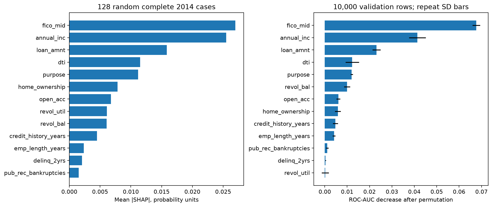

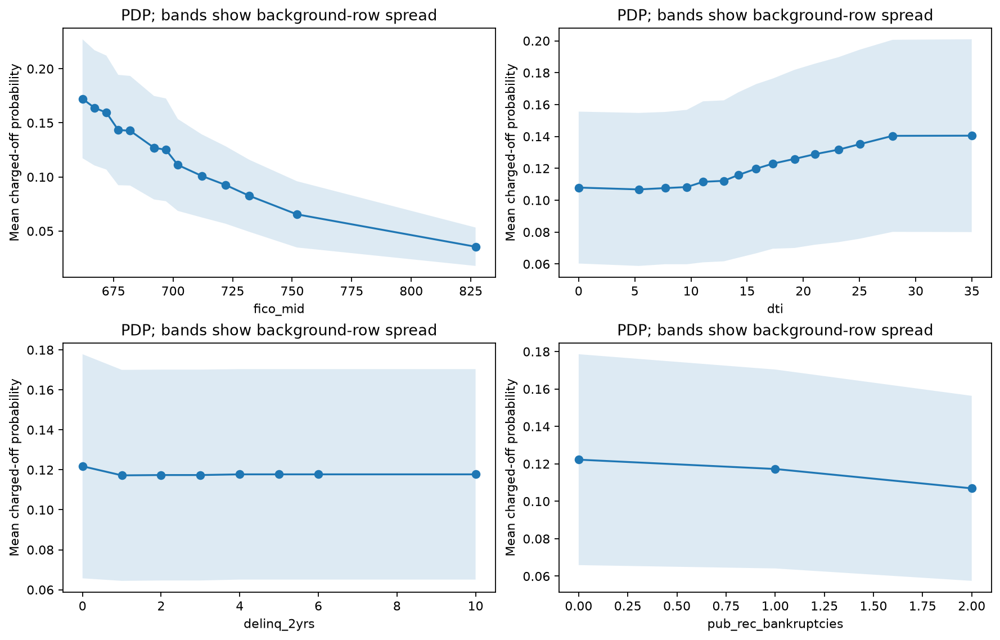

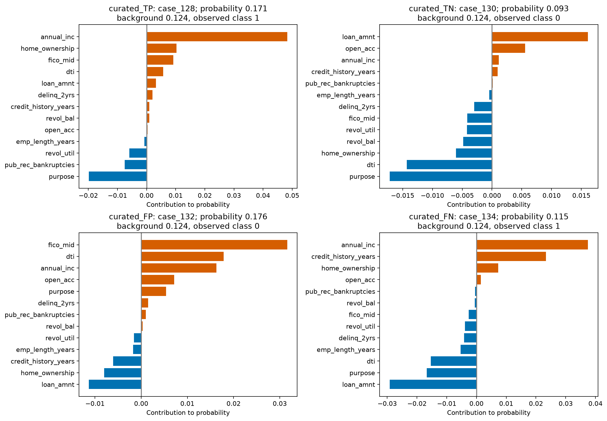

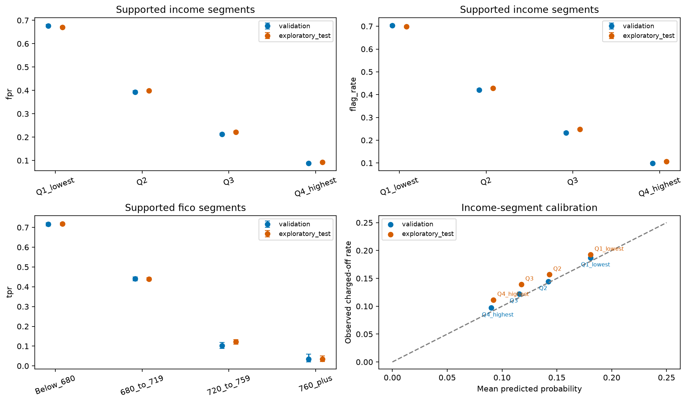

Native InterpretML interactive plots are saved beside the PNG/SVG figures. Their category values are display codes; readable values and the codebook are in the CSV/manifest. Interactive HTML uses a Plotly CDN; static images and tables work offline.

MLflow experiment `lendingclub_interpretability_bias`, batch `25ccff7634a34d3c893b37ea8ce0499d`. [Manifest and complete CSVs](../assets/results/interpret_bias/25ccff7634a34d3c893b37ea8ce0499d/manifest.json). The main model-review notebook displays these results without refitting.

References: [InterpretML ShapKernel](https://interpret.ml/docs/python/api/ShapKernel.html), [InterpretML PartialDependence](https://interpret.ml/docs/python/api/PartialDependence.html), [Fairlearn fairness-assessment guidance](https://fairlearn.org/v0.15/user_guide/assessment/perform_fairness_assessment.html).


### overall_metrics

| split | policy | rows | observed_positive_rate | mean_predicted_probability | threshold | roc_auc | gini | ks | average_precision | brier_score | log_loss | ece_10_uniform_bins | accuracy | balanced_accuracy | precision | recall | specificity | f1 | predicted_positive_rate | tn | fp | fn | tp |
| --- | --- | --- | --- | --- | --- | --- | --- | --- | --- | --- | --- | --- | --- | --- | --- | --- | --- | --- | --- | --- | --- | --- | --- |
| validation | frozen_validation_f1 | 162570 | 0.137264 | 0.131767 | 0.147853 | 0.653889 | 0.307779 | 0.222796 | 0.216483 | 0.114375 | 0.382348 | 0.005851 | 0.651689 | 0.607648 | 0.207851 | 0.546942 | 0.668354 | 0.301228 | 0.361198 | 93740 | 46515 | 10110 | 12205 |
| validation | default_0_5 | 162570 | 0.137264 | 0.131767 | 0.5 | 0.653889 | 0.307779 | 0.222796 | 0.216483 | 0.114375 | 0.382348 | 0.005851 | 0.862736 | 0.5 | 0 | 0 | 1 | 0 | 0 | 140255 | 0 | 22315 | 0 |
| exploratory_test | frozen_validation_f1 | 283026 | 0.148863 | 0.132223 | 0.147853 | 0.65435 | 0.308701 | 0.223789 | 0.235027 | 0.122279 | 0.402502 | 0.01664 | 0.650467 | 0.606918 | 0.22352 | 0.544906 | 0.668929 | 0.317005 | 0.362903 | 161141 | 79753 | 19174 | 22958 |
| exploratory_test | default_0_5 | 283026 | 0.148863 | 0.132223 | 0.5 | 0.65435 | 0.308701 | 0.223789 | 0.235027 | 0.122279 | 0.402502 | 0.01664 | 0.851137 | 0.5 | 0 | 0 | 1 | 0 | 0 | 240894 | 0 | 42132 | 0 |

### protected_attribute_coverage

| attribute | matching_structured_source_fields | available_as_structured_source_field | protected_group_audit_performed | scope_note |
| --- | --- | --- | --- | --- |
| race |  | False | False | Not inferred from names, text, state, income, or credit history; unavailable in current model inputs. |
| ethnicity |  | False | False | Not inferred from names, text, state, income, or credit history; unavailable in current model inputs. |
| sex_or_gender |  | False | False | Not inferred from names, text, state, income, or credit history; unavailable in current model inputs. |
| age_or_birth_date |  | False | False | Not inferred from names, text, state, income, or credit history; unavailable in current model inputs. |
| disability |  | False | False | Not inferred from names, text, state, income, or credit history; unavailable in current model inputs. |
| marital_status |  | False | False | Not inferred from names, text, state, income, or credit history; unavailable in current model inputs. |
| religion |  | False | False | Not inferred from names, text, state, income, or credit history; unavailable in current model inputs. |
| national_origin |  | False | False | Not inferred from names, text, state, income, or credit history; unavailable in current model inputs. |

### segment_metrics

| split | policy | dimension | group | rows | positives | negatives | flagged | tp | fp | fn | tn | observed_rate | mean_probability | calibration_bias | brier_score | roc_auc | average_precision | flag_rate | tpr | fpr | fnr | precision | supported | support_reason | threshold | observed_rate_lower_95 | observed_rate_upper_95 | flag_rate_lower_95 | flag_rate_upper_95 | tpr_lower_95 | tpr_upper_95 | fpr_lower_95 | fpr_upper_95 | ece_10_uniform_bins |
| --- | --- | --- | --- | --- | --- | --- | --- | --- | --- | --- | --- | --- | --- | --- | --- | --- | --- | --- | --- | --- | --- | --- | --- | --- | --- | --- | --- | --- | --- | --- | --- | --- | --- | --- |
| exploratory_test | frozen_validation_f1 | home | ANY | 1 | 0 | 1 | 0 | 0 | 0 | 0 | 1 | 0 | 0.081994 | 0.081994 | 0.006723 | — | — | 0 | — | 0 | — | — | False | small_total,few_charged_off,few_fully_paid | 0.147853 | 0 | 0.793451 | 0 | 0.793451 | — | — | 0 | 0.793451 | 0.081994 |
| exploratory_test | default_0_5 | home | ANY | 1 | 0 | 1 | 0 | 0 | 0 | 0 | 1 | 0 | 0.081994 | 0.081994 | 0.006723 | — | — | 0 | — | 0 | — | — | False | small_total,few_charged_off,few_fully_paid | 0.5 | 0 | 0.793451 | 0 | 0.793451 | — | — | 0 | 0.793451 | 0.081994 |
| exploratory_test | frozen_validation_f1 | home | MORTGAGE | 129762 | 15653 | 114109 | 31186 | 6431 | 24755 | 9222 | 89354 | 0.120629 | 0.112623 | -0.008005 | 0.102573 | 0.660152 | 0.198213 | 0.240332 | 0.410848 | 0.216942 | 0.589152 | 0.206214 | True | supported | 0.147853 | 0.118868 | 0.122412 | 0.238015 | 0.242665 | 0.403163 | 0.418576 | 0.21456 | 0.219343 | 0.008005 |
| exploratory_test | default_0_5 | home | MORTGAGE | 129762 | 15653 | 114109 | 0 | 0 | 0 | 15653 | 114109 | 0.120629 | 0.112623 | -0.008005 | 0.102573 | 0.660152 | 0.198213 | 0 | 0 | 0 | 1 | — | True | supported | 0.5 | 0.118868 | 0.122412 | 0 | 0.00003 | 0 | 0.000245 | 0 | 0.000034 | 0.008005 |
| exploratory_test | frozen_validation_f1 | home | OWN | 31800 | 5035 | 26765 | 12920 | 2859 | 10061 | 2176 | 16704 | 0.158333 | 0.13736 | -0.020973 | 0.129488 | 0.637941 | 0.237045 | 0.406289 | 0.567825 | 0.375901 | 0.432175 | 0.221285 | True | supported | 0.147853 | 0.154362 | 0.162387 | 0.400903 | 0.411698 | 0.554096 | 0.581452 | 0.370117 | 0.381721 | 0.020973 |
| exploratory_test | default_0_5 | home | OWN | 31800 | 5035 | 26765 | 0 | 0 | 0 | 5035 | 26765 | 0.158333 | 0.13736 | -0.020973 | 0.129488 | 0.637941 | 0.237045 | 0 | 0 | 0 | 1 | — | True | supported | 0.5 | 0.154362 | 0.162387 | 0 | 0.000121 | 0 | 0.000762 | 0 | 0.000144 | 0.020973 |
| exploratory_test | frozen_validation_f1 | home | RENT | 121463 | 21444 | 100019 | 58605 | 13668 | 44937 | 7776 | 55082 | 0.176548 | 0.151816 | -0.024731 | 0.141445 | 0.63188 | 0.255964 | 0.482493 | 0.637381 | 0.449285 | 0.362619 | 0.233222 | True | supported | 0.147853 | 0.174414 | 0.178702 | 0.479683 | 0.485303 | 0.630922 | 0.643791 | 0.446204 | 0.452369 | 0.024753 |
| exploratory_test | default_0_5 | home | RENT | 121463 | 21444 | 100019 | 0 | 0 | 0 | 21444 | 100019 | 0.176548 | 0.151816 | -0.024731 | 0.141445 | 0.63188 | 0.255964 | 0 | 0 | 0 | 1 | — | True | supported | 0.5 | 0.174414 | 0.178702 | 0 | 0.000032 | 0 | 0.000179 | 0 | 0.000038 | 0.024753 |
| validation | frozen_validation_f1 | home | ANY | 1 | 0 | 1 | 0 | 0 | 0 | 0 | 1 | 0 | 0.136564 | 0.136564 | 0.01865 | — | — | 0 | — | 0 | — | — | False | small_total,few_charged_off,few_fully_paid | 0.147853 | 0 | 0.793451 | 0 | 0.793451 | — | — | 0 | 0.793451 | 0.136564 |
| validation | default_0_5 | home | ANY | 1 | 0 | 1 | 0 | 0 | 0 | 0 | 1 | 0 | 0.136564 | 0.136564 | 0.01865 | — | — | 0 | — | 0 | — | — | False | small_total,few_charged_off,few_fully_paid | 0.5 | 0 | 0.793451 | 0 | 0.793451 | — | — | 0 | 0.793451 | 0.136564 |
| validation | frozen_validation_f1 | home | MORTGAGE | 76326 | 8550 | 67776 | 17923 | 3392 | 14531 | 5158 | 53245 | 0.112019 | 0.111926 | -0.000094 | 0.096551 | 0.653415 | 0.181544 | 0.234822 | 0.396725 | 0.214397 | 0.603275 | 0.189254 | True | supported | 0.147853 | 0.109802 | 0.114277 | 0.231828 | 0.237842 | 0.386404 | 0.407139 | 0.211324 | 0.217503 | 0.002442 |
| validation | default_0_5 | home | MORTGAGE | 76326 | 8550 | 67776 | 0 | 0 | 0 | 8550 | 67776 | 0.112019 | 0.111926 | -0.000094 | 0.096551 | 0.653415 | 0.181544 | 0 | 0 | 0 | 1 | — | True | supported | 0.5 | 0.109802 | 0.114277 | 0 | 0.00005 | 0 | 0.000449 | 0 | 0.000057 | 0.002442 |
| validation | frozen_validation_f1 | home | OWN | 16493 | 2380 | 14113 | 6948 | 1390 | 5558 | 990 | 8555 | 0.144304 | 0.13877 | -0.005533 | 0.120293 | 0.632223 | 0.208901 | 0.42127 | 0.584034 | 0.393821 | 0.415966 | 0.200058 | True | supported | 0.147853 | 0.139024 | 0.149749 | 0.413753 | 0.428823 | 0.564112 | 0.603685 | 0.38579 | 0.40191 | 0.007533 |
| validation | default_0_5 | home | OWN | 16493 | 2380 | 14113 | 0 | 0 | 0 | 2380 | 14113 | 0.144304 | 0.13877 | -0.005533 | 0.120293 | 0.632223 | 0.208901 | 0 | 0 | 0 | 1 | — | True | supported | 0.5 | 0.139024 | 0.149749 | 0 | 0.000233 | 0 | 0.001611 | 0 | 0.000272 | 0.007533 |
| validation | frozen_validation_f1 | home | RENT | 69750 | 11385 | 58365 | 33849 | 7423 | 26426 | 3962 | 31939 | 0.163226 | 0.151822 | -0.011404 | 0.132482 | 0.637307 | 0.238345 | 0.48529 | 0.651998 | 0.452771 | 0.348002 | 0.219297 | True | supported | 0.147853 | 0.160502 | 0.165987 | 0.481582 | 0.489 | 0.643199 | 0.660695 | 0.448736 | 0.456813 | 0.011959 |
| validation | default_0_5 | home | RENT | 69750 | 11385 | 58365 | 0 | 0 | 0 | 11385 | 58365 | 0.163226 | 0.151822 | -0.011404 | 0.132482 | 0.637307 | 0.238345 | 0 | 0 | 0 | 1 | — | True | supported | 0.5 | 0.160502 | 0.165987 | 0 | 0.000055 | 0 | 0.000337 | 0 | 0.000066 | 0.011959 |
| exploratory_test | frozen_validation_f1 | purpose | car | 2768 | 368 | 2400 | 755 | 168 | 587 | 200 | 1813 | 0.132948 | 0.120479 | -0.012469 | 0.111469 | 0.650834 | 0.216927 | 0.27276 | 0.456522 | 0.244583 | 0.543478 | 0.222517 | True | supported | 0.147853 | 0.120807 | 0.146106 | 0.256492 | 0.289658 | 0.406341 | 0.507601 | 0.227804 | 0.262179 | 0.013091 |
| exploratory_test | default_0_5 | purpose | car | 2768 | 368 | 2400 | 0 | 0 | 0 | 368 | 2400 | 0.132948 | 0.120479 | -0.012469 | 0.111469 | 0.650834 | 0.216927 | 0 | 0 | 0 | 1 | — | True | supported | 0.5 | 0.120807 | 0.146106 | 0 | 0.001386 | 0 | 0.010331 | 0 | 0.001598 | 0.013091 |
| exploratory_test | frozen_validation_f1 | purpose | credit_card | 70650 | 8642 | 62008 | 14985 | 3245 | 11740 | 5397 | 50268 | 0.122321 | 0.110063 | -0.012258 | 0.103763 | 0.664214 | 0.202994 | 0.212102 | 0.375492 | 0.18933 | 0.624508 | 0.21655 | True | supported | 0.147853 | 0.119926 | 0.124758 | 0.209103 | 0.215132 | 0.36534 | 0.385755 | 0.186266 | 0.192433 | 0.012282 |
| exploratory_test | default_0_5 | purpose | credit_card | 70650 | 8642 | 62008 | 0 | 0 | 0 | 8642 | 62008 | 0.122321 | 0.110063 | -0.012258 | 0.103763 | 0.664214 | 0.202994 | 0 | 0 | 0 | 1 | — | True | supported | 0.5 | 0.119926 | 0.124758 | 0 | 0.000054 | 0 | 0.000444 | 0 | 0.000062 | 0.012282 |
| exploratory_test | frozen_validation_f1 | purpose | debt_consolidation | 160983 | 25327 | 135656 | 64236 | 14540 | 49696 | 10787 | 85960 | 0.157327 | 0.137482 | -0.019845 | 0.128265 | 0.647755 | 0.241551 | 0.399023 | 0.574091 | 0.366338 | 0.425909 | 0.226353 | True | supported | 0.147853 | 0.155557 | 0.159114 | 0.396634 | 0.401418 | 0.56799 | 0.580169 | 0.363778 | 0.368906 | 0.019846 |
| exploratory_test | default_0_5 | purpose | debt_consolidation | 160983 | 25327 | 135656 | 0 | 0 | 0 | 25327 | 135656 | 0.157327 | 0.137482 | -0.019845 | 0.128265 | 0.647755 | 0.241551 | 0 | 0 | 0 | 1 | — | True | supported | 0.5 | 0.155557 | 0.159114 | 0 | 0.000024 | 0 | 0.000152 | 0 | 0.000028 | 0.019846 |
| exploratory_test | frozen_validation_f1 | purpose | educational | 1 | 0 | 1 | 1 | 0 | 1 | 0 | 0 | 0 | 0.288019 | 0.288019 | 0.082955 | — | — | 1 | — | 1 | — | 0 | False | small_total,few_charged_off,few_fully_paid | 0.147853 | 0 | 0.793451 | 0.206549 | 1 | — | — | 0.206549 | 1 | 0.288019 |
| exploratory_test | default_0_5 | purpose | educational | 1 | 0 | 1 | 0 | 0 | 0 | 0 | 1 | 0 | 0.288019 | 0.288019 | 0.082955 | — | — | 0 | — | 0 | — | — | False | small_total,few_charged_off,few_fully_paid | 0.5 | 0 | 0.793451 | 0 | 0.793451 | — | — | 0 | 0.793451 | 0.288019 |
| exploratory_test | frozen_validation_f1 | purpose | home_improvement | 17160 | 2318 | 14842 | 5255 | 1115 | 4140 | 1203 | 10702 | 0.135082 | 0.122253 | -0.012828 | 0.112996 | 0.654285 | 0.214949 | 0.306235 | 0.481018 | 0.278938 | 0.518982 | 0.212179 | True | supported | 0.147853 | 0.130049 | 0.140278 | 0.299383 | 0.313175 | 0.460726 | 0.501373 | 0.271781 | 0.28621 | 0.012828 |
| exploratory_test | default_0_5 | purpose | home_improvement | 17160 | 2318 | 14842 | 0 | 0 | 0 | 2318 | 14842 | 0.135082 | 0.122253 | -0.012828 | 0.112996 | 0.654285 | 0.214949 | 0 | 0 | 0 | 1 | — | True | supported | 0.5 | 0.130049 | 0.140278 | 0 | 0.000224 | 0 | 0.001654 | 0 | 0.000259 | 0.012828 |
| exploratory_test | frozen_validation_f1 | purpose | house | 1004 | 217 | 787 | 529 | 139 | 390 | 78 | 397 | 0.216135 | 0.155945 | -0.06019 | 0.167428 | 0.619871 | 0.317762 | 0.526892 | 0.640553 | 0.495553 | 0.359447 | 0.26276 | True | supported | 0.147853 | 0.191783 | 0.242652 | 0.495965 | 0.557614 | 0.574776 | 0.701441 | 0.460728 | 0.530421 | 0.06019 |
| exploratory_test | default_0_5 | purpose | house | 1004 | 217 | 787 | 0 | 0 | 0 | 217 | 787 | 0.216135 | 0.155945 | -0.06019 | 0.167428 | 0.619871 | 0.317762 | 0 | 0 | 0 | 1 | — | True | supported | 0.5 | 0.191783 | 0.242652 | 0 | 0.003812 | 0 | 0.017395 | 0 | 0.004857 | 0.06019 |
| exploratory_test | frozen_validation_f1 | purpose | major_purchase | 5342 | 772 | 4570 | 1393 | 328 | 1065 | 444 | 3505 | 0.144515 | 0.116269 | -0.028247 | 0.120372 | 0.649637 | 0.22221 | 0.260764 | 0.42487 | 0.233042 | 0.57513 | 0.235463 | True | supported | 0.147853 | 0.135342 | 0.1542 | 0.249165 | 0.272706 | 0.390457 | 0.460028 | 0.221012 | 0.24552 | 0.030115 |
| exploratory_test | default_0_5 | purpose | major_purchase | 5342 | 772 | 4570 | 0 | 0 | 0 | 772 | 4570 | 0.144515 | 0.116269 | -0.028247 | 0.120372 | 0.649637 | 0.22221 | 0 | 0 | 0 | 1 | — | True | supported | 0.5 | 0.135342 | 0.1542 | 0 | 0.000719 | 0 | 0.004951 | 0 | 0.00084 | 0.030115 |
| exploratory_test | frozen_validation_f1 | purpose | medical | 3146 | 561 | 2585 | 1948 | 435 | 1513 | 126 | 1072 | 0.178322 | 0.168788 | -0.009534 | 0.140675 | 0.645176 | 0.288364 | 0.619199 | 0.775401 | 0.5853 | 0.224599 | 0.223306 | True | supported | 0.147853 | 0.165341 | 0.192087 | 0.602095 | 0.636012 | 0.739062 | 0.807994 | 0.566195 | 0.604152 | 0.009534 |
| exploratory_test | default_0_5 | purpose | medical | 3146 | 561 | 2585 | 0 | 0 | 0 | 561 | 2585 | 0.178322 | 0.168788 | -0.009534 | 0.140675 | 0.645176 | 0.288364 | 0 | 0 | 0 | 1 | — | True | supported | 0.5 | 0.165341 | 0.192087 | 0 | 0.00122 | 0 | 0.006801 | 0 | 0.001484 | 0.009534 |
| exploratory_test | frozen_validation_f1 | purpose | moving | 2061 | 419 | 1642 | 1189 | 296 | 893 | 123 | 749 | 0.203299 | 0.16377 | -0.039529 | 0.157698 | 0.637357 | 0.303174 | 0.576904 | 0.706444 | 0.543849 | 0.293556 | 0.248949 | True | supported | 0.147853 | 0.186484 | 0.221219 | 0.555451 | 0.598071 | 0.661123 | 0.748014 | 0.519684 | 0.56781 | 0.039529 |
| exploratory_test | default_0_5 | purpose | moving | 2061 | 419 | 1642 | 0 | 0 | 0 | 419 | 1642 | 0.203299 | 0.16377 | -0.039529 | 0.157698 | 0.637357 | 0.303174 | 0 | 0 | 0 | 1 | — | True | supported | 0.5 | 0.186484 | 0.221219 | 0 | 0.00186 | 0 | 0.009085 | 0 | 0.002334 | 0.039529 |
| exploratory_test | frozen_validation_f1 | purpose | other | 15227 | 2568 | 12659 | 9348 | 1952 | 7396 | 616 | 5263 | 0.168648 | 0.168506 | -0.000141 | 0.136181 | 0.628114 | 0.243537 | 0.61391 | 0.760125 | 0.584248 | 0.239875 | 0.208815 | True | supported | 0.147853 | 0.162784 | 0.174679 | 0.606149 | 0.621613 | 0.743229 | 0.776244 | 0.575639 | 0.592807 | 0.001039 |
| exploratory_test | default_0_5 | purpose | other | 15227 | 2568 | 12659 | 0 | 0 | 0 | 2568 | 12659 | 0.168648 | 0.168506 | -0.000141 | 0.136181 | 0.628114 | 0.243537 | 0 | 0 | 0 | 1 | — | True | supported | 0.5 | 0.162784 | 0.174679 | 0 | 0.000252 | 0 | 0.001494 | 0 | 0.000303 | 0.001039 |
| exploratory_test | frozen_validation_f1 | purpose | renewable_energy | 185 | 45 | 140 | 117 | 31 | 86 | 14 | 54 | 0.243243 | 0.167271 | -0.075972 | 0.188007 | 0.571429 | 0.303326 | 0.632432 | 0.688889 | 0.614286 | 0.311111 | 0.264957 | False | small_total,few_charged_off | 0.147853 | 0.187051 | 0.309881 | 0.56092 | 0.698557 | 0.543352 | 0.804713 | 0.531628 | 0.690839 | 0.090091 |
| exploratory_test | default_0_5 | purpose | renewable_energy | 185 | 45 | 140 | 0 | 0 | 0 | 45 | 140 | 0.243243 | 0.167271 | -0.075972 | 0.188007 | 0.571429 | 0.303326 | 0 | 0 | 0 | 1 | — | False | small_total,few_charged_off | 0.5 | 0.187051 | 0.309881 | 0 | 0.020342 | 0 | 0.078652 | 0 | 0.026706 | 0.090091 |
| exploratory_test | frozen_validation_f1 | purpose | small_business | 2425 | 557 | 1868 | 1988 | 510 | 1478 | 47 | 390 | 0.229691 | 0.219695 | -0.009996 | 0.171988 | 0.610429 | 0.312771 | 0.819794 | 0.915619 | 0.791221 | 0.084381 | 0.256539 | True | supported | 0.147853 | 0.213384 | 0.246852 | 0.803994 | 0.834582 | 0.889593 | 0.935952 | 0.772201 | 0.809045 | 0.024756 |
| exploratory_test | default_0_5 | purpose | small_business | 2425 | 557 | 1868 | 0 | 0 | 0 | 557 | 1868 | 0.229691 | 0.219695 | -0.009996 | 0.171988 | 0.610429 | 0.312771 | 0 | 0 | 0 | 1 | — | True | supported | 0.5 | 0.213384 | 0.246852 | 0 | 0.001582 | 0 | 0.006849 | 0 | 0.002052 | 0.024756 |
| exploratory_test | frozen_validation_f1 | purpose | vacation | 2071 | 338 | 1733 | 966 | 199 | 767 | 139 | 966 | 0.163206 | 0.147966 | -0.015241 | 0.133726 | 0.607456 | 0.243619 | 0.466441 | 0.588757 | 0.442585 | 0.411243 | 0.206004 | True | supported | 0.147853 | 0.147916 | 0.179743 | 0.445038 | 0.487969 | 0.535589 | 0.639931 | 0.419353 | 0.466072 | 0.015241 |
| exploratory_test | default_0_5 | purpose | vacation | 2071 | 338 | 1733 | 0 | 0 | 0 | 338 | 1733 | 0.163206 | 0.147966 | -0.015241 | 0.133726 | 0.607456 | 0.243619 | 0 | 0 | 0 | 1 | — | True | supported | 0.5 | 0.147916 | 0.179743 | 0 | 0.001851 | 0 | 0.011238 | 0 | 0.002212 | 0.015241 |
| exploratory_test | frozen_validation_f1 | purpose | wedding | 3 | 0 | 3 | 1 | 0 | 1 | 0 | 2 | 0 | 0.13498 | 0.13498 | 0.01949 | — | — | 0.333333 | — | 0.333333 | — | 0 | False | small_total,few_charged_off,few_fully_paid | 0.147853 | 0 | 0.561497 | 0.061492 | 0.79234 | — | — | 0.061492 | 0.79234 | 0.13498 |
| exploratory_test | default_0_5 | purpose | wedding | 3 | 0 | 3 | 0 | 0 | 0 | 0 | 3 | 0 | 0.13498 | 0.13498 | 0.01949 | — | — | 0 | — | 0 | — | — | False | small_total,few_charged_off,few_fully_paid | 0.5 | 0 | 0.561497 | 0 | 0.561497 | — | — | 0 | 0.561497 | 0.13498 |
| validation | frozen_validation_f1 | purpose | car | 1516 | 175 | 1341 | 424 | 81 | 343 | 94 | 998 | 0.115435 | 0.117775 | 0.00234 | 0.098317 | 0.670216 | 0.203321 | 0.279683 | 0.462857 | 0.255779 | 0.537143 | 0.191038 | True | supported | 0.147853 | 0.100313 | 0.132502 | 0.257668 | 0.302813 | 0.390573 | 0.536737 | 0.233148 | 0.279806 | 0.006455 |
| validation | default_0_5 | purpose | car | 1516 | 175 | 1341 | 0 | 0 | 0 | 175 | 1341 | 0.115435 | 0.117775 | 0.00234 | 0.098317 | 0.670216 | 0.203321 | 0 | 0 | 0 | 1 | — | True | supported | 0.5 | 0.100313 | 0.132502 | 0 | 0.002528 | 0 | 0.02148 | 0 | 0.002856 | 0.006455 |
| validation | frozen_validation_f1 | purpose | credit_card | 40100 | 4634 | 35466 | 8619 | 1788 | 6831 | 2846 | 28635 | 0.115561 | 0.110592 | -0.004969 | 0.098766 | 0.664295 | 0.19353 | 0.214938 | 0.385844 | 0.192607 | 0.614156 | 0.207449 | True | supported | 0.147853 | 0.112469 | 0.118727 | 0.210945 | 0.218985 | 0.371928 | 0.399949 | 0.188536 | 0.196744 | 0.007769 |
| validation | default_0_5 | purpose | credit_card | 40100 | 4634 | 35466 | 0 | 0 | 0 | 4634 | 35466 | 0.115561 | 0.110592 | -0.004969 | 0.098766 | 0.664295 | 0.19353 | 0 | 0 | 0 | 1 | — | True | supported | 0.5 | 0.112469 | 0.118727 | 0 | 0.000096 | 0 | 0.000828 | 0 | 0.000108 | 0.007769 |
| validation | frozen_validation_f1 | purpose | debt_consolidation | 94822 | 13616 | 81206 | 37254 | 7803 | 29451 | 5813 | 51755 | 0.143595 | 0.136234 | -0.007362 | 0.118974 | 0.647743 | 0.221315 | 0.392884 | 0.573076 | 0.36267 | 0.426924 | 0.209454 | True | supported | 0.147853 | 0.141378 | 0.145842 | 0.389779 | 0.395996 | 0.564748 | 0.581362 | 0.35937 | 0.365983 | 0.007769 |
| validation | default_0_5 | purpose | debt_consolidation | 94822 | 13616 | 81206 | 0 | 0 | 0 | 13616 | 81206 | 0.143595 | 0.136234 | -0.007362 | 0.118974 | 0.647743 | 0.221315 | 0 | 0 | 0 | 1 | — | True | supported | 0.5 | 0.141378 | 0.145842 | 0 | 0.000041 | 0 | 0.000282 | 0 | 0.000047 | 0.007769 |
| validation | frozen_validation_f1 | purpose | home_improvement | 8654 | 1029 | 7625 | 2624 | 503 | 2121 | 526 | 5504 | 0.118905 | 0.121347 | 0.002443 | 0.10151 | 0.656216 | 0.191482 | 0.303212 | 0.488824 | 0.278164 | 0.511176 | 0.191692 | True | supported | 0.147853 | 0.112254 | 0.125894 | 0.293617 | 0.312982 | 0.45838 | 0.519351 | 0.26822 | 0.288331 | 0.002443 |
| validation | default_0_5 | purpose | home_improvement | 8654 | 1029 | 7625 | 0 | 0 | 0 | 1029 | 7625 | 0.118905 | 0.121347 | 0.002443 | 0.10151 | 0.656216 | 0.191482 | 0 | 0 | 0 | 1 | — | True | supported | 0.5 | 0.112254 | 0.125894 | 0 | 0.000444 | 0 | 0.003719 | 0 | 0.000504 | 0.002443 |
| validation | frozen_validation_f1 | purpose | house | 511 | 100 | 411 | 272 | 67 | 205 | 33 | 206 | 0.195695 | 0.15545 | -0.040245 | 0.15521 | 0.615888 | 0.262103 | 0.53229 | 0.67 | 0.498783 | 0.33 | 0.246324 | True | supported | 0.147853 | 0.16362 | 0.23231 | 0.488948 | 0.575149 | 0.573053 | 0.754369 | 0.45068 | 0.546909 | 0.04255 |
| validation | default_0_5 | purpose | house | 511 | 100 | 411 | 0 | 0 | 0 | 100 | 411 | 0.195695 | 0.15545 | -0.040245 | 0.15521 | 0.615888 | 0.262103 | 0 | 0 | 0 | 1 | — | True | supported | 0.5 | 0.16362 | 0.23231 | 0 | 0.007461 | 0 | 0.036993 | 0 | 0.00926 | 0.04255 |
| validation | frozen_validation_f1 | purpose | major_purchase | 2888 | 390 | 2498 | 721 | 153 | 568 | 237 | 1930 | 0.135042 | 0.113642 | -0.021399 | 0.113333 | 0.655695 | 0.214342 | 0.249654 | 0.392308 | 0.227382 | 0.607692 | 0.212205 | True | supported | 0.147853 | 0.123061 | 0.147992 | 0.234208 | 0.265764 | 0.345125 | 0.441591 | 0.211371 | 0.24423 | 0.021399 |
| validation | default_0_5 | purpose | major_purchase | 2888 | 390 | 2498 | 0 | 0 | 0 | 390 | 2498 | 0.135042 | 0.113642 | -0.021399 | 0.113333 | 0.655695 | 0.214342 | 0 | 0 | 0 | 1 | — | True | supported | 0.5 | 0.123061 | 0.147992 | 0 | 0.001328 | 0 | 0.009754 | 0 | 0.001535 | 0.021399 |
| validation | frozen_validation_f1 | purpose | medical | 1885 | 321 | 1564 | 1137 | 241 | 896 | 80 | 668 | 0.170292 | 0.165759 | -0.004533 | 0.137648 | 0.625035 | 0.240597 | 0.603183 | 0.750779 | 0.57289 | 0.249221 | 0.211961 | True | supported | 0.147853 | 0.153998 | 0.187927 | 0.580909 | 0.625037 | 0.700681 | 0.794946 | 0.548226 | 0.597197 | 0.006387 |
| validation | default_0_5 | purpose | medical | 1885 | 321 | 1564 | 0 | 0 | 0 | 321 | 1564 | 0.170292 | 0.165759 | -0.004533 | 0.137648 | 0.625035 | 0.240597 | 0 | 0 | 0 | 1 | — | True | supported | 0.5 | 0.153998 | 0.187927 | 0 | 0.002034 | 0 | 0.011826 | 0 | 0.00245 | 0.006387 |
| validation | frozen_validation_f1 | purpose | moving | 1133 | 241 | 892 | 690 | 186 | 504 | 55 | 388 | 0.21271 | 0.165103 | -0.047607 | 0.163333 | 0.641665 | 0.322727 | 0.609003 | 0.771784 | 0.565022 | 0.228216 | 0.269565 | True | supported | 0.147853 | 0.189873 | 0.237488 | 0.580266 | 0.637002 | 0.714779 | 0.820261 | 0.532279 | 0.597209 | 0.047607 |
| validation | default_0_5 | purpose | moving | 1133 | 241 | 892 | 0 | 0 | 0 | 241 | 892 | 0.21271 | 0.165103 | -0.047607 | 0.163333 | 0.641665 | 0.322727 | 0 | 0 | 0 | 1 | — | True | supported | 0.5 | 0.189873 | 0.237488 | 0 | 0.003379 | 0 | 0.01569 | 0 | 0.004288 | 0.047607 |
| validation | frozen_validation_f1 | purpose | other | 8252 | 1261 | 6991 | 5053 | 952 | 4101 | 309 | 2890 | 0.152811 | 0.16849 | 0.015679 | 0.126239 | 0.627811 | 0.224941 | 0.612336 | 0.754956 | 0.586611 | 0.245044 | 0.188403 | True | supported | 0.147853 | 0.14521 | 0.160736 | 0.601774 | 0.622794 | 0.730466 | 0.777898 | 0.575023 | 0.598104 | 0.015679 |
| validation | default_0_5 | purpose | other | 8252 | 1261 | 6991 | 0 | 0 | 0 | 1261 | 6991 | 0.152811 | 0.16849 | 0.015679 | 0.126239 | 0.627811 | 0.224941 | 0 | 0 | 0 | 1 | — | True | supported | 0.5 | 0.14521 | 0.160736 | 0 | 0.000465 | 0 | 0.003037 | 0 | 0.000549 | 0.015679 |
| validation | frozen_validation_f1 | purpose | renewable_energy | 102 | 16 | 86 | 59 | 6 | 53 | 10 | 33 | 0.156863 | 0.162106 | 0.005243 | 0.138417 | 0.374273 | 0.222102 | 0.578431 | 0.375 | 0.616279 | 0.625 | 0.101695 | False | small_total,few_charged_off | 0.147853 | 0.098923 | 0.239711 | 0.481465 | 0.669704 | 0.184812 | 0.61359 | 0.510629 | 0.711986 | 0.060114 |
| validation | default_0_5 | purpose | renewable_energy | 102 | 16 | 86 | 0 | 0 | 0 | 16 | 86 | 0.156863 | 0.162106 | 0.005243 | 0.138417 | 0.374273 | 0.222102 | 0 | 0 | 0 | 1 | — | False | small_total,few_charged_off | 0.5 | 0.098923 | 0.239711 | 0 | 0.036294 | 0 | 0.193608 | 0 | 0.042758 | 0.060114 |
| validation | frozen_validation_f1 | purpose | small_business | 1634 | 368 | 1266 | 1366 | 330 | 1036 | 38 | 230 | 0.225214 | 0.225026 | -0.000189 | 0.173029 | 0.577448 | 0.274452 | 0.835985 | 0.896739 | 0.818325 | 0.103261 | 0.241581 | True | supported | 0.147853 | 0.205618 | 0.246099 | 0.817247 | 0.853148 | 0.861441 | 0.92384 | 0.796133 | 0.838592 | 0.018393 |
| validation | default_0_5 | purpose | small_business | 1634 | 368 | 1266 | 0 | 0 | 0 | 368 | 1266 | 0.225214 | 0.225026 | -0.000189 | 0.173029 | 0.577448 | 0.274452 | 0 | 0 | 0 | 1 | — | True | supported | 0.5 | 0.205618 | 0.246099 | 0 | 0.002345 | 0 | 0.010331 | 0 | 0.003025 | 0.018393 |
| validation | frozen_validation_f1 | purpose | vacation | 1065 | 164 | 901 | 499 | 95 | 404 | 69 | 497 | 0.153991 | 0.147654 | -0.006336 | 0.126552 | 0.61986 | 0.250053 | 0.468545 | 0.579268 | 0.448391 | 0.420732 | 0.190381 | True | supported | 0.147853 | 0.13356 | 0.176908 | 0.438742 | 0.498574 | 0.502746 | 0.652162 | 0.416204 | 0.481015 | 0.012344 |
| validation | default_0_5 | purpose | vacation | 1065 | 164 | 901 | 0 | 0 | 0 | 164 | 901 | 0.153991 | 0.147654 | -0.006336 | 0.126552 | 0.61986 | 0.250053 | 0 | 0 | 0 | 1 | — | True | supported | 0.5 | 0.13356 | 0.176908 | 0 | 0.003594 | 0 | 0.022887 | 0 | 0.004245 | 0.012344 |
| validation | frozen_validation_f1 | purpose | wedding | 8 | 0 | 8 | 2 | 0 | 2 | 0 | 6 | 0 | 0.110556 | 0.110556 | 0.013373 | — | — | 0.25 | — | 0.25 | — | 0 | False | small_total,few_charged_off,few_fully_paid | 0.147853 | 0 | 0.324408 | 0.071479 | 0.590725 | — | — | 0.071479 | 0.590725 | 0.110556 |
| validation | default_0_5 | purpose | wedding | 8 | 0 | 8 | 0 | 0 | 0 | 0 | 8 | 0 | 0.110556 | 0.110556 | 0.013373 | — | — | 0 | — | 0 | — | — | False | small_total,few_charged_off,few_fully_paid | 0.5 | 0 | 0.324408 | 0 | 0.324408 | — | — | 0 | 0.324408 | 0.110556 |
| exploratory_test | frozen_validation_f1 | income | Missing | 2 | 1 | 1 | 1 | 0 | 1 | 1 | 0 | 0.5 | 0.1404 | -0.3596 | 0.41253 | 0 | 0.5 | 0.5 | 0 | 1 | 1 | 0 | False | small_total,few_charged_off,few_fully_paid | 0.147853 | 0.094531 | 0.905469 | 0.094531 | 0.905469 | 0 | 0.793451 | 0.206549 | 1 | 0.3596 |
| exploratory_test | default_0_5 | income | Missing | 2 | 1 | 1 | 0 | 0 | 0 | 1 | 1 | 0.5 | 0.1404 | -0.3596 | 0.41253 | 0 | 0.5 | 0 | 0 | 0 | 1 | — | False | small_total,few_charged_off,few_fully_paid | 0.5 | 0.094531 | 0.905469 | 0 | 0.65762 | 0 | 0.793451 | 0 | 0.793451 | 0.3596 |
| exploratory_test | frozen_validation_f1 | income | Q1_lowest | 67112 | 12928 | 54184 | 46848 | 10512 | 36336 | 2416 | 17848 | 0.192633 | 0.180782 | -0.011851 | 0.151744 | 0.614135 | 0.263611 | 0.698057 | 0.813119 | 0.670604 | 0.186881 | 0.224385 | True | supported | 0.147853 | 0.189667 | 0.195634 | 0.694572 | 0.701519 | 0.806307 | 0.819745 | 0.666635 | 0.674549 | 0.011851 |
| exploratory_test | default_0_5 | income | Q1_lowest | 67112 | 12928 | 54184 | 0 | 0 | 0 | 12928 | 54184 | 0.192633 | 0.180782 | -0.011851 | 0.151744 | 0.614135 | 0.263611 | 0 | 0 | 0 | 1 | — | True | supported | 0.5 | 0.189667 | 0.195634 | 0 | 0.000057 | 0 | 0.000297 | 0 | 0.000071 | 0.011851 |
| exploratory_test | frozen_validation_f1 | income | Q2 | 72286 | 11329 | 60957 | 30957 | 6680 | 24277 | 4649 | 36680 | 0.156725 | 0.143077 | -0.013648 | 0.128376 | 0.636348 | 0.233044 | 0.428257 | 0.589637 | 0.398264 | 0.410363 | 0.215783 | True | supported | 0.147853 | 0.154093 | 0.159393 | 0.424654 | 0.431868 | 0.58055 | 0.598663 | 0.394385 | 0.402157 | 0.013826 |
| exploratory_test | default_0_5 | income | Q2 | 72286 | 11329 | 60957 | 0 | 0 | 0 | 11329 | 60957 | 0.156725 | 0.143077 | -0.013648 | 0.128376 | 0.636348 | 0.233044 | 0 | 0 | 0 | 1 | — | True | supported | 0.5 | 0.154093 | 0.159393 | 0 | 0.000053 | 0 | 0.000339 | 0 | 0.000063 | 0.013826 |
| exploratory_test | frozen_validation_f1 | income | Q3 | 67492 | 9390 | 58102 | 16762 | 3861 | 12901 | 5529 | 45201 | 0.139128 | 0.117652 | -0.021475 | 0.11609 | 0.65285 | 0.225775 | 0.248355 | 0.411182 | 0.222041 | 0.588818 | 0.230342 | True | supported | 0.147853 | 0.136537 | 0.141759 | 0.24511 | 0.251629 | 0.401268 | 0.421169 | 0.21868 | 0.225438 | 0.021506 |
| exploratory_test | default_0_5 | income | Q3 | 67492 | 9390 | 58102 | 0 | 0 | 0 | 9390 | 58102 | 0.139128 | 0.117652 | -0.021475 | 0.11609 | 0.65285 | 0.225775 | 0 | 0 | 0 | 1 | — | True | supported | 0.5 | 0.136537 | 0.141759 | 0 | 0.000057 | 0 | 0.000409 | 0 | 0.000066 | 0.021506 |
| exploratory_test | frozen_validation_f1 | income | Q4_highest | 76134 | 8484 | 67650 | 8143 | 1905 | 6238 | 6579 | 61412 | 0.111435 | 0.092028 | -0.019407 | 0.095996 | 0.669607 | 0.195552 | 0.106956 | 0.22454 | 0.09221 | 0.77546 | 0.233943 | True | supported | 0.147853 | 0.109219 | 0.11369 | 0.104781 | 0.109171 | 0.215787 | 0.233543 | 0.090053 | 0.094413 | 0.019414 |
| exploratory_test | default_0_5 | income | Q4_highest | 76134 | 8484 | 67650 | 0 | 0 | 0 | 8484 | 67650 | 0.111435 | 0.092028 | -0.019407 | 0.095996 | 0.669607 | 0.195552 | 0 | 0 | 0 | 1 | — | True | supported | 0.5 | 0.109219 | 0.11369 | 0 | 0.00005 | 0 | 0.000453 | 0 | 0.000057 | 0.019414 |
| validation | frozen_validation_f1 | income | Q1_lowest | 39538 | 7391 | 32147 | 27795 | 6039 | 21756 | 1352 | 10391 | 0.186934 | 0.180538 | -0.006396 | 0.148744 | 0.608908 | 0.24772 | 0.702995 | 0.817075 | 0.676766 | 0.182925 | 0.217269 | True | supported | 0.147853 | 0.183122 | 0.190807 | 0.698471 | 0.707479 | 0.808097 | 0.825723 | 0.671632 | 0.681857 | 0.007366 |
| validation | default_0_5 | income | Q1_lowest | 39538 | 7391 | 32147 | 0 | 0 | 0 | 7391 | 32147 | 0.186934 | 0.180538 | -0.006396 | 0.148744 | 0.608908 | 0.24772 | 0 | 0 | 0 | 1 | — | True | supported | 0.5 | 0.183122 | 0.190807 | 0 | 0.000097 | 0 | 0.000519 | 0 | 0.000119 | 0.007366 |
| validation | frozen_validation_f1 | income | Q2 | 42082 | 6086 | 35996 | 17682 | 3529 | 14153 | 2557 | 21843 | 0.144622 | 0.142305 | -0.002317 | 0.120406 | 0.632055 | 0.214162 | 0.42018 | 0.579855 | 0.393183 | 0.420145 | 0.199581 | True | supported | 0.147853 | 0.141294 | 0.148015 | 0.415471 | 0.424903 | 0.567408 | 0.592202 | 0.388148 | 0.39824 | 0.005528 |
| validation | default_0_5 | income | Q2 | 42082 | 6086 | 35996 | 0 | 0 | 0 | 6086 | 35996 | 0.144622 | 0.142305 | -0.002317 | 0.120406 | 0.632055 | 0.214162 | 0 | 0 | 0 | 1 | — | True | supported | 0.5 | 0.141294 | 0.148015 | 0 | 0.000091 | 0 | 0.000631 | 0 | 0.000107 | 0.005528 |
| validation | frozen_validation_f1 | income | Q3 | 39005 | 4767 | 34238 | 9087 | 1824 | 7263 | 2943 | 26975 | 0.122215 | 0.115608 | -0.006608 | 0.104383 | 0.642672 | 0.191734 | 0.23297 | 0.382631 | 0.212133 | 0.617369 | 0.200726 | True | supported | 0.147853 | 0.119002 | 0.125503 | 0.228801 | 0.237191 | 0.368933 | 0.396517 | 0.207835 | 0.216495 | 0.006972 |
| validation | default_0_5 | income | Q3 | 39005 | 4767 | 34238 | 0 | 0 | 0 | 4767 | 34238 | 0.122215 | 0.115608 | -0.006608 | 0.104383 | 0.642672 | 0.191734 | 0 | 0 | 0 | 1 | — | True | supported | 0.5 | 0.119002 | 0.125503 | 0 | 0.000098 | 0 | 0.000805 | 0 | 0.000112 | 0.006972 |
| validation | frozen_validation_f1 | income | Q4_highest | 41945 | 4071 | 37874 | 4156 | 813 | 3343 | 3258 | 34531 | 0.097056 | 0.090247 | -0.006808 | 0.085221 | 0.660618 | 0.165079 | 0.099082 | 0.199705 | 0.088266 | 0.800295 | 0.195621 | True | supported | 0.147853 | 0.094259 | 0.099926 | 0.09626 | 0.101978 | 0.18771 | 0.212266 | 0.085451 | 0.091165 | 0.00681 |
| validation | default_0_5 | income | Q4_highest | 41945 | 4071 | 37874 | 0 | 0 | 0 | 4071 | 37874 | 0.097056 | 0.090247 | -0.006808 | 0.085221 | 0.660618 | 0.165079 | 0 | 0 | 0 | 1 | — | True | supported | 0.5 | 0.094259 | 0.099926 | 0 | 0.000092 | 0 | 0.000943 | 0 | 0.000101 | 0.00681 |
| exploratory_test | frozen_validation_f1 | fico | 680_to_719 | 125033 | 17743 | 107290 | 37238 | 7780 | 29458 | 9963 | 77832 | 0.141907 | 0.127254 | -0.014653 | 0.119124 | 0.623679 | 0.208022 | 0.297825 | 0.438483 | 0.274564 | 0.561517 | 0.208926 | True | supported | 0.147853 | 0.139983 | 0.143852 | 0.295297 | 0.300366 | 0.431196 | 0.445796 | 0.271902 | 0.277243 | 0.014653 |
| exploratory_test | default_0_5 | fico | 680_to_719 | 125033 | 17743 | 107290 | 0 | 0 | 0 | 17743 | 107290 | 0.141907 | 0.127254 | -0.014653 | 0.119124 | 0.623679 | 0.208022 | 0 | 0 | 0 | 1 | — | True | supported | 0.5 | 0.139983 | 0.143852 | 0 | 0.000031 | 0 | 0.000216 | 0 | 0.000036 | 0.014653 |
| exploratory_test | frozen_validation_f1 | fico | 720_to_759 | 37723 | 3153 | 34570 | 1963 | 383 | 1580 | 2770 | 32990 | 0.083583 | 0.079515 | -0.004068 | 0.074917 | 0.64754 | 0.141997 | 0.052037 | 0.121472 | 0.045704 | 0.878528 | 0.19511 | True | supported | 0.147853 | 0.080832 | 0.086418 | 0.049841 | 0.054324 | 0.110527 | 0.133337 | 0.043553 | 0.047957 | 0.004226 |
| exploratory_test | default_0_5 | fico | 720_to_759 | 37723 | 3153 | 34570 | 0 | 0 | 0 | 3153 | 34570 | 0.083583 | 0.079515 | -0.004068 | 0.074917 | 0.64754 | 0.141997 | 0 | 0 | 0 | 1 | — | True | supported | 0.5 | 0.080832 | 0.086418 | 0 | 0.000102 | 0 | 0.001217 | 0 | 0.000111 | 0.004226 |
| exploratory_test | frozen_validation_f1 | fico | 760_plus | 13738 | 655 | 13083 | 91 | 22 | 69 | 633 | 13014 | 0.047678 | 0.045292 | -0.002386 | 0.044154 | 0.698891 | 0.119705 | 0.006624 | 0.033588 | 0.005274 | 0.966412 | 0.241758 | True | supported | 0.147853 | 0.044239 | 0.051369 | 0.005399 | 0.008125 | 0.022284 | 0.050331 | 0.00417 | 0.006669 | 0.002386 |
| exploratory_test | default_0_5 | fico | 760_plus | 13738 | 655 | 13083 | 0 | 0 | 0 | 655 | 13083 | 0.047678 | 0.045292 | -0.002386 | 0.044154 | 0.698891 | 0.119705 | 0 | 0 | 0 | 1 | — | True | supported | 0.5 | 0.044239 | 0.051369 | 0 | 0.00028 | 0 | 0.005831 | 0 | 0.000294 | 0.002386 |
| exploratory_test | frozen_validation_f1 | fico | Below_680 | 106532 | 20581 | 85951 | 63419 | 14773 | 48646 | 5808 | 37305 | 0.193191 | 0.167928 | -0.025263 | 0.152829 | 0.609717 | 0.263623 | 0.595305 | 0.717798 | 0.565974 | 0.282202 | 0.232943 | True | supported | 0.147853 | 0.190831 | 0.195573 | 0.592354 | 0.598249 | 0.711609 | 0.723906 | 0.562657 | 0.569284 | 0.025263 |
| exploratory_test | default_0_5 | fico | Below_680 | 106532 | 20581 | 85951 | 0 | 0 | 0 | 20581 | 85951 | 0.193191 | 0.167928 | -0.025263 | 0.152829 | 0.609717 | 0.263623 | 0 | 0 | 0 | 1 | — | True | supported | 0.5 | 0.190831 | 0.195573 | 0 | 0.000036 | 0 | 0.000187 | 0 | 0.000045 | 0.025263 |
| validation | frozen_validation_f1 | fico | 680_to_719 | 71403 | 9335 | 62068 | 20561 | 4110 | 16451 | 5225 | 45617 | 0.130737 | 0.125896 | -0.004841 | 0.110902 | 0.631237 | 0.196149 | 0.287957 | 0.440279 | 0.265048 | 0.559721 | 0.199893 | True | supported | 0.147853 | 0.128284 | 0.133229 | 0.284647 | 0.29129 | 0.430235 | 0.450371 | 0.26159 | 0.268535 | 0.005145 |
| validation | default_0_5 | fico | 680_to_719 | 71403 | 9335 | 62068 | 0 | 0 | 0 | 9335 | 62068 | 0.130737 | 0.125896 | -0.004841 | 0.110902 | 0.631237 | 0.196149 | 0 | 0 | 0 | 1 | — | True | supported | 0.5 | 0.128284 | 0.133229 | 0 | 0.000054 | 0 | 0.000411 | 0 | 0.000062 | 0.005145 |
| validation | frozen_validation_f1 | fico | 720_to_759 | 20760 | 1565 | 19195 | 880 | 160 | 720 | 1405 | 18475 | 0.075385 | 0.0768 | 0.001414 | 0.068333 | 0.642517 | 0.128662 | 0.042389 | 0.102236 | 0.03751 | 0.897764 | 0.181818 | True | supported | 0.147853 | 0.071872 | 0.079056 | 0.039732 | 0.045216 | 0.088187 | 0.118233 | 0.034913 | 0.040292 | 0.002069 |
| validation | default_0_5 | fico | 720_to_759 | 20760 | 1565 | 19195 | 0 | 0 | 0 | 1565 | 19195 | 0.075385 | 0.0768 | 0.001414 | 0.068333 | 0.642517 | 0.128662 | 0 | 0 | 0 | 1 | — | True | supported | 0.5 | 0.071872 | 0.079056 | 0 | 0.000185 | 0 | 0.002449 | 0 | 0.0002 | 0.002069 |
| validation | frozen_validation_f1 | fico | 760_plus | 7228 | 346 | 6882 | 64 | 12 | 52 | 334 | 6830 | 0.047869 | 0.045527 | -0.002343 | 0.044517 | 0.677239 | 0.112233 | 0.008854 | 0.034682 | 0.007556 | 0.965318 | 0.1875 | True | supported | 0.147853 | 0.043183 | 0.053036 | 0.006941 | 0.01129 | 0.019949 | 0.059634 | 0.005767 | 0.009894 | 0.002343 |
| validation | default_0_5 | fico | 760_plus | 7228 | 346 | 6882 | 0 | 0 | 0 | 346 | 6882 | 0.047869 | 0.045527 | -0.002343 | 0.044517 | 0.677239 | 0.112233 | 0 | 0 | 0 | 1 | — | True | supported | 0.5 | 0.043183 | 0.053036 | 0 | 0.000531 | 0 | 0.010981 | 0 | 0.000558 | 0.002343 |
| validation | frozen_validation_f1 | fico | Below_680 | 63179 | 11069 | 52110 | 37215 | 7923 | 29292 | 3146 | 22818 | 0.175201 | 0.16633 | -0.008871 | 0.141422 | 0.611434 | 0.238965 | 0.589041 | 0.715783 | 0.562119 | 0.284217 | 0.212898 | True | supported | 0.147853 | 0.172256 | 0.178185 | 0.585199 | 0.592872 | 0.707307 | 0.724109 | 0.557854 | 0.566374 | 0.009505 |
| validation | default_0_5 | fico | Below_680 | 63179 | 11069 | 52110 | 0 | 0 | 0 | 11069 | 52110 | 0.175201 | 0.16633 | -0.008871 | 0.141422 | 0.611434 | 0.238965 | 0 | 0 | 0 | 1 | — | True | supported | 0.5 | 0.172256 | 0.178185 | 0 | 0.000061 | 0 | 0.000347 | 0 | 0.000074 | 0.009505 |
| exploratory_test | frozen_validation_f1 | employment | 10_plus_years | 89647 | 11957 | 77690 | 25753 | 5578 | 20175 | 6379 | 57515 | 0.133379 | 0.120627 | -0.012751 | 0.111524 | 0.660094 | 0.218049 | 0.287271 | 0.466505 | 0.259686 | 0.533495 | 0.216596 | True | supported | 0.147853 | 0.131169 | 0.13562 | 0.284318 | 0.290242 | 0.457575 | 0.475456 | 0.256615 | 0.262781 | 0.012751 |
| exploratory_test | default_0_5 | employment | 10_plus_years | 89647 | 11957 | 77690 | 0 | 0 | 0 | 11957 | 77690 | 0.133379 | 0.120627 | -0.012751 | 0.111524 | 0.660094 | 0.218049 | 0 | 0 | 0 | 1 | — | True | supported | 0.5 | 0.131169 | 0.13562 | 0 | 0.000043 | 0 | 0.000321 | 0 | 0.000049 | 0.012751 |
| exploratory_test | frozen_validation_f1 | employment | 2_to_5_years | 82602 | 12262 | 70340 | 30459 | 6625 | 23834 | 5637 | 46506 | 0.148447 | 0.132575 | -0.015872 | 0.12247 | 0.645657 | 0.227804 | 0.368744 | 0.540287 | 0.33884 | 0.459713 | 0.217505 | True | supported | 0.147853 | 0.146038 | 0.150888 | 0.36546 | 0.37204 | 0.531455 | 0.549094 | 0.335351 | 0.342346 | 0.015923 |
| exploratory_test | default_0_5 | employment | 2_to_5_years | 82602 | 12262 | 70340 | 0 | 0 | 0 | 12262 | 70340 | 0.148447 | 0.132575 | -0.015872 | 0.12247 | 0.645657 | 0.227804 | 0 | 0 | 0 | 1 | — | True | supported | 0.5 | 0.146038 | 0.150888 | 0 | 0.000047 | 0 | 0.000313 | 0 | 0.000055 | 0.015923 |
| exploratory_test | frozen_validation_f1 | employment | 6_to_9_years | 48507 | 7135 | 41372 | 17304 | 3852 | 13452 | 3283 | 27920 | 0.147092 | 0.131405 | -0.015688 | 0.12117 | 0.654233 | 0.230632 | 0.356732 | 0.539874 | 0.325147 | 0.460126 | 0.222607 | True | supported | 0.147853 | 0.143968 | 0.150272 | 0.352481 | 0.361006 | 0.528291 | 0.551414 | 0.32065 | 0.329677 | 0.015832 |
| exploratory_test | default_0_5 | employment | 6_to_9_years | 48507 | 7135 | 41372 | 0 | 0 | 0 | 7135 | 41372 | 0.147092 | 0.131405 | -0.015688 | 0.12117 | 0.654233 | 0.230632 | 0 | 0 | 0 | 1 | — | True | supported | 0.5 | 0.143968 | 0.150272 | 0 | 0.000079 | 0 | 0.000538 | 0 | 0.000093 | 0.015832 |
| exploratory_test | frozen_validation_f1 | employment | Below_2_years | 43310 | 6687 | 36623 | 16766 | 3676 | 13090 | 3011 | 23533 | 0.154399 | 0.134963 | -0.019436 | 0.126922 | 0.640087 | 0.228067 | 0.387116 | 0.549723 | 0.357426 | 0.450277 | 0.219253 | True | supported | 0.147853 | 0.151026 | 0.157832 | 0.382539 | 0.391713 | 0.537774 | 0.561616 | 0.352533 | 0.362349 | 0.019436 |
| exploratory_test | default_0_5 | employment | Below_2_years | 43310 | 6687 | 36623 | 0 | 0 | 0 | 6687 | 36623 | 0.154399 | 0.134963 | -0.019436 | 0.126922 | 0.640087 | 0.228067 | 0 | 0 | 0 | 1 | — | True | supported | 0.5 | 0.151026 | 0.157832 | 0 | 0.000089 | 0 | 0.000574 | 0 | 0.000105 | 0.019436 |
| exploratory_test | frozen_validation_f1 | employment | Missing | 18960 | 4091 | 14869 | 12429 | 3227 | 9202 | 864 | 5667 | 0.21577 | 0.181346 | -0.034424 | 0.164534 | 0.62804 | 0.302163 | 0.655538 | 0.788805 | 0.618871 | 0.211195 | 0.259635 | True | supported | 0.147853 | 0.209973 | 0.221683 | 0.648743 | 0.66227 | 0.776029 | 0.801038 | 0.611035 | 0.626646 | 0.034424 |
| exploratory_test | default_0_5 | employment | Missing | 18960 | 4091 | 14869 | 0 | 0 | 0 | 4091 | 14869 | 0.21577 | 0.181346 | -0.034424 | 0.164534 | 0.62804 | 0.302163 | 0 | 0 | 0 | 1 | — | True | supported | 0.5 | 0.209973 | 0.221683 | 0 | 0.000203 | 0 | 0.000938 | 0 | 0.000258 | 0.034424 |
| validation | frozen_validation_f1 | employment | 10_plus_years | 51146 | 6225 | 44921 | 14797 | 2810 | 11987 | 3415 | 32934 | 0.12171 | 0.120963 | -0.000748 | 0.10383 | 0.645713 | 0.192269 | 0.289309 | 0.451406 | 0.266846 | 0.548594 | 0.189903 | True | supported | 0.147853 | 0.118905 | 0.124572 | 0.285395 | 0.293254 | 0.439077 | 0.463794 | 0.262776 | 0.270956 | 0.001553 |
| validation | default_0_5 | employment | 10_plus_years | 51146 | 6225 | 44921 | 0 | 0 | 0 | 6225 | 44921 | 0.12171 | 0.120963 | -0.000748 | 0.10383 | 0.645713 | 0.192269 | 0 | 0 | 0 | 1 | — | True | supported | 0.5 | 0.118905 | 0.124572 | 0 | 0.000075 | 0 | 0.000617 | 0 | 0.000086 | 0.001553 |
| validation | frozen_validation_f1 | employment | 2_to_5_years | 46593 | 6421 | 40172 | 17077 | 3578 | 13499 | 2843 | 26673 | 0.13781 | 0.131776 | -0.006035 | 0.114611 | 0.658106 | 0.217749 | 0.366514 | 0.557234 | 0.33603 | 0.442766 | 0.209522 | True | supported | 0.147853 | 0.13471 | 0.14097 | 0.36215 | 0.3709 | 0.545054 | 0.569346 | 0.331427 | 0.340665 | 0.008025 |
| validation | default_0_5 | employment | 2_to_5_years | 46593 | 6421 | 40172 | 0 | 0 | 0 | 6421 | 40172 | 0.13781 | 0.131776 | -0.006035 | 0.114611 | 0.658106 | 0.217749 | 0 | 0 | 0 | 1 | — | True | supported | 0.5 | 0.13471 | 0.14097 | 0 | 0.000082 | 0 | 0.000598 | 0 | 0.000096 | 0.008025 |
| validation | frozen_validation_f1 | employment | 6_to_9_years | 31558 | 4291 | 27267 | 11156 | 2297 | 8859 | 1994 | 18408 | 0.135972 | 0.13087 | -0.005102 | 0.113659 | 0.650227 | 0.213586 | 0.353508 | 0.535306 | 0.324898 | 0.464694 | 0.205898 | True | supported | 0.147853 | 0.132234 | 0.139798 | 0.348252 | 0.3588 | 0.520359 | 0.550191 | 0.319364 | 0.330481 | 0.005232 |
| validation | default_0_5 | employment | 6_to_9_years | 31558 | 4291 | 27267 | 0 | 0 | 0 | 4291 | 27267 | 0.135972 | 0.13087 | -0.005102 | 0.113659 | 0.650227 | 0.213586 | 0 | 0 | 0 | 1 | — | True | supported | 0.5 | 0.132234 | 0.139798 | 0 | 0.000122 | 0 | 0.000894 | 0 | 0.000141 | 0.005232 |
| validation | frozen_validation_f1 | employment | Below_2_years | 23627 | 3433 | 20194 | 9111 | 1976 | 7135 | 1457 | 13059 | 0.1453 | 0.134539 | -0.010761 | 0.120036 | 0.652749 | 0.222481 | 0.385618 | 0.57559 | 0.353323 | 0.42441 | 0.216881 | True | supported | 0.147853 | 0.140864 | 0.149851 | 0.379431 | 0.391843 | 0.558981 | 0.59203 | 0.346758 | 0.359943 | 0.011753 |
| validation | default_0_5 | employment | Below_2_years | 23627 | 3433 | 20194 | 0 | 0 | 0 | 3433 | 20194 | 0.1453 | 0.134539 | -0.010761 | 0.120036 | 0.652749 | 0.222481 | 0 | 0 | 0 | 1 | — | True | supported | 0.5 | 0.140864 | 0.149851 | 0 | 0.000163 | 0 | 0.001118 | 0 | 0.00019 | 0.011753 |
| validation | frozen_validation_f1 | employment | Missing | 9646 | 1945 | 7701 | 6579 | 1544 | 5035 | 401 | 2666 | 0.201638 | 0.185149 | -0.016488 | 0.157628 | 0.608445 | 0.266506 | 0.682044 | 0.79383 | 0.653811 | 0.20617 | 0.234686 | True | supported | 0.147853 | 0.193751 | 0.209763 | 0.67268 | 0.691264 | 0.775281 | 0.811222 | 0.643111 | 0.664358 | 0.017602 |
| validation | default_0_5 | employment | Missing | 9646 | 1945 | 7701 | 0 | 0 | 0 | 1945 | 7701 | 0.201638 | 0.185149 | -0.016488 | 0.157628 | 0.608445 | 0.266506 | 0 | 0 | 0 | 1 | — | True | supported | 0.5 | 0.193751 | 0.209763 | 0 | 0.000398 | 0 | 0.001971 | 0 | 0.000499 | 0.017602 |
| exploratory_test | frozen_validation_f1 | delinquency | None | 224052 | 32702 | 191350 | 79974 | 17918 | 62056 | 14784 | 129294 | 0.145957 | 0.130835 | -0.015122 | 0.119923 | 0.661336 | 0.235851 | 0.356944 | 0.547918 | 0.324306 | 0.452082 | 0.224048 | True | supported | 0.147853 | 0.144501 | 0.147425 | 0.354963 | 0.35893 | 0.542518 | 0.553306 | 0.322212 | 0.326407 | 0.015122 |
| exploratory_test | default_0_5 | delinquency | None | 224052 | 32702 | 191350 | 0 | 0 | 0 | 32702 | 191350 | 0.145957 | 0.130835 | -0.015122 | 0.119923 | 0.661336 | 0.235851 | 0 | 0 | 0 | 1 | — | True | supported | 0.5 | 0.144501 | 0.147425 | 0 | 0.000017 | 0 | 0.000117 | 0 | 0.00002 | 0.015122 |
| exploratory_test | frozen_validation_f1 | delinquency | One_or_more | 58974 | 9430 | 49544 | 22737 | 5040 | 17697 | 4390 | 31847 | 0.159901 | 0.137493 | -0.022408 | 0.131231 | 0.626456 | 0.232378 | 0.385543 | 0.534464 | 0.357198 | 0.465536 | 0.221665 | True | supported | 0.147853 | 0.156965 | 0.162881 | 0.381622 | 0.389478 | 0.524385 | 0.544516 | 0.35299 | 0.361428 | 0.022485 |
| exploratory_test | default_0_5 | delinquency | One_or_more | 58974 | 9430 | 49544 | 0 | 0 | 0 | 9430 | 49544 | 0.159901 | 0.137493 | -0.022408 | 0.131231 | 0.626456 | 0.232378 | 0 | 0 | 0 | 1 | — | True | supported | 0.5 | 0.156965 | 0.162881 | 0 | 0.000065 | 0 | 0.000407 | 0 | 0.000078 | 0.022485 |
| validation | frozen_validation_f1 | delinquency | None | 128739 | 17350 | 111389 | 45842 | 9593 | 36249 | 7757 | 75140 | 0.134769 | 0.130372 | -0.004397 | 0.112274 | 0.661235 | 0.218315 | 0.356085 | 0.552911 | 0.325427 | 0.447089 | 0.209262 | True | supported | 0.147853 | 0.132914 | 0.136645 | 0.353473 | 0.358705 | 0.545502 | 0.560296 | 0.322682 | 0.328185 | 0.005482 |
| validation | default_0_5 | delinquency | None | 128739 | 17350 | 111389 | 0 | 0 | 0 | 17350 | 111389 | 0.134769 | 0.130372 | -0.004397 | 0.112274 | 0.661235 | 0.218315 | 0 | 0 | 0 | 1 | — | True | supported | 0.5 | 0.132914 | 0.136645 | 0 | 0.00003 | 0 | 0.000221 | 0 | 0.000034 | 0.005482 |
| validation | frozen_validation_f1 | delinquency | One_or_more | 33831 | 4965 | 28866 | 12878 | 2612 | 10266 | 2353 | 18600 | 0.146759 | 0.137073 | -0.009686 | 0.12237 | 0.624233 | 0.210089 | 0.380657 | 0.526083 | 0.355643 | 0.473917 | 0.202827 | True | supported | 0.147853 | 0.143028 | 0.15057 | 0.375497 | 0.385844 | 0.512179 | 0.539946 | 0.35014 | 0.361185 | 0.01076 |
| validation | default_0_5 | delinquency | One_or_more | 33831 | 4965 | 28866 | 0 | 0 | 0 | 4965 | 28866 | 0.146759 | 0.137073 | -0.009686 | 0.12237 | 0.624233 | 0.210089 | 0 | 0 | 0 | 1 | — | True | supported | 0.5 | 0.143028 | 0.15057 | 0 | 0.000114 | 0 | 0.000773 | 0 | 0.000133 | 0.01076 |
| exploratory_test | frozen_validation_f1 | bankruptcy | None | 246951 | 35590 | 211361 | 86449 | 19078 | 67371 | 16512 | 143990 | 0.144118 | 0.130072 | -0.014046 | 0.118846 | 0.657939 | 0.231709 | 0.350065 | 0.536049 | 0.318748 | 0.463951 | 0.220685 | True | supported | 0.147853 | 0.142738 | 0.145508 | 0.348186 | 0.351949 | 0.530865 | 0.541226 | 0.316765 | 0.320738 | 0.014046 |
| exploratory_test | default_0_5 | bankruptcy | None | 246951 | 35590 | 211361 | 0 | 0 | 0 | 35590 | 211361 | 0.144118 | 0.130072 | -0.014046 | 0.118846 | 0.657939 | 0.231709 | 0 | 0 | 0 | 1 | — | True | supported | 0.5 | 0.142738 | 0.145508 | 0 | 0.000016 | 0 | 0.000108 | 0 | 0.000018 | 0.014046 |
| exploratory_test | frozen_validation_f1 | bankruptcy | One_or_more | 36075 | 6542 | 29533 | 16262 | 3880 | 12382 | 2662 | 17151 | 0.181344 | 0.146946 | -0.034398 | 0.145779 | 0.620676 | 0.25439 | 0.450783 | 0.593091 | 0.41926 | 0.406909 | 0.238593 | True | supported | 0.147853 | 0.177402 | 0.185354 | 0.445654 | 0.455923 | 0.581135 | 0.604937 | 0.413643 | 0.424898 | 0.034466 |
| exploratory_test | default_0_5 | bankruptcy | One_or_more | 36075 | 6542 | 29533 | 0 | 0 | 0 | 6542 | 29533 | 0.181344 | 0.146946 | -0.034398 | 0.145779 | 0.620676 | 0.25439 | 0 | 0 | 0 | 1 | — | True | supported | 0.5 | 0.177402 | 0.185354 | 0 | 0.000106 | 0 | 0.000587 | 0 | 0.00013 | 0.034466 |
| validation | frozen_validation_f1 | bankruptcy | None | 140359 | 18901 | 121458 | 49372 | 10227 | 39145 | 8674 | 82313 | 0.134662 | 0.129963 | -0.004699 | 0.11239 | 0.657808 | 0.215552 | 0.351755 | 0.541082 | 0.322292 | 0.458918 | 0.207142 | True | supported | 0.147853 | 0.132886 | 0.136458 | 0.349261 | 0.354257 | 0.533971 | 0.548177 | 0.31967 | 0.324926 | 0.005166 |
| validation | default_0_5 | bankruptcy | None | 140359 | 18901 | 121458 | 0 | 0 | 0 | 18901 | 121458 | 0.134662 | 0.129963 | -0.004699 | 0.11239 | 0.657808 | 0.215552 | 0 | 0 | 0 | 1 | — | True | supported | 0.5 | 0.132886 | 0.136458 | 0 | 0.000027 | 0 | 0.000203 | 0 | 0.000032 | 0.005166 |
| validation | frozen_validation_f1 | bankruptcy | One_or_more | 22211 | 3414 | 18797 | 9348 | 1978 | 7370 | 1436 | 11427 | 0.153708 | 0.143166 | -0.010542 | 0.126922 | 0.626236 | 0.222089 | 0.420873 | 0.579379 | 0.392084 | 0.420621 | 0.211596 | True | supported | 0.147853 | 0.149024 | 0.158511 | 0.414394 | 0.427378 | 0.56274 | 0.59584 | 0.385127 | 0.399085 | 0.010701 |
| validation | default_0_5 | bankruptcy | One_or_more | 22211 | 3414 | 18797 | 0 | 0 | 0 | 3414 | 18797 | 0.153708 | 0.143166 | -0.010542 | 0.126922 | 0.626236 | 0.222089 | 0 | 0 | 0 | 1 | — | True | supported | 0.5 | 0.149024 | 0.158511 | 0 | 0.000173 | 0 | 0.001124 | 0 | 0.000204 | 0.010701 |
| exploratory_test | frozen_validation_f1 | missingness | Any_missing | 19083 | 4116 | 14967 | 12485 | 3242 | 9243 | 874 | 5724 | 0.215689 | 0.181115 | -0.034574 | 0.164471 | 0.628297 | 0.302675 | 0.654247 | 0.787658 | 0.617559 | 0.212342 | 0.259672 | True | supported | 0.147853 | 0.209911 | 0.221582 | 0.647469 | 0.660964 | 0.774899 | 0.799881 | 0.609744 | 0.625313 | 0.034574 |
| exploratory_test | default_0_5 | missingness | Any_missing | 19083 | 4116 | 14967 | 0 | 0 | 0 | 4116 | 14967 | 0.215689 | 0.181115 | -0.034574 | 0.164471 | 0.628297 | 0.302675 | 0 | 0 | 0 | 1 | — | True | supported | 0.5 | 0.209911 | 0.221582 | 0 | 0.000201 | 0 | 0.000932 | 0 | 0.000257 | 0.034574 |
| exploratory_test | frozen_validation_f1 | missingness | Complete | 263943 | 38016 | 225927 | 90226 | 19716 | 70510 | 18300 | 155417 | 0.144031 | 0.128688 | -0.015343 | 0.119229 | 0.652037 | 0.225223 | 0.341839 | 0.518624 | 0.312092 | 0.481376 | 0.218518 | True | supported | 0.147853 | 0.142697 | 0.145376 | 0.340032 | 0.343651 | 0.513599 | 0.523644 | 0.310185 | 0.314006 | 0.015367 |
| exploratory_test | default_0_5 | missingness | Complete | 263943 | 38016 | 225927 | 0 | 0 | 0 | 38016 | 225927 | 0.144031 | 0.128688 | -0.015343 | 0.119229 | 0.652037 | 0.225223 | 0 | 0 | 0 | 1 | — | True | supported | 0.5 | 0.142697 | 0.145376 | 0 | 0.000015 | 0 | 0.000101 | 0 | 0.000017 | 0.015367 |
| validation | frozen_validation_f1 | missingness | Any_missing | 9717 | 1957 | 7760 | 6599 | 1549 | 5050 | 408 | 2710 | 0.2014 | 0.18461 | -0.016789 | 0.157466 | 0.60904 | 0.266703 | 0.679119 | 0.791518 | 0.650773 | 0.208482 | 0.234733 | True | supported | 0.147853 | 0.193544 | 0.209491 | 0.669768 | 0.688328 | 0.772957 | 0.808936 | 0.640094 | 0.661303 | 0.017751 |
| validation | default_0_5 | missingness | Any_missing | 9717 | 1957 | 7760 | 0 | 0 | 0 | 1957 | 7760 | 0.2014 | 0.18461 | -0.016789 | 0.157466 | 0.60904 | 0.266703 | 0 | 0 | 0 | 1 | — | True | supported | 0.5 | 0.193544 | 0.209491 | 0 | 0.000395 | 0 | 0.001959 | 0 | 0.000495 | 0.017751 |
| validation | frozen_validation_f1 | missingness | Complete | 152853 | 20358 | 132495 | 52121 | 10656 | 41465 | 9702 | 91030 | 0.133187 | 0.128407 | -0.00478 | 0.111636 | 0.653124 | 0.21003 | 0.340988 | 0.523431 | 0.312955 | 0.476569 | 0.204447 | True | supported | 0.147853 | 0.131493 | 0.134899 | 0.338615 | 0.343368 | 0.516566 | 0.530286 | 0.310464 | 0.315457 | 0.005497 |
| validation | default_0_5 | missingness | Complete | 152853 | 20358 | 132495 | 0 | 0 | 0 | 20358 | 132495 | 0.133187 | 0.128407 | -0.00478 | 0.111636 | 0.653124 | 0.21003 | 0 | 0 | 0 | 1 | — | True | supported | 0.5 | 0.131493 | 0.134899 | 0 | 0.000025 | 0 | 0.000189 | 0 | 0.000029 | 0.005497 |
| exploratory_test | frozen_validation_f1 | state | AK | 650 | 106 | 544 | 227 | 57 | 170 | 49 | 374 | 0.163077 | 0.1308 | -0.032277 | 0.131907 | 0.669274 | 0.251249 | 0.349231 | 0.537736 | 0.3125 | 0.462264 | 0.251101 | True | supported | 0.147853 | 0.13667 | 0.193443 | 0.313565 | 0.386668 | 0.443168 | 0.629664 | 0.274979 | 0.35265 | 0.036412 |
| exploratory_test | default_0_5 | state | AK | 650 | 106 | 544 | 0 | 0 | 0 | 106 | 544 | 0.163077 | 0.1308 | -0.032277 | 0.131907 | 0.669274 | 0.251249 | 0 | 0 | 0 | 1 | — | True | supported | 0.5 | 0.13667 | 0.193443 | 0 | 0.005875 | 0 | 0.034973 | 0 | 0.007012 | 0.036412 |
| exploratory_test | frozen_validation_f1 | state | AL | 3373 | 584 | 2789 | 1411 | 355 | 1056 | 229 | 1733 | 0.17314 | 0.1397 | -0.03344 | 0.138076 | 0.659227 | 0.279389 | 0.418322 | 0.607877 | 0.37863 | 0.392123 | 0.251595 | True | supported | 0.147853 | 0.160744 | 0.186279 | 0.401777 | 0.435053 | 0.567698 | 0.646645 | 0.360807 | 0.396787 | 0.03344 |
| exploratory_test | default_0_5 | state | AL | 3373 | 584 | 2789 | 0 | 0 | 0 | 584 | 2789 | 0.17314 | 0.1397 | -0.03344 | 0.138076 | 0.659227 | 0.279389 | 0 | 0 | 0 | 1 | — | True | supported | 0.5 | 0.160744 | 0.186279 | 0 | 0.001138 | 0 | 0.006535 | 0 | 0.001375 | 0.03344 |
| exploratory_test | frozen_validation_f1 | state | AR | 2037 | 403 | 1634 | 837 | 210 | 627 | 193 | 1007 | 0.19784 | 0.138665 | -0.059175 | 0.157899 | 0.613321 | 0.280365 | 0.410898 | 0.521092 | 0.383721 | 0.478908 | 0.250896 | True | supported | 0.147853 | 0.181116 | 0.215702 | 0.38972 | 0.432412 | 0.47235 | 0.569435 | 0.360441 | 0.407546 | 0.059175 |
| exploratory_test | default_0_5 | state | AR | 2037 | 403 | 1634 | 0 | 0 | 0 | 403 | 1634 | 0.19784 | 0.138665 | -0.059175 | 0.157899 | 0.613321 | 0.280365 | 0 | 0 | 0 | 1 | — | True | supported | 0.5 | 0.181116 | 0.215702 | 0 | 0.001882 | 0 | 0.009442 | 0 | 0.002345 | 0.059175 |
| exploratory_test | frozen_validation_f1 | state | AZ | 6652 | 1009 | 5643 | 2545 | 566 | 1979 | 443 | 3664 | 0.151684 | 0.135018 | -0.016666 | 0.124068 | 0.655794 | 0.240712 | 0.382592 | 0.560951 | 0.3507 | 0.439049 | 0.222397 | True | supported | 0.147853 | 0.143265 | 0.160505 | 0.370983 | 0.394336 | 0.530156 | 0.591284 | 0.338355 | 0.363248 | 0.016666 |
| exploratory_test | default_0_5 | state | AZ | 6652 | 1009 | 5643 | 0 | 0 | 0 | 1009 | 5643 | 0.151684 | 0.135018 | -0.016666 | 0.124068 | 0.655794 | 0.240712 | 0 | 0 | 0 | 1 | — | True | supported | 0.5 | 0.143265 | 0.160505 | 0 | 0.000577 | 0 | 0.003793 | 0 | 0.00068 | 0.016666 |
| exploratory_test | frozen_validation_f1 | state | CA | 41377 | 6314 | 35063 | 14427 | 3428 | 10999 | 2886 | 24064 | 0.152597 | 0.130627 | -0.02197 | 0.124386 | 0.664103 | 0.247519 | 0.348672 | 0.54292 | 0.313692 | 0.45708 | 0.23761 | True | supported | 0.147853 | 0.149164 | 0.156094 | 0.344094 | 0.353278 | 0.530611 | 0.555178 | 0.308856 | 0.318569 | 0.021996 |
| exploratory_test | default_0_5 | state | CA | 41377 | 6314 | 35063 | 0 | 0 | 0 | 6314 | 35063 | 0.152597 | 0.130627 | -0.02197 | 0.124386 | 0.664103 | 0.247519 | 0 | 0 | 0 | 1 | — | True | supported | 0.5 | 0.149164 | 0.156094 | 0 | 0.000093 | 0 | 0.000608 | 0 | 0.00011 | 0.021996 |
| exploratory_test | frozen_validation_f1 | state | CO | 5967 | 711 | 5256 | 2008 | 392 | 1616 | 319 | 3640 | 0.119155 | 0.128415 | 0.009259 | 0.100729 | 0.678961 | 0.20685 | 0.336518 | 0.551336 | 0.307458 | 0.448664 | 0.195219 | True | supported | 0.147853 | 0.111179 | 0.127621 | 0.324637 | 0.348608 | 0.5146 | 0.587521 | 0.295128 | 0.32007 | 0.009259 |
| exploratory_test | default_0_5 | state | CO | 5967 | 711 | 5256 | 0 | 0 | 0 | 711 | 5256 | 0.119155 | 0.128415 | 0.009259 | 0.100729 | 0.678961 | 0.20685 | 0 | 0 | 0 | 1 | — | True | supported | 0.5 | 0.111179 | 0.127621 | 0 | 0.000643 | 0 | 0.005374 | 0 | 0.00073 | 0.009259 |
| exploratory_test | frozen_validation_f1 | state | CT | 4221 | 535 | 3686 | 1353 | 259 | 1094 | 276 | 2592 | 0.126747 | 0.126019 | -0.000728 | 0.107706 | 0.645213 | 0.193069 | 0.32054 | 0.484112 | 0.296799 | 0.515888 | 0.191426 | True | supported | 0.147853 | 0.117049 | 0.137124 | 0.30663 | 0.334777 | 0.44203 | 0.526421 | 0.282268 | 0.311752 | 0.00787 |
| exploratory_test | default_0_5 | state | CT | 4221 | 535 | 3686 | 0 | 0 | 0 | 535 | 3686 | 0.126747 | 0.126019 | -0.000728 | 0.107706 | 0.645213 | 0.193069 | 0 | 0 | 0 | 1 | — | True | supported | 0.5 | 0.117049 | 0.137124 | 0 | 0.000909 | 0 | 0.007129 | 0 | 0.001041 | 0.00787 |
| exploratory_test | frozen_validation_f1 | state | DC | 716 | 80 | 636 | 197 | 44 | 153 | 36 | 483 | 0.111732 | 0.119084 | 0.007352 | 0.094048 | 0.716136 | 0.219883 | 0.27514 | 0.55 | 0.240566 | 0.45 | 0.22335 | True | supported | 0.147853 | 0.090697 | 0.136911 | 0.243694 | 0.308985 | 0.441195 | 0.654223 | 0.208968 | 0.275279 | 0.009446 |
| exploratory_test | default_0_5 | state | DC | 716 | 80 | 636 | 0 | 0 | 0 | 80 | 636 | 0.111732 | 0.119084 | 0.007352 | 0.094048 | 0.716136 | 0.219883 | 0 | 0 | 0 | 1 | — | True | supported | 0.5 | 0.090697 | 0.136911 | 0 | 0.005337 | 0 | 0.045818 | 0 | 0.006004 | 0.009446 |
| exploratory_test | frozen_validation_f1 | state | DE | 800 | 115 | 685 | 272 | 61 | 211 | 54 | 474 | 0.14375 | 0.128688 | -0.015062 | 0.118453 | 0.663789 | 0.240193 | 0.34 | 0.530435 | 0.308029 | 0.469565 | 0.224265 | True | supported | 0.147853 | 0.12114 | 0.169765 | 0.308008 | 0.373521 | 0.439718 | 0.619184 | 0.274606 | 0.343593 | 0.021426 |
| exploratory_test | default_0_5 | state | DE | 800 | 115 | 685 | 0 | 0 | 0 | 115 | 685 | 0.14375 | 0.128688 | -0.015062 | 0.118453 | 0.663789 | 0.240193 | 0 | 0 | 0 | 1 | — | True | supported | 0.5 | 0.12114 | 0.169765 | 0 | 0.004779 | 0 | 0.032324 | 0 | 0.005577 | 0.021426 |
| exploratory_test | frozen_validation_f1 | state | FL | 20374 | 3289 | 17085 | 8340 | 1884 | 6456 | 1405 | 10629 | 0.161431 | 0.139845 | -0.021587 | 0.131472 | 0.638764 | 0.24144 | 0.409345 | 0.572818 | 0.377875 | 0.427182 | 0.225899 | True | supported | 0.147853 | 0.156443 | 0.166547 | 0.402611 | 0.416114 | 0.555838 | 0.589629 | 0.370633 | 0.385172 | 0.02178 |
| exploratory_test | default_0_5 | state | FL | 20374 | 3289 | 17085 | 0 | 0 | 0 | 3289 | 17085 | 0.161431 | 0.139845 | -0.021587 | 0.131472 | 0.638764 | 0.24144 | 0 | 0 | 0 | 1 | — | True | supported | 0.5 | 0.156443 | 0.166547 | 0 | 0.000189 | 0 | 0.001167 | 0 | 0.000225 | 0.02178 |
| exploratory_test | frozen_validation_f1 | state | GA | 9383 | 1206 | 8177 | 3431 | 694 | 2737 | 512 | 5440 | 0.12853 | 0.131939 | 0.003409 | 0.107658 | 0.667199 | 0.216048 | 0.365661 | 0.575456 | 0.334719 | 0.424544 | 0.202273 | True | supported | 0.147853 | 0.12191 | 0.135454 | 0.355973 | 0.375459 | 0.547364 | 0.603069 | 0.324571 | 0.345023 | 0.004998 |
| exploratory_test | default_0_5 | state | GA | 9383 | 1206 | 8177 | 0 | 0 | 0 | 1206 | 8177 | 0.12853 | 0.131939 | 0.003409 | 0.107658 | 0.667199 | 0.216048 | 0 | 0 | 0 | 1 | — | True | supported | 0.5 | 0.12191 | 0.135454 | 0 | 0.000409 | 0 | 0.003175 | 0 | 0.00047 | 0.004998 |
| exploratory_test | frozen_validation_f1 | state | HI | 1401 | 192 | 1209 | 639 | 119 | 520 | 73 | 689 | 0.137045 | 0.146394 | 0.009349 | 0.115448 | 0.633392 | 0.203874 | 0.456103 | 0.619792 | 0.430108 | 0.380208 | 0.186228 | True | supported | 0.147853 | 0.120027 | 0.156048 | 0.430178 | 0.482268 | 0.549414 | 0.68547 | 0.402465 | 0.458193 | 0.012688 |
| exploratory_test | default_0_5 | state | HI | 1401 | 192 | 1209 | 0 | 0 | 0 | 192 | 1209 | 0.137045 | 0.146394 | 0.009349 | 0.115448 | 0.633392 | 0.203874 | 0 | 0 | 0 | 1 | — | True | supported | 0.5 | 0.120027 | 0.156048 | 0 | 0.002734 | 0 | 0.019615 | 0 | 0.003167 | 0.012688 |
| exploratory_test | frozen_validation_f1 | state | IL | 11609 | 1520 | 10089 | 3954 | 783 | 3171 | 737 | 6918 | 0.130933 | 0.128913 | -0.00202 | 0.109803 | 0.657597 | 0.212899 | 0.340598 | 0.515132 | 0.314303 | 0.484868 | 0.198027 | True | supported | 0.147853 | 0.124919 | 0.137191 | 0.332031 | 0.34927 | 0.490001 | 0.540186 | 0.305316 | 0.323431 | 0.007068 |
| exploratory_test | default_0_5 | state | IL | 11609 | 1520 | 10089 | 0 | 0 | 0 | 1520 | 10089 | 0.130933 | 0.128913 | -0.00202 | 0.109803 | 0.657597 | 0.212899 | 0 | 0 | 0 | 1 | — | True | supported | 0.5 | 0.124919 | 0.137191 | 0 | 0.000331 | 0 | 0.002521 | 0 | 0.000381 | 0.007068 |
| exploratory_test | frozen_validation_f1 | state | IN | 4597 | 730 | 3867 | 1783 | 414 | 1369 | 316 | 2498 | 0.158799 | 0.135005 | -0.023794 | 0.129106 | 0.65313 | 0.24873 | 0.387862 | 0.567123 | 0.354021 | 0.432877 | 0.232193 | True | supported | 0.147853 | 0.148519 | 0.169649 | 0.373875 | 0.402035 | 0.530922 | 0.602622 | 0.3391 | 0.369232 | 0.023794 |
| exploratory_test | default_0_5 | state | IN | 4597 | 730 | 3867 | 0 | 0 | 0 | 730 | 3867 | 0.158799 | 0.135005 | -0.023794 | 0.129106 | 0.65313 | 0.24873 | 0 | 0 | 0 | 1 | — | True | supported | 0.5 | 0.148519 | 0.169649 | 0 | 0.000835 | 0 | 0.005235 | 0 | 0.000992 | 0.023794 |
| exploratory_test | frozen_validation_f1 | state | KS | 2413 | 290 | 2123 | 866 | 162 | 704 | 128 | 1419 | 0.120182 | 0.132372 | 0.01219 | 0.102545 | 0.657536 | 0.197439 | 0.358889 | 0.558621 | 0.331606 | 0.441379 | 0.187067 | True | supported | 0.147853 | 0.107808 | 0.133764 | 0.339989 | 0.378239 | 0.501074 | 0.614634 | 0.3119 | 0.351921 | 0.01624 |
| exploratory_test | default_0_5 | state | KS | 2413 | 290 | 2123 | 0 | 0 | 0 | 290 | 2123 | 0.120182 | 0.132372 | 0.01219 | 0.102545 | 0.657536 | 0.197439 | 0 | 0 | 0 | 1 | — | True | supported | 0.5 | 0.107808 | 0.133764 | 0 | 0.001589 | 0 | 0.013073 | 0 | 0.001806 | 0.01624 |
| exploratory_test | frozen_validation_f1 | state | KY | 2607 | 404 | 2203 | 986 | 222 | 764 | 182 | 1439 | 0.154967 | 0.133925 | -0.021042 | 0.126741 | 0.650207 | 0.242565 | 0.378213 | 0.549505 | 0.3468 | 0.450495 | 0.225152 | True | supported | 0.147853 | 0.141585 | 0.169365 | 0.359789 | 0.396994 | 0.500749 | 0.597328 | 0.327207 | 0.366926 | 0.021042 |
| exploratory_test | default_0_5 | state | KY | 2607 | 404 | 2203 | 0 | 0 | 0 | 404 | 2203 | 0.154967 | 0.133925 | -0.021042 | 0.126741 | 0.650207 | 0.242565 | 0 | 0 | 0 | 1 | — | True | supported | 0.5 | 0.141585 | 0.169365 | 0 | 0.001471 | 0 | 0.009419 | 0 | 0.001741 | 0.021042 |
| exploratory_test | frozen_validation_f1 | state | LA | 3294 | 584 | 2710 | 1217 | 309 | 908 | 275 | 1802 | 0.177292 | 0.132432 | -0.04486 | 0.142823 | 0.643285 | 0.261779 | 0.36946 | 0.52911 | 0.335055 | 0.47089 | 0.253903 | True | supported | 0.147853 | 0.164628 | 0.190708 | 0.353138 | 0.386085 | 0.488568 | 0.56927 | 0.317529 | 0.353049 | 0.045136 |
| exploratory_test | default_0_5 | state | LA | 3294 | 584 | 2710 | 0 | 0 | 0 | 584 | 2710 | 0.177292 | 0.132432 | -0.04486 | 0.142823 | 0.643285 | 0.261779 | 0 | 0 | 0 | 1 | — | True | supported | 0.5 | 0.164628 | 0.190708 | 0 | 0.001165 | 0 | 0.006535 | 0 | 0.001416 | 0.045136 |
| exploratory_test | frozen_validation_f1 | state | MA | 6370 | 830 | 5540 | 1910 | 417 | 1493 | 413 | 4047 | 0.130298 | 0.121726 | -0.008572 | 0.108611 | 0.676917 | 0.222098 | 0.299843 | 0.50241 | 0.269495 | 0.49759 | 0.218325 | True | supported | 0.147853 | 0.122254 | 0.138788 | 0.288715 | 0.311213 | 0.468462 | 0.536335 | 0.257974 | 0.281335 | 0.009298 |
| exploratory_test | default_0_5 | state | MA | 6370 | 830 | 5540 | 0 | 0 | 0 | 830 | 5540 | 0.130298 | 0.121726 | -0.008572 | 0.108611 | 0.676917 | 0.222098 | 0 | 0 | 0 | 1 | — | True | supported | 0.5 | 0.122254 | 0.138788 | 0 | 0.000603 | 0 | 0.004607 | 0 | 0.000693 | 0.009298 |
| exploratory_test | frozen_validation_f1 | state | MD | 6467 | 980 | 5487 | 2069 | 488 | 1581 | 492 | 3906 | 0.151539 | 0.125877 | -0.025661 | 0.124017 | 0.658626 | 0.249603 | 0.319932 | 0.497959 | 0.288136 | 0.502041 | 0.235863 | True | supported | 0.147853 | 0.143006 | 0.160485 | 0.308673 | 0.331404 | 0.466724 | 0.52921 | 0.276304 | 0.300264 | 0.025792 |
| exploratory_test | default_0_5 | state | MD | 6467 | 980 | 5487 | 0 | 0 | 0 | 980 | 5487 | 0.151539 | 0.125877 | -0.025661 | 0.124017 | 0.658626 | 0.249603 | 0 | 0 | 0 | 1 | — | True | supported | 0.5 | 0.143006 | 0.160485 | 0 | 0.000594 | 0 | 0.003905 | 0 | 0.0007 | 0.025792 |
| exploratory_test | frozen_validation_f1 | state | ME | 334 | 35 | 299 | 132 | 20 | 112 | 15 | 187 | 0.10479 | 0.138137 | 0.033347 | 0.089831 | 0.694314 | 0.271056 | 0.39521 | 0.571429 | 0.374582 | 0.428571 | 0.151515 | False | small_total,few_charged_off | 0.147853 | 0.076317 | 0.142252 | 0.344255 | 0.448547 | 0.408574 | 0.720154 | 0.321637 | 0.430709 | 0.039327 |
| exploratory_test | default_0_5 | state | ME | 334 | 35 | 299 | 0 | 0 | 0 | 35 | 299 | 0.10479 | 0.138137 | 0.033347 | 0.089831 | 0.694314 | 0.271056 | 0 | 0 | 0 | 1 | — | False | small_total,few_charged_off | 0.5 | 0.076317 | 0.142252 | 0 | 0.011371 | 0 | 0.098901 | 0 | 0.012685 | 0.039327 |
| exploratory_test | frozen_validation_f1 | state | MI | 7737 | 1126 | 6611 | 3006 | 654 | 2352 | 472 | 4259 | 0.145534 | 0.136468 | -0.009067 | 0.11954 | 0.657029 | 0.240317 | 0.388523 | 0.580817 | 0.355771 | 0.419183 | 0.217565 | True | supported | 0.147853 | 0.137853 | 0.153568 | 0.37772 | 0.399436 | 0.55177 | 0.609315 | 0.344317 | 0.367392 | 0.00917 |
| exploratory_test | default_0_5 | state | MI | 7737 | 1126 | 6611 | 0 | 0 | 0 | 1126 | 6611 | 0.145534 | 0.136468 | -0.009067 | 0.11954 | 0.657029 | 0.240317 | 0 | 0 | 0 | 1 | — | True | supported | 0.5 | 0.137853 | 0.153568 | 0 | 0.000496 | 0 | 0.0034 | 0 | 0.000581 | 0.00917 |
| exploratory_test | frozen_validation_f1 | state | MN | 5094 | 753 | 4341 | 1802 | 391 | 1411 | 362 | 2930 | 0.147821 | 0.130566 | -0.017255 | 0.12163 | 0.653171 | 0.235601 | 0.35375 | 0.519256 | 0.32504 | 0.480744 | 0.216981 | True | supported | 0.147853 | 0.13834 | 0.157833 | 0.340734 | 0.366985 | 0.483563 | 0.554754 | 0.311267 | 0.339123 | 0.017255 |
| exploratory_test | default_0_5 | state | MN | 5094 | 753 | 4341 | 0 | 0 | 0 | 753 | 4341 | 0.147821 | 0.130566 | -0.017255 | 0.12163 | 0.653171 | 0.235601 | 0 | 0 | 0 | 1 | — | True | supported | 0.5 | 0.13834 | 0.157833 | 0 | 0.000754 | 0 | 0.005076 | 0 | 0.000884 | 0.017255 |
| exploratory_test | frozen_validation_f1 | state | MO | 4378 | 695 | 3683 | 1631 | 416 | 1215 | 279 | 2468 | 0.158748 | 0.133159 | -0.025589 | 0.127102 | 0.684441 | 0.281258 | 0.372545 | 0.598561 | 0.329894 | 0.401439 | 0.255058 | True | supported | 0.147853 | 0.148223 | 0.169872 | 0.358341 | 0.386972 | 0.561672 | 0.634367 | 0.314894 | 0.345249 | 0.025589 |
| exploratory_test | default_0_5 | state | MO | 4378 | 695 | 3683 | 0 | 0 | 0 | 695 | 3683 | 0.158748 | 0.133159 | -0.025589 | 0.127102 | 0.684441 | 0.281258 | 0 | 0 | 0 | 1 | — | True | supported | 0.5 | 0.148223 | 0.169872 | 0 | 0.000877 | 0 | 0.005497 | 0 | 0.001042 | 0.025589 |
| exploratory_test | frozen_validation_f1 | state | MS | 1718 | 326 | 1392 | 747 | 197 | 550 | 129 | 842 | 0.189756 | 0.142731 | -0.047025 | 0.151603 | 0.626558 | 0.262936 | 0.434808 | 0.604294 | 0.395115 | 0.395706 | 0.263722 | True | supported | 0.147853 | 0.171914 | 0.208981 | 0.411538 | 0.458369 | 0.550294 | 0.655866 | 0.369755 | 0.421052 | 0.047497 |
| exploratory_test | default_0_5 | state | MS | 1718 | 326 | 1392 | 0 | 0 | 0 | 326 | 1392 | 0.189756 | 0.142731 | -0.047025 | 0.151603 | 0.626558 | 0.262936 | 0 | 0 | 0 | 1 | — | True | supported | 0.5 | 0.171914 | 0.208981 | 0 | 0.002231 | 0 | 0.011646 | 0 | 0.002752 | 0.047497 |
| exploratory_test | frozen_validation_f1 | state | MT | 796 | 107 | 689 | 300 | 52 | 248 | 55 | 441 | 0.134422 | 0.133238 | -0.001184 | 0.11497 | 0.609633 | 0.176921 | 0.376884 | 0.485981 | 0.359942 | 0.514019 | 0.173333 | True | supported | 0.147853 | 0.112473 | 0.159882 | 0.343886 | 0.411065 | 0.39342 | 0.579514 | 0.32497 | 0.396467 | 0.017975 |
| exploratory_test | default_0_5 | state | MT | 796 | 107 | 689 | 0 | 0 | 0 | 107 | 689 | 0.134422 | 0.133238 | -0.001184 | 0.11497 | 0.609633 | 0.176921 | 0 | 0 | 0 | 1 | — | True | supported | 0.5 | 0.112473 | 0.159882 | 0 | 0.004803 | 0 | 0.034657 | 0 | 0.005544 | 0.017975 |
| exploratory_test | frozen_validation_f1 | state | NC | 7644 | 1166 | 6478 | 2794 | 625 | 2169 | 541 | 4309 | 0.152538 | 0.133298 | -0.01924 | 0.125183 | 0.645227 | 0.24069 | 0.365515 | 0.536021 | 0.334826 | 0.463979 | 0.223694 | True | supported | 0.147853 | 0.144653 | 0.160772 | 0.35479 | 0.376376 | 0.507325 | 0.56448 | 0.323434 | 0.346413 | 0.01924 |
| exploratory_test | default_0_5 | state | NC | 7644 | 1166 | 6478 | 0 | 0 | 0 | 1166 | 6478 | 0.152538 | 0.133298 | -0.01924 | 0.125183 | 0.645227 | 0.24069 | 0 | 0 | 0 | 1 | — | True | supported | 0.5 | 0.144653 | 0.160772 | 0 | 0.000502 | 0 | 0.003284 | 0 | 0.000593 | 0.01924 |
| exploratory_test | frozen_validation_f1 | state | ND | 311 | 49 | 262 | 143 | 30 | 113 | 19 | 149 | 0.157556 | 0.142873 | -0.014683 | 0.129733 | 0.620891 | 0.233837 | 0.459807 | 0.612245 | 0.431298 | 0.387755 | 0.20979 | False | small_total,few_charged_off | 0.147853 | 0.121275 | 0.202194 | 0.405244 | 0.515351 | 0.47246 | 0.73571 | 0.372748 | 0.491833 | 0.024481 |
| exploratory_test | default_0_5 | state | ND | 311 | 49 | 262 | 0 | 0 | 0 | 49 | 262 | 0.157556 | 0.142873 | -0.014683 | 0.129733 | 0.620891 | 0.233837 | 0 | 0 | 0 | 1 | — | False | small_total,few_charged_off | 0.5 | 0.121275 | 0.202194 | 0 | 0.012201 | 0 | 0.072698 | 0 | 0.01445 | 0.024481 |
| exploratory_test | frozen_validation_f1 | state | NE | 754 | 145 | 609 | 329 | 91 | 238 | 54 | 371 | 0.192308 | 0.142625 | -0.049683 | 0.149866 | 0.679203 | 0.309141 | 0.43634 | 0.627586 | 0.390805 | 0.372414 | 0.276596 | True | supported | 0.147853 | 0.165765 | 0.22197 | 0.401352 | 0.471972 | 0.546557 | 0.70203 | 0.352852 | 0.430126 | 0.053013 |
| exploratory_test | default_0_5 | state | NE | 754 | 145 | 609 | 0 | 0 | 0 | 145 | 609 | 0.192308 | 0.142625 | -0.049683 | 0.149866 | 0.679203 | 0.309141 | 0 | 0 | 0 | 1 | — | True | supported | 0.5 | 0.165765 | 0.22197 | 0 | 0.005069 | 0 | 0.025809 | 0 | 0.006268 | 0.053013 |
| exploratory_test | frozen_validation_f1 | state | NH | 1384 | 129 | 1255 | 450 | 67 | 383 | 62 | 872 | 0.093208 | 0.12668 | 0.033472 | 0.083954 | 0.65015 | 0.164835 | 0.325145 | 0.51938 | 0.305179 | 0.48062 | 0.148889 | True | supported | 0.147853 | 0.078997 | 0.109671 | 0.300979 | 0.350278 | 0.433856 | 0.603783 | 0.280329 | 0.331218 | 0.034163 |
| exploratory_test | default_0_5 | state | NH | 1384 | 129 | 1255 | 0 | 0 | 0 | 129 | 1255 | 0.093208 | 0.12668 | 0.033472 | 0.083954 | 0.65015 | 0.164835 | 0 | 0 | 0 | 1 | — | True | supported | 0.5 | 0.078997 | 0.109671 | 0 | 0.002768 | 0 | 0.028918 | 0 | 0.003052 | 0.034163 |
| exploratory_test | frozen_validation_f1 | state | NJ | 10088 | 1590 | 8498 | 3348 | 760 | 2588 | 830 | 5910 | 0.157613 | 0.12711 | -0.030503 | 0.129593 | 0.641248 | 0.233008 | 0.331879 | 0.477987 | 0.304542 | 0.522013 | 0.227001 | True | supported | 0.147853 | 0.150633 | 0.164854 | 0.322756 | 0.341131 | 0.453517 | 0.502564 | 0.294848 | 0.314413 | 0.030799 |
| exploratory_test | default_0_5 | state | NJ | 10088 | 1590 | 8498 | 0 | 0 | 0 | 1590 | 8498 | 0.157613 | 0.12711 | -0.030503 | 0.129593 | 0.641248 | 0.233008 | 0 | 0 | 0 | 1 | — | True | supported | 0.5 | 0.150633 | 0.164854 | 0 | 0.000381 | 0 | 0.00241 | 0 | 0.000452 | 0.030799 |
| exploratory_test | frozen_validation_f1 | state | NM | 1588 | 251 | 1337 | 641 | 141 | 500 | 110 | 837 | 0.15806 | 0.139275 | -0.018785 | 0.129212 | 0.635647 | 0.241476 | 0.403652 | 0.561753 | 0.373972 | 0.438247 | 0.219969 | True | supported | 0.147853 | 0.140946 | 0.176825 | 0.379782 | 0.427988 | 0.499897 | 0.621747 | 0.348432 | 0.400234 | 0.019379 |
| exploratory_test | default_0_5 | state | NM | 1588 | 251 | 1337 | 0 | 0 | 0 | 251 | 1337 | 0.15806 | 0.139275 | -0.018785 | 0.129212 | 0.635647 | 0.241476 | 0 | 0 | 0 | 1 | — | True | supported | 0.5 | 0.140946 | 0.176825 | 0 | 0.002413 | 0 | 0.015074 | 0 | 0.002865 | 0.019379 |
| exploratory_test | frozen_validation_f1 | state | NV | 4250 | 775 | 3475 | 1808 | 444 | 1364 | 331 | 2111 | 0.182353 | 0.142082 | -0.040271 | 0.145737 | 0.634593 | 0.269012 | 0.425412 | 0.572903 | 0.392518 | 0.427097 | 0.245575 | True | supported | 0.147853 | 0.171033 | 0.194247 | 0.410622 | 0.440337 | 0.537802 | 0.607285 | 0.37641 | 0.408864 | 0.040271 |
| exploratory_test | default_0_5 | state | NV | 4250 | 775 | 3475 | 0 | 0 | 0 | 775 | 3475 | 0.182353 | 0.142082 | -0.040271 | 0.145737 | 0.634593 | 0.269012 | 0 | 0 | 0 | 1 | — | True | supported | 0.5 | 0.171033 | 0.194247 | 0 | 0.000903 | 0 | 0.004932 | 0 | 0.001104 | 0.040271 |
| exploratory_test | frozen_validation_f1 | state | NY | 23386 | 3831 | 19555 | 8312 | 2005 | 6307 | 1826 | 13248 | 0.163816 | 0.131644 | -0.032172 | 0.133168 | 0.647504 | 0.247161 | 0.355426 | 0.523362 | 0.322526 | 0.476638 | 0.241218 | True | supported | 0.147853 | 0.159128 | 0.168615 | 0.349316 | 0.361584 | 0.507531 | 0.539146 | 0.31601 | 0.329112 | 0.03229 |
| exploratory_test | default_0_5 | state | NY | 23386 | 3831 | 19555 | 0 | 0 | 0 | 3831 | 19555 | 0.163816 | 0.131644 | -0.032172 | 0.133168 | 0.647504 | 0.247161 | 0 | 0 | 0 | 1 | — | True | supported | 0.5 | 0.159128 | 0.168615 | 0 | 0.000164 | 0 | 0.001002 | 0 | 0.000196 | 0.03229 |
| exploratory_test | frozen_validation_f1 | state | OH | 9168 | 1433 | 7735 | 3593 | 845 | 2748 | 588 | 4987 | 0.156305 | 0.136127 | -0.020178 | 0.126495 | 0.666486 | 0.257899 | 0.391907 | 0.589672 | 0.355268 | 0.410328 | 0.23518 | True | supported | 0.147853 | 0.149015 | 0.163882 | 0.381961 | 0.401943 | 0.563997 | 0.614867 | 0.344677 | 0.366003 | 0.020354 |
| exploratory_test | default_0_5 | state | OH | 9168 | 1433 | 7735 | 0 | 0 | 0 | 1433 | 7735 | 0.156305 | 0.136127 | -0.020178 | 0.126495 | 0.666486 | 0.257899 | 0 | 0 | 0 | 1 | — | True | supported | 0.5 | 0.149015 | 0.163882 | 0 | 0.000419 | 0 | 0.002674 | 0 | 0.000496 | 0.020354 |
| exploratory_test | frozen_validation_f1 | state | OK | 2596 | 480 | 2116 | 944 | 262 | 682 | 218 | 1434 | 0.1849 | 0.133125 | -0.051775 | 0.147727 | 0.647949 | 0.278766 | 0.363636 | 0.545833 | 0.322306 | 0.454167 | 0.277542 | True | supported | 0.147853 | 0.170435 | 0.200295 | 0.345346 | 0.38233 | 0.501104 | 0.589835 | 0.30273 | 0.342526 | 0.051775 |
| exploratory_test | default_0_5 | state | OK | 2596 | 480 | 2116 | 0 | 0 | 0 | 480 | 2116 | 0.1849 | 0.133125 | -0.051775 | 0.147727 | 0.647949 | 0.278766 | 0 | 0 | 0 | 1 | — | True | supported | 0.5 | 0.170435 | 0.200295 | 0 | 0.001478 | 0 | 0.007939 | 0 | 0.001812 | 0.051775 |
| exploratory_test | frozen_validation_f1 | state | OR | 3399 | 350 | 3049 | 1327 | 217 | 1110 | 133 | 1939 | 0.102971 | 0.136774 | 0.033802 | 0.090581 | 0.66787 | 0.177216 | 0.390409 | 0.62 | 0.364054 | 0.38 | 0.163527 | True | supported | 0.147853 | 0.093198 | 0.113641 | 0.374141 | 0.406924 | 0.568106 | 0.669288 | 0.347156 | 0.381294 | 0.033802 |
| exploratory_test | default_0_5 | state | OR | 3399 | 350 | 3049 | 0 | 0 | 0 | 350 | 3049 | 0.102971 | 0.136774 | 0.033802 | 0.090581 | 0.66787 | 0.177216 | 0 | 0 | 0 | 1 | — | True | supported | 0.5 | 0.093198 | 0.113641 | 0 | 0.001129 | 0 | 0.010856 | 0 | 0.001258 | 0.033802 |
| exploratory_test | frozen_validation_f1 | state | PA | 9505 | 1434 | 8071 | 3578 | 767 | 2811 | 667 | 5260 | 0.150868 | 0.133653 | -0.017215 | 0.124398 | 0.637539 | 0.230748 | 0.376433 | 0.534868 | 0.348284 | 0.465132 | 0.214366 | True | supported | 0.147853 | 0.143814 | 0.158204 | 0.366745 | 0.386222 | 0.508993 | 0.560556 | 0.337964 | 0.358748 | 0.017282 |
| exploratory_test | default_0_5 | state | PA | 9505 | 1434 | 8071 | 0 | 0 | 0 | 1434 | 8071 | 0.150868 | 0.133653 | -0.017215 | 0.124398 | 0.637539 | 0.230748 | 0 | 0 | 0 | 1 | — | True | supported | 0.5 | 0.143814 | 0.158204 | 0 | 0.000404 | 0 | 0.002672 | 0 | 0.000476 | 0.017282 |
| exploratory_test | frozen_validation_f1 | state | RI | 1228 | 169 | 1059 | 423 | 91 | 332 | 78 | 727 | 0.137622 | 0.127807 | -0.009815 | 0.11542 | 0.644831 | 0.2147 | 0.344463 | 0.538462 | 0.313503 | 0.461538 | 0.21513 | True | supported | 0.147853 | 0.119481 | 0.158024 | 0.318407 | 0.371488 | 0.463282 | 0.611932 | 0.286279 | 0.342076 | 0.024302 |
| exploratory_test | default_0_5 | state | RI | 1228 | 169 | 1059 | 0 | 0 | 0 | 169 | 1059 | 0.137622 | 0.127807 | -0.009815 | 0.11542 | 0.644831 | 0.2147 | 0 | 0 | 0 | 1 | — | True | supported | 0.5 | 0.119481 | 0.158024 | 0 | 0.003118 | 0 | 0.022225 | 0 | 0.003614 | 0.024302 |
| exploratory_test | frozen_validation_f1 | state | SC | 3182 | 370 | 2812 | 1291 | 221 | 1070 | 149 | 1742 | 0.116279 | 0.13828 | 0.022001 | 0.099643 | 0.663437 | 0.197918 | 0.40572 | 0.597297 | 0.380512 | 0.402703 | 0.171185 | True | supported | 0.147853 | 0.105601 | 0.127883 | 0.388782 | 0.422885 | 0.546572 | 0.646023 | 0.362742 | 0.398608 | 0.023669 |
| exploratory_test | default_0_5 | state | SC | 3182 | 370 | 2812 | 0 | 0 | 0 | 370 | 2812 | 0.116279 | 0.13828 | 0.022001 | 0.099643 | 0.663437 | 0.197918 | 0 | 0 | 0 | 1 | — | True | supported | 0.5 | 0.105601 | 0.127883 | 0 | 0.001206 | 0 | 0.010276 | 0 | 0.001364 | 0.023669 |
| exploratory_test | frozen_validation_f1 | state | SD | 550 | 97 | 453 | 215 | 58 | 157 | 39 | 296 | 0.176364 | 0.135706 | -0.040657 | 0.139851 | 0.660613 | 0.314224 | 0.390909 | 0.597938 | 0.346578 | 0.402062 | 0.269767 | True | supported | 0.147853 | 0.146788 | 0.210429 | 0.351021 | 0.432311 | 0.498437 | 0.689978 | 0.304212 | 0.391525 | 0.040657 |
| exploratory_test | default_0_5 | state | SD | 550 | 97 | 453 | 0 | 0 | 0 | 97 | 453 | 0.176364 | 0.135706 | -0.040657 | 0.139851 | 0.660613 | 0.314224 | 0 | 0 | 0 | 1 | — | True | supported | 0.5 | 0.146788 | 0.210429 | 0 | 0.006936 | 0 | 0.038094 | 0 | 0.008409 | 0.040657 |
| exploratory_test | frozen_validation_f1 | state | TN | 4428 | 707 | 3721 | 1738 | 437 | 1301 | 270 | 2420 | 0.159666 | 0.136983 | -0.022683 | 0.127958 | 0.679082 | 0.271689 | 0.392502 | 0.618105 | 0.349637 | 0.381895 | 0.251438 | True | supported | 0.147853 | 0.149173 | 0.170749 | 0.378219 | 0.406972 | 0.581745 | 0.653188 | 0.334478 | 0.365107 | 0.022866 |
| exploratory_test | default_0_5 | state | TN | 4428 | 707 | 3721 | 0 | 0 | 0 | 707 | 3721 | 0.159666 | 0.136983 | -0.022683 | 0.127958 | 0.679082 | 0.271689 | 0 | 0 | 0 | 1 | — | True | supported | 0.5 | 0.149173 | 0.170749 | 0 | 0.000867 | 0 | 0.005404 | 0 | 0.001031 | 0.022866 |
| exploratory_test | frozen_validation_f1 | state | TX | 23530 | 3515 | 20015 | 8055 | 1799 | 6256 | 1716 | 13759 | 0.149384 | 0.128547 | -0.020837 | 0.123264 | 0.643621 | 0.232694 | 0.342329 | 0.511807 | 0.312566 | 0.488193 | 0.22334 | True | supported | 0.147853 | 0.144886 | 0.153996 | 0.336292 | 0.348417 | 0.495278 | 0.528309 | 0.30618 | 0.319023 | 0.020837 |
| exploratory_test | default_0_5 | state | TX | 23530 | 3515 | 20015 | 0 | 0 | 0 | 3515 | 20015 | 0.149384 | 0.128547 | -0.020837 | 0.123264 | 0.643621 | 0.232694 | 0 | 0 | 0 | 1 | — | True | supported | 0.5 | 0.144886 | 0.153996 | 0 | 0.000163 | 0 | 0.001092 | 0 | 0.000192 | 0.020837 |
| exploratory_test | frozen_validation_f1 | state | UT | 1802 | 243 | 1559 | 700 | 141 | 559 | 102 | 1000 | 0.13485 | 0.135382 | 0.000532 | 0.111337 | 0.672973 | 0.244796 | 0.388457 | 0.580247 | 0.358563 | 0.419753 | 0.201429 | True | supported | 0.147853 | 0.119854 | 0.1514 | 0.366213 | 0.411176 | 0.517419 | 0.640577 | 0.335132 | 0.38269 | 0.008705 |
| exploratory_test | default_0_5 | state | UT | 1802 | 243 | 1559 | 0 | 0 | 0 | 243 | 1559 | 0.13485 | 0.135382 | 0.000532 | 0.111337 | 0.672973 | 0.244796 | 0 | 0 | 0 | 1 | — | True | supported | 0.5 | 0.119854 | 0.1514 | 0 | 0.002127 | 0 | 0.015562 | 0 | 0.002458 | 0.008705 |
| exploratory_test | frozen_validation_f1 | state | VA | 7659 | 1063 | 6596 | 2514 | 559 | 1955 | 504 | 4641 | 0.138791 | 0.126592 | -0.012199 | 0.115144 | 0.665496 | 0.220186 | 0.328241 | 0.52587 | 0.296392 | 0.47413 | 0.222355 | True | supported | 0.147853 | 0.131229 | 0.146715 | 0.317813 | 0.338841 | 0.495814 | 0.55574 | 0.285492 | 0.307528 | 0.014632 |
| exploratory_test | default_0_5 | state | VA | 7659 | 1063 | 6596 | 0 | 0 | 0 | 1063 | 6596 | 0.138791 | 0.126592 | -0.012199 | 0.115144 | 0.665496 | 0.220186 | 0 | 0 | 0 | 1 | — | True | supported | 0.5 | 0.131229 | 0.146715 | 0 | 0.000501 | 0 | 0.003601 | 0 | 0.000582 | 0.014632 |
| exploratory_test | frozen_validation_f1 | state | VT | 588 | 55 | 533 | 207 | 34 | 173 | 21 | 360 | 0.093537 | 0.129865 | 0.036328 | 0.085496 | 0.634522 | 0.136753 | 0.352041 | 0.618182 | 0.324578 | 0.381818 | 0.164251 | True | supported | 0.147853 | 0.072569 | 0.119783 | 0.314511 | 0.391491 | 0.486092 | 0.73484 | 0.286206 | 0.36546 | 0.036328 |
| exploratory_test | default_0_5 | state | VT | 588 | 55 | 533 | 0 | 0 | 0 | 55 | 533 | 0.093537 | 0.129865 | 0.036328 | 0.085496 | 0.634522 | 0.136753 | 0 | 0 | 0 | 1 | — | True | supported | 0.5 | 0.072569 | 0.119783 | 0 | 0.006491 | 0 | 0.065285 | 0 | 0.007156 | 0.036328 |
| exploratory_test | frozen_validation_f1 | state | WA | 6017 | 684 | 5333 | 2204 | 384 | 1820 | 300 | 3513 | 0.113678 | 0.133061 | 0.019383 | 0.098066 | 0.652241 | 0.193958 | 0.366295 | 0.561404 | 0.341271 | 0.438596 | 0.174229 | True | supported | 0.147853 | 0.105903 | 0.121946 | 0.354211 | 0.378551 | 0.523976 | 0.598145 | 0.328664 | 0.354107 | 0.022474 |
| exploratory_test | default_0_5 | state | WA | 6017 | 684 | 5333 | 0 | 0 | 0 | 684 | 5333 | 0.113678 | 0.133061 | 0.019383 | 0.098066 | 0.652241 | 0.193958 | 0 | 0 | 0 | 1 | — | True | supported | 0.5 | 0.105903 | 0.121946 | 0 | 0.000638 | 0 | 0.005585 | 0 | 0.00072 | 0.022474 |
| exploratory_test | frozen_validation_f1 | state | WI | 3827 | 454 | 3373 | 1338 | 259 | 1079 | 195 | 2294 | 0.118631 | 0.130552 | 0.011921 | 0.100611 | 0.672134 | 0.205464 | 0.349621 | 0.570485 | 0.319893 | 0.429515 | 0.193572 | True | supported | 0.147853 | 0.108767 | 0.12926 | 0.334671 | 0.364873 | 0.524547 | 0.615239 | 0.304365 | 0.335831 | 0.014974 |
| exploratory_test | default_0_5 | state | WI | 3827 | 454 | 3373 | 0 | 0 | 0 | 454 | 3373 | 0.118631 | 0.130552 | 0.011921 | 0.100611 | 0.672134 | 0.205464 | 0 | 0 | 0 | 1 | — | True | supported | 0.5 | 0.108767 | 0.12926 | 0 | 0.001003 | 0 | 0.00839 | 0 | 0.001138 | 0.014974 |
| exploratory_test | frozen_validation_f1 | state | WV | 1182 | 144 | 1038 | 454 | 87 | 367 | 57 | 671 | 0.121827 | 0.134324 | 0.012496 | 0.103101 | 0.662452 | 0.218536 | 0.384095 | 0.604167 | 0.353565 | 0.395833 | 0.19163 | True | supported | 0.147853 | 0.104396 | 0.141709 | 0.356785 | 0.412156 | 0.522585 | 0.680335 | 0.32507 | 0.383139 | 0.013509 |
| exploratory_test | default_0_5 | state | WV | 1182 | 144 | 1038 | 0 | 0 | 0 | 144 | 1038 | 0.121827 | 0.134324 | 0.012496 | 0.103101 | 0.662452 | 0.218536 | 0 | 0 | 0 | 1 | — | True | supported | 0.5 | 0.104396 | 0.141709 | 0 | 0.003239 | 0 | 0.025984 | 0 | 0.003687 | 0.013509 |
| exploratory_test | frozen_validation_f1 | state | WY | 595 | 74 | 521 | 215 | 40 | 175 | 34 | 346 | 0.12437 | 0.128555 | 0.004185 | 0.105765 | 0.641671 | 0.208176 | 0.361345 | 0.540541 | 0.335893 | 0.459459 | 0.186047 | True | supported | 0.147853 | 0.100239 | 0.15332 | 0.323748 | 0.40072 | 0.427813 | 0.649266 | 0.296669 | 0.377518 | 0.009548 |
| exploratory_test | default_0_5 | state | WY | 595 | 74 | 521 | 0 | 0 | 0 | 74 | 521 | 0.12437 | 0.128555 | 0.004185 | 0.105765 | 0.641671 | 0.208176 | 0 | 0 | 0 | 1 | — | True | supported | 0.5 | 0.100239 | 0.15332 | 0 | 0.006415 | 0 | 0.04935 | 0 | 0.007319 | 0.009548 |
| validation | frozen_validation_f1 | state | AK | 417 | 47 | 370 | 137 | 23 | 114 | 24 | 256 | 0.11271 | 0.126182 | 0.013472 | 0.098173 | 0.632605 | 0.184854 | 0.328537 | 0.489362 | 0.308108 | 0.510638 | 0.167883 | False | small_total,few_charged_off | 0.147853 | 0.085825 | 0.146665 | 0.285201 | 0.375003 | 0.352756 | 0.627575 | 0.263235 | 0.356925 | 0.027923 |
| validation | default_0_5 | state | AK | 417 | 47 | 370 | 0 | 0 | 0 | 47 | 370 | 0.11271 | 0.126182 | 0.013472 | 0.098173 | 0.632605 | 0.184854 | 0 | 0 | 0 | 1 | — | False | small_total,few_charged_off | 0.5 | 0.085825 | 0.146665 | 0 | 0.009128 | 0 | 0.075558 | 0 | 0.010276 | 0.027923 |
| validation | frozen_validation_f1 | state | AL | 1935 | 323 | 1612 | 776 | 192 | 584 | 131 | 1028 | 0.166925 | 0.137102 | -0.029823 | 0.13551 | 0.641163 | 0.247833 | 0.401034 | 0.594427 | 0.362283 | 0.405573 | 0.247423 | True | supported | 0.147853 | 0.150973 | 0.184197 | 0.379413 | 0.423046 | 0.540075 | 0.64656 | 0.339172 | 0.386049 | 0.031294 |
| validation | default_0_5 | state | AL | 1935 | 323 | 1612 | 0 | 0 | 0 | 323 | 1612 | 0.166925 | 0.137102 | -0.029823 | 0.13551 | 0.641163 | 0.247833 | 0 | 0 | 0 | 1 | — | True | supported | 0.5 | 0.150973 | 0.184197 | 0 | 0.001981 | 0 | 0.011753 | 0 | 0.002377 | 0.031294 |
| validation | frozen_validation_f1 | state | AR | 1243 | 197 | 1046 | 500 | 114 | 386 | 83 | 660 | 0.158488 | 0.136732 | -0.021756 | 0.129727 | 0.637798 | 0.238784 | 0.402253 | 0.57868 | 0.369025 | 0.42132 | 0.228 | True | supported | 0.147853 | 0.139242 | 0.179838 | 0.375334 | 0.429773 | 0.50887 | 0.64548 | 0.340311 | 0.398697 | 0.023191 |
| validation | default_0_5 | state | AR | 1243 | 197 | 1046 | 0 | 0 | 0 | 197 | 1046 | 0.158488 | 0.136732 | -0.021756 | 0.129727 | 0.637798 | 0.238784 | 0 | 0 | 0 | 1 | — | True | supported | 0.5 | 0.139242 | 0.179838 | 0 | 0.003081 | 0 | 0.019127 | 0 | 0.003659 | 0.023191 |
| validation | frozen_validation_f1 | state | AZ | 3889 | 541 | 3348 | 1442 | 310 | 1132 | 231 | 2216 | 0.13911 | 0.133867 | -0.005243 | 0.115288 | 0.659635 | 0.228358 | 0.370789 | 0.573013 | 0.338112 | 0.426987 | 0.214979 | True | supported | 0.147853 | 0.12859 | 0.150343 | 0.355743 | 0.386091 | 0.530961 | 0.614035 | 0.322282 | 0.354314 | 0.008885 |
| validation | default_0_5 | state | AZ | 3889 | 541 | 3348 | 0 | 0 | 0 | 541 | 3348 | 0.13911 | 0.133867 | -0.005243 | 0.115288 | 0.659635 | 0.228358 | 0 | 0 | 0 | 1 | — | True | supported | 0.5 | 0.12859 | 0.150343 | 0 | 0.000987 | 0 | 0.007051 | 0 | 0.001146 | 0.008885 |
| validation | frozen_validation_f1 | state | CA | 24339 | 3440 | 20899 | 8622 | 1937 | 6685 | 1503 | 14214 | 0.141337 | 0.131634 | -0.009703 | 0.116208 | 0.670139 | 0.238362 | 0.354246 | 0.563081 | 0.319872 | 0.436919 | 0.224658 | True | supported | 0.147853 | 0.137017 | 0.14577 | 0.348261 | 0.360278 | 0.546445 | 0.579577 | 0.313582 | 0.326228 | 0.011312 |
| validation | default_0_5 | state | CA | 24339 | 3440 | 20899 | 0 | 0 | 0 | 3440 | 20899 | 0.141337 | 0.131634 | -0.009703 | 0.116208 | 0.670139 | 0.238362 | 0 | 0 | 0 | 1 | — | True | supported | 0.5 | 0.137017 | 0.14577 | 0 | 0.000158 | 0 | 0.001115 | 0 | 0.000184 | 0.011312 |
| validation | frozen_validation_f1 | state | CO | 3393 | 382 | 3011 | 1146 | 214 | 932 | 168 | 2079 | 0.112585 | 0.128234 | 0.015649 | 0.096585 | 0.671361 | 0.188828 | 0.337754 | 0.560209 | 0.309532 | 0.439791 | 0.186736 | True | supported | 0.147853 | 0.102384 | 0.123661 | 0.322032 | 0.353843 | 0.510079 | 0.609141 | 0.29327 | 0.326278 | 0.015649 |
| validation | default_0_5 | state | CO | 3393 | 382 | 3011 | 0 | 0 | 0 | 382 | 3011 | 0.112585 | 0.128234 | 0.015649 | 0.096585 | 0.671361 | 0.188828 | 0 | 0 | 0 | 1 | — | True | supported | 0.5 | 0.102384 | 0.123661 | 0 | 0.001131 | 0 | 0.009956 | 0 | 0.001274 | 0.015649 |
| validation | frozen_validation_f1 | state | CT | 2413 | 258 | 2155 | 757 | 117 | 640 | 141 | 1515 | 0.106921 | 0.125541 | 0.01862 | 0.093912 | 0.635486 | 0.168749 | 0.313717 | 0.453488 | 0.296984 | 0.546512 | 0.154557 | True | supported | 0.147853 | 0.09521 | 0.119881 | 0.295512 | 0.332515 | 0.393868 | 0.514474 | 0.278067 | 0.316623 | 0.01862 |
| validation | default_0_5 | state | CT | 2413 | 258 | 2155 | 0 | 0 | 0 | 258 | 2155 | 0.106921 | 0.125541 | 0.01862 | 0.093912 | 0.635486 | 0.168749 | 0 | 0 | 0 | 1 | — | True | supported | 0.5 | 0.09521 | 0.119881 | 0 | 0.001589 | 0 | 0.014671 | 0 | 0.001779 | 0.01862 |
| validation | frozen_validation_f1 | state | DC | 483 | 48 | 435 | 133 | 25 | 108 | 23 | 327 | 0.099379 | 0.115101 | 0.015722 | 0.084627 | 0.708716 | 0.260777 | 0.275362 | 0.520833 | 0.248276 | 0.479167 | 0.18797 | False | small_total,few_charged_off | 0.147853 | 0.075778 | 0.129302 | 0.237416 | 0.316854 | 0.383292 | 0.655287 | 0.21 | 0.290959 | 0.018354 |
| validation | default_0_5 | state | DC | 483 | 48 | 435 | 0 | 0 | 0 | 48 | 435 | 0.099379 | 0.115101 | 0.015722 | 0.084627 | 0.708716 | 0.260777 | 0 | 0 | 0 | 1 | — | False | small_total,few_charged_off | 0.5 | 0.075778 | 0.129302 | 0 | 0.007891 | 0 | 0.0741 | 0 | 0.008754 | 0.018354 |
| validation | frozen_validation_f1 | state | DE | 414 | 55 | 359 | 159 | 26 | 133 | 29 | 226 | 0.13285 | 0.134489 | 0.001638 | 0.113204 | 0.619347 | 0.188765 | 0.384058 | 0.472727 | 0.370474 | 0.527273 | 0.163522 | False | small_total | 0.147853 | 0.103507 | 0.168944 | 0.338477 | 0.431771 | 0.346931 | 0.602085 | 0.322135 | 0.421554 | 0.01318 |
| validation | default_0_5 | state | DE | 414 | 55 | 359 | 0 | 0 | 0 | 55 | 359 | 0.13285 | 0.134489 | 0.001638 | 0.113204 | 0.619347 | 0.188765 | 0 | 0 | 0 | 1 | — | False | small_total | 0.5 | 0.103507 | 0.168944 | 0 | 0.009194 | 0 | 0.065285 | 0 | 0.010587 | 0.01318 |
| validation | frozen_validation_f1 | state | FL | 11163 | 1674 | 9489 | 4655 | 995 | 3660 | 679 | 5829 | 0.14996 | 0.139585 | -0.010374 | 0.123761 | 0.641893 | 0.219602 | 0.417003 | 0.594385 | 0.38571 | 0.405615 | 0.213749 | True | supported | 0.147853 | 0.143457 | 0.156703 | 0.407886 | 0.426176 | 0.570673 | 0.617664 | 0.375964 | 0.395548 | 0.011934 |
| validation | default_0_5 | state | FL | 11163 | 1674 | 9489 | 0 | 0 | 0 | 1674 | 9489 | 0.14996 | 0.139585 | -0.010374 | 0.123761 | 0.641893 | 0.219602 | 0 | 0 | 0 | 1 | — | True | supported | 0.5 | 0.143457 | 0.156703 | 0 | 0.000344 | 0 | 0.00229 | 0 | 0.000405 | 0.011934 |
| validation | frozen_validation_f1 | state | GA | 5169 | 625 | 4544 | 1829 | 335 | 1494 | 290 | 3050 | 0.120913 | 0.130679 | 0.009766 | 0.103394 | 0.648258 | 0.189365 | 0.35384 | 0.536 | 0.328785 | 0.464 | 0.18316 | True | supported | 0.147853 | 0.112306 | 0.130084 | 0.340918 | 0.36698 | 0.496802 | 0.574759 | 0.315276 | 0.342584 | 0.009766 |
| validation | default_0_5 | state | GA | 5169 | 625 | 4544 | 0 | 0 | 0 | 625 | 4544 | 0.120913 | 0.130679 | 0.009766 | 0.103394 | 0.648258 | 0.189365 | 0 | 0 | 0 | 1 | — | True | supported | 0.5 | 0.112306 | 0.130084 | 0 | 0.000743 | 0 | 0.006109 | 0 | 0.000845 | 0.009766 |
| validation | frozen_validation_f1 | state | HI | 804 | 118 | 686 | 372 | 68 | 304 | 50 | 382 | 0.146766 | 0.146895 | 0.000128 | 0.123829 | 0.604956 | 0.19577 | 0.462687 | 0.576271 | 0.443149 | 0.423729 | 0.182796 | True | supported | 0.147853 | 0.123986 | 0.172906 | 0.428481 | 0.497247 | 0.486091 | 0.661642 | 0.406394 | 0.480536 | 0.016681 |
| validation | default_0_5 | state | HI | 804 | 118 | 686 | 0 | 0 | 0 | 118 | 686 | 0.146766 | 0.146895 | 0.000128 | 0.123829 | 0.604956 | 0.19577 | 0 | 0 | 0 | 1 | — | True | supported | 0.5 | 0.123986 | 0.172906 | 0 | 0.004755 | 0 | 0.031528 | 0 | 0.005569 | 0.016681 |
| validation | frozen_validation_f1 | state | IA | 1 | 0 | 1 | 1 | 0 | 1 | 0 | 0 | 0 | 0.183322 | 0.183322 | 0.033607 | — | — | 1 | — | 1 | — | 0 | False | small_total,few_charged_off,few_fully_paid | 0.147853 | 0 | 0.793451 | 0.206549 | 1 | — | — | 0.206549 | 1 | 0.183322 |
| validation | default_0_5 | state | IA | 1 | 0 | 1 | 0 | 0 | 0 | 0 | 1 | 0 | 0.183322 | 0.183322 | 0.033607 | — | — | 0 | — | 0 | — | — | False | small_total,few_charged_off,few_fully_paid | 0.5 | 0 | 0.793451 | 0 | 0.793451 | — | — | 0 | 0.793451 | 0.183322 |
| validation | frozen_validation_f1 | state | ID | 1 | 0 | 1 | 0 | 0 | 0 | 0 | 1 | 0 | 0.074744 | 0.074744 | 0.005587 | — | — | 0 | — | 0 | — | — | False | small_total,few_charged_off,few_fully_paid | 0.147853 | 0 | 0.793451 | 0 | 0.793451 | — | — | 0 | 0.793451 | 0.074744 |
| validation | default_0_5 | state | ID | 1 | 0 | 1 | 0 | 0 | 0 | 0 | 1 | 0 | 0.074744 | 0.074744 | 0.005587 | — | — | 0 | — | 0 | — | — | False | small_total,few_charged_off,few_fully_paid | 0.5 | 0 | 0.793451 | 0 | 0.793451 | — | — | 0 | 0.793451 | 0.074744 |
| validation | frozen_validation_f1 | state | IL | 6701 | 768 | 5933 | 2096 | 408 | 1688 | 360 | 4245 | 0.11461 | 0.125113 | 0.010503 | 0.097775 | 0.673821 | 0.197148 | 0.312789 | 0.53125 | 0.28451 | 0.46875 | 0.194656 | True | supported | 0.147853 | 0.107203 | 0.122459 | 0.301798 | 0.323994 | 0.495889 | 0.5663 | 0.273172 | 0.296127 | 0.010561 |
| validation | default_0_5 | state | IL | 6701 | 768 | 5933 | 0 | 0 | 0 | 768 | 5933 | 0.11461 | 0.125113 | 0.010503 | 0.097775 | 0.673821 | 0.197148 | 0 | 0 | 0 | 1 | — | True | supported | 0.5 | 0.107203 | 0.122459 | 0 | 0.000573 | 0 | 0.004977 | 0 | 0.000647 | 0.010561 |
| validation | frozen_validation_f1 | state | IN | 2728 | 379 | 2349 | 1044 | 216 | 828 | 163 | 1521 | 0.13893 | 0.134399 | -0.004531 | 0.114679 | 0.663697 | 0.24589 | 0.382698 | 0.569921 | 0.35249 | 0.430079 | 0.206897 | True | supported | 0.147853 | 0.126458 | 0.152417 | 0.364636 | 0.40109 | 0.519621 | 0.618817 | 0.333426 | 0.372037 | 0.00862 |
| validation | default_0_5 | state | IN | 2728 | 379 | 2349 | 0 | 0 | 0 | 379 | 2349 | 0.13893 | 0.134399 | -0.004531 | 0.114679 | 0.663697 | 0.24589 | 0 | 0 | 0 | 1 | — | True | supported | 0.5 | 0.126458 | 0.152417 | 0 | 0.001406 | 0 | 0.010034 | 0 | 0.001633 | 0.00862 |
| validation | frozen_validation_f1 | state | KS | 1408 | 131 | 1277 | 526 | 81 | 445 | 50 | 832 | 0.09304 | 0.130618 | 0.037579 | 0.083373 | 0.668301 | 0.161259 | 0.37358 | 0.618321 | 0.348473 | 0.381679 | 0.153992 | True | supported | 0.147853 | 0.078954 | 0.10934 | 0.348688 | 0.399159 | 0.532885 | 0.697015 | 0.322829 | 0.375026 | 0.037579 |
| validation | default_0_5 | state | KS | 1408 | 131 | 1277 | 0 | 0 | 0 | 131 | 1277 | 0.09304 | 0.130618 | 0.037579 | 0.083373 | 0.668301 | 0.161259 | 0 | 0 | 0 | 1 | — | True | supported | 0.5 | 0.078954 | 0.10934 | 0 | 0.002721 | 0 | 0.028489 | 0 | 0.002999 | 0.037579 |
| validation | frozen_validation_f1 | state | KY | 1520 | 204 | 1316 | 585 | 125 | 460 | 79 | 856 | 0.134211 | 0.135148 | 0.000938 | 0.110904 | 0.67986 | 0.244041 | 0.384868 | 0.612745 | 0.349544 | 0.387255 | 0.213675 | True | supported | 0.147853 | 0.117993 | 0.152272 | 0.360727 | 0.40959 | 0.544404 | 0.676919 | 0.324254 | 0.37571 | 0.011052 |
| validation | default_0_5 | state | KY | 1520 | 204 | 1316 | 0 | 0 | 0 | 204 | 1316 | 0.134211 | 0.135148 | 0.000938 | 0.110904 | 0.67986 | 0.244041 | 0 | 0 | 0 | 1 | — | True | supported | 0.5 | 0.117993 | 0.152272 | 0 | 0.002521 | 0 | 0.018483 | 0 | 0.002911 | 0.011052 |
| validation | frozen_validation_f1 | state | LA | 1856 | 275 | 1581 | 678 | 153 | 525 | 122 | 1056 | 0.148168 | 0.131799 | -0.016369 | 0.121705 | 0.653246 | 0.242349 | 0.365302 | 0.556364 | 0.332068 | 0.443636 | 0.225664 | True | supported | 0.147853 | 0.132732 | 0.165057 | 0.343695 | 0.387465 | 0.497269 | 0.613905 | 0.309285 | 0.355665 | 0.016369 |
| validation | default_0_5 | state | LA | 1856 | 275 | 1581 | 0 | 0 | 0 | 275 | 1581 | 0.148168 | 0.131799 | -0.016369 | 0.121705 | 0.653246 | 0.242349 | 0 | 0 | 0 | 1 | — | True | supported | 0.5 | 0.132732 | 0.165057 | 0 | 0.002065 | 0 | 0.013776 | 0 | 0.002424 | 0.016369 |
| validation | frozen_validation_f1 | state | MA | 3443 | 441 | 3002 | 995 | 220 | 775 | 221 | 2227 | 0.128086 | 0.120815 | -0.007271 | 0.107391 | 0.669103 | 0.214742 | 0.288992 | 0.498866 | 0.258161 | 0.501134 | 0.221106 | True | supported | 0.147853 | 0.117336 | 0.139665 | 0.274093 | 0.304362 | 0.452412 | 0.54534 | 0.242823 | 0.274118 | 0.008116 |
| validation | default_0_5 | state | MA | 3443 | 441 | 3002 | 0 | 0 | 0 | 441 | 3002 | 0.128086 | 0.120815 | -0.007271 | 0.107391 | 0.669103 | 0.214742 | 0 | 0 | 0 | 1 | — | True | supported | 0.5 | 0.117336 | 0.139665 | 0 | 0.001114 | 0 | 0.008636 | 0 | 0.001278 | 0.008116 |
| validation | frozen_validation_f1 | state | MD | 3650 | 523 | 3127 | 1153 | 252 | 901 | 271 | 2226 | 0.143288 | 0.126124 | -0.017164 | 0.118761 | 0.654033 | 0.224846 | 0.31589 | 0.481836 | 0.288136 | 0.518164 | 0.21856 | True | supported | 0.147853 | 0.132296 | 0.155029 | 0.30101 | 0.331158 | 0.439301 | 0.524635 | 0.272529 | 0.304262 | 0.018414 |
| validation | default_0_5 | state | MD | 3650 | 523 | 3127 | 0 | 0 | 0 | 523 | 3127 | 0.143288 | 0.126124 | -0.017164 | 0.118761 | 0.654033 | 0.224846 | 0 | 0 | 0 | 1 | — | True | supported | 0.5 | 0.132296 | 0.155029 | 0 | 0.001051 | 0 | 0.007291 | 0 | 0.001227 | 0.018414 |
| validation | frozen_validation_f1 | state | ME | 1 | 0 | 1 | 1 | 0 | 1 | 0 | 0 | 0 | 0.193054 | 0.193054 | 0.03727 | — | — | 1 | — | 1 | — | 0 | False | small_total,few_charged_off,few_fully_paid | 0.147853 | 0 | 0.793451 | 0.206549 | 1 | — | — | 0.206549 | 1 | 0.193054 |
| validation | default_0_5 | state | ME | 1 | 0 | 1 | 0 | 0 | 0 | 0 | 1 | 0 | 0.193054 | 0.193054 | 0.03727 | — | — | 0 | — | 0 | — | — | False | small_total,few_charged_off,few_fully_paid | 0.5 | 0 | 0.793451 | 0 | 0.793451 | — | — | 0 | 0.793451 | 0.193054 |
| validation | frozen_validation_f1 | state | MI | 4308 | 586 | 3722 | 1629 | 324 | 1305 | 262 | 2417 | 0.136026 | 0.135235 | -0.000791 | 0.113545 | 0.648444 | 0.220975 | 0.378134 | 0.552901 | 0.350618 | 0.447099 | 0.198895 | True | supported | 0.147853 | 0.126113 | 0.146588 | 0.363768 | 0.392717 | 0.512431 | 0.592682 | 0.33545 | 0.366094 | 0.007871 |
| validation | default_0_5 | state | MI | 4308 | 586 | 3722 | 0 | 0 | 0 | 586 | 3722 | 0.136026 | 0.135235 | -0.000791 | 0.113545 | 0.648444 | 0.220975 | 0 | 0 | 0 | 1 | — | True | supported | 0.5 | 0.126113 | 0.146588 | 0 | 0.000891 | 0 | 0.006513 | 0 | 0.001031 | 0.007871 |
| validation | frozen_validation_f1 | state | MN | 2949 | 445 | 2504 | 1075 | 242 | 833 | 203 | 1671 | 0.150899 | 0.131434 | -0.019465 | 0.124459 | 0.644075 | 0.22644 | 0.36453 | 0.54382 | 0.332668 | 0.45618 | 0.225116 | True | supported | 0.147853 | 0.138434 | 0.164271 | 0.347346 | 0.382067 | 0.497365 | 0.589525 | 0.314482 | 0.351366 | 0.019955 |
| validation | default_0_5 | state | MN | 2949 | 445 | 2504 | 0 | 0 | 0 | 445 | 2504 | 0.150899 | 0.131434 | -0.019465 | 0.124459 | 0.644075 | 0.22644 | 0 | 0 | 0 | 1 | — | True | supported | 0.5 | 0.138434 | 0.164271 | 0 | 0.001301 | 0 | 0.008559 | 0 | 0.001532 | 0.019955 |
| validation | frozen_validation_f1 | state | MO | 2535 | 410 | 2125 | 999 | 232 | 767 | 178 | 1358 | 0.161736 | 0.134726 | -0.02701 | 0.13142 | 0.647063 | 0.250809 | 0.394083 | 0.565854 | 0.360941 | 0.434146 | 0.232232 | True | supported | 0.147853 | 0.147916 | 0.176579 | 0.375235 | 0.413252 | 0.517485 | 0.612999 | 0.340789 | 0.381595 | 0.02701 |
| validation | default_0_5 | state | MO | 2535 | 410 | 2125 | 0 | 0 | 0 | 410 | 2125 | 0.161736 | 0.134726 | -0.02701 | 0.13142 | 0.647063 | 0.250809 | 0 | 0 | 0 | 1 | — | True | supported | 0.5 | 0.147916 | 0.176579 | 0 | 0.001513 | 0 | 0.009282 | 0 | 0.001804 | 0.02701 |
| validation | frozen_validation_f1 | state | MS | 754 | 137 | 617 | 335 | 84 | 251 | 53 | 366 | 0.181698 | 0.14226 | -0.039438 | 0.144711 | 0.645258 | 0.278209 | 0.444297 | 0.613139 | 0.406807 | 0.386861 | 0.250746 | True | supported | 0.147853 | 0.155811 | 0.210811 | 0.409202 | 0.479957 | 0.52956 | 0.690546 | 0.368738 | 0.446029 | 0.041008 |
| validation | default_0_5 | state | MS | 754 | 137 | 617 | 0 | 0 | 0 | 137 | 617 | 0.181698 | 0.14226 | -0.039438 | 0.144711 | 0.645258 | 0.278209 | 0 | 0 | 0 | 1 | — | True | supported | 0.5 | 0.155811 | 0.210811 | 0 | 0.005069 | 0 | 0.027275 | 0 | 0.006188 | 0.041008 |
| validation | frozen_validation_f1 | state | MT | 491 | 55 | 436 | 193 | 27 | 166 | 28 | 270 | 0.112016 | 0.13777 | 0.025754 | 0.098558 | 0.610842 | 0.196272 | 0.393075 | 0.490909 | 0.380734 | 0.509091 | 0.139896 | False | small_total | 0.147853 | 0.087077 | 0.142979 | 0.350863 | 0.436948 | 0.363768 | 0.619237 | 0.336385 | 0.427166 | 0.035827 |
| validation | default_0_5 | state | MT | 491 | 55 | 436 | 0 | 0 | 0 | 55 | 436 | 0.112016 | 0.13777 | 0.025754 | 0.098558 | 0.610842 | 0.196272 | 0 | 0 | 0 | 1 | — | False | small_total | 0.5 | 0.087077 | 0.142979 | 0 | 0.007763 | 0 | 0.065285 | 0 | 0.008734 | 0.035827 |
| validation | frozen_validation_f1 | state | NC | 4233 | 583 | 3650 | 1599 | 329 | 1270 | 254 | 2380 | 0.137727 | 0.134236 | -0.003492 | 0.115555 | 0.640999 | 0.204095 | 0.377746 | 0.564322 | 0.347945 | 0.435678 | 0.205754 | True | supported | 0.147853 | 0.127674 | 0.148438 | 0.363258 | 0.392456 | 0.523782 | 0.604021 | 0.33266 | 0.36355 | 0.012291 |
| validation | default_0_5 | state | NC | 4233 | 583 | 3650 | 0 | 0 | 0 | 583 | 3650 | 0.137727 | 0.134236 | -0.003492 | 0.115555 | 0.640999 | 0.204095 | 0 | 0 | 0 | 1 | — | True | supported | 0.5 | 0.127674 | 0.148438 | 0 | 0.000907 | 0 | 0.006546 | 0 | 0.001051 | 0.012291 |
| validation | frozen_validation_f1 | state | NH | 770 | 73 | 697 | 268 | 39 | 229 | 34 | 468 | 0.094805 | 0.128687 | 0.033882 | 0.085403 | 0.635876 | 0.169132 | 0.348052 | 0.534247 | 0.328551 | 0.465753 | 0.145522 | True | supported | 0.147853 | 0.076079 | 0.117554 | 0.315236 | 0.382377 | 0.420989 | 0.64408 | 0.294705 | 0.364277 | 0.033882 |
| validation | default_0_5 | state | NH | 770 | 73 | 697 | 0 | 0 | 0 | 73 | 697 | 0.094805 | 0.128687 | 0.033882 | 0.085403 | 0.635876 | 0.169132 | 0 | 0 | 0 | 1 | — | True | supported | 0.5 | 0.076079 | 0.117554 | 0 | 0.004964 | 0 | 0.049992 | 0 | 0.005481 | 0.033882 |
| validation | frozen_validation_f1 | state | NJ | 6017 | 781 | 5236 | 1946 | 381 | 1565 | 400 | 3671 | 0.129799 | 0.125433 | -0.004366 | 0.109917 | 0.640287 | 0.198924 | 0.323417 | 0.487836 | 0.298892 | 0.512164 | 0.195786 | True | supported | 0.147853 | 0.121543 | 0.138528 | 0.311713 | 0.335346 | 0.452925 | 0.522866 | 0.286644 | 0.311435 | 0.005084 |
| validation | default_0_5 | state | NJ | 6017 | 781 | 5236 | 0 | 0 | 0 | 781 | 5236 | 0.129799 | 0.125433 | -0.004366 | 0.109917 | 0.640287 | 0.198924 | 0 | 0 | 0 | 1 | — | True | supported | 0.5 | 0.121543 | 0.138528 | 0 | 0.000638 | 0 | 0.004895 | 0 | 0.000733 | 0.005084 |
| validation | frozen_validation_f1 | state | NM | 971 | 152 | 819 | 345 | 68 | 277 | 84 | 542 | 0.15654 | 0.132566 | -0.023974 | 0.130818 | 0.601913 | 0.20529 | 0.355304 | 0.447368 | 0.338217 | 0.552632 | 0.197101 | True | supported | 0.147853 | 0.135043 | 0.180743 | 0.325825 | 0.385923 | 0.37059 | 0.526742 | 0.306638 | 0.371307 | 0.029274 |
| validation | default_0_5 | state | NM | 971 | 152 | 819 | 0 | 0 | 0 | 152 | 819 | 0.15654 | 0.132566 | -0.023974 | 0.130818 | 0.601913 | 0.20529 | 0 | 0 | 0 | 1 | — | True | supported | 0.5 | 0.135043 | 0.180743 | 0 | 0.003941 | 0 | 0.02465 | 0 | 0.004669 | 0.029274 |
| validation | frozen_validation_f1 | state | NV | 2354 | 383 | 1971 | 912 | 218 | 694 | 165 | 1277 | 0.162702 | 0.138144 | -0.024558 | 0.13217 | 0.642001 | 0.253538 | 0.387426 | 0.569191 | 0.352106 | 0.430809 | 0.239035 | True | supported | 0.147853 | 0.148343 | 0.178159 | 0.367945 | 0.407274 | 0.519153 | 0.617854 | 0.331326 | 0.373461 | 0.024558 |
| validation | default_0_5 | state | NV | 2354 | 383 | 1971 | 0 | 0 | 0 | 383 | 1971 | 0.162702 | 0.138144 | -0.024558 | 0.13217 | 0.642001 | 0.253538 | 0 | 0 | 0 | 1 | — | True | supported | 0.5 | 0.148343 | 0.178159 | 0 | 0.001629 | 0 | 0.00993 | 0 | 0.001945 | 0.024558 |
| validation | frozen_validation_f1 | state | NY | 14079 | 2141 | 11938 | 5050 | 1104 | 3946 | 1037 | 7992 | 0.15207 | 0.131317 | -0.020754 | 0.125466 | 0.641273 | 0.224425 | 0.35869 | 0.515647 | 0.330541 | 0.484353 | 0.218614 | True | supported | 0.147853 | 0.146234 | 0.158097 | 0.350807 | 0.36665 | 0.494469 | 0.536769 | 0.322158 | 0.339033 | 0.021851 |
| validation | default_0_5 | state | NY | 14079 | 2141 | 11938 | 0 | 0 | 0 | 2141 | 11938 | 0.15207 | 0.131317 | -0.020754 | 0.125466 | 0.641273 | 0.224425 | 0 | 0 | 0 | 1 | — | True | supported | 0.5 | 0.146234 | 0.158097 | 0 | 0.000273 | 0 | 0.001791 | 0 | 0.000322 | 0.021851 |
| validation | frozen_validation_f1 | state | OH | 5248 | 745 | 4503 | 2092 | 452 | 1640 | 293 | 2863 | 0.141959 | 0.136004 | -0.005954 | 0.116511 | 0.672042 | 0.240876 | 0.398628 | 0.606711 | 0.364202 | 0.393289 | 0.216061 | True | supported | 0.147853 | 0.132778 | 0.151663 | 0.38546 | 0.411944 | 0.571173 | 0.641155 | 0.350268 | 0.378367 | 0.011319 |
| validation | default_0_5 | state | OH | 5248 | 745 | 4503 | 0 | 0 | 0 | 745 | 4503 | 0.141959 | 0.136004 | -0.005954 | 0.116511 | 0.672042 | 0.240876 | 0 | 0 | 0 | 1 | — | True | supported | 0.5 | 0.132778 | 0.151663 | 0 | 0.000731 | 0 | 0.00513 | 0 | 0.000852 | 0.011319 |
| validation | frozen_validation_f1 | state | OK | 1393 | 234 | 1159 | 525 | 131 | 394 | 103 | 765 | 0.167983 | 0.13367 | -0.034312 | 0.135392 | 0.660468 | 0.259235 | 0.376884 | 0.559829 | 0.339948 | 0.440171 | 0.249524 | True | supported | 0.147853 | 0.149269 | 0.188522 | 0.351807 | 0.402639 | 0.495768 | 0.621958 | 0.313246 | 0.367708 | 0.034312 |
| validation | default_0_5 | state | OK | 1393 | 234 | 1159 | 0 | 0 | 0 | 234 | 1159 | 0.167983 | 0.13367 | -0.034312 | 0.135392 | 0.660468 | 0.259235 | 0 | 0 | 0 | 1 | — | True | supported | 0.5 | 0.149269 | 0.188522 | 0 | 0.00275 | 0 | 0.016151 | 0 | 0.003304 | 0.034312 |
| validation | frozen_validation_f1 | state | OR | 2101 | 249 | 1852 | 845 | 154 | 691 | 95 | 1161 | 0.118515 | 0.137533 | 0.019018 | 0.100588 | 0.67775 | 0.207245 | 0.402189 | 0.618474 | 0.37311 | 0.381526 | 0.182249 | True | supported | 0.147853 | 0.105386 | 0.133037 | 0.38142 | 0.423316 | 0.556772 | 0.676576 | 0.351368 | 0.395378 | 0.019567 |
| validation | default_0_5 | state | OR | 2101 | 249 | 1852 | 0 | 0 | 0 | 249 | 1852 | 0.118515 | 0.137533 | 0.019018 | 0.100588 | 0.67775 | 0.207245 | 0 | 0 | 0 | 1 | — | True | supported | 0.5 | 0.105386 | 0.133037 | 0 | 0.001825 | 0 | 0.015193 | 0 | 0.00207 | 0.019567 |
| validation | frozen_validation_f1 | state | PA | 5504 | 754 | 4750 | 2063 | 411 | 1652 | 343 | 3098 | 0.136991 | 0.133711 | -0.003281 | 0.114335 | 0.649448 | 0.218929 | 0.374818 | 0.545093 | 0.347789 | 0.454907 | 0.199224 | True | supported | 0.147853 | 0.12816 | 0.146329 | 0.362121 | 0.38769 | 0.50941 | 0.580318 | 0.334373 | 0.361452 | 0.003281 |
| validation | default_0_5 | state | PA | 5504 | 754 | 4750 | 0 | 0 | 0 | 754 | 4750 | 0.136991 | 0.133711 | -0.003281 | 0.114335 | 0.649448 | 0.218929 | 0 | 0 | 0 | 1 | — | True | supported | 0.5 | 0.12816 | 0.146329 | 0 | 0.000697 | 0 | 0.005069 | 0 | 0.000808 | 0.003281 |
| validation | frozen_validation_f1 | state | RI | 697 | 82 | 615 | 232 | 38 | 194 | 44 | 421 | 0.117647 | 0.130358 | 0.012711 | 0.102316 | 0.614614 | 0.180212 | 0.332855 | 0.463415 | 0.315447 | 0.536585 | 0.163793 | True | supported | 0.147853 | 0.095798 | 0.143688 | 0.298871 | 0.368671 | 0.359551 | 0.570553 | 0.279963 | 0.353223 | 0.012787 |
| validation | default_0_5 | state | RI | 697 | 82 | 615 | 0 | 0 | 0 | 82 | 615 | 0.117647 | 0.130358 | 0.012711 | 0.102316 | 0.614614 | 0.180212 | 0 | 0 | 0 | 1 | — | True | supported | 0.5 | 0.095798 | 0.143688 | 0 | 0.005481 | 0 | 0.044751 | 0 | 0.006208 | 0.012787 |
| validation | frozen_validation_f1 | state | SC | 1971 | 220 | 1751 | 757 | 127 | 630 | 93 | 1121 | 0.111618 | 0.135783 | 0.024165 | 0.095611 | 0.671022 | 0.216144 | 0.384069 | 0.577273 | 0.359794 | 0.422727 | 0.167768 | True | supported | 0.147853 | 0.098465 | 0.126283 | 0.362842 | 0.405747 | 0.511219 | 0.640674 | 0.337644 | 0.382559 | 0.024165 |
| validation | default_0_5 | state | SC | 1971 | 220 | 1751 | 0 | 0 | 0 | 220 | 1751 | 0.111618 | 0.135783 | 0.024165 | 0.095611 | 0.671022 | 0.216144 | 0 | 0 | 0 | 1 | — | True | supported | 0.5 | 0.098465 | 0.126283 | 0 | 0.001945 | 0 | 0.017162 | 0 | 0.002189 | 0.024165 |
| validation | frozen_validation_f1 | state | SD | 360 | 52 | 308 | 145 | 31 | 114 | 21 | 194 | 0.144444 | 0.140235 | -0.00421 | 0.121616 | 0.619755 | 0.202941 | 0.402778 | 0.596154 | 0.37013 | 0.403846 | 0.213793 | False | small_total | 0.147853 | 0.111882 | 0.184515 | 0.353398 | 0.45421 | 0.460676 | 0.718403 | 0.318116 | 0.425344 | 0.018408 |
| validation | default_0_5 | state | SD | 360 | 52 | 308 | 0 | 0 | 0 | 52 | 308 | 0.144444 | 0.140235 | -0.00421 | 0.121616 | 0.619755 | 0.202941 | 0 | 0 | 0 | 1 | — | False | small_total | 0.5 | 0.111882 | 0.184515 | 0 | 0.010558 | 0 | 0.068792 | 0 | 0.012319 | 0.018408 |
| validation | frozen_validation_f1 | state | TN | 2578 | 420 | 2158 | 1028 | 237 | 791 | 183 | 1367 | 0.162917 | 0.136832 | -0.026085 | 0.132073 | 0.651891 | 0.248126 | 0.398759 | 0.564286 | 0.366543 | 0.435714 | 0.230545 | True | supported | 0.147853 | 0.149165 | 0.177672 | 0.380022 | 0.417797 | 0.516494 | 0.610913 | 0.346467 | 0.387094 | 0.026085 |
| validation | default_0_5 | state | TN | 2578 | 420 | 2158 | 0 | 0 | 0 | 420 | 2158 | 0.162917 | 0.136832 | -0.026085 | 0.132073 | 0.651891 | 0.248126 | 0 | 0 | 0 | 1 | — | True | supported | 0.5 | 0.149165 | 0.177672 | 0 | 0.001488 | 0 | 0.009063 | 0 | 0.001777 | 0.026085 |
| validation | frozen_validation_f1 | state | TX | 13388 | 1770 | 11618 | 4548 | 895 | 3653 | 875 | 7965 | 0.132208 | 0.128191 | -0.004017 | 0.111518 | 0.645204 | 0.198502 | 0.339707 | 0.50565 | 0.314426 | 0.49435 | 0.19679 | True | supported | 0.147853 | 0.126576 | 0.138051 | 0.331732 | 0.347775 | 0.482371 | 0.528904 | 0.306046 | 0.322929 | 0.005829 |
| validation | default_0_5 | state | TX | 13388 | 1770 | 11618 | 0 | 0 | 0 | 1770 | 11618 | 0.132208 | 0.128191 | -0.004017 | 0.111518 | 0.645204 | 0.198502 | 0 | 0 | 0 | 1 | — | True | supported | 0.5 | 0.126576 | 0.138051 | 0 | 0.000287 | 0 | 0.002166 | 0 | 0.000331 | 0.005829 |
| validation | frozen_validation_f1 | state | UT | 1110 | 137 | 973 | 415 | 71 | 344 | 66 | 629 | 0.123423 | 0.132399 | 0.008975 | 0.105251 | 0.634609 | 0.218541 | 0.373874 | 0.518248 | 0.353546 | 0.481752 | 0.171084 | True | supported | 0.147853 | 0.105362 | 0.144082 | 0.345892 | 0.402726 | 0.435228 | 0.600273 | 0.324136 | 0.384107 | 0.011522 |
| validation | default_0_5 | state | UT | 1110 | 137 | 973 | 0 | 0 | 0 | 137 | 973 | 0.123423 | 0.132399 | 0.008975 | 0.105251 | 0.634609 | 0.218541 | 0 | 0 | 0 | 1 | — | True | supported | 0.5 | 0.105362 | 0.144082 | 0 | 0.003449 | 0 | 0.027275 | 0 | 0.003933 | 0.011522 |
| validation | frozen_validation_f1 | state | VA | 4520 | 655 | 3865 | 1515 | 345 | 1170 | 310 | 2695 | 0.144912 | 0.127314 | -0.017598 | 0.119409 | 0.653906 | 0.243119 | 0.335177 | 0.526718 | 0.302717 | 0.473282 | 0.227723 | True | supported | 0.147853 | 0.134951 | 0.155475 | 0.32156 | 0.349073 | 0.488437 | 0.564687 | 0.288434 | 0.317391 | 0.017598 |
| validation | default_0_5 | state | VA | 4520 | 655 | 3865 | 0 | 0 | 0 | 655 | 3865 | 0.144912 | 0.127314 | -0.017598 | 0.119409 | 0.653906 | 0.243119 | 0 | 0 | 0 | 1 | — | True | supported | 0.5 | 0.134951 | 0.155475 | 0 | 0.000849 | 0 | 0.005831 | 0 | 0.000993 | 0.017598 |
| validation | frozen_validation_f1 | state | VT | 373 | 39 | 334 | 134 | 21 | 113 | 18 | 221 | 0.104558 | 0.131323 | 0.026766 | 0.090842 | 0.680715 | 0.185641 | 0.359249 | 0.538462 | 0.338323 | 0.461538 | 0.156716 | False | small_total,few_charged_off | 0.147853 | 0.077433 | 0.139744 | 0.312222 | 0.409146 | 0.385694 | 0.684331 | 0.289676 | 0.390647 | 0.027187 |
| validation | default_0_5 | state | VT | 373 | 39 | 334 | 0 | 0 | 0 | 39 | 334 | 0.104558 | 0.131323 | 0.026766 | 0.090842 | 0.680715 | 0.185641 | 0 | 0 | 0 | 1 | — | False | small_total,few_charged_off | 0.5 | 0.077433 | 0.139744 | 0 | 0.010194 | 0 | 0.089667 | 0 | 0.011371 | 0.027187 |
| validation | frozen_validation_f1 | state | WA | 3562 | 393 | 3169 | 1257 | 216 | 1041 | 177 | 2128 | 0.110331 | 0.130778 | 0.020447 | 0.096018 | 0.651353 | 0.175025 | 0.352892 | 0.549618 | 0.328495 | 0.450382 | 0.171838 | True | supported | 0.147853 | 0.100459 | 0.121043 | 0.337365 | 0.368736 | 0.500185 | 0.598091 | 0.312359 | 0.345046 | 0.020447 |
| validation | default_0_5 | state | WA | 3562 | 393 | 3169 | 0 | 0 | 0 | 393 | 3169 | 0.110331 | 0.130778 | 0.020447 | 0.096018 | 0.651353 | 0.175025 | 0 | 0 | 0 | 1 | — | True | supported | 0.5 | 0.100459 | 0.121043 | 0 | 0.001077 | 0 | 0.00968 | 0 | 0.001211 | 0.020447 |
| validation | frozen_validation_f1 | state | WI | 2153 | 271 | 1882 | 786 | 150 | 636 | 121 | 1246 | 0.125871 | 0.132154 | 0.006283 | 0.106556 | 0.650915 | 0.206417 | 0.365072 | 0.553506 | 0.337938 | 0.446494 | 0.19084 | True | supported | 0.147853 | 0.112523 | 0.140552 | 0.344992 | 0.385632 | 0.49398 | 0.611535 | 0.316918 | 0.359619 | 0.006283 |
| validation | default_0_5 | state | WI | 2153 | 271 | 1882 | 0 | 0 | 0 | 271 | 1882 | 0.125871 | 0.132154 | 0.006283 | 0.106556 | 0.650915 | 0.206417 | 0 | 0 | 0 | 1 | — | True | supported | 0.5 | 0.112523 | 0.140552 | 0 | 0.001781 | 0 | 0.013977 | 0 | 0.002037 | 0.006283 |
| validation | frozen_validation_f1 | state | WV | 797 | 75 | 722 | 297 | 39 | 258 | 36 | 464 | 0.094103 | 0.134519 | 0.040416 | 0.085637 | 0.637673 | 0.15032 | 0.372647 | 0.52 | 0.357341 | 0.48 | 0.131313 | True | supported | 0.147853 | 0.075735 | 0.116365 | 0.339765 | 0.406751 | 0.408742 | 0.629309 | 0.323225 | 0.392966 | 0.041883 |
| validation | default_0_5 | state | WV | 797 | 75 | 722 | 0 | 0 | 0 | 75 | 722 | 0.094103 | 0.134519 | 0.040416 | 0.085637 | 0.637673 | 0.15032 | 0 | 0 | 0 | 1 | — | True | supported | 0.5 | 0.075735 | 0.116365 | 0 | 0.004797 | 0 | 0.048724 | 0 | 0.005292 | 0.041883 |
| validation | frozen_validation_f1 | state | WY | 383 | 44 | 339 | 123 | 28 | 95 | 16 | 244 | 0.114883 | 0.127915 | 0.013033 | 0.095403 | 0.728479 | 0.25563 | 0.321149 | 0.636364 | 0.280236 | 0.363636 | 0.227642 | False | small_total,few_charged_off | 0.147853 | 0.086701 | 0.150713 | 0.276362 | 0.369488 | 0.488664 | 0.762165 | 0.235095 | 0.330302 | 0.017387 |
| validation | default_0_5 | state | WY | 383 | 44 | 339 | 0 | 0 | 0 | 44 | 339 | 0.114883 | 0.127915 | 0.013033 | 0.095403 | 0.728479 | 0.25563 | 0 | 0 | 0 | 1 | — | False | small_total,few_charged_off | 0.5 | 0.086701 | 0.150713 | 0 | 0.00993 | 0 | 0.080296 | 0 | 0.011205 | 0.017387 |
| exploratory_test | frozen_validation_f1 | application | Individual | 282787 | 42089 | 240698 | 102572 | 22926 | 79646 | 19163 | 161052 | 0.148836 | 0.132185 | -0.016651 | 0.122261 | 0.654348 | 0.235055 | 0.362718 | 0.544703 | 0.330896 | 0.455297 | 0.223511 | True | supported | 0.147853 | 0.147529 | 0.150153 | 0.360948 | 0.364492 | 0.539941 | 0.549456 | 0.329019 | 0.332778 | 0.016651 |
| exploratory_test | default_0_5 | application | Individual | 282787 | 42089 | 240698 | 0 | 0 | 0 | 42089 | 240698 | 0.148836 | 0.132185 | -0.016651 | 0.122261 | 0.654348 | 0.235055 | 0 | 0 | 0 | 1 | — | True | supported | 0.5 | 0.147529 | 0.150153 | 0 | 0.000014 | 0 | 0.000091 | 0 | 0.000016 | 0.016651 |
| exploratory_test | frozen_validation_f1 | application | Joint App | 239 | 43 | 196 | 139 | 32 | 107 | 11 | 89 | 0.179916 | 0.176785 | -0.003131 | 0.143645 | 0.635501 | 0.254425 | 0.58159 | 0.744186 | 0.545918 | 0.255814 | 0.230216 | False | small_total,few_charged_off | 0.147853 | 0.136403 | 0.233556 | 0.518242 | 0.642356 | 0.597616 | 0.850705 | 0.476 | 0.614071 | 0.025413 |
| exploratory_test | default_0_5 | application | Joint App | 239 | 43 | 196 | 0 | 0 | 0 | 43 | 196 | 0.179916 | 0.176785 | -0.003131 | 0.143645 | 0.635501 | 0.254425 | 0 | 0 | 0 | 1 | — | False | small_total,few_charged_off | 0.5 | 0.136403 | 0.233556 | 0 | 0.015819 | 0 | 0.08201 | 0 | 0.019223 | 0.025413 |
| validation | frozen_validation_f1 | application | Individual | 162570 | 22315 | 140255 | 58720 | 12205 | 46515 | 10110 | 93740 | 0.137264 | 0.131767 | -0.005497 | 0.114375 | 0.653889 | 0.216483 | 0.361198 | 0.546942 | 0.331646 | 0.453058 | 0.207851 | True | supported | 0.147853 | 0.1356 | 0.138945 | 0.358867 | 0.363536 | 0.540403 | 0.553464 | 0.329187 | 0.334114 | 0.005851 |
| validation | default_0_5 | application | Individual | 162570 | 22315 | 140255 | 0 | 0 | 0 | 22315 | 140255 | 0.137264 | 0.131767 | -0.005497 | 0.114375 | 0.653889 | 0.216483 | 0 | 0 | 0 | 1 | — | True | supported | 0.5 | 0.1356 | 0.138945 | 0 | 0.000024 | 0 | 0.000172 | 0 | 0.000027 | 0.005851 |
| exploratory_test | frozen_validation_f1 | income_home | Missing / MORTGAGE | 2 | 1 | 1 | 1 | 0 | 1 | 1 | 0 | 0.5 | 0.1404 | -0.3596 | 0.41253 | 0 | 0.5 | 0.5 | 0 | 1 | 1 | 0 | False | small_total,few_charged_off,few_fully_paid | 0.147853 | 0.094531 | 0.905469 | 0.094531 | 0.905469 | 0 | 0.793451 | 0.206549 | 1 | 0.3596 |
| exploratory_test | default_0_5 | income_home | Missing / MORTGAGE | 2 | 1 | 1 | 0 | 0 | 0 | 1 | 1 | 0.5 | 0.1404 | -0.3596 | 0.41253 | 0 | 0.5 | 0 | 0 | 0 | 1 | — | False | small_total,few_charged_off,few_fully_paid | 0.5 | 0.094531 | 0.905469 | 0 | 0.65762 | 0 | 0.793451 | 0 | 0.793451 | 0.3596 |
| exploratory_test | frozen_validation_f1 | income_home | Q1_lowest / MORTGAGE | 17649 | 2934 | 14715 | 10493 | 2171 | 8322 | 763 | 6393 | 0.166242 | 0.161635 | -0.004607 | 0.13528 | 0.620931 | 0.229563 | 0.594538 | 0.739945 | 0.565545 | 0.260055 | 0.2069 | True | supported | 0.147853 | 0.160822 | 0.171807 | 0.587275 | 0.60176 | 0.723766 | 0.755497 | 0.55752 | 0.573536 | 0.007716 |
| exploratory_test | default_0_5 | income_home | Q1_lowest / MORTGAGE | 17649 | 2934 | 14715 | 0 | 0 | 0 | 2934 | 14715 | 0.166242 | 0.161635 | -0.004607 | 0.13528 | 0.620931 | 0.229563 | 0 | 0 | 0 | 1 | — | True | supported | 0.5 | 0.160822 | 0.171807 | 0 | 0.000218 | 0 | 0.001308 | 0 | 0.000261 | 0.007716 |
| exploratory_test | frozen_validation_f1 | income_home | Q1_lowest / OWN | 10340 | 1950 | 8390 | 7174 | 1566 | 5608 | 384 | 2782 | 0.188588 | 0.178504 | -0.010084 | 0.149635 | 0.608835 | 0.25746 | 0.69381 | 0.803077 | 0.668415 | 0.196923 | 0.218288 | True | supported | 0.147853 | 0.181164 | 0.196243 | 0.684856 | 0.702621 | 0.784838 | 0.820124 | 0.658266 | 0.678409 | 0.010084 |
| exploratory_test | default_0_5 | income_home | Q1_lowest / OWN | 10340 | 1950 | 8390 | 0 | 0 | 0 | 1950 | 8390 | 0.188588 | 0.178504 | -0.010084 | 0.149635 | 0.608835 | 0.25746 | 0 | 0 | 0 | 1 | — | True | supported | 0.5 | 0.181164 | 0.196243 | 0 | 0.000371 | 0 | 0.001966 | 0 | 0.000458 | 0.010084 |
| exploratory_test | frozen_validation_f1 | income_home | Q1_lowest / RENT | 39123 | 8044 | 31079 | 29181 | 6775 | 22406 | 1269 | 8673 | 0.205608 | 0.190022 | -0.015586 | 0.159729 | 0.607224 | 0.275286 | 0.745878 | 0.842243 | 0.720937 | 0.157757 | 0.232172 | True | supported | 0.147853 | 0.201632 | 0.209641 | 0.74154 | 0.750168 | 0.834114 | 0.850045 | 0.715923 | 0.725896 | 0.015586 |
| exploratory_test | default_0_5 | income_home | Q1_lowest / RENT | 39123 | 8044 | 31079 | 0 | 0 | 0 | 8044 | 31079 | 0.205608 | 0.190022 | -0.015586 | 0.159729 | 0.607224 | 0.275286 | 0 | 0 | 0 | 1 | — | True | supported | 0.5 | 0.201632 | 0.209641 | 0 | 0.000098 | 0 | 0.000477 | 0 | 0.000124 | 0.015586 |
| exploratory_test | frozen_validation_f1 | income_home | Q2 / MORTGAGE | 30226 | 4051 | 26175 | 10478 | 2091 | 8387 | 1960 | 17788 | 0.134024 | 0.131124 | -0.0029 | 0.112853 | 0.640867 | 0.201774 | 0.346655 | 0.516169 | 0.32042 | 0.483831 | 0.199561 | True | supported | 0.147853 | 0.13023 | 0.137911 | 0.34131 | 0.352039 | 0.500772 | 0.531535 | 0.314794 | 0.326099 | 0.006891 |
| exploratory_test | default_0_5 | income_home | Q2 / MORTGAGE | 30226 | 4051 | 26175 | 0 | 0 | 0 | 4051 | 26175 | 0.134024 | 0.131124 | -0.0029 | 0.112853 | 0.640867 | 0.201774 | 0 | 0 | 0 | 1 | — | True | supported | 0.5 | 0.13023 | 0.137911 | 0 | 0.000127 | 0 | 0.000947 | 0 | 0.000147 | 0.006891 |
| exploratory_test | frozen_validation_f1 | income_home | Q2 / OWN | 7980 | 1260 | 6720 | 3424 | 724 | 2700 | 536 | 4020 | 0.157895 | 0.14158 | -0.016314 | 0.1297 | 0.628326 | 0.227107 | 0.429073 | 0.574603 | 0.401786 | 0.425397 | 0.211449 | True | supported | 0.147853 | 0.150059 | 0.16606 | 0.41825 | 0.439964 | 0.547118 | 0.601635 | 0.390123 | 0.41356 | 0.016314 |
| exploratory_test | default_0_5 | income_home | Q2 / OWN | 7980 | 1260 | 6720 | 0 | 0 | 0 | 1260 | 6720 | 0.157895 | 0.14158 | -0.016314 | 0.1297 | 0.628326 | 0.227107 | 0 | 0 | 0 | 1 | — | True | supported | 0.5 | 0.150059 | 0.16606 | 0 | 0.000481 | 0 | 0.00304 | 0 | 0.000571 | 0.016314 |
| exploratory_test | frozen_validation_f1 | income_home | Q2 / RENT | 34080 | 6018 | 28062 | 17055 | 3865 | 13190 | 2153 | 14872 | 0.176585 | 0.154029 | -0.022556 | 0.141834 | 0.624928 | 0.252273 | 0.50044 | 0.64224 | 0.470031 | 0.35776 | 0.22662 | True | supported | 0.147853 | 0.172573 | 0.180669 | 0.495132 | 0.505748 | 0.630042 | 0.654256 | 0.464196 | 0.475874 | 0.022616 |
| exploratory_test | default_0_5 | income_home | Q2 / RENT | 34080 | 6018 | 28062 | 0 | 0 | 0 | 6018 | 28062 | 0.176585 | 0.154029 | -0.022556 | 0.141834 | 0.624928 | 0.252273 | 0 | 0 | 0 | 1 | — | True | supported | 0.5 | 0.172573 | 0.180669 | 0 | 0.000113 | 0 | 0.000638 | 0 | 0.000137 | 0.022616 |
| exploratory_test | frozen_validation_f1 | income_home | Q3 / ANY | 1 | 0 | 1 | 0 | 0 | 0 | 0 | 1 | 0 | 0.081994 | 0.081994 | 0.006723 | — | — | 0 | — | 0 | — | — | False | small_total,few_charged_off,few_fully_paid | 0.147853 | 0 | 0.793451 | 0 | 0.793451 | — | — | 0 | 0.793451 | 0.081994 |
| exploratory_test | default_0_5 | income_home | Q3 / ANY | 1 | 0 | 1 | 0 | 0 | 0 | 0 | 1 | 0 | 0.081994 | 0.081994 | 0.006723 | — | — | 0 | — | 0 | — | — | False | small_total,few_charged_off,few_fully_paid | 0.5 | 0 | 0.793451 | 0 | 0.793451 | — | — | 0 | 0.793451 | 0.081994 |
| exploratory_test | frozen_validation_f1 | income_home | Q3 / MORTGAGE | 34919 | 4141 | 30778 | 6704 | 1408 | 5296 | 2733 | 25482 | 0.118589 | 0.108798 | -0.009791 | 0.101311 | 0.654776 | 0.197802 | 0.191987 | 0.340014 | 0.172071 | 0.659986 | 0.210024 | True | supported | 0.147853 | 0.11524 | 0.122022 | 0.18789 | 0.196152 | 0.325741 | 0.354585 | 0.167895 | 0.176329 | 0.009791 |
| exploratory_test | default_0_5 | income_home | Q3 / MORTGAGE | 34919 | 4141 | 30778 | 0 | 0 | 0 | 4141 | 30778 | 0.118589 | 0.108798 | -0.009791 | 0.101311 | 0.654776 | 0.197802 | 0 | 0 | 0 | 1 | — | True | supported | 0.5 | 0.11524 | 0.122022 | 0 | 0.00011 | 0 | 0.000927 | 0 | 0.000125 | 0.009791 |
| exploratory_test | frozen_validation_f1 | income_home | Q3 / OWN | 6432 | 915 | 5517 | 1587 | 373 | 1214 | 542 | 4303 | 0.142257 | 0.116894 | -0.025364 | 0.118666 | 0.644371 | 0.229459 | 0.246735 | 0.40765 | 0.220047 | 0.59235 | 0.235035 | True | supported | 0.147853 | 0.133934 | 0.151008 | 0.236353 | 0.25742 | 0.376261 | 0.439812 | 0.209312 | 0.231172 | 0.025364 |
| exploratory_test | default_0_5 | income_home | Q3 / OWN | 6432 | 915 | 5517 | 0 | 0 | 0 | 915 | 5517 | 0.142257 | 0.116894 | -0.025364 | 0.118666 | 0.644371 | 0.229459 | 0 | 0 | 0 | 1 | — | True | supported | 0.5 | 0.133934 | 0.151008 | 0 | 0.000597 | 0 | 0.004181 | 0 | 0.000696 | 0.025364 |
| exploratory_test | frozen_validation_f1 | income_home | Q3 / RENT | 26140 | 4334 | 21806 | 8471 | 2080 | 6391 | 2254 | 15415 | 0.1658 | 0.129668 | -0.036131 | 0.135203 | 0.638045 | 0.249414 | 0.324063 | 0.479926 | 0.293084 | 0.520074 | 0.245544 | True | supported | 0.147853 | 0.16134 | 0.170357 | 0.318415 | 0.329762 | 0.465077 | 0.494811 | 0.28708 | 0.299162 | 0.036268 |
| exploratory_test | default_0_5 | income_home | Q3 / RENT | 26140 | 4334 | 21806 | 0 | 0 | 0 | 4334 | 21806 | 0.1658 | 0.129668 | -0.036131 | 0.135203 | 0.638045 | 0.249414 | 0 | 0 | 0 | 1 | — | True | supported | 0.5 | 0.16134 | 0.170357 | 0 | 0.000147 | 0 | 0.000886 | 0 | 0.000176 | 0.036268 |
| exploratory_test | frozen_validation_f1 | income_home | Q4_highest / MORTGAGE | 46966 | 4526 | 42440 | 3510 | 761 | 2749 | 3765 | 39691 | 0.096368 | 0.085142 | -0.011225 | 0.084593 | 0.666798 | 0.1701 | 0.074735 | 0.16814 | 0.064774 | 0.83186 | 0.216809 | True | supported | 0.147853 | 0.093732 | 0.09907 | 0.072391 | 0.077148 | 0.157526 | 0.179316 | 0.062471 | 0.067155 | 0.011225 |
| exploratory_test | default_0_5 | income_home | Q4_highest / MORTGAGE | 46966 | 4526 | 42440 | 0 | 0 | 0 | 4526 | 42440 | 0.096368 | 0.085142 | -0.011225 | 0.084593 | 0.666798 | 0.1701 | 0 | 0 | 0 | 1 | — | True | supported | 0.5 | 0.093732 | 0.09907 | 0 | 0.000082 | 0 | 0.000848 | 0 | 0.000091 | 0.011225 |
| exploratory_test | frozen_validation_f1 | income_home | Q4_highest / OWN | 7048 | 910 | 6138 | 735 | 196 | 539 | 714 | 5599 | 0.129115 | 0.090898 | -0.038217 | 0.109568 | 0.673391 | 0.230561 | 0.104285 | 0.215385 | 0.087814 | 0.784615 | 0.266667 | True | supported | 0.147853 | 0.121488 | 0.137146 | 0.097364 | 0.111637 | 0.189901 | 0.243261 | 0.080989 | 0.095154 | 0.038217 |
| exploratory_test | default_0_5 | income_home | Q4_highest / OWN | 7048 | 910 | 6138 | 0 | 0 | 0 | 910 | 6138 | 0.129115 | 0.090898 | -0.038217 | 0.109568 | 0.673391 | 0.230561 | 0 | 0 | 0 | 1 | — | True | supported | 0.5 | 0.121488 | 0.137146 | 0 | 0.000545 | 0 | 0.004204 | 0 | 0.000625 | 0.038217 |
| exploratory_test | frozen_validation_f1 | income_home | Q4_highest / RENT | 22120 | 3048 | 19072 | 3898 | 948 | 2950 | 2100 | 16122 | 0.137794 | 0.107009 | -0.030785 | 0.115885 | 0.653407 | 0.220761 | 0.176221 | 0.311024 | 0.154677 | 0.688976 | 0.243202 | True | supported | 0.147853 | 0.133314 | 0.142399 | 0.171256 | 0.181298 | 0.294836 | 0.327687 | 0.149615 | 0.159878 | 0.030861 |
| exploratory_test | default_0_5 | income_home | Q4_highest / RENT | 22120 | 3048 | 19072 | 0 | 0 | 0 | 3048 | 19072 | 0.137794 | 0.107009 | -0.030785 | 0.115885 | 0.653407 | 0.220761 | 0 | 0 | 0 | 1 | — | True | supported | 0.5 | 0.133314 | 0.142399 | 0 | 0.000174 | 0 | 0.001259 | 0 | 0.000201 | 0.030861 |
| validation | frozen_validation_f1 | income_home | Q1_lowest / ANY | 1 | 0 | 1 | 0 | 0 | 0 | 0 | 1 | 0 | 0.136564 | 0.136564 | 0.01865 | — | — | 0 | — | 0 | — | — | False | small_total,few_charged_off,few_fully_paid | 0.147853 | 0 | 0.793451 | 0 | 0.793451 | — | — | 0 | 0.793451 | 0.136564 |
| validation | default_0_5 | income_home | Q1_lowest / ANY | 1 | 0 | 1 | 0 | 0 | 0 | 0 | 1 | 0 | 0.136564 | 0.136564 | 0.01865 | — | — | 0 | — | 0 | — | — | False | small_total,few_charged_off,few_fully_paid | 0.5 | 0 | 0.793451 | 0 | 0.793451 | — | — | 0 | 0.793451 | 0.136564 |
| validation | frozen_validation_f1 | income_home | Q1_lowest / MORTGAGE | 10661 | 1699 | 8962 | 6281 | 1236 | 5045 | 463 | 3917 | 0.159366 | 0.160972 | 0.001607 | 0.131235 | 0.615304 | 0.217127 | 0.589157 | 0.727487 | 0.562932 | 0.272513 | 0.196784 | True | supported | 0.147853 | 0.152541 | 0.166436 | 0.579787 | 0.598462 | 0.705819 | 0.748128 | 0.552638 | 0.573173 | 0.002733 |
| validation | default_0_5 | income_home | Q1_lowest / MORTGAGE | 10661 | 1699 | 8962 | 0 | 0 | 0 | 1699 | 8962 | 0.159366 | 0.160972 | 0.001607 | 0.131235 | 0.615304 | 0.217127 | 0 | 0 | 0 | 1 | — | True | supported | 0.5 | 0.152541 | 0.166436 | 0 | 0.00036 | 0 | 0.002256 | 0 | 0.000428 | 0.002733 |
| validation | frozen_validation_f1 | income_home | Q1_lowest / OWN | 5769 | 1024 | 4745 | 4065 | 827 | 3238 | 197 | 1507 | 0.1775 | 0.17872 | 0.001219 | 0.1434 | 0.601591 | 0.229846 | 0.704628 | 0.807617 | 0.682403 | 0.192383 | 0.203444 | True | supported | 0.147853 | 0.167856 | 0.187574 | 0.692723 | 0.716261 | 0.782343 | 0.830592 | 0.669013 | 0.695497 | 0.001991 |
| validation | default_0_5 | income_home | Q1_lowest / OWN | 5769 | 1024 | 4745 | 0 | 0 | 0 | 1024 | 4745 | 0.1775 | 0.17872 | 0.001219 | 0.1434 | 0.601591 | 0.229846 | 0 | 0 | 0 | 1 | — | True | supported | 0.5 | 0.167856 | 0.187574 | 0 | 0.000665 | 0 | 0.003737 | 0 | 0.000809 | 0.001991 |
| validation | frozen_validation_f1 | income_home | Q1_lowest / RENT | 23107 | 4668 | 18439 | 17449 | 3976 | 13473 | 692 | 4966 | 0.202017 | 0.190021 | -0.011996 | 0.158163 | 0.599841 | 0.260682 | 0.755139 | 0.851757 | 0.73068 | 0.148243 | 0.227864 | True | supported | 0.147853 | 0.19689 | 0.207243 | 0.749553 | 0.760641 | 0.841274 | 0.861661 | 0.724229 | 0.737034 | 0.012723 |
| validation | default_0_5 | income_home | Q1_lowest / RENT | 23107 | 4668 | 18439 | 0 | 0 | 0 | 4668 | 18439 | 0.202017 | 0.190021 | -0.011996 | 0.158163 | 0.599841 | 0.260682 | 0 | 0 | 0 | 1 | — | True | supported | 0.5 | 0.19689 | 0.207243 | 0 | 0.000166 | 0 | 0.000822 | 0 | 0.000208 | 0.012723 |
| validation | frozen_validation_f1 | income_home | Q2 / MORTGAGE | 17997 | 2252 | 15745 | 6059 | 1099 | 4960 | 1153 | 10785 | 0.125132 | 0.130592 | 0.00546 | 0.10716 | 0.625581 | 0.183906 | 0.336667 | 0.488011 | 0.315021 | 0.511989 | 0.181383 | True | supported | 0.147853 | 0.120378 | 0.130046 | 0.329799 | 0.343606 | 0.467404 | 0.508658 | 0.307811 | 0.322321 | 0.005937 |
| validation | default_0_5 | income_home | Q2 / MORTGAGE | 17997 | 2252 | 15745 | 0 | 0 | 0 | 2252 | 15745 | 0.125132 | 0.130592 | 0.00546 | 0.10716 | 0.625581 | 0.183906 | 0 | 0 | 0 | 1 | — | True | supported | 0.5 | 0.120378 | 0.130046 | 0 | 0.000213 | 0 | 0.001703 | 0 | 0.000244 | 0.005937 |
| validation | frozen_validation_f1 | income_home | Q2 / OWN | 4239 | 609 | 3630 | 1791 | 337 | 1454 | 272 | 2176 | 0.143666 | 0.140393 | -0.003273 | 0.121062 | 0.60403 | 0.194708 | 0.422505 | 0.553366 | 0.400551 | 0.446634 | 0.188163 | True | supported | 0.147853 | 0.13343 | 0.154548 | 0.407712 | 0.437439 | 0.51367 | 0.592393 | 0.384724 | 0.416588 | 0.00669 |
| validation | default_0_5 | income_home | Q2 / OWN | 4239 | 609 | 3630 | 0 | 0 | 0 | 609 | 3630 | 0.143666 | 0.140393 | -0.003273 | 0.121062 | 0.60403 | 0.194708 | 0 | 0 | 0 | 1 | — | True | supported | 0.5 | 0.13343 | 0.154548 | 0 | 0.000905 | 0 | 0.006268 | 0 | 0.001057 | 0.00669 |
| validation | frozen_validation_f1 | income_home | Q2 / RENT | 19846 | 3225 | 16621 | 9832 | 2093 | 7739 | 1132 | 8882 | 0.162501 | 0.153335 | -0.009166 | 0.132277 | 0.632569 | 0.235718 | 0.495415 | 0.648992 | 0.465616 | 0.351008 | 0.212876 | True | supported | 0.147853 | 0.157434 | 0.167699 | 0.48846 | 0.502371 | 0.632351 | 0.665279 | 0.458041 | 0.473206 | 0.012311 |
| validation | default_0_5 | income_home | Q2 / RENT | 19846 | 3225 | 16621 | 0 | 0 | 0 | 3225 | 16621 | 0.162501 | 0.153335 | -0.009166 | 0.132277 | 0.632569 | 0.235718 | 0 | 0 | 0 | 1 | — | True | supported | 0.5 | 0.157434 | 0.167699 | 0 | 0.000194 | 0 | 0.00119 | 0 | 0.000231 | 0.012311 |
| validation | frozen_validation_f1 | income_home | Q3 / MORTGAGE | 21050 | 2284 | 18766 | 3780 | 717 | 3063 | 1567 | 15703 | 0.108504 | 0.10728 | -0.001223 | 0.094265 | 0.643361 | 0.173891 | 0.179572 | 0.313923 | 0.163221 | 0.686077 | 0.189683 | True | supported | 0.147853 | 0.104373 | 0.112777 | 0.174446 | 0.184816 | 0.295216 | 0.333255 | 0.158002 | 0.168577 | 0.003576 |
| validation | default_0_5 | income_home | Q3 / MORTGAGE | 21050 | 2284 | 18766 | 0 | 0 | 0 | 2284 | 18766 | 0.108504 | 0.10728 | -0.001223 | 0.094265 | 0.643361 | 0.173891 | 0 | 0 | 0 | 1 | — | True | supported | 0.5 | 0.104373 | 0.112777 | 0 | 0.000182 | 0 | 0.001679 | 0 | 0.000205 | 0.003576 |
| validation | frozen_validation_f1 | income_home | Q3 / OWN | 3228 | 414 | 2814 | 771 | 158 | 613 | 256 | 2201 | 0.128253 | 0.115106 | -0.013147 | 0.109178 | 0.633839 | 0.195586 | 0.238848 | 0.381643 | 0.217839 | 0.618357 | 0.204929 | True | supported | 0.147853 | 0.117158 | 0.140231 | 0.224455 | 0.253861 | 0.336139 | 0.429322 | 0.202978 | 0.23347 | 0.014931 |
| validation | default_0_5 | income_home | Q3 / OWN | 3228 | 414 | 2814 | 0 | 0 | 0 | 414 | 2814 | 0.128253 | 0.115106 | -0.013147 | 0.109178 | 0.633839 | 0.195586 | 0 | 0 | 0 | 1 | — | True | supported | 0.5 | 0.117158 | 0.140231 | 0 | 0.001189 | 0 | 0.009194 | 0 | 0.001363 | 0.014931 |
| validation | frozen_validation_f1 | income_home | Q3 / RENT | 14727 | 2069 | 12658 | 4536 | 949 | 3587 | 1120 | 9071 | 0.14049 | 0.12762 | -0.01287 | 0.117793 | 0.632548 | 0.209357 | 0.308006 | 0.458676 | 0.283378 | 0.541324 | 0.209215 | True | supported | 0.147853 | 0.134972 | 0.146196 | 0.3006 | 0.315511 | 0.437301 | 0.480203 | 0.275594 | 0.291293 | 0.013765 |
| validation | default_0_5 | income_home | Q3 / RENT | 14727 | 2069 | 12658 | 0 | 0 | 0 | 2069 | 12658 | 0.14049 | 0.12762 | -0.01287 | 0.117793 | 0.632548 | 0.209357 | 0 | 0 | 0 | 1 | — | True | supported | 0.5 | 0.134972 | 0.146196 | 0 | 0.000261 | 0 | 0.001853 | 0 | 0.000303 | 0.013765 |
| validation | frozen_validation_f1 | income_home | Q4_highest / MORTGAGE | 26618 | 2315 | 24303 | 1803 | 340 | 1463 | 1975 | 22840 | 0.086971 | 0.083335 | -0.003636 | 0.077293 | 0.663714 | 0.152315 | 0.067736 | 0.146868 | 0.060198 | 0.853132 | 0.188575 | True | supported | 0.147853 | 0.083645 | 0.090416 | 0.064779 | 0.070818 | 0.133034 | 0.161872 | 0.057277 | 0.063259 | 0.004371 |
| validation | default_0_5 | income_home | Q4_highest / MORTGAGE | 26618 | 2315 | 24303 | 0 | 0 | 0 | 2315 | 24303 | 0.086971 | 0.083335 | -0.003636 | 0.077293 | 0.663714 | 0.152315 | 0 | 0 | 0 | 1 | — | True | supported | 0.5 | 0.083645 | 0.090416 | 0 | 0.000144 | 0 | 0.001657 | 0 | 0.000158 | 0.004371 |
| validation | frozen_validation_f1 | income_home | Q4_highest / OWN | 3257 | 333 | 2924 | 321 | 68 | 253 | 265 | 2671 | 0.102241 | 0.089351 | -0.01289 | 0.089378 | 0.657495 | 0.173712 | 0.098557 | 0.204204 | 0.086525 | 0.795796 | 0.211838 | True | supported | 0.147853 | 0.092301 | 0.113119 | 0.088788 | 0.109271 | 0.164396 | 0.250759 | 0.07687 | 0.097266 | 0.013082 |
| validation | default_0_5 | income_home | Q4_highest / OWN | 3257 | 333 | 2924 | 0 | 0 | 0 | 333 | 2924 | 0.102241 | 0.089351 | -0.01289 | 0.089378 | 0.657495 | 0.173712 | 0 | 0 | 0 | 1 | — | True | supported | 0.5 | 0.092301 | 0.113119 | 0 | 0.001178 | 0 | 0.011404 | 0 | 0.001312 | 0.013082 |
| validation | frozen_validation_f1 | income_home | Q4_highest / RENT | 12070 | 1423 | 10647 | 2032 | 405 | 1627 | 1018 | 9020 | 0.117896 | 0.105733 | -0.012163 | 0.101581 | 0.639067 | 0.182327 | 0.168351 | 0.28461 | 0.152813 | 0.71539 | 0.199311 | True | supported | 0.147853 | 0.112264 | 0.123771 | 0.161782 | 0.175132 | 0.26177 | 0.30861 | 0.146104 | 0.159773 | 0.012198 |
| validation | default_0_5 | income_home | Q4_highest / RENT | 12070 | 1423 | 10647 | 0 | 0 | 0 | 1423 | 10647 | 0.117896 | 0.105733 | -0.012163 | 0.101581 | 0.639067 | 0.182327 | 0 | 0 | 0 | 1 | — | True | supported | 0.5 | 0.112264 | 0.123771 | 0 | 0.000318 | 0 | 0.002692 | 0 | 0.000361 | 0.012198 |
| exploratory_test | frozen_validation_f1 | fico_delinquency | 680_to_719 / None | 100833 | 14349 | 86484 | 31000 | 6455 | 24545 | 7894 | 61939 | 0.142305 | 0.128649 | -0.013655 | 0.119352 | 0.624209 | 0.208548 | 0.307439 | 0.449857 | 0.28381 | 0.550143 | 0.208226 | True | supported | 0.147853 | 0.140162 | 0.144475 | 0.304598 | 0.310294 | 0.441732 | 0.458009 | 0.280815 | 0.286824 | 0.013655 |
| exploratory_test | default_0_5 | fico_delinquency | 680_to_719 / None | 100833 | 14349 | 86484 | 0 | 0 | 0 | 14349 | 86484 | 0.142305 | 0.128649 | -0.013655 | 0.119352 | 0.624209 | 0.208548 | 0 | 0 | 0 | 1 | — | True | supported | 0.5 | 0.140162 | 0.144475 | 0 | 0.000038 | 0 | 0.000268 | 0 | 0.000044 | 0.013655 |
| exploratory_test | frozen_validation_f1 | fico_delinquency | 680_to_719 / One_or_more | 24200 | 3394 | 20806 | 6238 | 1325 | 4913 | 2069 | 15893 | 0.140248 | 0.12144 | -0.018808 | 0.118171 | 0.62148 | 0.206651 | 0.257769 | 0.390395 | 0.236134 | 0.609605 | 0.212408 | True | supported | 0.147853 | 0.13593 | 0.14468 | 0.252296 | 0.263318 | 0.374115 | 0.406922 | 0.230412 | 0.241953 | 0.018837 |
| exploratory_test | default_0_5 | fico_delinquency | 680_to_719 / One_or_more | 24200 | 3394 | 20806 | 0 | 0 | 0 | 3394 | 20806 | 0.140248 | 0.12144 | -0.018808 | 0.118171 | 0.62148 | 0.206651 | 0 | 0 | 0 | 1 | — | True | supported | 0.5 | 0.13593 | 0.14468 | 0 | 0.000159 | 0 | 0.001131 | 0 | 0.000185 | 0.018837 |
| exploratory_test | frozen_validation_f1 | fico_delinquency | 720_to_759 / None | 34084 | 2815 | 31269 | 1775 | 336 | 1439 | 2479 | 29830 | 0.08259 | 0.079663 | -0.002927 | 0.074149 | 0.648055 | 0.138716 | 0.052077 | 0.119361 | 0.04602 | 0.880639 | 0.189296 | True | supported | 0.147853 | 0.079715 | 0.08556 | 0.049769 | 0.054487 | 0.107899 | 0.131859 | 0.043753 | 0.048399 | 0.003102 |
| exploratory_test | default_0_5 | fico_delinquency | 720_to_759 / None | 34084 | 2815 | 31269 | 0 | 0 | 0 | 2815 | 31269 | 0.08259 | 0.079663 | -0.002927 | 0.074149 | 0.648055 | 0.138716 | 0 | 0 | 0 | 1 | — | True | supported | 0.5 | 0.079715 | 0.08556 | 0 | 0.000113 | 0 | 0.001363 | 0 | 0.000123 | 0.003102 |
| exploratory_test | frozen_validation_f1 | fico_delinquency | 720_to_759 / One_or_more | 3639 | 338 | 3301 | 188 | 47 | 141 | 291 | 3160 | 0.092883 | 0.078127 | -0.014755 | 0.082112 | 0.64427 | 0.180046 | 0.051663 | 0.139053 | 0.042714 | 0.860947 | 0.25 | True | supported | 0.147853 | 0.083876 | 0.102748 | 0.044932 | 0.059339 | 0.106207 | 0.180012 | 0.036331 | 0.05016 | 0.014755 |
| exploratory_test | default_0_5 | fico_delinquency | 720_to_759 / One_or_more | 3639 | 338 | 3301 | 0 | 0 | 0 | 338 | 3301 | 0.092883 | 0.078127 | -0.014755 | 0.082112 | 0.64427 | 0.180046 | 0 | 0 | 0 | 1 | — | True | supported | 0.5 | 0.083876 | 0.102748 | 0 | 0.001055 | 0 | 0.011238 | 0 | 0.001162 | 0.014755 |
| exploratory_test | frozen_validation_f1 | fico_delinquency | 760_plus / None | 13403 | 634 | 12769 | 88 | 21 | 67 | 613 | 12702 | 0.047303 | 0.045236 | -0.002067 | 0.043836 | 0.698197 | 0.118263 | 0.006566 | 0.033123 | 0.005247 | 0.966877 | 0.238636 | True | supported | 0.147853 | 0.043837 | 0.051028 | 0.005333 | 0.008081 | 0.021765 | 0.050105 | 0.004134 | 0.006658 | 0.0023 |
| exploratory_test | default_0_5 | fico_delinquency | 760_plus / None | 13403 | 634 | 12769 | 0 | 0 | 0 | 634 | 12769 | 0.047303 | 0.045236 | -0.002067 | 0.043836 | 0.698197 | 0.118263 | 0 | 0 | 0 | 1 | — | True | supported | 0.5 | 0.043837 | 0.051028 | 0 | 0.000287 | 0 | 0.006023 | 0 | 0.000301 | 0.0023 |
| exploratory_test | frozen_validation_f1 | fico_delinquency | 760_plus / One_or_more | 335 | 21 | 314 | 3 | 1 | 2 | 20 | 312 | 0.062687 | 0.047536 | -0.01515 | 0.056869 | 0.717925 | 0.205579 | 0.008955 | 0.047619 | 0.006369 | 0.952381 | 0.333333 | False | small_total,few_charged_off | 0.147853 | 0.041363 | 0.093926 | 0.00305 | 0.025994 | 0.008456 | 0.226694 | 0.001748 | 0.022923 | 0.01515 |
| exploratory_test | default_0_5 | fico_delinquency | 760_plus / One_or_more | 335 | 21 | 314 | 0 | 0 | 0 | 21 | 314 | 0.062687 | 0.047536 | -0.01515 | 0.056869 | 0.717925 | 0.205579 | 0 | 0 | 0 | 1 | — | False | small_total,few_charged_off | 0.5 | 0.041363 | 0.093926 | 0 | 0.011337 | 0 | 0.154639 | 0 | 0.012086 | 0.01515 |
| exploratory_test | frozen_validation_f1 | fico_delinquency | Below_680 / None | 75732 | 14904 | 60828 | 47111 | 11106 | 36005 | 3798 | 24823 | 0.196799 | 0.171926 | -0.024873 | 0.15475 | 0.612236 | 0.269498 | 0.622075 | 0.745169 | 0.591915 | 0.254831 | 0.235741 | True | supported | 0.147853 | 0.193983 | 0.199646 | 0.618616 | 0.625522 | 0.738111 | 0.752101 | 0.588004 | 0.595815 | 0.024873 |
| exploratory_test | default_0_5 | fico_delinquency | Below_680 / None | 75732 | 14904 | 60828 | 0 | 0 | 0 | 14904 | 60828 | 0.196799 | 0.171926 | -0.024873 | 0.15475 | 0.612236 | 0.269498 | 0 | 0 | 0 | 1 | — | True | supported | 0.5 | 0.193983 | 0.199646 | 0 | 0.000051 | 0 | 0.000258 | 0 | 0.000063 | 0.024873 |
| exploratory_test | frozen_validation_f1 | fico_delinquency | Below_680 / One_or_more | 30800 | 5677 | 25123 | 16308 | 3667 | 12641 | 2010 | 12482 | 0.184318 | 0.158098 | -0.026221 | 0.148104 | 0.600773 | 0.247268 | 0.529481 | 0.64594 | 0.503164 | 0.35406 | 0.224859 | True | supported | 0.147853 | 0.180027 | 0.188688 | 0.523903 | 0.535051 | 0.633405 | 0.658277 | 0.496982 | 0.509346 | 0.026344 |
| exploratory_test | default_0_5 | fico_delinquency | Below_680 / One_or_more | 30800 | 5677 | 25123 | 0 | 0 | 0 | 5677 | 25123 | 0.184318 | 0.158098 | -0.026221 | 0.148104 | 0.600773 | 0.247268 | 0 | 0 | 0 | 1 | — | True | supported | 0.5 | 0.180027 | 0.188688 | 0 | 0.000125 | 0 | 0.000676 | 0 | 0.000153 | 0.026344 |
| validation | frozen_validation_f1 | fico_delinquency | 680_to_719 / None | 57870 | 7614 | 50256 | 17278 | 3474 | 13804 | 4140 | 36452 | 0.131571 | 0.127288 | -0.004283 | 0.111408 | 0.632913 | 0.19856 | 0.298566 | 0.456265 | 0.274674 | 0.543735 | 0.201065 | True | supported | 0.147853 | 0.128841 | 0.134349 | 0.294851 | 0.302308 | 0.445102 | 0.467472 | 0.270789 | 0.278593 | 0.005153 |
| validation | default_0_5 | fico_delinquency | 680_to_719 / None | 57870 | 7614 | 50256 | 0 | 0 | 0 | 7614 | 50256 | 0.131571 | 0.127288 | -0.004283 | 0.111408 | 0.632913 | 0.19856 | 0 | 0 | 0 | 1 | — | True | supported | 0.5 | 0.128841 | 0.134349 | 0 | 0.000066 | 0 | 0.000504 | 0 | 0.000076 | 0.005153 |
| validation | frozen_validation_f1 | fico_delinquency | 680_to_719 / One_or_more | 13533 | 1721 | 11812 | 3283 | 636 | 2647 | 1085 | 9165 | 0.127171 | 0.119942 | -0.007229 | 0.108737 | 0.623895 | 0.1863 | 0.242592 | 0.369553 | 0.224094 | 0.630447 | 0.193725 | True | supported | 0.147853 | 0.121663 | 0.13289 | 0.235444 | 0.249887 | 0.347062 | 0.392624 | 0.216665 | 0.231703 | 0.008543 |
| validation | default_0_5 | fico_delinquency | 680_to_719 / One_or_more | 13533 | 1721 | 11812 | 0 | 0 | 0 | 1721 | 11812 | 0.127171 | 0.119942 | -0.007229 | 0.108737 | 0.623895 | 0.1863 | 0 | 0 | 0 | 1 | — | True | supported | 0.5 | 0.121663 | 0.13289 | 0 | 0.000284 | 0 | 0.002227 | 0 | 0.000325 | 0.008543 |
| validation | frozen_validation_f1 | fico_delinquency | 720_to_759 / None | 19010 | 1416 | 17594 | 793 | 149 | 644 | 1267 | 16950 | 0.074487 | 0.076785 | 0.002298 | 0.067552 | 0.643609 | 0.129118 | 0.041715 | 0.105226 | 0.036603 | 0.894774 | 0.187894 | True | supported | 0.147853 | 0.07084 | 0.078306 | 0.038964 | 0.044651 | 0.090298 | 0.12229 | 0.033928 | 0.039481 | 0.002905 |
| validation | default_0_5 | fico_delinquency | 720_to_759 / None | 19010 | 1416 | 17594 | 0 | 0 | 0 | 1416 | 17594 | 0.074487 | 0.076785 | 0.002298 | 0.067552 | 0.643609 | 0.129118 | 0 | 0 | 0 | 1 | — | True | supported | 0.5 | 0.07084 | 0.078306 | 0 | 0.000202 | 0 | 0.002706 | 0 | 0.000218 | 0.002905 |
| validation | frozen_validation_f1 | fico_delinquency | 720_to_759 / One_or_more | 1750 | 149 | 1601 | 87 | 11 | 76 | 138 | 1525 | 0.085143 | 0.076961 | -0.008182 | 0.07682 | 0.632625 | 0.132117 | 0.049714 | 0.073826 | 0.04747 | 0.926174 | 0.126437 | True | supported | 0.147853 | 0.072958 | 0.099145 | 0.040481 | 0.060921 | 0.04172 | 0.127353 | 0.038094 | 0.059013 | 0.008548 |
| validation | default_0_5 | fico_delinquency | 720_to_759 / One_or_more | 1750 | 149 | 1601 | 0 | 0 | 0 | 149 | 1601 | 0.085143 | 0.076961 | -0.008182 | 0.07682 | 0.632625 | 0.132117 | 0 | 0 | 0 | 1 | — | True | supported | 0.5 | 0.072958 | 0.099145 | 0 | 0.00219 | 0 | 0.025134 | 0 | 0.002394 | 0.008548 |
| validation | frozen_validation_f1 | fico_delinquency | 760_plus / None | 7021 | 332 | 6689 | 63 | 12 | 51 | 320 | 6638 | 0.047287 | 0.045411 | -0.001875 | 0.044006 | 0.675758 | 0.112119 | 0.008973 | 0.036145 | 0.007624 | 0.963855 | 0.190476 | True | supported | 0.147853 | 0.042565 | 0.052504 | 0.00702 | 0.011463 | 0.020795 | 0.062106 | 0.005804 | 0.01001 | 0.001875 |
| validation | default_0_5 | fico_delinquency | 760_plus / None | 7021 | 332 | 6689 | 0 | 0 | 0 | 332 | 6689 | 0.047287 | 0.045411 | -0.001875 | 0.044006 | 0.675758 | 0.112119 | 0 | 0 | 0 | 1 | — | True | supported | 0.5 | 0.042565 | 0.052504 | 0 | 0.000547 | 0 | 0.011438 | 0 | 0.000574 | 0.001875 |
| validation | frozen_validation_f1 | fico_delinquency | 760_plus / One_or_more | 207 | 14 | 193 | 1 | 0 | 1 | 14 | 192 | 0.067633 | 0.049434 | -0.018199 | 0.061843 | 0.705403 | 0.163422 | 0.004831 | 0 | 0.005181 | 1 | 0 | False | small_total,few_charged_off | 0.147853 | 0.040712 | 0.110309 | 0.000853 | 0.026852 | 0 | 0.215311 | 0.000915 | 0.028761 | 0.024892 |
| validation | default_0_5 | fico_delinquency | 760_plus / One_or_more | 207 | 14 | 193 | 0 | 0 | 0 | 14 | 193 | 0.067633 | 0.049434 | -0.018199 | 0.061843 | 0.705403 | 0.163422 | 0 | 0 | 0 | 1 | — | False | small_total,few_charged_off | 0.5 | 0.040712 | 0.110309 | 0 | 0.01822 | 0 | 0.215311 | 0 | 0.019515 | 0.024892 |
| validation | frozen_validation_f1 | fico_delinquency | Below_680 / None | 44838 | 7988 | 36850 | 27708 | 5958 | 21750 | 2030 | 15100 | 0.178152 | 0.170376 | -0.007777 | 0.143043 | 0.615108 | 0.244485 | 0.617958 | 0.745869 | 0.590231 | 0.254131 | 0.215028 | True | supported | 0.147853 | 0.174638 | 0.181722 | 0.613451 | 0.622445 | 0.736205 | 0.755297 | 0.5852 | 0.595242 | 0.008248 |
| validation | default_0_5 | fico_delinquency | Below_680 / None | 44838 | 7988 | 36850 | 0 | 0 | 0 | 7988 | 36850 | 0.178152 | 0.170376 | -0.007777 | 0.143043 | 0.615108 | 0.244485 | 0 | 0 | 0 | 1 | — | True | supported | 0.5 | 0.174638 | 0.181722 | 0 | 0.000086 | 0 | 0.000481 | 0 | 0.000104 | 0.008248 |
| validation | frozen_validation_f1 | fico_delinquency | Below_680 / One_or_more | 18341 | 3081 | 15260 | 9507 | 1965 | 7542 | 1116 | 7718 | 0.167984 | 0.156438 | -0.011547 | 0.137459 | 0.600926 | 0.223855 | 0.518347 | 0.63778 | 0.494233 | 0.36222 | 0.20669 | True | supported | 0.147853 | 0.162643 | 0.173464 | 0.511113 | 0.525574 | 0.620646 | 0.65457 | 0.486303 | 0.502166 | 0.012578 |
| validation | default_0_5 | fico_delinquency | Below_680 / One_or_more | 18341 | 3081 | 15260 | 0 | 0 | 0 | 3081 | 15260 | 0.167984 | 0.156438 | -0.011547 | 0.137459 | 0.600926 | 0.223855 | 0 | 0 | 0 | 1 | — | True | supported | 0.5 | 0.162643 | 0.173464 | 0 | 0.000209 | 0 | 0.001245 | 0 | 0.000252 | 0.012578 |

### segment_spreads

| split | policy | dimension | observed_groups | supported_groups | supported_rows | all_groups_zero_flags | flag_rate_spread | tpr_spread | fpr_spread | roc_auc_spread | calibration_bias_spread | brier_score_spread |
| --- | --- | --- | --- | --- | --- | --- | --- | --- | --- | --- | --- | --- |
| exploratory_test | default_0_5 | application | 2 | 1 | 282787 | True | — | — | — | — | — | — |
| exploratory_test | default_0_5 | bankruptcy | 2 | 2 | 283026 | True | 0 | 0 | 0 | 0.037262 | 0.020352 | 0.026932 |
| exploratory_test | default_0_5 | delinquency | 2 | 2 | 283026 | True | 0 | 0 | 0 | 0.03488 | 0.007287 | 0.011308 |
| exploratory_test | default_0_5 | employment | 5 | 5 | 283026 | True | 0 | 0 | 0 | 0.032054 | 0.021673 | 0.05301 |
| exploratory_test | default_0_5 | fico | 4 | 4 | 283026 | True | 0 | 0 | 0 | 0.089174 | 0.022876 | 0.108675 |
| exploratory_test | default_0_5 | fico_delinquency | 8 | 7 | 282691 | True | 0 | 0 | 0 | 0.097425 | 0.024153 | 0.110914 |
| exploratory_test | default_0_5 | home | 4 | 3 | 283025 | True | 0 | 0 | 0 | 0.028272 | 0.016726 | 0.038872 |
| exploratory_test | default_0_5 | income | 5 | 4 | 283024 | True | 0 | 0 | 0 | 0.055472 | 0.009624 | 0.055748 |
| exploratory_test | default_0_5 | income_home | 14 | 12 | 283023 | True | 0 | 0 | 0 | 0.066167 | 0.035317 | 0.075136 |
| exploratory_test | default_0_5 | missingness | 2 | 2 | 283026 | True | 0 | 0 | 0 | 0.023741 | 0.019231 | 0.045242 |
| exploratory_test | default_0_5 | purpose | 14 | 11 | 282837 | True | 0 | 0 | 0 | 0.056758 | 0.060049 | 0.068225 |
| exploratory_test | default_0_5 | state | 49 | 47 | 282381 | True | 0 | 0 | 0 | 0.106503 | 0.095503 | 0.073945 |
| exploratory_test | frozen_validation_f1 | application | 2 | 1 | 282787 | False | — | — | — | — | — | — |
| exploratory_test | frozen_validation_f1 | bankruptcy | 2 | 2 | 283026 | False | 0.100718 | 0.057041 | 0.100511 | 0.037262 | 0.020352 | 0.026932 |
| exploratory_test | frozen_validation_f1 | delinquency | 2 | 2 | 283026 | False | 0.028599 | 0.013453 | 0.032891 | 0.03488 | 0.007287 | 0.011308 |
| exploratory_test | frozen_validation_f1 | employment | 5 | 5 | 283026 | False | 0.368267 | 0.3223 | 0.359186 | 0.032054 | 0.021673 | 0.05301 |
| exploratory_test | frozen_validation_f1 | fico | 4 | 4 | 283026 | False | 0.588681 | 0.68421 | 0.5607 | 0.089174 | 0.022876 | 0.108675 |
| exploratory_test | frozen_validation_f1 | fico_delinquency | 8 | 7 | 282691 | False | 0.61551 | 0.712046 | 0.586668 | 0.097425 | 0.024153 | 0.110914 |
| exploratory_test | frozen_validation_f1 | home | 4 | 3 | 283025 | False | 0.24216 | 0.226533 | 0.232343 | 0.028272 | 0.016726 | 0.038872 |
| exploratory_test | frozen_validation_f1 | income | 5 | 4 | 283024 | False | 0.591101 | 0.588579 | 0.578394 | 0.055472 | 0.009624 | 0.055748 |
| exploratory_test | frozen_validation_f1 | income_home | 14 | 12 | 283023 | False | 0.671143 | 0.674103 | 0.656163 | 0.066167 | 0.035317 | 0.075136 |
| exploratory_test | frozen_validation_f1 | missingness | 2 | 2 | 283026 | False | 0.312408 | 0.269034 | 0.305467 | 0.023741 | 0.019231 | 0.045242 |
| exploratory_test | frozen_validation_f1 | purpose | 14 | 11 | 282837 | False | 0.607692 | 0.540128 | 0.60189 | 0.056758 | 0.060049 | 0.068225 |
| exploratory_test | frozen_validation_f1 | state | 49 | 47 | 282381 | False | 0.180963 | 0.149599 | 0.189541 | 0.106503 | 0.095503 | 0.073945 |
| validation | default_0_5 | application | 1 | 1 | 162570 | True | — | — | — | — | — | — |
| validation | default_0_5 | bankruptcy | 2 | 2 | 162570 | True | 0 | 0 | 0 | 0.031572 | 0.005843 | 0.014532 |
| validation | default_0_5 | delinquency | 2 | 2 | 162570 | True | 0 | 0 | 0 | 0.037002 | 0.005289 | 0.010096 |
| validation | default_0_5 | employment | 5 | 5 | 162570 | True | 0 | 0 | 0 | 0.04966 | 0.015741 | 0.053798 |
| validation | default_0_5 | fico | 4 | 4 | 162570 | True | 0 | 0 | 0 | 0.065805 | 0.010285 | 0.096905 |
| validation | default_0_5 | fico_delinquency | 8 | 7 | 162363 | True | 0 | 0 | 0 | 0.074832 | 0.013844 | 0.099037 |
| validation | default_0_5 | home | 4 | 3 | 162569 | True | 0 | 0 | 0 | 0.021192 | 0.011311 | 0.035931 |
| validation | default_0_5 | income | 4 | 4 | 162570 | True | 0 | 0 | 0 | 0.051709 | 0.004491 | 0.063524 |
| validation | default_0_5 | income_home | 13 | 12 | 162569 | True | 0 | 0 | 0 | 0.063873 | 0.018607 | 0.080869 |
| validation | default_0_5 | missingness | 2 | 2 | 162570 | True | 0 | 0 | 0 | 0.044084 | 0.01201 | 0.04583 |
| validation | default_0_5 | purpose | 13 | 11 | 162460 | True | 0 | 0 | 0 | 0.092768 | 0.063285 | 0.074711 |
| validation | default_0_5 | state | 49 | 39 | 159646 | True | 0 | 0 | 0 | 0.077947 | 0.079854 | 0.061338 |
| validation | frozen_validation_f1 | application | 1 | 1 | 162570 | False | — | — | — | — | — | — |
| validation | frozen_validation_f1 | bankruptcy | 2 | 2 | 162570 | False | 0.069117 | 0.038297 | 0.069791 | 0.031572 | 0.005843 | 0.014532 |
| validation | frozen_validation_f1 | delinquency | 2 | 2 | 162570 | False | 0.024572 | 0.026828 | 0.030216 | 0.037002 | 0.005289 | 0.010096 |
| validation | frozen_validation_f1 | employment | 5 | 5 | 162570 | False | 0.392735 | 0.342425 | 0.386965 | 0.04966 | 0.015741 | 0.053798 |
| validation | frozen_validation_f1 | fico | 4 | 4 | 162570 | False | 0.580186 | 0.681101 | 0.554563 | 0.065805 | 0.010285 | 0.096905 |
| validation | frozen_validation_f1 | fico_delinquency | 8 | 7 | 162363 | False | 0.608985 | 0.709724 | 0.582606 | 0.074832 | 0.013844 | 0.099037 |
| validation | frozen_validation_f1 | home | 4 | 3 | 162569 | False | 0.250469 | 0.255273 | 0.238374 | 0.021192 | 0.011311 | 0.035931 |
| validation | frozen_validation_f1 | income | 4 | 4 | 162570 | False | 0.603912 | 0.61737 | 0.5885 | 0.051709 | 0.004491 | 0.063524 |
| validation | frozen_validation_f1 | income_home | 13 | 12 | 162569 | False | 0.687403 | 0.704888 | 0.670481 | 0.063873 | 0.018607 | 0.080869 |
| validation | frozen_validation_f1 | missingness | 2 | 2 | 162570 | False | 0.338131 | 0.268087 | 0.337818 | 0.044084 | 0.01201 | 0.04583 |
| validation | frozen_validation_f1 | purpose | 13 | 11 | 162460 | False | 0.621048 | 0.510895 | 0.625718 | 0.092768 | 0.063285 | 0.074711 |
| validation | frozen_validation_f1 | state | 49 | 39 | 159646 | False | 0.173694 | 0.171105 | 0.184987 | 0.077947 | 0.079854 | 0.061338 |

### segment_calibration_bins

| split | dimension | group | bin | rows | mean_probability | observed_rate | observed_lower_95 | observed_upper_95 |
| --- | --- | --- | --- | --- | --- | --- | --- | --- |
| exploratory_test | home | ANY | 0 | 1 | 0.081994 | 0 | 0 | 0.793451 |
| exploratory_test | home | MORTGAGE | 0 | 59824 | 0.067457 | 0.068952 | 0.066949 | 0.07101 |
| exploratory_test | home | MORTGAGE | 1 | 60968 | 0.139618 | 0.152916 | 0.150081 | 0.155795 |
| exploratory_test | home | MORTGAGE | 2 | 8747 | 0.227976 | 0.243512 | 0.234631 | 0.252618 |
| exploratory_test | home | MORTGAGE | 3 | 220 | 0.323161 | 0.331818 | 0.272953 | 0.396456 |
| exploratory_test | home | MORTGAGE | 4 | 3 | 0.413481 | 0.666667 | 0.20766 | 0.938508 |
| exploratory_test | home | OWN | 0 | 10007 | 0.069551 | 0.087339 | 0.081964 | 0.09303 |
| exploratory_test | home | OWN | 1 | 16426 | 0.146116 | 0.168331 | 0.162687 | 0.17413 |
| exploratory_test | home | OWN | 2 | 5111 | 0.232473 | 0.254745 | 0.242987 | 0.266871 |
| exploratory_test | home | OWN | 3 | 249 | 0.324464 | 0.361446 | 0.304297 | 0.422805 |
| exploratory_test | home | OWN | 4 | 7 | 0.426377 | 0.571429 | 0.250458 | 0.84178 |
| exploratory_test | home | RENT | 0 | 27865 | 0.074349 | 0.089467 | 0.086172 | 0.092875 |
| exploratory_test | home | RENT | 1 | 65988 | 0.146655 | 0.175153 | 0.172272 | 0.178072 |
| exploratory_test | home | RENT | 2 | 25529 | 0.235179 | 0.260057 | 0.254713 | 0.265474 |
| exploratory_test | home | RENT | 3 | 2022 | 0.327231 | 0.361029 | 0.340376 | 0.382209 |
| exploratory_test | home | RENT | 4 | 59 | 0.429435 | 0.40678 | 0.29089 | 0.534066 |
| validation | home | ANY | 1 | 1 | 0.136564 | 0 | 0 | 0.793451 |
| validation | home | MORTGAGE | 0 | 35544 | 0.06772 | 0.065553 | 0.063026 | 0.068173 |
| validation | home | MORTGAGE | 1 | 35746 | 0.139379 | 0.142086 | 0.138505 | 0.145744 |
| validation | home | MORTGAGE | 2 | 4902 | 0.226453 | 0.224194 | 0.212738 | 0.236082 |
| validation | home | MORTGAGE | 3 | 133 | 0.323674 | 0.315789 | 0.242908 | 0.399013 |
| validation | home | MORTGAGE | 4 | 1 | 0.425548 | 0 | 0 | 0.793451 |
| validation | home | OWN | 0 | 4914 | 0.069996 | 0.078348 | 0.071159 | 0.086194 |
| validation | home | OWN | 1 | 8793 | 0.146627 | 0.154214 | 0.146816 | 0.161913 |
| validation | home | OWN | 2 | 2667 | 0.231171 | 0.227972 | 0.212448 | 0.244278 |
| validation | home | OWN | 3 | 119 | 0.327342 | 0.260504 | 0.190017 | 0.34597 |
| validation | home | RENT | 0 | 15564 | 0.074537 | 0.077551 | 0.073452 | 0.081858 |
| validation | home | RENT | 1 | 38604 | 0.146782 | 0.160502 | 0.156874 | 0.164197 |
| validation | home | RENT | 2 | 14470 | 0.234813 | 0.251279 | 0.244278 | 0.258411 |
| validation | home | RENT | 3 | 1081 | 0.325831 | 0.308048 | 0.281246 | 0.33621 |
| validation | home | RENT | 4 | 31 | 0.423049 | 0.419355 | 0.264155 | 0.592337 |
| exploratory_test | purpose | car | 0 | 1149 | 0.068425 | 0.08181 | 0.067322 | 0.099086 |
| exploratory_test | purpose | car | 1 | 1339 | 0.139413 | 0.151606 | 0.133395 | 0.17181 |
| exploratory_test | purpose | car | 2 | 259 | 0.2368 | 0.250965 | 0.202063 | 0.307147 |
| exploratory_test | purpose | car | 3 | 21 | 0.326735 | 0.285714 | 0.138139 | 0.499564 |
| exploratory_test | purpose | credit_card | 0 | 34315 | 0.069085 | 0.070815 | 0.068148 | 0.073577 |
| exploratory_test | purpose | credit_card | 1 | 31962 | 0.13745 | 0.159252 | 0.155281 | 0.163304 |
| exploratory_test | purpose | credit_card | 2 | 4252 | 0.228899 | 0.254939 | 0.242064 | 0.268256 |
| exploratory_test | purpose | credit_card | 3 | 121 | 0.320886 | 0.31405 | 0.238154 | 0.401389 |
| exploratory_test | purpose | debt_consolidation | 0 | 49454 | 0.070462 | 0.080034 | 0.077675 | 0.082458 |
| exploratory_test | purpose | debt_consolidation | 1 | 84706 | 0.144859 | 0.16863 | 0.166124 | 0.171167 |
| exploratory_test | purpose | debt_consolidation | 2 | 25447 | 0.23292 | 0.257987 | 0.252648 | 0.263399 |
| exploratory_test | purpose | debt_consolidation | 3 | 1343 | 0.324658 | 0.376768 | 0.351238 | 0.403002 |
| exploratory_test | purpose | debt_consolidation | 4 | 33 | 0.426179 | 0.424242 | 0.272356 | 0.591927 |
| exploratory_test | purpose | educational | 2 | 1 | 0.288019 | 0 | 0 | 0.793451 |
| exploratory_test | purpose | home_improvement | 0 | 6773 | 0.066475 | 0.075299 | 0.069253 | 0.081827 |
| exploratory_test | purpose | home_improvement | 1 | 8560 | 0.142011 | 0.158178 | 0.150601 | 0.166061 |
| exploratory_test | purpose | home_improvement | 2 | 1755 | 0.232908 | 0.245014 | 0.225463 | 0.265679 |
| exploratory_test | purpose | home_improvement | 3 | 72 | 0.323134 | 0.333333 | 0.235346 | 0.448204 |
| exploratory_test | purpose | house | 0 | 180 | 0.066848 | 0.122222 | 0.082115 | 0.178117 |
| exploratory_test | purpose | house | 1 | 582 | 0.148397 | 0.197595 | 0.167273 | 0.231882 |
| exploratory_test | purpose | house | 2 | 228 | 0.234796 | 0.320175 | 0.263027 | 0.383283 |
| exploratory_test | purpose | house | 3 | 14 | 0.331141 | 0.5 | 0.267992 | 0.732008 |
| exploratory_test | purpose | major_purchase | 0 | 2382 | 0.066128 | 0.085223 | 0.074667 | 0.097114 |
| exploratory_test | purpose | major_purchase | 1 | 2459 | 0.139546 | 0.174461 | 0.159972 | 0.189966 |
| exploratory_test | purpose | major_purchase | 2 | 474 | 0.235135 | 0.28692 | 0.248041 | 0.329225 |
| exploratory_test | purpose | major_purchase | 3 | 27 | 0.332997 | 0.148148 | 0.059159 | 0.324787 |
| exploratory_test | purpose | medical | 0 | 441 | 0.067006 | 0.068027 | 0.048064 | 0.095452 |
| exploratory_test | purpose | medical | 1 | 1767 | 0.152887 | 0.153933 | 0.137859 | 0.171509 |
| exploratory_test | purpose | medical | 2 | 834 | 0.235504 | 0.260192 | 0.231563 | 0.29102 |
| exploratory_test | purpose | medical | 3 | 101 | 0.332523 | 0.386139 | 0.297023 | 0.483598 |
| exploratory_test | purpose | medical | 4 | 3 | 0.43696 | 1 | 0.438503 | 1 |
| exploratory_test | purpose | moving | 0 | 279 | 0.072208 | 0.107527 | 0.076364 | 0.149351 |
| exploratory_test | purpose | moving | 1 | 1256 | 0.150939 | 0.174363 | 0.154381 | 0.196331 |
| exploratory_test | purpose | moving | 2 | 476 | 0.232929 | 0.317227 | 0.277023 | 0.360357 |
| exploratory_test | purpose | moving | 3 | 45 | 0.32918 | 0.355556 | 0.232191 | 0.501642 |
| exploratory_test | purpose | moving | 4 | 5 | 0.4234 | 0.6 | 0.230724 | 0.882379 |
| exploratory_test | purpose | other | 0 | 2181 | 0.072492 | 0.073361 | 0.063153 | 0.085069 |
| exploratory_test | purpose | other | 1 | 8432 | 0.152282 | 0.15287 | 0.145347 | 0.160709 |
| exploratory_test | purpose | other | 2 | 4221 | 0.235695 | 0.2362 | 0.22363 | 0.24925 |
| exploratory_test | purpose | other | 3 | 386 | 0.326178 | 0.310881 | 0.266761 | 0.358728 |
| exploratory_test | purpose | other | 4 | 7 | 0.418774 | 0.285714 | 0.082219 | 0.641066 |
| exploratory_test | purpose | renewable_energy | 0 | 18 | 0.072186 | 0.222222 | 0.090009 | 0.452146 |
| exploratory_test | purpose | renewable_energy | 1 | 118 | 0.151674 | 0.211864 | 0.147825 | 0.294072 |
| exploratory_test | purpose | renewable_energy | 2 | 45 | 0.23205 | 0.355556 | 0.232191 | 0.501642 |
| exploratory_test | purpose | renewable_energy | 3 | 4 | 0.32651 | 0 | 0 | 0.489891 |
| exploratory_test | purpose | small_business | 0 | 113 | 0.076424 | 0.053097 | 0.02456 | 0.111021 |
| exploratory_test | purpose | small_business | 1 | 892 | 0.157398 | 0.189462 | 0.165098 | 0.216489 |
| exploratory_test | purpose | small_business | 2 | 1054 | 0.245847 | 0.232448 | 0.207947 | 0.258892 |
| exploratory_test | purpose | small_business | 3 | 345 | 0.334681 | 0.373913 | 0.324509 | 0.426094 |
| exploratory_test | purpose | small_business | 4 | 21 | 0.435167 | 0.380952 | 0.20751 | 0.591213 |
| exploratory_test | purpose | vacation | 0 | 412 | 0.077518 | 0.109223 | 0.082637 | 0.143029 |
| exploratory_test | purpose | vacation | 1 | 1306 | 0.146977 | 0.150842 | 0.132457 | 0.171275 |
| exploratory_test | purpose | vacation | 2 | 341 | 0.230703 | 0.269795 | 0.225442 | 0.319276 |
| exploratory_test | purpose | vacation | 3 | 12 | 0.323124 | 0.333333 | 0.13812 | 0.609378 |
| exploratory_test | purpose | wedding | 1 | 3 | 0.13498 | 0 | 0 | 0.561497 |
| validation | purpose | car | 0 | 654 | 0.064703 | 0.062691 | 0.046546 | 0.083944 |
| validation | purpose | car | 1 | 712 | 0.141062 | 0.136236 | 0.112983 | 0.163393 |
| validation | purpose | car | 2 | 141 | 0.233199 | 0.255319 | 0.190501 | 0.333116 |
| validation | purpose | car | 3 | 9 | 0.323797 | 0.111111 | 0.019891 | 0.435 |
| validation | purpose | credit_card | 0 | 19302 | 0.069565 | 0.066677 | 0.063243 | 0.070283 |
| validation | purpose | credit_card | 1 | 18293 | 0.137527 | 0.148909 | 0.143824 | 0.154142 |
| validation | purpose | credit_card | 2 | 2453 | 0.228091 | 0.246637 | 0.229984 | 0.264082 |
| validation | purpose | credit_card | 3 | 51 | 0.319727 | 0.352941 | 0.236345 | 0.490139 |
| validation | purpose | credit_card | 4 | 1 | 0.406392 | 0 | 0 | 0.793451 |
| validation | purpose | debt_consolidation | 0 | 29263 | 0.070566 | 0.072446 | 0.069532 | 0.075473 |
| validation | purpose | debt_consolidation | 1 | 50591 | 0.144677 | 0.153822 | 0.150704 | 0.156992 |
| validation | purpose | debt_consolidation | 2 | 14301 | 0.23195 | 0.245857 | 0.238869 | 0.252982 |
| validation | purpose | debt_consolidation | 3 | 657 | 0.323176 | 0.29376 | 0.26021 | 0.329706 |
| validation | purpose | debt_consolidation | 4 | 10 | 0.41867 | 0.5 | 0.236593 | 0.763407 |
| validation | purpose | home_improvement | 0 | 3532 | 0.066564 | 0.065402 | 0.057711 | 0.074037 |
| validation | purpose | home_improvement | 1 | 4185 | 0.142048 | 0.141458 | 0.131228 | 0.152345 |
| validation | purpose | home_improvement | 2 | 901 | 0.231673 | 0.217536 | 0.191827 | 0.245644 |
| validation | purpose | home_improvement | 3 | 36 | 0.328602 | 0.277778 | 0.158483 | 0.439925 |
| validation | purpose | house | 0 | 84 | 0.065295 | 0.095238 | 0.049052 | 0.176826 |
| validation | purpose | house | 1 | 312 | 0.149312 | 0.185897 | 0.146645 | 0.232791 |
| validation | purpose | house | 2 | 110 | 0.234327 | 0.3 | 0.222299 | 0.391199 |
| validation | purpose | house | 3 | 5 | 0.317793 | 0.2 | 0.036224 | 0.624465 |
| validation | purpose | major_purchase | 0 | 1346 | 0.064348 | 0.076523 | 0.063496 | 0.091961 |
| validation | purpose | major_purchase | 1 | 1279 | 0.139356 | 0.172791 | 0.153059 | 0.194483 |
| validation | purpose | major_purchase | 2 | 237 | 0.231966 | 0.240506 | 0.19051 | 0.298781 |
| validation | purpose | major_purchase | 3 | 26 | 0.322068 | 0.346154 | 0.194122 | 0.537794 |
| validation | purpose | medical | 0 | 290 | 0.07049 | 0.07931 | 0.053428 | 0.116193 |
| validation | purpose | medical | 1 | 1087 | 0.153138 | 0.157314 | 0.13688 | 0.180161 |
| validation | purpose | medical | 2 | 453 | 0.237003 | 0.242826 | 0.205609 | 0.284367 |
| validation | purpose | medical | 3 | 54 | 0.328655 | 0.296296 | 0.191374 | 0.428276 |
| validation | purpose | medical | 4 | 1 | 0.442565 | 1 | 0.206549 | 1 |
| validation | purpose | moving | 0 | 129 | 0.071799 | 0.085271 | 0.048281 | 0.146248 |
| validation | purpose | moving | 1 | 734 | 0.153425 | 0.196185 | 0.16907 | 0.226464 |
| validation | purpose | moving | 2 | 246 | 0.232571 | 0.288618 | 0.235588 | 0.348148 |
| validation | purpose | moving | 3 | 23 | 0.328344 | 0.608696 | 0.407855 | 0.778424 |
| validation | purpose | moving | 4 | 1 | 0.421181 | 1 | 0.206549 | 1 |
| validation | purpose | other | 0 | 1123 | 0.072079 | 0.065895 | 0.052814 | 0.081936 |
| validation | purpose | other | 1 | 4619 | 0.151785 | 0.13661 | 0.127007 | 0.146816 |
| validation | purpose | other | 2 | 2312 | 0.235476 | 0.213235 | 0.197022 | 0.2304 |
| validation | purpose | other | 3 | 196 | 0.321882 | 0.321429 | 0.260019 | 0.389703 |
| validation | purpose | other | 4 | 2 | 0.413917 | 0 | 0 | 0.65762 |
| validation | purpose | renewable_energy | 0 | 8 | 0.071469 | 0.375 | 0.136844 | 0.694258 |
| validation | purpose | renewable_energy | 1 | 71 | 0.147884 | 0.140845 | 0.078342 | 0.240217 |
| validation | purpose | renewable_energy | 2 | 21 | 0.230166 | 0.095238 | 0.026519 | 0.289141 |
| validation | purpose | renewable_energy | 3 | 2 | 0.314918 | 0.5 | 0.094531 | 0.905469 |
| validation | purpose | small_business | 0 | 56 | 0.07569 | 0.107143 | 0.050039 | 0.214684 |
| validation | purpose | small_business | 1 | 596 | 0.158091 | 0.171141 | 0.143033 | 0.203461 |
| validation | purpose | small_business | 2 | 701 | 0.247301 | 0.25535 | 0.224463 | 0.288902 |
| validation | purpose | small_business | 3 | 264 | 0.335673 | 0.284091 | 0.23309 | 0.341285 |
| validation | purpose | small_business | 4 | 17 | 0.426788 | 0.352941 | 0.173097 | 0.586996 |
| validation | purpose | vacation | 0 | 232 | 0.078445 | 0.064655 | 0.03957 | 0.103923 |
| validation | purpose | vacation | 1 | 660 | 0.147923 | 0.15 | 0.124787 | 0.179263 |
| validation | purpose | vacation | 2 | 163 | 0.234187 | 0.276074 | 0.213198 | 0.34926 |
| validation | purpose | vacation | 3 | 10 | 0.325096 | 0.5 | 0.236593 | 0.763407 |
| validation | purpose | wedding | 0 | 3 | 0.070336 | 0 | 0 | 0.561497 |
| validation | purpose | wedding | 1 | 5 | 0.134688 | 0 | 0 | 0.434482 |
| exploratory_test | income | Missing | 1 | 2 | 0.1404 | 0.5 | 0.094531 | 0.905469 |
| exploratory_test | income | Q1_lowest | 0 | 5188 | 0.080402 | 0.082113 | 0.074948 | 0.089896 |
| exploratory_test | income | Q1_lowest | 1 | 37573 | 0.155032 | 0.165997 | 0.162269 | 0.169793 |
| exploratory_test | income | Q1_lowest | 2 | 22704 | 0.235658 | 0.250661 | 0.245066 | 0.25634 |
| exploratory_test | income | Q1_lowest | 3 | 1609 | 0.325568 | 0.344935 | 0.322102 | 0.368506 |
| exploratory_test | income | Q1_lowest | 4 | 38 | 0.427745 | 0.5 | 0.348499 | 0.651501 |
| exploratory_test | income | Q2 | 0 | 16341 | 0.075846 | 0.075516 | 0.071563 | 0.079667 |
| exploratory_test | income | Q2 | 1 | 44896 | 0.144865 | 0.161395 | 0.158021 | 0.164827 |
| exploratory_test | income | Q2 | 2 | 10505 | 0.230272 | 0.252451 | 0.244235 | 0.260848 |
| exploratory_test | income | Q2 | 3 | 530 | 0.328593 | 0.362264 | 0.32247 | 0.404041 |
| exploratory_test | income | Q2 | 4 | 14 | 0.431021 | 0.357143 | 0.163447 | 0.612356 |
| exploratory_test | income | Q3 | 0 | 27644 | 0.071076 | 0.080741 | 0.077587 | 0.084011 |
| exploratory_test | income | Q3 | 1 | 35137 | 0.138494 | 0.165125 | 0.161279 | 0.169044 |
| exploratory_test | income | Q3 | 2 | 4438 | 0.229474 | 0.280081 | 0.267065 | 0.293478 |
| exploratory_test | income | Q3 | 3 | 259 | 0.328451 | 0.416988 | 0.358582 | 0.477822 |
| exploratory_test | income | Q3 | 4 | 14 | 0.429997 | 0.357143 | 0.163447 | 0.612356 |
| exploratory_test | income | Q4_highest | 0 | 48524 | 0.065576 | 0.07419 | 0.071892 | 0.076556 |
| exploratory_test | income | Q4_highest | 1 | 25774 | 0.131697 | 0.169163 | 0.164635 | 0.173789 |
| exploratory_test | income | Q4_highest | 2 | 1740 | 0.228939 | 0.278736 | 0.258173 | 0.300273 |
| exploratory_test | income | Q4_highest | 3 | 93 | 0.327803 | 0.408602 | 0.314255 | 0.5102 |
| exploratory_test | income | Q4_highest | 4 | 3 | 0.417726 | 0.333333 | 0.061492 | 0.79234 |
| validation | income | Q1_lowest | 0 | 2766 | 0.08097 | 0.08243 | 0.07275 | 0.093267 |
| validation | income | Q1_lowest | 1 | 22675 | 0.155308 | 0.162073 | 0.157333 | 0.166927 |
| validation | income | Q1_lowest | 2 | 13196 | 0.234795 | 0.243483 | 0.236236 | 0.25088 |
| validation | income | Q1_lowest | 3 | 882 | 0.324296 | 0.302721 | 0.27331 | 0.333844 |
| validation | income | Q1_lowest | 4 | 19 | 0.428854 | 0.421053 | 0.231419 | 0.637241 |
| validation | income | Q2 | 0 | 9272 | 0.076418 | 0.069456 | 0.064458 | 0.074811 |
| validation | income | Q2 | 1 | 26773 | 0.144409 | 0.148246 | 0.14404 | 0.152553 |
| validation | income | Q2 | 2 | 5756 | 0.229443 | 0.240271 | 0.229409 | 0.251479 |
| validation | income | Q2 | 3 | 274 | 0.328658 | 0.321168 | 0.268682 | 0.378599 |
| validation | income | Q2 | 4 | 7 | 0.421014 | 0.285714 | 0.082219 | 0.641066 |
| validation | income | Q3 | 0 | 16516 | 0.071405 | 0.072899 | 0.069033 | 0.076964 |
| validation | income | Q3 | 1 | 20103 | 0.137776 | 0.148286 | 0.143441 | 0.153266 |
| validation | income | Q3 | 2 | 2238 | 0.228558 | 0.241287 | 0.224013 | 0.259447 |
| validation | income | Q3 | 3 | 144 | 0.327109 | 0.277778 | 0.211122 | 0.355982 |
| validation | income | Q3 | 4 | 4 | 0.407411 | 0.5 | 0.150039 | 0.849961 |
| validation | income | Q4_highest | 0 | 27468 | 0.065504 | 0.067205 | 0.064305 | 0.070227 |
| validation | income | Q4_highest | 1 | 13593 | 0.130985 | 0.147576 | 0.141713 | 0.153638 |
| validation | income | Q4_highest | 2 | 849 | 0.228285 | 0.243816 | 0.216129 | 0.273811 |
| validation | income | Q4_highest | 3 | 33 | 0.334569 | 0.333333 | 0.197502 | 0.503921 |
| validation | income | Q4_highest | 4 | 2 | 0.407547 | 0.5 | 0.094531 | 0.905469 |
| exploratory_test | fico | 680_to_719 | 0 | 43886 | 0.077763 | 0.088434 | 0.085813 | 0.091126 |
| exploratory_test | fico | 680_to_719 | 1 | 69192 | 0.139785 | 0.157576 | 0.15488 | 0.16031 |
| exploratory_test | fico | 680_to_719 | 2 | 11272 | 0.230824 | 0.241661 | 0.233847 | 0.249651 |
| exploratory_test | fico | 680_to_719 | 3 | 663 | 0.325535 | 0.340875 | 0.305803 | 0.37778 |
| exploratory_test | fico | 680_to_719 | 4 | 20 | 0.428559 | 0.45 | 0.258198 | 0.657915 |
| exploratory_test | fico | 720_to_759 | 0 | 28987 | 0.063702 | 0.065685 | 0.06289 | 0.068594 |
| exploratory_test | fico | 720_to_759 | 1 | 8361 | 0.127579 | 0.138022 | 0.130794 | 0.145582 |
| exploratory_test | fico | 720_to_759 | 2 | 363 | 0.226848 | 0.258953 | 0.216579 | 0.306376 |
| exploratory_test | fico | 720_to_759 | 3 | 12 | 0.331617 | 0.083333 | 0.014865 | 0.35388 |
| exploratory_test | fico | 760_plus | 0 | 13246 | 0.042205 | 0.042352 | 0.039053 | 0.045917 |
| exploratory_test | fico | 760_plus | 1 | 466 | 0.123007 | 0.188841 | 0.155904 | 0.226866 |
| exploratory_test | fico | 760_plus | 2 | 26 | 0.224732 | 0.230769 | 0.110338 | 0.420516 |
| exploratory_test | fico | Below_680 | 0 | 11578 | 0.085083 | 0.098981 | 0.093673 | 0.104554 |
| exploratory_test | fico | Below_680 | 1 | 65363 | 0.149837 | 0.175956 | 0.173056 | 0.178894 |
| exploratory_test | fico | Below_680 | 2 | 27726 | 0.234297 | 0.261379 | 0.256241 | 0.266584 |
| exploratory_test | fico | Below_680 | 3 | 1816 | 0.326949 | 0.36674 | 0.344878 | 0.389164 |
| exploratory_test | fico | Below_680 | 4 | 49 | 0.428378 | 0.428571 | 0.300233 | 0.567295 |
| validation | fico | 680_to_719 | 0 | 25599 | 0.07761 | 0.077933 | 0.074712 | 0.08128 |
| validation | fico | 680_to_719 | 1 | 39395 | 0.139358 | 0.147506 | 0.144039 | 0.151042 |
| validation | fico | 680_to_719 | 2 | 6047 | 0.23052 | 0.234827 | 0.224314 | 0.245677 |
| validation | fico | 680_to_719 | 3 | 353 | 0.325374 | 0.294618 | 0.249478 | 0.344179 |
| validation | fico | 680_to_719 | 4 | 9 | 0.417278 | 0.555556 | 0.266651 | 0.811221 |
| validation | fico | 720_to_759 | 0 | 16481 | 0.062845 | 0.060676 | 0.057133 | 0.064424 |
| validation | fico | 720_to_759 | 1 | 4105 | 0.126174 | 0.126431 | 0.116613 | 0.136948 |
| validation | fico | 720_to_759 | 2 | 163 | 0.22606 | 0.257669 | 0.196651 | 0.329845 |
| validation | fico | 720_to_759 | 3 | 10 | 0.341308 | 0.4 | 0.16818 | 0.687326 |
| validation | fico | 720_to_759 | 4 | 1 | 0.404048 | 0 | 0 | 0.793451 |
| validation | fico | 760_plus | 0 | 6927 | 0.041844 | 0.043598 | 0.039036 | 0.048664 |
| validation | fico | 760_plus | 1 | 291 | 0.126777 | 0.134021 | 0.099612 | 0.177966 |
| validation | fico | 760_plus | 2 | 9 | 0.223337 | 0.444444 | 0.188779 | 0.733349 |
| validation | fico | 760_plus | 3 | 1 | 0.31228 | 1 | 0.206549 | 1 |
| validation | fico | Below_680 | 0 | 7015 | 0.085356 | 0.089095 | 0.082651 | 0.095988 |
| validation | fico | Below_680 | 1 | 39353 | 0.149752 | 0.159124 | 0.155543 | 0.162771 |
| validation | fico | Below_680 | 2 | 15820 | 0.233347 | 0.24507 | 0.238429 | 0.251833 |
| validation | fico | Below_680 | 3 | 969 | 0.325741 | 0.306502 | 0.278284 | 0.336247 |
| validation | fico | Below_680 | 4 | 22 | 0.426387 | 0.363636 | 0.197332 | 0.570483 |
| exploratory_test | employment | 10_plus_years | 0 | 36873 | 0.068688 | 0.072194 | 0.069596 | 0.07488 |
| exploratory_test | employment | 10_plus_years | 1 | 43924 | 0.141008 | 0.160004 | 0.156605 | 0.163462 |
| exploratory_test | employment | 10_plus_years | 2 | 8437 | 0.231387 | 0.251274 | 0.242133 | 0.260641 |
| exploratory_test | employment | 10_plus_years | 3 | 405 | 0.325733 | 0.350617 | 0.305747 | 0.398295 |
| exploratory_test | employment | 10_plus_years | 4 | 8 | 0.424657 | 0.625 | 0.305742 | 0.863156 |
| exploratory_test | employment | 2_to_5_years | 0 | 27585 | 0.070367 | 0.078847 | 0.075725 | 0.082086 |
| exploratory_test | employment | 2_to_5_years | 1 | 43105 | 0.144038 | 0.163183 | 0.159724 | 0.166701 |
| exploratory_test | employment | 2_to_5_years | 2 | 11377 | 0.230626 | 0.25156 | 0.243672 | 0.259616 |
| exploratory_test | employment | 2_to_5_years | 3 | 519 | 0.327884 | 0.358382 | 0.318306 | 0.400538 |
| exploratory_test | employment | 2_to_5_years | 4 | 16 | 0.44372 | 0.3125 | 0.141646 | 0.555956 |
| exploratory_test | employment | 6_to_9_years | 0 | 16731 | 0.069705 | 0.075787 | 0.071874 | 0.079896 |
| exploratory_test | employment | 6_to_9_years | 1 | 24863 | 0.143221 | 0.163536 | 0.158991 | 0.168185 |
| exploratory_test | employment | 6_to_9_years | 2 | 6530 | 0.232901 | 0.254977 | 0.244552 | 0.26569 |
| exploratory_test | employment | 6_to_9_years | 3 | 370 | 0.325829 | 0.362162 | 0.314838 | 0.41232 |
| exploratory_test | employment | 6_to_9_years | 4 | 13 | 0.423953 | 0.153846 | 0.043258 | 0.422346 |
| exploratory_test | employment | Below_2_years | 0 | 13670 | 0.070482 | 0.081858 | 0.077379 | 0.086572 |
| exploratory_test | employment | Below_2_years | 1 | 23052 | 0.144673 | 0.16966 | 0.16487 | 0.17456 |
| exploratory_test | employment | Below_2_years | 2 | 6308 | 0.230684 | 0.247464 | 0.23697 | 0.258264 |
| exploratory_test | employment | Below_2_years | 3 | 275 | 0.325506 | 0.338182 | 0.284838 | 0.395984 |
| exploratory_test | employment | Below_2_years | 4 | 5 | 0.415703 | 0.6 | 0.230724 | 0.882379 |
| exploratory_test | employment | Missing | 0 | 2838 | 0.070413 | 0.094433 | 0.084215 | 0.105746 |
| exploratory_test | employment | Missing | 1 | 8438 | 0.15306 | 0.190448 | 0.182212 | 0.198966 |
| exploratory_test | employment | Missing | 2 | 6735 | 0.24263 | 0.276615 | 0.266061 | 0.287423 |
| exploratory_test | employment | Missing | 3 | 922 | 0.326879 | 0.366594 | 0.336104 | 0.398192 |
| exploratory_test | employment | Missing | 4 | 27 | 0.425002 | 0.555556 | 0.37313 | 0.724141 |
| validation | employment | 10_plus_years | 0 | 20703 | 0.068977 | 0.068782 | 0.065414 | 0.07231 |
| validation | employment | 10_plus_years | 1 | 25448 | 0.140929 | 0.143233 | 0.138983 | 0.147591 |
| validation | employment | 10_plus_years | 2 | 4776 | 0.230536 | 0.22969 | 0.217981 | 0.241834 |
| validation | employment | 10_plus_years | 3 | 217 | 0.325006 | 0.267281 | 0.212823 | 0.329835 |
| validation | employment | 10_plus_years | 4 | 2 | 0.403078 | 0.5 | 0.094531 | 0.905469 |
| validation | employment | 2_to_5_years | 0 | 15695 | 0.070328 | 0.06741 | 0.063592 | 0.071439 |
| validation | employment | 2_to_5_years | 1 | 24419 | 0.144093 | 0.154634 | 0.150153 | 0.159223 |
| validation | employment | 2_to_5_years | 2 | 6195 | 0.229697 | 0.240678 | 0.230195 | 0.251482 |
| validation | employment | 2_to_5_years | 3 | 271 | 0.327988 | 0.335793 | 0.282208 | 0.393969 |
| validation | employment | 2_to_5_years | 4 | 13 | 0.42829 | 0.384615 | 0.177097 | 0.644771 |
| validation | employment | 6_to_9_years | 0 | 10811 | 0.070123 | 0.071224 | 0.066526 | 0.076226 |
| validation | employment | 6_to_9_years | 1 | 16494 | 0.143299 | 0.149388 | 0.144029 | 0.154909 |
| validation | employment | 6_to_9_years | 2 | 4023 | 0.231983 | 0.244594 | 0.231559 | 0.258116 |
| validation | employment | 6_to_9_years | 3 | 225 | 0.324098 | 0.32 | 0.262508 | 0.383535 |
| validation | employment | 6_to_9_years | 4 | 5 | 0.426394 | 0.2 | 0.036224 | 0.624465 |
| validation | employment | Below_2_years | 0 | 7600 | 0.070114 | 0.071184 | 0.065617 | 0.077184 |
| validation | employment | Below_2_years | 1 | 12405 | 0.144909 | 0.160419 | 0.154066 | 0.166982 |
| validation | employment | Below_2_years | 2 | 3483 | 0.230471 | 0.248923 | 0.234845 | 0.263554 |
| validation | employment | Below_2_years | 3 | 137 | 0.326408 | 0.240876 | 0.176969 | 0.318918 |
| validation | employment | Below_2_years | 4 | 2 | 0.419194 | 1 | 0.34238 | 1 |
| validation | employment | Missing | 0 | 1213 | 0.072801 | 0.106348 | 0.090225 | 0.124956 |
| validation | employment | Missing | 1 | 4378 | 0.153478 | 0.172682 | 0.161774 | 0.184163 |
| validation | employment | Missing | 2 | 3562 | 0.242657 | 0.25379 | 0.239769 | 0.268341 |
| validation | employment | Missing | 3 | 483 | 0.325414 | 0.3147 | 0.274884 | 0.35744 |
| validation | employment | Missing | 4 | 10 | 0.419578 | 0.4 | 0.16818 | 0.687326 |
| exploratory_test | delinquency | None | 0 | 80889 | 0.068283 | 0.073298 | 0.071522 | 0.075114 |
| exploratory_test | delinquency | None | 1 | 109587 | 0.143592 | 0.164125 | 0.161944 | 0.16633 |
| exploratory_test | delinquency | None | 2 | 31417 | 0.233758 | 0.254767 | 0.249979 | 0.259614 |
| exploratory_test | delinquency | None | 3 | 2102 | 0.326602 | 0.359657 | 0.339415 | 0.380412 |
| exploratory_test | delinquency | None | 4 | 57 | 0.426311 | 0.473684 | 0.349872 | 0.60082 |
| exploratory_test | delinquency | One_or_more | 0 | 16808 | 0.076154 | 0.092991 | 0.088693 | 0.097475 |
| exploratory_test | delinquency | One_or_more | 1 | 33795 | 0.143631 | 0.16748 | 0.163537 | 0.171499 |
| exploratory_test | delinquency | One_or_more | 2 | 7970 | 0.23114 | 0.259348 | 0.249843 | 0.269084 |
| exploratory_test | delinquency | One_or_more | 3 | 389 | 0.326557 | 0.352185 | 0.306375 | 0.400886 |
| exploratory_test | delinquency | One_or_more | 4 | 12 | 0.438498 | 0.25 | 0.088942 | 0.532305 |
| validation | delinquency | None | 0 | 46409 | 0.068461 | 0.067185 | 0.064943 | 0.069499 |
| validation | delinquency | None | 1 | 63626 | 0.1437 | 0.15107 | 0.148309 | 0.153874 |
| validation | delinquency | None | 2 | 17576 | 0.232933 | 0.242433 | 0.236154 | 0.248824 |
| validation | delinquency | None | 3 | 1103 | 0.325533 | 0.31641 | 0.289641 | 0.344453 |
| validation | delinquency | None | 4 | 25 | 0.424333 | 0.4 | 0.234033 | 0.592605 |
| validation | delinquency | One_or_more | 0 | 9613 | 0.076346 | 0.083637 | 0.078268 | 0.089339 |
| validation | delinquency | One_or_more | 1 | 19518 | 0.1432 | 0.154678 | 0.149673 | 0.159819 |
| validation | delinquency | One_or_more | 2 | 4463 | 0.230859 | 0.242438 | 0.23009 | 0.255229 |
| validation | delinquency | One_or_more | 3 | 230 | 0.326796 | 0.247826 | 0.196476 | 0.307461 |
| validation | delinquency | One_or_more | 4 | 7 | 0.418819 | 0.428571 | 0.15822 | 0.749542 |
| exploratory_test | bankruptcy | None | 0 | 90149 | 0.068706 | 0.074732 | 0.073033 | 0.076467 |
| exploratory_test | bankruptcy | None | 1 | 120926 | 0.143236 | 0.161702 | 0.159638 | 0.163788 |
| exploratory_test | bankruptcy | None | 2 | 33532 | 0.233624 | 0.252117 | 0.247498 | 0.256793 |
| exploratory_test | bankruptcy | None | 3 | 2278 | 0.326784 | 0.35777 | 0.33834 | 0.377679 |
| exploratory_test | bankruptcy | None | 4 | 66 | 0.429498 | 0.454545 | 0.340241 | 0.57385 |
| exploratory_test | bankruptcy | One_or_more | 0 | 7548 | 0.080759 | 0.100026 | 0.09346 | 0.107 |
| exploratory_test | bankruptcy | One_or_more | 1 | 22456 | 0.145569 | 0.182223 | 0.177229 | 0.187326 |
| exploratory_test | bankruptcy | One_or_more | 2 | 5855 | 0.230961 | 0.276174 | 0.264871 | 0.28777 |
| exploratory_test | bankruptcy | One_or_more | 3 | 213 | 0.324572 | 0.366197 | 0.304401 | 0.432734 |
| exploratory_test | bankruptcy | One_or_more | 4 | 3 | 0.404949 | 0 | 0 | 0.561497 |
| validation | bankruptcy | None | 0 | 51110 | 0.068769 | 0.068656 | 0.066496 | 0.070881 |
| validation | bankruptcy | None | 1 | 69069 | 0.14344 | 0.151283 | 0.148631 | 0.153975 |
| validation | bankruptcy | None | 2 | 18915 | 0.232855 | 0.240814 | 0.234774 | 0.24696 |
| validation | bankruptcy | None | 3 | 1236 | 0.325814 | 0.304207 | 0.279198 | 0.33043 |
| validation | bankruptcy | None | 4 | 29 | 0.423874 | 0.413793 | 0.255132 | 0.592622 |
| validation | bankruptcy | One_or_more | 0 | 4912 | 0.08069 | 0.08408 | 0.07664 | 0.092169 |
| validation | bankruptcy | One_or_more | 1 | 14075 | 0.144286 | 0.155027 | 0.149142 | 0.1611 |
| validation | bankruptcy | One_or_more | 2 | 3124 | 0.230443 | 0.252241 | 0.237322 | 0.267768 |
| validation | bankruptcy | One_or_more | 3 | 97 | 0.324943 | 0.309278 | 0.226042 | 0.407046 |
| validation | bankruptcy | One_or_more | 4 | 3 | 0.41591 | 0.333333 | 0.061492 | 0.79234 |
| exploratory_test | missingness | Any_missing | 0 | 2874 | 0.070344 | 0.094294 | 0.084144 | 0.105526 |
| exploratory_test | missingness | Any_missing | 1 | 8495 | 0.153008 | 0.190465 | 0.182256 | 0.198954 |
| exploratory_test | missingness | Any_missing | 2 | 6761 | 0.242568 | 0.276734 | 0.266199 | 0.287523 |
| exploratory_test | missingness | Any_missing | 3 | 926 | 0.326972 | 0.368251 | 0.337788 | 0.399801 |
| exploratory_test | missingness | Any_missing | 4 | 27 | 0.425002 | 0.555556 | 0.37313 | 0.724141 |
| exploratory_test | missingness | Complete | 0 | 94823 | 0.069616 | 0.076152 | 0.074481 | 0.077858 |
| exploratory_test | missingness | Complete | 1 | 134887 | 0.143009 | 0.163307 | 0.161344 | 0.165289 |
| exploratory_test | missingness | Complete | 2 | 32626 | 0.231293 | 0.251333 | 0.246656 | 0.256069 |
| exploratory_test | missingness | Complete | 3 | 1565 | 0.326372 | 0.352716 | 0.32943 | 0.376723 |
| exploratory_test | missingness | Complete | 4 | 42 | 0.430635 | 0.357143 | 0.229892 | 0.508336 |
| validation | missingness | Any_missing | 0 | 1246 | 0.072534 | 0.105939 | 0.090045 | 0.124255 |
| validation | missingness | Any_missing | 1 | 4412 | 0.153392 | 0.172711 | 0.161843 | 0.184148 |
| validation | missingness | Any_missing | 2 | 3565 | 0.242649 | 0.254137 | 0.240116 | 0.268688 |
| validation | missingness | Any_missing | 3 | 484 | 0.325361 | 0.316116 | 0.276279 | 0.358848 |
| validation | missingness | Any_missing | 4 | 10 | 0.419578 | 0.4 | 0.16818 | 0.687326 |
| validation | missingness | Complete | 0 | 54776 | 0.069752 | 0.069191 | 0.067096 | 0.071346 |
| validation | missingness | Complete | 1 | 78732 | 0.143033 | 0.150752 | 0.14827 | 0.153268 |
| validation | missingness | Complete | 2 | 18474 | 0.230557 | 0.240175 | 0.23407 | 0.246389 |
| validation | missingness | Complete | 3 | 849 | 0.325973 | 0.297998 | 0.268197 | 0.329618 |
| validation | missingness | Complete | 4 | 22 | 0.42474 | 0.409091 | 0.232558 | 0.612652 |
| exploratory_test | state | AK | 0 | 231 | 0.066371 | 0.073593 | 0.046453 | 0.114684 |
| exploratory_test | state | AK | 1 | 317 | 0.140834 | 0.192429 | 0.15282 | 0.239403 |
| exploratory_test | state | AK | 2 | 92 | 0.235871 | 0.282609 | 0.200757 | 0.381887 |
| exploratory_test | state | AK | 3 | 9 | 0.325479 | 0.222222 | 0.063225 | 0.547411 |
| exploratory_test | state | AK | 4 | 1 | 0.414526 | 0 | 0 | 0.793451 |
| exploratory_test | state | AL | 0 | 954 | 0.070027 | 0.085954 | 0.069786 | 0.105443 |
| exploratory_test | state | AL | 1 | 1841 | 0.144433 | 0.178707 | 0.161882 | 0.196871 |
| exploratory_test | state | AL | 2 | 536 | 0.232872 | 0.296642 | 0.25953 | 0.336648 |
| exploratory_test | state | AL | 3 | 42 | 0.325717 | 0.333333 | 0.210125 | 0.484475 |
| exploratory_test | state | AR | 0 | 589 | 0.06971 | 0.11545 | 0.092097 | 0.143786 |
| exploratory_test | state | AR | 1 | 1099 | 0.144481 | 0.207461 | 0.184527 | 0.232434 |
| exploratory_test | state | AR | 2 | 330 | 0.231741 | 0.29697 | 0.250236 | 0.348376 |
| exploratory_test | state | AR | 3 | 18 | 0.318038 | 0.444444 | 0.245595 | 0.662836 |
| exploratory_test | state | AR | 4 | 1 | 0.417283 | 1 | 0.206549 | 1 |
| exploratory_test | state | AZ | 0 | 2190 | 0.070158 | 0.075342 | 0.065016 | 0.087156 |
| exploratory_test | state | AZ | 1 | 3425 | 0.145378 | 0.166131 | 0.154042 | 0.178969 |
| exploratory_test | state | AZ | 2 | 974 | 0.231957 | 0.255647 | 0.229248 | 0.283965 |
| exploratory_test | state | AZ | 3 | 62 | 0.326099 | 0.403226 | 0.290249 | 0.527495 |
| exploratory_test | state | AZ | 4 | 1 | 0.426379 | 1 | 0.206549 | 1 |
| exploratory_test | state | CA | 0 | 14983 | 0.069874 | 0.07662 | 0.072469 | 0.080989 |
| exploratory_test | state | CA | 1 | 20305 | 0.142742 | 0.172076 | 0.166946 | 0.177329 |
| exploratory_test | state | CA | 2 | 5710 | 0.233704 | 0.268301 | 0.256967 | 0.279947 |
| exploratory_test | state | CA | 3 | 366 | 0.326896 | 0.368852 | 0.321022 | 0.419407 |
| exploratory_test | state | CA | 4 | 13 | 0.425883 | 0.384615 | 0.177097 | 0.644771 |
| exploratory_test | state | CO | 0 | 2183 | 0.068553 | 0.053138 | 0.044489 | 0.063357 |
| exploratory_test | state | CO | 1 | 2990 | 0.142566 | 0.137124 | 0.125259 | 0.14992 |
| exploratory_test | state | CO | 2 | 738 | 0.233045 | 0.228997 | 0.200131 | 0.26067 |
| exploratory_test | state | CO | 3 | 55 | 0.325514 | 0.290909 | 0.187712 | 0.421407 |
| exploratory_test | state | CO | 4 | 1 | 0.435148 | 0 | 0 | 0.793451 |
| exploratory_test | state | CT | 0 | 1664 | 0.069181 | 0.069712 | 0.058441 | 0.082964 |
| exploratory_test | state | CT | 1 | 2025 | 0.142586 | 0.151111 | 0.136173 | 0.16737 |
| exploratory_test | state | CT | 2 | 492 | 0.233173 | 0.20935 | 0.175721 | 0.247482 |
| exploratory_test | state | CT | 3 | 37 | 0.326983 | 0.243243 | 0.133614 | 0.401173 |
| exploratory_test | state | CT | 4 | 3 | 0.41747 | 0.333333 | 0.061492 | 0.79234 |
| exploratory_test | state | DC | 0 | 307 | 0.065995 | 0.052117 | 0.032331 | 0.082973 |
| exploratory_test | state | DC | 1 | 332 | 0.140148 | 0.135542 | 0.102865 | 0.176557 |
| exploratory_test | state | DC | 2 | 70 | 0.232145 | 0.242857 | 0.157519 | 0.35495 |
| exploratory_test | state | DC | 3 | 7 | 0.317699 | 0.285714 | 0.082219 | 0.641066 |
| exploratory_test | state | DE | 0 | 282 | 0.069311 | 0.060284 | 0.037975 | 0.094411 |
| exploratory_test | state | DE | 1 | 424 | 0.143882 | 0.17217 | 0.139219 | 0.211007 |
| exploratory_test | state | DE | 2 | 90 | 0.234703 | 0.255556 | 0.176748 | 0.354376 |
| exploratory_test | state | DE | 3 | 4 | 0.318873 | 0.5 | 0.150039 | 0.849961 |
| exploratory_test | state | FL | 0 | 6078 | 0.071192 | 0.083909 | 0.077199 | 0.091145 |
| exploratory_test | state | FL | 1 | 10688 | 0.145186 | 0.170191 | 0.163185 | 0.177434 |
| exploratory_test | state | FL | 2 | 3372 | 0.233472 | 0.261862 | 0.2473 | 0.276967 |
| exploratory_test | state | FL | 3 | 230 | 0.325955 | 0.317391 | 0.260657 | 0.380125 |
| exploratory_test | state | FL | 4 | 6 | 0.417551 | 0.666667 | 0.299993 | 0.903229 |
| exploratory_test | state | GA | 0 | 3250 | 0.06968 | 0.06 | 0.052343 | 0.068696 |
| exploratory_test | state | GA | 1 | 4767 | 0.143885 | 0.142647 | 0.133007 | 0.152863 |
| exploratory_test | state | GA | 2 | 1283 | 0.232446 | 0.237724 | 0.215236 | 0.261779 |
| exploratory_test | state | GA | 3 | 80 | 0.326043 | 0.3 | 0.210646 | 0.407682 |
| exploratory_test | state | GA | 4 | 3 | 0.439478 | 0.666667 | 0.20766 | 0.938508 |
| exploratory_test | state | HI | 0 | 383 | 0.069611 | 0.075718 | 0.053234 | 0.106628 |
| exploratory_test | state | HI | 1 | 728 | 0.147491 | 0.133242 | 0.110471 | 0.159863 |
| exploratory_test | state | HI | 2 | 266 | 0.237357 | 0.229323 | 0.182869 | 0.283484 |
| exploratory_test | state | HI | 3 | 23 | 0.325534 | 0.217391 | 0.09664 | 0.419035 |
| exploratory_test | state | HI | 4 | 1 | 0.438876 | 0 | 0 | 0.793451 |
| exploratory_test | state | IL | 0 | 4196 | 0.069261 | 0.064347 | 0.057314 | 0.072177 |
| exploratory_test | state | IL | 1 | 5821 | 0.142104 | 0.150318 | 0.141368 | 0.159729 |
| exploratory_test | state | IL | 2 | 1493 | 0.231928 | 0.22639 | 0.20588 | 0.248304 |
| exploratory_test | state | IL | 3 | 98 | 0.327152 | 0.377551 | 0.287905 | 0.476434 |
| exploratory_test | state | IL | 4 | 1 | 0.41157 | 0 | 0 | 0.793451 |
| exploratory_test | state | IN | 0 | 1464 | 0.070298 | 0.076503 | 0.063968 | 0.091254 |
| exploratory_test | state | IN | 1 | 2461 | 0.145131 | 0.177164 | 0.162586 | 0.192748 |
| exploratory_test | state | IN | 2 | 634 | 0.233386 | 0.264984 | 0.232121 | 0.300678 |
| exploratory_test | state | IN | 3 | 38 | 0.330694 | 0.368421 | 0.233842 | 0.52716 |
| exploratory_test | state | KS | 0 | 835 | 0.070537 | 0.051497 | 0.038454 | 0.068647 |
| exploratory_test | state | KS | 1 | 1208 | 0.143004 | 0.144868 | 0.126145 | 0.165842 |
| exploratory_test | state | KS | 2 | 349 | 0.23205 | 0.180516 | 0.143712 | 0.224276 |
| exploratory_test | state | KS | 3 | 20 | 0.318282 | 0.45 | 0.258198 | 0.657915 |
| exploratory_test | state | KS | 4 | 1 | 0.416255 | 0 | 0 | 0.793451 |
| exploratory_test | state | KY | 0 | 865 | 0.070162 | 0.073988 | 0.058366 | 0.093378 |
| exploratory_test | state | KY | 1 | 1335 | 0.143567 | 0.177528 | 0.157964 | 0.198942 |
| exploratory_test | state | KY | 2 | 390 | 0.233712 | 0.248718 | 0.208407 | 0.293931 |
| exploratory_test | state | KY | 3 | 17 | 0.331902 | 0.352941 | 0.173097 | 0.586996 |
| exploratory_test | state | LA | 0 | 1129 | 0.069447 | 0.098317 | 0.082288 | 0.117071 |
| exploratory_test | state | LA | 1 | 1682 | 0.144066 | 0.203329 | 0.184781 | 0.22323 |
| exploratory_test | state | LA | 2 | 451 | 0.232822 | 0.259424 | 0.221122 | 0.301788 |
| exploratory_test | state | LA | 3 | 31 | 0.324177 | 0.451613 | 0.291617 | 0.622278 |
| exploratory_test | state | LA | 4 | 1 | 0.455705 | 0 | 0 | 0.793451 |
| exploratory_test | state | MA | 0 | 2698 | 0.066673 | 0.065975 | 0.057211 | 0.075972 |
| exploratory_test | state | MA | 1 | 2881 | 0.14127 | 0.160014 | 0.147081 | 0.173853 |
| exploratory_test | state | MA | 2 | 755 | 0.233676 | 0.233113 | 0.20435 | 0.264577 |
| exploratory_test | state | MA | 3 | 34 | 0.331047 | 0.382353 | 0.239002 | 0.54959 |
| exploratory_test | state | MA | 4 | 2 | 0.414252 | 1 | 0.34238 | 1 |
| exploratory_test | state | MD | 0 | 2456 | 0.068957 | 0.083876 | 0.073552 | 0.0955 |
| exploratory_test | state | MD | 1 | 3225 | 0.141744 | 0.166512 | 0.154052 | 0.179764 |
| exploratory_test | state | MD | 2 | 733 | 0.232106 | 0.297408 | 0.265442 | 0.331487 |
| exploratory_test | state | MD | 3 | 52 | 0.327112 | 0.365385 | 0.248007 | 0.501283 |
| exploratory_test | state | MD | 4 | 1 | 0.423816 | 0 | 0 | 0.793451 |
| exploratory_test | state | ME | 0 | 110 | 0.070493 | 0.036364 | 0.01423 | 0.089787 |
| exploratory_test | state | ME | 1 | 165 | 0.145987 | 0.09697 | 0.060572 | 0.151707 |
| exploratory_test | state | ME | 2 | 56 | 0.237404 | 0.232143 | 0.140994 | 0.357682 |
| exploratory_test | state | ME | 3 | 3 | 0.333767 | 0.666667 | 0.20766 | 0.938508 |
| exploratory_test | state | MI | 0 | 2483 | 0.07112 | 0.074104 | 0.064446 | 0.085078 |
| exploratory_test | state | MI | 1 | 4000 | 0.144952 | 0.1535 | 0.142662 | 0.165003 |
| exploratory_test | state | MI | 2 | 1178 | 0.233171 | 0.252122 | 0.228158 | 0.277698 |
| exploratory_test | state | MI | 3 | 75 | 0.325005 | 0.413333 | 0.308777 | 0.526335 |
| exploratory_test | state | MI | 4 | 1 | 0.400633 | 0 | 0 | 0.793451 |
| exploratory_test | state | MN | 0 | 1751 | 0.069744 | 0.07253 | 0.061295 | 0.085637 |
| exploratory_test | state | MN | 1 | 2657 | 0.1433 | 0.164848 | 0.151225 | 0.179438 |
| exploratory_test | state | MN | 2 | 650 | 0.231766 | 0.267692 | 0.235092 | 0.303022 |
| exploratory_test | state | MN | 3 | 36 | 0.321789 | 0.388889 | 0.247849 | 0.551355 |
| exploratory_test | state | MO | 0 | 1477 | 0.069199 | 0.069736 | 0.057832 | 0.083873 |
| exploratory_test | state | MO | 1 | 2221 | 0.143912 | 0.169293 | 0.154271 | 0.185457 |
| exploratory_test | state | MO | 2 | 647 | 0.232535 | 0.31221 | 0.2777 | 0.348937 |
| exploratory_test | state | MO | 3 | 33 | 0.323835 | 0.424242 | 0.272356 | 0.591927 |
| exploratory_test | state | MS | 0 | 471 | 0.072319 | 0.112527 | 0.087065 | 0.144257 |
| exploratory_test | state | MS | 1 | 931 | 0.146423 | 0.197637 | 0.173322 | 0.224437 |
| exploratory_test | state | MS | 2 | 302 | 0.23272 | 0.278146 | 0.230637 | 0.331228 |
| exploratory_test | state | MS | 3 | 13 | 0.31863 | 0.384615 | 0.177097 | 0.644771 |
| exploratory_test | state | MS | 4 | 1 | 0.405247 | 0 | 0 | 0.793451 |
| exploratory_test | state | MT | 0 | 267 | 0.070458 | 0.086142 | 0.058086 | 0.125939 |
| exploratory_test | state | MT | 1 | 407 | 0.143889 | 0.152334 | 0.120686 | 0.190484 |
| exploratory_test | state | MT | 2 | 114 | 0.229269 | 0.184211 | 0.12376 | 0.265249 |
| exploratory_test | state | MT | 3 | 8 | 0.318268 | 0.125 | 0.022417 | 0.470888 |
| exploratory_test | state | NC | 0 | 2578 | 0.069179 | 0.081071 | 0.071147 | 0.092241 |
| exploratory_test | state | NC | 1 | 3887 | 0.143537 | 0.170826 | 0.159321 | 0.182981 |
| exploratory_test | state | NC | 2 | 1105 | 0.233574 | 0.234389 | 0.210359 | 0.26026 |
| exploratory_test | state | NC | 3 | 73 | 0.330689 | 0.452055 | 0.343147 | 0.565757 |
| exploratory_test | state | NC | 4 | 1 | 0.420709 | 1 | 0.206549 | 1 |
| exploratory_test | state | ND | 0 | 91 | 0.071059 | 0.098901 | 0.052909 | 0.177386 |
| exploratory_test | state | ND | 1 | 164 | 0.149065 | 0.170732 | 0.120846 | 0.235689 |
| exploratory_test | state | ND | 2 | 53 | 0.236295 | 0.207547 | 0.120046 | 0.334577 |
| exploratory_test | state | ND | 3 | 3 | 0.332325 | 0.333333 | 0.061492 | 0.79234 |
| exploratory_test | state | NE | 0 | 195 | 0.07128 | 0.066667 | 0.039371 | 0.110706 |
| exploratory_test | state | NE | 1 | 422 | 0.146043 | 0.199052 | 0.163746 | 0.239788 |
| exploratory_test | state | NE | 2 | 133 | 0.230478 | 0.353383 | 0.277302 | 0.437696 |
| exploratory_test | state | NE | 3 | 4 | 0.339012 | 0.25 | 0.045587 | 0.699358 |
| exploratory_test | state | NH | 0 | 527 | 0.068349 | 0.051233 | 0.035447 | 0.073515 |
| exploratory_test | state | NH | 1 | 671 | 0.141773 | 0.104322 | 0.083402 | 0.129747 |
| exploratory_test | state | NH | 2 | 178 | 0.234009 | 0.162921 | 0.115897 | 0.224188 |
| exploratory_test | state | NH | 3 | 8 | 0.315162 | 0.375 | 0.136844 | 0.694258 |
| exploratory_test | state | NJ | 0 | 3876 | 0.069178 | 0.084365 | 0.076022 | 0.093532 |
| exploratory_test | state | NJ | 1 | 4902 | 0.142742 | 0.187678 | 0.176994 | 0.198852 |
| exploratory_test | state | NJ | 2 | 1231 | 0.233952 | 0.257514 | 0.233868 | 0.282669 |
| exploratory_test | state | NJ | 3 | 77 | 0.331029 | 0.311688 | 0.219273 | 0.422 |
| exploratory_test | state | NJ | 4 | 2 | 0.47136 | 1 | 0.34238 | 1 |
| exploratory_test | state | NM | 0 | 507 | 0.070314 | 0.094675 | 0.072152 | 0.123293 |
| exploratory_test | state | NM | 1 | 785 | 0.145095 | 0.16051 | 0.136493 | 0.187832 |
| exploratory_test | state | NM | 2 | 278 | 0.236373 | 0.255396 | 0.207709 | 0.30975 |
| exploratory_test | state | NM | 3 | 17 | 0.321837 | 0.294118 | 0.1328 | 0.531331 |
| exploratory_test | state | NM | 4 | 1 | 0.437494 | 1 | 0.206549 | 1 |
| exploratory_test | state | NV | 0 | 1161 | 0.071726 | 0.095607 | 0.080002 | 0.11388 |
| exploratory_test | state | NV | 1 | 2324 | 0.145163 | 0.189329 | 0.173918 | 0.205765 |
| exploratory_test | state | NV | 2 | 721 | 0.234045 | 0.287101 | 0.255275 | 0.321184 |
| exploratory_test | state | NV | 3 | 42 | 0.324397 | 0.380952 | 0.249997 | 0.53186 |
| exploratory_test | state | NV | 4 | 2 | 0.423362 | 0.5 | 0.094531 | 0.905469 |
| exploratory_test | state | NY | 0 | 8193 | 0.069821 | 0.089345 | 0.083359 | 0.095715 |
| exploratory_test | state | NY | 1 | 11738 | 0.142783 | 0.183677 | 0.176776 | 0.190785 |
| exploratory_test | state | NY | 2 | 3228 | 0.234116 | 0.267658 | 0.252668 | 0.283201 |
| exploratory_test | state | NY | 3 | 224 | 0.328074 | 0.352679 | 0.293071 | 0.417253 |
| exploratory_test | state | NY | 4 | 3 | 0.457198 | 0 | 0 | 0.561497 |
| exploratory_test | state | OH | 0 | 2790 | 0.069427 | 0.076344 | 0.067063 | 0.086791 |
| exploratory_test | state | OH | 1 | 4976 | 0.144817 | 0.163384 | 0.153372 | 0.173916 |
| exploratory_test | state | OH | 2 | 1332 | 0.233238 | 0.286036 | 0.26241 | 0.310893 |
| exploratory_test | state | OH | 3 | 68 | 0.326781 | 0.382353 | 0.276094 | 0.501193 |
| exploratory_test | state | OH | 4 | 2 | 0.404322 | 0 | 0 | 0.65762 |
| exploratory_test | state | OK | 0 | 832 | 0.069827 | 0.108173 | 0.088841 | 0.131107 |
| exploratory_test | state | OK | 1 | 1404 | 0.143343 | 0.198718 | 0.17868 | 0.2204 |
| exploratory_test | state | OK | 2 | 334 | 0.23329 | 0.305389 | 0.25844 | 0.356764 |
| exploratory_test | state | OK | 3 | 26 | 0.320151 | 0.346154 | 0.194122 | 0.537794 |
| exploratory_test | state | OR | 0 | 1115 | 0.070433 | 0.052018 | 0.040454 | 0.066659 |
| exploratory_test | state | OR | 1 | 1701 | 0.144601 | 0.104644 | 0.090978 | 0.120092 |
| exploratory_test | state | OR | 2 | 546 | 0.234773 | 0.190476 | 0.159746 | 0.225532 |
| exploratory_test | state | OR | 3 | 36 | 0.325526 | 0.277778 | 0.158483 | 0.439925 |
| exploratory_test | state | OR | 4 | 1 | 0.488414 | 0 | 0 | 0.793451 |
| exploratory_test | state | PA | 0 | 3160 | 0.069755 | 0.086392 | 0.077092 | 0.096697 |
| exploratory_test | state | PA | 1 | 4920 | 0.144357 | 0.15935 | 0.149389 | 0.169842 |
| exploratory_test | state | PA | 2 | 1343 | 0.232802 | 0.256143 | 0.233516 | 0.280161 |
| exploratory_test | state | PA | 3 | 79 | 0.325839 | 0.405063 | 0.303663 | 0.515268 |
| exploratory_test | state | PA | 4 | 3 | 0.439379 | 0.333333 | 0.061492 | 0.79234 |
| exploratory_test | state | RI | 0 | 450 | 0.069314 | 0.068889 | 0.048953 | 0.096123 |
| exploratory_test | state | RI | 1 | 625 | 0.14262 | 0.1744 | 0.146665 | 0.206113 |
| exploratory_test | state | RI | 2 | 144 | 0.234052 | 0.173611 | 0.120449 | 0.243734 |
| exploratory_test | state | RI | 3 | 9 | 0.323842 | 0.444444 | 0.188779 | 0.733349 |
| exploratory_test | state | SC | 0 | 994 | 0.070634 | 0.047284 | 0.035743 | 0.06231 |
| exploratory_test | state | SC | 1 | 1660 | 0.146407 | 0.130723 | 0.115356 | 0.147795 |
| exploratory_test | state | SC | 2 | 502 | 0.23498 | 0.189243 | 0.157387 | 0.225819 |
| exploratory_test | state | SC | 3 | 25 | 0.33384 | 0.44 | 0.266656 | 0.629327 |
| exploratory_test | state | SC | 4 | 1 | 0.456704 | 0 | 0 | 0.793451 |
| exploratory_test | state | SD | 0 | 166 | 0.072376 | 0.096386 | 0.060202 | 0.150827 |
| exploratory_test | state | SD | 1 | 311 | 0.145368 | 0.180064 | 0.141346 | 0.22659 |
| exploratory_test | state | SD | 2 | 67 | 0.228762 | 0.313433 | 0.215053 | 0.432046 |
| exploratory_test | state | SD | 3 | 5 | 0.334122 | 0.6 | 0.230724 | 0.882379 |
| exploratory_test | state | SD | 4 | 1 | 0.416841 | 1 | 0.206549 | 1 |
| exploratory_test | state | TN | 0 | 1386 | 0.069866 | 0.070707 | 0.058365 | 0.085422 |
| exploratory_test | state | TN | 1 | 2303 | 0.144532 | 0.16891 | 0.154162 | 0.184761 |
| exploratory_test | state | TN | 2 | 686 | 0.232309 | 0.290087 | 0.257372 | 0.325141 |
| exploratory_test | state | TN | 3 | 52 | 0.328823 | 0.403846 | 0.281597 | 0.539324 |
| exploratory_test | state | TN | 4 | 1 | 0.405362 | 0 | 0 | 0.793451 |
| exploratory_test | state | TX | 0 | 8581 | 0.069143 | 0.086237 | 0.080481 | 0.092363 |
| exploratory_test | state | TX | 1 | 11900 | 0.143318 | 0.165378 | 0.158811 | 0.172161 |
| exploratory_test | state | TX | 2 | 2875 | 0.232338 | 0.257391 | 0.241741 | 0.273689 |
| exploratory_test | state | TX | 3 | 164 | 0.32747 | 0.378049 | 0.307428 | 0.454252 |
| exploratory_test | state | TX | 4 | 10 | 0.421891 | 0.5 | 0.236593 | 0.763407 |
| exploratory_test | state | UT | 0 | 574 | 0.069435 | 0.055749 | 0.039764 | 0.077641 |
| exploratory_test | state | UT | 1 | 940 | 0.144037 | 0.146809 | 0.125622 | 0.17087 |
| exploratory_test | state | UT | 2 | 273 | 0.232961 | 0.245421 | 0.198139 | 0.299769 |
| exploratory_test | state | UT | 3 | 14 | 0.331685 | 0.428571 | 0.213808 | 0.674094 |
| exploratory_test | state | UT | 4 | 1 | 0.466969 | 0 | 0 | 0.793451 |
| exploratory_test | state | VA | 0 | 2983 | 0.068216 | 0.072746 | 0.063965 | 0.082625 |
| exploratory_test | state | VA | 1 | 3658 | 0.142887 | 0.160197 | 0.148668 | 0.172439 |
| exploratory_test | state | VA | 2 | 949 | 0.232466 | 0.25922 | 0.23235 | 0.288032 |
| exploratory_test | state | VA | 3 | 68 | 0.328176 | 0.191176 | 0.115273 | 0.300106 |
| exploratory_test | state | VA | 4 | 1 | 0.474384 | 1 | 0.206549 | 1 |
| exploratory_test | state | VT | 0 | 216 | 0.070422 | 0.060185 | 0.035506 | 0.100234 |
| exploratory_test | state | VT | 1 | 290 | 0.14303 | 0.106897 | 0.076335 | 0.147736 |
| exploratory_test | state | VT | 2 | 80 | 0.237251 | 0.1375 | 0.078547 | 0.229671 |
| exploratory_test | state | VT | 3 | 2 | 0.345405 | 0 | 0 | 0.65762 |
| exploratory_test | state | WA | 0 | 2061 | 0.070449 | 0.057254 | 0.048023 | 0.068132 |
| exploratory_test | state | WA | 1 | 3039 | 0.143848 | 0.126357 | 0.115014 | 0.138644 |
| exploratory_test | state | WA | 2 | 862 | 0.232687 | 0.179814 | 0.155616 | 0.206854 |
| exploratory_test | state | WA | 3 | 55 | 0.321847 | 0.490909 | 0.363768 | 0.619237 |
| exploratory_test | state | WI | 0 | 1358 | 0.069178 | 0.054492 | 0.043628 | 0.067869 |
| exploratory_test | state | WI | 1 | 1923 | 0.143089 | 0.127405 | 0.113242 | 0.143054 |
| exploratory_test | state | WI | 2 | 514 | 0.23377 | 0.245136 | 0.209929 | 0.284125 |
| exploratory_test | state | WI | 3 | 32 | 0.32379 | 0.28125 | 0.155646 | 0.453745 |
| exploratory_test | state | WV | 0 | 396 | 0.066968 | 0.060606 | 0.041062 | 0.088593 |
| exploratory_test | state | WV | 1 | 596 | 0.144897 | 0.127517 | 0.103103 | 0.156701 |
| exploratory_test | state | WV | 2 | 175 | 0.234103 | 0.222857 | 0.167528 | 0.290093 |
| exploratory_test | state | WV | 3 | 14 | 0.323074 | 0.285714 | 0.117214 | 0.546491 |
| exploratory_test | state | WV | 4 | 1 | 0.401554 | 1 | 0.206549 | 1 |
| exploratory_test | state | WY | 0 | 211 | 0.068779 | 0.07109 | 0.043552 | 0.113967 |
| exploratory_test | state | WY | 1 | 308 | 0.143268 | 0.133117 | 0.099663 | 0.175609 |
| exploratory_test | state | WY | 2 | 73 | 0.2314 | 0.246575 | 0.162045 | 0.356444 |
| exploratory_test | state | WY | 3 | 3 | 0.319649 | 0 | 0 | 0.561497 |
| validation | state | AK | 0 | 160 | 0.070919 | 0.075 | 0.043421 | 0.126508 |
| validation | state | AK | 1 | 208 | 0.142363 | 0.105769 | 0.070892 | 0.154945 |
| validation | state | AK | 2 | 46 | 0.231304 | 0.282609 | 0.173242 | 0.425486 |
| validation | state | AK | 3 | 3 | 0.339788 | 0 | 0 | 0.561497 |
| validation | state | AL | 0 | 585 | 0.071078 | 0.094017 | 0.072944 | 0.120387 |
| validation | state | AL | 1 | 1048 | 0.145088 | 0.175573 | 0.153735 | 0.19978 |
| validation | state | AL | 2 | 283 | 0.230515 | 0.279152 | 0.230113 | 0.334106 |
| validation | state | AL | 3 | 18 | 0.33404 | 0.277778 | 0.124998 | 0.508727 |
| validation | state | AL | 4 | 1 | 0.410317 | 0 | 0 | 0.793451 |
| validation | state | AR | 0 | 380 | 0.069334 | 0.073684 | 0.051469 | 0.104433 |
| validation | state | AR | 1 | 661 | 0.144957 | 0.18003 | 0.152615 | 0.211143 |
| validation | state | AR | 2 | 193 | 0.232655 | 0.248705 | 0.193024 | 0.314194 |
| validation | state | AR | 3 | 9 | 0.321365 | 0.222222 | 0.063225 | 0.547411 |
| validation | state | AZ | 0 | 1258 | 0.070003 | 0.064388 | 0.052107 | 0.079321 |
| validation | state | AZ | 1 | 2035 | 0.143106 | 0.155283 | 0.140198 | 0.171666 |
| validation | state | AZ | 2 | 561 | 0.231759 | 0.231729 | 0.19871 | 0.268398 |
| validation | state | AZ | 3 | 35 | 0.32306 | 0.4 | 0.255507 | 0.564273 |
| validation | state | CA | 0 | 8519 | 0.070551 | 0.068318 | 0.063153 | 0.073872 |
| validation | state | CA | 1 | 12286 | 0.142947 | 0.154159 | 0.147882 | 0.160652 |
| validation | state | CA | 2 | 3304 | 0.233305 | 0.267252 | 0.252439 | 0.282605 |
| validation | state | CA | 3 | 224 | 0.326657 | 0.352679 | 0.293071 | 0.417253 |
| validation | state | CA | 4 | 6 | 0.425001 | 0.333333 | 0.096771 | 0.700007 |
| validation | state | CO | 0 | 1270 | 0.07023 | 0.053543 | 0.042454 | 0.067325 |
| validation | state | CO | 1 | 1663 | 0.142378 | 0.128683 | 0.113441 | 0.145637 |
| validation | state | CO | 2 | 434 | 0.232076 | 0.211982 | 0.176142 | 0.252875 |
| validation | state | CO | 3 | 26 | 0.323414 | 0.307692 | 0.165013 | 0.499883 |
| validation | state | CT | 0 | 930 | 0.069633 | 0.058065 | 0.044773 | 0.074992 |
| validation | state | CT | 1 | 1183 | 0.141165 | 0.121724 | 0.104307 | 0.141591 |
| validation | state | CT | 2 | 284 | 0.232265 | 0.197183 | 0.155083 | 0.247365 |
| validation | state | CT | 3 | 16 | 0.325634 | 0.25 | 0.101821 | 0.494983 |
| validation | state | DC | 0 | 228 | 0.068869 | 0.048246 | 0.02715 | 0.084312 |
| validation | state | DC | 1 | 211 | 0.139939 | 0.123223 | 0.085494 | 0.174425 |
| validation | state | DC | 2 | 42 | 0.229933 | 0.238095 | 0.13481 | 0.385275 |
| validation | state | DC | 3 | 2 | 0.353595 | 0.5 | 0.094531 | 0.905469 |
| validation | state | DE | 0 | 141 | 0.070001 | 0.06383 | 0.033941 | 0.116854 |
| validation | state | DE | 1 | 207 | 0.143381 | 0.154589 | 0.111681 | 0.210084 |
| validation | state | DE | 2 | 60 | 0.236619 | 0.2 | 0.118285 | 0.317818 |
| validation | state | DE | 3 | 6 | 0.321864 | 0.333333 | 0.096771 | 0.700007 |
| validation | state | FL | 0 | 3287 | 0.071307 | 0.073928 | 0.065471 | 0.083378 |
| validation | state | FL | 1 | 5949 | 0.145513 | 0.163725 | 0.15454 | 0.173344 |
| validation | state | FL | 2 | 1821 | 0.232533 | 0.236683 | 0.217728 | 0.256747 |
| validation | state | FL | 3 | 104 | 0.325053 | 0.25 | 0.176696 | 0.341114 |
| validation | state | FL | 4 | 2 | 0.450424 | 0 | 0 | 0.65762 |
| validation | state | GA | 0 | 1816 | 0.069379 | 0.062225 | 0.052012 | 0.074286 |
| validation | state | GA | 1 | 2641 | 0.144184 | 0.136691 | 0.124116 | 0.150321 |
| validation | state | GA | 2 | 679 | 0.232425 | 0.209131 | 0.18022 | 0.241315 |
| validation | state | GA | 3 | 32 | 0.326656 | 0.28125 | 0.155646 | 0.453745 |
| validation | state | GA | 4 | 1 | 0.425548 | 0 | 0 | 0.793451 |
| validation | state | HI | 0 | 204 | 0.070323 | 0.102941 | 0.06832 | 0.15224 |
| validation | state | HI | 1 | 433 | 0.145757 | 0.138568 | 0.109192 | 0.174301 |
| validation | state | HI | 2 | 145 | 0.230626 | 0.227586 | 0.166894 | 0.30234 |
| validation | state | HI | 3 | 22 | 0.32745 | 0.181818 | 0.073069 | 0.385166 |
| validation | state | IA | 1 | 1 | 0.183322 | 0 | 0 | 0.793451 |
| validation | state | ID | 0 | 1 | 0.074744 | 0 | 0 | 0.793451 |
| validation | state | IL | 0 | 2587 | 0.068367 | 0.05373 | 0.045684 | 0.0631 |
| validation | state | IL | 1 | 3301 | 0.141622 | 0.133596 | 0.122415 | 0.145629 |
| validation | state | IL | 2 | 764 | 0.232889 | 0.229058 | 0.200659 | 0.260167 |
| validation | state | IL | 3 | 47 | 0.325369 | 0.255319 | 0.152532 | 0.395082 |
| validation | state | IL | 4 | 2 | 0.402974 | 0.5 | 0.094531 | 0.905469 |
| validation | state | IN | 0 | 866 | 0.071105 | 0.064665 | 0.050131 | 0.083044 |
| validation | state | IN | 1 | 1456 | 0.144645 | 0.148352 | 0.13102 | 0.167534 |
| validation | state | IN | 2 | 395 | 0.229884 | 0.253165 | 0.212802 | 0.298282 |
| validation | state | IN | 3 | 11 | 0.332362 | 0.636364 | 0.353801 | 0.848335 |
| validation | state | KS | 0 | 499 | 0.068918 | 0.04008 | 0.026093 | 0.061094 |
| validation | state | KS | 1 | 716 | 0.145574 | 0.114525 | 0.093228 | 0.139936 |
| validation | state | KS | 2 | 183 | 0.230246 | 0.147541 | 0.103422 | 0.206153 |
| validation | state | KS | 3 | 10 | 0.315471 | 0.2 | 0.056682 | 0.509838 |
| validation | state | KY | 0 | 466 | 0.071057 | 0.051502 | 0.034851 | 0.075488 |
| validation | state | KY | 1 | 838 | 0.144592 | 0.149165 | 0.126647 | 0.174884 |
| validation | state | KY | 2 | 207 | 0.233373 | 0.241546 | 0.188289 | 0.304221 |
| validation | state | KY | 3 | 9 | 0.315172 | 0.555556 | 0.266651 | 0.811221 |
| validation | state | LA | 0 | 663 | 0.068674 | 0.078431 | 0.06031 | 0.101409 |
| validation | state | LA | 1 | 912 | 0.144531 | 0.16557 | 0.142859 | 0.191086 |
| validation | state | LA | 2 | 260 | 0.231786 | 0.242308 | 0.194222 | 0.297897 |
| validation | state | LA | 3 | 21 | 0.333869 | 0.428571 | 0.2447 | 0.634534 |
| validation | state | MA | 0 | 1482 | 0.067094 | 0.066802 | 0.055177 | 0.080666 |
| validation | state | MA | 1 | 1561 | 0.141485 | 0.153107 | 0.136097 | 0.17182 |
| validation | state | MA | 2 | 375 | 0.233746 | 0.256 | 0.214458 | 0.30249 |
| validation | state | MA | 3 | 25 | 0.320832 | 0.28 | 0.142839 | 0.475766 |
| validation | state | MD | 0 | 1405 | 0.069538 | 0.076868 | 0.064064 | 0.09198 |
| validation | state | MD | 1 | 1788 | 0.141715 | 0.161074 | 0.144764 | 0.178836 |
| validation | state | MD | 2 | 431 | 0.233366 | 0.278422 | 0.238206 | 0.322554 |
| validation | state | MD | 3 | 25 | 0.33125 | 0.24 | 0.114963 | 0.434297 |
| validation | state | MD | 4 | 1 | 0.401897 | 1 | 0.206549 | 1 |
| validation | state | ME | 1 | 1 | 0.193054 | 0 | 0 | 0.793451 |
| validation | state | MI | 0 | 1360 | 0.070552 | 0.066176 | 0.054149 | 0.080648 |
| validation | state | MI | 1 | 2282 | 0.143476 | 0.149869 | 0.135812 | 0.165101 |
| validation | state | MI | 2 | 620 | 0.232744 | 0.217742 | 0.187047 | 0.251913 |
| validation | state | MI | 3 | 45 | 0.321809 | 0.4 | 0.270249 | 0.545481 |
| validation | state | MI | 4 | 1 | 0.449058 | 1 | 0.206549 | 1 |
| validation | state | MN | 0 | 1002 | 0.069633 | 0.083832 | 0.068221 | 0.102622 |
| validation | state | MN | 1 | 1533 | 0.143791 | 0.166993 | 0.14916 | 0.186491 |
| validation | state | MN | 2 | 393 | 0.230715 | 0.251908 | 0.211532 | 0.297088 |
| validation | state | MN | 3 | 21 | 0.320082 | 0.285714 | 0.138139 | 0.499564 |
| validation | state | MO | 0 | 808 | 0.068606 | 0.082921 | 0.065823 | 0.103966 |
| validation | state | MO | 1 | 1327 | 0.144658 | 0.184627 | 0.164672 | 0.206403 |
| validation | state | MO | 2 | 384 | 0.231033 | 0.236979 | 0.197184 | 0.281984 |
| validation | state | MO | 3 | 15 | 0.333373 | 0.4 | 0.198245 | 0.642532 |
| validation | state | MO | 4 | 1 | 0.417495 | 1 | 0.206549 | 1 |
| validation | state | MS | 0 | 198 | 0.074125 | 0.116162 | 0.078663 | 0.16827 |
| validation | state | MS | 1 | 427 | 0.145607 | 0.175644 | 0.142489 | 0.214583 |
| validation | state | MS | 2 | 124 | 0.232428 | 0.306452 | 0.232141 | 0.392394 |
| validation | state | MS | 3 | 5 | 0.31841 | 0.2 | 0.036224 | 0.624465 |
| validation | state | MT | 0 | 142 | 0.069453 | 0.077465 | 0.043803 | 0.133385 |
| validation | state | MT | 1 | 265 | 0.143356 | 0.10566 | 0.07412 | 0.14847 |
| validation | state | MT | 2 | 82 | 0.233279 | 0.170732 | 0.104516 | 0.266417 |
| validation | state | MT | 3 | 2 | 0.33229 | 1 | 0.34238 | 1 |
| validation | state | NC | 0 | 1389 | 0.070091 | 0.065515 | 0.053664 | 0.079763 |
| validation | state | NC | 1 | 2189 | 0.144173 | 0.159434 | 0.144696 | 0.175364 |
| validation | state | NC | 2 | 614 | 0.231645 | 0.214984 | 0.184314 | 0.249197 |
| validation | state | NC | 3 | 41 | 0.318006 | 0.268293 | 0.15695 | 0.419335 |
| validation | state | NH | 0 | 280 | 0.06716 | 0.057143 | 0.035476 | 0.090797 |
| validation | state | NH | 1 | 389 | 0.143597 | 0.092545 | 0.067597 | 0.125462 |
| validation | state | NH | 2 | 89 | 0.230273 | 0.213483 | 0.141148 | 0.309528 |
| validation | state | NH | 3 | 12 | 0.327562 | 0.166667 | 0.046965 | 0.448031 |
| validation | state | NJ | 0 | 2355 | 0.068564 | 0.072611 | 0.062812 | 0.083803 |
| validation | state | NJ | 1 | 2913 | 0.14245 | 0.148301 | 0.135858 | 0.16167 |
| validation | state | NJ | 2 | 706 | 0.2325 | 0.235127 | 0.205331 | 0.267791 |
| validation | state | NJ | 3 | 42 | 0.327085 | 0.285714 | 0.17167 | 0.435672 |
| validation | state | NJ | 4 | 1 | 0.423786 | 0 | 0 | 0.793451 |
| validation | state | NM | 0 | 333 | 0.07081 | 0.105105 | 0.076549 | 0.142668 |
| validation | state | NM | 1 | 489 | 0.142769 | 0.167689 | 0.137195 | 0.203364 |
| validation | state | NM | 2 | 141 | 0.232298 | 0.248227 | 0.184237 | 0.325571 |
| validation | state | NM | 3 | 8 | 0.321655 | 0 | 0 | 0.324408 |
| validation | state | NV | 0 | 693 | 0.073308 | 0.092352 | 0.072986 | 0.116213 |
| validation | state | NV | 1 | 1295 | 0.144354 | 0.166023 | 0.146751 | 0.187271 |
| validation | state | NV | 2 | 343 | 0.23344 | 0.274052 | 0.229547 | 0.323563 |
| validation | state | NV | 3 | 23 | 0.320922 | 0.434783 | 0.256346 | 0.631886 |
| validation | state | NY | 0 | 4927 | 0.069863 | 0.08423 | 0.076795 | 0.092312 |
| validation | state | NY | 1 | 7152 | 0.143419 | 0.169463 | 0.160946 | 0.178335 |
| validation | state | NY | 2 | 1866 | 0.232895 | 0.255627 | 0.236351 | 0.275907 |
| validation | state | NY | 3 | 128 | 0.32597 | 0.265625 | 0.196755 | 0.348153 |
| validation | state | NY | 4 | 6 | 0.426022 | 0.5 | 0.187616 | 0.812384 |
| validation | state | OH | 0 | 1644 | 0.0701 | 0.06691 | 0.055813 | 0.080026 |
| validation | state | OH | 1 | 2769 | 0.145279 | 0.142651 | 0.13012 | 0.156172 |
| validation | state | OH | 2 | 797 | 0.230458 | 0.287327 | 0.25699 | 0.319705 |
| validation | state | OH | 3 | 37 | 0.328504 | 0.297297 | 0.174895 | 0.457831 |
| validation | state | OH | 4 | 1 | 0.400289 | 0 | 0 | 0.793451 |
| validation | state | OK | 0 | 435 | 0.069771 | 0.078161 | 0.056469 | 0.107238 |
| validation | state | OK | 1 | 767 | 0.143968 | 0.189048 | 0.162914 | 0.218282 |
| validation | state | OK | 2 | 180 | 0.23256 | 0.283333 | 0.222566 | 0.353156 |
| validation | state | OK | 3 | 11 | 0.324367 | 0.363636 | 0.151665 | 0.646199 |
| validation | state | OR | 0 | 659 | 0.069447 | 0.037936 | 0.025826 | 0.055402 |
| validation | state | OR | 1 | 1077 | 0.144784 | 0.130919 | 0.112079 | 0.152383 |
| validation | state | OR | 2 | 343 | 0.233268 | 0.233236 | 0.191587 | 0.280794 |
| validation | state | OR | 3 | 21 | 0.324991 | 0.095238 | 0.026519 | 0.289141 |
| validation | state | OR | 4 | 1 | 0.422904 | 1 | 0.206549 | 1 |
| validation | state | PA | 0 | 1822 | 0.070273 | 0.072997 | 0.061929 | 0.085861 |
| validation | state | PA | 1 | 2844 | 0.143838 | 0.145218 | 0.132748 | 0.158645 |
| validation | state | PA | 2 | 799 | 0.23309 | 0.242804 | 0.214349 | 0.273719 |
| validation | state | PA | 3 | 39 | 0.322866 | 0.358974 | 0.227421 | 0.515819 |
| validation | state | RI | 0 | 219 | 0.068049 | 0.059361 | 0.035015 | 0.098898 |
| validation | state | RI | 1 | 392 | 0.140704 | 0.135204 | 0.104874 | 0.172615 |
| validation | state | RI | 2 | 80 | 0.23534 | 0.175 | 0.107206 | 0.272575 |
| validation | state | RI | 3 | 6 | 0.3289 | 0.333333 | 0.096771 | 0.700007 |
| validation | state | SC | 0 | 638 | 0.070135 | 0.056426 | 0.041034 | 0.077128 |
| validation | state | SC | 1 | 1021 | 0.145119 | 0.112635 | 0.094677 | 0.133497 |
| validation | state | SC | 2 | 290 | 0.232252 | 0.213793 | 0.170509 | 0.264561 |
| validation | state | SC | 3 | 22 | 0.334668 | 0.318182 | 0.163606 | 0.526814 |
| validation | state | SD | 0 | 93 | 0.07476 | 0.086022 | 0.044233 | 0.160653 |
| validation | state | SD | 1 | 215 | 0.144076 | 0.15814 | 0.115428 | 0.212853 |
| validation | state | SD | 2 | 48 | 0.235608 | 0.1875 | 0.101914 | 0.319399 |
| validation | state | SD | 3 | 4 | 0.311613 | 0.25 | 0.045587 | 0.699358 |
| validation | state | TN | 0 | 787 | 0.070443 | 0.072427 | 0.05632 | 0.092687 |
| validation | state | TN | 1 | 1384 | 0.144799 | 0.183526 | 0.164018 | 0.204786 |
| validation | state | TN | 2 | 383 | 0.232256 | 0.261097 | 0.219635 | 0.307303 |
| validation | state | TN | 3 | 24 | 0.331598 | 0.375 | 0.211594 | 0.5729 |
| validation | state | TX | 0 | 4935 | 0.069086 | 0.072746 | 0.065827 | 0.080329 |
| validation | state | TX | 1 | 6736 | 0.143283 | 0.150386 | 0.142049 | 0.159121 |
| validation | state | TX | 2 | 1618 | 0.233331 | 0.229913 | 0.210065 | 0.251042 |
| validation | state | TX | 3 | 97 | 0.327588 | 0.268041 | 0.189976 | 0.363779 |
| validation | state | TX | 4 | 2 | 0.413291 | 0 | 0 | 0.65762 |
| validation | state | UT | 0 | 379 | 0.071016 | 0.058047 | 0.038643 | 0.086321 |
| validation | state | UT | 1 | 576 | 0.14515 | 0.140625 | 0.11461 | 0.171401 |
| validation | state | UT | 2 | 147 | 0.230304 | 0.204082 | 0.146861 | 0.276374 |
| validation | state | UT | 3 | 8 | 0.323338 | 0.5 | 0.215216 | 0.784784 |
| validation | state | VA | 0 | 1690 | 0.068235 | 0.086391 | 0.073917 | 0.10074 |
| validation | state | VA | 1 | 2233 | 0.142564 | 0.153605 | 0.139246 | 0.169154 |
| validation | state | VA | 2 | 565 | 0.232353 | 0.267257 | 0.232429 | 0.305228 |
| validation | state | VA | 3 | 30 | 0.32295 | 0.466667 | 0.302324 | 0.638577 |
| validation | state | VA | 4 | 2 | 0.413767 | 0.5 | 0.094531 | 0.905469 |
| validation | state | VT | 0 | 124 | 0.069746 | 0.040323 | 0.017344 | 0.090926 |
| validation | state | VT | 1 | 204 | 0.14645 | 0.117647 | 0.080346 | 0.169082 |
| validation | state | VT | 2 | 42 | 0.227092 | 0.214286 | 0.117058 | 0.359398 |
| validation | state | VT | 3 | 3 | 0.307128 | 0.333333 | 0.061492 | 0.79234 |
| validation | state | WA | 0 | 1254 | 0.069603 | 0.055821 | 0.044418 | 0.069937 |
| validation | state | WA | 1 | 1827 | 0.143836 | 0.124247 | 0.109906 | 0.140166 |
| validation | state | WA | 2 | 451 | 0.234304 | 0.201774 | 0.167325 | 0.24126 |
| validation | state | WA | 3 | 27 | 0.325281 | 0.148148 | 0.059159 | 0.324787 |
| validation | state | WA | 4 | 3 | 0.435424 | 0.333333 | 0.061492 | 0.79234 |
| validation | state | WI | 0 | 711 | 0.069566 | 0.067511 | 0.051295 | 0.088374 |
| validation | state | WI | 1 | 1145 | 0.144242 | 0.139738 | 0.120858 | 0.161028 |
| validation | state | WI | 2 | 287 | 0.231896 | 0.209059 | 0.166011 | 0.259793 |
| validation | state | WI | 3 | 10 | 0.33541 | 0.3 | 0.107791 | 0.603222 |
| validation | state | WV | 0 | 254 | 0.069953 | 0.035433 | 0.018751 | 0.065957 |
| validation | state | WV | 1 | 407 | 0.141869 | 0.115479 | 0.087962 | 0.150187 |
| validation | state | WV | 2 | 128 | 0.227123 | 0.140625 | 0.09084 | 0.211352 |
| validation | state | WV | 3 | 7 | 0.316511 | 0 | 0 | 0.35433 |
| validation | state | WV | 4 | 1 | 0.415447 | 1 | 0.206549 | 1 |
| validation | state | WY | 0 | 144 | 0.070309 | 0.034722 | 0.014921 | 0.078703 |
| validation | state | WY | 1 | 187 | 0.142785 | 0.139037 | 0.096681 | 0.195925 |
| validation | state | WY | 2 | 52 | 0.233967 | 0.25 | 0.152332 | 0.382065 |
| exploratory_test | application | Individual | 0 | 97661 | 0.069635 | 0.076704 | 0.075052 | 0.07839 |
| exploratory_test | application | Individual | 1 | 143261 | 0.143598 | 0.164909 | 0.162996 | 0.166839 |
| exploratory_test | application | Individual | 2 | 39321 | 0.233212 | 0.255716 | 0.251428 | 0.260052 |
| exploratory_test | application | Individual | 3 | 2477 | 0.326509 | 0.358498 | 0.339845 | 0.377589 |
| exploratory_test | application | Individual | 4 | 67 | 0.42834 | 0.447761 | 0.334764 | 0.566424 |
| exploratory_test | application | Joint App | 0 | 36 | 0.077435 | 0.027778 | 0.00492 | 0.141697 |
| exploratory_test | application | Joint App | 1 | 121 | 0.147146 | 0.173554 | 0.116409 | 0.250788 |
| exploratory_test | application | Joint App | 2 | 66 | 0.242607 | 0.242424 | 0.155092 | 0.358091 |
| exploratory_test | application | Joint App | 3 | 14 | 0.341739 | 0.357143 | 0.163447 | 0.612356 |
| exploratory_test | application | Joint App | 4 | 2 | 0.431486 | 0 | 0 | 0.65762 |
| validation | application | Individual | 0 | 56022 | 0.069814 | 0.070008 | 0.067925 | 0.072151 |
| validation | application | Individual | 1 | 83144 | 0.143583 | 0.151917 | 0.149493 | 0.154373 |
| validation | application | Individual | 2 | 22039 | 0.232513 | 0.242434 | 0.236821 | 0.248136 |
| validation | application | Individual | 3 | 1333 | 0.325751 | 0.304576 | 0.280461 | 0.329815 |
| validation | application | Individual | 4 | 32 | 0.423127 | 0.40625 | 0.255196 | 0.5774 |
| exploratory_test | income_home | Missing / MORTGAGE | 1 | 2 | 0.1404 | 0.5 | 0.094531 | 0.905469 |
| exploratory_test | income_home | Q1_lowest / MORTGAGE | 0 | 2110 | 0.077745 | 0.066351 | 0.056499 | 0.077778 |
| exploratory_test | income_home | Q1_lowest / MORTGAGE | 1 | 11535 | 0.152319 | 0.158734 | 0.152179 | 0.165516 |
| exploratory_test | income_home | Q1_lowest / MORTGAGE | 2 | 3902 | 0.230249 | 0.239108 | 0.225986 | 0.252744 |
| exploratory_test | income_home | Q1_lowest / MORTGAGE | 3 | 100 | 0.323921 | 0.29 | 0.210148 | 0.385389 |
| exploratory_test | income_home | Q1_lowest / MORTGAGE | 4 | 2 | 0.41158 | 0.5 | 0.094531 | 0.905469 |
| exploratory_test | income_home | Q1_lowest / OWN | 0 | 917 | 0.079933 | 0.095965 | 0.078552 | 0.116749 |
| exploratory_test | income_home | Q1_lowest / OWN | 1 | 5760 | 0.155856 | 0.164236 | 0.154893 | 0.174027 |
| exploratory_test | income_home | Q1_lowest / OWN | 2 | 3480 | 0.234164 | 0.245402 | 0.231391 | 0.259975 |
| exploratory_test | income_home | Q1_lowest / OWN | 3 | 179 | 0.324331 | 0.335196 | 0.270147 | 0.407169 |
| exploratory_test | income_home | Q1_lowest / OWN | 4 | 4 | 0.439345 | 0.5 | 0.150039 | 0.849961 |
| exploratory_test | income_home | Q1_lowest / RENT | 0 | 2161 | 0.083195 | 0.091624 | 0.080175 | 0.104523 |
| exploratory_test | income_home | Q1_lowest / RENT | 1 | 20278 | 0.156342 | 0.170628 | 0.165513 | 0.175868 |
| exploratory_test | income_home | Q1_lowest / RENT | 2 | 15322 | 0.237375 | 0.254797 | 0.247959 | 0.261758 |
| exploratory_test | income_home | Q1_lowest / RENT | 3 | 1330 | 0.325858 | 0.350376 | 0.3252 | 0.376414 |
| exploratory_test | income_home | Q1_lowest / RENT | 4 | 32 | 0.427305 | 0.5 | 0.336309 | 0.663691 |
| exploratory_test | income_home | Q2 / MORTGAGE | 0 | 8608 | 0.07427 | 0.067263 | 0.062162 | 0.07275 |
| exploratory_test | income_home | Q2 / MORTGAGE | 1 | 18772 | 0.142456 | 0.149638 | 0.144607 | 0.154812 |
| exploratory_test | income_home | Q2 / MORTGAGE | 2 | 2774 | 0.225865 | 0.229632 | 0.214361 | 0.245651 |
| exploratory_test | income_home | Q2 / MORTGAGE | 3 | 72 | 0.323507 | 0.361111 | 0.259817 | 0.476475 |
| exploratory_test | income_home | Q2 / OWN | 0 | 1842 | 0.07496 | 0.082519 | 0.070805 | 0.09597 |
| exploratory_test | income_home | Q2 / OWN | 1 | 5037 | 0.146314 | 0.161604 | 0.151697 | 0.172027 |
| exploratory_test | income_home | Q2 / OWN | 2 | 1071 | 0.228833 | 0.264239 | 0.238708 | 0.291455 |
| exploratory_test | income_home | Q2 / OWN | 3 | 30 | 0.322438 | 0.366667 | 0.218739 | 0.544864 |
| exploratory_test | income_home | Q2 / RENT | 0 | 5891 | 0.078426 | 0.085384 | 0.078516 | 0.092794 |
| exploratory_test | income_home | Q2 / RENT | 1 | 21087 | 0.146663 | 0.171812 | 0.166781 | 0.176963 |
| exploratory_test | income_home | Q2 / RENT | 2 | 6660 | 0.232339 | 0.26006 | 0.249665 | 0.270732 |
| exploratory_test | income_home | Q2 / RENT | 3 | 428 | 0.329881 | 0.36215 | 0.318029 | 0.408723 |
| exploratory_test | income_home | Q2 / RENT | 4 | 14 | 0.431021 | 0.357143 | 0.163447 | 0.612356 |
| exploratory_test | income_home | Q3 / ANY | 0 | 1 | 0.081994 | 0 | 0 | 0.793451 |
| exploratory_test | income_home | Q3 / MORTGAGE | 0 | 16434 | 0.069652 | 0.071681 | 0.067836 | 0.075725 |
| exploratory_test | income_home | Q3 / MORTGAGE | 1 | 17014 | 0.136219 | 0.150288 | 0.144997 | 0.155737 |
| exploratory_test | income_home | Q3 / MORTGAGE | 2 | 1435 | 0.226583 | 0.273171 | 0.250745 | 0.296808 |
| exploratory_test | income_home | Q3 / MORTGAGE | 3 | 35 | 0.322164 | 0.371429 | 0.231658 | 0.536631 |
| exploratory_test | income_home | Q3 / MORTGAGE | 4 | 1 | 0.417283 | 1 | 0.206549 | 1 |
| exploratory_test | income_home | Q3 / OWN | 0 | 2704 | 0.070864 | 0.089127 | 0.078963 | 0.100458 |
| exploratory_test | income_home | Q3 / OWN | 1 | 3296 | 0.139001 | 0.164745 | 0.152473 | 0.177798 |
| exploratory_test | income_home | Q3 / OWN | 2 | 401 | 0.229043 | 0.286783 | 0.244705 | 0.332907 |
| exploratory_test | income_home | Q3 / OWN | 3 | 29 | 0.325398 | 0.517241 | 0.34431 | 0.686139 |
| exploratory_test | income_home | Q3 / OWN | 4 | 2 | 0.408449 | 0.5 | 0.094531 | 0.905469 |
| exploratory_test | income_home | Q3 / RENT | 0 | 8505 | 0.073895 | 0.095591 | 0.089523 | 0.102024 |
| exploratory_test | income_home | Q3 / RENT | 1 | 14827 | 0.140993 | 0.182235 | 0.176104 | 0.188531 |
| exploratory_test | income_home | Q3 / RENT | 2 | 2602 | 0.231134 | 0.282859 | 0.265884 | 0.300475 |
| exploratory_test | income_home | Q3 / RENT | 3 | 195 | 0.330034 | 0.410256 | 0.3436 | 0.48038 |
| exploratory_test | income_home | Q3 / RENT | 4 | 11 | 0.435071 | 0.272727 | 0.097461 | 0.565645 |
| exploratory_test | income_home | Q4_highest / MORTGAGE | 0 | 32672 | 0.063894 | 0.068193 | 0.06551 | 0.070977 |
| exploratory_test | income_home | Q4_highest / MORTGAGE | 1 | 13645 | 0.129213 | 0.155735 | 0.149748 | 0.161916 |
| exploratory_test | income_home | Q4_highest / MORTGAGE | 2 | 636 | 0.226384 | 0.264151 | 0.231376 | 0.299757 |
| exploratory_test | income_home | Q4_highest / MORTGAGE | 3 | 13 | 0.31808 | 0.384615 | 0.177097 | 0.644771 |
| exploratory_test | income_home | Q4_highest / OWN | 0 | 4544 | 0.064483 | 0.086488 | 0.07866 | 0.095014 |
| exploratory_test | income_home | Q4_highest / OWN | 1 | 2333 | 0.131697 | 0.198028 | 0.182359 | 0.21469 |
| exploratory_test | income_home | Q4_highest / OWN | 2 | 159 | 0.22864 | 0.314465 | 0.247395 | 0.390289 |
| exploratory_test | income_home | Q4_highest / OWN | 3 | 11 | 0.329684 | 0.363636 | 0.151665 | 0.646199 |
| exploratory_test | income_home | Q4_highest / OWN | 4 | 1 | 0.410358 | 1 | 0.206549 | 1 |
| exploratory_test | income_home | Q4_highest / RENT | 0 | 11308 | 0.070876 | 0.086576 | 0.081532 | 0.0919 |
| exploratory_test | income_home | Q4_highest / RENT | 1 | 9796 | 0.135156 | 0.180992 | 0.173493 | 0.188741 |
| exploratory_test | income_home | Q4_highest / RENT | 2 | 945 | 0.230709 | 0.28254 | 0.254759 | 0.312081 |
| exploratory_test | income_home | Q4_highest / RENT | 3 | 69 | 0.329335 | 0.42029 | 0.311061 | 0.537926 |
| exploratory_test | income_home | Q4_highest / RENT | 4 | 2 | 0.42141 | 0 | 0 | 0.65762 |
| validation | income_home | Q1_lowest / ANY | 1 | 1 | 0.136564 | 0 | 0 | 0.793451 |
| validation | income_home | Q1_lowest / MORTGAGE | 0 | 1178 | 0.079116 | 0.081494 | 0.067197 | 0.098512 |
| validation | income_home | Q1_lowest / MORTGAGE | 1 | 7160 | 0.15188 | 0.149302 | 0.141235 | 0.157745 |
| validation | income_home | Q1_lowest / MORTGAGE | 2 | 2265 | 0.228167 | 0.229581 | 0.212727 | 0.24735 |
| validation | income_home | Q1_lowest / MORTGAGE | 3 | 58 | 0.321872 | 0.241379 | 0.149589 | 0.3653 |
| validation | income_home | Q1_lowest / OWN | 0 | 436 | 0.079025 | 0.077982 | 0.056339 | 0.106996 |
| validation | income_home | Q1_lowest / OWN | 1 | 3300 | 0.156295 | 0.15697 | 0.144958 | 0.169779 |
| validation | income_home | Q1_lowest / OWN | 2 | 1944 | 0.232355 | 0.230967 | 0.212774 | 0.250221 |
| validation | income_home | Q1_lowest / OWN | 3 | 89 | 0.327037 | 0.258427 | 0.178815 | 0.358029 |
| validation | income_home | Q1_lowest / RENT | 0 | 1152 | 0.083603 | 0.085069 | 0.070306 | 0.102591 |
| validation | income_home | Q1_lowest / RENT | 1 | 12214 | 0.157053 | 0.170951 | 0.164379 | 0.177731 |
| validation | income_home | Q1_lowest / RENT | 2 | 8987 | 0.236993 | 0.249694 | 0.240853 | 0.258748 |
| validation | income_home | Q1_lowest / RENT | 3 | 735 | 0.324155 | 0.312925 | 0.280449 | 0.347346 |
| validation | income_home | Q1_lowest / RENT | 4 | 19 | 0.428854 | 0.421053 | 0.231419 | 0.637241 |
| validation | income_home | Q2 / MORTGAGE | 0 | 5074 | 0.075089 | 0.066023 | 0.059513 | 0.073189 |
| validation | income_home | Q2 / MORTGAGE | 1 | 11340 | 0.141911 | 0.1403 | 0.134029 | 0.146814 |
| validation | income_home | Q2 / MORTGAGE | 2 | 1543 | 0.224802 | 0.200259 | 0.181046 | 0.220961 |
| validation | income_home | Q2 / MORTGAGE | 3 | 39 | 0.325845 | 0.435897 | 0.293048 | 0.590243 |
| validation | income_home | Q2 / MORTGAGE | 4 | 1 | 0.425548 | 0 | 0 | 0.793451 |
| validation | income_home | Q2 / OWN | 0 | 931 | 0.075731 | 0.083781 | 0.067649 | 0.103334 |
| validation | income_home | Q2 / OWN | 1 | 2792 | 0.145193 | 0.150072 | 0.137305 | 0.163799 |
| validation | income_home | Q2 / OWN | 2 | 496 | 0.226888 | 0.215726 | 0.181785 | 0.254036 |
| validation | income_home | Q2 / OWN | 3 | 20 | 0.335297 | 0.25 | 0.111862 | 0.468701 |
| validation | income_home | Q2 / RENT | 0 | 3267 | 0.078679 | 0.070707 | 0.062412 | 0.08001 |
| validation | income_home | Q2 / RENT | 1 | 12641 | 0.146477 | 0.154972 | 0.148768 | 0.161385 |
| validation | income_home | Q2 / RENT | 2 | 3717 | 0.23171 | 0.260156 | 0.246305 | 0.274502 |
| validation | income_home | Q2 / RENT | 3 | 215 | 0.328551 | 0.306977 | 0.249161 | 0.371569 |
| validation | income_home | Q2 / RENT | 4 | 6 | 0.420258 | 0.333333 | 0.096771 | 0.700007 |
| validation | income_home | Q3 / MORTGAGE | 0 | 10198 | 0.070119 | 0.067758 | 0.063041 | 0.072801 |
| validation | income_home | Q3 / MORTGAGE | 1 | 10055 | 0.135382 | 0.139135 | 0.132508 | 0.146037 |
| validation | income_home | Q3 / MORTGAGE | 2 | 767 | 0.224543 | 0.241199 | 0.212261 | 0.272717 |
| validation | income_home | Q3 / MORTGAGE | 3 | 30 | 0.322735 | 0.3 | 0.166647 | 0.478758 |
| validation | income_home | Q3 / OWN | 0 | 1389 | 0.071203 | 0.082073 | 0.068765 | 0.097687 |
| validation | income_home | Q3 / OWN | 1 | 1666 | 0.139227 | 0.157263 | 0.140573 | 0.17553 |
| validation | income_home | Q3 / OWN | 2 | 164 | 0.230977 | 0.213415 | 0.157643 | 0.282304 |
| validation | income_home | Q3 / OWN | 3 | 9 | 0.314246 | 0.333333 | 0.120584 | 0.645798 |
| validation | income_home | Q3 / RENT | 0 | 4929 | 0.074122 | 0.080949 | 0.073657 | 0.088894 |
| validation | income_home | Q3 / RENT | 1 | 8382 | 0.140359 | 0.15748 | 0.14984 | 0.165435 |
| validation | income_home | Q3 / RENT | 2 | 1307 | 0.230611 | 0.244836 | 0.222294 | 0.268872 |
| validation | income_home | Q3 / RENT | 3 | 105 | 0.329461 | 0.266667 | 0.191417 | 0.358387 |
| validation | income_home | Q3 / RENT | 4 | 4 | 0.407411 | 0.5 | 0.150039 | 0.849961 |
| validation | income_home | Q4_highest / MORTGAGE | 0 | 19094 | 0.063778 | 0.063266 | 0.0599 | 0.066808 |
| validation | income_home | Q4_highest / MORTGAGE | 1 | 7191 | 0.12853 | 0.141844 | 0.133971 | 0.150099 |
| validation | income_home | Q4_highest / MORTGAGE | 2 | 327 | 0.226851 | 0.259939 | 0.215383 | 0.31007 |
| validation | income_home | Q4_highest / MORTGAGE | 3 | 6 | 0.331684 | 0.333333 | 0.096771 | 0.700007 |
| validation | income_home | Q4_highest / OWN | 0 | 2158 | 0.06492 | 0.073679 | 0.063398 | 0.085475 |
| validation | income_home | Q4_highest / OWN | 1 | 1035 | 0.131582 | 0.151691 | 0.131127 | 0.174831 |
| validation | income_home | Q4_highest / OWN | 2 | 63 | 0.228878 | 0.269841 | 0.175838 | 0.390299 |
| validation | income_home | Q4_highest / OWN | 3 | 1 | 0.313311 | 0 | 0 | 0.793451 |
| validation | income_home | Q4_highest / RENT | 0 | 6216 | 0.071009 | 0.077059 | 0.070688 | 0.083953 |
| validation | income_home | Q4_highest / RENT | 1 | 5367 | 0.134159 | 0.154462 | 0.145041 | 0.164378 |
| validation | income_home | Q4_highest / RENT | 2 | 459 | 0.229225 | 0.228758 | 0.192677 | 0.269342 |
| validation | income_home | Q4_highest / RENT | 3 | 26 | 0.336052 | 0.346154 | 0.194122 | 0.537794 |
| validation | income_home | Q4_highest / RENT | 4 | 2 | 0.407547 | 0.5 | 0.094531 | 0.905469 |
| exploratory_test | fico_delinquency | 680_to_719 / None | 0 | 34473 | 0.077904 | 0.08717 | 0.084238 | 0.090194 |
| exploratory_test | fico_delinquency | 680_to_719 / None | 1 | 56144 | 0.140168 | 0.157274 | 0.154286 | 0.160309 |
| exploratory_test | fico_delinquency | 680_to_719 / None | 2 | 9622 | 0.230906 | 0.239971 | 0.231543 | 0.248607 |
| exploratory_test | fico_delinquency | 680_to_719 / None | 3 | 577 | 0.325687 | 0.341421 | 0.303893 | 0.381047 |
| exploratory_test | fico_delinquency | 680_to_719 / None | 4 | 17 | 0.424291 | 0.470588 | 0.261651 | 0.690368 |
| exploratory_test | fico_delinquency | 680_to_719 / One_or_more | 0 | 9413 | 0.077247 | 0.093063 | 0.087359 | 0.099099 |
| exploratory_test | fico_delinquency | 680_to_719 / One_or_more | 1 | 13048 | 0.138135 | 0.158875 | 0.152703 | 0.165248 |
| exploratory_test | fico_delinquency | 680_to_719 / One_or_more | 2 | 1650 | 0.230349 | 0.251515 | 0.231173 | 0.273011 |
| exploratory_test | fico_delinquency | 680_to_719 / One_or_more | 3 | 86 | 0.324515 | 0.337209 | 0.246165 | 0.442174 |
| exploratory_test | fico_delinquency | 680_to_719 / One_or_more | 4 | 3 | 0.452744 | 0.333333 | 0.061492 | 0.79234 |
| exploratory_test | fico_delinquency | 720_to_759 / None | 0 | 26121 | 0.063746 | 0.06489 | 0.061967 | 0.067942 |
| exploratory_test | fico_delinquency | 720_to_759 / None | 1 | 7625 | 0.127512 | 0.136393 | 0.128873 | 0.14428 |
| exploratory_test | fico_delinquency | 720_to_759 / None | 2 | 326 | 0.226587 | 0.242331 | 0.198993 | 0.291672 |
| exploratory_test | fico_delinquency | 720_to_759 / None | 3 | 12 | 0.331617 | 0.083333 | 0.014865 | 0.35388 |
| exploratory_test | fico_delinquency | 720_to_759 / One_or_more | 0 | 2866 | 0.063299 | 0.072924 | 0.063966 | 0.083026 |
| exploratory_test | fico_delinquency | 720_to_759 / One_or_more | 1 | 736 | 0.128276 | 0.154891 | 0.130551 | 0.182815 |
| exploratory_test | fico_delinquency | 720_to_759 / One_or_more | 2 | 37 | 0.229153 | 0.405405 | 0.263465 | 0.56514 |
| exploratory_test | fico_delinquency | 760_plus / None | 0 | 12922 | 0.042142 | 0.042021 | 0.038696 | 0.045619 |
| exploratory_test | fico_delinquency | 760_plus / None | 1 | 455 | 0.12283 | 0.186813 | 0.153676 | 0.225194 |
| exploratory_test | fico_delinquency | 760_plus / None | 2 | 26 | 0.224732 | 0.230769 | 0.110338 | 0.420516 |
| exploratory_test | fico_delinquency | 760_plus / One_or_more | 0 | 324 | 0.044725 | 0.055556 | 0.035427 | 0.0861 |
| exploratory_test | fico_delinquency | 760_plus / One_or_more | 1 | 11 | 0.13034 | 0.272727 | 0.097461 | 0.565645 |
| exploratory_test | fico_delinquency | Below_680 / None | 0 | 7373 | 0.085192 | 0.093042 | 0.086622 | 0.099886 |
| exploratory_test | fico_delinquency | Below_680 / None | 1 | 45363 | 0.15074 | 0.177039 | 0.173553 | 0.180578 |
| exploratory_test | fico_delinquency | Below_680 / None | 2 | 21443 | 0.235158 | 0.261624 | 0.255784 | 0.267549 |
| exploratory_test | fico_delinquency | Below_680 / None | 3 | 1513 | 0.326911 | 0.368804 | 0.344853 | 0.393419 |
| exploratory_test | fico_delinquency | Below_680 / None | 4 | 40 | 0.42717 | 0.475 | 0.329355 | 0.625026 |
| exploratory_test | fico_delinquency | Below_680 / One_or_more | 0 | 4205 | 0.084891 | 0.109394 | 0.100313 | 0.119187 |
| exploratory_test | fico_delinquency | Below_680 / One_or_more | 1 | 20000 | 0.147789 | 0.1735 | 0.168315 | 0.178811 |
| exploratory_test | fico_delinquency | Below_680 / One_or_more | 2 | 6283 | 0.231359 | 0.260544 | 0.24984 | 0.271542 |
| exploratory_test | fico_delinquency | Below_680 / One_or_more | 3 | 303 | 0.327136 | 0.356436 | 0.304614 | 0.411852 |
| exploratory_test | fico_delinquency | Below_680 / One_or_more | 4 | 9 | 0.43375 | 0.222222 | 0.063225 | 0.547411 |
| validation | fico_delinquency | 680_to_719 / None | 0 | 20158 | 0.077796 | 0.076645 | 0.073052 | 0.080398 |
| validation | fico_delinquency | 680_to_719 / None | 1 | 32255 | 0.139826 | 0.148008 | 0.144175 | 0.151925 |
| validation | fico_delinquency | 680_to_719 / None | 2 | 5154 | 0.230606 | 0.232247 | 0.220921 | 0.243972 |
| validation | fico_delinquency | 680_to_719 / None | 3 | 295 | 0.325293 | 0.318644 | 0.268095 | 0.373855 |
| validation | fico_delinquency | 680_to_719 / None | 4 | 8 | 0.416655 | 0.5 | 0.215216 | 0.784784 |
| validation | fico_delinquency | 680_to_719 / One_or_more | 0 | 5441 | 0.076918 | 0.082705 | 0.075678 | 0.090322 |
| validation | fico_delinquency | 680_to_719 / One_or_more | 1 | 7140 | 0.137246 | 0.145238 | 0.137256 | 0.153602 |
| validation | fico_delinquency | 680_to_719 / One_or_more | 2 | 893 | 0.23002 | 0.24972 | 0.222443 | 0.279141 |
| validation | fico_delinquency | 680_to_719 / One_or_more | 3 | 58 | 0.32579 | 0.172414 | 0.096443 | 0.289083 |
| validation | fico_delinquency | 680_to_719 / One_or_more | 4 | 1 | 0.42226 | 1 | 0.206549 | 1 |
| validation | fico_delinquency | 720_to_759 / None | 0 | 15083 | 0.062863 | 0.05967 | 0.056001 | 0.063563 |
| validation | fico_delinquency | 720_to_759 / None | 1 | 3770 | 0.125963 | 0.125729 | 0.115526 | 0.136695 |
| validation | fico_delinquency | 720_to_759 / None | 2 | 147 | 0.225444 | 0.258503 | 0.194516 | 0.334791 |
| validation | fico_delinquency | 720_to_759 / None | 3 | 9 | 0.343631 | 0.444444 | 0.188779 | 0.733349 |
| validation | fico_delinquency | 720_to_759 / None | 4 | 1 | 0.404048 | 0 | 0 | 0.793451 |
| validation | fico_delinquency | 720_to_759 / One_or_more | 0 | 1398 | 0.062652 | 0.071531 | 0.059163 | 0.086246 |
| validation | fico_delinquency | 720_to_759 / One_or_more | 1 | 335 | 0.128557 | 0.134328 | 0.101929 | 0.175019 |
| validation | fico_delinquency | 720_to_759 / One_or_more | 2 | 16 | 0.231714 | 0.25 | 0.101821 | 0.494983 |
| validation | fico_delinquency | 720_to_759 / One_or_more | 3 | 1 | 0.320402 | 0 | 0 | 0.793451 |
| validation | fico_delinquency | 760_plus / None | 0 | 6733 | 0.041781 | 0.042923 | 0.038337 | 0.04803 |
| validation | fico_delinquency | 760_plus / None | 1 | 279 | 0.127003 | 0.136201 | 0.100864 | 0.181419 |
| validation | fico_delinquency | 760_plus / None | 2 | 8 | 0.221942 | 0.5 | 0.215216 | 0.784784 |
| validation | fico_delinquency | 760_plus / None | 3 | 1 | 0.31228 | 1 | 0.206549 | 1 |
| validation | fico_delinquency | 760_plus / One_or_more | 0 | 194 | 0.044021 | 0.06701 | 0.039576 | 0.111259 |
| validation | fico_delinquency | 760_plus / One_or_more | 1 | 12 | 0.121524 | 0.083333 | 0.014865 | 0.35388 |
| validation | fico_delinquency | 760_plus / One_or_more | 2 | 1 | 0.2345 | 0 | 0 | 0.793451 |
| validation | fico_delinquency | Below_680 / None | 0 | 4435 | 0.085569 | 0.086584 | 0.078661 | 0.095223 |
| validation | fico_delinquency | Below_680 / None | 1 | 27322 | 0.150892 | 0.158334 | 0.154053 | 0.162711 |
| validation | fico_delinquency | Below_680 / None | 2 | 12267 | 0.234007 | 0.246352 | 0.238807 | 0.254056 |
| validation | fico_delinquency | Below_680 / None | 3 | 798 | 0.325434 | 0.313283 | 0.282061 | 0.346294 |
| validation | fico_delinquency | Below_680 / None | 4 | 16 | 0.42944 | 0.375 | 0.184812 | 0.61359 |
| validation | fico_delinquency | Below_680 / One_or_more | 0 | 2580 | 0.08499 | 0.093411 | 0.082778 | 0.105252 |
| validation | fico_delinquency | Below_680 / One_or_more | 1 | 12031 | 0.147163 | 0.160918 | 0.15446 | 0.167592 |
| validation | fico_delinquency | Below_680 / One_or_more | 2 | 3553 | 0.231065 | 0.240642 | 0.226871 | 0.254973 |
| validation | fico_delinquency | Below_680 / One_or_more | 3 | 171 | 0.327175 | 0.274854 | 0.213442 | 0.346159 |
| validation | fico_delinquency | Below_680 / One_or_more | 4 | 6 | 0.418245 | 0.333333 | 0.096771 | 0.700007 |

### segment_temporal_drift

| dimension | group | rows_2014 | supported_2014 | observed_rate_2014 | mean_probability_2014 | calibration_bias_2014 | tpr_2014 | fpr_2014 | roc_auc_2014 | rows_2015 | supported_2015 | observed_rate_2015 | mean_probability_2015 | calibration_bias_2015 | tpr_2015 | fpr_2015 | roc_auc_2015 | observed_rate_change_2015_minus_2014 | mean_probability_change_2015_minus_2014 | calibration_bias_change_2015_minus_2014 | tpr_change_2015_minus_2014 | fpr_change_2015_minus_2014 | roc_auc_change_2015_minus_2014 | supported_both_years |
| --- | --- | --- | --- | --- | --- | --- | --- | --- | --- | --- | --- | --- | --- | --- | --- | --- | --- | --- | --- | --- | --- | --- | --- | --- |
| application | Individual | 162,570 | True | 0.137264 | 0.131767 | -0.005497 | 0.546942 | 0.331646 | 0.653889 | 282,787 | True | 0.148836 | 0.132185 | -0.016651 | 0.544703 | 0.330896 | 0.654348 | 0.011572 | 0.000418 | -0.011154 | -0.002239 | -0.00075 | 0.000459 | True |
| application | Joint App | — | — | — | — | — | — | — | — | 239 | False | 0.179916 | 0.176785 | -0.003131 | 0.744186 | 0.545918 | 0.635501 | — | — | — | — | — | — | False |
| bankruptcy | None | 140,359 | True | 0.134662 | 0.129963 | -0.004699 | 0.541082 | 0.322292 | 0.657808 | 246,951 | True | 0.144118 | 0.130072 | -0.014046 | 0.536049 | 0.318748 | 0.657939 | 0.009456 | 0.000109 | -0.009347 | -0.005033 | -0.003544 | 0.000131 | True |
| bankruptcy | One_or_more | 22,211 | True | 0.153708 | 0.143166 | -0.010542 | 0.579379 | 0.392084 | 0.626236 | 36,075 | True | 0.181344 | 0.146946 | -0.034398 | 0.593091 | 0.41926 | 0.620676 | 0.027637 | 0.003781 | -0.023856 | 0.013712 | 0.027176 | -0.00556 | True |
| delinquency | None | 128,739 | True | 0.134769 | 0.130372 | -0.004397 | 0.552911 | 0.325427 | 0.661235 | 224,052 | True | 0.145957 | 0.130835 | -0.015122 | 0.547918 | 0.324306 | 0.661336 | 0.011188 | 0.000463 | -0.010725 | -0.004993 | -0.001121 | 0.000101 | True |
| delinquency | One_or_more | 33,831 | True | 0.146759 | 0.137073 | -0.009686 | 0.526083 | 0.355643 | 0.624233 | 58,974 | True | 0.159901 | 0.137493 | -0.022408 | 0.534464 | 0.357198 | 0.626456 | 0.013142 | 0.00042 | -0.012722 | 0.008382 | 0.001554 | 0.002223 | True |
| employment | 10_plus_years | 51,146 | True | 0.12171 | 0.120963 | -0.000748 | 0.451406 | 0.266846 | 0.645713 | 89,647 | True | 0.133379 | 0.120627 | -0.012751 | 0.466505 | 0.259686 | 0.660094 | 0.011668 | -0.000335 | -0.012004 | 0.015099 | -0.00716 | 0.014381 | True |
| employment | 2_to_5_years | 46,593 | True | 0.13781 | 0.131776 | -0.006035 | 0.557234 | 0.33603 | 0.658106 | 82,602 | True | 0.148447 | 0.132575 | -0.015872 | 0.540287 | 0.33884 | 0.645657 | 0.010636 | 0.000799 | -0.009837 | -0.016947 | 0.00281 | -0.012449 | True |
| employment | 6_to_9_years | 31,558 | True | 0.135972 | 0.13087 | -0.005102 | 0.535306 | 0.324898 | 0.650227 | 48,507 | True | 0.147092 | 0.131405 | -0.015688 | 0.539874 | 0.325147 | 0.654233 | 0.01112 | 0.000534 | -0.010586 | 0.004567 | 0.000249 | 0.004006 | True |
| employment | Below_2_years | 23,627 | True | 0.1453 | 0.134539 | -0.010761 | 0.57559 | 0.353323 | 0.652749 | 43,310 | True | 0.154399 | 0.134963 | -0.019436 | 0.549723 | 0.357426 | 0.640087 | 0.009099 | 0.000424 | -0.008675 | -0.025867 | 0.004103 | -0.012662 | True |
| employment | Missing | 9,646 | True | 0.201638 | 0.185149 | -0.016488 | 0.79383 | 0.653811 | 0.608445 | 18,960 | True | 0.21577 | 0.181346 | -0.034424 | 0.788805 | 0.618871 | 0.62804 | 0.014132 | -0.003803 | -0.017936 | -0.005026 | -0.03494 | 0.019595 | True |
| fico | 680_to_719 | 71,403 | True | 0.130737 | 0.125896 | -0.004841 | 0.440279 | 0.265048 | 0.631237 | 125,033 | True | 0.141907 | 0.127254 | -0.014653 | 0.438483 | 0.274564 | 0.623679 | 0.01117 | 0.001358 | -0.009811 | -0.001796 | 0.009516 | -0.007558 | True |
| fico | 720_to_759 | 20,760 | True | 0.075385 | 0.0768 | 0.001414 | 0.102236 | 0.03751 | 0.642517 | 37,723 | True | 0.083583 | 0.079515 | -0.004068 | 0.121472 | 0.045704 | 0.64754 | 0.008198 | 0.002715 | -0.005482 | 0.019235 | 0.008195 | 0.005023 | True |
| fico | 760_plus | 7,228 | True | 0.047869 | 0.045527 | -0.002343 | 0.034682 | 0.007556 | 0.677239 | 13,738 | True | 0.047678 | 0.045292 | -0.002386 | 0.033588 | 0.005274 | 0.698891 | -0.000191 | -0.000235 | -0.000044 | -0.001094 | -0.002282 | 0.021652 | True |
| fico | Below_680 | 63,179 | True | 0.175201 | 0.16633 | -0.008871 | 0.715783 | 0.562119 | 0.611434 | 106,532 | True | 0.193191 | 0.167928 | -0.025263 | 0.717798 | 0.565974 | 0.609717 | 0.01799 | 0.001599 | -0.016392 | 0.002015 | 0.003855 | -0.001718 | True |
| fico_delinquency | 680_to_719 / None | 57,870 | True | 0.131571 | 0.127288 | -0.004283 | 0.456265 | 0.274674 | 0.632913 | 100,833 | True | 0.142305 | 0.128649 | -0.013655 | 0.449857 | 0.28381 | 0.624209 | 0.010734 | 0.001361 | -0.009372 | -0.006408 | 0.009136 | -0.008704 | True |
| fico_delinquency | 680_to_719 / One_or_more | 13,533 | True | 0.127171 | 0.119942 | -0.007229 | 0.369553 | 0.224094 | 0.623895 | 24,200 | True | 0.140248 | 0.12144 | -0.018808 | 0.390395 | 0.236134 | 0.62148 | 0.013077 | 0.001498 | -0.011579 | 0.020842 | 0.01204 | -0.002415 | True |
| fico_delinquency | 720_to_759 / None | 19,010 | True | 0.074487 | 0.076785 | 0.002298 | 0.105226 | 0.036603 | 0.643609 | 34,084 | True | 0.08259 | 0.079663 | -0.002927 | 0.119361 | 0.04602 | 0.648055 | 0.008103 | 0.002878 | -0.005225 | 0.014135 | 0.009417 | 0.004445 | True |
| fico_delinquency | 720_to_759 / One_or_more | 1,750 | True | 0.085143 | 0.076961 | -0.008182 | 0.073826 | 0.04747 | 0.632625 | 3,639 | True | 0.092883 | 0.078127 | -0.014755 | 0.139053 | 0.042714 | 0.64427 | 0.00774 | 0.001167 | -0.006573 | 0.065228 | -0.004756 | 0.011645 | True |
| fico_delinquency | 760_plus / None | 7,021 | True | 0.047287 | 0.045411 | -0.001875 | 0.036145 | 0.007624 | 0.675758 | 13,403 | True | 0.047303 | 0.045236 | -0.002067 | 0.033123 | 0.005247 | 0.698197 | 0.000016 | -0.000176 | -0.000192 | -0.003022 | -0.002377 | 0.022439 | True |
| fico_delinquency | 760_plus / One_or_more | 207 | False | 0.067633 | 0.049434 | -0.018199 | 0 | 0.005181 | 0.705403 | 335 | False | 0.062687 | 0.047536 | -0.01515 | 0.047619 | 0.006369 | 0.717925 | -0.004946 | -0.001898 | 0.003048 | 0.047619 | 0.001188 | 0.012522 | False |
| fico_delinquency | Below_680 / None | 44,838 | True | 0.178152 | 0.170376 | -0.007777 | 0.745869 | 0.590231 | 0.615108 | 75,732 | True | 0.196799 | 0.171926 | -0.024873 | 0.745169 | 0.591915 | 0.612236 | 0.018647 | 0.00155 | -0.017096 | -0.0007 | 0.001684 | -0.002872 | True |
| fico_delinquency | Below_680 / One_or_more | 18,341 | True | 0.167984 | 0.156438 | -0.011547 | 0.63778 | 0.494233 | 0.600926 | 30,800 | True | 0.184318 | 0.158098 | -0.026221 | 0.64594 | 0.503164 | 0.600773 | 0.016334 | 0.00166 | -0.014674 | 0.00816 | 0.008931 | -0.000153 | True |
| home | ANY | 1 | False | 0 | 0.136564 | 0.136564 | — | 0 | — | 1 | False | 0 | 0.081994 | 0.081994 | — | 0 | — | 0 | -0.05457 | -0.05457 | — | 0 | — | False |
| home | MORTGAGE | 76,326 | True | 0.112019 | 0.111926 | -0.000094 | 0.396725 | 0.214397 | 0.653415 | 129,762 | True | 0.120629 | 0.112623 | -0.008005 | 0.410848 | 0.216942 | 0.660152 | 0.008609 | 0.000697 | -0.007912 | 0.014123 | 0.002544 | 0.006736 | True |
| home | OWN | 16,493 | True | 0.144304 | 0.13877 | -0.005533 | 0.584034 | 0.393821 | 0.632223 | 31,800 | True | 0.158333 | 0.13736 | -0.020973 | 0.567825 | 0.375901 | 0.637941 | 0.01403 | -0.00141 | -0.01544 | -0.016208 | -0.01792 | 0.005718 | True |
| home | RENT | 69,750 | True | 0.163226 | 0.151822 | -0.011404 | 0.651998 | 0.452771 | 0.637307 | 121,463 | True | 0.176548 | 0.151816 | -0.024731 | 0.637381 | 0.449285 | 0.63188 | 0.013322 | -0.000005 | -0.013327 | -0.014617 | -0.003487 | -0.005427 | True |
| income | Missing | — | — | — | — | — | — | — | — | 2 | False | 0.5 | 0.1404 | -0.3596 | 0 | 1 | 0 | — | — | — | — | — | — | False |
| income | Q1_lowest | 39,538 | True | 0.186934 | 0.180538 | -0.006396 | 0.817075 | 0.676766 | 0.608908 | 67,112 | True | 0.192633 | 0.180782 | -0.011851 | 0.813119 | 0.670604 | 0.614135 | 0.005699 | 0.000244 | -0.005455 | -0.003956 | -0.006162 | 0.005227 | True |
| income | Q2 | 42,082 | True | 0.144622 | 0.142305 | -0.002317 | 0.579855 | 0.393183 | 0.632055 | 72,286 | True | 0.156725 | 0.143077 | -0.013648 | 0.589637 | 0.398264 | 0.636348 | 0.012102 | 0.000772 | -0.01133 | 0.009782 | 0.005082 | 0.004292 | True |
| income | Q3 | 39,005 | True | 0.122215 | 0.115608 | -0.006608 | 0.382631 | 0.212133 | 0.642672 | 67,492 | True | 0.139128 | 0.117652 | -0.021475 | 0.411182 | 0.222041 | 0.65285 | 0.016912 | 0.002045 | -0.014868 | 0.028552 | 0.009908 | 0.010178 | True |
| income | Q4_highest | 41,945 | True | 0.097056 | 0.090247 | -0.006808 | 0.199705 | 0.088266 | 0.660618 | 76,134 | True | 0.111435 | 0.092028 | -0.019407 | 0.22454 | 0.09221 | 0.669607 | 0.014379 | 0.001781 | -0.012599 | 0.024835 | 0.003944 | 0.008989 | True |
| income_home | Missing / MORTGAGE | — | — | — | — | — | — | — | — | 2 | False | 0.5 | 0.1404 | -0.3596 | 0 | 1 | 0 | — | — | — | — | — | — | False |
| income_home | Q1_lowest / ANY | 1 | False | 0 | 0.136564 | 0.136564 | — | 0 | — | — | — | — | — | — | — | — | — | — | — | — | — | — | — | False |
| income_home | Q1_lowest / MORTGAGE | 10,661 | True | 0.159366 | 0.160972 | 0.001607 | 0.727487 | 0.562932 | 0.615304 | 17,649 | True | 0.166242 | 0.161635 | -0.004607 | 0.739945 | 0.565545 | 0.620931 | 0.006876 | 0.000662 | -0.006214 | 0.012459 | 0.002613 | 0.005627 | True |
| income_home | Q1_lowest / OWN | 5,769 | True | 0.1775 | 0.17872 | 0.001219 | 0.807617 | 0.682403 | 0.601591 | 10,340 | True | 0.188588 | 0.178504 | -0.010084 | 0.803077 | 0.668415 | 0.608835 | 0.011088 | -0.000215 | -0.011303 | -0.00454 | -0.013988 | 0.007244 | True |
| income_home | Q1_lowest / RENT | 23,107 | True | 0.202017 | 0.190021 | -0.011996 | 0.851757 | 0.73068 | 0.599841 | 39,123 | True | 0.205608 | 0.190022 | -0.015586 | 0.842243 | 0.720937 | 0.607224 | 0.003591 | 0.000001 | -0.003591 | -0.009514 | -0.009743 | 0.007383 | True |
| income_home | Q2 / MORTGAGE | 17,997 | True | 0.125132 | 0.130592 | 0.00546 | 0.488011 | 0.315021 | 0.625581 | 30,226 | True | 0.134024 | 0.131124 | -0.0029 | 0.516169 | 0.32042 | 0.640867 | 0.008892 | 0.000531 | -0.00836 | 0.028158 | 0.0054 | 0.015287 | True |
| income_home | Q2 / OWN | 4,239 | True | 0.143666 | 0.140393 | -0.003273 | 0.553366 | 0.400551 | 0.60403 | 7,980 | True | 0.157895 | 0.14158 | -0.016314 | 0.574603 | 0.401786 | 0.628326 | 0.014229 | 0.001187 | -0.013042 | 0.021237 | 0.001235 | 0.024296 | True |
| income_home | Q2 / RENT | 19,846 | True | 0.162501 | 0.153335 | -0.009166 | 0.648992 | 0.465616 | 0.632569 | 34,080 | True | 0.176585 | 0.154029 | -0.022556 | 0.64224 | 0.470031 | 0.624928 | 0.014083 | 0.000694 | -0.013389 | -0.006752 | 0.004415 | -0.007641 | True |
| income_home | Q3 / ANY | — | — | — | — | — | — | — | — | 1 | False | 0 | 0.081994 | 0.081994 | — | 0 | — | — | — | — | — | — | — | False |
| income_home | Q3 / MORTGAGE | 21,050 | True | 0.108504 | 0.10728 | -0.001223 | 0.313923 | 0.163221 | 0.643361 | 34,919 | True | 0.118589 | 0.108798 | -0.009791 | 0.340014 | 0.172071 | 0.654776 | 0.010085 | 0.001518 | -0.008567 | 0.026092 | 0.00885 | 0.011415 | True |
| income_home | Q3 / OWN | 3,228 | True | 0.128253 | 0.115106 | -0.013147 | 0.381643 | 0.217839 | 0.633839 | 6,432 | True | 0.142257 | 0.116894 | -0.025364 | 0.40765 | 0.220047 | 0.644371 | 0.014005 | 0.001788 | -0.012217 | 0.026008 | 0.002208 | 0.010531 | True |
| income_home | Q3 / RENT | 14,727 | True | 0.14049 | 0.12762 | -0.01287 | 0.458676 | 0.283378 | 0.632548 | 26,140 | True | 0.1658 | 0.129668 | -0.036131 | 0.479926 | 0.293084 | 0.638045 | 0.025309 | 0.002048 | -0.023261 | 0.02125 | 0.009706 | 0.005498 | True |
| income_home | Q4_highest / MORTGAGE | 26,618 | True | 0.086971 | 0.083335 | -0.003636 | 0.146868 | 0.060198 | 0.663714 | 46,966 | True | 0.096368 | 0.085142 | -0.011225 | 0.16814 | 0.064774 | 0.666798 | 0.009396 | 0.001807 | -0.007589 | 0.021271 | 0.004575 | 0.003084 | True |
| income_home | Q4_highest / OWN | 3,257 | True | 0.102241 | 0.089351 | -0.01289 | 0.204204 | 0.086525 | 0.657495 | 7,048 | True | 0.129115 | 0.090898 | -0.038217 | 0.215385 | 0.087814 | 0.673391 | 0.026873 | 0.001546 | -0.025327 | 0.01118 | 0.001288 | 0.015896 | True |
| income_home | Q4_highest / RENT | 12,070 | True | 0.117896 | 0.105733 | -0.012163 | 0.28461 | 0.152813 | 0.639067 | 22,120 | True | 0.137794 | 0.107009 | -0.030785 | 0.311024 | 0.154677 | 0.653407 | 0.019898 | 0.001276 | -0.018622 | 0.026414 | 0.001864 | 0.01434 | True |
| missingness | Any_missing | 9,717 | True | 0.2014 | 0.18461 | -0.016789 | 0.791518 | 0.650773 | 0.60904 | 19,083 | True | 0.215689 | 0.181115 | -0.034574 | 0.787658 | 0.617559 | 0.628297 | 0.01429 | -0.003495 | -0.017785 | -0.00386 | -0.033215 | 0.019256 | True |
| missingness | Complete | 152,853 | True | 0.133187 | 0.128407 | -0.00478 | 0.523431 | 0.312955 | 0.653124 | 263,943 | True | 0.144031 | 0.128688 | -0.015343 | 0.518624 | 0.312092 | 0.652037 | 0.010844 | 0.00028 | -0.010564 | -0.004807 | -0.000863 | -0.001087 | True |
| purpose | car | 1,516 | True | 0.115435 | 0.117775 | 0.00234 | 0.462857 | 0.255779 | 0.670216 | 2,768 | True | 0.132948 | 0.120479 | -0.012469 | 0.456522 | 0.244583 | 0.650834 | 0.017513 | 0.002704 | -0.014809 | -0.006335 | -0.011196 | -0.019382 | True |
| purpose | credit_card | 40,100 | True | 0.115561 | 0.110592 | -0.004969 | 0.385844 | 0.192607 | 0.664295 | 70,650 | True | 0.122321 | 0.110063 | -0.012258 | 0.375492 | 0.18933 | 0.664214 | 0.00676 | -0.000529 | -0.00729 | -0.010352 | -0.003277 | -0.000081 | True |
| purpose | debt_consolidation | 94,822 | True | 0.143595 | 0.136234 | -0.007362 | 0.573076 | 0.36267 | 0.647743 | 160,983 | True | 0.157327 | 0.137482 | -0.019845 | 0.574091 | 0.366338 | 0.647755 | 0.013732 | 0.001248 | -0.012484 | 0.001015 | 0.003668 | 0.000012 | True |
| purpose | educational | — | — | — | — | — | — | — | — | 1 | False | 0 | 0.288019 | 0.288019 | — | 1 | — | — | — | — | — | — | — | False |
| purpose | home_improvement | 8,654 | True | 0.118905 | 0.121347 | 0.002443 | 0.488824 | 0.278164 | 0.656216 | 17,160 | True | 0.135082 | 0.122253 | -0.012828 | 0.481018 | 0.278938 | 0.654285 | 0.016177 | 0.000906 | -0.015271 | -0.007806 | 0.000774 | -0.00193 | True |
| purpose | house | 511 | True | 0.195695 | 0.15545 | -0.040245 | 0.67 | 0.498783 | 0.615888 | 1,004 | True | 0.216135 | 0.155945 | -0.06019 | 0.640553 | 0.495553 | 0.619871 | 0.020441 | 0.000495 | -0.019946 | -0.029447 | -0.003231 | 0.003983 | True |
| purpose | major_purchase | 2,888 | True | 0.135042 | 0.113642 | -0.021399 | 0.392308 | 0.227382 | 0.655695 | 5,342 | True | 0.144515 | 0.116269 | -0.028247 | 0.42487 | 0.233042 | 0.649637 | 0.009474 | 0.002626 | -0.006847 | 0.032563 | 0.00566 | -0.006058 | True |
| purpose | medical | 1,885 | True | 0.170292 | 0.165759 | -0.004533 | 0.750779 | 0.57289 | 0.625035 | 3,146 | True | 0.178322 | 0.168788 | -0.009534 | 0.775401 | 0.5853 | 0.645176 | 0.00803 | 0.003029 | -0.005001 | 0.024622 | 0.01241 | 0.020141 | True |
| purpose | moving | 1,133 | True | 0.21271 | 0.165103 | -0.047607 | 0.771784 | 0.565022 | 0.641665 | 2,061 | True | 0.203299 | 0.16377 | -0.039529 | 0.706444 | 0.543849 | 0.637357 | -0.00941 | -0.001333 | 0.008077 | -0.06534 | -0.021173 | -0.004308 | True |
| purpose | other | 8,252 | True | 0.152811 | 0.16849 | 0.015679 | 0.754956 | 0.586611 | 0.627811 | 15,227 | True | 0.168648 | 0.168506 | -0.000141 | 0.760125 | 0.584248 | 0.628114 | 0.015836 | 0.000017 | -0.01582 | 0.005168 | -0.002363 | 0.000303 | True |
| purpose | renewable_energy | 102 | False | 0.156863 | 0.162106 | 0.005243 | 0.375 | 0.616279 | 0.374273 | 185 | False | 0.243243 | 0.167271 | -0.075972 | 0.688889 | 0.614286 | 0.571429 | 0.08638 | 0.005165 | -0.081215 | 0.313889 | -0.001993 | 0.197155 | False |
| purpose | small_business | 1,634 | True | 0.225214 | 0.225026 | -0.000189 | 0.896739 | 0.818325 | 0.577448 | 2,425 | True | 0.229691 | 0.219695 | -0.009996 | 0.915619 | 0.791221 | 0.610429 | 0.004477 | -0.00533 | -0.009807 | 0.01888 | -0.027105 | 0.032981 | True |
| purpose | vacation | 1,065 | True | 0.153991 | 0.147654 | -0.006336 | 0.579268 | 0.448391 | 0.61986 | 2,071 | True | 0.163206 | 0.147966 | -0.015241 | 0.588757 | 0.442585 | 0.607456 | 0.009216 | 0.000311 | -0.008904 | 0.009489 | -0.005806 | -0.012404 | True |
| purpose | wedding | 8 | False | 0 | 0.110556 | 0.110556 | — | 0.25 | — | 3 | False | 0 | 0.13498 | 0.13498 | — | 0.333333 | — | 0 | 0.024424 | 0.024424 | — | 0.083333 | — | False |
| state | AK | 417 | False | 0.11271 | 0.126182 | 0.013472 | 0.489362 | 0.308108 | 0.632605 | 650 | True | 0.163077 | 0.1308 | -0.032277 | 0.537736 | 0.3125 | 0.669274 | 0.050367 | 0.004618 | -0.045749 | 0.048374 | 0.004392 | 0.036669 | False |
| state | AL | 1,935 | True | 0.166925 | 0.137102 | -0.029823 | 0.594427 | 0.362283 | 0.641163 | 3,373 | True | 0.17314 | 0.1397 | -0.03344 | 0.607877 | 0.37863 | 0.659227 | 0.006215 | 0.002598 | -0.003617 | 0.013449 | 0.016347 | 0.018064 | True |
| state | AR | 1,243 | True | 0.158488 | 0.136732 | -0.021756 | 0.57868 | 0.369025 | 0.637798 | 2,037 | True | 0.19784 | 0.138665 | -0.059175 | 0.521092 | 0.383721 | 0.613321 | 0.039352 | 0.001933 | -0.03742 | -0.057588 | 0.014696 | -0.024477 | True |
| state | AZ | 3,889 | True | 0.13911 | 0.133867 | -0.005243 | 0.573013 | 0.338112 | 0.659635 | 6,652 | True | 0.151684 | 0.135018 | -0.016666 | 0.560951 | 0.3507 | 0.655794 | 0.012573 | 0.00115 | -0.011423 | -0.012062 | 0.012588 | -0.00384 | True |
| state | CA | 24,339 | True | 0.141337 | 0.131634 | -0.009703 | 0.563081 | 0.319872 | 0.670139 | 41,377 | True | 0.152597 | 0.130627 | -0.02197 | 0.54292 | 0.313692 | 0.664103 | 0.01126 | -0.001007 | -0.012267 | -0.020161 | -0.006179 | -0.006037 | True |
| state | CO | 3,393 | True | 0.112585 | 0.128234 | 0.015649 | 0.560209 | 0.309532 | 0.671361 | 5,967 | True | 0.119155 | 0.128415 | 0.009259 | 0.551336 | 0.307458 | 0.678961 | 0.006571 | 0.000181 | -0.00639 | -0.008873 | -0.002074 | 0.0076 | True |
| state | CT | 2,413 | True | 0.106921 | 0.125541 | 0.01862 | 0.453488 | 0.296984 | 0.635486 | 4,221 | True | 0.126747 | 0.126019 | -0.000728 | 0.484112 | 0.296799 | 0.645213 | 0.019826 | 0.000478 | -0.019348 | 0.030624 | -0.000185 | 0.009727 | True |
| state | DC | 483 | False | 0.099379 | 0.115101 | 0.015722 | 0.520833 | 0.248276 | 0.708716 | 716 | True | 0.111732 | 0.119084 | 0.007352 | 0.55 | 0.240566 | 0.716136 | 0.012353 | 0.003983 | -0.00837 | 0.029167 | -0.00771 | 0.00742 | False |
| state | DE | 414 | False | 0.13285 | 0.134489 | 0.001638 | 0.472727 | 0.370474 | 0.619347 | 800 | True | 0.14375 | 0.128688 | -0.015062 | 0.530435 | 0.308029 | 0.663789 | 0.0109 | -0.005801 | -0.0167 | 0.057708 | -0.062444 | 0.044443 | False |
| state | FL | 11,163 | True | 0.14996 | 0.139585 | -0.010374 | 0.594385 | 0.38571 | 0.641893 | 20,374 | True | 0.161431 | 0.139845 | -0.021587 | 0.572818 | 0.377875 | 0.638764 | 0.011472 | 0.000259 | -0.011212 | -0.021566 | -0.007834 | -0.003129 | True |
| state | GA | 5,169 | True | 0.120913 | 0.130679 | 0.009766 | 0.536 | 0.328785 | 0.648258 | 9,383 | True | 0.12853 | 0.131939 | 0.003409 | 0.575456 | 0.334719 | 0.667199 | 0.007617 | 0.001261 | -0.006356 | 0.039456 | 0.005934 | 0.01894 | True |
| state | HI | 804 | True | 0.146766 | 0.146895 | 0.000128 | 0.576271 | 0.443149 | 0.604956 | 1,401 | True | 0.137045 | 0.146394 | 0.009349 | 0.619792 | 0.430108 | 0.633392 | -0.009721 | -0.000501 | 0.009221 | 0.04352 | -0.013041 | 0.028436 | True |
| state | IA | 1 | False | 0 | 0.183322 | 0.183322 | — | 1 | — | — | — | — | — | — | — | — | — | — | — | — | — | — | — | False |
| state | ID | 1 | False | 0 | 0.074744 | 0.074744 | — | 0 | — | — | — | — | — | — | — | — | — | — | — | — | — | — | — | False |
| state | IL | 6,701 | True | 0.11461 | 0.125113 | 0.010503 | 0.53125 | 0.28451 | 0.673821 | 11,609 | True | 0.130933 | 0.128913 | -0.00202 | 0.515132 | 0.314303 | 0.657597 | 0.016323 | 0.003799 | -0.012524 | -0.016118 | 0.029792 | -0.016224 | True |
| state | IN | 2,728 | True | 0.13893 | 0.134399 | -0.004531 | 0.569921 | 0.35249 | 0.663697 | 4,597 | True | 0.158799 | 0.135005 | -0.023794 | 0.567123 | 0.354021 | 0.65313 | 0.01987 | 0.000606 | -0.019264 | -0.002798 | 0.001531 | -0.010567 | True |
| state | KS | 1,408 | True | 0.09304 | 0.130618 | 0.037579 | 0.618321 | 0.348473 | 0.668301 | 2,413 | True | 0.120182 | 0.132372 | 0.01219 | 0.558621 | 0.331606 | 0.657536 | 0.027143 | 0.001754 | -0.025389 | -0.0597 | -0.016867 | -0.010765 | True |
| state | KY | 1,520 | True | 0.134211 | 0.135148 | 0.000938 | 0.612745 | 0.349544 | 0.67986 | 2,607 | True | 0.154967 | 0.133925 | -0.021042 | 0.549505 | 0.3468 | 0.650207 | 0.020757 | -0.001223 | -0.02198 | -0.06324 | -0.002744 | -0.029653 | True |
| state | LA | 1,856 | True | 0.148168 | 0.131799 | -0.016369 | 0.556364 | 0.332068 | 0.653246 | 3,294 | True | 0.177292 | 0.132432 | -0.04486 | 0.52911 | 0.335055 | 0.643285 | 0.029124 | 0.000634 | -0.02849 | -0.027254 | 0.002987 | -0.009961 | True |
| state | MA | 3,443 | True | 0.128086 | 0.120815 | -0.007271 | 0.498866 | 0.258161 | 0.669103 | 6,370 | True | 0.130298 | 0.121726 | -0.008572 | 0.50241 | 0.269495 | 0.676917 | 0.002212 | 0.00091 | -0.001302 | 0.003543 | 0.011333 | 0.007815 | True |
| state | MD | 3,650 | True | 0.143288 | 0.126124 | -0.017164 | 0.481836 | 0.288136 | 0.654033 | 6,467 | True | 0.151539 | 0.125877 | -0.025661 | 0.497959 | 0.288136 | 0.658626 | 0.008251 | -0.000246 | -0.008497 | 0.016124 | 0 | 0.004592 | True |
| state | ME | 1 | False | 0 | 0.193054 | 0.193054 | — | 1 | — | 334 | False | 0.10479 | 0.138137 | 0.033347 | 0.571429 | 0.374582 | 0.694314 | 0.10479 | -0.054917 | -0.159707 | — | -0.625418 | — | False |
| state | MI | 4,308 | True | 0.136026 | 0.135235 | -0.000791 | 0.552901 | 0.350618 | 0.648444 | 7,737 | True | 0.145534 | 0.136468 | -0.009067 | 0.580817 | 0.355771 | 0.657029 | 0.009508 | 0.001232 | -0.008276 | 0.027916 | 0.005153 | 0.008584 | True |
| state | MN | 2,949 | True | 0.150899 | 0.131434 | -0.019465 | 0.54382 | 0.332668 | 0.644075 | 5,094 | True | 0.147821 | 0.130566 | -0.017255 | 0.519256 | 0.32504 | 0.653171 | -0.003078 | -0.000867 | 0.00221 | -0.024564 | -0.007627 | 0.009096 | True |
| state | MO | 2,535 | True | 0.161736 | 0.134726 | -0.02701 | 0.565854 | 0.360941 | 0.647063 | 4,378 | True | 0.158748 | 0.133159 | -0.025589 | 0.598561 | 0.329894 | 0.684441 | -0.002987 | -0.001566 | 0.001421 | 0.032707 | -0.031047 | 0.037378 | True |
| state | MS | 754 | True | 0.181698 | 0.14226 | -0.039438 | 0.613139 | 0.406807 | 0.645258 | 1,718 | True | 0.189756 | 0.142731 | -0.047025 | 0.604294 | 0.395115 | 0.626558 | 0.008058 | 0.000471 | -0.007587 | -0.008844 | -0.011692 | -0.0187 | True |
| state | MT | 491 | False | 0.112016 | 0.13777 | 0.025754 | 0.490909 | 0.380734 | 0.610842 | 796 | True | 0.134422 | 0.133238 | -0.001184 | 0.485981 | 0.359942 | 0.609633 | 0.022406 | -0.004532 | -0.026937 | -0.004928 | -0.020792 | -0.001209 | False |
| state | NC | 4,233 | True | 0.137727 | 0.134236 | -0.003492 | 0.564322 | 0.347945 | 0.640999 | 7,644 | True | 0.152538 | 0.133298 | -0.01924 | 0.536021 | 0.334826 | 0.645227 | 0.014811 | -0.000938 | -0.015748 | -0.028302 | -0.01312 | 0.004228 | True |
| state | ND | — | — | — | — | — | — | — | — | 311 | False | 0.157556 | 0.142873 | -0.014683 | 0.612245 | 0.431298 | 0.620891 | — | — | — | — | — | — | False |
| state | NE | — | — | — | — | — | — | — | — | 754 | True | 0.192308 | 0.142625 | -0.049683 | 0.627586 | 0.390805 | 0.679203 | — | — | — | — | — | — | False |
| state | NH | 770 | True | 0.094805 | 0.128687 | 0.033882 | 0.534247 | 0.328551 | 0.635876 | 1,384 | True | 0.093208 | 0.12668 | 0.033472 | 0.51938 | 0.305179 | 0.65015 | -0.001597 | -0.002007 | -0.00041 | -0.014867 | -0.023372 | 0.014274 | True |
| state | NJ | 6,017 | True | 0.129799 | 0.125433 | -0.004366 | 0.487836 | 0.298892 | 0.640287 | 10,088 | True | 0.157613 | 0.12711 | -0.030503 | 0.477987 | 0.304542 | 0.641248 | 0.027814 | 0.001676 | -0.026138 | -0.009849 | 0.00565 | 0.000961 | True |
| state | NM | 971 | True | 0.15654 | 0.132566 | -0.023974 | 0.447368 | 0.338217 | 0.601913 | 1,588 | True | 0.15806 | 0.139275 | -0.018785 | 0.561753 | 0.373972 | 0.635647 | 0.001521 | 0.00671 | 0.005189 | 0.114385 | 0.035754 | 0.033734 | True |
| state | NV | 2,354 | True | 0.162702 | 0.138144 | -0.024558 | 0.569191 | 0.352106 | 0.642001 | 4,250 | True | 0.182353 | 0.142082 | -0.040271 | 0.572903 | 0.392518 | 0.634593 | 0.019651 | 0.003938 | -0.015713 | 0.003713 | 0.040412 | -0.007408 | True |
| state | NY | 14,079 | True | 0.15207 | 0.131317 | -0.020754 | 0.515647 | 0.330541 | 0.641273 | 23,386 | True | 0.163816 | 0.131644 | -0.032172 | 0.523362 | 0.322526 | 0.647504 | 0.011745 | 0.000327 | -0.011419 | 0.007715 | -0.008015 | 0.006231 | True |
| state | OH | 5,248 | True | 0.141959 | 0.136004 | -0.005954 | 0.606711 | 0.364202 | 0.672042 | 9,168 | True | 0.156305 | 0.136127 | -0.020178 | 0.589672 | 0.355268 | 0.666486 | 0.014346 | 0.000123 | -0.014223 | -0.017039 | -0.008933 | -0.005557 | True |
| state | OK | 1,393 | True | 0.167983 | 0.13367 | -0.034312 | 0.559829 | 0.339948 | 0.660468 | 2,596 | True | 0.1849 | 0.133125 | -0.051775 | 0.545833 | 0.322306 | 0.647949 | 0.016917 | -0.000545 | -0.017462 | -0.013996 | -0.017642 | -0.012519 | True |
| state | OR | 2,101 | True | 0.118515 | 0.137533 | 0.019018 | 0.618474 | 0.37311 | 0.67775 | 3,399 | True | 0.102971 | 0.136774 | 0.033802 | 0.62 | 0.364054 | 0.66787 | -0.015544 | -0.000759 | 0.014784 | 0.001526 | -0.009056 | -0.00988 | True |
| state | PA | 5,504 | True | 0.136991 | 0.133711 | -0.003281 | 0.545093 | 0.347789 | 0.649448 | 9,505 | True | 0.150868 | 0.133653 | -0.017215 | 0.534868 | 0.348284 | 0.637539 | 0.013877 | -0.000057 | -0.013934 | -0.010225 | 0.000495 | -0.011909 | True |
| state | RI | 697 | True | 0.117647 | 0.130358 | 0.012711 | 0.463415 | 0.315447 | 0.614614 | 1,228 | True | 0.137622 | 0.127807 | -0.009815 | 0.538462 | 0.313503 | 0.644831 | 0.019975 | -0.002551 | -0.022526 | 0.075047 | -0.001944 | 0.030216 | True |
| state | SC | 1,971 | True | 0.111618 | 0.135783 | 0.024165 | 0.577273 | 0.359794 | 0.671022 | 3,182 | True | 0.116279 | 0.13828 | 0.022001 | 0.597297 | 0.380512 | 0.663437 | 0.004661 | 0.002497 | -0.002163 | 0.020025 | 0.020718 | -0.007585 | True |
| state | SD | 360 | False | 0.144444 | 0.140235 | -0.00421 | 0.596154 | 0.37013 | 0.619755 | 550 | True | 0.176364 | 0.135706 | -0.040657 | 0.597938 | 0.346578 | 0.660613 | 0.031919 | -0.004529 | -0.036448 | 0.001784 | -0.023552 | 0.040858 | False |
| state | TN | 2,578 | True | 0.162917 | 0.136832 | -0.026085 | 0.564286 | 0.366543 | 0.651891 | 4,428 | True | 0.159666 | 0.136983 | -0.022683 | 0.618105 | 0.349637 | 0.679082 | -0.003251 | 0.000151 | 0.003402 | 0.053819 | -0.016906 | 0.027191 | True |
| state | TX | 13,388 | True | 0.132208 | 0.128191 | -0.004017 | 0.50565 | 0.314426 | 0.645204 | 23,530 | True | 0.149384 | 0.128547 | -0.020837 | 0.511807 | 0.312566 | 0.643621 | 0.017176 | 0.000355 | -0.01682 | 0.006157 | -0.00186 | -0.001583 | True |
| state | UT | 1,110 | True | 0.123423 | 0.132399 | 0.008975 | 0.518248 | 0.353546 | 0.634609 | 1,802 | True | 0.13485 | 0.135382 | 0.000532 | 0.580247 | 0.358563 | 0.672973 | 0.011427 | 0.002983 | -0.008443 | 0.061999 | 0.005017 | 0.038364 | True |
| state | VA | 4,520 | True | 0.144912 | 0.127314 | -0.017598 | 0.526718 | 0.302717 | 0.653906 | 7,659 | True | 0.138791 | 0.126592 | -0.012199 | 0.52587 | 0.296392 | 0.665496 | -0.006121 | -0.000722 | 0.005399 | -0.000847 | -0.006325 | 0.01159 | True |
| state | VT | 373 | False | 0.104558 | 0.131323 | 0.026766 | 0.538462 | 0.338323 | 0.680715 | 588 | True | 0.093537 | 0.129865 | 0.036328 | 0.618182 | 0.324578 | 0.634522 | -0.01102 | -0.001458 | 0.009562 | 0.07972 | -0.013745 | -0.046194 | False |
| state | WA | 3,562 | True | 0.110331 | 0.130778 | 0.020447 | 0.549618 | 0.328495 | 0.651353 | 6,017 | True | 0.113678 | 0.133061 | 0.019383 | 0.561404 | 0.341271 | 0.652241 | 0.003347 | 0.002283 | -0.001064 | 0.011785 | 0.012777 | 0.000888 | True |
| state | WI | 2,153 | True | 0.125871 | 0.132154 | 0.006283 | 0.553506 | 0.337938 | 0.650915 | 3,827 | True | 0.118631 | 0.130552 | 0.011921 | 0.570485 | 0.319893 | 0.672134 | -0.00724 | -0.001602 | 0.005638 | 0.016979 | -0.018045 | 0.021219 | True |
| state | WV | 797 | True | 0.094103 | 0.134519 | 0.040416 | 0.52 | 0.357341 | 0.637673 | 1,182 | True | 0.121827 | 0.134324 | 0.012496 | 0.604167 | 0.353565 | 0.662452 | 0.027725 | -0.000195 | -0.02792 | 0.084167 | -0.003776 | 0.024779 | True |
| state | WY | 383 | False | 0.114883 | 0.127915 | 0.013033 | 0.636364 | 0.280236 | 0.728479 | 595 | True | 0.12437 | 0.128555 | 0.004185 | 0.540541 | 0.335893 | 0.641671 | 0.009487 | 0.000639 | -0.008848 | -0.095823 | 0.055657 | -0.086808 | False |

### training_count_feature_support

| feature | training_value | rows |
| --- | --- | --- |
| delinq_2yrs | 0.0 | 134211 |
| delinq_2yrs | 1.0 | 16709 |
| delinq_2yrs | 2.0 | 4505 |
| delinq_2yrs | 3.0 | 1404 |
| delinq_2yrs | 4.0 | 576 |
| delinq_2yrs | 5.0 | 273 |
| delinq_2yrs | 6.0 | 146 |
| delinq_2yrs | 7.0 | 68 |
| delinq_2yrs | 8.0 | 32 |
| delinq_2yrs | 9.0 | 25 |
| delinq_2yrs | 10.0 | 15 |
| delinq_2yrs | 11.0 | 12 |
| delinq_2yrs | 12.0 | 7 |
| delinq_2yrs | 18.0 | 3 |
| delinq_2yrs | 13.0 | 2 |
| delinq_2yrs | 15.0 | 2 |
| delinq_2yrs | 14.0 | 1 |
| delinq_2yrs | 24.0 | 1 |
| delinq_2yrs | 29.0 | 1 |
| pub_rec_bankruptcies | 0.0 | 145029 |
| pub_rec_bankruptcies | 1.0 | 12701 |
| pub_rec_bankruptcies | 2.0 | 210 |
| pub_rec_bankruptcies | 3.0 | 33 |
| pub_rec_bankruptcies | 4.0 | 11 |
| pub_rec_bankruptcies | 5.0 | 4 |
| pub_rec_bankruptcies | 6.0 | 3 |
| pub_rec_bankruptcies | 7.0 | 1 |
| pub_rec_bankruptcies | 8.0 | 1 |

### local_cases

| case_id | selection | validation_row_position | observed_charged_off | model_probability | flagged_risk | background_probability | contribution_sum | additivity_residual |
| --- | --- | --- | --- | --- | --- | --- | --- | --- |
| case_000 | random_sample | 1222 | 0 | 0.08914 | False | 0.123649 | -0.034509 | 0 |
| case_001 | random_sample | 3408 | 0 | 0.136658 | False | 0.123649 | 0.013009 | 0 |
| case_002 | random_sample | 3778 | 0 | 0.075942 | False | 0.123649 | -0.047706 | 0 |
| case_003 | random_sample | 4291 | 0 | 0.205226 | True | 0.123649 | 0.081577 | -0 |
| case_004 | random_sample | 6379 | 0 | 0.072452 | False | 0.123649 | -0.051197 | 0 |
| case_005 | random_sample | 10473 | 0 | 0.127522 | False | 0.123649 | 0.003873 | 0 |
| case_006 | random_sample | 11359 | 0 | 0.033227 | False | 0.123649 | -0.090422 | 0 |
| case_007 | random_sample | 17256 | 0 | 0.208063 | True | 0.123649 | 0.084414 | 0 |
| case_008 | random_sample | 18363 | 0 | 0.109812 | False | 0.123649 | -0.013837 | 0 |
| case_009 | random_sample | 18919 | 0 | 0.083803 | False | 0.123649 | -0.039846 | 0 |
| case_010 | random_sample | 18976 | 0 | 0.129386 | False | 0.123649 | 0.005737 | 0 |
| case_011 | random_sample | 21991 | 0 | 0.255064 | True | 0.123649 | 0.131415 | 0 |
| case_012 | random_sample | 22585 | 0 | 0.079177 | False | 0.123649 | -0.044472 | 0 |
| case_013 | random_sample | 22632 | 0 | 0.154747 | True | 0.123649 | 0.031099 | 0 |
| case_014 | random_sample | 25197 | 0 | 0.12806 | False | 0.123649 | 0.004412 | -0 |
| case_015 | random_sample | 25488 | 0 | 0.131795 | False | 0.123649 | 0.008147 | 0 |
| case_016 | random_sample | 27450 | 0 | 0.078336 | False | 0.123649 | -0.045313 | 0 |
| case_017 | random_sample | 28884 | 1 | 0.078395 | False | 0.123649 | -0.045254 | 0 |
| case_018 | random_sample | 28886 | 0 | 0.154823 | True | 0.123649 | 0.031175 | 0 |
| case_019 | random_sample | 31517 | 0 | 0.097266 | False | 0.123649 | -0.026382 | 0 |
| case_020 | random_sample | 35773 | 0 | 0.262466 | True | 0.123649 | 0.138817 | 0 |
| case_021 | random_sample | 36561 | 1 | 0.153122 | True | 0.123649 | 0.029474 | 0 |
| case_022 | random_sample | 38104 | 0 | 0.093304 | False | 0.123649 | -0.030344 | 0 |
| case_023 | random_sample | 38330 | 0 | 0.217789 | True | 0.123649 | 0.09414 | 0 |
| case_024 | random_sample | 39266 | 0 | 0.08229 | False | 0.123649 | -0.041359 | 0 |
| case_025 | random_sample | 39844 | 0 | 0.102818 | False | 0.123649 | -0.020831 | 0 |
| case_026 | random_sample | 39908 | 1 | 0.188176 | True | 0.123649 | 0.064527 | 0 |
| case_027 | random_sample | 40776 | 0 | 0.139031 | False | 0.123649 | 0.015382 | 0 |
| case_028 | random_sample | 42120 | 0 | 0.195785 | True | 0.123649 | 0.072136 | 0 |
| case_029 | random_sample | 44247 | 0 | 0.105172 | False | 0.123649 | -0.018477 | 0 |
| case_030 | random_sample | 46784 | 0 | 0.122246 | False | 0.123649 | -0.001402 | 0 |
| case_031 | random_sample | 46803 | 0 | 0.131298 | False | 0.123649 | 0.007649 | 0 |
| case_032 | random_sample | 47254 | 0 | 0.08689 | False | 0.123649 | -0.036759 | 0 |
| case_033 | random_sample | 47317 | 0 | 0.066289 | False | 0.123649 | -0.05736 | 0 |
| case_034 | random_sample | 47474 | 0 | 0.085297 | False | 0.123649 | -0.038352 | 0 |
| case_035 | random_sample | 49886 | 0 | 0.111363 | False | 0.123649 | -0.012286 | 0 |
| case_036 | random_sample | 50246 | 1 | 0.281554 | True | 0.123649 | 0.157905 | 0 |
| case_037 | random_sample | 51600 | 0 | 0.161215 | True | 0.123649 | 0.037566 | 0 |
| case_038 | random_sample | 52311 | 0 | 0.105749 | False | 0.123649 | -0.0179 | 0 |
| case_039 | random_sample | 52593 | 0 | 0.120638 | False | 0.123649 | -0.003011 | 0 |
| case_040 | random_sample | 53534 | 0 | 0.09857 | False | 0.123649 | -0.025078 | 0 |
| case_041 | random_sample | 54494 | 0 | 0.148136 | True | 0.123649 | 0.024487 | 0 |
| case_042 | random_sample | 54837 | 0 | 0.077638 | False | 0.123649 | -0.046011 | 0 |
| case_043 | random_sample | 59072 | 0 | 0.090802 | False | 0.123649 | -0.032846 | 0 |
| case_044 | random_sample | 59087 | 0 | 0.065895 | False | 0.123649 | -0.057753 | -0 |
| case_045 | random_sample | 59641 | 0 | 0.133869 | False | 0.123649 | 0.01022 | -0 |
| case_046 | random_sample | 63564 | 1 | 0.118996 | False | 0.123649 | -0.004653 | 0 |
| case_047 | random_sample | 65081 | 0 | 0.156391 | True | 0.123649 | 0.032742 | 0 |
| case_048 | random_sample | 65147 | 0 | 0.042581 | False | 0.123649 | -0.081068 | 0 |
| case_049 | random_sample | 65349 | 0 | 0.115042 | False | 0.123649 | -0.008606 | 0 |
| case_050 | random_sample | 65602 | 1 | 0.208219 | True | 0.123649 | 0.08457 | 0 |
| case_051 | random_sample | 66759 | 0 | 0.107651 | False | 0.123649 | -0.015998 | 0 |
| case_052 | random_sample | 68831 | 0 | 0.081952 | False | 0.123649 | -0.041697 | 0 |
| case_053 | random_sample | 68955 | 0 | 0.180006 | True | 0.123649 | 0.056357 | 0 |
| case_054 | random_sample | 71602 | 0 | 0.203023 | True | 0.123649 | 0.079374 | 0 |
| case_055 | random_sample | 71989 | 0 | 0.092416 | False | 0.123649 | -0.031233 | -0 |
| case_056 | random_sample | 72171 | 1 | 0.163754 | True | 0.123649 | 0.040105 | 0 |
| case_057 | random_sample | 73264 | 0 | 0.148994 | True | 0.123649 | 0.025345 | -0 |
| case_058 | random_sample | 73603 | 1 | 0.094356 | False | 0.123649 | -0.029293 | 0 |
| case_059 | random_sample | 73889 | 0 | 0.119072 | False | 0.123649 | -0.004577 | -0 |
| case_060 | random_sample | 74202 | 1 | 0.062629 | False | 0.123649 | -0.06102 | 0 |
| case_061 | random_sample | 75066 | 0 | 0.040019 | False | 0.123649 | -0.08363 | 0 |
| case_062 | random_sample | 77407 | 1 | 0.152626 | True | 0.123649 | 0.028977 | -0 |
| case_063 | random_sample | 78096 | 0 | 0.045905 | False | 0.123649 | -0.077744 | 0 |
| case_064 | random_sample | 79554 | 0 | 0.085748 | False | 0.123649 | -0.037901 | 0 |
| case_065 | random_sample | 81371 | 0 | 0.170072 | True | 0.123649 | 0.046423 | 0 |
| case_066 | random_sample | 82278 | 0 | 0.047899 | False | 0.123649 | -0.075749 | -0 |
| case_067 | random_sample | 84333 | 0 | 0.09486 | False | 0.123649 | -0.028789 | 0 |
| case_068 | random_sample | 87499 | 0 | 0.165913 | True | 0.123649 | 0.042265 | 0 |
| case_069 | random_sample | 88335 | 0 | 0.091545 | False | 0.123649 | -0.032103 | 0 |
| case_070 | random_sample | 88357 | 0 | 0.102215 | False | 0.123649 | -0.021434 | 0 |
| case_071 | random_sample | 89634 | 1 | 0.229464 | True | 0.123649 | 0.105815 | 0 |
| case_072 | random_sample | 92583 | 0 | 0.133238 | False | 0.123649 | 0.00959 | 0 |
| case_073 | random_sample | 93404 | 0 | 0.153822 | True | 0.123649 | 0.030173 | 0 |
| case_074 | random_sample | 95061 | 0 | 0.170562 | True | 0.123649 | 0.046914 | 0 |
| case_075 | random_sample | 95520 | 0 | 0.116342 | False | 0.123649 | -0.007307 | 0 |
| case_076 | random_sample | 98127 | 0 | 0.139861 | False | 0.123649 | 0.016212 | 0 |
| case_077 | random_sample | 98315 | 0 | 0.100675 | False | 0.123649 | -0.022974 | 0 |
| case_078 | random_sample | 98934 | 0 | 0.192755 | True | 0.123649 | 0.069106 | 0 |
| case_079 | random_sample | 100519 | 0 | 0.158899 | True | 0.123649 | 0.03525 | 0 |
| case_080 | random_sample | 101400 | 0 | 0.042183 | False | 0.123649 | -0.081466 | 0 |
| case_081 | random_sample | 101556 | 0 | 0.256439 | True | 0.123649 | 0.13279 | 0 |
| case_082 | random_sample | 102503 | 0 | 0.229818 | True | 0.123649 | 0.106169 | 0 |
| case_083 | random_sample | 102622 | 0 | 0.132688 | False | 0.123649 | 0.009039 | 0 |
| case_084 | random_sample | 102773 | 0 | 0.164071 | True | 0.123649 | 0.040422 | 0 |
| case_085 | random_sample | 104552 | 0 | 0.057461 | False | 0.123649 | -0.066188 | 0 |
| case_086 | random_sample | 106642 | 0 | 0.112694 | False | 0.123649 | -0.010955 | 0 |
| case_087 | random_sample | 107638 | 0 | 0.093722 | False | 0.123649 | -0.029927 | 0 |
| case_088 | random_sample | 111111 | 0 | 0.117272 | False | 0.123649 | -0.006377 | 0 |
| case_089 | random_sample | 113461 | 0 | 0.051437 | False | 0.123649 | -0.072212 | 0 |
| case_090 | random_sample | 113495 | 0 | 0.224635 | True | 0.123649 | 0.100986 | 0 |
| case_091 | random_sample | 113589 | 0 | 0.135455 | False | 0.123649 | 0.011807 | 0 |
| case_092 | random_sample | 114246 | 0 | 0.060226 | False | 0.123649 | -0.063423 | 0 |
| case_093 | random_sample | 115341 | 0 | 0.116944 | False | 0.123649 | -0.006705 | 0 |
| case_094 | random_sample | 116409 | 0 | 0.094005 | False | 0.123649 | -0.029644 | -0 |
| case_095 | random_sample | 120864 | 0 | 0.198401 | True | 0.123649 | 0.074752 | 0 |
| case_096 | random_sample | 123719 | 0 | 0.160311 | True | 0.123649 | 0.036662 | -0 |
| case_097 | random_sample | 124051 | 0 | 0.073073 | False | 0.123649 | -0.050576 | -0 |
| case_098 | random_sample | 125665 | 0 | 0.347723 | True | 0.123649 | 0.224074 | 0 |
| case_099 | random_sample | 128357 | 0 | 0.159687 | True | 0.123649 | 0.036038 | 0 |
| case_100 | random_sample | 129447 | 0 | 0.10563 | False | 0.123649 | -0.018019 | 0 |
| case_101 | random_sample | 131330 | 0 | 0.216344 | True | 0.123649 | 0.092695 | -0 |
| case_102 | random_sample | 131955 | 0 | 0.19537 | True | 0.123649 | 0.071721 | 0 |
| case_103 | random_sample | 132494 | 0 | 0.180977 | True | 0.123649 | 0.057329 | 0 |
| case_104 | random_sample | 135217 | 0 | 0.097223 | False | 0.123649 | -0.026426 | 0 |
| case_105 | random_sample | 136262 | 0 | 0.128802 | False | 0.123649 | 0.005153 | 0 |
| case_106 | random_sample | 136898 | 1 | 0.167191 | True | 0.123649 | 0.043542 | 0 |
| case_107 | random_sample | 137516 | 0 | 0.125652 | False | 0.123649 | 0.002003 | 0 |
| case_108 | random_sample | 138585 | 0 | 0.133146 | False | 0.123649 | 0.009498 | 0 |
| case_109 | random_sample | 139003 | 0 | 0.120399 | False | 0.123649 | -0.00325 | 0 |
| case_110 | random_sample | 139709 | 0 | 0.080256 | False | 0.123649 | -0.043393 | 0 |
| case_111 | random_sample | 142090 | 0 | 0.041898 | False | 0.123649 | -0.08175 | 0 |
| case_112 | random_sample | 142607 | 1 | 0.12262 | False | 0.123649 | -0.001029 | 0 |
| case_113 | random_sample | 143797 | 0 | 0.09245 | False | 0.123649 | -0.031198 | 0 |
| case_114 | random_sample | 148260 | 1 | 0.237411 | True | 0.123649 | 0.113762 | 0 |
| case_115 | random_sample | 150082 | 0 | 0.11344 | False | 0.123649 | -0.010208 | 0 |
| case_116 | random_sample | 151613 | 0 | 0.036586 | False | 0.123649 | -0.087063 | 0 |
| case_117 | random_sample | 152029 | 0 | 0.093492 | False | 0.123649 | -0.030156 | 0 |
| case_118 | random_sample | 152076 | 0 | 0.141061 | False | 0.123649 | 0.017413 | 0 |
| case_119 | random_sample | 152532 | 0 | 0.122341 | False | 0.123649 | -0.001308 | 0 |
| case_120 | random_sample | 153721 | 0 | 0.057972 | False | 0.123649 | -0.065677 | 0 |
| case_121 | random_sample | 155045 | 1 | 0.125397 | False | 0.123649 | 0.001749 | 0 |
| case_122 | random_sample | 156331 | 0 | 0.20022 | True | 0.123649 | 0.076571 | 0 |
| case_123 | random_sample | 158556 | 0 | 0.083601 | False | 0.123649 | -0.040048 | 0 |
| case_124 | random_sample | 158936 | 0 | 0.072924 | False | 0.123649 | -0.050725 | 0 |
| case_125 | random_sample | 159429 | 0 | 0.078902 | False | 0.123649 | -0.044746 | 0 |
| case_126 | random_sample | 161962 | 0 | 0.046507 | False | 0.123649 | -0.077142 | 0 |
| case_127 | random_sample | 162308 | 0 | 0.097942 | False | 0.123649 | -0.025706 | -0 |
| case_128 | curated_TP | 149040 | 1 | 0.170711 | True | 0.123649 | 0.047062 | 0 |
| case_129 | curated_TP | 79449 | 1 | 0.236712 | True | 0.123649 | 0.113063 | 0 |
| case_130 | curated_TN | 28909 | 0 | 0.093474 | False | 0.123649 | -0.030175 | 0 |
| case_131 | curated_TN | 141802 | 0 | 0.020065 | False | 0.123649 | -0.103584 | 0 |
| case_132 | curated_FP | 158214 | 0 | 0.176032 | True | 0.123649 | 0.052383 | 0 |
| case_133 | curated_FP | 154895 | 0 | 0.164214 | True | 0.123649 | 0.040565 | 0 |
| case_134 | curated_FN | 73272 | 1 | 0.114896 | False | 0.123649 | -0.008753 | 0 |
| case_135 | curated_FN | 31708 | 1 | 0.104794 | False | 0.123649 | -0.018854 | 0 |

### local_contributions

| case_id | selection | feature | feature_value | contribution_probability_units |
| --- | --- | --- | --- | --- |
| case_000 | random_sample | loan_amnt | 25000.0 | 0.03514 |
| case_000 | random_sample | annual_inc | 130000.0 | -0.058236 |
| case_000 | random_sample | dti | 27.28 | 0.013587 |
| case_000 | random_sample | revol_util | 96.0 | 0.028345 |
| case_000 | random_sample | revol_bal | 56423.0 | -0.008142 |
| case_000 | random_sample | open_acc | 17.0 | 0.007416 |
| case_000 | random_sample | delinq_2yrs | 0.0 | 0.001574 |
| case_000 | random_sample | pub_rec_bankruptcies | 0.0 | 0.000131 |
| case_000 | random_sample | emp_length_years | 10.0 | 0.000865 |
| case_000 | random_sample | fico_mid | 692.0 | -0.005646 |
| case_000 | random_sample | credit_history_years | 24.166666666666668 | -0.017957 |
| case_000 | random_sample | home_ownership | MORTGAGE | -0.014545 |
| case_000 | random_sample | purpose | credit_card | -0.017041 |
| case_001 | random_sample | loan_amnt | 20000.0 | 0.017536 |
| case_001 | random_sample | annual_inc | 119100.0 | -0.043235 |
| case_001 | random_sample | dti | 14.45 | -0.005132 |
| case_001 | random_sample | revol_util | 85.3 | 0.007926 |
| case_001 | random_sample | revol_bal | 23639.0 | -0.010223 |
| case_001 | random_sample | open_acc | 11.0 | 0.00183 |
| case_001 | random_sample | delinq_2yrs | 0.0 | 0.00295 |
| case_001 | random_sample | pub_rec_bankruptcies | 0.0 | 0.00078 |
| case_001 | random_sample | emp_length_years | 10.0 | 0.003446 |
| case_001 | random_sample | fico_mid | 667.0 | 0.032476 |
| case_001 | random_sample | credit_history_years | 18.083333333333332 | -0.00875 |
| case_001 | random_sample | home_ownership | RENT | 0.012739 |
| case_001 | random_sample | purpose | debt_consolidation | 0.000666 |
| case_002 | random_sample | loan_amnt | 8000.0 | -0.003876 |
| case_002 | random_sample | annual_inc | 150000.0 | -0.036891 |
| case_002 | random_sample | dti | 6.29 | -0.019087 |
| case_002 | random_sample | revol_util | 0.0 | -0.008195 |
| case_002 | random_sample | revol_bal | 0.0 | 0.026571 |
| case_002 | random_sample | open_acc | 10.0 | -0.000217 |
| case_002 | random_sample | delinq_2yrs | 0.0 | 0.001371 |
| case_002 | random_sample | pub_rec_bankruptcies | 0.0 | 0.00073 |
| case_002 | random_sample | emp_length_years | 8.0 | 0.000908 |
| case_002 | random_sample | fico_mid | 692.0 | -0.003854 |
| case_002 | random_sample | credit_history_years | 21.0 | -0.009878 |
| case_002 | random_sample | home_ownership | RENT | 0.013188 |
| case_002 | random_sample | purpose | major_purchase | -0.008476 |
| case_003 | random_sample | loan_amnt | 9375.0 | 0.000719 |
| case_003 | random_sample | annual_inc | 34840.0 | 0.040126 |
| case_003 | random_sample | dti | 18.6 | 0.00174 |
| case_003 | random_sample | revol_util | 31.0 | -0.003303 |
| case_003 | random_sample | revol_bal | 4057.0 | 0.005819 |
| case_003 | random_sample | open_acc | 9.0 | 0.000564 |
| case_003 | random_sample | delinq_2yrs | 0.0 | 0.001875 |
| case_003 | random_sample | pub_rec_bankruptcies | 1.0 | -0.013215 |
| case_003 | random_sample | emp_length_years | 5.0 | -0.000039 |
| case_003 | random_sample | fico_mid | 672.0 | 0.031464 |
| case_003 | random_sample | credit_history_years | 10.25 | 0.003673 |
| case_003 | random_sample | home_ownership | RENT | 0.010927 |
| case_003 | random_sample | purpose | debt_consolidation | 0.001229 |
| case_004 | random_sample | loan_amnt | 8000.0 | -0.00234 |
| case_004 | random_sample | annual_inc | 70000.0 | -0.012642 |
| case_004 | random_sample | dti | 14.37 | -0.006188 |
| case_004 | random_sample | revol_util | 57.6 | -0.003869 |
| case_004 | random_sample | revol_bal | 9737.0 | 0.000754 |
| case_004 | random_sample | open_acc | 8.0 | -0.003103 |
| case_004 | random_sample | delinq_2yrs | 0.0 | 0.001547 |
| case_004 | random_sample | pub_rec_bankruptcies | 0.0 | 0.000366 |
| case_004 | random_sample | emp_length_years | 3.0 | -0.004592 |
| case_004 | random_sample | fico_mid | 697.0 | -0.008907 |
| case_004 | random_sample | credit_history_years | 8.333333333333334 | -0.000057 |
| case_004 | random_sample | home_ownership | RENT | 0.005161 |
| case_004 | random_sample | purpose | credit_card | -0.017327 |
| case_005 | random_sample | loan_amnt | 9000.0 | 0.002886 |
| case_005 | random_sample | annual_inc | 38000.0 | 0.030812 |
| case_005 | random_sample | dti | 13.77 | -0.006472 |
| case_005 | random_sample | revol_util | 39.0 | -0.004135 |
| case_005 | random_sample | revol_bal | 12922.0 | 0.001867 |
| case_005 | random_sample | open_acc | 9.0 | 0.0026 |
| case_005 | random_sample | delinq_2yrs | 0.0 | 0.001514 |
| case_005 | random_sample | pub_rec_bankruptcies | 0.0 | 0.000234 |
| case_005 | random_sample | emp_length_years | 4.0 | -0.001546 |
| case_005 | random_sample | fico_mid | 687.0 | 0.004238 |
| case_005 | random_sample | credit_history_years | 21.416666666666668 | -0.005908 |
| case_005 | random_sample | home_ownership | MORTGAGE | -0.008328 |
| case_005 | random_sample | purpose | credit_card | -0.01389 |
| case_006 | random_sample | loan_amnt | 21000.0 | 0.010277 |
| case_006 | random_sample | annual_inc | 130000.0 | -0.030252 |
| case_006 | random_sample | dti | 12.16 | -0.005784 |
| case_006 | random_sample | revol_util | 76.0 | 0.001412 |
| case_006 | random_sample | revol_bal | 22647.0 | -0.004647 |
| case_006 | random_sample | open_acc | 7.0 | -0.006858 |
| case_006 | random_sample | delinq_2yrs | 0.0 | 0.0006 |
| case_006 | random_sample | pub_rec_bankruptcies | 0.0 | 0.000257 |
| case_006 | random_sample | emp_length_years | 10.0 | 0.001171 |
| case_006 | random_sample | fico_mid | 737.0 | -0.032114 |
| case_006 | random_sample | credit_history_years | 22.166666666666668 | -0.006882 |
| case_006 | random_sample | home_ownership | MORTGAGE | -0.006461 |
| case_006 | random_sample | purpose | credit_card | -0.011139 |
| case_007 | random_sample | loan_amnt | 14350.0 | 0.013428 |
| case_007 | random_sample | annual_inc | 36000.0 | 0.049807 |
| case_007 | random_sample | dti | 23.63 | 0.014084 |
| case_007 | random_sample | revol_util | 49.2 | -0.004521 |
| case_007 | random_sample | revol_bal | 15594.0 | -0.003127 |
| case_007 | random_sample | open_acc | 13.0 | 0.004798 |
| case_007 | random_sample | delinq_2yrs | 1.0 | -0.005559 |
| case_007 | random_sample | pub_rec_bankruptcies | 0.0 | 0.000261 |
| case_007 | random_sample | emp_length_years | 4.0 | -0.005215 |
| case_007 | random_sample | fico_mid | 687.0 | 0.008568 |
| case_007 | random_sample | credit_history_years | 7.333333333333333 | 0.002246 |
| case_007 | random_sample | home_ownership | RENT | 0.009761 |
| case_007 | random_sample | purpose | debt_consolidation | -0.000118 |
| case_008 | random_sample | loan_amnt | 10000.0 | 0.003136 |
| case_008 | random_sample | annual_inc | 60000.0 | 0.001873 |
| case_008 | random_sample | dti | 13.24 | -0.01088 |
| case_008 | random_sample | revol_util | 73.7 | 0.001516 |
| case_008 | random_sample | revol_bal | 21734.0 | 0.00075 |
| case_008 | random_sample | open_acc | 14.0 | 0.003805 |
| case_008 | random_sample | delinq_2yrs | 0.0 | 0.001023 |
| case_008 | random_sample | pub_rec_bankruptcies | 0.0 | 0.0003 |
| case_008 | random_sample | emp_length_years | 0.0 | -0.002689 |
| case_008 | random_sample | fico_mid | 697.0 | -0.009018 |
| case_008 | random_sample | credit_history_years | 11.583333333333334 | -0.000541 |
| case_008 | random_sample | home_ownership | MORTGAGE | -0.003694 |
| case_008 | random_sample | purpose | debt_consolidation | 0.000582 |
| case_009 | random_sample | loan_amnt | 21075.0 | 0.014273 |
| case_009 | random_sample | annual_inc | 47000.0 | 0.016737 |
| case_009 | random_sample | dti | 11.11 | -0.009908 |
| case_009 | random_sample | revol_util | 30.6 | -0.005616 |
| case_009 | random_sample | revol_bal | 18862.0 | -0.00804 |
| case_009 | random_sample | open_acc | 11.0 | 0.00122 |
| case_009 | random_sample | delinq_2yrs | 2.0 | -0.001691 |
| case_009 | random_sample | pub_rec_bankruptcies | 0.0 | 0.000448 |
| case_009 | random_sample | emp_length_years | 1.0 | 0.002426 |
| case_009 | random_sample | fico_mid | 732.0 | -0.041245 |
| case_009 | random_sample | credit_history_years | 24.666666666666668 | -0.003505 |
| case_009 | random_sample | home_ownership | MORTGAGE | -0.003351 |
| case_009 | random_sample | purpose | debt_consolidation | -0.001593 |
| case_010 | random_sample | loan_amnt | 16750.0 | 0.017188 |
| case_010 | random_sample | annual_inc | 42000.0 | 0.020207 |
| case_010 | random_sample | dti | 20.37 | 0.004012 |
| case_010 | random_sample | revol_util | 82.1 | 0.001994 |
| case_010 | random_sample | revol_bal | 8370.0 | 0.003106 |
| case_010 | random_sample | open_acc | 6.0 | -0.015292 |
| case_010 | random_sample | delinq_2yrs | 0.0 | 0.001042 |
| case_010 | random_sample | pub_rec_bankruptcies | 0.0 | 0.000387 |
| case_010 | random_sample | emp_length_years | 1.0 | 0.00064 |
| case_010 | random_sample | fico_mid | 702.0 | -0.02354 |
| case_010 | random_sample | credit_history_years | 12.5 | 0.00132 |
| case_010 | random_sample | home_ownership | MORTGAGE | -0.004357 |
| case_010 | random_sample | purpose | debt_consolidation | -0.000971 |
| case_011 | random_sample | loan_amnt | 4675.0 | -0.031213 |
| case_011 | random_sample | annual_inc | 58240.0 | 0.018638 |
| case_011 | random_sample | dti | 19.84 | 0.004805 |
| case_011 | random_sample | revol_util | 84.0 | 0.000231 |
| case_011 | random_sample | revol_bal | 2435.0 | 0.010259 |
| case_011 | random_sample | open_acc | 9.0 | 0.000904 |
| case_011 | random_sample | delinq_2yrs | 0.0 | 0.001619 |
| case_011 | random_sample | pub_rec_bankruptcies | 0.0 | 0.000198 |
| case_011 | random_sample | emp_length_years | 3.0 | -0.001348 |
| case_011 | random_sample | fico_mid | 672.0 | 0.028315 |
| case_011 | random_sample | credit_history_years | 5.5 | 0.008056 |
| case_011 | random_sample | home_ownership | MORTGAGE | -0.008996 |
| case_011 | random_sample | purpose | small_business | 0.099944 |
| case_012 | random_sample | loan_amnt | 8000.0 | 0.000396 |
| case_012 | random_sample | annual_inc | 72000.0 | -0.011532 |
| case_012 | random_sample | dti | 12.57 | -0.011125 |
| case_012 | random_sample | revol_util | 61.2 | -0.004537 |
| case_012 | random_sample | revol_bal | 20139.0 | 0.000843 |
| case_012 | random_sample | open_acc | 17.0 | 0.006558 |
| case_012 | random_sample | delinq_2yrs | 0.0 | 0.000722 |
| case_012 | random_sample | pub_rec_bankruptcies | 0.0 | 0.000162 |
| case_012 | random_sample | emp_length_years | 5.0 | -0.002123 |
| case_012 | random_sample | fico_mid | 702.0 | -0.016541 |
| case_012 | random_sample | credit_history_years | 27.333333333333332 | -0.003405 |
| case_012 | random_sample | home_ownership | MORTGAGE | -0.004787 |
| case_012 | random_sample | purpose | debt_consolidation | 0.000897 |
| case_013 | random_sample | loan_amnt | 5000.0 | -0.010445 |
| case_013 | random_sample | annual_inc | 46970.0 | 0.016116 |
| case_013 | random_sample | dti | 22.36 | 0.014449 |
| case_013 | random_sample | revol_util | 37.7 | -0.00052 |
| case_013 | random_sample | revol_bal | 12450.0 | 0.002601 |
| case_013 | random_sample | open_acc | 16.0 | 0.008042 |
| case_013 | random_sample | delinq_2yrs | 4.0 | -0.008381 |
| case_013 | random_sample | pub_rec_bankruptcies | 0.0 | 0.000587 |
| case_013 | random_sample | emp_length_years | 3.0 | -0.000397 |
| case_013 | random_sample | fico_mid | 662.0 | 0.034761 |
| case_013 | random_sample | credit_history_years | 24.5 | -0.005272 |
| case_013 | random_sample | home_ownership | RENT | 0.008345 |
| case_013 | random_sample | purpose | credit_card | -0.028788 |
| case_014 | random_sample | loan_amnt | 9200.0 | 0.003454 |
| case_014 | random_sample | annual_inc | 25000.0 | 0.060166 |
| case_014 | random_sample | dti | 27.75 | 0.019486 |
| case_014 | random_sample | revol_util | 29.3 | -0.001357 |
| case_014 | random_sample | revol_bal | 8597.0 | 0.001434 |
| case_014 | random_sample | open_acc | 3.0 | -0.010757 |
| case_014 | random_sample | delinq_2yrs | 0.0 | 0.001224 |
| case_014 | random_sample | pub_rec_bankruptcies | 0.0 | 0.001235 |
| case_014 | random_sample | emp_length_years | 7.0 | 0.001572 |
| case_014 | random_sample | fico_mid | 752.0 | -0.085637 |
| case_014 | random_sample | credit_history_years | 25.75 | 0.000294 |
| case_014 | random_sample | home_ownership | RENT | 0.012852 |
| case_014 | random_sample | purpose | debt_consolidation | 0.000446 |
| case_015 | random_sample | loan_amnt | 6500.0 | -0.012292 |
| case_015 | random_sample | annual_inc | 41000.0 | 0.027554 |
| case_015 | random_sample | dti | 22.92 | 0.011089 |
| case_015 | random_sample | revol_util | 60.0 | -0.003414 |
| case_015 | random_sample | revol_bal | 9599.0 | 0.000938 |
| case_015 | random_sample | open_acc | 9.0 | 0.000728 |
| case_015 | random_sample | delinq_2yrs | 0.0 | 0.002203 |
| case_015 | random_sample | pub_rec_bankruptcies | 0.0 | 0.000379 |
| case_015 | random_sample | emp_length_years | 2.0 | -0.002656 |
| case_015 | random_sample | fico_mid | 692.0 | -0.006467 |
| case_015 | random_sample | credit_history_years | 13.083333333333334 | 0.002724 |
| case_015 | random_sample | home_ownership | RENT | 0.00648 |
| case_015 | random_sample | purpose | credit_card | -0.019121 |
| case_016 | random_sample | loan_amnt | 12000.0 | 0.00264 |
| case_016 | random_sample | annual_inc | 72000.0 | -0.013515 |
| case_016 | random_sample | dti | 9.75 | -0.015024 |
| case_016 | random_sample | revol_util | 42.5 | -0.005251 |
| case_016 | random_sample | revol_bal | 6505.0 | 0.005284 |
| case_016 | random_sample | open_acc | 11.0 | 0.00199 |
| case_016 | random_sample | delinq_2yrs | 0.0 | 0.000923 |
| case_016 | random_sample | pub_rec_bankruptcies | 0.0 | 0.000291 |
| case_016 | random_sample | emp_length_years | 0.0 | -0.002832 |
| case_016 | random_sample | fico_mid | 712.0 | -0.026446 |
| case_016 | random_sample | credit_history_years | 12.166666666666666 | 0.001836 |
| case_016 | random_sample | home_ownership | RENT | 0.005175 |
| case_016 | random_sample | purpose | debt_consolidation | -0.000383 |
| case_017 | random_sample | loan_amnt | 2500.0 | -0.014374 |
| case_017 | random_sample | annual_inc | 190000.0 | -0.04579 |
| case_017 | random_sample | dti | 6.49 | -0.009352 |
| case_017 | random_sample | revol_util | 87.6 | 0.012692 |
| case_017 | random_sample | revol_bal | 34618.0 | -0.003895 |
| case_017 | random_sample | open_acc | 7.0 | -0.005284 |
| case_017 | random_sample | delinq_2yrs | 0.0 | 0.001173 |
| case_017 | random_sample | pub_rec_bankruptcies | 0.0 | 0.000078 |
| case_017 | random_sample | emp_length_years | 7.0 | 0.000502 |
| case_017 | random_sample | fico_mid | 687.0 | 0.000035 |
| case_017 | random_sample | credit_history_years | 15.916666666666666 | -0.005589 |
| case_017 | random_sample | home_ownership | OWN | -0.004342 |
| case_017 | random_sample | purpose | other | 0.028891 |
| case_018 | random_sample | loan_amnt | 32000.0 | 0.060407 |
| case_018 | random_sample | annual_inc | 72000.0 | -0.016568 |
| case_018 | random_sample | dti | 14.39 | -0.007085 |
| case_018 | random_sample | revol_util | 44.0 | -0.006064 |
| case_018 | random_sample | revol_bal | 15954.0 | -0.00968 |
| case_018 | random_sample | open_acc | 5.0 | -0.020641 |
| case_018 | random_sample | delinq_2yrs | 0.0 | 0.002257 |
| case_018 | random_sample | pub_rec_bankruptcies | 0.0 | 0.000705 |
| case_018 | random_sample | emp_length_years | 0.0 | -0.001248 |
| case_018 | random_sample | fico_mid | 662.0 | 0.040952 |
| case_018 | random_sample | credit_history_years | 14.5 | 0.004318 |
| case_018 | random_sample | home_ownership | RENT | 0.01017 |
| case_018 | random_sample | purpose | credit_card | -0.026348 |
| case_019 | random_sample | loan_amnt | 7500.0 | -0.006182 |
| case_019 | random_sample | annual_inc | 33000.0 | 0.036906 |
| case_019 | random_sample | dti | 5.13 | -0.015676 |
| case_019 | random_sample | revol_util | 60.1 | -0.005139 |
| case_019 | random_sample | revol_bal | 4566.0 | 0.000436 |
| case_019 | random_sample | open_acc | 7.0 | -0.010793 |
| case_019 | random_sample | delinq_2yrs | 0.0 | 0.000763 |
| case_019 | random_sample | pub_rec_bankruptcies | 1.0 | -0.012147 |
| case_019 | random_sample | emp_length_years | 10.0 | 0.000013 |
| case_019 | random_sample | fico_mid | 662.0 | 0.022691 |
| case_019 | random_sample | credit_history_years | 27.75 | -0.012296 |
| case_019 | random_sample | home_ownership | MORTGAGE | -0.00885 |
| case_019 | random_sample | purpose | credit_card | -0.01611 |
| case_020 | random_sample | loan_amnt | 10000.0 | 0.007429 |
| case_020 | random_sample | annual_inc | 25000.0 | 0.073431 |
| case_020 | random_sample | dti | 27.94 | 0.024608 |
| case_020 | random_sample | revol_util | 43.2 | -0.004631 |
| case_020 | random_sample | revol_bal | 7438.0 | 0.000545 |
| case_020 | random_sample | open_acc | 13.0 | 0.003392 |
| case_020 | random_sample | delinq_2yrs | 0.0 | 0.001378 |
| case_020 | random_sample | pub_rec_bankruptcies | 0.0 | 0.000695 |
| case_020 | random_sample | emp_length_years | 2.0 | -0.003036 |
| case_020 | random_sample | fico_mid | 687.0 | 0.011748 |
| case_020 | random_sample | credit_history_years | 13.416666666666666 | 0.007614 |
| case_020 | random_sample | home_ownership | RENT | 0.0138 |
| case_020 | random_sample | purpose | debt_consolidation | 0.001844 |
| case_021 | random_sample | loan_amnt | 2425.0 | -0.042394 |
| case_021 | random_sample | annual_inc | 40000.0 | 0.026369 |
| case_021 | random_sample | dti | 31.8 | 0.018012 |
| case_021 | random_sample | revol_util | 85.6 | 0.003016 |
| case_021 | random_sample | revol_bal | 4795.0 | 0.002286 |
| case_021 | random_sample | open_acc | 24.0 | 0.015975 |
| case_021 | random_sample | delinq_2yrs | 1.0 | -0.000222 |
| case_021 | random_sample | pub_rec_bankruptcies | 0.0 | 0.000544 |
| case_021 | random_sample | emp_length_years | 2.0 | -0.012161 |
| case_021 | random_sample | fico_mid | 682.0 | 0.011004 |
| case_021 | random_sample | credit_history_years | 6.25 | -0.002585 |
| case_021 | random_sample | home_ownership | RENT | 0.007493 |
| case_021 | random_sample | purpose | debt_consolidation | 0.002135 |
| case_022 | random_sample | loan_amnt | 20000.0 | 0.016044 |
| case_022 | random_sample | annual_inc | 70000.0 | -0.013304 |
| case_022 | random_sample | dti | 22.56 | 0.009335 |
| case_022 | random_sample | revol_util | 46.9 | -0.005696 |
| case_022 | random_sample | revol_bal | 44263.0 | -0.002371 |
| case_022 | random_sample | open_acc | 22.0 | 0.013368 |
| case_022 | random_sample | delinq_2yrs | 0.0 | 0.000711 |
| case_022 | random_sample | pub_rec_bankruptcies | 0.0 | 0.00018 |
| case_022 | random_sample | emp_length_years | 3.0 | -0.000714 |
| case_022 | random_sample | fico_mid | 712.0 | -0.038345 |
| case_022 | random_sample | credit_history_years | 27.0 | -0.002978 |
| case_022 | random_sample | home_ownership | MORTGAGE | -0.00672 |
| case_022 | random_sample | purpose | debt_consolidation | 0.000145 |
| case_023 | random_sample | loan_amnt | 5975.0 | -0.036175 |
| case_023 | random_sample | annual_inc | 20000.0 | 0.070741 |
| case_023 | random_sample | dti | 14.53 | -0.004059 |
| case_023 | random_sample | revol_util | 50.8 | -0.004404 |
| case_023 | random_sample | revol_bal | 6151.0 | 0.004571 |
| case_023 | random_sample | open_acc | 8.0 | -0.00419 |
| case_023 | random_sample | delinq_2yrs | 1.0 | -0.002514 |
| case_023 | random_sample | pub_rec_bankruptcies | 0.0 | 0.000333 |
| case_023 | random_sample | emp_length_years | 2.0 | 0.002622 |
| case_023 | random_sample | fico_mid | 672.0 | 0.022675 |
| case_023 | random_sample | credit_history_years | 9.75 | 0.002014 |
| case_023 | random_sample | home_ownership | OWN | 0.001018 |
| case_023 | random_sample | purpose | other | 0.041508 |
| case_024 | random_sample | loan_amnt | 8000.0 | -0.002849 |
| case_024 | random_sample | annual_inc | 40000.0 | 0.023323 |
| case_024 | random_sample | dti | 24.86 | 0.008786 |
| case_024 | random_sample | revol_util | 65.9 | -0.006115 |
| case_024 | random_sample | revol_bal | 10484.0 | -0.000108 |
| case_024 | random_sample | open_acc | 11.0 | 0.002553 |
| case_024 | random_sample | delinq_2yrs | 0.0 | 0.000772 |
| case_024 | random_sample | pub_rec_bankruptcies | 0.0 | 0.000327 |
| case_024 | random_sample | emp_length_years | 1.0 | -0.000621 |
| case_024 | random_sample | fico_mid | 742.0 | -0.063791 |
| case_024 | random_sample | credit_history_years | 9.666666666666666 | 0.000963 |
| case_024 | random_sample | home_ownership | MORTGAGE | -0.005016 |
| case_024 | random_sample | purpose | car | 0.000419 |
| case_025 | random_sample | loan_amnt | 5000.0 | -0.016096 |
| case_025 | random_sample | annual_inc | 34000.0 | 0.03754 |
| case_025 | random_sample | dti | 2.58 | -0.016921 |
| case_025 | random_sample | revol_util | 18.3 | -0.00789 |
| case_025 | random_sample | revol_bal | 2270.0 | 0.008264 |
| case_025 | random_sample | open_acc | 10.0 | 0.001118 |
| case_025 | random_sample | delinq_2yrs | 0.0 | 0.000858 |
| case_025 | random_sample | pub_rec_bankruptcies | 0.0 | 0.000689 |
| case_025 | random_sample | emp_length_years | 5.0 | -0.001491 |
| case_025 | random_sample | fico_mid | 687.0 | 0.004859 |
| case_025 | random_sample | credit_history_years | 22.833333333333332 | -0.005045 |
| case_025 | random_sample | home_ownership | MORTGAGE | -0.008658 |
| case_025 | random_sample | purpose | credit_card | -0.018058 |
| case_026 | random_sample | loan_amnt | 19800.0 | 0.028484 |
| case_026 | random_sample | annual_inc | 60000.0 | 0.004993 |
| case_026 | random_sample | dti | 16.68 | -0.002942 |
| case_026 | random_sample | revol_util | 79.5 | 0.002322 |
| case_026 | random_sample | revol_bal | 10490.0 | 0.00182 |
| case_026 | random_sample | open_acc | 8.0 | -0.007384 |
| case_026 | random_sample | delinq_2yrs | 0.0 | 0.00252 |
| case_026 | random_sample | pub_rec_bankruptcies | 0.0 | 0.000652 |
| case_026 | random_sample | emp_length_years | 9.0 | 0.004287 |
| case_026 | random_sample | fico_mid | 682.0 | 0.014137 |
| case_026 | random_sample | credit_history_years | 10.916666666666666 | 0.001399 |
| case_026 | random_sample | home_ownership | RENT | 0.012965 |
| case_026 | random_sample | purpose | debt_consolidation | 0.001274 |
| case_027 | random_sample | loan_amnt | 15000.0 | 0.026003 |
| case_027 | random_sample | annual_inc | 70500.0 | -0.013163 |
| case_027 | random_sample | dti | 16.14 | -0.003303 |
| case_027 | random_sample | revol_util | 30.7 | -0.002838 |
| case_027 | random_sample | revol_bal | 5103.0 | 0.016014 |
| case_027 | random_sample | open_acc | 14.0 | 0.008548 |
| case_027 | random_sample | delinq_2yrs | 0.0 | 0.001244 |
| case_027 | random_sample | pub_rec_bankruptcies | 1.0 | -0.008172 |
| case_027 | random_sample | emp_length_years | 10.0 | 0.006708 |
| case_027 | random_sample | fico_mid | 702.0 | -0.027197 |
| case_027 | random_sample | credit_history_years | 10.333333333333334 | 0.001418 |
| case_027 | random_sample | home_ownership | RENT | 0.008809 |
| case_027 | random_sample | purpose | debt_consolidation | 0.001311 |
| case_028 | random_sample | loan_amnt | 1000.0 | -0.055545 |
| case_028 | random_sample | annual_inc | 36000.0 | 0.053855 |
| case_028 | random_sample | dti | 26.07 | 0.009365 |
| case_028 | random_sample | revol_util | 79.2 | 0.001881 |
| case_028 | random_sample | revol_bal | 18931.0 | 0.004356 |
| case_028 | random_sample | open_acc | 8.0 | -0.003841 |
| case_028 | random_sample | delinq_2yrs | 0.0 | 0.002283 |
| case_028 | random_sample | pub_rec_bankruptcies | 0.0 | 0.000319 |
| case_028 | random_sample | emp_length_years | 10.0 | 0.002556 |
| case_028 | random_sample | fico_mid | 692.0 | 0.004478 |
| case_028 | random_sample | credit_history_years | 17.416666666666668 | -0.00167 |
| case_028 | random_sample | home_ownership | RENT | 0.01399 |
| case_028 | random_sample | purpose | other | 0.04011 |
| case_029 | random_sample | loan_amnt | 7800.0 | -0.00348 |
| case_029 | random_sample | annual_inc | 78500.0 | -0.017538 |
| case_029 | random_sample | dti | 17.18 | 0.002237 |
| case_029 | random_sample | revol_util | 55.8 | -0.003967 |
| case_029 | random_sample | revol_bal | 7871.0 | 0.002431 |
| case_029 | random_sample | open_acc | 10.0 | 0.002139 |
| case_029 | random_sample | delinq_2yrs | 0.0 | 0.001487 |
| case_029 | random_sample | pub_rec_bankruptcies | 1.0 | -0.01102 |
| case_029 | random_sample | emp_length_years | 9.0 | 0.000514 |
| case_029 | random_sample | fico_mid | 687.0 | 0.004234 |
| case_029 | random_sample | credit_history_years | 22.5 | -0.00622 |
| case_029 | random_sample | home_ownership | RENT | 0.00858 |
| case_029 | random_sample | purpose | debt_consolidation | 0.002126 |
| case_030 | random_sample | loan_amnt | 13000.0 | 0.007841 |
| case_030 | random_sample | annual_inc | 71000.0 | -0.022016 |
| case_030 | random_sample | dti | 29.5 | 0.021308 |
| case_030 | random_sample | revol_util | 58.7 | -0.006034 |
| case_030 | random_sample | revol_bal | 25130.0 | -0.000061 |
| case_030 | random_sample | open_acc | 33.0 | 0.014816 |
| case_030 | random_sample | delinq_2yrs | 0.0 | 0.000649 |
| case_030 | random_sample | pub_rec_bankruptcies | 0.0 | 0.00024 |
| case_030 | random_sample | emp_length_years | 2.0 | -0.009417 |
| case_030 | random_sample | fico_mid | 677.0 | 0.008165 |
| case_030 | random_sample | credit_history_years | 5.75 | 0.008958 |
| case_030 | random_sample | home_ownership | MORTGAGE | -0.007108 |
| case_030 | random_sample | purpose | credit_card | -0.018743 |
| case_031 | random_sample | loan_amnt | 6400.0 | -0.013458 |
| case_031 | random_sample | annual_inc | 58000.0 | 0.008195 |
| case_031 | random_sample | dti | 14.64 | -0.006707 |
| case_031 | random_sample | revol_util | 22.3 | -0.006531 |
| case_031 | random_sample | revol_bal | 9194.0 | 0.001822 |
| case_031 | random_sample | open_acc | 15.0 | 0.006085 |
| case_031 | random_sample | delinq_2yrs | 1.0 | -0.004023 |
| case_031 | random_sample | pub_rec_bankruptcies | 0.0 | 0.00054 |
| case_031 | random_sample | emp_length_years | 10.0 | 0.000682 |
| case_031 | random_sample | fico_mid | 712.0 | -0.021206 |
| case_031 | random_sample | credit_history_years | 16.666666666666668 | -0.000673 |
| case_031 | random_sample | home_ownership | MORTGAGE | -0.005473 |
| case_031 | random_sample | purpose | medical | 0.048397 |
| case_032 | random_sample | loan_amnt | 6850.0 | -0.012103 |
| case_032 | random_sample | annual_inc | 46574.0 | 0.008114 |
| case_032 | random_sample | dti | 9.33 | -0.013447 |
| case_032 | random_sample | revol_util | 26.1 | -0.004866 |
| case_032 | random_sample | revol_bal | 6334.0 | 0.002174 |
| case_032 | random_sample | open_acc | 13.0 | 0.004168 |
| case_032 | random_sample | delinq_2yrs | 1.0 | -0.004411 |
| case_032 | random_sample | pub_rec_bankruptcies | 0.0 | 0.000515 |
| case_032 | random_sample | emp_length_years | 5.0 | -0.00192 |
| case_032 | random_sample | fico_mid | 697.0 | -0.00676 |
| case_032 | random_sample | credit_history_years | 14.333333333333334 | 0.001982 |
| case_032 | random_sample | home_ownership | RENT | 0.005793 |
| case_032 | random_sample | purpose | credit_card | -0.015997 |
| case_033 | random_sample | loan_amnt | 16000.0 | 0.012444 |
| case_033 | random_sample | annual_inc | 65000.0 | -0.009753 |
| case_033 | random_sample | dti | 14.84 | -0.005578 |
| case_033 | random_sample | revol_util | 49.8 | -0.003537 |
| case_033 | random_sample | revol_bal | 17463.0 | -0.00464 |
| case_033 | random_sample | open_acc | 15.0 | 0.005004 |
| case_033 | random_sample | delinq_2yrs | 0.0 | 0.000722 |
| case_033 | random_sample | pub_rec_bankruptcies | 0.0 | 0.000518 |
| case_033 | random_sample | emp_length_years | 8.0 | -0.00035 |
| case_033 | random_sample | fico_mid | 732.0 | -0.053704 |
| case_033 | random_sample | credit_history_years | 31.5 | -0.003746 |
| case_033 | random_sample | home_ownership | MORTGAGE | -0.008703 |
| case_033 | random_sample | purpose | home_improvement | 0.013965 |
| case_034 | random_sample | loan_amnt | 13500.0 | 0.011573 |
| case_034 | random_sample | annual_inc | 80000.0 | -0.023896 |
| case_034 | random_sample | dti | 17.55 | 0.000759 |
| case_034 | random_sample | revol_util | 44.6 | -0.001605 |
| case_034 | random_sample | revol_bal | 10748.0 | -0.000129 |
| case_034 | random_sample | open_acc | 12.0 | 0.004917 |
| case_034 | random_sample | delinq_2yrs | 1.0 | -0.003572 |
| case_034 | random_sample | pub_rec_bankruptcies | 0.0 | 0.000259 |
| case_034 | random_sample | emp_length_years | 3.0 | -0.000628 |
| case_034 | random_sample | fico_mid | 692.0 | -0.005898 |
| case_034 | random_sample | credit_history_years | 9.0 | 0.001558 |
| case_034 | random_sample | home_ownership | MORTGAGE | -0.003217 |
| case_034 | random_sample | purpose | credit_card | -0.018472 |
| case_035 | random_sample | loan_amnt | 19150.0 | 0.026263 |
| case_035 | random_sample | annual_inc | 48000.0 | 0.016479 |
| case_035 | random_sample | dti | 11.95 | -0.006677 |
| case_035 | random_sample | revol_util | 74.2 | 0.002119 |
| case_035 | random_sample | revol_bal | 9644.0 | 0.000736 |
| case_035 | random_sample | open_acc | 3.0 | -0.015869 |
| case_035 | random_sample | delinq_2yrs | 0.0 | 0.001226 |
| case_035 | random_sample | pub_rec_bankruptcies | 0.0 | 0.000225 |
| case_035 | random_sample | emp_length_years | 3.0 | -0.00807 |
| case_035 | random_sample | fico_mid | 717.0 | -0.037957 |
| case_035 | random_sample | credit_history_years | 6.333333333333333 | 0.005679 |
| case_035 | random_sample | home_ownership | RENT | 0.007221 |
| case_035 | random_sample | purpose | debt_consolidation | -0.003663 |
| case_036 | random_sample | loan_amnt | 16500.0 | 0.028672 |
| case_036 | random_sample | annual_inc | 40000.0 | 0.041021 |
| case_036 | random_sample | dti | 34.11 | 0.029256 |
| case_036 | random_sample | revol_util | 63.1 | -0.006393 |
| case_036 | random_sample | revol_bal | 12942.0 | -0.00169 |
| case_036 | random_sample | open_acc | 15.0 | 0.009181 |
| case_036 | random_sample | delinq_2yrs | 0.0 | 0.003395 |
| case_036 | random_sample | pub_rec_bankruptcies | 0.0 | 0.000406 |
| case_036 | random_sample | emp_length_years | 7.0 | 0.002565 |
| case_036 | random_sample | fico_mid | 672.0 | 0.043219 |
| case_036 | random_sample | credit_history_years | 6.666666666666667 | 0.006191 |
| case_036 | random_sample | home_ownership | RENT | 0.018677 |
| case_036 | random_sample | purpose | credit_card | -0.016593 |
| case_037 | random_sample | loan_amnt | 10000.0 | 0.002825 |
| case_037 | random_sample | annual_inc | 38000.0 | 0.027428 |
| case_037 | random_sample | dti | 16.27 | -0.002644 |
| case_037 | random_sample | revol_util | 19.5 | -0.007801 |
| case_037 | random_sample | revol_bal | 7573.0 | -0.001267 |
| case_037 | random_sample | open_acc | 8.0 | -0.005838 |
| case_037 | random_sample | delinq_2yrs | 0.0 | 0.000472 |
| case_037 | random_sample | pub_rec_bankruptcies | 1.0 | -0.012376 |
| case_037 | random_sample | emp_length_years | 6.0 | -0.000371 |
| case_037 | random_sample | fico_mid | 677.0 | 0.009669 |
| case_037 | random_sample | credit_history_years | 24.916666666666668 | -0.011858 |
| case_037 | random_sample | home_ownership | OWN | -0.005236 |
| case_037 | random_sample | purpose | other | 0.044564 |
| case_038 | random_sample | loan_amnt | 11500.0 | 0.007341 |
| case_038 | random_sample | annual_inc | 45000.0 | 0.020314 |
| case_038 | random_sample | dti | 28.11 | 0.018223 |
| case_038 | random_sample | revol_util | 34.1 | -0.001231 |
| case_038 | random_sample | revol_bal | 9302.0 | 0.000042 |
| case_038 | random_sample | open_acc | 14.0 | 0.004181 |
| case_038 | random_sample | delinq_2yrs | 0.0 | 0.001077 |
| case_038 | random_sample | pub_rec_bankruptcies | 0.0 | 0.000476 |
| case_038 | random_sample | emp_length_years | 1.0 | -0.009692 |
| case_038 | random_sample | fico_mid | 722.0 | -0.047152 |
| case_038 | random_sample | credit_history_years | 8.0 | -0.002681 |
| case_038 | random_sample | home_ownership | RENT | 0.005476 |
| case_038 | random_sample | purpose | credit_card | -0.014274 |
| case_039 | random_sample | loan_amnt | 25600.0 | 0.046991 |
| case_039 | random_sample | annual_inc | 90000.0 | -0.032362 |
| case_039 | random_sample | dti | 8.33 | -0.018161 |
| case_039 | random_sample | revol_util | 75.1 | 0.001222 |
| case_039 | random_sample | revol_bal | 15700.0 | -0.003581 |
| case_039 | random_sample | open_acc | 14.0 | 0.008121 |
| case_039 | random_sample | delinq_2yrs | 3.0 | -0.005181 |
| case_039 | random_sample | pub_rec_bankruptcies | 0.0 | 0.000576 |
| case_039 | random_sample | emp_length_years | 4.0 | -0.001466 |
| case_039 | random_sample | fico_mid | 667.0 | 0.027101 |
| case_039 | random_sample | credit_history_years | 16.583333333333332 | -0.001869 |
| case_039 | random_sample | home_ownership | MORTGAGE | -0.006325 |
| case_039 | random_sample | purpose | credit_card | -0.018077 |
| case_040 | random_sample | loan_amnt | 9000.0 | 0.000207 |
| case_040 | random_sample | annual_inc | 135000.0 | -0.033171 |
| case_040 | random_sample | dti | 1.86 | -0.018294 |
| case_040 | random_sample | revol_util | 73.4 | 0.002063 |
| case_040 | random_sample | revol_bal | 9761.0 | 0.000193 |
| case_040 | random_sample | open_acc | 9.0 | -0.000097 |
| case_040 | random_sample | delinq_2yrs | 0.0 | 0.001477 |
| case_040 | random_sample | pub_rec_bankruptcies | 1.0 | -0.005803 |
| case_040 | random_sample | emp_length_years | 5.0 | 0.00103 |
| case_040 | random_sample | fico_mid | 662.0 | 0.0319 |
| case_040 | random_sample | credit_history_years | 15.5 | 0.000423 |
| case_040 | random_sample | home_ownership | MORTGAGE | -0.006659 |
| case_040 | random_sample | purpose | debt_consolidation | 0.001652 |
| case_041 | random_sample | loan_amnt | 4400.0 | -0.02227 |
| case_041 | random_sample | annual_inc | 17420.0 | 0.05675 |
| case_041 | random_sample | dti | 23.23 | 0.009889 |
| case_041 | random_sample | revol_util | 41.9 | -0.005808 |
| case_041 | random_sample | revol_bal | 4186.0 | -0.001418 |
| case_041 | random_sample | open_acc | 6.0 | -0.009093 |
| case_041 | random_sample | delinq_2yrs | 0.0 | 0.002463 |
| case_041 | random_sample | pub_rec_bankruptcies | 0.0 | 0.00026 |
| case_041 | random_sample | emp_length_years | 3.0 | -0.003498 |
| case_041 | random_sample | fico_mid | 722.0 | -0.051177 |
| case_041 | random_sample | credit_history_years | 7.75 | -0.003254 |
| case_041 | random_sample | home_ownership | RENT | 0.008042 |
| case_041 | random_sample | purpose | medical | 0.043603 |
| case_042 | random_sample | loan_amnt | 13475.0 | 0.011087 |
| case_042 | random_sample | annual_inc | 30000.0 | 0.038681 |
| case_042 | random_sample | dti | 10.28 | -0.007456 |
| case_042 | random_sample | revol_util | 37.1 | -0.005851 |
| case_042 | random_sample | revol_bal | 16639.0 | -0.003731 |
| case_042 | random_sample | open_acc | 10.0 | 0.000606 |
| case_042 | random_sample | delinq_2yrs | 0.0 | 0.000757 |
| case_042 | random_sample | pub_rec_bankruptcies | 0.0 | 0.000309 |
| case_042 | random_sample | emp_length_years | 2.0 | 0.000713 |
| case_042 | random_sample | fico_mid | 757.0 | -0.077237 |
| case_042 | random_sample | credit_history_years | 15.666666666666666 | -0.000111 |
| case_042 | random_sample | home_ownership | OWN | -0.00105 |
| case_042 | random_sample | purpose | debt_consolidation | -0.002727 |
| case_043 | random_sample | loan_amnt | 3200.0 | -0.003318 |
| case_043 | random_sample | annual_inc | 97641.0 | -0.038624 |
| case_043 | random_sample | dti | 14.66 | -0.003836 |
| case_043 | random_sample | revol_util | 90.0 | 0.013712 |
| case_043 | random_sample | revol_bal | 42128.0 | 0.002725 |
| case_043 | random_sample | open_acc | 6.0 | -0.009502 |
| case_043 | random_sample | delinq_2yrs | 1.0 | -0.002955 |
| case_043 | random_sample | pub_rec_bankruptcies | 0.0 | 0.000302 |
| case_043 | random_sample | emp_length_years | 2.0 | 0.00439 |
| case_043 | random_sample | fico_mid | 682.0 | 0.00969 |
| case_043 | random_sample | credit_history_years | 18.666666666666668 | -0.003445 |
| case_043 | random_sample | home_ownership | MORTGAGE | -0.005431 |
| case_043 | random_sample | purpose | debt_consolidation | 0.003446 |
| case_044 | random_sample | loan_amnt | 20000.0 | 0.015093 |
| case_044 | random_sample | annual_inc | 62000.0 | -0.00671 |
| case_044 | random_sample | dti | 27.47 | 0.015572 |
| case_044 | random_sample | revol_util | 38.3 | -0.002479 |
| case_044 | random_sample | revol_bal | 26822.0 | -0.002081 |
| case_044 | random_sample | open_acc | 23.0 | 0.013161 |
| case_044 | random_sample | delinq_2yrs | 0.0 | 0.000511 |
| case_044 | random_sample | pub_rec_bankruptcies | 0.0 | 0.000332 |
| case_044 | random_sample | emp_length_years | 10.0 | 0.001641 |
| case_044 | random_sample | fico_mid | 742.0 | -0.068292 |
| case_044 | random_sample | credit_history_years | 20.166666666666668 | -0.00612 |
| case_044 | random_sample | home_ownership | OWN | -0.003535 |
| case_044 | random_sample | purpose | credit_card | -0.014846 |
| case_045 | random_sample | loan_amnt | 5000.0 | -0.01373 |
| case_045 | random_sample | annual_inc | 48000.0 | 0.017822 |
| case_045 | random_sample | dti | 13.45 | -0.00706 |
| case_045 | random_sample | revol_util | 36.2 | -0.002163 |
| case_045 | random_sample | revol_bal | 651.0 | 0.048505 |
| case_045 | random_sample | open_acc | 2.0 | -0.006469 |
| case_045 | random_sample | delinq_2yrs | 0.0 | 0.001905 |
| case_045 | random_sample | pub_rec_bankruptcies | 0.0 | 0.000577 |
| case_045 | random_sample | emp_length_years | 7.0 | 0.00256 |
| case_045 | random_sample | fico_mid | 732.0 | -0.047495 |
| case_045 | random_sample | credit_history_years | 7.25 | 0.004089 |
| case_045 | random_sample | home_ownership | RENT | 0.006541 |
| case_045 | random_sample | purpose | debt_consolidation | 0.005139 |
| case_046 | random_sample | loan_amnt | 6000.0 | -0.006391 |
| case_046 | random_sample | annual_inc | 32000.0 | 0.037286 |
| case_046 | random_sample | dti | 24.04 | 0.01013 |
| case_046 | random_sample | revol_util | 55.3 | -0.003778 |
| case_046 | random_sample | revol_bal | 12603.0 | 0.001763 |
| case_046 | random_sample | open_acc | 9.0 | 0.00003 |
| case_046 | random_sample | delinq_2yrs | 0.0 | 0.000998 |
| case_046 | random_sample | pub_rec_bankruptcies | 0.0 | 0.000193 |
| case_046 | random_sample | emp_length_years | 0.0 | 0.001241 |
| case_046 | random_sample | fico_mid | 717.0 | -0.043619 |
| case_046 | random_sample | credit_history_years | 14.583333333333334 | 0.001939 |
| case_046 | random_sample | home_ownership | MORTGAGE | -0.00566 |
| case_046 | random_sample | purpose | debt_consolidation | 0.001216 |
| case_047 | random_sample | loan_amnt | 20000.0 | 0.017704 |
| case_047 | random_sample | annual_inc | 45000.0 | 0.020684 |
| case_047 | random_sample | dti | 14.29 | -0.007176 |
| case_047 | random_sample | revol_util | 69.9 | 0.001295 |
| case_047 | random_sample | revol_bal | 27135.0 | -0.009032 |
| case_047 | random_sample | open_acc | 11.0 | 0.003228 |
| case_047 | random_sample | delinq_2yrs | 0.0 | 0.00206 |
| case_047 | random_sample | pub_rec_bankruptcies | 0.0 | 0.000342 |
| case_047 | random_sample | emp_length_years | 0.0 | -0.000347 |
| case_047 | random_sample | fico_mid | 672.0 | 0.028396 |
| case_047 | random_sample | credit_history_years | 12.75 | 0.001871 |
| case_047 | random_sample | home_ownership | MORTGAGE | -0.007197 |
| case_047 | random_sample | purpose | credit_card | -0.019087 |
| case_048 | random_sample | loan_amnt | 15000.0 | 0.009752 |
| case_048 | random_sample | annual_inc | 142000.0 | -0.035678 |
| case_048 | random_sample | dti | 16.65 | -0.000465 |
| case_048 | random_sample | revol_util | 82.3 | 0.002992 |
| case_048 | random_sample | revol_bal | 70009.0 | -0.001312 |
| case_048 | random_sample | open_acc | 10.0 | 0.00042 |
| case_048 | random_sample | delinq_2yrs | 0.0 | 0.001178 |
| case_048 | random_sample | pub_rec_bankruptcies | 0.0 | 0.000338 |
| case_048 | random_sample | emp_length_years | 10.0 | 0.00051 |
| case_048 | random_sample | fico_mid | 722.0 | -0.029573 |
| case_048 | random_sample | credit_history_years | 32.5 | -0.007373 |
| case_048 | random_sample | home_ownership | MORTGAGE | -0.009694 |
| case_048 | random_sample | purpose | credit_card | -0.012163 |
| case_049 | random_sample | loan_amnt | 8000.0 | -0.005772 |
| case_049 | random_sample | annual_inc | 30000.0 | 0.040881 |
| case_049 | random_sample | dti | 8.88 | -0.01037 |
| case_049 | random_sample | revol_util | 31.0 | -0.005787 |
| case_049 | random_sample | revol_bal | 4957.0 | 0.002393 |
| case_049 | random_sample | open_acc | 5.0 | -0.009934 |
| case_049 | random_sample | delinq_2yrs | 0.0 | 0.001388 |
| case_049 | random_sample | pub_rec_bankruptcies | 0.0 | 0.001075 |
| case_049 | random_sample | emp_length_years | 5.0 | -0.005596 |
| case_049 | random_sample | fico_mid | 722.0 | -0.052484 |
| case_049 | random_sample | credit_history_years | 3.5833333333333335 | 0.028196 |
| case_049 | random_sample | home_ownership | RENT | 0.007471 |
| case_049 | random_sample | purpose | debt_consolidation | -0.000067 |
| case_050 | random_sample | loan_amnt | 7000.0 | -0.012708 |
| case_050 | random_sample | annual_inc | 42000.0 | 0.030117 |
| case_050 | random_sample | dti | 13.6 | -0.006273 |
| case_050 | random_sample | revol_util | 35.3 | -0.005034 |
| case_050 | random_sample | revol_bal | 12993.0 | 0.002822 |
| case_050 | random_sample | open_acc | 17.0 | 0.01442 |
| case_050 | random_sample | delinq_2yrs | 2.0 | -0.00892 |
| case_050 | random_sample | pub_rec_bankruptcies | 0.0 | 0.000745 |
| case_050 | random_sample | emp_length_years | 9.0 | -0.000984 |
| case_050 | random_sample | fico_mid | 682.0 | 0.010988 |
| case_050 | random_sample | credit_history_years | 37.333333333333336 | -0.003677 |
| case_050 | random_sample | home_ownership | RENT | 0.012967 |
| case_050 | random_sample | purpose | other | 0.050109 |
| case_051 | random_sample | loan_amnt | 28900.0 | 0.0494 |
| case_051 | random_sample | annual_inc | 70000.0 | -0.007877 |
| case_051 | random_sample | dti | 23.28 | 0.00828 |
| case_051 | random_sample | revol_util | 52.2 | -0.00491 |
| case_051 | random_sample | revol_bal | 38236.0 | -0.023979 |
| case_051 | random_sample | open_acc | 23.0 | 0.023377 |
| case_051 | random_sample | delinq_2yrs | 0.0 | 0.001149 |
| case_051 | random_sample | pub_rec_bankruptcies | 0.0 | 0.000297 |
| case_051 | random_sample | emp_length_years | 10.0 | 0.001693 |
| case_051 | random_sample | fico_mid | 727.0 | -0.049078 |
| case_051 | random_sample | credit_history_years | 23.166666666666668 | -0.005354 |
| case_051 | random_sample | home_ownership | MORTGAGE | -0.008955 |
| case_051 | random_sample | purpose | debt_consolidation | -0.00004 |
| case_052 | random_sample | loan_amnt | 12000.0 | 0.003295 |
| case_052 | random_sample | annual_inc | 87000.0 | -0.02701 |
| case_052 | random_sample | dti | 25.31 | 0.010713 |
| case_052 | random_sample | revol_util | 37.3 | -0.0029 |
| case_052 | random_sample | revol_bal | 14996.0 | -0.001484 |
| case_052 | random_sample | open_acc | 18.0 | 0.008445 |
| case_052 | random_sample | delinq_2yrs | 1.0 | -0.002804 |
| case_052 | random_sample | pub_rec_bankruptcies | 0.0 | 0.000246 |
| case_052 | random_sample | emp_length_years | 10.0 | 0.000578 |
| case_052 | random_sample | fico_mid | 707.0 | -0.019329 |
| case_052 | random_sample | credit_history_years | 28.333333333333332 | -0.005229 |
| case_052 | random_sample | home_ownership | MORTGAGE | -0.007799 |
| case_052 | random_sample | purpose | debt_consolidation | 0.001579 |
| case_053 | random_sample | loan_amnt | 7500.0 | -0.009195 |
| case_053 | random_sample | annual_inc | 32000.0 | 0.04252 |
| case_053 | random_sample | dti | 23.78 | 0.014373 |
| case_053 | random_sample | revol_util | 56.8 | -0.003112 |
| case_053 | random_sample | revol_bal | 5452.0 | 0.007981 |
| case_053 | random_sample | open_acc | 8.0 | -0.004753 |
| case_053 | random_sample | delinq_2yrs | 0.0 | 0.001285 |
| case_053 | random_sample | pub_rec_bankruptcies | 0.0 | 0.000673 |
| case_053 | random_sample | emp_length_years | 7.0 | 0.001718 |
| case_053 | random_sample | fico_mid | 687.0 | 0.008021 |
| case_053 | random_sample | credit_history_years | 6.833333333333333 | 0.004545 |
| case_053 | random_sample | home_ownership | MORTGAGE | -0.011008 |
| case_053 | random_sample | purpose | debt_consolidation | 0.003309 |
| case_054 | random_sample | loan_amnt | 10000.0 | 0.002837 |
| case_054 | random_sample | annual_inc | 55000.0 | 0.007626 |
| case_054 | random_sample | dti | 28.23 | 0.022509 |
| case_054 | random_sample | revol_util | 90.7 | 0.00999 |
| case_054 | random_sample | revol_bal | 18422.0 | 0.000114 |
| case_054 | random_sample | open_acc | 9.0 | -0.003278 |
| case_054 | random_sample | delinq_2yrs | 2.0 | -0.006602 |
| case_054 | random_sample | pub_rec_bankruptcies | 0.0 | 0.000677 |
| case_054 | random_sample | emp_length_years | 10.0 | 0.001301 |
| case_054 | random_sample | fico_mid | 662.0 | 0.043141 |
| case_054 | random_sample | credit_history_years | 12.083333333333334 | 0.005946 |
| case_054 | random_sample | home_ownership | MORTGAGE | -0.010112 |
| case_054 | random_sample | purpose | debt_consolidation | 0.005226 |
| case_055 | random_sample | loan_amnt | 15000.0 | 0.010646 |
| case_055 | random_sample | annual_inc | 88000.0 | -0.03486 |
| case_055 | random_sample | dti | 13.02 | -0.011226 |
| case_055 | random_sample | revol_util | 83.5 | 0.004117 |
| case_055 | random_sample | revol_bal | 17291.0 | -0.006863 |
| case_055 | random_sample | open_acc | 6.0 | -0.013952 |
| case_055 | random_sample | delinq_2yrs | 0.0 | 0.00207 |
| case_055 | random_sample | pub_rec_bankruptcies | 0.0 | 0.000319 |
| case_055 | random_sample | emp_length_years | 9.0 | 0.001776 |
| case_055 | random_sample | fico_mid | 682.0 | 0.008933 |
| case_055 | random_sample | credit_history_years | 15.916666666666666 | -0.001717 |
| case_055 | random_sample | home_ownership | RENT | 0.008762 |
| case_055 | random_sample | purpose | debt_consolidation | 0.000762 |
| case_056 | random_sample | loan_amnt | 11250.0 | 0.008019 |
| case_056 | random_sample | annual_inc | 25600.0 | 0.070027 |
| case_056 | random_sample | dti | 9.7 | -0.011284 |
| case_056 | random_sample | revol_util | 57.4 | -0.007747 |
| case_056 | random_sample | revol_bal | 10794.0 | 0.000098 |
| case_056 | random_sample | open_acc | 9.0 | -0.000391 |
| case_056 | random_sample | delinq_2yrs | 0.0 | 0.000173 |
| case_056 | random_sample | pub_rec_bankruptcies | 0.0 | 0.000289 |
| case_056 | random_sample | emp_length_years | 9.0 | 0.000786 |
| case_056 | random_sample | fico_mid | 702.0 | -0.021001 |
| case_056 | random_sample | credit_history_years | 15.583333333333334 | 0.003319 |
| case_056 | random_sample | home_ownership | OWN | -0.001983 |
| case_056 | random_sample | purpose | debt_consolidation | -0.0002 |
| case_057 | random_sample | loan_amnt | 14225.0 | 0.014746 |
| case_057 | random_sample | annual_inc | 90000.0 | -0.034717 |
| case_057 | random_sample | dti | 21.09 | 0.009888 |
| case_057 | random_sample | revol_util | 47.4 | -0.000427 |
| case_057 | random_sample | revol_bal | 4502.0 | 0.006683 |
| case_057 | random_sample | open_acc | 11.0 | 0.004134 |
| case_057 | random_sample | delinq_2yrs | 2.0 | -0.005004 |
| case_057 | random_sample | pub_rec_bankruptcies | 0.0 | 0.000503 |
| case_057 | random_sample | emp_length_years | 10.0 | -0.002793 |
| case_057 | random_sample | fico_mid | 662.0 | 0.035961 |
| case_057 | random_sample | credit_history_years | 32.666666666666664 | -0.013154 |
| case_057 | random_sample | home_ownership | OWN | -0.005492 |
| case_057 | random_sample | purpose | home_improvement | 0.015017 |
| case_058 | random_sample | loan_amnt | 8000.0 | 0.001536 |
| case_058 | random_sample | annual_inc | 75000.0 | -0.011686 |
| case_058 | random_sample | dti | 19.34 | 0.003216 |
| case_058 | random_sample | revol_util | 50.9 | -0.004933 |
| case_058 | random_sample | revol_bal | 24516.0 | -0.000001 |
| case_058 | random_sample | open_acc | 12.0 | 0.003539 |
| case_058 | random_sample | delinq_2yrs | 0.0 | 0.001112 |
| case_058 | random_sample | pub_rec_bankruptcies | 0.0 | 0.000375 |
| case_058 | random_sample | emp_length_years | 0.0 | -0.000016 |
| case_058 | random_sample | fico_mid | 712.0 | -0.034322 |
| case_058 | random_sample | credit_history_years | 42.083333333333336 | 0.0052 |
| case_058 | random_sample | home_ownership | RENT | 0.006275 |
| case_058 | random_sample | purpose | debt_consolidation | 0.000413 |
| case_059 | random_sample | loan_amnt | 35000.0 | 0.058787 |
| case_059 | random_sample | annual_inc | 110000.0 | -0.028874 |
| case_059 | random_sample | dti | 15.62 | -0.003557 |
| case_059 | random_sample | revol_util | 71.5 | 0.001395 |
| case_059 | random_sample | revol_bal | 38441.0 | -0.021127 |
| case_059 | random_sample | open_acc | 20.0 | 0.018186 |
| case_059 | random_sample | delinq_2yrs | 0.0 | -0.000188 |
| case_059 | random_sample | pub_rec_bankruptcies | 0.0 | 0.000217 |
| case_059 | random_sample | emp_length_years | 8.0 | 0.002165 |
| case_059 | random_sample | fico_mid | 697.0 | -0.004519 |
| case_059 | random_sample | credit_history_years | 17.083333333333332 | -0.000088 |
| case_059 | random_sample | home_ownership | MORTGAGE | -0.009203 |
| case_059 | random_sample | purpose | credit_card | -0.017771 |
| case_060 | random_sample | loan_amnt | 7750.0 | 0.000644 |
| case_060 | random_sample | annual_inc | 70000.0 | -0.011179 |
| case_060 | random_sample | dti | 26.63 | 0.012317 |
| case_060 | random_sample | revol_util | 45.2 | -0.00246 |
| case_060 | random_sample | revol_bal | 20296.0 | 0.000472 |
| case_060 | random_sample | open_acc | 10.0 | 0.001446 |
| case_060 | random_sample | delinq_2yrs | 1.0 | -0.002413 |
| case_060 | random_sample | pub_rec_bankruptcies | 0.0 | 0.000144 |
| case_060 | random_sample | emp_length_years | 10.0 | -0.000149 |
| case_060 | random_sample | fico_mid | 732.0 | -0.051411 |
| case_060 | random_sample | credit_history_years | 22.25 | -0.003741 |
| case_060 | random_sample | home_ownership | MORTGAGE | -0.006373 |
| case_060 | random_sample | purpose | debt_consolidation | 0.001682 |
| case_061 | random_sample | loan_amnt | 30000.0 | 0.035756 |
| case_061 | random_sample | annual_inc | 270000.0 | -0.027763 |
| case_061 | random_sample | dti | 5.24 | -0.010817 |
| case_061 | random_sample | revol_util | 37.7 | -0.003561 |
| case_061 | random_sample | revol_bal | 26379.0 | -0.011204 |
| case_061 | random_sample | open_acc | 14.0 | 0.003531 |
| case_061 | random_sample | delinq_2yrs | 1.0 | -0.002504 |
| case_061 | random_sample | pub_rec_bankruptcies | 0.0 | 0.000722 |
| case_061 | random_sample | emp_length_years | 9.0 | 0.000094 |
| case_061 | random_sample | fico_mid | 747.0 | -0.044567 |
| case_061 | random_sample | credit_history_years | 19.75 | -0.005536 |
| case_061 | random_sample | home_ownership | MORTGAGE | -0.008438 |
| case_061 | random_sample | purpose | credit_card | -0.009343 |
| case_062 | random_sample | loan_amnt | 17425.0 | 0.013958 |
| case_062 | random_sample | annual_inc | 65000.0 | -0.000493 |
| case_062 | random_sample | dti | 33.53 | 0.022505 |
| case_062 | random_sample | revol_util | 62.0 | -0.003367 |
| case_062 | random_sample | revol_bal | 18476.0 | -0.010994 |
| case_062 | random_sample | open_acc | 12.0 | 0.004903 |
| case_062 | random_sample | delinq_2yrs | 0.0 | 0.001341 |
| case_062 | random_sample | pub_rec_bankruptcies | 0.0 | 0.000442 |
| case_062 | random_sample | emp_length_years | 6.0 | 0.001491 |
| case_062 | random_sample | fico_mid | 687.0 | 0.002276 |
| case_062 | random_sample | credit_history_years | 7.333333333333333 | 0.003817 |
| case_062 | random_sample | home_ownership | MORTGAGE | -0.009039 |
| case_062 | random_sample | purpose | debt_consolidation | 0.002136 |
| case_063 | random_sample | loan_amnt | 5000.0 | -0.008301 |
| case_063 | random_sample | annual_inc | 42000.0 | 0.017951 |
| case_063 | random_sample | dti | 1.43 | -0.010895 |
| case_063 | random_sample | revol_util | 5.2 | -0.010191 |
| case_063 | random_sample | revol_bal | 1224.0 | 0.021777 |
| case_063 | random_sample | open_acc | 11.0 | -0.000387 |
| case_063 | random_sample | delinq_2yrs | 0.0 | -0.000132 |
| case_063 | random_sample | pub_rec_bankruptcies | 0.0 | -0.000088 |
| case_063 | random_sample | emp_length_years | 10.0 | 0.001809 |
| case_063 | random_sample | fico_mid | 787.0 | -0.088604 |
| case_063 | random_sample | credit_history_years | 11.916666666666666 | 0.001276 |
| case_063 | random_sample | home_ownership | OWN | -0.002065 |
| case_063 | random_sample | purpose | debt_consolidation | 0.000106 |
| case_064 | random_sample | loan_amnt | 2400.0 | -0.027162 |
| case_064 | random_sample | annual_inc | 56300.0 | 0.000177 |
| case_064 | random_sample | dti | 2.0 | -0.015201 |
| case_064 | random_sample | revol_util | 52.2 | -0.001641 |
| case_064 | random_sample | revol_bal | 1775.0 | 0.016483 |
| case_064 | random_sample | open_acc | 11.0 | 0.000761 |
| case_064 | random_sample | delinq_2yrs | 0.0 | 0.000903 |
| case_064 | random_sample | pub_rec_bankruptcies | 0.0 | 0.00039 |
| case_064 | random_sample | emp_length_years | 0.0 | -0.005851 |
| case_064 | random_sample | fico_mid | 677.0 | 0.009133 |
| case_064 | random_sample | credit_history_years | 9.75 | 0.000287 |
| case_064 | random_sample | home_ownership | RENT | 0.005312 |
| case_064 | random_sample | purpose | credit_card | -0.021492 |
| case_065 | random_sample | loan_amnt | 10000.0 | 0.000372 |
| case_065 | random_sample | annual_inc | 45000.0 | 0.015693 |
| case_065 | random_sample | dti | 21.24 | 0.016145 |
| case_065 | random_sample | revol_util | 12.8 | 0.000468 |
| case_065 | random_sample | revol_bal | 3471.0 | 0.007801 |
| case_065 | random_sample | open_acc | 8.0 | -0.007349 |
| case_065 | random_sample | delinq_2yrs | 6.0 | -0.004623 |
| case_065 | random_sample | pub_rec_bankruptcies | 0.0 | 0.000563 |
| case_065 | random_sample | emp_length_years | 10.0 | -0.000355 |
| case_065 | random_sample | fico_mid | 667.0 | 0.031437 |
| case_065 | random_sample | credit_history_years | 22.083333333333332 | -0.009647 |
| case_065 | random_sample | home_ownership | MORTGAGE | -0.009232 |
| case_065 | random_sample | purpose | debt_consolidation | 0.00515 |
| case_066 | random_sample | loan_amnt | 15000.0 | 0.009502 |
| case_066 | random_sample | annual_inc | 88000.0 | -0.021988 |
| case_066 | random_sample | dti | 16.45 | 0.000414 |
| case_066 | random_sample | revol_util | 50.5 | -0.003435 |
| case_066 | random_sample | revol_bal | 13950.0 | -0.003048 |
| case_066 | random_sample | open_acc | 10.0 | 0.000641 |
| case_066 | random_sample | delinq_2yrs | 0.0 | 0.001008 |
| case_066 | random_sample | pub_rec_bankruptcies | 0.0 | 0.00028 |
| case_066 | random_sample | emp_length_years | 9.0 | 0.000921 |
| case_066 | random_sample | fico_mid | 747.0 | -0.056179 |
| case_066 | random_sample | credit_history_years | 14.416666666666666 | 0.001528 |
| case_066 | random_sample | home_ownership | MORTGAGE | -0.005126 |
| case_066 | random_sample | purpose | debt_consolidation | -0.000268 |
| case_067 | random_sample | loan_amnt | 4000.0 | -0.014238 |
| case_067 | random_sample | annual_inc | 44496.0 | 0.012728 |
| case_067 | random_sample | dti | 8.22 | -0.014387 |
| case_067 | random_sample | revol_util | 45.4 | -0.003505 |
| case_067 | random_sample | revol_bal | 8537.0 | 0.000934 |
| case_067 | random_sample | open_acc | 9.0 | 0.001694 |
| case_067 | random_sample | delinq_2yrs | 0.0 | 0.000988 |
| case_067 | random_sample | pub_rec_bankruptcies | 1.0 | -0.006851 |
| case_067 | random_sample | emp_length_years | 10.0 | 0.001343 |
| case_067 | random_sample | fico_mid | 682.0 | 0.006473 |
| case_067 | random_sample | credit_history_years | 11.666666666666666 | 0.002166 |
| case_067 | random_sample | home_ownership | OWN | -0.001197 |
| case_067 | random_sample | purpose | credit_card | -0.014937 |
| case_068 | random_sample | loan_amnt | 7800.0 | -0.005356 |
| case_068 | random_sample | annual_inc | 33000.0 | 0.048865 |
| case_068 | random_sample | dti | 6.25 | -0.009903 |
| case_068 | random_sample | revol_util | 95.0 | 0.031573 |
| case_068 | random_sample | revol_bal | 7041.0 | -0.000519 |
| case_068 | random_sample | open_acc | 5.0 | -0.010277 |
| case_068 | random_sample | delinq_2yrs | 0.0 | 0.001901 |
| case_068 | random_sample | pub_rec_bankruptcies | 0.0 | 0.000778 |
| case_068 | random_sample | emp_length_years | 6.0 | -0.000254 |
| case_068 | random_sample | fico_mid | 667.0 | 0.022057 |
| case_068 | random_sample | credit_history_years | 17.583333333333332 | -0.007645 |
| case_068 | random_sample | home_ownership | MORTGAGE | -0.010858 |
| case_068 | random_sample | purpose | credit_card | -0.018096 |
| case_069 | random_sample | loan_amnt | 14000.0 | 0.008056 |
| case_069 | random_sample | annual_inc | 107600.0 | -0.038791 |
| case_069 | random_sample | dti | 14.45 | -0.005662 |
| case_069 | random_sample | revol_util | 67.7 | 0.001903 |
| case_069 | random_sample | revol_bal | 26660.0 | -0.007289 |
| case_069 | random_sample | open_acc | 9.0 | -0.000573 |
| case_069 | random_sample | delinq_2yrs | 0.0 | 0.00118 |
| case_069 | random_sample | pub_rec_bankruptcies | 0.0 | 0.00037 |
| case_069 | random_sample | emp_length_years | 4.0 | -0.001088 |
| case_069 | random_sample | fico_mid | 677.0 | 0.010193 |
| case_069 | random_sample | credit_history_years | 6.416666666666667 | 0.005278 |
| case_069 | random_sample | home_ownership | MORTGAGE | -0.005485 |
| case_069 | random_sample | purpose | debt_consolidation | -0.000195 |
| case_070 | random_sample | loan_amnt | 10000.0 | 0.001531 |
| case_070 | random_sample | annual_inc | 108000.0 | -0.032615 |
| case_070 | random_sample | dti | 3.17 | -0.02033 |
| case_070 | random_sample | revol_util | 32.8 | -0.005961 |
| case_070 | random_sample | revol_bal | 6258.0 | 0.004496 |
| case_070 | random_sample | open_acc | 16.0 | 0.007927 |
| case_070 | random_sample | delinq_2yrs | 3.0 | 0.000721 |
| case_070 | random_sample | pub_rec_bankruptcies | 0.0 | 0.000443 |
| case_070 | random_sample | emp_length_years | 9.0 | -0.000552 |
| case_070 | random_sample | fico_mid | 672.0 | 0.024683 |
| case_070 | random_sample | credit_history_years | 16.833333333333332 | -0.00404 |
| case_070 | random_sample | home_ownership | MORTGAGE | -0.010146 |
| case_070 | random_sample | purpose | home_improvement | 0.012408 |
| case_071 | random_sample | loan_amnt | 3200.0 | -0.046076 |
| case_071 | random_sample | annual_inc | 20000.0 | 0.06996 |
| case_071 | random_sample | dti | 30.19 | 0.01651 |
| case_071 | random_sample | revol_util | 110.7 | 0.034768 |
| case_071 | random_sample | revol_bal | 3984.0 | 0.003828 |
| case_071 | random_sample | open_acc | 7.0 | -0.003973 |
| case_071 | random_sample | delinq_2yrs | 0.0 | 0.001686 |
| case_071 | random_sample | pub_rec_bankruptcies | 0.0 | -0.000741 |
| case_071 | random_sample | emp_length_years | 3.0 | -0.006932 |
| case_071 | random_sample | fico_mid | 682.0 | 0.020003 |
| case_071 | random_sample | credit_history_years | 6.25 | -0.003756 |
| case_071 | random_sample | home_ownership | RENT | 0.014067 |
| case_071 | random_sample | purpose | debt_consolidation | 0.00647 |
| case_072 | random_sample | loan_amnt | 18000.0 | 0.016947 |
| case_072 | random_sample | annual_inc | 98000.0 | -0.036659 |
| case_072 | random_sample | dti | 24.14 | 0.011887 |
| case_072 | random_sample | revol_util | 67.9 | 0.002551 |
| case_072 | random_sample | revol_bal | 10323.0 | -0.000176 |
| case_072 | random_sample | open_acc | 21.0 | 0.016625 |
| case_072 | random_sample | delinq_2yrs | 2.0 | -0.00453 |
| case_072 | random_sample | pub_rec_bankruptcies | 0.0 | 0.000304 |
| case_072 | random_sample | emp_length_years | 10.0 | 0.004249 |
| case_072 | random_sample | fico_mid | 687.0 | 0.002869 |
| case_072 | random_sample | credit_history_years | 12.0 | 0.003755 |
| case_072 | random_sample | home_ownership | MORTGAGE | -0.010067 |
| case_072 | random_sample | purpose | debt_consolidation | 0.001836 |
| case_073 | random_sample | loan_amnt | 34350.0 | 0.05847 |
| case_073 | random_sample | annual_inc | 84000.0 | -0.022852 |
| case_073 | random_sample | dti | 18.77 | 0.002213 |
| case_073 | random_sample | revol_util | 90.5 | 0.021571 |
| case_073 | random_sample | revol_bal | 43365.0 | -0.024154 |
| case_073 | random_sample | open_acc | 9.0 | -0.001188 |
| case_073 | random_sample | delinq_2yrs | 0.0 | 0.001556 |
| case_073 | random_sample | pub_rec_bankruptcies | 0.0 | 0.000634 |
| case_073 | random_sample | emp_length_years | 6.0 | 0.000421 |
| case_073 | random_sample | fico_mid | 692.0 | -0.001035 |
| case_073 | random_sample | credit_history_years | 17.166666666666668 | 0.000882 |
| case_073 | random_sample | home_ownership | MORTGAGE | -0.007228 |
| case_073 | random_sample | purpose | debt_consolidation | 0.000884 |
| case_074 | random_sample | loan_amnt | 21000.0 | 0.02049 |
| case_074 | random_sample | annual_inc | 200000.0 | -0.054631 |
| case_074 | random_sample | dti | 20.75 | 0.009002 |
| case_074 | random_sample | revol_util | 90.3 | 0.015378 |
| case_074 | random_sample | revol_bal | 40295.0 | -0.003675 |
| case_074 | random_sample | open_acc | 17.0 | 0.011728 |
| case_074 | random_sample | delinq_2yrs | 7.0 | -0.004167 |
| case_074 | random_sample | pub_rec_bankruptcies | 0.0 | -0.000191 |
| case_074 | random_sample | emp_length_years | 0.0 | 0.007178 |
| case_074 | random_sample | fico_mid | 667.0 | 0.03642 |
| case_074 | random_sample | credit_history_years | 35.083333333333336 | -0.002702 |
| case_074 | random_sample | home_ownership | RENT | 0.011818 |
| case_074 | random_sample | purpose | debt_consolidation | 0.000265 |
| case_075 | random_sample | loan_amnt | 24000.0 | 0.034313 |
| case_075 | random_sample | annual_inc | 82000.0 | -0.031876 |
| case_075 | random_sample | dti | 19.16 | 0.002381 |
| case_075 | random_sample | revol_util | 112.4 | 0.044887 |
| case_075 | random_sample | revol_bal | 8765.0 | 0.002598 |
| case_075 | random_sample | open_acc | 7.0 | -0.005368 |
| case_075 | random_sample | delinq_2yrs | 0.0 | 0.001966 |
| case_075 | random_sample | pub_rec_bankruptcies | 0.0 | 0.00001 |
| case_075 | random_sample | emp_length_years | 1.0 | 0.000591 |
| case_075 | random_sample | fico_mid | 732.0 | -0.050924 |
| case_075 | random_sample | credit_history_years | 17.583333333333332 | 0.000327 |
| case_075 | random_sample | home_ownership | RENT | 0.009582 |
| case_075 | random_sample | purpose | credit_card | -0.015792 |
| case_076 | random_sample | loan_amnt | 9000.0 | 0.004041 |
| case_076 | random_sample | annual_inc | 46000.0 | 0.012266 |
| case_076 | random_sample | dti | 15.44 | -0.006567 |
| case_076 | random_sample | revol_util | 79.0 | 0.007435 |
| case_076 | random_sample | revol_bal | 30509.0 | 0.004984 |
| case_076 | random_sample | open_acc | 10.0 | 0.001974 |
| case_076 | random_sample | delinq_2yrs | 0.0 | 0.001081 |
| case_076 | random_sample | pub_rec_bankruptcies | 0.0 | 0.000259 |
| case_076 | random_sample | emp_length_years | 1.0 | 0.004301 |
| case_076 | random_sample | fico_mid | 697.0 | -0.009286 |
| case_076 | random_sample | credit_history_years | 16.083333333333332 | 0.000408 |
| case_076 | random_sample | home_ownership | MORTGAGE | -0.004458 |
| case_076 | random_sample | purpose | debt_consolidation | -0.000226 |
| case_077 | random_sample | loan_amnt | 8750.0 | 0.000049 |
| case_077 | random_sample | annual_inc | 41000.0 | 0.024821 |
| case_077 | random_sample | dti | 17.68 | 0.000797 |
| case_077 | random_sample | revol_util | 14.1 | -0.009453 |
| case_077 | random_sample | revol_bal | 619.0 | 0.043712 |
| case_077 | random_sample | open_acc | 7.0 | -0.002474 |
| case_077 | random_sample | delinq_2yrs | 0.0 | 0.001008 |
| case_077 | random_sample | pub_rec_bankruptcies | 0.0 | 0.000446 |
| case_077 | random_sample | emp_length_years | 10.0 | 0.002194 |
| case_077 | random_sample | fico_mid | 757.0 | -0.082505 |
| case_077 | random_sample | credit_history_years | 13.833333333333334 | 0.000795 |
| case_077 | random_sample | home_ownership | MORTGAGE | -0.006958 |
| case_077 | random_sample | purpose | debt_consolidation | 0.004595 |
| case_078 | random_sample | loan_amnt | 11500.0 | 0.008089 |
| case_078 | random_sample | annual_inc | 60000.0 | 0.010085 |
| case_078 | random_sample | dti | 18.52 | 0.003645 |
| case_078 | random_sample | revol_util | 80.3 | 0.00552 |
| case_078 | random_sample | revol_bal | 40380.0 | 0.015005 |
| case_078 | random_sample | open_acc | 12.0 | 0.007765 |
| case_078 | random_sample | delinq_2yrs | 0.0 | 0.001684 |
| case_078 | random_sample | pub_rec_bankruptcies | 0.0 | 0.000459 |
| case_078 | random_sample | emp_length_years | 10.0 | 0.004454 |
| case_078 | random_sample | fico_mid | 682.0 | 0.012321 |
| case_078 | random_sample | credit_history_years | 10.5 | 0.005116 |
| case_078 | random_sample | home_ownership | OWN | -0.006177 |
| case_078 | random_sample | purpose | debt_consolidation | 0.001139 |
| case_079 | random_sample | loan_amnt | 16775.0 | 0.029827 |
| case_079 | random_sample | annual_inc | 40000.0 | 0.032988 |
| case_079 | random_sample | dti | 8.88 | -0.019919 |
| case_079 | random_sample | revol_util | 13.6 | -0.010247 |
| case_079 | random_sample | revol_bal | 3523.0 | 0.010276 |
| case_079 | random_sample | open_acc | 10.0 | 0.003153 |
| case_079 | random_sample | delinq_2yrs | 2.0 | -0.002451 |
| case_079 | random_sample | pub_rec_bankruptcies | 0.0 | 0.000315 |
| case_079 | random_sample | emp_length_years | 8.0 | -0.001248 |
| case_079 | random_sample | fico_mid | 692.0 | -0.002968 |
| case_079 | random_sample | credit_history_years | 17.0 | -0.00292 |
| case_079 | random_sample | home_ownership | MORTGAGE | -0.013022 |
| case_079 | random_sample | purpose | home_improvement | 0.011466 |
| case_080 | random_sample | loan_amnt | 20000.0 | 0.011361 |
| case_080 | random_sample | annual_inc | 170000.0 | -0.036233 |
| case_080 | random_sample | dti | 9.19 | -0.012432 |
| case_080 | random_sample | revol_util | 61.4 | -0.003896 |
| case_080 | random_sample | revol_bal | 39810.0 | -0.007216 |
| case_080 | random_sample | open_acc | 12.0 | 0.003634 |
| case_080 | random_sample | delinq_2yrs | 0.0 | 0.000195 |
| case_080 | random_sample | pub_rec_bankruptcies | 0.0 | 0.000861 |
| case_080 | random_sample | emp_length_years | 1.0 | 0.002349 |
| case_080 | random_sample | fico_mid | 722.0 | -0.030768 |
| case_080 | random_sample | credit_history_years | 20.0 | -0.002411 |
| case_080 | random_sample | home_ownership | MORTGAGE | -0.006462 |
| case_080 | random_sample | purpose | debt_consolidation | -0.000448 |
| case_081 | random_sample | loan_amnt | 18500.0 | 0.029823 |
| case_081 | random_sample | annual_inc | 55000.0 | 0.012269 |
| case_081 | random_sample | dti | 33.71 | 0.027073 |
| case_081 | random_sample | revol_util | 58.1 | -0.003074 |
| case_081 | random_sample | revol_bal | 13474.0 | -0.003308 |
| case_081 | random_sample | open_acc | 14.0 | 0.011212 |
| case_081 | random_sample | delinq_2yrs | 4.0 | -0.006147 |
| case_081 | random_sample | pub_rec_bankruptcies | 0.0 | 0.000635 |
| case_081 | random_sample | emp_length_years | 10.0 | 0.00137 |
| case_081 | random_sample | fico_mid | 662.0 | 0.055898 |
| case_081 | random_sample | credit_history_years | 14.75 | 0.006131 |
| case_081 | random_sample | home_ownership | OWN | -0.004481 |
| case_081 | random_sample | purpose | debt_consolidation | 0.005389 |
| case_082 | random_sample | loan_amnt | 6000.0 | -0.021899 |
| case_082 | random_sample | annual_inc | 56000.0 | 0.01201 |
| case_082 | random_sample | dti | 32.4 | 0.028845 |
| case_082 | random_sample | revol_util | 47.3 | -0.002786 |
| case_082 | random_sample | revol_bal | 11154.0 | -0.000439 |
| case_082 | random_sample | open_acc | 18.0 | 0.010448 |
| case_082 | random_sample | delinq_2yrs | 1.0 | -0.008473 |
| case_082 | random_sample | pub_rec_bankruptcies | 0.0 | 0.000697 |
| case_082 | random_sample | emp_length_years | 3.0 | 0.000967 |
| case_082 | random_sample | fico_mid | 672.0 | 0.033468 |
| case_082 | random_sample | credit_history_years | 21.333333333333332 | -0.000161 |
| case_082 | random_sample | home_ownership | RENT | 0.013026 |
| case_082 | random_sample | purpose | medical | 0.040466 |
| case_083 | random_sample | loan_amnt | 9375.0 | 0.004405 |
| case_083 | random_sample | annual_inc | 42000.0 | 0.025953 |
| case_083 | random_sample | dti | 38.8 | 0.02151 |
| case_083 | random_sample | revol_util | 22.0 | -0.005056 |
| case_083 | random_sample | revol_bal | 19715.0 | 0.001759 |
| case_083 | random_sample | open_acc | 15.0 | 0.00544 |
| case_083 | random_sample | delinq_2yrs | 0.0 | 0.001945 |
| case_083 | random_sample | pub_rec_bankruptcies | 0.0 | 0.000389 |
| case_083 | random_sample | emp_length_years | 10.0 | 0.003718 |
| case_083 | random_sample | fico_mid | 732.0 | -0.059808 |
| case_083 | random_sample | credit_history_years | 17.5 | -0.002164 |
| case_083 | random_sample | home_ownership | RENT | 0.01199 |
| case_083 | random_sample | purpose | debt_consolidation | -0.001043 |
| case_084 | random_sample | loan_amnt | 5125.0 | -0.02034 |
| case_084 | random_sample | annual_inc | 40276.0 | 0.025906 |
| case_084 | random_sample | dti | 5.96 | -0.02518 |
| case_084 | random_sample | revol_util | 33.7 | -0.004774 |
| case_084 | random_sample | revol_bal | 3240.0 | 0.002662 |
| case_084 | random_sample | open_acc | 9.0 | 0.000207 |
| case_084 | random_sample | delinq_2yrs | 0.0 | 0.002042 |
| case_084 | random_sample | pub_rec_bankruptcies | 0.0 | 0.000867 |
| case_084 | random_sample | emp_length_years | 6.0 | 0.00143 |
| case_084 | random_sample | fico_mid | 662.0 | 0.041473 |
| case_084 | random_sample | credit_history_years | 10.333333333333334 | 0.004517 |
| case_084 | random_sample | home_ownership | RENT | 0.009499 |
| case_084 | random_sample | purpose | debt_consolidation | 0.002113 |
| case_085 | random_sample | loan_amnt | 6000.0 | -0.00703 |
| case_085 | random_sample | annual_inc | 100000.0 | -0.035377 |
| case_085 | random_sample | dti | 15.64 | -0.001495 |
| case_085 | random_sample | revol_util | 94.7 | 0.012922 |
| case_085 | random_sample | revol_bal | 79676.0 | 0.003785 |
| case_085 | random_sample | open_acc | 9.0 | -0.000711 |
| case_085 | random_sample | delinq_2yrs | 0.0 | 0.000971 |
| case_085 | random_sample | pub_rec_bankruptcies | 0.0 | 0.000097 |
| case_085 | random_sample | emp_length_years | 10.0 | -0.000453 |
| case_085 | random_sample | fico_mid | 722.0 | -0.030941 |
| case_085 | random_sample | credit_history_years | 23.416666666666668 | -0.005029 |
| case_085 | random_sample | home_ownership | MORTGAGE | -0.009871 |
| case_085 | random_sample | purpose | home_improvement | 0.006943 |
| case_086 | random_sample | loan_amnt | 10000.0 | 0.001576 |
| case_086 | random_sample | annual_inc | 50000.0 | 0.007245 |
| case_086 | random_sample | dti | 20.26 | 0.003739 |
| case_086 | random_sample | revol_util | 56.3 | -0.004618 |
| case_086 | random_sample | revol_bal | 11991.0 | 0.000627 |
| case_086 | random_sample | open_acc | 8.0 | -0.003942 |
| case_086 | random_sample | delinq_2yrs | 0.0 | 0.001291 |
| case_086 | random_sample | pub_rec_bankruptcies | 0.0 | 0.000317 |
| case_086 | random_sample | emp_length_years | 3.0 | -0.000759 |
| case_086 | random_sample | fico_mid | 687.0 | 0.002475 |
| case_086 | random_sample | credit_history_years | 10.25 | 0.001342 |
| case_086 | random_sample | home_ownership | OWN | -0.00241 |
| case_086 | random_sample | purpose | credit_card | -0.017838 |
| case_087 | random_sample | loan_amnt | 18000.0 | 0.013565 |
| case_087 | random_sample | annual_inc | 120000.0 | -0.044725 |
| case_087 | random_sample | dti | 18.03 | 0.002496 |
| case_087 | random_sample | revol_util | 69.4 | 0.001139 |
| case_087 | random_sample | revol_bal | 39396.0 | -0.00403 |
| case_087 | random_sample | open_acc | 12.0 | 0.006169 |
| case_087 | random_sample | delinq_2yrs | 0.0 | 0.001493 |
| case_087 | random_sample | pub_rec_bankruptcies | 0.0 | 0.000463 |
| case_087 | random_sample | emp_length_years | 6.0 | -0.000259 |
| case_087 | random_sample | fico_mid | 672.0 | 0.026208 |
| case_087 | random_sample | credit_history_years | 19.666666666666668 | -0.009854 |
| case_087 | random_sample | home_ownership | OWN | -0.005487 |
| case_087 | random_sample | purpose | credit_card | -0.017103 |
| case_088 | random_sample | loan_amnt | 4000.0 | -0.009611 |
| case_088 | random_sample | annual_inc | 86000.0 | -0.023428 |
| case_088 | random_sample | dti | 17.59 | 0.003637 |
| case_088 | random_sample | revol_util | 23.0 | -0.002852 |
| case_088 | random_sample | revol_bal | 9522.0 | 0.000796 |
| case_088 | random_sample | open_acc | 20.0 | 0.012704 |
| case_088 | random_sample | delinq_2yrs | 0.0 | 0.000881 |
| case_088 | random_sample | pub_rec_bankruptcies | 0.0 | 0.000405 |
| case_088 | random_sample | emp_length_years | 10.0 | 0.000877 |
| case_088 | random_sample | fico_mid | 712.0 | -0.016627 |
| case_088 | random_sample | credit_history_years | 24.666666666666668 | -0.006998 |
| case_088 | random_sample | home_ownership | MORTGAGE | -0.008766 |
| case_088 | random_sample | purpose | other | 0.042605 |
| case_089 | random_sample | loan_amnt | 16500.0 | 0.009366 |
| case_089 | random_sample | annual_inc | 80000.0 | -0.020617 |
| case_089 | random_sample | dti | 10.32 | -0.00834 |
| case_089 | random_sample | revol_util | 77.5 | 0.002039 |
| case_089 | random_sample | revol_bal | 19210.0 | -0.003973 |
| case_089 | random_sample | open_acc | 7.0 | -0.008094 |
| case_089 | random_sample | delinq_2yrs | 0.0 | 0.001246 |
| case_089 | random_sample | pub_rec_bankruptcies | 0.0 | 0.000266 |
| case_089 | random_sample | emp_length_years | 8.0 | 0.001067 |
| case_089 | random_sample | fico_mid | 717.0 | -0.026869 |
| case_089 | random_sample | credit_history_years | 14.166666666666666 | 0.000717 |
| case_089 | random_sample | home_ownership | MORTGAGE | -0.005912 |
| case_089 | random_sample | purpose | credit_card | -0.013108 |
| case_090 | random_sample | loan_amnt | 30900.0 | 0.049022 |
| case_090 | random_sample | annual_inc | 62000.0 | 0.000838 |
| case_090 | random_sample | dti | 23.81 | 0.024597 |
| case_090 | random_sample | revol_util | 72.4 | 0.000331 |
| case_090 | random_sample | revol_bal | 46342.0 | -0.026626 |
| case_090 | random_sample | open_acc | 15.0 | 0.013329 |
| case_090 | random_sample | delinq_2yrs | 0.0 | 0.003181 |
| case_090 | random_sample | pub_rec_bankruptcies | 0.0 | 0.00089 |
| case_090 | random_sample | emp_length_years | 10.0 | 0.002403 |
| case_090 | random_sample | fico_mid | 682.0 | 0.021939 |
| case_090 | random_sample | credit_history_years | 22.916666666666668 | -0.011692 |
| case_090 | random_sample | home_ownership | RENT | 0.020171 |
| case_090 | random_sample | purpose | debt_consolidation | 0.002603 |
| case_091 | random_sample | loan_amnt | 30000.0 | 0.052332 |
| case_091 | random_sample | annual_inc | 120000.0 | -0.041395 |
| case_091 | random_sample | dti | 14.62 | -0.003412 |
| case_091 | random_sample | revol_util | 89.2 | 0.013781 |
| case_091 | random_sample | revol_bal | 42926.0 | -0.017488 |
| case_091 | random_sample | open_acc | 17.0 | 0.010201 |
| case_091 | random_sample | delinq_2yrs | 1.0 | -0.006182 |
| case_091 | random_sample | pub_rec_bankruptcies | 0.0 | 0.000536 |
| case_091 | random_sample | emp_length_years | 3.0 | 0.001469 |
| case_091 | random_sample | fico_mid | 667.0 | 0.031486 |
| case_091 | random_sample | credit_history_years | 29.583333333333332 | -0.008318 |
| case_091 | random_sample | home_ownership | OWN | -0.000672 |
| case_091 | random_sample | purpose | credit_card | -0.020532 |
| case_092 | random_sample | loan_amnt | 9800.0 | 0.003187 |
| case_092 | random_sample | annual_inc | 195000.0 | -0.040961 |
| case_092 | random_sample | dti | 16.18 | -0.000015 |
| case_092 | random_sample | revol_util | 49.3 | -0.003159 |
| case_092 | random_sample | revol_bal | 106302.0 | 0.002954 |
| case_092 | random_sample | open_acc | 18.0 | 0.005844 |
| case_092 | random_sample | delinq_2yrs | 1.0 | -0.001722 |
| case_092 | random_sample | pub_rec_bankruptcies | 0.0 | 0.000104 |
| case_092 | random_sample | emp_length_years | 2.0 | 0.004254 |
| case_092 | random_sample | fico_mid | 722.0 | -0.036929 |
| case_092 | random_sample | credit_history_years | 30.583333333333332 | -0.002526 |
| case_092 | random_sample | home_ownership | MORTGAGE | -0.008916 |
| case_092 | random_sample | purpose | home_improvement | 0.014461 |
| case_093 | random_sample | loan_amnt | 6000.0 | -0.012191 |
| case_093 | random_sample | annual_inc | 55000.0 | 0.005361 |
| case_093 | random_sample | dti | 33.76 | 0.019467 |
| case_093 | random_sample | revol_util | 10.5 | -0.001966 |
| case_093 | random_sample | revol_bal | 4093.0 | 0.005231 |
| case_093 | random_sample | open_acc | 18.0 | 0.006331 |
| case_093 | random_sample | delinq_2yrs | 1.0 | -0.003128 |
| case_093 | random_sample | pub_rec_bankruptcies | 0.0 | 0.000283 |
| case_093 | random_sample | emp_length_years | 2.0 | -0.003866 |
| case_093 | random_sample | fico_mid | 702.0 | -0.024647 |
| case_093 | random_sample | credit_history_years | 11.166666666666666 | -0.00082 |
| case_093 | random_sample | home_ownership | MORTGAGE | -0.001842 |
| case_093 | random_sample | purpose | debt_consolidation | 0.005082 |
| case_094 | random_sample | loan_amnt | 9600.0 | 0.001141 |
| case_094 | random_sample | annual_inc | 160000.0 | -0.023094 |
| case_094 | random_sample | dti | 12.35 | -0.014071 |
| case_094 | random_sample | revol_util | 60.4 | -0.00362 |
| case_094 | random_sample | revol_bal | 10451.0 | 0.002362 |
| case_094 | random_sample | open_acc | 9.0 | -0.000007 |
| case_094 | random_sample | delinq_2yrs | 3.0 | -0.007459 |
| case_094 | random_sample | pub_rec_bankruptcies | 0.0 | 0.000557 |
| case_094 | random_sample | emp_length_years | 10.0 | 0.001435 |
| case_094 | random_sample | fico_mid | 662.0 | 0.029263 |
| case_094 | random_sample | credit_history_years | 19.25 | -0.013272 |
| case_094 | random_sample | home_ownership | RENT | 0.012704 |
| case_094 | random_sample | purpose | credit_card | -0.015583 |
| case_095 | random_sample | loan_amnt | 20000.0 | 0.029435 |
| case_095 | random_sample | annual_inc | 50000.0 | 0.0124 |
| case_095 | random_sample | dti | 15.12 | -0.007015 |
| case_095 | random_sample | revol_util | 54.5 | -0.004068 |
| case_095 | random_sample | revol_bal | 15703.0 | -0.004606 |
| case_095 | random_sample | open_acc | 13.0 | 0.00987 |
| case_095 | random_sample | delinq_2yrs | 1.0 | -0.004868 |
| case_095 | random_sample | pub_rec_bankruptcies | 0.0 | 0.000662 |
| case_095 | random_sample | emp_length_years | 6.0 | 0.002744 |
| case_095 | random_sample | fico_mid | 667.0 | 0.040124 |
| case_095 | random_sample | credit_history_years | 14.333333333333334 | 0.005413 |
| case_095 | random_sample | home_ownership | MORTGAGE | -0.006987 |
| case_095 | random_sample | purpose | debt_consolidation | 0.001649 |
| case_096 | random_sample | loan_amnt | 24125.0 | 0.02 |
| case_096 | random_sample | annual_inc | 55000.0 | 0.010539 |
| case_096 | random_sample | dti | 26.31 | 0.023748 |
| case_096 | random_sample | revol_util | 49.3 | -0.005134 |
| case_096 | random_sample | revol_bal | 40078.0 | -0.000228 |
| case_096 | random_sample | open_acc | 12.0 | 0.006486 |
| case_096 | random_sample | delinq_2yrs | 0.0 | 0.000571 |
| case_096 | random_sample | pub_rec_bankruptcies | 0.0 | 0.000312 |
| case_096 | random_sample | emp_length_years | 10.0 | -0.000114 |
| case_096 | random_sample | fico_mid | 697.0 | -0.007163 |
| case_096 | random_sample | credit_history_years | 37.416666666666664 | -0.007883 |
| case_096 | random_sample | home_ownership | OWN | -0.004834 |
| case_096 | random_sample | purpose | debt_consolidation | 0.000364 |
| case_097 | random_sample | loan_amnt | 5000.0 | -0.010128 |
| case_097 | random_sample | annual_inc | 75000.0 | -0.011339 |
| case_097 | random_sample | dti | 14.67 | -0.00361 |
| case_097 | random_sample | revol_util | 42.9 | -0.002895 |
| case_097 | random_sample | revol_bal | 5016.0 | 0.003793 |
| case_097 | random_sample | open_acc | 11.0 | 0.002387 |
| case_097 | random_sample | delinq_2yrs | 0.0 | 0.001029 |
| case_097 | random_sample | pub_rec_bankruptcies | 0.0 | 0.000307 |
| case_097 | random_sample | emp_length_years | 10.0 | -0.000006 |
| case_097 | random_sample | fico_mid | 717.0 | -0.03394 |
| case_097 | random_sample | credit_history_years | 19.0 | -0.003544 |
| case_097 | random_sample | home_ownership | OWN | -0.002814 |
| case_097 | random_sample | purpose | home_improvement | 0.010184 |
| case_098 | random_sample | loan_amnt | 25450.0 | 0.083009 |
| case_098 | random_sample | annual_inc | 67000.0 | 0.000571 |
| case_098 | random_sample | dti | 23.59 | 0.023671 |
| case_098 | random_sample | revol_util | 42.8 | -0.008163 |
| case_098 | random_sample | revol_bal | 25740.0 | -0.017009 |
| case_098 | random_sample | open_acc | 26.0 | 0.064345 |
| case_098 | random_sample | delinq_2yrs | 0.0 | 0.002401 |
| case_098 | random_sample | pub_rec_bankruptcies | 0.0 | 0.000805 |
| case_098 | random_sample | emp_length_years | 6.0 | 0.004453 |
| case_098 | random_sample | fico_mid | 667.0 | 0.051984 |
| case_098 | random_sample | credit_history_years | 18.0 | -0.007993 |
| case_098 | random_sample | home_ownership | RENT | 0.019544 |
| case_098 | random_sample | purpose | debt_consolidation | 0.006457 |
| case_099 | random_sample | loan_amnt | 6000.0 | -0.01538 |
| case_099 | random_sample | annual_inc | 30000.0 | 0.043949 |
| case_099 | random_sample | dti | 9.28 | -0.016888 |
| case_099 | random_sample | revol_util | 57.6 | -0.005255 |
| case_099 | random_sample | revol_bal | 6159.0 | 0.000744 |
| case_099 | random_sample | open_acc | 6.0 | -0.010596 |
| case_099 | random_sample | delinq_2yrs | 0.0 | 0.001826 |
| case_099 | random_sample | pub_rec_bankruptcies | 0.0 | 0.000561 |
| case_099 | random_sample | emp_length_years | 4.0 | -0.000835 |
| case_099 | random_sample | fico_mid | 662.0 | 0.035043 |
| case_099 | random_sample | credit_history_years | 10.833333333333334 | 0.005744 |
| case_099 | random_sample | home_ownership | MORTGAGE | -0.007079 |
| case_099 | random_sample | purpose | debt_consolidation | 0.004206 |
| case_100 | random_sample | loan_amnt | 5025.0 | -0.00853 |
| case_100 | random_sample | annual_inc | 49000.0 | 0.006305 |
| case_100 | random_sample | dti | 16.12 | -0.004528 |
| case_100 | random_sample | revol_util | 47.4 | -0.003505 |
| case_100 | random_sample | revol_bal | 7019.0 | 0.001621 |
| case_100 | random_sample | open_acc | 13.0 | 0.003449 |
| case_100 | random_sample | delinq_2yrs | 0.0 | 0.001673 |
| case_100 | random_sample | pub_rec_bankruptcies | 0.0 | 0.000388 |
| case_100 | random_sample | emp_length_years | 1.0 | -0.009053 |
| case_100 | random_sample | fico_mid | 692.0 | -0.009453 |
| case_100 | random_sample | credit_history_years | 8.333333333333334 | -0.002119 |
| case_100 | random_sample | home_ownership | RENT | 0.004262 |
| case_100 | random_sample | purpose | debt_consolidation | 0.001472 |
| case_101 | random_sample | loan_amnt | 3200.0 | -0.014992 |
| case_101 | random_sample | annual_inc | 45000.0 | 0.022982 |
| case_101 | random_sample | dti | 23.89 | 0.01762 |
| case_101 | random_sample | revol_util | 94.5 | 0.013696 |
| case_101 | random_sample | revol_bal | 13134.0 | 0.003483 |
| case_101 | random_sample | open_acc | 13.0 | 0.008474 |
| case_101 | random_sample | delinq_2yrs | 0.0 | 0.002557 |
| case_101 | random_sample | pub_rec_bankruptcies | 0.0 | 0.000491 |
| case_101 | random_sample | emp_length_years | 6.0 | -0.000433 |
| case_101 | random_sample | fico_mid | 667.0 | 0.036189 |
| case_101 | random_sample | credit_history_years | 15.083333333333334 | 0.005576 |
| case_101 | random_sample | home_ownership | MORTGAGE | -0.008435 |
| case_101 | random_sample | purpose | debt_consolidation | 0.005488 |
| case_102 | random_sample | loan_amnt | 11200.0 | 0.008874 |
| case_102 | random_sample | annual_inc | 40000.0 | 0.029784 |
| case_102 | random_sample | dti | 33.0 | 0.026822 |
| case_102 | random_sample | revol_util | 56.0 | -0.002837 |
| case_102 | random_sample | revol_bal | 4033.0 | 0.010295 |
| case_102 | random_sample | open_acc | 13.0 | 0.005599 |
| case_102 | random_sample | delinq_2yrs | 0.0 | 0.000585 |
| case_102 | random_sample | pub_rec_bankruptcies | 1.0 | -0.00377 |
| case_102 | random_sample | emp_length_years | 3.0 | -0.001691 |
| case_102 | random_sample | fico_mid | 697.0 | -0.006182 |
| case_102 | random_sample | credit_history_years | 6.75 | 0.004847 |
| case_102 | random_sample | home_ownership | OWN | -0.000766 |
| case_102 | random_sample | purpose | debt_consolidation | 0.000161 |
| case_103 | random_sample | loan_amnt | 19350.0 | 0.029663 |
| case_103 | random_sample | annual_inc | 60000.0 | 0.004604 |
| case_103 | random_sample | dti | 15.94 | -0.004158 |
| case_103 | random_sample | revol_util | 44.8 | -0.005173 |
| case_103 | random_sample | revol_bal | 9327.0 | 0.003668 |
| case_103 | random_sample | open_acc | 16.0 | 0.011952 |
| case_103 | random_sample | delinq_2yrs | 0.0 | 0.000881 |
| case_103 | random_sample | pub_rec_bankruptcies | 1.0 | -0.01219 |
| case_103 | random_sample | emp_length_years | 1.0 | 0.005459 |
| case_103 | random_sample | fico_mid | 667.0 | 0.034879 |
| case_103 | random_sample | credit_history_years | 19.833333333333332 | -0.007594 |
| case_103 | random_sample | home_ownership | MORTGAGE | -0.007329 |
| case_103 | random_sample | purpose | debt_consolidation | 0.002668 |
| case_104 | random_sample | loan_amnt | 19500.0 | 0.016793 |
| case_104 | random_sample | annual_inc | 53550.0 | 0.00114 |
| case_104 | random_sample | dti | 9.93 | -0.016579 |
| case_104 | random_sample | revol_util | 35.7 | -0.005385 |
| case_104 | random_sample | revol_bal | 19540.0 | -0.011687 |
| case_104 | random_sample | open_acc | 10.0 | 0.001585 |
| case_104 | random_sample | delinq_2yrs | 0.0 | 0.000835 |
| case_104 | random_sample | pub_rec_bankruptcies | 0.0 | 0.000182 |
| case_104 | random_sample | emp_length_years | 1.0 | -0.00485 |
| case_104 | random_sample | fico_mid | 697.0 | -0.009976 |
| case_104 | random_sample | credit_history_years | 11.0 | -0.001975 |
| case_104 | random_sample | home_ownership | RENT | 0.004929 |
| case_104 | random_sample | purpose | debt_consolidation | -0.001437 |
| case_105 | random_sample | loan_amnt | 6000.0 | -0.017382 |
| case_105 | random_sample | annual_inc | 30000.0 | 0.041892 |
| case_105 | random_sample | dti | 6.12 | -0.016573 |
| case_105 | random_sample | revol_util | 57.3 | -0.005849 |
| case_105 | random_sample | revol_bal | 4523.0 | 0.004103 |
| case_105 | random_sample | open_acc | 9.0 | -0.000556 |
| case_105 | random_sample | delinq_2yrs | 0.0 | 0.001992 |
| case_105 | random_sample | pub_rec_bankruptcies | 0.0 | 0.000952 |
| case_105 | random_sample | emp_length_years | 10.0 | 0.002924 |
| case_105 | random_sample | fico_mid | 702.0 | -0.01639 |
| case_105 | random_sample | credit_history_years | 15.083333333333334 | -0.000163 |
| case_105 | random_sample | home_ownership | RENT | 0.009143 |
| case_105 | random_sample | purpose | debt_consolidation | 0.001059 |
| case_106 | random_sample | loan_amnt | 8850.0 | -0.001261 |
| case_106 | random_sample | annual_inc | 49459.0 | 0.012689 |
| case_106 | random_sample | dti | 26.77 | 0.029579 |
| case_106 | random_sample | revol_util | 55.4 | -0.003355 |
| case_106 | random_sample | revol_bal | 6700.0 | -0.001362 |
| case_106 | random_sample | open_acc | 11.0 | 0.002606 |
| case_106 | random_sample | delinq_2yrs | 0.0 | 0.001476 |
| case_106 | random_sample | pub_rec_bankruptcies | 2.0 | -0.033347 |
| case_106 | random_sample | emp_length_years | 10.0 | 0.000555 |
| case_106 | random_sample | fico_mid | 667.0 | 0.029384 |
| case_106 | random_sample | credit_history_years | 33.083333333333336 | -0.010358 |
| case_106 | random_sample | home_ownership | RENT | 0.013929 |
| case_106 | random_sample | purpose | debt_consolidation | 0.003007 |
| case_107 | random_sample | loan_amnt | 15000.0 | 0.019357 |
| case_107 | random_sample | annual_inc | 125000.0 | -0.047888 |
| case_107 | random_sample | dti | 14.04 | -0.004 |
| case_107 | random_sample | revol_util | 48.9 | -0.002967 |
| case_107 | random_sample | revol_bal | 8749.0 | 0.002337 |
| case_107 | random_sample | open_acc | 16.0 | 0.004353 |
| case_107 | random_sample | delinq_2yrs | 0.0 | 0.001769 |
| case_107 | random_sample | pub_rec_bankruptcies | 0.0 | 0.000468 |
| case_107 | random_sample | emp_length_years | 2.0 | -0.008763 |
| case_107 | random_sample | fico_mid | 687.0 | 0.003437 |
| case_107 | random_sample | credit_history_years | 7.0 | -0.001236 |
| case_107 | random_sample | home_ownership | RENT | 0.009834 |
| case_107 | random_sample | purpose | vacation | 0.025301 |
| case_108 | random_sample | loan_amnt | 12000.0 | 0.001897 |
| case_108 | random_sample | annual_inc | 52000.0 | -0.002008 |
| case_108 | random_sample | dti | 6.65 | -0.022445 |
| case_108 | random_sample | revol_util | 91.9 | 0.017258 |
| case_108 | random_sample | revol_bal | 7353.0 | 0.002242 |
| case_108 | random_sample | open_acc | 4.0 | -0.018738 |
| case_108 | random_sample | delinq_2yrs | 0.0 | 0.001635 |
| case_108 | random_sample | pub_rec_bankruptcies | 0.0 | 0.000751 |
| case_108 | random_sample | emp_length_years | 3.0 | -0.002514 |
| case_108 | random_sample | fico_mid | 672.0 | 0.02322 |
| case_108 | random_sample | credit_history_years | 15.25 | 0.000489 |
| case_108 | random_sample | home_ownership | RENT | 0.006552 |
| case_108 | random_sample | purpose | debt_consolidation | 0.001158 |
| case_109 | random_sample | loan_amnt | 2000.0 | -0.026804 |
| case_109 | random_sample | annual_inc | 50000.0 | 0.008661 |
| case_109 | random_sample | dti | 10.18 | -0.009579 |
| case_109 | random_sample | revol_util | 88.9 | 0.019273 |
| case_109 | random_sample | revol_bal | 12889.0 | 0.001642 |
| case_109 | random_sample | open_acc | 4.0 | -0.008943 |
| case_109 | random_sample | delinq_2yrs | 0.0 | 0.000976 |
| case_109 | random_sample | pub_rec_bankruptcies | 0.0 | 0.000244 |
| case_109 | random_sample | emp_length_years | 10.0 | 0.00241 |
| case_109 | random_sample | fico_mid | 687.0 | 0.001701 |
| case_109 | random_sample | credit_history_years | 9.583333333333334 | 0.004232 |
| case_109 | random_sample | home_ownership | MORTGAGE | -0.007919 |
| case_109 | random_sample | purpose | home_improvement | 0.010858 |
| case_110 | random_sample | loan_amnt | 24500.0 | 0.013493 |
| case_110 | random_sample | annual_inc | 157401.0 | -0.032714 |
| case_110 | random_sample | dti | 6.1 | -0.012124 |
| case_110 | random_sample | revol_util | 93.7 | 0.018305 |
| case_110 | random_sample | revol_bal | 17152.0 | -0.007918 |
| case_110 | random_sample | open_acc | 8.0 | -0.004451 |
| case_110 | random_sample | delinq_2yrs | 0.0 | 0.001815 |
| case_110 | random_sample | pub_rec_bankruptcies | 0.0 | 0.000559 |
| case_110 | random_sample | emp_length_years | 9.0 | 0.001046 |
| case_110 | random_sample | fico_mid | 712.0 | -0.024132 |
| case_110 | random_sample | credit_history_years | 23.0 | -0.007681 |
| case_110 | random_sample | home_ownership | RENT | 0.011639 |
| case_110 | random_sample | purpose | debt_consolidation | -0.001229 |
| case_111 | random_sample | loan_amnt | 13000.0 | 0.004276 |
| case_111 | random_sample | annual_inc | 74256.0 | -0.01753 |
| case_111 | random_sample | dti | 10.63 | -0.009748 |
| case_111 | random_sample | revol_util | 66.1 | -0.003819 |
| case_111 | random_sample | revol_bal | 13876.0 | -0.000696 |
| case_111 | random_sample | open_acc | 8.0 | -0.002049 |
| case_111 | random_sample | delinq_2yrs | 0.0 | 0.000892 |
| case_111 | random_sample | pub_rec_bankruptcies | 0.0 | 0.00013 |
| case_111 | random_sample | emp_length_years | 1.0 | -0.004167 |
| case_111 | random_sample | fico_mid | 732.0 | -0.040363 |
| case_111 | random_sample | credit_history_years | 10.75 | -0.000572 |
| case_111 | random_sample | home_ownership | RENT | 0.003418 |
| case_111 | random_sample | purpose | credit_card | -0.011523 |
| case_112 | random_sample | loan_amnt | 16000.0 | 0.018661 |
| case_112 | random_sample | annual_inc | 50000.0 | 0.013107 |
| case_112 | random_sample | dti | 24.05 | 0.011979 |
| case_112 | random_sample | revol_util | 31.6 | -0.003684 |
| case_112 | random_sample | revol_bal | 10023.0 | 0.001211 |
| case_112 | random_sample | open_acc | 10.0 | 0.002747 |
| case_112 | random_sample | delinq_2yrs | 0.0 | 0.001077 |
| case_112 | random_sample | pub_rec_bankruptcies | 0.0 | 0.000292 |
| case_112 | random_sample | emp_length_years | 10.0 | 0.001087 |
| case_112 | random_sample | fico_mid | 712.0 | -0.04052 |
| case_112 | random_sample | credit_history_years | 16.333333333333332 | -0.001401 |
| case_112 | random_sample | home_ownership | OWN | -0.00517 |
| case_112 | random_sample | purpose | debt_consolidation | -0.000415 |
| case_113 | random_sample | loan_amnt | 3000.0 | -0.013817 |
| case_113 | random_sample | annual_inc | 40000.0 | 0.026491 |
| case_113 | random_sample | dti | 21.69 | 0.005057 |
| case_113 | random_sample | revol_util | 89.0 | 0.013989 |
| case_113 | random_sample | revol_bal | 8008.0 | -0.00104 |
| case_113 | random_sample | open_acc | 3.0 | -0.011284 |
| case_113 | random_sample | delinq_2yrs | 0.0 | 0.001136 |
| case_113 | random_sample | pub_rec_bankruptcies | 0.0 | 0.000369 |
| case_113 | random_sample | emp_length_years | 10.0 | 0.000673 |
| case_113 | random_sample | fico_mid | 737.0 | -0.047448 |
| case_113 | random_sample | credit_history_years | 16.75 | -0.002304 |
| case_113 | random_sample | home_ownership | MORTGAGE | -0.009143 |
| case_113 | random_sample | purpose | home_improvement | 0.006123 |
| case_114 | random_sample | loan_amnt | 5000.0 | -0.024475 |
| case_114 | random_sample | annual_inc | 50000.0 | 0.020282 |
| case_114 | random_sample | dti | 18.03 | 0.001464 |
| case_114 | random_sample | revol_util | 89.8 | 0.010167 |
| case_114 | random_sample | revol_bal | 23261.0 | 0.004968 |
| case_114 | random_sample | open_acc | 9.0 | 0.000246 |
| case_114 | random_sample | delinq_2yrs | 0.0 | 0.00229 |
| case_114 | random_sample | pub_rec_bankruptcies | 0.0 | -0.000141 |
| case_114 | random_sample | emp_length_years | 10.0 | 0.000854 |
| case_114 | random_sample | fico_mid | 692.0 | -0.002231 |
| case_114 | random_sample | credit_history_years | 10.75 | 0.003695 |
| case_114 | random_sample | home_ownership | MORTGAGE | -0.007466 |
| case_114 | random_sample | purpose | small_business | 0.104107 |
| case_115 | random_sample | loan_amnt | 7475.0 | -0.00207 |
| case_115 | random_sample | annual_inc | 95000.0 | -0.035538 |
| case_115 | random_sample | dti | 12.17 | -0.014698 |
| case_115 | random_sample | revol_util | 32.1 | -0.004507 |
| case_115 | random_sample | revol_bal | 1766.0 | 0.0277 |
| case_115 | random_sample | open_acc | 8.0 | -0.004004 |
| case_115 | random_sample | delinq_2yrs | 0.0 | 0.002257 |
| case_115 | random_sample | pub_rec_bankruptcies | 0.0 | 0.000816 |
| case_115 | random_sample | emp_length_years | 10.0 | 0.002562 |
| case_115 | random_sample | fico_mid | 682.0 | 0.010695 |
| case_115 | random_sample | credit_history_years | 26.916666666666668 | -0.008908 |
| case_115 | random_sample | home_ownership | RENT | 0.012396 |
| case_115 | random_sample | purpose | debt_consolidation | 0.00309 |
| case_116 | random_sample | loan_amnt | 25000.0 | 0.021206 |
| case_116 | random_sample | annual_inc | 210000.0 | -0.033584 |
| case_116 | random_sample | dti | 9.14 | -0.013165 |
| case_116 | random_sample | revol_util | 17.9 | -0.006065 |
| case_116 | random_sample | revol_bal | 18432.0 | -0.00415 |
| case_116 | random_sample | open_acc | 19.0 | 0.006406 |
| case_116 | random_sample | delinq_2yrs | 0.0 | 0.001163 |
| case_116 | random_sample | pub_rec_bankruptcies | 0.0 | -0.00056 |
| case_116 | random_sample | emp_length_years | 4.0 | -0.000908 |
| case_116 | random_sample | fico_mid | 752.0 | -0.055196 |
| case_116 | random_sample | credit_history_years | 37.083333333333336 | -0.003443 |
| case_116 | random_sample | home_ownership | MORTGAGE | -0.008916 |
| case_116 | random_sample | purpose | home_improvement | 0.010149 |
| case_117 | random_sample | loan_amnt | 18200.0 | 0.012869 |
| case_117 | random_sample | annual_inc | 93000.0 | -0.03522 |
| case_117 | random_sample | dti | 18.85 | 0.004051 |
| case_117 | random_sample | revol_util | 30.8 | -0.001327 |
| case_117 | random_sample | revol_bal | 18742.0 | -0.006978 |
| case_117 | random_sample | open_acc | 18.0 | 0.011114 |
| case_117 | random_sample | delinq_2yrs | 1.0 | -0.002554 |
| case_117 | random_sample | pub_rec_bankruptcies | 0.0 | 0.000203 |
| case_117 | random_sample | emp_length_years | 5.0 | -0.001362 |
| case_117 | random_sample | fico_mid | 697.0 | -0.012207 |
| case_117 | random_sample | credit_history_years | 12.083333333333334 | 0.003512 |
| case_117 | random_sample | home_ownership | MORTGAGE | -0.003274 |
| case_117 | random_sample | purpose | debt_consolidation | 0.001017 |
| case_118 | random_sample | loan_amnt | 10000.0 | -0.001154 |
| case_118 | random_sample | annual_inc | 52000.0 | 0.004684 |
| case_118 | random_sample | dti | 12.44 | -0.016886 |
| case_118 | random_sample | revol_util | 34.5 | -0.008038 |
| case_118 | random_sample | revol_bal | 2481.0 | 0.009762 |
| case_118 | random_sample | open_acc | 7.0 | -0.015093 |
| case_118 | random_sample | delinq_2yrs | 0.0 | 0.001697 |
| case_118 | random_sample | pub_rec_bankruptcies | 0.0 | 0.000877 |
| case_118 | random_sample | emp_length_years | 7.0 | -0.000055 |
| case_118 | random_sample | fico_mid | 662.0 | 0.035975 |
| case_118 | random_sample | credit_history_years | 13.5 | 0.003443 |
| case_118 | random_sample | home_ownership | MORTGAGE | -0.011559 |
| case_118 | random_sample | purpose | home_improvement | 0.01376 |
| case_119 | random_sample | loan_amnt | 16000.0 | 0.020875 |
| case_119 | random_sample | annual_inc | 55000.0 | 0.003079 |
| case_119 | random_sample | dti | 2.23 | -0.023182 |
| case_119 | random_sample | revol_util | 36.0 | -0.004166 |
| case_119 | random_sample | revol_bal | 3416.0 | 0.01259 |
| case_119 | random_sample | open_acc | 5.0 | -0.01446 |
| case_119 | random_sample | delinq_2yrs | 1.0 | -0.002697 |
| case_119 | random_sample | pub_rec_bankruptcies | 0.0 | 0.000738 |
| case_119 | random_sample | emp_length_years | 10.0 | 0.00166 |
| case_119 | random_sample | fico_mid | 677.0 | 0.011507 |
| case_119 | random_sample | credit_history_years | 10.833333333333334 | 0.002233 |
| case_119 | random_sample | home_ownership | MORTGAGE | -0.010807 |
| case_119 | random_sample | purpose | debt_consolidation | 0.001321 |
| case_120 | random_sample | loan_amnt | 5000.0 | -0.016996 |
| case_120 | random_sample | annual_inc | 43200.0 | 0.021518 |
| case_120 | random_sample | dti | 7.56 | -0.014099 |
| case_120 | random_sample | revol_util | 15.2 | -0.005018 |
| case_120 | random_sample | revol_bal | 2300.0 | 0.008877 |
| case_120 | random_sample | open_acc | 8.0 | -0.001558 |
| case_120 | random_sample | delinq_2yrs | 0.0 | 0.000841 |
| case_120 | random_sample | pub_rec_bankruptcies | 0.0 | -0.000732 |
| case_120 | random_sample | emp_length_years | 0.0 | -0.009065 |
| case_120 | random_sample | fico_mid | 752.0 | -0.057444 |
| case_120 | random_sample | credit_history_years | 4.25 | 0.01077 |
| case_120 | random_sample | home_ownership | RENT | 0.005324 |
| case_120 | random_sample | purpose | major_purchase | -0.008095 |
| case_121 | random_sample | loan_amnt | 10000.0 | 0.003957 |
| case_121 | random_sample | annual_inc | 63500.0 | -0.001586 |
| case_121 | random_sample | dti | 20.94 | 0.006926 |
| case_121 | random_sample | revol_util | 81.8 | 0.003925 |
| case_121 | random_sample | revol_bal | 18249.0 | 0.000048 |
| case_121 | random_sample | open_acc | 11.0 | 0.00324 |
| case_121 | random_sample | delinq_2yrs | 0.0 | 0.001268 |
| case_121 | random_sample | pub_rec_bankruptcies | 0.0 | 0.000298 |
| case_121 | random_sample | emp_length_years | 10.0 | -0.000373 |
| case_121 | random_sample | fico_mid | 697.0 | -0.003853 |
| case_121 | random_sample | credit_history_years | 24.916666666666668 | -0.006618 |
| case_121 | random_sample | home_ownership | MORTGAGE | -0.007404 |
| case_121 | random_sample | purpose | debt_consolidation | 0.001921 |
| case_122 | random_sample | loan_amnt | 8500.0 | 0.00371 |
| case_122 | random_sample | annual_inc | 38000.0 | 0.031498 |
| case_122 | random_sample | dti | 32.66 | 0.025498 |
| case_122 | random_sample | revol_util | 47.7 | -0.004552 |
| case_122 | random_sample | revol_bal | 17270.0 | 0.005482 |
| case_122 | random_sample | open_acc | 17.0 | 0.011343 |
| case_122 | random_sample | delinq_2yrs | 0.0 | 0.00077 |
| case_122 | random_sample | pub_rec_bankruptcies | 2.0 | -0.023795 |
| case_122 | random_sample | emp_length_years | 0.0 | 0.005112 |
| case_122 | random_sample | fico_mid | 667.0 | 0.032739 |
| case_122 | random_sample | credit_history_years | 32.333333333333336 | -0.003307 |
| case_122 | random_sample | home_ownership | MORTGAGE | -0.008892 |
| case_122 | random_sample | purpose | debt_consolidation | 0.000965 |
| case_123 | random_sample | loan_amnt | 7200.0 | -0.002214 |
| case_123 | random_sample | annual_inc | 54000.0 | 0.002939 |
| case_123 | random_sample | dti | 11.58 | -0.008932 |
| case_123 | random_sample | revol_util | 76.2 | 0.002472 |
| case_123 | random_sample | revol_bal | 6476.0 | 0.002892 |
| case_123 | random_sample | open_acc | 10.0 | 0.002123 |
| case_123 | random_sample | delinq_2yrs | 1.0 | -0.003015 |
| case_123 | random_sample | pub_rec_bankruptcies | 0.0 | 0.000328 |
| case_123 | random_sample | emp_length_years | 5.0 | -0.001396 |
| case_123 | random_sample | fico_mid | 722.0 | -0.034915 |
| case_123 | random_sample | credit_history_years | 11.916666666666666 | 0.002061 |
| case_123 | random_sample | home_ownership | MORTGAGE | -0.002619 |
| case_123 | random_sample | purpose | debt_consolidation | 0.000228 |
| case_124 | random_sample | loan_amnt | 18000.0 | 0.011507 |
| case_124 | random_sample | annual_inc | 140000.0 | -0.042289 |
| case_124 | random_sample | dti | 25.61 | 0.010107 |
| case_124 | random_sample | revol_util | 81.6 | 0.000825 |
| case_124 | random_sample | revol_bal | 18604.0 | -0.006452 |
| case_124 | random_sample | open_acc | 9.0 | 0.000812 |
| case_124 | random_sample | delinq_2yrs | 1.0 | -0.004628 |
| case_124 | random_sample | pub_rec_bankruptcies | 0.0 | -0.000261 |
| case_124 | random_sample | emp_length_years | 4.0 | -0.002258 |
| case_124 | random_sample | fico_mid | 697.0 | -0.007744 |
| case_124 | random_sample | credit_history_years | 20.75 | -0.003586 |
| case_124 | random_sample | home_ownership | RENT | 0.009696 |
| case_124 | random_sample | purpose | credit_card | -0.016454 |
| case_125 | random_sample | loan_amnt | 5000.0 | -0.007861 |
| case_125 | random_sample | annual_inc | 45000.0 | 0.016375 |
| case_125 | random_sample | dti | 4.37 | -0.010023 |
| case_125 | random_sample | revol_util | 62.4 | -0.003825 |
| case_125 | random_sample | revol_bal | 6240.0 | 0.001068 |
| case_125 | random_sample | open_acc | 5.0 | -0.007796 |
| case_125 | random_sample | delinq_2yrs | 0.0 | 0.001067 |
| case_125 | random_sample | pub_rec_bankruptcies | 0.0 | 0.000304 |
| case_125 | random_sample | emp_length_years | 2.0 | -0.000866 |
| case_125 | random_sample | fico_mid | 732.0 | -0.031305 |
| case_125 | random_sample | credit_history_years | 43.666666666666664 | 0.005137 |
| case_125 | random_sample | home_ownership | RENT | 0.006228 |
| case_125 | random_sample | purpose | credit_card | -0.013249 |
| case_126 | random_sample | loan_amnt | 8000.0 | -0.001856 |
| case_126 | random_sample | annual_inc | 68000.0 | -0.011276 |
| case_126 | random_sample | dti | 10.52 | -0.010536 |
| case_126 | random_sample | revol_util | 24.4 | -0.005527 |
| case_126 | random_sample | revol_bal | 6411.0 | 0.002691 |
| case_126 | random_sample | open_acc | 7.0 | -0.008271 |
| case_126 | random_sample | delinq_2yrs | 0.0 | 0.001052 |
| case_126 | random_sample | pub_rec_bankruptcies | 0.0 | 0.00028 |
| case_126 | random_sample | emp_length_years | 10.0 | 0.001498 |
| case_126 | random_sample | fico_mid | 717.0 | -0.026796 |
| case_126 | random_sample | credit_history_years | 14.416666666666666 | 0.000582 |
| case_126 | random_sample | home_ownership | MORTGAGE | -0.005762 |
| case_126 | random_sample | purpose | credit_card | -0.013219 |
| case_127 | random_sample | loan_amnt | 20000.0 | 0.012423 |
| case_127 | random_sample | annual_inc | 210000.0 | -0.024404 |
| case_127 | random_sample | dti | 4.21 | -0.022787 |
| case_127 | random_sample | revol_util | 37.2 | -0.005818 |
| case_127 | random_sample | revol_bal | 30344.0 | -0.014238 |
| case_127 | random_sample | open_acc | 16.0 | 0.005968 |
| case_127 | random_sample | delinq_2yrs | 0.0 | 0.001131 |
| case_127 | random_sample | pub_rec_bankruptcies | 0.0 | 0.000067 |
| case_127 | random_sample | emp_length_years | 4.0 | -0.00317 |
| case_127 | random_sample | fico_mid | 682.0 | 0.004451 |
| case_127 | random_sample | credit_history_years | 12.666666666666666 | 0.007837 |
| case_127 | random_sample | home_ownership | RENT | 0.014633 |
| case_127 | random_sample | purpose | debt_consolidation | -0.001798 |
| case_128 | curated_TP | loan_amnt | 10000.0 | 0.003215 |
| case_128 | curated_TP | annual_inc | 30000.0 | 0.048335 |
| case_128 | curated_TP | dti | 20.32 | 0.00574 |
| case_128 | curated_TP | revol_util | 34.9 | -0.005948 |
| case_128 | curated_TP | revol_bal | 8231.0 | 0.000898 |
| case_128 | curated_TP | open_acc | 9.0 | 0.000385 |
| case_128 | curated_TP | delinq_2yrs | 0.0 | 0.002002 |
| case_128 | curated_TP | pub_rec_bankruptcies | 1.0 | -0.007498 |
| case_128 | curated_TP | emp_length_years | 5.0 | -0.00071 |
| case_128 | curated_TP | fico_mid | 687.0 | 0.009217 |
| case_128 | curated_TP | credit_history_years | 13.416666666666666 | 0.000935 |
| case_128 | curated_TP | home_ownership | RENT | 0.010281 |
| case_128 | curated_TP | purpose | credit_card | -0.01979 |
| case_129 | curated_TP | loan_amnt | 4000.0 | -0.025582 |
| case_129 | curated_TP | annual_inc | 32000.0 | 0.052416 |
| case_129 | curated_TP | dti | 28.06 | 0.014479 |
| case_129 | curated_TP | revol_util | 95.4 | 0.016602 |
| case_129 | curated_TP | revol_bal | 14889.0 | 0.004736 |
| case_129 | curated_TP | open_acc | 8.0 | -0.003511 |
| case_129 | curated_TP | delinq_2yrs | 0.0 | 0.00302 |
| case_129 | curated_TP | pub_rec_bankruptcies | 0.0 | -0.000026 |
| case_129 | curated_TP | emp_length_years | 3.0 | 0.000417 |
| case_129 | curated_TP | fico_mid | 682.0 | 0.013964 |
| case_129 | curated_TP | credit_history_years | 12.166666666666666 | 0.000357 |
| case_129 | curated_TP | home_ownership | RENT | 0.017938 |
| case_129 | curated_TP | purpose | vacation | 0.018251 |
| case_130 | curated_TN | loan_amnt | 16000.0 | 0.016112 |
| case_130 | curated_TN | annual_inc | 55400.0 | 0.001156 |
| case_130 | curated_TN | dti | 7.04 | -0.014283 |
| case_130 | curated_TN | revol_util | 59.6 | -0.004178 |
| case_130 | curated_TN | revol_bal | 13001.0 | -0.004817 |
| case_130 | curated_TN | open_acc | 14.0 | 0.005581 |
| case_130 | curated_TN | delinq_2yrs | 1.0 | -0.002986 |
| case_130 | curated_TN | pub_rec_bankruptcies | 0.0 | 0.000111 |
| case_130 | curated_TN | emp_length_years | 5.0 | -0.000465 |
| case_130 | curated_TN | fico_mid | 692.0 | -0.004142 |
| case_130 | curated_TN | credit_history_years | 15.416666666666666 | 0.000949 |
| case_130 | curated_TN | home_ownership | MORTGAGE | -0.00603 |
| case_130 | curated_TN | purpose | credit_card | -0.017184 |
| case_131 | curated_TN | loan_amnt | 8900.0 | 0.001433 |
| case_131 | curated_TN | annual_inc | 69000.0 | -0.008842 |
| case_131 | curated_TN | dti | 3.97 | -0.008731 |
| case_131 | curated_TN | revol_util | 16.0 | -0.005809 |
| case_131 | curated_TN | revol_bal | 12610.0 | 0.000343 |
| case_131 | curated_TN | open_acc | 6.0 | -0.007337 |
| case_131 | curated_TN | delinq_2yrs | 0.0 | -0.000151 |
| case_131 | curated_TN | pub_rec_bankruptcies | 0.0 | 0.000397 |
| case_131 | curated_TN | emp_length_years | 10.0 | 0.00155 |
| case_131 | curated_TN | fico_mid | 807.0 | -0.059277 |
| case_131 | curated_TN | credit_history_years | 25.583333333333332 | -0.0043 |
| case_131 | curated_TN | home_ownership | MORTGAGE | -0.005127 |
| case_131 | curated_TN | purpose | credit_card | -0.007732 |
| case_132 | curated_FP | loan_amnt | 4800.0 | -0.011309 |
| case_132 | curated_FP | annual_inc | 49000.0 | 0.016277 |
| case_132 | curated_FP | dti | 21.84 | 0.017839 |
| case_132 | curated_FP | revol_util | 39.0 | -0.001568 |
| case_132 | curated_FP | revol_bal | 6634.0 | 0.000289 |
| case_132 | curated_FP | open_acc | 12.0 | 0.007155 |
| case_132 | curated_FP | delinq_2yrs | 0.0 | 0.001534 |
| case_132 | curated_FP | pub_rec_bankruptcies | 0.0 | 0.001026 |
| case_132 | curated_FP | emp_length_years | 5.0 | -0.001759 |
| case_132 | curated_FP | fico_mid | 672.0 | 0.031633 |
| case_132 | curated_FP | credit_history_years | 21.666666666666668 | -0.0061 |
| case_132 | curated_FP | home_ownership | MORTGAGE | -0.008039 |
| case_132 | curated_FP | purpose | debt_consolidation | 0.005405 |
| case_133 | curated_FP | loan_amnt | 14000.0 | 0.013098 |
| case_133 | curated_FP | annual_inc | 130000.0 | -0.037318 |
| case_133 | curated_FP | dti | 13.19 | -0.015349 |
| case_133 | curated_FP | revol_util | 85.4 | 0.002125 |
| case_133 | curated_FP | revol_bal | 5207.0 | 0.014976 |
| case_133 | curated_FP | open_acc | 9.0 | -0.000741 |
| case_133 | curated_FP | delinq_2yrs | 0.0 | 0.002619 |
| case_133 | curated_FP | pub_rec_bankruptcies | 0.0 | 0.00052 |
| case_133 | curated_FP | emp_length_years | 7.0 | 0.002194 |
| case_133 | curated_FP | fico_mid | 662.0 | 0.039095 |
| case_133 | curated_FP | credit_history_years | 8.333333333333334 | 0.006321 |
| case_133 | curated_FP | home_ownership | RENT | 0.010992 |
| case_133 | curated_FP | purpose | debt_consolidation | 0.002032 |
| case_134 | curated_FN | loan_amnt | 5000.0 | -0.029198 |
| case_134 | curated_FN | annual_inc | 35000.0 | 0.037489 |
| case_134 | curated_FN | dti | 7.54 | -0.015354 |
| case_134 | curated_FN | revol_util | 33.0 | -0.003832 |
| case_134 | curated_FN | revol_bal | 3835.0 | -0.000578 |
| case_134 | curated_FN | open_acc | 10.0 | 0.001434 |
| case_134 | curated_FN | delinq_2yrs | 1.0 | -0.004163 |
| case_134 | curated_FN | pub_rec_bankruptcies | 0.0 | -0.000458 |
| case_134 | curated_FN | emp_length_years | 3.0 | -0.005378 |
| case_134 | curated_FN | fico_mid | 697.0 | -0.002622 |
| case_134 | curated_FN | credit_history_years | 4.166666666666667 | 0.023341 |
| case_134 | curated_FN | home_ownership | RENT | 0.007274 |
| case_134 | curated_FN | purpose | credit_card | -0.016708 |
| case_135 | curated_FN | loan_amnt | 20000.0 | 0.014449 |
| case_135 | curated_FN | annual_inc | 70000.0 | -0.012292 |
| case_135 | curated_FN | dti | 6.19 | -0.020289 |
| case_135 | curated_FN | revol_util | 73.2 | 0.001841 |
| case_135 | curated_FN | revol_bal | 16898.0 | -0.009209 |
| case_135 | curated_FN | open_acc | 10.0 | 0.000662 |
| case_135 | curated_FN | delinq_2yrs | 0.0 | 0.001145 |
| case_135 | curated_FN | pub_rec_bankruptcies | 0.0 | 0.000217 |
| case_135 | curated_FN | emp_length_years | 10.0 | 0.00257 |
| case_135 | curated_FN | fico_mid | 677.0 | 0.006464 |
| case_135 | curated_FN | credit_history_years | 10.333333333333334 | 0.003308 |
| case_135 | curated_FN | home_ownership | MORTGAGE | -0.007763 |
| case_135 | curated_FN | purpose | debt_consolidation | 0.000044 |

### shap_global_importance

| feature | mean_absolute_contribution | mean_signed_contribution |
| --- | --- | --- |
| fico_mid | 0.026985 | -0.006466 |
| annual_inc | 0.025498 | 0.002061 |
| loan_amnt | 0.015857 | 0.005336 |
| dti | 0.011521 | 0.000126 |
| purpose | 0.011187 | 0.002039 |
| home_ownership | 0.007845 | -0.000214 |
| open_acc | 0.006766 | 0.001771 |
| revol_util | 0.006104 | 0.00009 |
| revol_bal | 0.006062 | 0.000856 |
| credit_history_years | 0.004488 | -0.001024 |
| emp_length_years | 0.002332 | -0.000191 |
| delinq_2yrs | 0.002065 | -0.000024 |
| pub_rec_bankruptcies | 0.001514 | -0.000758 |

### partial_dependence

| feature | grid_value | display_value | mean_probability | lower_row_spread | upper_row_spread |
| --- | --- | --- | --- | --- | --- |
| loan_amnt | 1,000 | 1000.0 | 0.09113 | 0.053504 | 0.128756 |
| loan_amnt | 4,000 | 4000.0 | 0.111164 | 0.061236 | 0.161092 |
| loan_amnt | 5,000 | 5000.0 | 0.111225 | 0.061215 | 0.161235 |
| loan_amnt | 6,200 | 6200.0 | 0.111551 | 0.060243 | 0.16286 |
| loan_amnt | 7,553.571429 | 7553.57142857143 | 0.118049 | 0.061442 | 0.174656 |
| loan_amnt | 8,500 | 8500.0 | 0.120128 | 0.060968 | 0.179288 |
| loan_amnt | 10,000 | 10000.0 | 0.122671 | 0.061453 | 0.183889 |
| loan_amnt | 10,000 | 10000.0 | 0.122671 | 0.061453 | 0.183889 |
| loan_amnt | 12,000 | 12000.0 | 0.126674 | 0.061057 | 0.192292 |
| loan_amnt | 13,000 | 13000.0 | 0.1281 | 0.06168 | 0.19452 |
| loan_amnt | 15,000 | 15000.0 | 0.138538 | 0.065618 | 0.211459 |
| loan_amnt | 17,587.5 | 17587.500000000004 | 0.138924 | 0.065662 | 0.212186 |
| loan_amnt | 20,000 | 20000.0 | 0.14449 | 0.066644 | 0.222337 |
| loan_amnt | 25,000 | 25000.0 | 0.164015 | 0.075429 | 0.252601 |
| loan_amnt | 35,000 | 35000.0 | 0.193058 | 0.103279 | 0.282837 |
| annual_inc | 10,200 | 10200.0 | 0.192782 | 0.126569 | 0.258995 |
| annual_inc | 30,000 | 30000.0 | 0.169663 | 0.11044 | 0.228887 |
| annual_inc | 36,000 | 36000.0 | 0.164642 | 0.106998 | 0.222287 |
| annual_inc | 41,038.928571 | 41038.92857142858 | 0.148899 | 0.093566 | 0.204232 |
| annual_inc | 47,000 | 47000.0 | 0.136695 | 0.084939 | 0.18845 |
| annual_inc | 52,000 | 52000.0 | 0.125064 | 0.072777 | 0.177352 |
| annual_inc | 56,000 | 56000.0 | 0.125101 | 0.072785 | 0.177418 |
| annual_inc | 61,365.5 | 61365.5 | 0.119826 | 0.066608 | 0.173043 |
| annual_inc | 68,000 | 68000.0 | 0.11109 | 0.063168 | 0.159012 |
| annual_inc | 74,093.428571 | 74093.4285714286 | 0.107334 | 0.06148 | 0.153187 |
| annual_inc | 80,000 | 80000.0 | 0.099478 | 0.057417 | 0.141539 |
| annual_inc | 90,000 | 90000.0 | 0.093169 | 0.055254 | 0.131085 |
| annual_inc | 105,000 | 105000.0 | 0.08852 | 0.050729 | 0.126311 |
| annual_inc | 135,000 | 135000.0 | 0.08695 | 0.049135 | 0.124765 |
| annual_inc | 619,000 | 619000.0 | 0.094417 | 0.050169 | 0.138666 |
| dti | 0 | 0.0 | 0.10794 | 0.06029 | 0.15559 |
| dti | 5.344286 | 5.344285714285715 | 0.10678 | 0.058788 | 0.154772 |
| dti | 7.7 | 7.7 | 0.107613 | 0.059853 | 0.155374 |
| dti | 9.630714 | 9.630714285714287 | 0.10827 | 0.059837 | 0.156703 |
| dti | 11.077143 | 11.077142857142858 | 0.111552 | 0.061045 | 0.162059 |
| dti | 12.921429 | 12.92142857142857 | 0.112168 | 0.061673 | 0.162663 |
| dti | 14.22 | 14.22 | 0.115843 | 0.063963 | 0.167722 |
| dti | 15.8 | 15.8 | 0.119778 | 0.066702 | 0.172854 |
| dti | 17.287143 | 17.287142857142857 | 0.122957 | 0.069569 | 0.176346 |
| dti | 19.214286 | 19.214285714285715 | 0.125926 | 0.070055 | 0.181798 |
| dti | 21.055714 | 21.055714285714284 | 0.128916 | 0.072105 | 0.185728 |
| dti | 23.115714 | 23.115714285714287 | 0.131701 | 0.073687 | 0.189715 |
| dti | 25.025714 | 25.025714285714287 | 0.135161 | 0.075859 | 0.194463 |
| dti | 27.952857 | 27.952857142857145 | 0.140396 | 0.08015 | 0.200641 |
| dti | 34.99 | 34.99 | 0.140489 | 0.080009 | 0.20097 |
| revol_util | 0 | 0.0 | 0.11589 | 0.057436 | 0.174343 |
| revol_util | 21.071429 | 21.071428571428573 | 0.115972 | 0.06126 | 0.170684 |
| revol_util | 29.571429 | 29.571428571428573 | 0.116404 | 0.061569 | 0.17124 |
| revol_util | 37.907143 | 37.90714285714286 | 0.116283 | 0.061819 | 0.170748 |
| revol_util | 42.7 | 42.7 | 0.116116 | 0.061799 | 0.170432 |
| revol_util | 48.9 | 48.9 | 0.116178 | 0.062381 | 0.169976 |
| revol_util | 53.514286 | 53.51428571428572 | 0.11645 | 0.06269 | 0.170209 |
| revol_util | 58.85 | 58.849999999999994 | 0.116658 | 0.062931 | 0.170385 |
| revol_util | 64.3 | 64.3 | 0.116579 | 0.063064 | 0.170094 |
| revol_util | 68.4 | 68.4 | 0.123703 | 0.067681 | 0.179725 |
| revol_util | 73.5 | 73.5 | 0.121922 | 0.06785 | 0.175994 |
| revol_util | 78.4 | 78.4 | 0.122801 | 0.068787 | 0.176815 |
| revol_util | 84.757143 | 84.75714285714287 | 0.127236 | 0.072938 | 0.181534 |
| revol_util | 91.1 | 91.1 | 0.13552 | 0.078527 | 0.192513 |
| revol_util | 99.8 | 99.8 | 0.154363 | 0.090584 | 0.218142 |
| revol_bal | 0 | 0.0 | 0.165484 | 0.090439 | 0.240528 |
| revol_bal | 2,798.357143 | 2798.3571428571427 | 0.133637 | 0.073587 | 0.193688 |
| revol_bal | 4,674.571429 | 4674.571428571428 | 0.131561 | 0.072742 | 0.190379 |
| revol_bal | 6,142.5 | 6142.500000000001 | 0.131545 | 0.072826 | 0.190264 |
| revol_bal | 7,366 | 7366.0 | 0.126652 | 0.07065 | 0.182654 |
| revol_bal | 8,750 | 8750.0 | 0.124579 | 0.068238 | 0.180921 |
| revol_bal | 10,037.428571 | 10037.42857142857 | 0.123986 | 0.067419 | 0.180553 |
| revol_bal | 11,470.5 | 11470.5 | 0.123277 | 0.065683 | 0.180871 |
| revol_bal | 13,272 | 13272.000000000004 | 0.122351 | 0.064929 | 0.179774 |
| revol_bal | 15,198.071429 | 15198.071428571431 | 0.122651 | 0.065167 | 0.180136 |
| revol_bal | 17,889.714286 | 17889.714285714286 | 0.121139 | 0.064068 | 0.17821 |
| revol_bal | 20,731.428571 | 20731.428571428572 | 0.121055 | 0.064007 | 0.178102 |
| revol_bal | 26,237.857143 | 26237.857142857156 | 0.120399 | 0.063122 | 0.177677 |
| revol_bal | 33,513.428571 | 33513.42857142857 | 0.120067 | 0.059674 | 0.180461 |
| revol_bal | 271,068 | 271068.0 | 0.13313 | 0.060394 | 0.205866 |
| open_acc | 2 | 2.0 | 0.107486 | 0.055479 | 0.159494 |
| open_acc | 5 | 5.0 | 0.109364 | 0.056605 | 0.162123 |
| open_acc | 6 | 6.0 | 0.109254 | 0.05661 | 0.161899 |
| open_acc | 7 | 7.0 | 0.112648 | 0.05919 | 0.166107 |
| open_acc | 8 | 8.0 | 0.116742 | 0.062271 | 0.171214 |
| open_acc | 9 | 9.0 | 0.121018 | 0.065791 | 0.176244 |
| open_acc | 9 | 9.0 | 0.121018 | 0.065791 | 0.176244 |
| open_acc | 10 | 10.0 | 0.121829 | 0.066092 | 0.177565 |
| open_acc | 11 | 11.0 | 0.122346 | 0.066637 | 0.178055 |
| open_acc | 12 | 12.0 | 0.12481 | 0.067956 | 0.181663 |
| open_acc | 13 | 13.0 | 0.124989 | 0.067997 | 0.181982 |
| open_acc | 14 | 14.0 | 0.125532 | 0.068153 | 0.18291 |
| open_acc | 15 | 15.0 | 0.126161 | 0.068788 | 0.183533 |
| open_acc | 18 | 18.0 | 0.129538 | 0.070714 | 0.188363 |
| open_acc | 32 | 32.0 | 0.14125 | 0.075936 | 0.206563 |
| delinq_2yrs | 0 | 0.0 | 0.121766 | 0.065708 | 0.177824 |
| delinq_2yrs | 1 | 1.0 | 0.117215 | 0.064436 | 0.169993 |
| delinq_2yrs | 2 | 2.0 | 0.117374 | 0.064628 | 0.170121 |
| delinq_2yrs | 3 | 3.0 | 0.117374 | 0.064628 | 0.170121 |
| delinq_2yrs | 4 | 4.0 | 0.117722 | 0.065077 | 0.170367 |
| delinq_2yrs | 5 | 5.0 | 0.117722 | 0.065077 | 0.170367 |
| delinq_2yrs | 6 | 6.0 | 0.117722 | 0.065077 | 0.170367 |
| delinq_2yrs | 10 | 10.0 | 0.117722 | 0.065077 | 0.170367 |
| pub_rec_bankruptcies | 0 | 0.0 | 0.12225 | 0.065908 | 0.178592 |
| pub_rec_bankruptcies | 1 | 1.0 | 0.117266 | 0.064123 | 0.17041 |
| pub_rec_bankruptcies | 2 | 2.0 | 0.106926 | 0.057491 | 0.156361 |
| emp_length_years | 0 | 0.0 | 0.120259 | 0.066069 | 0.174449 |
| emp_length_years | 1 | 1.0 | 0.120157 | 0.065955 | 0.174359 |
| emp_length_years | 2 | 2.0 | 0.120104 | 0.065996 | 0.174212 |
| emp_length_years | 3 | 3.0 | 0.119643 | 0.065317 | 0.173968 |
| emp_length_years | 4 | 4.0 | 0.11921 | 0.064588 | 0.173833 |
| emp_length_years | 5 | 5.0 | 0.119425 | 0.064713 | 0.174137 |
| emp_length_years | 6 | 6.0 | 0.122459 | 0.066158 | 0.17876 |
| emp_length_years | 7 | 7.0 | 0.123852 | 0.066409 | 0.181295 |
| emp_length_years | 8 | 8.0 | 0.123596 | 0.066122 | 0.181071 |
| emp_length_years | 9 | 9.0 | 0.123621 | 0.066087 | 0.181155 |
| emp_length_years | 10 | 10.0 | 0.125714 | 0.066276 | 0.185152 |
| fico_mid | 662 | 662.0 | 0.172262 | 0.1173 | 0.227224 |
| fico_mid | 667 | 667.0 | 0.163899 | 0.110628 | 0.217171 |
| fico_mid | 672 | 672.0 | 0.159498 | 0.106822 | 0.212175 |
| fico_mid | 677 | 677.0 | 0.143365 | 0.092381 | 0.194349 |
| fico_mid | 682 | 682.0 | 0.142692 | 0.092035 | 0.193348 |
| fico_mid | 682 | 682.0 | 0.142692 | 0.092035 | 0.193348 |
| fico_mid | 692 | 692.0 | 0.127026 | 0.079195 | 0.174857 |
| fico_mid | 692 | 692.0 | 0.127026 | 0.079195 | 0.174857 |
| fico_mid | 697 | 697.0 | 0.125074 | 0.077589 | 0.172559 |
| fico_mid | 702 | 702.0 | 0.111104 | 0.068632 | 0.153575 |
| fico_mid | 712 | 712.0 | 0.101014 | 0.062612 | 0.139417 |
| fico_mid | 722 | 722.0 | 0.092632 | 0.056826 | 0.128439 |
| fico_mid | 732 | 732.0 | 0.08259 | 0.049291 | 0.115888 |
| fico_mid | 752 | 752.0 | 0.065445 | 0.034824 | 0.096066 |
| fico_mid | 827 | 827.0 | 0.035534 | 0.017785 | 0.053283 |
| credit_history_years | 3 | 3.0 | 0.154026 | 0.087739 | 0.220313 |
| credit_history_years | 6.25 | 6.25 | 0.128662 | 0.071638 | 0.185685 |
| credit_history_years | 7.916667 | 7.916666666666667 | 0.122106 | 0.067414 | 0.176799 |
| credit_history_years | 9.5 | 9.5 | 0.122242 | 0.067353 | 0.177131 |
| credit_history_years | 10.75 | 10.75 | 0.122061 | 0.067254 | 0.176867 |
| credit_history_years | 11.64881 | 11.648809523809522 | 0.122398 | 0.067467 | 0.177328 |
| credit_history_years | 12.416667 | 12.416666666666666 | 0.12215 | 0.067414 | 0.176887 |
| credit_history_years | 13.291667 | 13.291666666666668 | 0.12279 | 0.067112 | 0.178467 |
| credit_history_years | 14.571429 | 14.571428571428575 | 0.123147 | 0.06721 | 0.179085 |
| credit_history_years | 15.666667 | 15.666666666666666 | 0.121746 | 0.066187 | 0.177305 |
| credit_history_years | 17.083333 | 17.083333333333332 | 0.120579 | 0.065119 | 0.176039 |
| credit_history_years | 18.833333 | 18.833333333333332 | 0.117871 | 0.063417 | 0.172324 |
| credit_history_years | 21.857143 | 21.85714285714286 | 0.117202 | 0.062856 | 0.171548 |
| credit_history_years | 25.970238 | 25.970238095238102 | 0.116619 | 0.062378 | 0.170859 |
| credit_history_years | 45.75 | 45.75 | 0.120397 | 0.064142 | 0.176652 |
| home_ownership | 0 | MORTGAGE | 0.114606 | 0.064069 | 0.165143 |
| home_ownership | 3 | OWN | 0.119164 | 0.066674 | 0.171654 |
| home_ownership | 4 | RENT | 0.130014 | 0.073146 | 0.186882 |
| purpose | 0 | car | 0.123792 | 0.066371 | 0.181212 |
| purpose | 1 | credit_card | 0.103102 | 0.056685 | 0.149519 |
| purpose | 2 | debt_consolidation | 0.121353 | 0.066798 | 0.175909 |
| purpose | 3 | home_improvement | 0.137587 | 0.076624 | 0.198551 |
| purpose | 4 | house | 0.148328 | 0.089165 | 0.207492 |
| purpose | 5 | major_purchase | 0.12339 | 0.065076 | 0.181703 |
| purpose | 6 | medical | 0.168169 | 0.102248 | 0.234089 |
| purpose | 7 | moving | 0.163033 | 0.099252 | 0.226813 |
| purpose | 8 | other | 0.163797 | 0.099443 | 0.228151 |
| purpose | 10 | small_business | 0.229153 | 0.154131 | 0.304175 |
| purpose | 11 | vacation | 0.153064 | 0.092697 | 0.213431 |
| purpose | 12 | wedding | 0.128301 | 0.076902 | 0.179699 |

### ice_curves

| feature | grid_value | ice_row | model_probability |
| --- | --- | --- | --- |
| loan_amnt | 1,000 | 0 | 0.082967 |
| loan_amnt | 1,000 | 1 | 0.17908 |
| loan_amnt | 1,000 | 2 | 0.117673 |
| loan_amnt | 1,000 | 3 | 0.062811 |
| loan_amnt | 1,000 | 4 | 0.105501 |
| loan_amnt | 1,000 | 5 | 0.038189 |
| loan_amnt | 1,000 | 6 | 0.063807 |
| loan_amnt | 1,000 | 7 | 0.116898 |
| loan_amnt | 1,000 | 8 | 0.08405 |
| loan_amnt | 1,000 | 9 | 0.064168 |
| loan_amnt | 4,000 | 0 | 0.11523 |
| loan_amnt | 4,000 | 1 | 0.203544 |
| loan_amnt | 4,000 | 2 | 0.183731 |
| loan_amnt | 4,000 | 3 | 0.083273 |
| loan_amnt | 4,000 | 4 | 0.158569 |
| loan_amnt | 4,000 | 5 | 0.053575 |
| loan_amnt | 4,000 | 6 | 0.062387 |
| loan_amnt | 4,000 | 7 | 0.156577 |
| loan_amnt | 4,000 | 8 | 0.123519 |
| loan_amnt | 4,000 | 9 | 0.080305 |
| loan_amnt | 5,000 | 0 | 0.11523 |
| loan_amnt | 5,000 | 1 | 0.203544 |
| loan_amnt | 5,000 | 2 | 0.183731 |
| loan_amnt | 5,000 | 3 | 0.083273 |
| loan_amnt | 5,000 | 4 | 0.158569 |
| loan_amnt | 5,000 | 5 | 0.053575 |
| loan_amnt | 5,000 | 6 | 0.062387 |
| loan_amnt | 5,000 | 7 | 0.156577 |
| loan_amnt | 5,000 | 8 | 0.123519 |
| loan_amnt | 5,000 | 9 | 0.080305 |
| loan_amnt | 6,200 | 0 | 0.12383 |
| loan_amnt | 6,200 | 1 | 0.202561 |
| loan_amnt | 6,200 | 2 | 0.183295 |
| loan_amnt | 6,200 | 3 | 0.080548 |
| loan_amnt | 6,200 | 4 | 0.167104 |
| loan_amnt | 6,200 | 5 | 0.054265 |
| loan_amnt | 6,200 | 6 | 0.060917 |
| loan_amnt | 6,200 | 7 | 0.160039 |
| loan_amnt | 6,200 | 8 | 0.120794 |
| loan_amnt | 6,200 | 9 | 0.08009 |
| loan_amnt | 7,553.571429 | 0 | 0.149855 |
| loan_amnt | 7,553.571429 | 1 | 0.24154 |
| loan_amnt | 7,553.571429 | 2 | 0.190559 |
| loan_amnt | 7,553.571429 | 3 | 0.080448 |
| loan_amnt | 7,553.571429 | 4 | 0.171188 |
| loan_amnt | 7,553.571429 | 5 | 0.060354 |
| loan_amnt | 7,553.571429 | 6 | 0.060983 |
| loan_amnt | 7,553.571429 | 7 | 0.165308 |
| loan_amnt | 7,553.571429 | 8 | 0.121692 |
| loan_amnt | 7,553.571429 | 9 | 0.087559 |
| loan_amnt | 8,500 | 0 | 0.151832 |
| loan_amnt | 8,500 | 1 | 0.243149 |
| loan_amnt | 8,500 | 2 | 0.191205 |
| loan_amnt | 8,500 | 3 | 0.081888 |
| loan_amnt | 8,500 | 4 | 0.171188 |
| loan_amnt | 8,500 | 5 | 0.060853 |
| loan_amnt | 8,500 | 6 | 0.060983 |
| loan_amnt | 8,500 | 7 | 0.171843 |
| loan_amnt | 8,500 | 8 | 0.121692 |
| loan_amnt | 8,500 | 9 | 0.087559 |
| loan_amnt | 10,000 | 0 | 0.161192 |
| loan_amnt | 10,000 | 1 | 0.247358 |
| loan_amnt | 10,000 | 2 | 0.193175 |
| loan_amnt | 10,000 | 3 | 0.082698 |
| loan_amnt | 10,000 | 4 | 0.168696 |
| loan_amnt | 10,000 | 5 | 0.065991 |
| loan_amnt | 10,000 | 6 | 0.059158 |
| loan_amnt | 10,000 | 7 | 0.180477 |
| loan_amnt | 10,000 | 8 | 0.122294 |
| loan_amnt | 10,000 | 9 | 0.08921 |
| loan_amnt | 10,000 | 0 | 0.161192 |
| loan_amnt | 10,000 | 1 | 0.247358 |
| loan_amnt | 10,000 | 2 | 0.193175 |
| loan_amnt | 10,000 | 3 | 0.082698 |
| loan_amnt | 10,000 | 4 | 0.168696 |
| loan_amnt | 10,000 | 5 | 0.065991 |
| loan_amnt | 10,000 | 6 | 0.059158 |
| loan_amnt | 10,000 | 7 | 0.180477 |
| loan_amnt | 10,000 | 8 | 0.122294 |
| loan_amnt | 10,000 | 9 | 0.08921 |
| loan_amnt | 12,000 | 0 | 0.173495 |
| loan_amnt | 12,000 | 1 | 0.256504 |
| loan_amnt | 12,000 | 2 | 0.194134 |
| loan_amnt | 12,000 | 3 | 0.082698 |
| loan_amnt | 12,000 | 4 | 0.167367 |
| loan_amnt | 12,000 | 5 | 0.068503 |
| loan_amnt | 12,000 | 6 | 0.059158 |
| loan_amnt | 12,000 | 7 | 0.200827 |
| loan_amnt | 12,000 | 8 | 0.122294 |
| loan_amnt | 12,000 | 9 | 0.08921 |
| loan_amnt | 13,000 | 0 | 0.181327 |
| loan_amnt | 13,000 | 1 | 0.267608 |
| loan_amnt | 13,000 | 2 | 0.194134 |
| loan_amnt | 13,000 | 3 | 0.082698 |
| loan_amnt | 13,000 | 4 | 0.167367 |
| loan_amnt | 13,000 | 5 | 0.070261 |
| loan_amnt | 13,000 | 6 | 0.059137 |
| loan_amnt | 13,000 | 7 | 0.200827 |
| loan_amnt | 13,000 | 8 | 0.122294 |
| loan_amnt | 13,000 | 9 | 0.08921 |
| loan_amnt | 15,000 | 0 | 0.206908 |
| loan_amnt | 15,000 | 1 | 0.338439 |
| loan_amnt | 15,000 | 2 | 0.193934 |
| loan_amnt | 15,000 | 3 | 0.089483 |
| loan_amnt | 15,000 | 4 | 0.173241 |
| loan_amnt | 15,000 | 5 | 0.095608 |
| loan_amnt | 15,000 | 6 | 0.057405 |
| loan_amnt | 15,000 | 7 | 0.215198 |
| loan_amnt | 15,000 | 8 | 0.125683 |
| loan_amnt | 15,000 | 9 | 0.090172 |
| loan_amnt | 17,587.5 | 0 | 0.206908 |
| loan_amnt | 17,587.5 | 1 | 0.336602 |
| loan_amnt | 17,587.5 | 2 | 0.193934 |
| loan_amnt | 17,587.5 | 3 | 0.089483 |
| loan_amnt | 17,587.5 | 4 | 0.173241 |
| loan_amnt | 17,587.5 | 5 | 0.098743 |
| loan_amnt | 17,587.5 | 6 | 0.057405 |
| loan_amnt | 17,587.5 | 7 | 0.215198 |
| loan_amnt | 17,587.5 | 8 | 0.125683 |
| loan_amnt | 17,587.5 | 9 | 0.090172 |
| loan_amnt | 20,000 | 0 | 0.2219 |
| loan_amnt | 20,000 | 1 | 0.358914 |
| loan_amnt | 20,000 | 2 | 0.197739 |
| loan_amnt | 20,000 | 3 | 0.089764 |
| loan_amnt | 20,000 | 4 | 0.173734 |
| loan_amnt | 20,000 | 5 | 0.1018 |
| loan_amnt | 20,000 | 6 | 0.057241 |
| loan_amnt | 20,000 | 7 | 0.214809 |
| loan_amnt | 20,000 | 8 | 0.126691 |
| loan_amnt | 20,000 | 9 | 0.092357 |
| loan_amnt | 25,000 | 0 | 0.25734 |
| loan_amnt | 25,000 | 1 | 0.408184 |
| loan_amnt | 25,000 | 2 | 0.23304 |
| loan_amnt | 25,000 | 3 | 0.101172 |
| loan_amnt | 25,000 | 4 | 0.178545 |
| loan_amnt | 25,000 | 5 | 0.131352 |
| loan_amnt | 25,000 | 6 | 0.062225 |
| loan_amnt | 25,000 | 7 | 0.217068 |
| loan_amnt | 25,000 | 8 | 0.130405 |
| loan_amnt | 25,000 | 9 | 0.106006 |
| loan_amnt | 35,000 | 0 | 0.273959 |
| loan_amnt | 35,000 | 1 | 0.432322 |
| loan_amnt | 35,000 | 2 | 0.261848 |
| loan_amnt | 35,000 | 3 | 0.138904 |
| loan_amnt | 35,000 | 4 | 0.212112 |
| loan_amnt | 35,000 | 5 | 0.161013 |
| loan_amnt | 35,000 | 6 | 0.100656 |
| loan_amnt | 35,000 | 7 | 0.237073 |
| loan_amnt | 35,000 | 8 | 0.186682 |
| loan_amnt | 35,000 | 9 | 0.176795 |
| annual_inc | 10,200 | 0 | 0.232629 |
| annual_inc | 10,200 | 1 | 0.230549 |
| annual_inc | 10,200 | 2 | 0.206925 |
| annual_inc | 10,200 | 3 | 0.247174 |
| annual_inc | 10,200 | 4 | 0.238576 |
| annual_inc | 10,200 | 5 | 0.244102 |
| annual_inc | 10,200 | 6 | 0.236399 |
| annual_inc | 10,200 | 7 | 0.285733 |
| annual_inc | 10,200 | 8 | 0.161806 |
| annual_inc | 10,200 | 9 | 0.129556 |
| annual_inc | 30,000 | 0 | 0.222311 |
| annual_inc | 30,000 | 1 | 0.203916 |
| annual_inc | 30,000 | 2 | 0.178079 |
| annual_inc | 30,000 | 3 | 0.216996 |
| annual_inc | 30,000 | 4 | 0.217524 |
| annual_inc | 30,000 | 5 | 0.214799 |
| annual_inc | 30,000 | 6 | 0.228819 |
| annual_inc | 30,000 | 7 | 0.22395 |
| annual_inc | 30,000 | 8 | 0.126871 |
| annual_inc | 30,000 | 9 | 0.101555 |
| annual_inc | 36,000 | 0 | 0.222311 |
| annual_inc | 36,000 | 1 | 0.199476 |
| annual_inc | 36,000 | 2 | 0.178079 |
| annual_inc | 36,000 | 3 | 0.216996 |
| annual_inc | 36,000 | 4 | 0.209245 |
| annual_inc | 36,000 | 5 | 0.204771 |
| annual_inc | 36,000 | 6 | 0.228819 |
| annual_inc | 36,000 | 7 | 0.211153 |
| annual_inc | 36,000 | 8 | 0.121764 |
| annual_inc | 36,000 | 9 | 0.099067 |
| annual_inc | 41,038.928571 | 0 | 0.212109 |
| annual_inc | 41,038.928571 | 1 | 0.171963 |
| annual_inc | 41,038.928571 | 2 | 0.165827 |
| annual_inc | 41,038.928571 | 3 | 0.204033 |
| annual_inc | 41,038.928571 | 4 | 0.206033 |
| annual_inc | 41,038.928571 | 5 | 0.180685 |
| annual_inc | 41,038.928571 | 6 | 0.216271 |
| annual_inc | 41,038.928571 | 7 | 0.170794 |
| annual_inc | 41,038.928571 | 8 | 0.1067 |
| annual_inc | 41,038.928571 | 9 | 0.090355 |
| annual_inc | 47,000 | 0 | 0.20092 |
| annual_inc | 47,000 | 1 | 0.145515 |
| annual_inc | 47,000 | 2 | 0.160986 |
| annual_inc | 47,000 | 3 | 0.180778 |
| annual_inc | 47,000 | 4 | 0.175832 |
| annual_inc | 47,000 | 5 | 0.179763 |
| annual_inc | 47,000 | 6 | 0.192766 |
| annual_inc | 47,000 | 7 | 0.147147 |
| annual_inc | 47,000 | 8 | 0.108343 |
| annual_inc | 47,000 | 9 | 0.081194 |
| annual_inc | 52,000 | 0 | 0.190503 |
| annual_inc | 52,000 | 1 | 0.136214 |
| annual_inc | 52,000 | 2 | 0.158917 |
| annual_inc | 52,000 | 3 | 0.163874 |
| annual_inc | 52,000 | 4 | 0.154062 |
| annual_inc | 52,000 | 5 | 0.176004 |
| annual_inc | 52,000 | 6 | 0.174954 |
| annual_inc | 52,000 | 7 | 0.141485 |
| annual_inc | 52,000 | 8 | 0.10864 |
| annual_inc | 52,000 | 9 | 0.072717 |
| annual_inc | 56,000 | 0 | 0.190503 |
| annual_inc | 56,000 | 1 | 0.136214 |
| annual_inc | 56,000 | 2 | 0.158917 |
| annual_inc | 56,000 | 3 | 0.163874 |
| annual_inc | 56,000 | 4 | 0.154062 |
| annual_inc | 56,000 | 5 | 0.176004 |
| annual_inc | 56,000 | 6 | 0.174954 |
| annual_inc | 56,000 | 7 | 0.141485 |
| annual_inc | 56,000 | 8 | 0.10864 |
| annual_inc | 56,000 | 9 | 0.072717 |
| annual_inc | 61,365.5 | 0 | 0.189571 |
| annual_inc | 61,365.5 | 1 | 0.13442 |
| annual_inc | 61,365.5 | 2 | 0.159328 |
| annual_inc | 61,365.5 | 3 | 0.162549 |
| annual_inc | 61,365.5 | 4 | 0.152868 |
| annual_inc | 61,365.5 | 5 | 0.177416 |
| annual_inc | 61,365.5 | 6 | 0.174469 |
| annual_inc | 61,365.5 | 7 | 0.140937 |
| annual_inc | 61,365.5 | 8 | 0.103907 |
| annual_inc | 61,365.5 | 9 | 0.070087 |
| annual_inc | 68,000 | 0 | 0.159462 |
| annual_inc | 68,000 | 1 | 0.12135 |
| annual_inc | 68,000 | 2 | 0.131985 |
| annual_inc | 68,000 | 3 | 0.151014 |
| annual_inc | 68,000 | 4 | 0.136587 |
| annual_inc | 68,000 | 5 | 0.144603 |
| annual_inc | 68,000 | 6 | 0.153669 |
| annual_inc | 68,000 | 7 | 0.132144 |
| annual_inc | 68,000 | 8 | 0.104077 |
| annual_inc | 68,000 | 9 | 0.06788 |
| annual_inc | 74,093.428571 | 0 | 0.150148 |
| annual_inc | 74,093.428571 | 1 | 0.11694 |
| annual_inc | 74,093.428571 | 2 | 0.122876 |
| annual_inc | 74,093.428571 | 3 | 0.150058 |
| annual_inc | 74,093.428571 | 4 | 0.133246 |
| annual_inc | 74,093.428571 | 5 | 0.126721 |
| annual_inc | 74,093.428571 | 6 | 0.147349 |
| annual_inc | 74,093.428571 | 7 | 0.129021 |
| annual_inc | 74,093.428571 | 8 | 0.103671 |
| annual_inc | 74,093.428571 | 9 | 0.065758 |
| annual_inc | 80,000 | 0 | 0.141315 |
| annual_inc | 80,000 | 1 | 0.107118 |
| annual_inc | 80,000 | 2 | 0.111988 |
| annual_inc | 80,000 | 3 | 0.13916 |
| annual_inc | 80,000 | 4 | 0.124776 |
| annual_inc | 80,000 | 5 | 0.123781 |
| annual_inc | 80,000 | 6 | 0.137734 |
| annual_inc | 80,000 | 7 | 0.123188 |
| annual_inc | 80,000 | 8 | 0.103983 |
| annual_inc | 80,000 | 9 | 0.061214 |
| annual_inc | 90,000 | 0 | 0.130675 |
| annual_inc | 90,000 | 1 | 0.098592 |
| annual_inc | 90,000 | 2 | 0.10517 |
| annual_inc | 90,000 | 3 | 0.132069 |
| annual_inc | 90,000 | 4 | 0.120881 |
| annual_inc | 90,000 | 5 | 0.123092 |
| annual_inc | 90,000 | 6 | 0.122312 |
| annual_inc | 90,000 | 7 | 0.115203 |
| annual_inc | 90,000 | 8 | 0.100035 |
| annual_inc | 90,000 | 9 | 0.058955 |
| annual_inc | 105,000 | 0 | 0.119375 |
| annual_inc | 105,000 | 1 | 0.086398 |
| annual_inc | 105,000 | 2 | 0.106069 |
| annual_inc | 105,000 | 3 | 0.134725 |
| annual_inc | 105,000 | 4 | 0.110499 |
| annual_inc | 105,000 | 5 | 0.116804 |
| annual_inc | 105,000 | 6 | 0.116115 |
| annual_inc | 105,000 | 7 | 0.110832 |
| annual_inc | 105,000 | 8 | 0.090305 |
| annual_inc | 105,000 | 9 | 0.052957 |
| annual_inc | 135,000 | 0 | 0.113011 |
| annual_inc | 135,000 | 1 | 0.082433 |
| annual_inc | 135,000 | 2 | 0.100334 |
| annual_inc | 135,000 | 3 | 0.134725 |
| annual_inc | 135,000 | 4 | 0.104552 |
| annual_inc | 135,000 | 5 | 0.111521 |
| annual_inc | 135,000 | 6 | 0.114187 |
| annual_inc | 135,000 | 7 | 0.109447 |
| annual_inc | 135,000 | 8 | 0.090305 |
| annual_inc | 135,000 | 9 | 0.050814 |
| annual_inc | 619,000 | 0 | 0.109317 |
| annual_inc | 619,000 | 1 | 0.075374 |
| annual_inc | 619,000 | 2 | 0.10669 |
| annual_inc | 619,000 | 3 | 0.147768 |
| annual_inc | 619,000 | 4 | 0.114382 |
| annual_inc | 619,000 | 5 | 0.132845 |
| annual_inc | 619,000 | 6 | 0.112812 |
| annual_inc | 619,000 | 7 | 0.113427 |
| annual_inc | 619,000 | 8 | 0.112053 |
| annual_inc | 619,000 | 9 | 0.049944 |
| dti | 0 | 0 | 0.060598 |
| dti | 0 | 1 | 0.047654 |
| dti | 0 | 2 | 0.034042 |
| dti | 0 | 3 | 0.12715 |
| dti | 0 | 4 | 0.130834 |
| dti | 0 | 5 | 0.129564 |
| dti | 0 | 6 | 0.131825 |
| dti | 0 | 7 | 0.085932 |
| dti | 0 | 8 | 0.113004 |
| dti | 0 | 9 | 0.095179 |
| dti | 5.344286 | 0 | 0.062591 |
| dti | 5.344286 | 1 | 0.047654 |
| dti | 5.344286 | 2 | 0.031305 |
| dti | 5.344286 | 3 | 0.12715 |
| dti | 5.344286 | 4 | 0.130834 |
| dti | 5.344286 | 5 | 0.129564 |
| dti | 5.344286 | 6 | 0.127915 |
| dti | 5.344286 | 7 | 0.067737 |
| dti | 5.344286 | 8 | 0.113004 |
| dti | 5.344286 | 9 | 0.087289 |
| dti | 7.7 | 0 | 0.063711 |
| dti | 7.7 | 1 | 0.048647 |
| dti | 7.7 | 2 | 0.031968 |
| dti | 7.7 | 3 | 0.125185 |
| dti | 7.7 | 4 | 0.130834 |
| dti | 7.7 | 5 | 0.132025 |
| dti | 7.7 | 6 | 0.13035 |
| dti | 7.7 | 7 | 0.069117 |
| dti | 7.7 | 8 | 0.115192 |
| dti | 7.7 | 9 | 0.087289 |
| dti | 9.630714 | 0 | 0.063698 |
| dti | 9.630714 | 1 | 0.048637 |
| dti | 9.630714 | 2 | 0.031961 |
| dti | 9.630714 | 3 | 0.125979 |
| dti | 9.630714 | 4 | 0.132643 |
| dti | 9.630714 | 5 | 0.120942 |
| dti | 9.630714 | 6 | 0.131326 |
| dti | 9.630714 | 7 | 0.069117 |
| dti | 9.630714 | 8 | 0.115192 |
| dti | 9.630714 | 9 | 0.087289 |
| dti | 11.077143 | 0 | 0.065126 |
| dti | 11.077143 | 1 | 0.049475 |
| dti | 11.077143 | 2 | 0.033695 |
| dti | 11.077143 | 3 | 0.125548 |
| dti | 11.077143 | 4 | 0.131628 |
| dti | 11.077143 | 5 | 0.122021 |
| dti | 11.077143 | 6 | 0.130765 |
| dti | 11.077143 | 7 | 0.070997 |
| dti | 11.077143 | 8 | 0.122473 |
| dti | 11.077143 | 9 | 0.08973 |
| dti | 12.921429 | 0 | 0.065126 |
| dti | 12.921429 | 1 | 0.049475 |
| dti | 12.921429 | 2 | 0.034866 |
| dti | 12.921429 | 3 | 0.125548 |
| dti | 12.921429 | 4 | 0.132653 |
| dti | 12.921429 | 5 | 0.122021 |
| dti | 12.921429 | 6 | 0.127953 |
| dti | 12.921429 | 7 | 0.075116 |
| dti | 12.921429 | 8 | 0.123437 |
| dti | 12.921429 | 9 | 0.090463 |
| dti | 14.22 | 0 | 0.065673 |
| dti | 14.22 | 1 | 0.050905 |
| dti | 14.22 | 2 | 0.037059 |
| dti | 14.22 | 3 | 0.127139 |
| dti | 14.22 | 4 | 0.131394 |
| dti | 14.22 | 5 | 0.122102 |
| dti | 14.22 | 6 | 0.125391 |
| dti | 14.22 | 7 | 0.081353 |
| dti | 14.22 | 8 | 0.129894 |
| dti | 14.22 | 9 | 0.097631 |
| dti | 15.8 | 0 | 0.067673 |
| dti | 15.8 | 1 | 0.05244 |
| dti | 15.8 | 2 | 0.038544 |
| dti | 15.8 | 3 | 0.128861 |
| dti | 15.8 | 4 | 0.136117 |
| dti | 15.8 | 5 | 0.125856 |
| dti | 15.8 | 6 | 0.131407 |
| dti | 15.8 | 7 | 0.083887 |
| dti | 15.8 | 8 | 0.131816 |
| dti | 15.8 | 9 | 0.108381 |
| dti | 17.287143 | 0 | 0.070967 |
| dti | 17.287143 | 1 | 0.054303 |
| dti | 17.287143 | 2 | 0.039933 |
| dti | 17.287143 | 3 | 0.128544 |
| dti | 17.287143 | 4 | 0.138317 |
| dti | 17.287143 | 5 | 0.131158 |
| dti | 17.287143 | 6 | 0.134979 |
| dti | 17.287143 | 7 | 0.084866 |
| dti | 17.287143 | 8 | 0.131816 |
| dti | 17.287143 | 9 | 0.108381 |
| dti | 19.214286 | 0 | 0.070967 |
| dti | 19.214286 | 1 | 0.054303 |
| dti | 19.214286 | 2 | 0.039933 |
| dti | 19.214286 | 3 | 0.128544 |
| dti | 19.214286 | 4 | 0.143235 |
| dti | 19.214286 | 5 | 0.128084 |
| dti | 19.214286 | 6 | 0.134979 |
| dti | 19.214286 | 7 | 0.086581 |
| dti | 19.214286 | 8 | 0.142454 |
| dti | 19.214286 | 9 | 0.109576 |
| dti | 21.055714 | 0 | 0.073353 |
| dti | 21.055714 | 1 | 0.056391 |
| dti | 21.055714 | 2 | 0.04146 |
| dti | 21.055714 | 3 | 0.129302 |
| dti | 21.055714 | 4 | 0.145667 |
| dti | 21.055714 | 5 | 0.129496 |
| dti | 21.055714 | 6 | 0.135356 |
| dti | 21.055714 | 7 | 0.086581 |
| dti | 21.055714 | 8 | 0.149479 |
| dti | 21.055714 | 9 | 0.109377 |
| dti | 23.115714 | 0 | 0.074449 |
| dti | 23.115714 | 1 | 0.056391 |
| dti | 23.115714 | 2 | 0.042101 |
| dti | 23.115714 | 3 | 0.129535 |
| dti | 23.115714 | 4 | 0.155164 |
| dti | 23.115714 | 5 | 0.129646 |
| dti | 23.115714 | 6 | 0.13709 |
| dti | 23.115714 | 7 | 0.087124 |
| dti | 23.115714 | 8 | 0.157809 |
| dti | 23.115714 | 9 | 0.110047 |
| dti | 25.025714 | 0 | 0.074449 |
| dti | 25.025714 | 1 | 0.057134 |
| dti | 25.025714 | 2 | 0.042101 |
| dti | 25.025714 | 3 | 0.12944 |
| dti | 25.025714 | 4 | 0.155164 |
| dti | 25.025714 | 5 | 0.129646 |
| dti | 25.025714 | 6 | 0.138388 |
| dti | 25.025714 | 7 | 0.087124 |
| dti | 25.025714 | 8 | 0.166518 |
| dti | 25.025714 | 9 | 0.115003 |
| dti | 27.952857 | 0 | 0.079459 |
| dti | 27.952857 | 1 | 0.062755 |
| dti | 27.952857 | 2 | 0.046012 |
| dti | 27.952857 | 3 | 0.133972 |
| dti | 27.952857 | 4 | 0.159475 |
| dti | 27.952857 | 5 | 0.129804 |
| dti | 27.952857 | 6 | 0.150329 |
| dti | 27.952857 | 7 | 0.088776 |
| dti | 27.952857 | 8 | 0.179292 |
| dti | 27.952857 | 9 | 0.120144 |
| dti | 34.99 | 0 | 0.079459 |
| dti | 34.99 | 1 | 0.062755 |
| dti | 34.99 | 2 | 0.046012 |
| dti | 34.99 | 3 | 0.130554 |
| dti | 34.99 | 4 | 0.1585 |
| dti | 34.99 | 5 | 0.131575 |
| dti | 34.99 | 6 | 0.151717 |
| dti | 34.99 | 7 | 0.087029 |
| dti | 34.99 | 8 | 0.179292 |
| dti | 34.99 | 9 | 0.117346 |
| revol_util | 0 | 0 | 0.1364 |
| revol_util | 0 | 1 | 0.034008 |
| revol_util | 0 | 2 | 0.101181 |
| revol_util | 0 | 3 | 0.121073 |
| revol_util | 0 | 4 | 0.070264 |
| revol_util | 0 | 5 | 0.085763 |
| revol_util | 0 | 6 | 0.233296 |
| revol_util | 0 | 7 | 0.082379 |
| revol_util | 0 | 8 | 0.136077 |
| revol_util | 0 | 9 | 0.072684 |
| revol_util | 21.071429 | 0 | 0.14128 |
| revol_util | 21.071429 | 1 | 0.037767 |
| revol_util | 21.071429 | 2 | 0.104576 |
| revol_util | 21.071429 | 3 | 0.120427 |
| revol_util | 21.071429 | 4 | 0.07504 |
| revol_util | 21.071429 | 5 | 0.091489 |
| revol_util | 21.071429 | 6 | 0.23994 |
| revol_util | 21.071429 | 7 | 0.058077 |
| revol_util | 21.071429 | 8 | 0.142214 |
| revol_util | 21.071429 | 9 | 0.070878 |
| revol_util | 29.571429 | 0 | 0.144432 |
| revol_util | 29.571429 | 1 | 0.037767 |
| revol_util | 29.571429 | 2 | 0.104576 |
| revol_util | 29.571429 | 3 | 0.120427 |
| revol_util | 29.571429 | 4 | 0.07504 |
| revol_util | 29.571429 | 5 | 0.091489 |
| revol_util | 29.571429 | 6 | 0.246584 |
| revol_util | 29.571429 | 7 | 0.055178 |
| revol_util | 29.571429 | 8 | 0.142214 |
| revol_util | 29.571429 | 9 | 0.070878 |
| revol_util | 37.907143 | 0 | 0.144432 |
| revol_util | 37.907143 | 1 | 0.037767 |
| revol_util | 37.907143 | 2 | 0.104576 |
| revol_util | 37.907143 | 3 | 0.122153 |
| revol_util | 37.907143 | 4 | 0.07504 |
| revol_util | 37.907143 | 5 | 0.091489 |
| revol_util | 37.907143 | 6 | 0.246584 |
| revol_util | 37.907143 | 7 | 0.055178 |
| revol_util | 37.907143 | 8 | 0.142214 |
| revol_util | 37.907143 | 9 | 0.070878 |
| revol_util | 42.7 | 0 | 0.144432 |
| revol_util | 42.7 | 1 | 0.037767 |
| revol_util | 42.7 | 2 | 0.104576 |
| revol_util | 42.7 | 3 | 0.122153 |
| revol_util | 42.7 | 4 | 0.07504 |
| revol_util | 42.7 | 5 | 0.091489 |
| revol_util | 42.7 | 6 | 0.246584 |
| revol_util | 42.7 | 7 | 0.055178 |
| revol_util | 42.7 | 8 | 0.142214 |
| revol_util | 42.7 | 9 | 0.070878 |
| revol_util | 48.9 | 0 | 0.144143 |
| revol_util | 48.9 | 1 | 0.038204 |
| revol_util | 48.9 | 2 | 0.106738 |
| revol_util | 48.9 | 3 | 0.127742 |
| revol_util | 48.9 | 4 | 0.076764 |
| revol_util | 48.9 | 5 | 0.09305 |
| revol_util | 48.9 | 6 | 0.247728 |
| revol_util | 48.9 | 7 | 0.055667 |
| revol_util | 48.9 | 8 | 0.143258 |
| revol_util | 48.9 | 9 | 0.072153 |
| revol_util | 53.514286 | 0 | 0.144143 |
| revol_util | 53.514286 | 1 | 0.038913 |
| revol_util | 53.514286 | 2 | 0.106738 |
| revol_util | 53.514286 | 3 | 0.127742 |
| revol_util | 53.514286 | 4 | 0.076764 |
| revol_util | 53.514286 | 5 | 0.09305 |
| revol_util | 53.514286 | 6 | 0.247728 |
| revol_util | 53.514286 | 7 | 0.056681 |
| revol_util | 53.514286 | 8 | 0.143258 |
| revol_util | 53.514286 | 9 | 0.072153 |
| revol_util | 58.85 | 0 | 0.144855 |
| revol_util | 58.85 | 1 | 0.038913 |
| revol_util | 58.85 | 2 | 0.106738 |
| revol_util | 58.85 | 3 | 0.127742 |
| revol_util | 58.85 | 4 | 0.076764 |
| revol_util | 58.85 | 5 | 0.093537 |
| revol_util | 58.85 | 6 | 0.247728 |
| revol_util | 58.85 | 7 | 0.056681 |
| revol_util | 58.85 | 8 | 0.143966 |
| revol_util | 58.85 | 9 | 0.072153 |
| revol_util | 64.3 | 0 | 0.144855 |
| revol_util | 64.3 | 1 | 0.038997 |
| revol_util | 64.3 | 2 | 0.105062 |
| revol_util | 64.3 | 3 | 0.127742 |
| revol_util | 64.3 | 4 | 0.077537 |
| revol_util | 64.3 | 5 | 0.093537 |
| revol_util | 64.3 | 6 | 0.244443 |
| revol_util | 64.3 | 7 | 0.056681 |
| revol_util | 64.3 | 8 | 0.143966 |
| revol_util | 64.3 | 9 | 0.072153 |
| revol_util | 68.4 | 0 | 0.152643 |
| revol_util | 68.4 | 1 | 0.049728 |
| revol_util | 68.4 | 2 | 0.1137 |
| revol_util | 68.4 | 3 | 0.127654 |
| revol_util | 68.4 | 4 | 0.085218 |
| revol_util | 68.4 | 5 | 0.099555 |
| revol_util | 68.4 | 6 | 0.245907 |
| revol_util | 68.4 | 7 | 0.060623 |
| revol_util | 68.4 | 8 | 0.149413 |
| revol_util | 68.4 | 9 | 0.079379 |
| revol_util | 73.5 | 0 | 0.149217 |
| revol_util | 73.5 | 1 | 0.051497 |
| revol_util | 73.5 | 2 | 0.114102 |
| revol_util | 73.5 | 3 | 0.126133 |
| revol_util | 73.5 | 4 | 0.084314 |
| revol_util | 73.5 | 5 | 0.09984 |
| revol_util | 73.5 | 6 | 0.243733 |
| revol_util | 73.5 | 7 | 0.060494 |
| revol_util | 73.5 | 8 | 0.147777 |
| revol_util | 73.5 | 9 | 0.069884 |
| revol_util | 78.4 | 0 | 0.158741 |
| revol_util | 78.4 | 1 | 0.051497 |
| revol_util | 78.4 | 2 | 0.116177 |
| revol_util | 78.4 | 3 | 0.127638 |
| revol_util | 78.4 | 4 | 0.085899 |
| revol_util | 78.4 | 5 | 0.100131 |
| revol_util | 78.4 | 6 | 0.243733 |
| revol_util | 78.4 | 7 | 0.061167 |
| revol_util | 78.4 | 8 | 0.148184 |
| revol_util | 78.4 | 9 | 0.070277 |
| revol_util | 84.757143 | 0 | 0.180127 |
| revol_util | 84.757143 | 1 | 0.05374 |
| revol_util | 84.757143 | 2 | 0.11965 |
| revol_util | 84.757143 | 3 | 0.128663 |
| revol_util | 84.757143 | 4 | 0.09263 |
| revol_util | 84.757143 | 5 | 0.10188 |
| revol_util | 84.757143 | 6 | 0.243733 |
| revol_util | 84.757143 | 7 | 0.061167 |
| revol_util | 84.757143 | 8 | 0.156014 |
| revol_util | 84.757143 | 9 | 0.070277 |
| revol_util | 91.1 | 0 | 0.203362 |
| revol_util | 91.1 | 1 | 0.059281 |
| revol_util | 91.1 | 2 | 0.127711 |
| revol_util | 91.1 | 3 | 0.133108 |
| revol_util | 91.1 | 4 | 0.102071 |
| revol_util | 91.1 | 5 | 0.108569 |
| revol_util | 91.1 | 6 | 0.253153 |
| revol_util | 91.1 | 7 | 0.068808 |
| revol_util | 91.1 | 8 | 0.168983 |
| revol_util | 91.1 | 9 | 0.073608 |
| revol_util | 99.8 | 0 | 0.288123 |
| revol_util | 99.8 | 1 | 0.077317 |
| revol_util | 99.8 | 2 | 0.136963 |
| revol_util | 99.8 | 3 | 0.126179 |
| revol_util | 99.8 | 4 | 0.106451 |
| revol_util | 99.8 | 5 | 0.121714 |
| revol_util | 99.8 | 6 | 0.278601 |
| revol_util | 99.8 | 7 | 0.080527 |
| revol_util | 99.8 | 8 | 0.19772 |
| revol_util | 99.8 | 9 | 0.093027 |
| revol_bal | 0 | 0 | 0.112704 |
| revol_bal | 0 | 1 | 0.258211 |
| revol_bal | 0 | 2 | 0.191148 |
| revol_bal | 0 | 3 | 0.227471 |
| revol_bal | 0 | 4 | 0.159771 |
| revol_bal | 0 | 5 | 0.095568 |
| revol_bal | 0 | 6 | 0.202077 |
| revol_bal | 0 | 7 | 0.204132 |
| revol_bal | 0 | 8 | 0.111808 |
| revol_bal | 0 | 9 | 0.179438 |
| revol_bal | 2,798.357143 | 0 | 0.081421 |
| revol_bal | 2,798.357143 | 1 | 0.223565 |
| revol_bal | 2,798.357143 | 2 | 0.19599 |
| revol_bal | 2,798.357143 | 3 | 0.167088 |
| revol_bal | 2,798.357143 | 4 | 0.121585 |
| revol_bal | 2,798.357143 | 5 | 0.088563 |
| revol_bal | 2,798.357143 | 6 | 0.195581 |
| revol_bal | 2,798.357143 | 7 | 0.184843 |
| revol_bal | 2,798.357143 | 8 | 0.118898 |
| revol_bal | 2,798.357143 | 9 | 0.12071 |
| revol_bal | 4,674.571429 | 0 | 0.080022 |
| revol_bal | 4,674.571429 | 1 | 0.223565 |
| revol_bal | 4,674.571429 | 2 | 0.19599 |
| revol_bal | 4,674.571429 | 3 | 0.166031 |
| revol_bal | 4,674.571429 | 4 | 0.118542 |
| revol_bal | 4,674.571429 | 5 | 0.088563 |
| revol_bal | 4,674.571429 | 6 | 0.190458 |
| revol_bal | 4,674.571429 | 7 | 0.184843 |
| revol_bal | 4,674.571429 | 8 | 0.118898 |
| revol_bal | 4,674.571429 | 9 | 0.117864 |
| revol_bal | 6,142.5 | 0 | 0.080022 |
| revol_bal | 6,142.5 | 1 | 0.223565 |
| revol_bal | 6,142.5 | 2 | 0.192084 |
| revol_bal | 6,142.5 | 3 | 0.171619 |
| revol_bal | 6,142.5 | 4 | 0.118542 |
| revol_bal | 6,142.5 | 5 | 0.088563 |
| revol_bal | 6,142.5 | 6 | 0.194159 |
| revol_bal | 6,142.5 | 7 | 0.180686 |
| revol_bal | 6,142.5 | 8 | 0.118898 |
| revol_bal | 6,142.5 | 9 | 0.120564 |
| revol_bal | 7,366 | 0 | 0.075858 |
| revol_bal | 7,366 | 1 | 0.218956 |
| revol_bal | 7,366 | 2 | 0.176115 |
| revol_bal | 7,366 | 3 | 0.164941 |
| revol_bal | 7,366 | 4 | 0.106538 |
| revol_bal | 7,366 | 5 | 0.088563 |
| revol_bal | 7,366 | 6 | 0.194159 |
| revol_bal | 7,366 | 7 | 0.171356 |
| revol_bal | 7,366 | 8 | 0.116854 |
| revol_bal | 7,366 | 9 | 0.120564 |
| revol_bal | 8,750 | 0 | 0.075399 |
| revol_bal | 8,750 | 1 | 0.196905 |
| revol_bal | 8,750 | 2 | 0.166237 |
| revol_bal | 8,750 | 3 | 0.167027 |
| revol_bal | 8,750 | 4 | 0.096708 |
| revol_bal | 8,750 | 5 | 0.088563 |
| revol_bal | 8,750 | 6 | 0.193333 |
| revol_bal | 8,750 | 7 | 0.172384 |
| revol_bal | 8,750 | 8 | 0.106622 |
| revol_bal | 8,750 | 9 | 0.123531 |
| revol_bal | 10,037.428571 | 0 | 0.073561 |
| revol_bal | 10,037.428571 | 1 | 0.195906 |
| revol_bal | 10,037.428571 | 2 | 0.161322 |
| revol_bal | 10,037.428571 | 3 | 0.169316 |
| revol_bal | 10,037.428571 | 4 | 0.091608 |
| revol_bal | 10,037.428571 | 5 | 0.088563 |
| revol_bal | 10,037.428571 | 6 | 0.200277 |
| revol_bal | 10,037.428571 | 7 | 0.177877 |
| revol_bal | 10,037.428571 | 8 | 0.105367 |
| revol_bal | 10,037.428571 | 9 | 0.125565 |
| revol_bal | 11,470.5 | 0 | 0.072674 |
| revol_bal | 11,470.5 | 1 | 0.188527 |
| revol_bal | 11,470.5 | 2 | 0.1295 |
| revol_bal | 11,470.5 | 3 | 0.171613 |
| revol_bal | 11,470.5 | 4 | 0.087207 |
| revol_bal | 11,470.5 | 5 | 0.088686 |
| revol_bal | 11,470.5 | 6 | 0.211034 |
| revol_bal | 11,470.5 | 7 | 0.171182 |
| revol_bal | 11,470.5 | 8 | 0.10113 |
| revol_bal | 11,470.5 | 9 | 0.130381 |
| revol_bal | 13,272 | 0 | 0.072674 |
| revol_bal | 13,272 | 1 | 0.182273 |
| revol_bal | 13,272 | 2 | 0.120753 |
| revol_bal | 13,272 | 3 | 0.17395 |
| revol_bal | 13,272 | 4 | 0.082485 |
| revol_bal | 13,272 | 5 | 0.0892 |
| revol_bal | 13,272 | 6 | 0.213938 |
| revol_bal | 13,272 | 7 | 0.177445 |
| revol_bal | 13,272 | 8 | 0.09869 |
| revol_bal | 13,272 | 9 | 0.135459 |
| revol_bal | 15,198.071429 | 0 | 0.073935 |
| revol_bal | 15,198.071429 | 1 | 0.182273 |
| revol_bal | 15,198.071429 | 2 | 0.118583 |
| revol_bal | 15,198.071429 | 3 | 0.176888 |
| revol_bal | 15,198.071429 | 4 | 0.082485 |
| revol_bal | 15,198.071429 | 5 | 0.090095 |
| revol_bal | 15,198.071429 | 6 | 0.215788 |
| revol_bal | 15,198.071429 | 7 | 0.177445 |
| revol_bal | 15,198.071429 | 8 | 0.096873 |
| revol_bal | 15,198.071429 | 9 | 0.135459 |
| revol_bal | 17,889.714286 | 0 | 0.079686 |
| revol_bal | 17,889.714286 | 1 | 0.170448 |
| revol_bal | 17,889.714286 | 2 | 0.113542 |
| revol_bal | 17,889.714286 | 3 | 0.177597 |
| revol_bal | 17,889.714286 | 4 | 0.074992 |
| revol_bal | 17,889.714286 | 5 | 0.090946 |
| revol_bal | 17,889.714286 | 6 | 0.216612 |
| revol_bal | 17,889.714286 | 7 | 0.177689 |
| revol_bal | 17,889.714286 | 8 | 0.088867 |
| revol_bal | 17,889.714286 | 9 | 0.137415 |
| revol_bal | 20,731.428571 | 0 | 0.074023 |
| revol_bal | 20,731.428571 | 1 | 0.170448 |
| revol_bal | 20,731.428571 | 2 | 0.112681 |
| revol_bal | 20,731.428571 | 3 | 0.177597 |
| revol_bal | 20,731.428571 | 4 | 0.074992 |
| revol_bal | 20,731.428571 | 5 | 0.094551 |
| revol_bal | 20,731.428571 | 6 | 0.216612 |
| revol_bal | 20,731.428571 | 7 | 0.177689 |
| revol_bal | 20,731.428571 | 8 | 0.088867 |
| revol_bal | 20,731.428571 | 9 | 0.137415 |
| revol_bal | 26,237.857143 | 0 | 0.078621 |
| revol_bal | 26,237.857143 | 1 | 0.163935 |
| revol_bal | 26,237.857143 | 2 | 0.087926 |
| revol_bal | 26,237.857143 | 3 | 0.184405 |
| revol_bal | 26,237.857143 | 4 | 0.073474 |
| revol_bal | 26,237.857143 | 5 | 0.094551 |
| revol_bal | 26,237.857143 | 6 | 0.216612 |
| revol_bal | 26,237.857143 | 7 | 0.177689 |
| revol_bal | 26,237.857143 | 8 | 0.088867 |
| revol_bal | 26,237.857143 | 9 | 0.141302 |
| revol_bal | 33,513.428571 | 0 | 0.070313 |
| revol_bal | 33,513.428571 | 1 | 0.148242 |
| revol_bal | 33,513.428571 | 2 | 0.078433 |
| revol_bal | 33,513.428571 | 3 | 0.197337 |
| revol_bal | 33,513.428571 | 4 | 0.06932 |
| revol_bal | 33,513.428571 | 5 | 0.094551 |
| revol_bal | 33,513.428571 | 6 | 0.217919 |
| revol_bal | 33,513.428571 | 7 | 0.178815 |
| revol_bal | 33,513.428571 | 8 | 0.088867 |
| revol_bal | 33,513.428571 | 9 | 0.144401 |
| revol_bal | 271,068 | 0 | 0.086154 |
| revol_bal | 271,068 | 1 | 0.132338 |
| revol_bal | 271,068 | 2 | 0.078433 |
| revol_bal | 271,068 | 3 | 0.229031 |
| revol_bal | 271,068 | 4 | 0.071098 |
| revol_bal | 271,068 | 5 | 0.094299 |
| revol_bal | 271,068 | 6 | 0.265259 |
| revol_bal | 271,068 | 7 | 0.204476 |
| revol_bal | 271,068 | 8 | 0.087597 |
| revol_bal | 271,068 | 9 | 0.170078 |
| open_acc | 2 | 0 | 0.033521 |
| open_acc | 2 | 1 | 0.201081 |
| open_acc | 2 | 2 | 0.082158 |
| open_acc | 2 | 3 | 0.06014 |
| open_acc | 2 | 4 | 0.076066 |
| open_acc | 2 | 5 | 0.174516 |
| open_acc | 2 | 6 | 0.102451 |
| open_acc | 2 | 7 | 0.098159 |
| open_acc | 2 | 8 | 0.038808 |
| open_acc | 2 | 9 | 0.078765 |
| open_acc | 5 | 0 | 0.034471 |
| open_acc | 5 | 1 | 0.201081 |
| open_acc | 5 | 2 | 0.082158 |
| open_acc | 5 | 3 | 0.061795 |
| open_acc | 5 | 4 | 0.073837 |
| open_acc | 5 | 5 | 0.181394 |
| open_acc | 5 | 6 | 0.102451 |
| open_acc | 5 | 7 | 0.102401 |
| open_acc | 5 | 8 | 0.039901 |
| open_acc | 5 | 9 | 0.078765 |
| open_acc | 6 | 0 | 0.034471 |
| open_acc | 6 | 1 | 0.201081 |
| open_acc | 6 | 2 | 0.082158 |
| open_acc | 6 | 3 | 0.061795 |
| open_acc | 6 | 4 | 0.073837 |
| open_acc | 6 | 5 | 0.181394 |
| open_acc | 6 | 6 | 0.102451 |
| open_acc | 6 | 7 | 0.102401 |
| open_acc | 6 | 8 | 0.039901 |
| open_acc | 6 | 9 | 0.078765 |
| open_acc | 7 | 0 | 0.035716 |
| open_acc | 7 | 1 | 0.202487 |
| open_acc | 7 | 2 | 0.084622 |
| open_acc | 7 | 3 | 0.075491 |
| open_acc | 7 | 4 | 0.076682 |
| open_acc | 7 | 5 | 0.181417 |
| open_acc | 7 | 6 | 0.107597 |
| open_acc | 7 | 7 | 0.108037 |
| open_acc | 7 | 8 | 0.044423 |
| open_acc | 7 | 9 | 0.083804 |
| open_acc | 8 | 0 | 0.037991 |
| open_acc | 8 | 1 | 0.206677 |
| open_acc | 8 | 2 | 0.087322 |
| open_acc | 8 | 3 | 0.077764 |
| open_acc | 8 | 4 | 0.07951 |
| open_acc | 8 | 5 | 0.192106 |
| open_acc | 8 | 6 | 0.111838 |
| open_acc | 8 | 7 | 0.111091 |
| open_acc | 8 | 8 | 0.048634 |
| open_acc | 8 | 9 | 0.087069 |
| open_acc | 9 | 0 | 0.040487 |
| open_acc | 9 | 1 | 0.207028 |
| open_acc | 9 | 2 | 0.091924 |
| open_acc | 9 | 3 | 0.082306 |
| open_acc | 9 | 4 | 0.083671 |
| open_acc | 9 | 5 | 0.198966 |
| open_acc | 9 | 6 | 0.121417 |
| open_acc | 9 | 7 | 0.115574 |
| open_acc | 9 | 8 | 0.052561 |
| open_acc | 9 | 9 | 0.095604 |
| open_acc | 9 | 0 | 0.040487 |
| open_acc | 9 | 1 | 0.207028 |
| open_acc | 9 | 2 | 0.091924 |
| open_acc | 9 | 3 | 0.082306 |
| open_acc | 9 | 4 | 0.083671 |
| open_acc | 9 | 5 | 0.198966 |
| open_acc | 9 | 6 | 0.121417 |
| open_acc | 9 | 7 | 0.115574 |
| open_acc | 9 | 8 | 0.052561 |
| open_acc | 9 | 9 | 0.095604 |
| open_acc | 10 | 0 | 0.041105 |
| open_acc | 10 | 1 | 0.209685 |
| open_acc | 10 | 2 | 0.091924 |
| open_acc | 10 | 3 | 0.083174 |
| open_acc | 10 | 4 | 0.083671 |
| open_acc | 10 | 5 | 0.198966 |
| open_acc | 10 | 6 | 0.121417 |
| open_acc | 10 | 7 | 0.115574 |
| open_acc | 10 | 8 | 0.052561 |
| open_acc | 10 | 9 | 0.095604 |
| open_acc | 11 | 0 | 0.041799 |
| open_acc | 11 | 1 | 0.197485 |
| open_acc | 11 | 2 | 0.092346 |
| open_acc | 11 | 3 | 0.083559 |
| open_acc | 11 | 4 | 0.084058 |
| open_acc | 11 | 5 | 0.19977 |
| open_acc | 11 | 6 | 0.121956 |
| open_acc | 11 | 7 | 0.11609 |
| open_acc | 11 | 8 | 0.052813 |
| open_acc | 11 | 9 | 0.096041 |
| open_acc | 12 | 0 | 0.042745 |
| open_acc | 12 | 1 | 0.201732 |
| open_acc | 12 | 2 | 0.093836 |
| open_acc | 12 | 3 | 0.086811 |
| open_acc | 12 | 4 | 0.086408 |
| open_acc | 12 | 5 | 0.208578 |
| open_acc | 12 | 6 | 0.122929 |
| open_acc | 12 | 7 | 0.116774 |
| open_acc | 12 | 8 | 0.055629 |
| open_acc | 12 | 9 | 0.101817 |
| open_acc | 13 | 0 | 0.042745 |
| open_acc | 13 | 1 | 0.201732 |
| open_acc | 13 | 2 | 0.094714 |
| open_acc | 13 | 3 | 0.086811 |
| open_acc | 13 | 4 | 0.086408 |
| open_acc | 13 | 5 | 0.210282 |
| open_acc | 13 | 6 | 0.122929 |
| open_acc | 13 | 7 | 0.116774 |
| open_acc | 13 | 8 | 0.055629 |
| open_acc | 13 | 9 | 0.101817 |
| open_acc | 14 | 0 | 0.042756 |
| open_acc | 14 | 1 | 0.203604 |
| open_acc | 14 | 2 | 0.093821 |
| open_acc | 14 | 3 | 0.086906 |
| open_acc | 14 | 4 | 0.08643 |
| open_acc | 14 | 5 | 0.214392 |
| open_acc | 14 | 6 | 0.123555 |
| open_acc | 14 | 7 | 0.116802 |
| open_acc | 14 | 8 | 0.055644 |
| open_acc | 14 | 9 | 0.101842 |
| open_acc | 15 | 0 | 0.044732 |
| open_acc | 15 | 1 | 0.203604 |
| open_acc | 15 | 2 | 0.093821 |
| open_acc | 15 | 3 | 0.089206 |
| open_acc | 15 | 4 | 0.08643 |
| open_acc | 15 | 5 | 0.21645 |
| open_acc | 15 | 6 | 0.123555 |
| open_acc | 15 | 7 | 0.116802 |
| open_acc | 15 | 8 | 0.057479 |
| open_acc | 15 | 9 | 0.101842 |
| open_acc | 18 | 0 | 0.04897 |
| open_acc | 18 | 1 | 0.202114 |
| open_acc | 18 | 2 | 0.100876 |
| open_acc | 18 | 3 | 0.08926 |
| open_acc | 18 | 4 | 0.090557 |
| open_acc | 18 | 5 | 0.225052 |
| open_acc | 18 | 6 | 0.130572 |
| open_acc | 18 | 7 | 0.116495 |
| open_acc | 18 | 8 | 0.060361 |
| open_acc | 18 | 9 | 0.102724 |
| open_acc | 32 | 0 | 0.050651 |
| open_acc | 32 | 1 | 0.216628 |
| open_acc | 32 | 2 | 0.130679 |
| open_acc | 32 | 3 | 0.119133 |
| open_acc | 32 | 4 | 0.100269 |
| open_acc | 32 | 5 | 0.236462 |
| open_acc | 32 | 6 | 0.130572 |
| open_acc | 32 | 7 | 0.125477 |
| open_acc | 32 | 8 | 0.084437 |
| open_acc | 32 | 9 | 0.125675 |
| delinq_2yrs | 0 | 0 | 0.110349 |
| delinq_2yrs | 0 | 1 | 0.054303 |
| delinq_2yrs | 0 | 2 | 0.101562 |
| delinq_2yrs | 0 | 3 | 0.064594 |
| delinq_2yrs | 0 | 4 | 0.221191 |
| delinq_2yrs | 0 | 5 | 0.095617 |
| delinq_2yrs | 0 | 6 | 0.185742 |
| delinq_2yrs | 0 | 7 | 0.063659 |
| delinq_2yrs | 0 | 8 | 0.211782 |
| delinq_2yrs | 0 | 9 | 0.14897 |
| delinq_2yrs | 1 | 0 | 0.106063 |
| delinq_2yrs | 1 | 1 | 0.054481 |
| delinq_2yrs | 1 | 2 | 0.091913 |
| delinq_2yrs | 1 | 3 | 0.063203 |
| delinq_2yrs | 1 | 4 | 0.206148 |
| delinq_2yrs | 1 | 5 | 0.093425 |
| delinq_2yrs | 1 | 6 | 0.171381 |
| delinq_2yrs | 1 | 7 | 0.063146 |
| delinq_2yrs | 1 | 8 | 0.202489 |
| delinq_2yrs | 1 | 9 | 0.147591 |
| delinq_2yrs | 2 | 0 | 0.106063 |
| delinq_2yrs | 2 | 1 | 0.057049 |
| delinq_2yrs | 2 | 2 | 0.091913 |
| delinq_2yrs | 2 | 3 | 0.063203 |
| delinq_2yrs | 2 | 4 | 0.206148 |
| delinq_2yrs | 2 | 5 | 0.093425 |
| delinq_2yrs | 2 | 6 | 0.171381 |
| delinq_2yrs | 2 | 7 | 0.063146 |
| delinq_2yrs | 2 | 8 | 0.202489 |
| delinq_2yrs | 2 | 9 | 0.147591 |
| delinq_2yrs | 3 | 0 | 0.106063 |
| delinq_2yrs | 3 | 1 | 0.057049 |
| delinq_2yrs | 3 | 2 | 0.091913 |
| delinq_2yrs | 3 | 3 | 0.063203 |
| delinq_2yrs | 3 | 4 | 0.206148 |
| delinq_2yrs | 3 | 5 | 0.093425 |
| delinq_2yrs | 3 | 6 | 0.171381 |
| delinq_2yrs | 3 | 7 | 0.063146 |
| delinq_2yrs | 3 | 8 | 0.202489 |
| delinq_2yrs | 3 | 9 | 0.147591 |
| delinq_2yrs | 4 | 0 | 0.106063 |
| delinq_2yrs | 4 | 1 | 0.057049 |
| delinq_2yrs | 4 | 2 | 0.091913 |
| delinq_2yrs | 4 | 3 | 0.063203 |
| delinq_2yrs | 4 | 4 | 0.206148 |
| delinq_2yrs | 4 | 5 | 0.093425 |
| delinq_2yrs | 4 | 6 | 0.171381 |
| delinq_2yrs | 4 | 7 | 0.063146 |
| delinq_2yrs | 4 | 8 | 0.202489 |
| delinq_2yrs | 4 | 9 | 0.147591 |
| delinq_2yrs | 5 | 0 | 0.106063 |
| delinq_2yrs | 5 | 1 | 0.057049 |
| delinq_2yrs | 5 | 2 | 0.091913 |
| delinq_2yrs | 5 | 3 | 0.063203 |
| delinq_2yrs | 5 | 4 | 0.206148 |
| delinq_2yrs | 5 | 5 | 0.093425 |
| delinq_2yrs | 5 | 6 | 0.171381 |
| delinq_2yrs | 5 | 7 | 0.063146 |
| delinq_2yrs | 5 | 8 | 0.202489 |
| delinq_2yrs | 5 | 9 | 0.147591 |
| delinq_2yrs | 6 | 0 | 0.106063 |
| delinq_2yrs | 6 | 1 | 0.057049 |
| delinq_2yrs | 6 | 2 | 0.091913 |
| delinq_2yrs | 6 | 3 | 0.063203 |
| delinq_2yrs | 6 | 4 | 0.206148 |
| delinq_2yrs | 6 | 5 | 0.093425 |
| delinq_2yrs | 6 | 6 | 0.171381 |
| delinq_2yrs | 6 | 7 | 0.063146 |
| delinq_2yrs | 6 | 8 | 0.202489 |
| delinq_2yrs | 6 | 9 | 0.147591 |
| delinq_2yrs | 10 | 0 | 0.106063 |
| delinq_2yrs | 10 | 1 | 0.057049 |
| delinq_2yrs | 10 | 2 | 0.091913 |
| delinq_2yrs | 10 | 3 | 0.063203 |
| delinq_2yrs | 10 | 4 | 0.206148 |
| delinq_2yrs | 10 | 5 | 0.093425 |
| delinq_2yrs | 10 | 6 | 0.171381 |
| delinq_2yrs | 10 | 7 | 0.063146 |
| delinq_2yrs | 10 | 8 | 0.202489 |
| delinq_2yrs | 10 | 9 | 0.147591 |
| pub_rec_bankruptcies | 0 | 0 | 0.131863 |
| pub_rec_bankruptcies | 0 | 1 | 0.064317 |
| pub_rec_bankruptcies | 0 | 2 | 0.055414 |
| pub_rec_bankruptcies | 0 | 3 | 0.076477 |
| pub_rec_bankruptcies | 0 | 4 | 0.089749 |
| pub_rec_bankruptcies | 0 | 5 | 0.162325 |
| pub_rec_bankruptcies | 0 | 6 | 0.180168 |
| pub_rec_bankruptcies | 0 | 7 | 0.15768 |
| pub_rec_bankruptcies | 0 | 8 | 0.105813 |
| pub_rec_bankruptcies | 0 | 9 | 0.053575 |
| pub_rec_bankruptcies | 1 | 0 | 0.130933 |
| pub_rec_bankruptcies | 1 | 1 | 0.066329 |
| pub_rec_bankruptcies | 1 | 2 | 0.05457 |
| pub_rec_bankruptcies | 1 | 3 | 0.077208 |
| pub_rec_bankruptcies | 1 | 4 | 0.088764 |
| pub_rec_bankruptcies | 1 | 5 | 0.162713 |
| pub_rec_bankruptcies | 1 | 6 | 0.171395 |
| pub_rec_bankruptcies | 1 | 7 | 0.157131 |
| pub_rec_bankruptcies | 1 | 8 | 0.108281 |
| pub_rec_bankruptcies | 1 | 9 | 0.051225 |
| pub_rec_bankruptcies | 2 | 0 | 0.118686 |
| pub_rec_bankruptcies | 2 | 1 | 0.059765 |
| pub_rec_bankruptcies | 2 | 2 | 0.049062 |
| pub_rec_bankruptcies | 2 | 3 | 0.069584 |
| pub_rec_bankruptcies | 2 | 4 | 0.08017 |
| pub_rec_bankruptcies | 2 | 5 | 0.147273 |
| pub_rec_bankruptcies | 2 | 6 | 0.156043 |
| pub_rec_bankruptcies | 2 | 7 | 0.142837 |
| pub_rec_bankruptcies | 2 | 8 | 0.097914 |
| pub_rec_bankruptcies | 2 | 9 | 0.046602 |
| emp_length_years | 0 | 0 | 0.184713 |
| emp_length_years | 0 | 1 | 0.13559 |
| emp_length_years | 0 | 2 | 0.107592 |
| emp_length_years | 0 | 3 | 0.105037 |
| emp_length_years | 0 | 4 | 0.085843 |
| emp_length_years | 0 | 5 | 0.068795 |
| emp_length_years | 0 | 6 | 0.197712 |
| emp_length_years | 0 | 7 | 0.075215 |
| emp_length_years | 0 | 8 | 0.196967 |
| emp_length_years | 0 | 9 | 0.132613 |
| emp_length_years | 1 | 0 | 0.184713 |
| emp_length_years | 1 | 1 | 0.13559 |
| emp_length_years | 1 | 2 | 0.107916 |
| emp_length_years | 1 | 3 | 0.105037 |
| emp_length_years | 1 | 4 | 0.085843 |
| emp_length_years | 1 | 5 | 0.069011 |
| emp_length_years | 1 | 6 | 0.197712 |
| emp_length_years | 1 | 7 | 0.075215 |
| emp_length_years | 1 | 8 | 0.196967 |
| emp_length_years | 1 | 9 | 0.132613 |
| emp_length_years | 2 | 0 | 0.184713 |
| emp_length_years | 2 | 1 | 0.13559 |
| emp_length_years | 2 | 2 | 0.107916 |
| emp_length_years | 2 | 3 | 0.106583 |
| emp_length_years | 2 | 4 | 0.084014 |
| emp_length_years | 2 | 5 | 0.069011 |
| emp_length_years | 2 | 6 | 0.197712 |
| emp_length_years | 2 | 7 | 0.075215 |
| emp_length_years | 2 | 8 | 0.196967 |
| emp_length_years | 2 | 9 | 0.132613 |
| emp_length_years | 3 | 0 | 0.181523 |
| emp_length_years | 3 | 1 | 0.129345 |
| emp_length_years | 3 | 2 | 0.102481 |
| emp_length_years | 3 | 3 | 0.103366 |
| emp_length_years | 3 | 4 | 0.076259 |
| emp_length_years | 3 | 5 | 0.067224 |
| emp_length_years | 3 | 6 | 0.197492 |
| emp_length_years | 3 | 7 | 0.074521 |
| emp_length_years | 3 | 8 | 0.198751 |
| emp_length_years | 3 | 9 | 0.132613 |
| emp_length_years | 4 | 0 | 0.181322 |
| emp_length_years | 4 | 1 | 0.129193 |
| emp_length_years | 4 | 2 | 0.099465 |
| emp_length_years | 4 | 3 | 0.103366 |
| emp_length_years | 4 | 4 | 0.072401 |
| emp_length_years | 4 | 5 | 0.06517 |
| emp_length_years | 4 | 6 | 0.199892 |
| emp_length_years | 4 | 7 | 0.074521 |
| emp_length_years | 4 | 8 | 0.200189 |
| emp_length_years | 4 | 9 | 0.132682 |
| emp_length_years | 5 | 0 | 0.181322 |
| emp_length_years | 5 | 1 | 0.129193 |
| emp_length_years | 5 | 2 | 0.099465 |
| emp_length_years | 5 | 3 | 0.103366 |
| emp_length_years | 5 | 4 | 0.067687 |
| emp_length_years | 5 | 5 | 0.061511 |
| emp_length_years | 5 | 6 | 0.199892 |
| emp_length_years | 5 | 7 | 0.074636 |
| emp_length_years | 5 | 8 | 0.200189 |
| emp_length_years | 5 | 9 | 0.135272 |
| emp_length_years | 6 | 0 | 0.181322 |
| emp_length_years | 6 | 1 | 0.136623 |
| emp_length_years | 6 | 2 | 0.099961 |
| emp_length_years | 6 | 3 | 0.103366 |
| emp_length_years | 6 | 4 | 0.067687 |
| emp_length_years | 6 | 5 | 0.061511 |
| emp_length_years | 6 | 6 | 0.199892 |
| emp_length_years | 6 | 7 | 0.082232 |
| emp_length_years | 6 | 8 | 0.210527 |
| emp_length_years | 6 | 9 | 0.135272 |
| emp_length_years | 7 | 0 | 0.181322 |
| emp_length_years | 7 | 1 | 0.134986 |
| emp_length_years | 7 | 2 | 0.099961 |
| emp_length_years | 7 | 3 | 0.102623 |
| emp_length_years | 7 | 4 | 0.067182 |
| emp_length_years | 7 | 5 | 0.061511 |
| emp_length_years | 7 | 6 | 0.200536 |
| emp_length_years | 7 | 7 | 0.086661 |
| emp_length_years | 7 | 8 | 0.213402 |
| emp_length_years | 7 | 9 | 0.133836 |
| emp_length_years | 8 | 0 | 0.181703 |
| emp_length_years | 8 | 1 | 0.136495 |
| emp_length_years | 8 | 2 | 0.098103 |
| emp_length_years | 8 | 3 | 0.098203 |
| emp_length_years | 8 | 4 | 0.075281 |
| emp_length_years | 8 | 5 | 0.06021 |
| emp_length_years | 8 | 6 | 0.199373 |
| emp_length_years | 8 | 7 | 0.086661 |
| emp_length_years | 8 | 8 | 0.213402 |
| emp_length_years | 8 | 9 | 0.133993 |
| emp_length_years | 9 | 0 | 0.181703 |
| emp_length_years | 9 | 1 | 0.136495 |
| emp_length_years | 9 | 2 | 0.098103 |
| emp_length_years | 9 | 3 | 0.098203 |
| emp_length_years | 9 | 4 | 0.075281 |
| emp_length_years | 9 | 5 | 0.06021 |
| emp_length_years | 9 | 6 | 0.199373 |
| emp_length_years | 9 | 7 | 0.086661 |
| emp_length_years | 9 | 8 | 0.213402 |
| emp_length_years | 9 | 9 | 0.133993 |
| emp_length_years | 10 | 0 | 0.181703 |
| emp_length_years | 10 | 1 | 0.13636 |
| emp_length_years | 10 | 2 | 0.098103 |
| emp_length_years | 10 | 3 | 0.098203 |
| emp_length_years | 10 | 4 | 0.075281 |
| emp_length_years | 10 | 5 | 0.06021 |
| emp_length_years | 10 | 6 | 0.199373 |
| emp_length_years | 10 | 7 | 0.088141 |
| emp_length_years | 10 | 8 | 0.233303 |
| emp_length_years | 10 | 9 | 0.133993 |
| fico_mid | 662 | 0 | 0.197627 |
| fico_mid | 662 | 1 | 0.148805 |
| fico_mid | 662 | 2 | 0.111217 |
| fico_mid | 662 | 3 | 0.103607 |
| fico_mid | 662 | 4 | 0.10038 |
| fico_mid | 662 | 5 | 0.175115 |
| fico_mid | 662 | 6 | 0.190676 |
| fico_mid | 662 | 7 | 0.170778 |
| fico_mid | 662 | 8 | 0.237561 |
| fico_mid | 662 | 9 | 0.169108 |
| fico_mid | 667 | 0 | 0.190716 |
| fico_mid | 667 | 1 | 0.139633 |
| fico_mid | 667 | 2 | 0.103257 |
| fico_mid | 667 | 3 | 0.10159 |
| fico_mid | 667 | 4 | 0.090428 |
| fico_mid | 667 | 5 | 0.1626 |
| fico_mid | 667 | 6 | 0.147204 |
| fico_mid | 667 | 7 | 0.163031 |
| fico_mid | 667 | 8 | 0.236336 |
| fico_mid | 667 | 9 | 0.154466 |
| fico_mid | 672 | 0 | 0.188182 |
| fico_mid | 672 | 1 | 0.136532 |
| fico_mid | 672 | 2 | 0.09701 |
| fico_mid | 672 | 3 | 0.100306 |
| fico_mid | 672 | 4 | 0.083146 |
| fico_mid | 672 | 5 | 0.159223 |
| fico_mid | 672 | 6 | 0.147804 |
| fico_mid | 672 | 7 | 0.162544 |
| fico_mid | 672 | 8 | 0.235129 |
| fico_mid | 672 | 9 | 0.155592 |
| fico_mid | 677 | 0 | 0.172765 |
| fico_mid | 677 | 1 | 0.126898 |
| fico_mid | 677 | 2 | 0.088116 |
| fico_mid | 677 | 3 | 0.090035 |
| fico_mid | 677 | 4 | 0.071209 |
| fico_mid | 677 | 5 | 0.124885 |
| fico_mid | 677 | 6 | 0.123984 |
| fico_mid | 677 | 7 | 0.13195 |
| fico_mid | 677 | 8 | 0.220298 |
| fico_mid | 677 | 9 | 0.155155 |
| fico_mid | 682 | 0 | 0.172494 |
| fico_mid | 682 | 1 | 0.125851 |
| fico_mid | 682 | 2 | 0.088116 |
| fico_mid | 682 | 3 | 0.090035 |
| fico_mid | 682 | 4 | 0.071209 |
| fico_mid | 682 | 5 | 0.122933 |
| fico_mid | 682 | 6 | 0.123064 |
| fico_mid | 682 | 7 | 0.129904 |
| fico_mid | 682 | 8 | 0.220298 |
| fico_mid | 682 | 9 | 0.154906 |
| fico_mid | 682 | 0 | 0.172494 |
| fico_mid | 682 | 1 | 0.125851 |
| fico_mid | 682 | 2 | 0.088116 |
| fico_mid | 682 | 3 | 0.090035 |
| fico_mid | 682 | 4 | 0.071209 |
| fico_mid | 682 | 5 | 0.122933 |
| fico_mid | 682 | 6 | 0.123064 |
| fico_mid | 682 | 7 | 0.129904 |
| fico_mid | 682 | 8 | 0.220298 |
| fico_mid | 682 | 9 | 0.154906 |
| fico_mid | 692 | 0 | 0.158886 |
| fico_mid | 692 | 1 | 0.11979 |
| fico_mid | 692 | 2 | 0.074981 |
| fico_mid | 692 | 3 | 0.083813 |
| fico_mid | 692 | 4 | 0.059853 |
| fico_mid | 692 | 5 | 0.102336 |
| fico_mid | 692 | 6 | 0.109056 |
| fico_mid | 692 | 7 | 0.12056 |
| fico_mid | 692 | 8 | 0.20494 |
| fico_mid | 692 | 9 | 0.148656 |
| fico_mid | 692 | 0 | 0.158886 |
| fico_mid | 692 | 1 | 0.11979 |
| fico_mid | 692 | 2 | 0.074981 |
| fico_mid | 692 | 3 | 0.083813 |
| fico_mid | 692 | 4 | 0.059853 |
| fico_mid | 692 | 5 | 0.102336 |
| fico_mid | 692 | 6 | 0.109056 |
| fico_mid | 692 | 7 | 0.12056 |
| fico_mid | 692 | 8 | 0.20494 |
| fico_mid | 692 | 9 | 0.148656 |
| fico_mid | 697 | 0 | 0.157029 |
| fico_mid | 697 | 1 | 0.119452 |
| fico_mid | 697 | 2 | 0.074334 |
| fico_mid | 697 | 3 | 0.084006 |
| fico_mid | 697 | 4 | 0.059329 |
| fico_mid | 697 | 5 | 0.099119 |
| fico_mid | 697 | 6 | 0.106785 |
| fico_mid | 697 | 7 | 0.116271 |
| fico_mid | 697 | 8 | 0.20256 |
| fico_mid | 697 | 9 | 0.149189 |
| fico_mid | 702 | 0 | 0.126589 |
| fico_mid | 702 | 1 | 0.105934 |
| fico_mid | 702 | 2 | 0.068421 |
| fico_mid | 702 | 3 | 0.086408 |
| fico_mid | 702 | 4 | 0.054539 |
| fico_mid | 702 | 5 | 0.086639 |
| fico_mid | 702 | 6 | 0.097753 |
| fico_mid | 702 | 7 | 0.102182 |
| fico_mid | 702 | 8 | 0.175566 |
| fico_mid | 702 | 9 | 0.129639 |
| fico_mid | 712 | 0 | 0.112935 |
| fico_mid | 712 | 1 | 0.112994 |
| fico_mid | 712 | 2 | 0.063971 |
| fico_mid | 712 | 3 | 0.087082 |
| fico_mid | 712 | 4 | 0.050943 |
| fico_mid | 712 | 5 | 0.07834 |
| fico_mid | 712 | 6 | 0.09055 |
| fico_mid | 712 | 7 | 0.090279 |
| fico_mid | 712 | 8 | 0.148421 |
| fico_mid | 712 | 9 | 0.124875 |
| fico_mid | 722 | 0 | 0.106385 |
| fico_mid | 722 | 1 | 0.10757 |
| fico_mid | 722 | 2 | 0.058627 |
| fico_mid | 722 | 3 | 0.073007 |
| fico_mid | 722 | 4 | 0.04736 |
| fico_mid | 722 | 5 | 0.068088 |
| fico_mid | 722 | 6 | 0.080102 |
| fico_mid | 722 | 7 | 0.081623 |
| fico_mid | 722 | 8 | 0.121004 |
| fico_mid | 722 | 9 | 0.11663 |
| fico_mid | 732 | 0 | 0.101888 |
| fico_mid | 732 | 1 | 0.092026 |
| fico_mid | 732 | 2 | 0.051469 |
| fico_mid | 732 | 3 | 0.061821 |
| fico_mid | 732 | 4 | 0.041868 |
| fico_mid | 732 | 5 | 0.057683 |
| fico_mid | 732 | 6 | 0.06687 |
| fico_mid | 732 | 7 | 0.068963 |
| fico_mid | 732 | 8 | 0.114204 |
| fico_mid | 732 | 9 | 0.108901 |
| fico_mid | 752 | 0 | 0.082577 |
| fico_mid | 752 | 1 | 0.076968 |
| fico_mid | 752 | 2 | 0.039666 |
| fico_mid | 752 | 3 | 0.0471 |
| fico_mid | 752 | 4 | 0.032431 |
| fico_mid | 752 | 5 | 0.043546 |
| fico_mid | 752 | 6 | 0.048371 |
| fico_mid | 752 | 7 | 0.047463 |
| fico_mid | 752 | 8 | 0.098475 |
| fico_mid | 752 | 9 | 0.09115 |
| fico_mid | 827 | 0 | 0.050916 |
| fico_mid | 827 | 1 | 0.036278 |
| fico_mid | 827 | 2 | 0.019429 |
| fico_mid | 827 | 3 | 0.028484 |
| fico_mid | 827 | 4 | 0.01606 |
| fico_mid | 827 | 5 | 0.024508 |
| fico_mid | 827 | 6 | 0.03885 |
| fico_mid | 827 | 7 | 0.024447 |
| fico_mid | 827 | 8 | 0.060955 |
| fico_mid | 827 | 9 | 0.046901 |
| credit_history_years | 3 | 0 | 0.130312 |
| credit_history_years | 3 | 1 | 0.073322 |
| credit_history_years | 3 | 2 | 0.04061 |
| credit_history_years | 3 | 3 | 0.02821 |
| credit_history_years | 3 | 4 | 0.19259 |
| credit_history_years | 3 | 5 | 0.11561 |
| credit_history_years | 3 | 6 | 0.201859 |
| credit_history_years | 3 | 7 | 0.137289 |
| credit_history_years | 3 | 8 | 0.090978 |
| credit_history_years | 3 | 9 | 0.15328 |
| credit_history_years | 6.25 | 0 | 0.106872 |
| credit_history_years | 6.25 | 1 | 0.066672 |
| credit_history_years | 6.25 | 2 | 0.04184 |
| credit_history_years | 6.25 | 3 | 0.024485 |
| credit_history_years | 6.25 | 4 | 0.161764 |
| credit_history_years | 6.25 | 5 | 0.086786 |
| credit_history_years | 6.25 | 6 | 0.166847 |
| credit_history_years | 6.25 | 7 | 0.123766 |
| credit_history_years | 6.25 | 8 | 0.069806 |
| credit_history_years | 6.25 | 9 | 0.146521 |
| credit_history_years | 7.916667 | 0 | 0.103305 |
| credit_history_years | 7.916667 | 1 | 0.064566 |
| credit_history_years | 7.916667 | 2 | 0.043752 |
| credit_history_years | 7.916667 | 3 | 0.024978 |
| credit_history_years | 7.916667 | 4 | 0.15949 |
| credit_history_years | 7.916667 | 5 | 0.083084 |
| credit_history_years | 7.916667 | 6 | 0.161213 |
| credit_history_years | 7.916667 | 7 | 0.123411 |
| credit_history_years | 7.916667 | 8 | 0.062917 |
| credit_history_years | 7.916667 | 9 | 0.142229 |
| credit_history_years | 9.5 | 0 | 0.103305 |
| credit_history_years | 9.5 | 1 | 0.064566 |
| credit_history_years | 9.5 | 2 | 0.044812 |
| credit_history_years | 9.5 | 3 | 0.024978 |
| credit_history_years | 9.5 | 4 | 0.15949 |
| credit_history_years | 9.5 | 5 | 0.083084 |
| credit_history_years | 9.5 | 6 | 0.161213 |
| credit_history_years | 9.5 | 7 | 0.123411 |
| credit_history_years | 9.5 | 8 | 0.062917 |
| credit_history_years | 9.5 | 9 | 0.145393 |
| credit_history_years | 10.75 | 0 | 0.103305 |
| credit_history_years | 10.75 | 1 | 0.064566 |
| credit_history_years | 10.75 | 2 | 0.044642 |
| credit_history_years | 10.75 | 3 | 0.024978 |
| credit_history_years | 10.75 | 4 | 0.15949 |
| credit_history_years | 10.75 | 5 | 0.080664 |
| credit_history_years | 10.75 | 6 | 0.161213 |
| credit_history_years | 10.75 | 7 | 0.123411 |
| credit_history_years | 10.75 | 8 | 0.062917 |
| credit_history_years | 10.75 | 9 | 0.145393 |
| credit_history_years | 11.64881 | 0 | 0.100215 |
| credit_history_years | 11.64881 | 1 | 0.068896 |
| credit_history_years | 11.64881 | 2 | 0.050384 |
| credit_history_years | 11.64881 | 3 | 0.024494 |
| credit_history_years | 11.64881 | 4 | 0.15949 |
| credit_history_years | 11.64881 | 5 | 0.079383 |
| credit_history_years | 11.64881 | 6 | 0.161213 |
| credit_history_years | 11.64881 | 7 | 0.130982 |
| credit_history_years | 11.64881 | 8 | 0.0647 |
| credit_history_years | 11.64881 | 9 | 0.154332 |
| credit_history_years | 12.416667 | 0 | 0.099745 |
| credit_history_years | 12.416667 | 1 | 0.069993 |
| credit_history_years | 12.416667 | 2 | 0.050918 |
| credit_history_years | 12.416667 | 3 | 0.025755 |
| credit_history_years | 12.416667 | 4 | 0.15768 |
| credit_history_years | 12.416667 | 5 | 0.079383 |
| credit_history_years | 12.416667 | 6 | 0.160542 |
| credit_history_years | 12.416667 | 7 | 0.136616 |
| credit_history_years | 12.416667 | 8 | 0.065375 |
| credit_history_years | 12.416667 | 9 | 0.154332 |
| credit_history_years | 13.291667 | 0 | 0.099745 |
| credit_history_years | 13.291667 | 1 | 0.071668 |
| credit_history_years | 13.291667 | 2 | 0.054872 |
| credit_history_years | 13.291667 | 3 | 0.025755 |
| credit_history_years | 13.291667 | 4 | 0.15768 |
| credit_history_years | 13.291667 | 5 | 0.061291 |
| credit_history_years | 13.291667 | 6 | 0.160542 |
| credit_history_years | 13.291667 | 7 | 0.138784 |
| credit_history_years | 13.291667 | 8 | 0.066572 |
| credit_history_years | 13.291667 | 9 | 0.169093 |
| credit_history_years | 14.571429 | 0 | 0.099745 |
| credit_history_years | 14.571429 | 1 | 0.072368 |
| credit_history_years | 14.571429 | 2 | 0.055418 |
| credit_history_years | 14.571429 | 3 | 0.025755 |
| credit_history_years | 14.571429 | 4 | 0.15768 |
| credit_history_years | 14.571429 | 5 | 0.061291 |
| credit_history_years | 14.571429 | 6 | 0.159071 |
| credit_history_years | 14.571429 | 7 | 0.141499 |
| credit_history_years | 14.571429 | 8 | 0.067325 |
| credit_history_years | 14.571429 | 9 | 0.17057 |
| credit_history_years | 15.666667 | 0 | 0.099505 |
| credit_history_years | 15.666667 | 1 | 0.072095 |
| credit_history_years | 15.666667 | 2 | 0.055418 |
| credit_history_years | 15.666667 | 3 | 0.026225 |
| credit_history_years | 15.666667 | 4 | 0.15768 |
| credit_history_years | 15.666667 | 5 | 0.060934 |
| credit_history_years | 15.666667 | 6 | 0.159071 |
| credit_history_years | 15.666667 | 7 | 0.140603 |
| credit_history_years | 15.666667 | 8 | 0.066373 |
| credit_history_years | 15.666667 | 9 | 0.169409 |
| credit_history_years | 17.083333 | 0 | 0.099834 |
| credit_history_years | 17.083333 | 1 | 0.070463 |
| credit_history_years | 17.083333 | 2 | 0.055418 |
| credit_history_years | 17.083333 | 3 | 0.028873 |
| credit_history_years | 17.083333 | 4 | 0.155555 |
| credit_history_years | 17.083333 | 5 | 0.060348 |
| credit_history_years | 17.083333 | 6 | 0.157308 |
| credit_history_years | 17.083333 | 7 | 0.140603 |
| credit_history_years | 17.083333 | 8 | 0.065738 |
| credit_history_years | 17.083333 | 9 | 0.169409 |
| credit_history_years | 18.833333 | 0 | 0.092032 |
| credit_history_years | 18.833333 | 1 | 0.07141 |
| credit_history_years | 18.833333 | 2 | 0.055418 |
| credit_history_years | 18.833333 | 3 | 0.029013 |
| credit_history_years | 18.833333 | 4 | 0.150286 |
| credit_history_years | 18.833333 | 5 | 0.060348 |
| credit_history_years | 18.833333 | 6 | 0.160838 |
| credit_history_years | 18.833333 | 7 | 0.140358 |
| credit_history_years | 18.833333 | 8 | 0.064846 |
| credit_history_years | 18.833333 | 9 | 0.166692 |
| credit_history_years | 21.857143 | 0 | 0.09134 |
| credit_history_years | 21.857143 | 1 | 0.07141 |
| credit_history_years | 21.857143 | 2 | 0.054673 |
| credit_history_years | 21.857143 | 3 | 0.029013 |
| credit_history_years | 21.857143 | 4 | 0.149401 |
| credit_history_years | 21.857143 | 5 | 0.059004 |
| credit_history_years | 21.857143 | 6 | 0.161816 |
| credit_history_years | 21.857143 | 7 | 0.141232 |
| credit_history_years | 21.857143 | 8 | 0.064426 |
| credit_history_years | 21.857143 | 9 | 0.166692 |
| credit_history_years | 25.970238 | 0 | 0.088486 |
| credit_history_years | 25.970238 | 1 | 0.07141 |
| credit_history_years | 25.970238 | 2 | 0.054673 |
| credit_history_years | 25.970238 | 3 | 0.029013 |
| credit_history_years | 25.970238 | 4 | 0.149401 |
| credit_history_years | 25.970238 | 5 | 0.059004 |
| credit_history_years | 25.970238 | 6 | 0.161816 |
| credit_history_years | 25.970238 | 7 | 0.141232 |
| credit_history_years | 25.970238 | 8 | 0.064426 |
| credit_history_years | 25.970238 | 9 | 0.166692 |
| credit_history_years | 45.75 | 0 | 0.088486 |
| credit_history_years | 45.75 | 1 | 0.070475 |
| credit_history_years | 45.75 | 2 | 0.056611 |
| credit_history_years | 45.75 | 3 | 0.029013 |
| credit_history_years | 45.75 | 4 | 0.149401 |
| credit_history_years | 45.75 | 5 | 0.058911 |
| credit_history_years | 45.75 | 6 | 0.161816 |
| credit_history_years | 45.75 | 7 | 0.144201 |
| credit_history_years | 45.75 | 8 | 0.066224 |
| credit_history_years | 45.75 | 9 | 0.177325 |
| home_ownership | 0 | 0 | 0.14317 |
| home_ownership | 0 | 1 | 0.170896 |
| home_ownership | 0 | 2 | 0.097513 |
| home_ownership | 0 | 3 | 0.055663 |
| home_ownership | 0 | 4 | 0.197772 |
| home_ownership | 0 | 5 | 0.134078 |
| home_ownership | 0 | 6 | 0.119375 |
| home_ownership | 0 | 7 | 0.119356 |
| home_ownership | 0 | 8 | 0.088842 |
| home_ownership | 0 | 9 | 0.107597 |
| home_ownership | 3 | 0 | 0.141083 |
| home_ownership | 3 | 1 | 0.170057 |
| home_ownership | 3 | 2 | 0.096846 |
| home_ownership | 3 | 3 | 0.059023 |
| home_ownership | 3 | 4 | 0.202198 |
| home_ownership | 3 | 5 | 0.138819 |
| home_ownership | 3 | 6 | 0.122833 |
| home_ownership | 3 | 7 | 0.117853 |
| home_ownership | 3 | 8 | 0.087489 |
| home_ownership | 3 | 9 | 0.11311 |
| home_ownership | 4 | 0 | 0.157774 |
| home_ownership | 4 | 1 | 0.1744 |
| home_ownership | 4 | 2 | 0.0915 |
| home_ownership | 4 | 3 | 0.055313 |
| home_ownership | 4 | 4 | 0.198634 |
| home_ownership | 4 | 5 | 0.12689 |
| home_ownership | 4 | 6 | 0.147012 |
| home_ownership | 4 | 7 | 0.147338 |
| home_ownership | 4 | 8 | 0.090122 |
| home_ownership | 4 | 9 | 0.148636 |
| purpose | 0 | 0 | 0.161167 |
| purpose | 0 | 1 | 0.081425 |
| purpose | 0 | 2 | 0.035839 |
| purpose | 0 | 3 | 0.074619 |
| purpose | 0 | 4 | 0.07687 |
| purpose | 0 | 5 | 0.187148 |
| purpose | 0 | 6 | 0.066945 |
| purpose | 0 | 7 | 0.086732 |
| purpose | 0 | 8 | 0.065449 |
| purpose | 0 | 9 | 0.1565 |
| purpose | 1 | 0 | 0.116553 |
| purpose | 1 | 1 | 0.080305 |
| purpose | 1 | 2 | 0.035264 |
| purpose | 1 | 3 | 0.068408 |
| purpose | 1 | 4 | 0.065439 |
| purpose | 1 | 5 | 0.14089 |
| purpose | 1 | 6 | 0.063536 |
| purpose | 1 | 7 | 0.081018 |
| purpose | 1 | 8 | 0.05591 |
| purpose | 1 | 9 | 0.104392 |
| purpose | 2 | 0 | 0.147363 |
| purpose | 2 | 1 | 0.089487 |
| purpose | 2 | 2 | 0.040109 |
| purpose | 2 | 3 | 0.104753 |
| purpose | 2 | 4 | 0.079152 |
| purpose | 2 | 5 | 0.17787 |
| purpose | 2 | 6 | 0.072153 |
| purpose | 2 | 7 | 0.081246 |
| purpose | 2 | 8 | 0.056108 |
| purpose | 2 | 9 | 0.13559 |
| purpose | 3 | 0 | 0.166158 |
| purpose | 3 | 1 | 0.095748 |
| purpose | 3 | 2 | 0.039457 |
| purpose | 3 | 3 | 0.111323 |
| purpose | 3 | 4 | 0.10137 |
| purpose | 3 | 5 | 0.198333 |
| purpose | 3 | 6 | 0.083874 |
| purpose | 3 | 7 | 0.087374 |
| purpose | 3 | 8 | 0.05422 |
| purpose | 3 | 9 | 0.165816 |
| purpose | 4 | 0 | 0.176745 |
| purpose | 4 | 1 | 0.092283 |
| purpose | 4 | 2 | 0.052379 |
| purpose | 4 | 3 | 0.082397 |
| purpose | 4 | 4 | 0.120569 |
| purpose | 4 | 5 | 0.195617 |
| purpose | 4 | 6 | 0.102926 |
| purpose | 4 | 7 | 0.095932 |
| purpose | 4 | 8 | 0.077783 |
| purpose | 4 | 9 | 0.165852 |
| purpose | 5 | 0 | 0.149133 |
| purpose | 5 | 1 | 0.081475 |
| purpose | 5 | 2 | 0.029452 |
| purpose | 5 | 3 | 0.068747 |
| purpose | 5 | 4 | 0.070898 |
| purpose | 5 | 5 | 0.166176 |
| purpose | 5 | 6 | 0.080719 |
| purpose | 5 | 7 | 0.092683 |
| purpose | 5 | 8 | 0.056892 |
| purpose | 5 | 9 | 0.13427 |
| purpose | 6 | 0 | 0.190319 |
| purpose | 6 | 1 | 0.135972 |
| purpose | 6 | 2 | 0.054221 |
| purpose | 6 | 3 | 0.129892 |
| purpose | 6 | 4 | 0.127545 |
| purpose | 6 | 5 | 0.240284 |
| purpose | 6 | 6 | 0.11215 |
| purpose | 6 | 7 | 0.114129 |
| purpose | 6 | 8 | 0.075713 |
| purpose | 6 | 9 | 0.188184 |
| purpose | 7 | 0 | 0.187285 |
| purpose | 7 | 1 | 0.145526 |
| purpose | 7 | 2 | 0.040925 |
| purpose | 7 | 3 | 0.122787 |
| purpose | 7 | 4 | 0.108843 |
| purpose | 7 | 5 | 0.237496 |
| purpose | 7 | 6 | 0.105398 |
| purpose | 7 | 7 | 0.136253 |
| purpose | 7 | 8 | 0.074428 |
| purpose | 7 | 9 | 0.16994 |
| purpose | 8 | 0 | 0.175924 |
| purpose | 8 | 1 | 0.148731 |
| purpose | 8 | 2 | 0.050351 |
| purpose | 8 | 3 | 0.142579 |
| purpose | 8 | 4 | 0.12338 |
| purpose | 8 | 5 | 0.257262 |
| purpose | 8 | 6 | 0.112194 |
| purpose | 8 | 7 | 0.102978 |
| purpose | 8 | 8 | 0.076528 |
| purpose | 8 | 9 | 0.17504 |
| purpose | 10 | 0 | 0.250503 |
| purpose | 10 | 1 | 0.19875 |
| purpose | 10 | 2 | 0.068849 |
| purpose | 10 | 3 | 0.153294 |
| purpose | 10 | 4 | 0.221355 |
| purpose | 10 | 5 | 0.293772 |
| purpose | 10 | 6 | 0.196244 |
| purpose | 10 | 7 | 0.189894 |
| purpose | 10 | 8 | 0.099727 |
| purpose | 10 | 9 | 0.240896 |
| purpose | 11 | 0 | 0.153674 |
| purpose | 11 | 1 | 0.12871 |
| purpose | 11 | 2 | 0.053677 |
| purpose | 11 | 3 | 0.145912 |
| purpose | 11 | 4 | 0.11986 |
| purpose | 11 | 5 | 0.2399 |
| purpose | 11 | 6 | 0.113667 |
| purpose | 11 | 7 | 0.127354 |
| purpose | 11 | 8 | 0.062435 |
| purpose | 11 | 9 | 0.164201 |
| purpose | 12 | 0 | 0.160408 |
| purpose | 12 | 1 | 0.092691 |
| purpose | 12 | 2 | 0.048025 |
| purpose | 12 | 3 | 0.096363 |
| purpose | 12 | 4 | 0.088842 |
| purpose | 12 | 5 | 0.171874 |
| purpose | 12 | 6 | 0.089437 |
| purpose | 12 | 7 | 0.094716 |
| purpose | 12 | 8 | 0.060829 |
| purpose | 12 | 9 | 0.160061 |

### permutation_repeats

| feature | repeat | roc_auc_drop |
| --- | --- | --- |
| loan_amnt | 0 | 0.025353 |
| loan_amnt | 1 | 0.019991 |
| loan_amnt | 2 | 0.022788 |
| loan_amnt | 3 | 0.023945 |
| loan_amnt | 4 | 0.023453 |
| annual_inc | 0 | 0.047715 |
| annual_inc | 1 | 0.040805 |
| annual_inc | 2 | 0.042708 |
| annual_inc | 3 | 0.036935 |
| annual_inc | 4 | 0.038744 |
| dti | 0 | 0.012203 |
| dti | 1 | 0.011845 |
| dti | 2 | 0.011141 |
| dti | 3 | 0.017632 |
| dti | 4 | 0.008376 |
| revol_util | 0 | -0.001318 |
| revol_util | 1 | 0.000033 |
| revol_util | 2 | 0.002311 |
| revol_util | 3 | 0.001568 |
| revol_util | 4 | -0.001662 |
| revol_bal | 0 | 0.009956 |
| revol_bal | 1 | 0.009834 |
| revol_bal | 2 | 0.010486 |
| revol_bal | 3 | 0.007687 |
| revol_bal | 4 | 0.011874 |
| open_acc | 0 | 0.006641 |
| open_acc | 1 | 0.006052 |
| open_acc | 2 | 0.005758 |
| open_acc | 3 | 0.007044 |
| open_acc | 4 | 0.004694 |
| delinq_2yrs | 0 | 0.00063 |
| delinq_2yrs | 1 | 0.000457 |
| delinq_2yrs | 2 | 0.000288 |
| delinq_2yrs | 3 | 0.000066 |
| delinq_2yrs | 4 | 0.000328 |
| pub_rec_bankruptcies | 0 | 0.001392 |
| pub_rec_bankruptcies | 1 | -0.000002 |
| pub_rec_bankruptcies | 2 | 0.001339 |
| pub_rec_bankruptcies | 3 | 0.001695 |
| pub_rec_bankruptcies | 4 | 0.001107 |
| emp_length_years | 0 | 0.004107 |
| emp_length_years | 1 | 0.003636 |
| emp_length_years | 2 | 0.003865 |
| emp_length_years | 3 | 0.003717 |
| emp_length_years | 4 | 0.005361 |
| fico_mid | 0 | 0.067529 |
| fico_mid | 1 | 0.066548 |
| fico_mid | 2 | 0.069439 |
| fico_mid | 3 | 0.069787 |
| fico_mid | 4 | 0.065286 |
| credit_history_years | 0 | 0.00584 |
| credit_history_years | 1 | 0.002483 |
| credit_history_years | 2 | 0.00531 |
| credit_history_years | 3 | 0.004712 |
| credit_history_years | 4 | 0.005236 |
| home_ownership | 0 | 0.006319 |
| home_ownership | 1 | 0.003712 |
| home_ownership | 2 | 0.005164 |
| home_ownership | 3 | 0.006321 |
| home_ownership | 4 | 0.007515 |
| purpose | 0 | 0.011982 |
| purpose | 1 | 0.011206 |
| purpose | 2 | 0.011864 |
| purpose | 3 | 0.012894 |
| purpose | 4 | 0.01225 |

### permutation_importance

| feature | roc_auc_drop_mean | repeat_standard_deviation |
| --- | --- | --- |
| fico_mid | 0.067718 | 0.001706 |
| annual_inc | 0.041381 | 0.003713 |
| loan_amnt | 0.023106 | 0.00177 |
| dti | 0.012239 | 0.003012 |
| purpose | 0.012039 | 0.000548 |
| revol_bal | 0.009967 | 0.001351 |
| open_acc | 0.006038 | 0.000807 |
| home_ownership | 0.005806 | 0.001284 |
| credit_history_years | 0.004716 | 0.001172 |
| emp_length_years | 0.004137 | 0.000633 |
| pub_rec_bankruptcies | 0.001106 | 0.000585 |
| delinq_2yrs | 0.000354 | 0.000187 |
| revol_util | 0.000187 | 0.001557 |

### Full interpretation and bias manifest

```json
{
  "status": "complete",
  "batch_run_id": "25ccff7634a34d3c893b37ea8ce0499d",
  "experiment_name": "lendingclub_interpretability_bias",
  "experiment_id": "8",
  "source_model_name": "hist_gradient_boosting",
  "source_model_uri": "models:/m-dc3900fe2e2e4bf093dea10d7c5250bc",
  "source_model_run_id": "f64a19bc843546e380a742697cf0bf26",
  "source_model_sha256": "beb4491348dfa7022290768ef79c8150fd7d14a722ef5b3ac78902fa9f0cc078",
  "features": [
    "loan_amnt",
    "annual_inc",
    "dti",
    "revol_util",
    "revol_bal",
    "open_acc",
    "delinq_2yrs",
    "pub_rec_bankruptcies",
    "emp_length_years",
    "fico_mid",
    "credit_history_years",
    "home_ownership",
    "purpose"
  ],
  "feature_policy": {
    "policy_version": 1,
    "policy_sha256": "7924dba2b6559db00d47a23da048fa6edd4b3a7a41d05390ab439582e6162f6a",
    "scope": "independent_baseline",
    "features": [
      "loan_amnt",
      "annual_inc",
      "dti",
      "revol_util",
      "revol_bal",
      "open_acc",
      "delinq_2yrs",
      "pub_rec_bankruptcies",
      "emp_length_years",
      "fico_mid",
      "credit_history_years",
      "home_ownership",
      "purpose"
    ],
    "scope_note": "Original candidate fields; requested/approved amount and issue-time history require application-time verification.",
    "deployment_approved": false
  },
  "positive_class": "Charged Off",
  "input_sha256": {
    "data/clean/modeling/train.parquet": "eac423f260cc81fd8eb9f11c1639e4cecd0f452b5ac8f9d57d12a788fb9d29c4",
    "data/clean/modeling/train_metadata.parquet": "f7306739e7011bbc4493b9473090e3674446e8e73f3109b2127632f182052738",
    "data/clean/modeling/validation.parquet": "c645fc9a7eebc4d8755155be63c8ffd44a1cd3b606f127ccb294d4b998a24fbc",
    "data/clean/modeling/validation_metadata.parquet": "8703286db2f5e6143a9e9282224a14f42acd6b098fdbc9a981e774fd8309a0d2",
    "data/clean/modeling/exploratory_test.parquet": "7d98e6c095b38287a1599aa241a061d8ca786a5894370e2ab6a4aeb16a553564",
    "data/clean/modeling/exploratory_test_metadata.parquet": "b94fdee9a5ae2d64badf43666f53d8f4f3c0c2c5f5100934a3f6aaeb15952c60"
  },
  "clean_source_sha256": "51e966cd9162ff4fd77c6dafd4afe7143dca4e97ee4053cabe07eaa2ac6d3e20",
  "seed": 42,
  "source_schema_audit_sha256": "244b38d10e129bbf2f41ad6f282397576ddb9fc6244e8c574fdf21daea385f04",
  "canonical_source_header_sha256": "547f0ac70ac4ddb72c159a97e7c8425475f150a05ccd51e53ff4cf974fc4f30f",
  "protected_field_schema_checked_against_actual_header": true,
  "frozen_threshold": 0.147852896338396,
  "threshold_source": "original 2014 F1 selection; not retuned here",
  "comparison_threshold": 0.5,
  "income_quartile_cutpoints_from_training": [
    42000.0,
    60000.0,
    85000.0
  ],
  "cohorts": {
    "validation": "2014, already used for model/threshold selection",
    "exploratory_test": "2015, previously explored; no fresh holdout claim"
  },
  "min_supported_rows": 500,
  "min_supported_positive_and_negative_rows": 50,
  "dimensions": [
    "home",
    "purpose",
    "income",
    "fico",
    "employment",
    "delinquency",
    "bankruptcy",
    "missingness",
    "state",
    "application",
    "income_home",
    "fico_delinquency"
  ],
  "protected_group_fairness_established": false,
  "protected_attributes_inferred": false,
  "decision_policy": "flagged risk, not an observed approval or denial",
  "incumbent_retrained": false,
  "group_thresholds_fitted": false,
  "versions": {
    "interpret-core": "0.7.8",
    "shap": "0.54.1",
    "plotly": "7.1.0",
    "scikit-learn": "1.9.1",
    "numpy": "2.5.4",
    "pandas": "3.1.0",
    "scipy": "1.18.1",
    "mlflow": "3.18.0",
    "duckdb": "2.0.0"
  },
  "result_directory": "assets/results/interpret_bias/25ccff7634a34d3c893b37ea8ce0499d",
  "figure_directory": "assets/figures/interpret_bias/25ccff7634a34d3c893b37ea8ce0499d",
  "model_directory": "models/interpret_bias/25ccff7634a34d3c893b37ea8ce0499d",
  "completed_at_utc": "2026-11-11T21:11:52.688443+00:00",
  "explanation_settings": {
    "method": "InterpretML ShapKernel and PartialDependence; permutation importance as a cross-check",
    "explained_quantity": "incumbent positive-class probability, scalar output; identity link",
    "random_seed": 42,
    "random_cases": 128,
    "curated_cases": 8,
    "kernel_background_rows": 64,
    "coalitions_per_case": 512,
    "kernel_l1_reg": 0,
    "pdp_background_rows": 1000,
    "pdp_max_continuous_points": 15,
    "pdp_ice_rows_per_feature": 10,
    "pdp_bands": "mean +/- one between-background-row standard deviation; not confidence intervals",
    "global_shap_importance_sample": "random complete training-known 2014 cases only; curated cases excluded",
    "training_rows": 157993,
    "training_explanation_eligible_rows": 150615,
    "validation_rows": 162570,
    "validation_explanation_eligible_rows": 152852,
    "maximum_additivity_residual": 2.7755575615628914e-17,
    "numeric_missing_rows_excluded_from_interpret_only": true,
    "all_rows_included_in_segment_and_overall_metrics": true,
    "permutation_rows": 10000,
    "permutation_repeats": 5,
    "permutation_sample_baseline_auc": 0.6611355243970154,
    "elapsed_seconds": 84.43330622899884,
    "category_codebook": {
      "home_ownership": [
        "MORTGAGE",
        "NONE",
        "OTHER",
        "OWN",
        "RENT"
      ],
      "purpose": [
        "car",
        "credit_card",
        "debt_consolidation",
        "home_improvement",
        "house",
        "major_purchase",
        "medical",
        "moving",
        "other",
        "renewable_energy",
        "small_business",
        "vacation",
        "wedding"
      ]
    }
  },
  "incumbent_unchanged": true,
  "overall_metrics_match_reference": true,
  "explanation_additivity_verified": true,
  "group_population_reconciliation_verified": true,
  "execution_script_sha256": "8d865a59e8d6c1bc1f87cf7e5c1e126d01b5630498a0dff77e639e6ac096f301",
  "source_sha256": {
    "scripts/14_interpret_bias.py": "8d865a59e8d6c1bc1f87cf7e5c1e126d01b5630498a0dff77e639e6ac096f301",
    "util/interpretation.py": "c54249dd5897f45cd48cc80d59f9085e8fcfe42f8443c339c76f00431b11cdff",
    "util/explanation_input.py": "55de10ed36773bd1d99e75dd6e860489841f12fc79296e70fbf57fd858132346",
    "util/segment_audit.py": "7d25b59c4392d3f1f61f9c38c9ebe12bf3416cac6868459e8c85974013440aff",
    "util/metrics.py": "d02f8d735d3e6300e887e28494be21b87dba7a4fafe4b85c3fdd7521dfd5687c",
    "sql/38_audit_segments.sql": "7a7614cd31c0e49c8d63f8c0d0fb9db327aa417dc57a47764c029573647d1322",
    "util/feature_policy.json": "7924dba2b6559db00d47a23da048fa6edd4b3a7a41d05390ab439582e6162f6a",
    "requirements.txt": "ca693c4b26f6942ec5f594e470065af6ca33ed839028212714bd98c7970420fc",
    "requirements.lock": "83d70a8e91f04287833f0a46385915a59d6dbe489d7eb211fc2e2f13f743f510"
  },
  "results_sha256": {
    "segment_spreads.csv": "a91958fa0f0978cc4897fc8c39c844cea3f79ad1d738d6dd2b4632770f76d926",
    "segment_temporal_drift.csv": "fe73c1422cdd88f5d68bc34a04a56f7ac088852f28858fe880dfa88e317042d3",
    "permutation_repeats.csv": "34ad4d7501cf0b4fab05fe563a9014c33e9e06cdc55ae372a6a3f56c91aba691",
    "segment_metrics.csv": "7ed4d58ba97053d6122a53ef29e0d4292a236cb032cc772ad6b7b812e0ea1dd0",
    "local_cases.csv": "6ef6dcbb54ce352de65717646ee00c3e9ae24666f84e2f0c9f372d759b47afcc",
    "local_contributions.csv": "aefa9e01f7cb00dee02eb848d0af51b5f48a4a1b15fd5891517fa4abb64394ce",
    "overall_metrics.csv": "bcead3b824d2e8ab911bfde21db995d3bc31fcad1a0ef40a83de9197b8fed0ea",
    "protected_attribute_coverage.csv": "0dd25c5b22613edc7f1fb70dda5f21950ab051988421954745cb59d1214c0310",
    "permutation_importance.csv": "f7e93b2ed141e6688053d23e39c4453eba0c1d2b2eeb795fd8fcc19e947eb676",
    "training_count_feature_support.csv": "7ee7dbd4771bd1c200bfc4fa731b04fd7e12ad12ec3ec80346ec1f156eae8731",
    "segment_calibration_bins.csv": "55139ab54bebe6ce70ba44b37f00c33e70bcb526982b8c8441f6aa11aa5c8fab",
    "partial_dependence.csv": "43ca0b28176c62de01678e2b0bdcde5f9b04863b3de111e397d3a78f53e2b821",
    "shap_global_importance.csv": "ef677f840a65b196a0619aeec54b310f0e31f44fe98f470e2c00257409dbc94b",
    "ice_curves.csv": "faedbf9384fe9c57d81e41595c0946e6f913b6383a506b46765a70f405b3ac6e"
  },
  "explanation_dataset_sha256": {
    "permutation_sample.parquet": "bf21e66e7eef84e220fa3d9ec03da54de3a03e76d316f29d8ce925fb37fe2eab",
    "kernel_background.parquet": "05952ec910c6d027730e1a2266018eb128e6da1e60b2a789a82bdaf8d67a317a",
    "explanation_cases.parquet": "475e8f030398c56415d6dd9a023c7675afd4959d01f064072061e6d7c2fe86ad",
    "pdp_background.parquet": "22ef5346101799be5c751d0c6cf2dcb0a96261a02d7e9cb256445a0bf07e0a51"
  }
}
```
