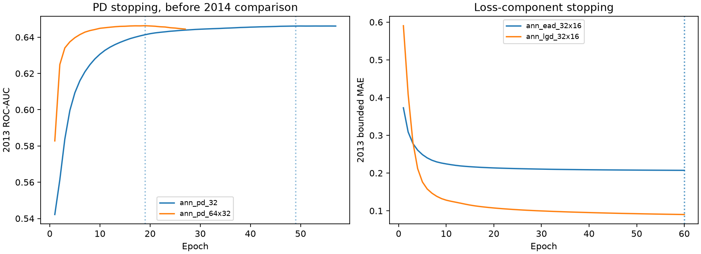
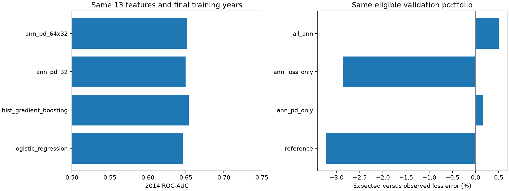

# ANN challengers

Two multilayer-perceptron classifiers (32 and 64→32 hidden units) and two 32→16 regressors test whether neural networks improve PD discrimination or snapshot loss proxies. They use the same 13 origination predictors as the original benchmark. No PyTorch/TensorFlow dependency is added.

## Protocol

Preprocessing is median imputation, training-only scaling, log1p for income/revolving balance, numeric missing flags, and one-hot categories. Each stopping fit learns preprocessing on 2011–2012 only. Stopping uses 2013 ROC-AUC for PD and bounded MAE for losses, with at most 60 epochs and patience 8. The chosen epoch budget is frozen, then preprocessing and network are refitted from scratch on 2011–2013. 2014 selects the ANN PD candidate by average precision and compares loss components by bounded MAE. 2014 does not select the stopping epoch. Losses train only on the identical eligible defaulted population used in the Basel-style proxy experiment. Only origination features reach neural-network inputs.

All networks use ReLU, Adam, alpha 0.01, learning rate 0.001, batch size 1024 and seed 42. Only one seed is studied; these are selection-influenced research results on already-explored cohorts. There is no new holdout claim. No 2015 rows are read, and incumbent PD/loss artifacts remain unchanged. The stopping cohort is subsequently included in the fixed-budget refit; it is not an independent final evaluation.

## Loss composition

Compare the reference bundle, ANN PD alone, ANN loss components alone, and all-ANN composition on the same eligible portfolio. Regressor predictions are explicitly bounded to [0,1] for loss composition. Raw errors/clipping counts are saved, while native regression evaluations use raw outputs. Expected-loss outputs retain the snapshot and residual-dependence limitations from the loss report. No capital assumptions or one-year-PD claims change.

## pd comparison

| model | split | rows | observed_positive_rate | mean_predicted_probability | threshold | roc_auc | gini | ks | average_precision | brier_score | log_loss | ece_10_uniform_bins | accuracy | balanced_accuracy | precision | recall | specificity | f1 | predicted_positive_rate | tn | fp | fn | tp |
| --- | --- | --- | --- | --- | --- | --- | --- | --- | --- | --- | --- | --- | --- | --- | --- | --- | --- | --- | --- | --- | --- | --- | --- |
| logistic_regression | validation | 162570 | 0.137264 | 0.132214 | 0.5 | 0.646231 | 0.292462 | 0.213711 | 0.21028 | 0.114869 | 0.384341 | 0.006675 | 0.862705 | 0.500152 | 0.391304 | 0.000403 | 0.9999 | 0.000806 | 0.000141 | 140241 | 14 | 22306 | 9 |
| hist_gradient_boosting | validation | 162570 | 0.137264 | 0.131767 | 0.5 | 0.653889 | 0.307779 | 0.222796 | 0.216483 | 0.114375 | 0.382348 | 0.005851 | 0.862736 | 0.5 | 0 | 0 | 1 | 0 | 0 | 140255 | 0 | 22315 | 0 |
| ann_pd_32 | validation | 162570 | 0.137264 | 0.130107 | 0.5 | 0.649693 | 0.299385 | 0.218697 | 0.213183 | 0.11473 | 0.383848 | 0.009889 | 0.862675 | 0.500134 | 0.321429 | 0.000403 | 0.999865 | 0.000806 | 0.000172 | 140236 | 19 | 22306 | 9 |
| ann_pd_64x32 | validation | 162570 | 0.137264 | 0.133349 | 0.5 | 0.651546 | 0.303092 | 0.22013 | 0.214436 | 0.114563 | 0.383005 | 0.007148 | 0.862736 | 0.500094 | 0.5 | 0.000224 | 0.999964 | 0.000448 | 0.000062 | 140250 | 5 | 22310 | 5 |

## loss comparison

| model | component | split | rows | raw_mae | bounded_mae | bounded_rmse | bounded_r2 | observed_mean | predicted_mean | predictions_clipped |
| --- | --- | --- | --- | --- | --- | --- | --- | --- | --- | --- |
| ead_mean | ead | validation | 22308 | 0.203347 | 0.203347 | 0.241757 | -0.002078 | 0.570639 | 0.581648 | 0 |
| ead_boosting | ead | validation | 22308 | 0.20203 | 0.20203 | 0.240937 | 0.00471 | 0.570639 | 0.582187 | 0 |
| lgd_mean | lgd | validation | 22308 | 0.075857 | 0.075857 | 0.121128 | -0.00192 | 0.888369 | 0.893671 | 0 |
| lgd_boosting | lgd | validation | 22308 | 0.076627 | 0.076627 | 0.121075 | -0.001047 | 0.888369 | 0.890492 | 0 |
| ann_ead_32x16 | ead | validation | 22308 | 0.203652 | 0.203635 | 0.244141 | -0.021937 | 0.570639 | 0.58841 | 3 |
| ann_lgd_32x16 | lgd | validation | 22308 | 0.082214 | 0.081999 | 0.125664 | -0.078371 | 0.888369 | 0.892065 | 153 |

## portfolio loss comparison

| method | rows | observed_loss_proxy_total | expected_loss_proxy_total | portfolio_relative_error | loan_dollar_mae | loan_dollar_rmse |
| --- | --- | --- | --- | --- | --- | --- |
| reference | 162563 | 136,945,537.9234 | 132,522,640.713809 | -0.032297 | 1,389.339737 | 2,721.321381 |
| ann_pd_only | 162563 | 136,945,537.9234 | 137,173,944.365377 | 0.001668 | 1,405.987787 | 2,724.590109 |
| ann_loss_only | 162563 | 136,945,537.9234 | 133,024,482.287243 | -0.028632 | 1,391.408369 | 2,723.561003 |
| all_ann | 162563 | 136,945,537.9234 | 137,626,396.467126 | 0.004972 | 1,407.897945 | 2,727.01213 |

## dataset roles

| component | role | rows | target_mean | dataset_digest |
| --- | --- | --- | --- | --- |
| pd | inner_fit | 57571 | 0.128572 | f2d0b047 |
| pd | stopping | 100422 | 0.12326 | 342aece7 |
| pd | train | 157993 | 0.125195 | 3fc22603 |
| pd | validation | 162570 | 0.137264 | 722bf1f9 |
| ead | inner_fit | 7388 | 0.588688 | e3f2b341 |
| ead | stopping | 12369 | 0.577443 | f3a9d8ec |
| ead | train | 19757 | 0.581648 | 1b5669f3 |
| ead | validation | 22308 | 0.570639 | d74c3112 |
| lgd | inner_fit | 7388 | 0.90526 | 356568e9 |
| lgd | stopping | 12369 | 0.886749 | 29d553a8 |
| lgd | train | 19757 | 0.893671 | 9521301c |
| lgd | validation | 22308 | 0.888369 | c160f33c |

MLflow experiment `lendingclub_ann_challengers`, batch `c85319471ca849758abb207d833f973b`. [Manifest and complete CSVs](../assets/results/ann_experiments/c85319471ca849758abb207d833f973b/manifest.json).

References: [MLPClassifier](https://scikit-learn.org/stable/modules/generated/sklearn.neural_network.MLPClassifier.html), [MLPRegressor](https://scikit-learn.org/stable/modules/generated/sklearn.neural_network.MLPRegressor.html).
