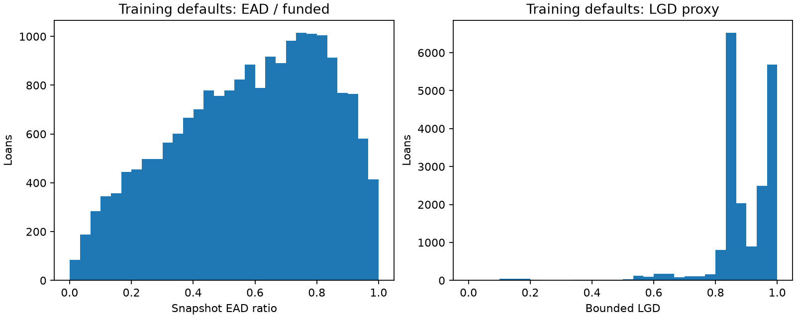
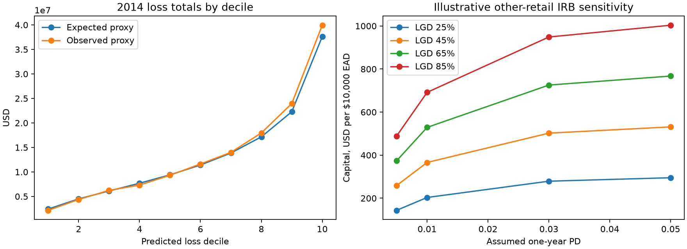

# Basel-style loss experiment

This experiment adds separate EAD and LGD models, resolved-outcome expected-loss proxies, and illustrative CRE31.16 other-retail capital calculations. It is not a regulatory model. The incumbent PD model is unchanged. Fit: 2011–2013; selection/evaluation: already-explored 2014. No 2015 rows are used.

## Targets and exclusions

On charged-off loans only, snapshot EAD = funded amount − principal received; LGD = 1 − net recoveries / snapshot EAD. Positive funded amounts, nonnegative source inputs, positive EAD, and LGD in [0,1] define this bounded experiment. Out-of-range targets are quarantined and counted, not silently clipped. LGD above one can represent costs rather than a parsing error. Fully-paid rows have zero observed loss and do not train EAD/LGD.

Snapshot principal and recoveries are not event-time EAD or discounted economic loss. Recovery dates, indirect costs and unresolved recovery tails are unavailable. The fitted sample therefore has retrospective selection and recovery-maturity limitations.

## Component models

Mean baselines and fixed gradient-boosting regressors use the same 13 origination predictors. All preprocessing is fitted on eligible training defaults only. Outcome fields form targets and dollar diagnostics; they never enter PD or loss predictor matrices. Predictions are explicitly bounded to [0,1] for composition; raw regression errors and clipping counts are also saved. Native MLflow regression evaluations use raw predictions. Selection uses validation bounded MAE.

## Expected loss and capital interpretation

Resolved-outcome EL proxy = unchanged PD score × predicted LGD × predicted EAD. EAD prediction = funded amount × predicted EAD ratio. Multiplying conditional EAD and LGD means ignores residual dependence; validation dollar errors expose this approximation. The observed loss comparator uses the same eligible portfolio and snapshot convention.

Capital uses explicitly assumed one-year PD scenarios, never the resolved-loan PD score. CRE31.16 correlation R = 0.03w + 0.16(1−w), w = (1−exp(−35PD))/(1−exp(−35)); K = LGD × [Phi((Phi^-1(PD)+sqrt(R)Phi^-1(0.999))/sqrt(1−R))−PD]; capital = K × EAD and RWA = 12.5 × capital. Scenario one-year EL uses the assumed PD. The scenario treats the loans as a hypothetical performing portfolio at origination; it does not apply the performing-exposure formula to their realised default state. Other-retail eligibility is assumed for illustration. No regulatory parameter floors, output floor, buffers, provisions adjustment, downturn-LGD validation or approval requirements are implemented. These are sensitivities, not a measured regulatory capital requirement.

## loss audit

| split | rows | charged_off_rows | missing_source | invalid_funded | bad_or_missing_loss_inputs | nonpositive_default_ead | negative_lgd | lgd_above_one | eligible_defaults | eligible_portfolio_rows |
| --- | --- | --- | --- | --- | --- | --- | --- | --- | --- | --- |
| train | 157993 | 19,780 | 0 | 0 | 0 | 0 | 23 | 0 | 19757 | 157970 |
| validation | 162570 | 22,315 | 0 | 0 | 0 | 0 | 7 | 0 | 22308 | 162563 |

## component metrics

| model | component | split | rows | raw_mae | bounded_mae | bounded_rmse | bounded_r2 | observed_mean | predicted_mean | predictions_clipped |
| --- | --- | --- | --- | --- | --- | --- | --- | --- | --- | --- |
| ead_mean | ead | train | 19757 | 0.206835 | 0.206835 | 0.244875 | 0 | 0.581648 | 0.581648 | 0 |
| ead_mean | ead | validation | 22308 | 0.203347 | 0.203347 | 0.241757 | -0.002078 | 0.570639 | 0.581648 | 0 |
| ead_boosting | ead | train | 19757 | 0.197543 | 0.197543 | 0.23467 | 0.081607 | 0.581648 | 0.581647 | 0 |
| ead_boosting | ead | validation | 22308 | 0.20203 | 0.20203 | 0.240937 | 0.00471 | 0.570639 | 0.582187 | 0 |
| lgd_mean | lgd | train | 19757 | 0.075662 | 0.075662 | 0.115712 | 0 | 0.893671 | 0.893671 | 0 |
| lgd_mean | lgd | validation | 22308 | 0.075857 | 0.075857 | 0.121128 | -0.00192 | 0.888369 | 0.893671 | 0 |
| lgd_boosting | lgd | train | 19757 | 0.072064 | 0.072064 | 0.110748 | 0.083959 | 0.893671 | 0.893677 | 0 |
| lgd_boosting | lgd | validation | 22308 | 0.076627 | 0.076627 | 0.121075 | -0.001047 | 0.888369 | 0.890492 | 0 |

## portfolio loss metrics

| method | ead_model | lgd_model | rows | observed_loss_proxy_total | expected_loss_proxy_total | portfolio_relative_error | loan_dollar_mae | loan_dollar_rmse |
| --- | --- | --- | --- | --- | --- | --- | --- | --- |
| mean_baseline | ead_mean | lgd_mean | 162563 | 136,945,537.9234 | 133,599,891.551034 | -0.02443 | 1,397.946728 | 2,722.01205 |
| boosting | ead_boosting | lgd_boosting | 162563 | 136,945,537.9234 | 131,383,513.104929 | -0.040615 | 1,384.1923 | 2,721.567036 |
| selected_components | ead_boosting | lgd_mean | 162563 | 136,945,537.9234 | 132,522,640.713809 | -0.032297 | 1,389.339737 | 2,721.321381 |

## loss deciles

| loss_decile | rows | expected_loss | observed_loss | mean_pd |
| --- | --- | --- | --- | --- |
| 1 | 16257 | 2,428,841.747448 | 2,174,280.5277 | 0.079452 |
| 2 | 16256 | 4,508,409.6393 | 4,390,934.1213 | 0.096169 |
| 3 | 16256 | 6,122,390.034093 | 6,242,610.5267 | 0.107181 |
| 4 | 16256 | 7,698,848.741259 | 7,324,709.1903 | 0.115385 |
| 5 | 16257 | 9,411,279.960759 | 9,328,621.7788 | 0.123669 |
| 6 | 16256 | 11,417,064.818844 | 11,623,728.9321 | 0.131949 |
| 7 | 16256 | 13,861,467.037322 | 13,994,687.3703 | 0.141604 |
| 8 | 16256 | 17,161,402.234201 | 17,962,841.2281 | 0.154841 |
| 9 | 16256 | 22,285,763.725126 | 23,963,009.122399 | 0.17125 |
| 10 | 16257 | 37,627,172.775456 | 39,940,115.1257 | 0.196187 |

## capital sensitivity

| pd_one_year_assumed | lgd | ead | correlation | capital_ratio | capital | risk_weight | rwa | expected_loss_one_year_scenario |
| --- | --- | --- | --- | --- | --- | --- | --- | --- |
| 0.005 | 0.25 | 10,000 | 0.139129 | 0.014383 | 143.827503 | 0.179784 | 1,797.843792 | 12.5 |
| 0.005 | 0.45 | 10,000 | 0.139129 | 0.025889 | 258.889506 | 0.323612 | 3,236.118826 | 22.5 |
| 0.005 | 0.65 | 10,000 | 0.139129 | 0.037395 | 373.951509 | 0.467439 | 4,674.39386 | 32.5 |
| 0.005 | 0.85 | 10,000 | 0.139129 | 0.048901 | 489.013512 | 0.611267 | 6,112.668894 | 42.5 |
| 0.01 | 0.25 | 10,000 | 0.121609 | 0.020343 | 203.434332 | 0.254293 | 2,542.929144 | 25 |
| 0.01 | 0.45 | 10,000 | 0.121609 | 0.036618 | 366.181797 | 0.457727 | 4,577.272459 | 45 |
| 0.01 | 0.65 | 10,000 | 0.121609 | 0.052893 | 528.929262 | 0.661162 | 6,611.615774 | 65 |
| 0.01 | 0.85 | 10,000 | 0.121609 | 0.069168 | 691.676727 | 0.864596 | 8,645.959089 | 85 |
| 0.03 | 0.25 | 10,000 | 0.075492 | 0.027907 | 279.074938 | 0.348844 | 3,488.436726 | 75 |
| 0.03 | 0.45 | 10,000 | 0.075492 | 0.050233 | 502.334889 | 0.627919 | 6,279.186107 | 135 |
| 0.03 | 0.65 | 10,000 | 0.075492 | 0.072559 | 725.594839 | 0.906994 | 9,069.935488 | 195 |
| 0.03 | 0.85 | 10,000 | 0.075492 | 0.094885 | 948.85479 | 1.186068 | 11,860.684869 | 255 |
| 0.05 | 0.25 | 10,000 | 0.052591 | 0.029518 | 295.178526 | 0.368973 | 3,689.73158 | 125 |
| 0.05 | 0.45 | 10,000 | 0.052591 | 0.053132 | 531.321348 | 0.664152 | 6,641.516844 | 225 |
| 0.05 | 0.65 | 10,000 | 0.052591 | 0.076746 | 767.464169 | 0.95933 | 9,593.302108 | 325 |
| 0.05 | 0.85 | 10,000 | 0.052591 | 0.100361 | 1,003.60699 | 1.254509 | 12,545.087372 | 425 |

## portfolio capital scenarios

| pd_one_year_assumed | lgd_addition | rows | predicted_ead_total | capital | rwa | scenario_one_year_el |
| --- | --- | --- | --- | --- | --- | --- |
| 0.01 | 0 | 162563 | 1,158,431,639.276366 | 84,242,742.978985 | 1,053,034,287.23731 | 10,352,572.050028 |
| 0.01 | 0.1 | 162563 | 1,158,431,639.276366 | 93,669,333.624738 | 1,170,866,670.309225 | 11,511,003.689305 |
| 0.03 | 0 | 162563 | 1,158,431,639.276366 | 115,565,736.162523 | 1,444,571,702.031539 | 31,057,716.150085 |
| 0.03 | 0.1 | 162563 | 1,158,431,639.276366 | 128,497,305.683603 | 1,606,216,321.04504 | 34,533,011.067914 |
| 0.05 | 0 | 162563 | 1,158,431,639.276366 | 122,234,278.485012 | 1,527,928,481.062648 | 51,762,860.250142 |
| 0.05 | 0.1 | 162563 | 1,158,431,639.276366 | 135,912,044.253449 | 1,698,900,553.168111 | 57,555,018.446523 |

## pd unchanged check

| stage | rows | observed_positive_rate | mean_predicted_probability | threshold | roc_auc | gini | ks | average_precision | brier_score | log_loss | ece_10_uniform_bins | accuracy | balanced_accuracy | precision | recall | specificity | f1 | predicted_positive_rate | tn | fp | fn | tp |
| --- | --- | --- | --- | --- | --- | --- | --- | --- | --- | --- | --- | --- | --- | --- | --- | --- | --- | --- | --- | --- | --- | --- |
| before_loss_layers | 162570 | 0.137264 | 0.131767 | 0.5 | 0.653889 | 0.307779 | 0.222796 | 0.216483 | 0.114375 | 0.382348 | 0.005851 | 0.862736 | 0.5 | 0 | 0 | 1 | 0 | 0 | 140255 | 0 | 22315 | 0 |
| after_loss_layers | 162570 | 0.137264 | 0.131767 | 0.5 | 0.653889 | 0.307779 | 0.222796 | 0.216483 | 0.114375 | 0.382348 | 0.005851 | 0.862736 | 0.5 | 0 | 0 | 1 | 0 | 0 | 140255 | 0 | 22315 | 0 |

## native regression evaluations

| model | evaluation_run_id | native_validation_score | native_validation_example_count | native_validation_mean_absolute_error | native_validation_mean_squared_error | native_validation_root_mean_squared_error | native_validation_sum_on_target | native_validation_mean_on_target | native_validation_r2_score | native_validation_max_error | native_validation_mean_absolute_percentage_error |
| --- | --- | --- | --- | --- | --- | --- | --- | --- | --- | --- | --- |
| ead_mean | 4d8025e2c38d45b7baf9b64d82a4121f | -0.002078 | 22308 | 0.203347 | 0.058446 | 0.241757 | 12,729.808506 | 0.570639 | -0.002078 | 0.581632 | 2.525249 |
| ead_boosting | 9a47dfabac3440dcab3352a61e95a918 | 0.00471 | 22308 | 0.20203 | 0.058051 | 0.240937 | 12,729.808506 | 0.570639 | 0.00471 | 0.669205 | 2.427968 |
| lgd_mean | 393ad762a4f545f4a5fa6e0b542a0935 | -0.00192 | 22308 | 0.075857 | 0.014672 | 0.121128 | 19,817.742847 | 0.888369 | -0.00192 | 0.893671 | 180,416,805,933.865601 |
| lgd_boosting | 98b3bb4f576843f29ae690848e64d548 | -0.001047 | 22308 | 0.076627 | 0.014659 | 0.121075 | 19,817.742847 | 0.888369 | -0.001047 | 0.936367 | 189,036,413,367.717377 |

Sources: [BIS CRE31.16 risk-weight functions](https://www.bis.org/committees/bcbs/basel-framework/standard/cre/31/inforce/2023-01-01/published/2020-03-27), [BIS CRE36 economic-loss requirements](https://www.bis.org/committees/bcbs/basel-framework/standard/cre/36/inforce/2023-01-01/published/2022-12-08).

MLflow experiment: `lendingclub_basel_loss_proxies`, batch `c072de3541e2496ab90ed6b7c2699137`. [Full manifest](../assets/results/basel_loss/c072de3541e2496ab90ed6b7c2699137/manifest.json). The local model directory contains four component pipelines and the selected loss-model bundle.
