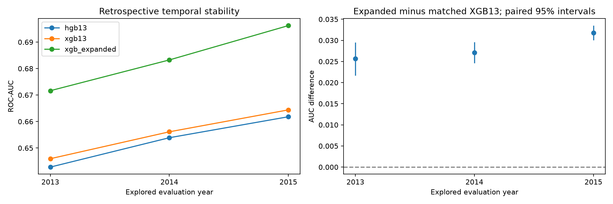

# Expanded bureau timing and temporal review

Batch `53a79329f2584a9db272ac2c42abf4e2`, completed 2026-11-11T22:42:29.307496+00:00.
**Decision: research only; no promotion.** The incumbent artifact and original
model/research manifest pointers are unchanged.

## Field timing audit

All **58 input features** have explicit timing-audit entries, including
**45 additions** to the 13-feature baseline. **Zero** have issuer-certified
per-field measurement/update lineage for this exact CSV. Policy allowlisting
prevents known later-outcome predictors; it does not certify availability.
Derived variables inherit their parents' timing uncertainty. Grade, subgrade and
interest rate are excluded from this comparison.

The filed [loan-request credit-report authorization](https://www.sec.gov/Archives/edgar/data/1409970/000095012309014424/c86710exv10w11.htm)
provides general evidence that reports were obtained for loan requests. It does
not map this extract's field values to measurement times. The
[April 2019 borrower agreement, section 6](https://www.sec.gov/Archives/edgar/data/1409970/000140997019000563/lc33119ex101.htm)
also authorizes periodic reports during the relationship. Those later terms do
not establish that any specific 2011–2015 CSV value was updated. Neither document
certifies the historical CSV snapshot. Unknown timing is not proof of leakage.

[Field audit](https://github.com/Codezy93/Credit-Risk-and-Failure-Modeling-Platform/blob/main/assets/results/bureau_temporal/53a79329f2584a9db272ac2c42abf4e2/feature_timing_audit.csv) and
[year-by-year feature coverage](https://github.com/Codezy93/Credit-Risk-and-Failure-Modeling-Platform/blob/main/assets/results/bureau_temporal/53a79329f2584a9db272ac2c42abf4e2/feature_coverage_by_year.csv)
record every field and missingness pattern. Coverage can reveal schema/cohort
changes; it is not timestamp evidence. Promotion requires an issuer/source
mapping of measurement time, first availability and update/immutability rules
for every input and its dependencies, before the intended scoring time.

## Predeclared research windows

| evaluation_year | role | rows | min_issue_date | max_issue_date | charged_off | positive_rate |
| --- | --- | --- | --- | --- | --- | --- |
| 2013 | train | 57571 | 2011-01-01 00:00:00 | 2012-12-01 00:00:00 | 7402 | 0.128572 |
| 2013 | evaluation | 100422 | 2013-01-01 00:00:00 | 2013-12-01 00:00:00 | 12378 | 0.12326 |
| 2014 | train | 157993 | 2011-01-01 00:00:00 | 2013-12-01 00:00:00 | 19780 | 0.125195 |
| 2014 | evaluation | 162570 | 2014-01-01 00:00:00 | 2014-12-01 00:00:00 | 22315 | 0.137264 |
| 2015 | train | 320563 | 2011-01-01 00:00:00 | 2014-12-01 00:00:00 | 42095 | 0.131316 |
| 2015 | evaluation | 283026 | 2015-01-01 00:00:00 | 2015-12-01 00:00:00 | 42132 | 0.148863 |

Evaluation years 2013, 2014 and 2015 were already explored. Training rows precede
evaluation rows, preprocessing fits on training only, and loan IDs are unique and
disjoint across each split. Borrower-level disjointness is not established.
Lifetime outcome labels were not necessarily known at the later origination
date, so these are **not point-in-time deployment backtests** or fresh holdouts.
Only resolved accepted 36-month loans are included; later, less-mature cohorts
are not added merely to obtain another test year.

Both XGBoost controls use exactly the same frozen parameters and
**335 trees**, without an eval_set or new tuning.
The tree budget was originally chosen using **2013 stopping data**; the
configuration and 58-feature contract were selected in earlier **2014-informed
research**. Thus 2013 reuses stopping data and 2014 reuses selection data. The
windows were fixed before this rerun, not before the project originally explored
them. These are descriptive, hindsight-informed comparisons, not independent
validation. HGB13 uses the original fixed 200-iteration
configuration but is refitted within each window. Its 2015 value is therefore
not the unchanged incumbent's original 2015 score.

## Measured results

| evaluation_year | model | train_rows | rows | roc_auc | gini | ks | average_precision | brier_score | observed_positive_rate | mean_score |
| --- | --- | --- | --- | --- | --- | --- | --- | --- | --- | --- |
| 2013 | hgb13 | 57571 | 100422 | 0.642801 | 0.285603 | 0.20653 | 0.189022 | 0.105429 | 0.12326 | 0.136538 |
| 2013 | xgb13 | 57571 | 100422 | 0.645969 | 0.291938 | 0.209494 | 0.192756 | 0.105372 | 0.12326 | 0.137152 |
| 2013 | xgb_expanded | 57571 | 100422 | 0.67164 | 0.34328 | 0.248942 | 0.215023 | 0.103727 | 0.12326 | 0.125224 |
| 2014 | hgb13 | 157993 | 162570 | 0.653889 | 0.307779 | 0.222796 | 0.216483 | 0.114375 | 0.137264 | 0.131767 |
| 2014 | xgb13 | 157993 | 162570 | 0.656124 | 0.312248 | 0.226062 | 0.218326 | 0.114261 | 0.137264 | 0.132051 |
| 2014 | xgb_expanded | 157993 | 162570 | 0.683258 | 0.366515 | 0.266477 | 0.244568 | 0.112495 | 0.137264 | 0.130218 |
| 2015 | hgb13 | 320563 | 283026 | 0.661806 | 0.323611 | 0.233764 | 0.241852 | 0.121657 | 0.148863 | 0.136401 |
| 2015 | xgb13 | 320563 | 283026 | 0.664401 | 0.328803 | 0.239271 | 0.244622 | 0.121439 | 0.148863 | 0.136457 |
| 2015 | xgb_expanded | 320563 | 283026 | 0.69622 | 0.39244 | 0.284954 | 0.276781 | 0.118935 | 0.148863 | 0.136065 |

The matched XGB13 control separates added-field gains from a change of algorithm
or tree budget. Compare all windows, average precision, Brier and mean score
against observed prevalence; ranking lift alone does not establish calibration.
No new winner or threshold is chosen from these results.

## Conditional uncertainty

| evaluation_year | auc_difference_expanded_minus_base13 | lower_95 | upper_95 | scope |
| --- | --- | --- | --- | --- |
| 2013 | 0.025671 | 0.021677 | 0.029533 | paired fixed-model cohort bootstrap; excludes fitting/selection uncertainty |
| 2014 | 0.027134 | 0.024617 | 0.029598 | paired fixed-model cohort bootstrap; excludes fitting/selection uncertainty |
| 2015 | 0.031819 | 0.030031 | 0.033495 | paired fixed-model cohort bootstrap; excludes fitting/selection uncertainty |

Intervals use 200 paired, class-stratified resamples of each evaluation cohort,
seed 42. They condition on fitted models and omit training/configuration/feature
selection uncertainty, macroeconomic variation and possible borrower dependence.
Windows share observations and are not independent replications; no pooled
significance claim is made. Even consistently positive intervals would not
resolve the timing gate.

## Artifacts and next evidence

Local suite: **113 tests**, 0 failures, 0 errors and 0 skips. [JUnit](https://github.com/Codezy93/Credit-Risk-and-Failure-Modeling-Platform/blob/main/assets/results/bureau_temporal/53a79329f2584a9db272ac2c42abf4e2/test_results.xml).

Nine saved pipelines, role-specific datasets and nine native MLflow evaluation
runs are recorded in `lendingclub_bureau_temporal_review`. Native full-cohort AUCs
were checked against custom metrics; saved pipelines reproduce full-cohort scores.
The manifest pins source, input, result, dataset and model hashes.

[Manifest](https://github.com/Codezy93/Credit-Risk-and-Failure-Modeling-Platform/blob/main/assets/results/bureau_temporal/53a79329f2584a9db272ac2c42abf4e2/manifest.json),
[metrics](https://github.com/Codezy93/Credit-Risk-and-Failure-Modeling-Platform/blob/main/assets/results/bureau_temporal/53a79329f2584a9db272ac2c42abf4e2/temporal_metrics.csv), and
[native evaluations](https://github.com/Codezy93/Credit-Risk-and-Failure-Modeling-Platform/blob/main/assets/results/bureau_temporal/53a79329f2584a9db272ac2c42abf4e2/native_evaluations.csv).
Run `make bureau-review` with the existing raw and clean data to repeat.

The remaining gate is an exact as-of data contract plus genuinely unused,
sufficiently mature evaluation data and label-availability evidence. Additional
retrospective windows support a stability discussion, not deployment approval.
The [lifetime charge-off target](risk_terminology.md) and the independent
[loss-proxy limitations](loss_model_limitations.md) remain unchanged.
