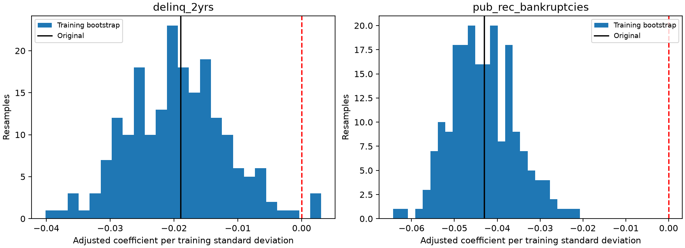

# Logistic coefficient validation

Terminology: [lifetime charge-off probability, snapshot losses and capital scenarios](risk_terminology.md).

This review investigates the two questioned negative logistic coefficients using only 2011–2013 training data. Four feature-removal variants are compared on the already-explored 2014 cohort. No 2015 rows are read, no model is promoted, and no coefficients are forced to have a preferred sign. Positive class is Charged Off.

## What the signs mean

The original logistic pipeline uses scaled numeric inputs and log1p for annual income and revolving balance. Coefficients are conditional associations within accepted, resolved loans. A negative coefficient does not establish that delinquency or bankruptcy protects against loss. Year-specific estimates use different training scales; signs are comparable, while raw magnitudes also depend on those scales. The CSV includes coefficients per transformed input unit.

Univariate fits, observed outcome buckets and FICO-stratified slices give context. Correlation and conditional/marginal sign changes are diagnostics, not proof of a causal explanation.

## Bootstrap protocol

200 resamples, seed 42, stratified by training issue year × outcome. Every resample refits imputation, scaling, encoding and regularized logistic regression. Intervals use empirical 2.5th/97.5th percentiles; sign fractions and estimable counts are saved. They condition on observed year/class counts and omit repeated-borrower dependence, macroeconomic uncertainty, and model-selection uncertainty. They are not unpenalized inferential p-values.

## univariate vs adjusted

| feature | univariate_standardized_coefficient | adjusted_standardized_coefficient | univariate_input_includes_missing_flag_if_needed |
| --- | --- | --- | --- |
| delinq_2yrs | 0.016058 | -0.018985 | True |
| pub_rec_bankruptcies | 0.012118 | -0.043006 | True |

## coefficient summary

| feature | point_coefficient | estimable_resamples | median | lower_95 | upper_95 | negative_fraction | positive_fraction |
| --- | --- | --- | --- | --- | --- | --- | --- |
| annual_inc | -0.294973 | 200 | -0.295362 | -0.318646 | -0.275914 | 1 | 0 |
| credit_history_years | -0.023221 | 200 | -0.024471 | -0.042613 | -0.00584 | 0.995 | 0.005 |
| delinq_2yrs | -0.018985 | 200 | -0.019517 | -0.034436 | -0.004122 | 0.985 | 0.015 |
| dti | 0.10686 | 200 | 0.107409 | 0.090059 | 0.126546 | 0 | 1 |
| emp_length_years | 0.02401 | 200 | 0.024554 | 0.008725 | 0.041595 | 0 | 1 |
| fico_mid | -0.383836 | 200 | -0.384017 | -0.405821 | -0.360347 | 1 | 0 |
| loan_amnt | 0.17579 | 200 | 0.175143 | 0.157625 | 0.194308 | 0 | 1 |
| open_acc | 0.085205 | 200 | 0.085349 | 0.066102 | 0.103458 | 0 | 1 |
| pub_rec_bankruptcies | -0.043006 | 200 | -0.043608 | -0.055997 | -0.027713 | 1 | 0 |
| revol_bal | -0.123783 | 200 | -0.12456 | -0.144027 | -0.102735 | 1 | 0 |
| revol_util | 0.082465 | 200 | 0.083382 | 0.062111 | 0.105791 | 0 | 1 |

## year coefficients

| feature | coefficient_standardized | coefficient_per_transformed_unit | input_transform | training_scale | estimable | fit_year | rows |
| --- | --- | --- | --- | --- | --- | --- | --- |
| loan_amnt | 0.094894 | 0.000015 | identity | 6,476.663273 | True | 2011 | 14101 |
| annual_inc | -0.372836 | -0.673245 | log1p | 0.553789 | True | 2011 | 14101 |
| dti | 0.026252 | 0.003897 | identity | 6.736156 | True | 2011 | 14101 |
| revol_util | 0.226929 | 0.008049 | identity | 28.195001 | True | 2011 | 14101 |
| revol_bal | -0.116259 | -0.064679 | log1p | 1.797468 | True | 2011 | 14101 |
| open_acc | 0.063071 | 0.014576 | identity | 4.326948 | True | 2011 | 14101 |
| delinq_2yrs | 0.022527 | 0.044815 | identity | 0.50267 | True | 2011 | 14101 |
| pub_rec_bankruptcies | 0.014601 | 0.07136 | identity | 0.204612 | True | 2011 | 14101 |
| emp_length_years | 0.058329 | 0.016949 | identity | 3.441466 | True | 2011 | 14101 |
| fico_mid | -0.412496 | -0.011435 | identity | 36.074024 | True | 2011 | 14101 |
| credit_history_years | 0.00619 | 0.000881 | identity | 7.022532 | True | 2011 | 14101 |
| loan_amnt | 0.208508 | 0.000029 | identity | 7,081.085313 | True | 2012 | 43470 |
| annual_inc | -0.287186 | -0.548894 | log1p | 0.523208 | True | 2012 | 43470 |
| dti | 0.062146 | 0.008168 | identity | 7.608557 | True | 2012 | 43470 |
| revol_util | 0.084877 | 0.003504 | identity | 24.221328 | True | 2012 | 43470 |
| revol_bal | -0.177292 | -0.151619 | log1p | 1.169326 | True | 2012 | 43470 |
| open_acc | 0.07934 | 0.017941 | identity | 4.422348 | True | 2012 | 43470 |
| delinq_2yrs | -0.032543 | -0.05109 | identity | 0.636979 | True | 2012 | 43470 |
| pub_rec_bankruptcies | 0.021986 | 0.143584 | identity | 0.153119 | True | 2012 | 43470 |
| emp_length_years | 0.031177 | 0.008982 | identity | 3.471016 | True | 2012 | 43470 |
| fico_mid | -0.42133 | -0.013032 | identity | 32.330593 | True | 2012 | 43470 |
| credit_history_years | 0.019873 | 0.002907 | identity | 6.836622 | True | 2012 | 43470 |
| loan_amnt | 0.174274 | 0.000024 | identity | 7,355.510725 | True | 2013 | 100422 |
| annual_inc | -0.283878 | -0.545774 | log1p | 0.520137 | True | 2013 | 100422 |
| dti | 0.139054 | 0.018225 | identity | 7.629728 | True | 2013 | 100422 |
| revol_util | 0.051989 | 0.002295 | identity | 22.657352 | True | 2013 | 100422 |
| revol_bal | -0.102488 | -0.101092 | log1p | 1.013802 | True | 2013 | 100422 |
| open_acc | 0.0852 | 0.018396 | identity | 4.631446 | True | 2013 | 100422 |
| delinq_2yrs | -0.018288 | -0.024983 | identity | 0.732023 | True | 2013 | 100422 |
| pub_rec_bankruptcies | -0.055851 | -0.166417 | identity | 0.335611 | True | 2013 | 100422 |
| emp_length_years | 0.016433 | 0.004711 | identity | 3.48817 | True | 2013 | 100422 |
| fico_mid | -0.364593 | -0.012479 | identity | 29.21575 | True | 2013 | 100422 |
| credit_history_years | -0.039213 | -0.005418 | identity | 7.236835 | True | 2013 | 100422 |

## ablation metrics

| model | removed | rows | observed_positive_rate | mean_predicted_probability | threshold | roc_auc | gini | ks | average_precision | brier_score | log_loss | ece_10_uniform_bins | accuracy | balanced_accuracy | precision | recall | specificity | f1 | predicted_positive_rate | tn | fp | fn | tp |
| --- | --- | --- | --- | --- | --- | --- | --- | --- | --- | --- | --- | --- | --- | --- | --- | --- | --- | --- | --- | --- | --- | --- | --- |
| full_reference_refit |  | 162570 | 0.137264 | 0.132214 | 0.5 | 0.646231 | 0.292462 | 0.213711 | 0.21028 | 0.114869 | 0.384341 | 0.006675 | 0.862705 | 0.500152 | 0.391304 | 0.000403 | 0.9999 | 0.000806 | 0.000141 | 140241 | 14 | 22306 | 9 |
| drop_delinq | delinq_2yrs | 162570 | 0.137264 | 0.132421 | 0.5 | 0.646438 | 0.292877 | 0.214507 | 0.21039 | 0.114856 | 0.384276 | 0.006469 | 0.862699 | 0.500148 | 0.375 | 0.000403 | 0.999893 | 0.000806 | 0.000148 | 140240 | 15 | 22306 | 9 |
| drop_bankruptcies | pub_rec_bankruptcies | 162570 | 0.137264 | 0.132985 | 0.5 | 0.646646 | 0.293291 | 0.21389 | 0.210386 | 0.114846 | 0.384219 | 0.006178 | 0.862687 | 0.500141 | 0.346154 | 0.000403 | 0.999879 | 0.000806 | 0.00016 | 140238 | 17 | 22306 | 9 |
| drop_both | delinq_2yrs,pub_rec_bankruptcies | 162570 | 0.137264 | 0.133059 | 0.5 | 0.646776 | 0.293552 | 0.214307 | 0.210494 | 0.114838 | 0.384179 | 0.006026 | 0.862687 | 0.500141 | 0.346154 | 0.000403 | 0.999879 | 0.000806 | 0.00016 | 140238 | 17 | 22306 | 9 |

## ablation auc interval

| comparison | point_difference | lower_95 | upper_95 |
| --- | --- | --- | --- |
| drop_both_minus_full_logistic | 0.000545 | 0.000061 | 0.000995 |

## limitations

| item | status | finding |
| --- | --- | --- |
| target | limitation | Charged-off versus fully-paid among resolved 36-month accepted loans; no fixed one-year default horizon. |
| test | limitation | 2015 was previously explored and is not read in this review; no fresh holdout exists. |
| label timing | limitation | Snapshot training labels may not have been known at later origination dates; not a point-in-time backtest. |
| bureau timing | limitation | Added bureau-field collection/update times remain uncertified; expanded results are research only. |
| logistic interpretation | reviewed | Year, bootstrap, univariate and removal checks recorded; negative conditional coefficients are not causal protective effects or scorecard approval. |
| loss targets | proxy only | EAD is residual snapshot principal; LGD uses snapshot net recoveries without event-time/discounted economic-loss validation. |
| capital | illustrative only | Capital uses assumed one-year PD scenarios; no regulatory floors, buffers, downturn-LGD validation or compliance claim. |

## Use decision

Keep the incumbent histogram-boosting model unchanged. The plain logistic baseline is not a WoE scorecard and this review does not certify monotonic economic interpretation. If a model requires monotonic delinquency/bankruptcy effects, that requirement must be enforced and validated in a separate constrained model; do not relabel conditional negative effects as beneficial borrower behaviour. Feature-removal comparisons and their paired interval show the discrimination trade-off, without turning 2014 into a fresh holdout.

[Scikit-learn coefficient-interpretation guidance](https://scikit-learn.org/stable/auto_examples/inspection/plot_linear_model_coefficient_interpretation.html). MLflow experiment `lendingclub_coefficient_validation`, batch `ada1537bb4c646d9baadfa73f78e09c0`. [Full CSVs and manifest](https://github.com/Codezy93/Credit-Risk-and-Failure-Modeling-Platform/blob/main/assets/results/validation_review/ada1537bb4c646d9baadfa73f78e09c0/manifest.json).

A later [WoE scorecard comparison](scorecard.md) provides separate binned
challengers, training IV decisions and full points tables. Its design constraints
do not retroactively make the original raw coefficients causal or incorrect.
