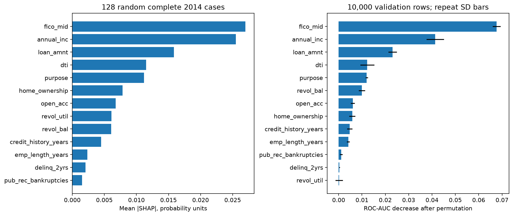
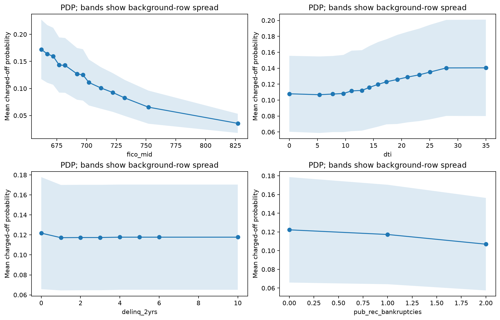
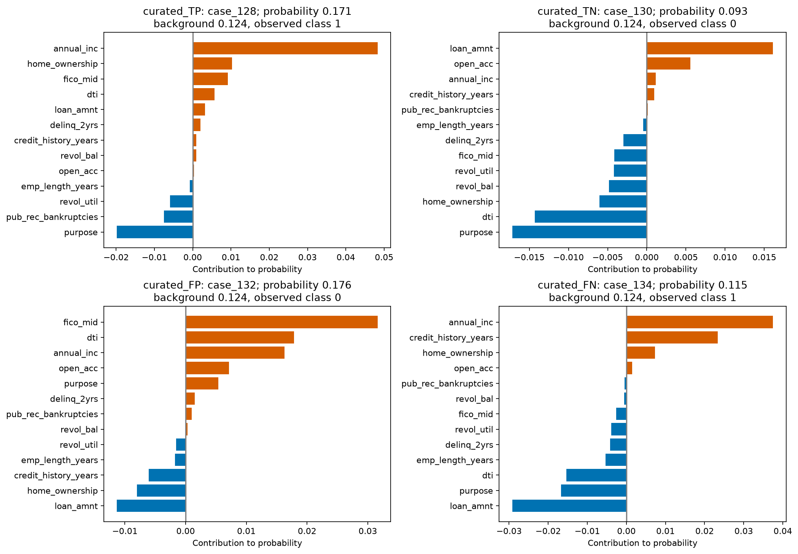
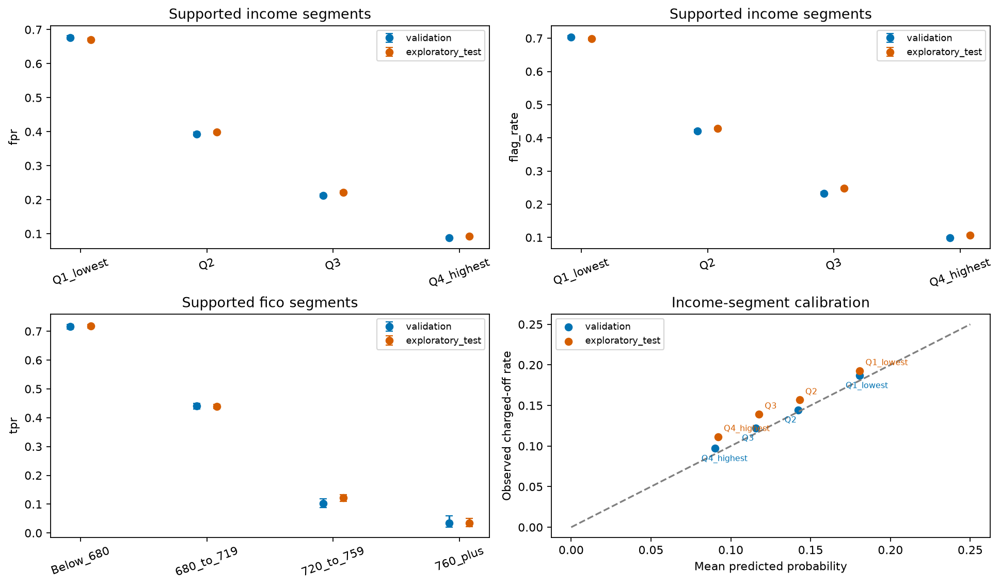

# InterpretML and borrower-segment bias analysis

This stage explains the unchanged histogram-gradient-boosting incumbent and measures descriptive disparities on 2014 validation and previously explored 2015 loans. It does not retrain a model, adjust thresholds or establish protected-group fairness.

## Main findings

The top three sampled SHAP features are **fico_mid, annual_inc, loan_amnt**; permutation importance provides a separate ranking cross-check. On 2015 loans, the lowest/highest training-defined income quartiles have false-positive rates **67.06% / 9.22%**, default-capture rates **81.31% / 22.45%**, and observed charged-off rates **19.26% / 11.14%**. These are material descriptive segment differences at a common risk threshold; they are not measured denial rates or proof of discrimination. Case mix, selection, label quality and decision context remain unresolved.

## InterpretML methods and sampling

InterpretML ShapKernel explains the positive-class probability using 64 uniformly sampled complete training rows and 512 coalition samples per case. Global mean absolute contributions use only 128 uniformly sampled eligible 2014 cases. The 8 additional TP/TN/FP/FN examples are diagnostic and excluded from that ranking. Numeric category codes are reversed before calling the original pipeline; no coded categories are added to model predictors. The scalar explained output is probability, not a hard decision or a new regression model.

InterpretML PartialDependence uses 1000 complete training rows. Bands show between-background-row spread, not confidence intervals. PDP/SHAP can combine correlated features into unusual profiles; contributions are background-dependent model diagnostics, not causal effects or validated adverse-action reasons. Counts in the training support table contextualize rare event levels. Permutation importance uses 10,000 stratified 2014 rows, including missing values, with five repeats. Its error bars are repeat standard deviations, not uncertainty about the population importance.

Eligible complete/training-known rows: training 150,615/157,993; validation 152,852/162,570. Missing/unseen rows are excluded only from InterpretML explanations, not the population metrics, permutation sample or segment audit. Maximum SHAP reconstruction residual: 2.78e-17.

## What 'bias analysis' can establish here

Structured race, ethnicity, sex/gender, age/birth date, disability, marital status, religion and national-origin fields are unavailable in the current source schema. We do not infer them from names, free text, credit history, income or geography. Income, FICO, home ownership, state, purpose, employment, adverse history, missingness, application type and two intersections are observed business segments, not substitutes for protected attributes. No legal/compliance or fairness-pass determination is made.

The data contains accepted loans only. It cannot measure rejected-applicant outcomes, actual approval/denial disparities, or the selection and measurement biases in the original lending process. Labels are resolved-loan outcomes, not fixed-horizon regulatory defaults. Cohort comparisons remain retrospective; 2014 influenced the original model and threshold selection, and 2015 was previously explored.

## Segment protocol

The same frozen threshold 0.147852896 applies to every group. A risk flag is an audit decision proxy, not an observed rejection. False-positive rate means the fraction of Fully Paid loans flagged; TPR/recall means the fraction of Charged Off loans flagged. Income cut points come from training only: $42,000.00, $60,000.00, $85,000.00. Missing groups are retained. Supported groups require at least 500 rows, 50 charged-off and 50 fully-paid loans. Unsupported groups stay in the tables and are excluded only from spread summaries. Undefined precision/AUC/error rates are missing, not falsely set to zero.

Wilson 95% intervals are descriptive and assume independent Bernoulli observations; repeated-borrower and macroeconomic dependence are not modelled. Groups overlap and many slices are screened, so worst-group spreads are selection-influenced diagnostics without multiple-testing or causal claims. Case mix and base-rate differences must be considered. No group-specific threshold is fitted and no four-fifths or other automatic fairness acceptance rule is applied.

The 0.5 comparison threshold can produce no flags at all. Zero flag/TPR/FPR spreads in that degenerate policy are not evidence of fairness: default capture is also zero.

## overall metrics

| split | policy | rows | observed_positive_rate | mean_predicted_probability | threshold | roc_auc | gini | ks | average_precision | brier_score | log_loss | ece_10_uniform_bins | accuracy | balanced_accuracy | precision | recall | specificity | f1 | predicted_positive_rate | tn | fp | fn | tp |
| --- | --- | --- | --- | --- | --- | --- | --- | --- | --- | --- | --- | --- | --- | --- | --- | --- | --- | --- | --- | --- | --- | --- | --- |
| validation | frozen_validation_f1 | 162570 | 0.137264 | 0.131767 | 0.147853 | 0.653889 | 0.307779 | 0.222796 | 0.216483 | 0.114375 | 0.382348 | 0.005851 | 0.651689 | 0.607648 | 0.207851 | 0.546942 | 0.668354 | 0.301228 | 0.361198 | 93740 | 46515 | 10110 | 12205 |
| validation | default_0_5 | 162570 | 0.137264 | 0.131767 | 0.5 | 0.653889 | 0.307779 | 0.222796 | 0.216483 | 0.114375 | 0.382348 | 0.005851 | 0.862736 | 0.5 | 0 | 0 | 1 | 0 | 0 | 140255 | 0 | 22315 | 0 |
| exploratory_test | frozen_validation_f1 | 283026 | 0.148863 | 0.132223 | 0.147853 | 0.65435 | 0.308701 | 0.223789 | 0.235027 | 0.122279 | 0.402502 | 0.01664 | 0.650467 | 0.606918 | 0.22352 | 0.544906 | 0.668929 | 0.317005 | 0.362903 | 161141 | 79753 | 19174 | 22958 |
| exploratory_test | default_0_5 | 283026 | 0.148863 | 0.132223 | 0.5 | 0.65435 | 0.308701 | 0.223789 | 0.235027 | 0.122279 | 0.402502 | 0.01664 | 0.851137 | 0.5 | 0 | 0 | 1 | 0 | 0 | 240894 | 0 | 42132 | 0 |

## protected attribute coverage

| attribute | matching_structured_source_fields | available_as_structured_source_field | protected_group_audit_performed | scope_note |
| --- | --- | --- | --- | --- |
| race |  | False | False | Not inferred from names, text, state, income, or credit history; unavailable in current model inputs. |
| ethnicity |  | False | False | Not inferred from names, text, state, income, or credit history; unavailable in current model inputs. |
| sex_or_gender |  | False | False | Not inferred from names, text, state, income, or credit history; unavailable in current model inputs. |
| age_or_birth_date |  | False | False | Not inferred from names, text, state, income, or credit history; unavailable in current model inputs. |
| disability |  | False | False | Not inferred from names, text, state, income, or credit history; unavailable in current model inputs. |
| marital_status |  | False | False | Not inferred from names, text, state, income, or credit history; unavailable in current model inputs. |
| religion |  | False | False | Not inferred from names, text, state, income, or credit history; unavailable in current model inputs. |
| national_origin |  | False | False | Not inferred from names, text, state, income, or credit history; unavailable in current model inputs. |

## shap global importance

| feature | mean_absolute_contribution | mean_signed_contribution |
| --- | --- | --- |
| fico_mid | 0.026985 | -0.006466 |
| annual_inc | 0.025498 | 0.002061 |
| loan_amnt | 0.015857 | 0.005336 |
| dti | 0.011521 | 0.000126 |
| purpose | 0.011187 | 0.002039 |
| home_ownership | 0.007845 | -0.000214 |
| open_acc | 0.006766 | 0.001771 |
| revol_util | 0.006104 | 0.00009 |
| revol_bal | 0.006062 | 0.000856 |
| credit_history_years | 0.004488 | -0.001024 |
| emp_length_years | 0.002332 | -0.000191 |
| delinq_2yrs | 0.002065 | -0.000024 |
| pub_rec_bankruptcies | 0.001514 | -0.000758 |

## permutation importance

| feature | roc_auc_drop_mean | repeat_standard_deviation |
| --- | --- | --- |
| fico_mid | 0.067718 | 0.001706 |
| annual_inc | 0.041381 | 0.003713 |
| loan_amnt | 0.023106 | 0.00177 |
| dti | 0.012239 | 0.003012 |
| purpose | 0.012039 | 0.000548 |
| revol_bal | 0.009967 | 0.001351 |
| open_acc | 0.006038 | 0.000807 |
| home_ownership | 0.005806 | 0.001284 |
| credit_history_years | 0.004716 | 0.001172 |
| emp_length_years | 0.004137 | 0.000633 |
| pub_rec_bankruptcies | 0.001106 | 0.000585 |
| delinq_2yrs | 0.000354 | 0.000187 |
| revol_util | 0.000187 | 0.001557 |

## Supported-segment spreads

| split | policy | dimension | observed_groups | supported_groups | supported_rows | all_groups_zero_flags | flag_rate_spread | tpr_spread | fpr_spread | roc_auc_spread | calibration_bias_spread | brier_score_spread |
| --- | --- | --- | --- | --- | --- | --- | --- | --- | --- | --- | --- | --- |
| exploratory_test | frozen_validation_f1 | application | 2 | 1 | 282787 | False | — | — | — | — | — | — |
| exploratory_test | frozen_validation_f1 | bankruptcy | 2 | 2 | 283026 | False | 0.100718 | 0.057041 | 0.100511 | 0.037262 | 0.020352 | 0.026932 |
| exploratory_test | frozen_validation_f1 | delinquency | 2 | 2 | 283026 | False | 0.028599 | 0.013453 | 0.032891 | 0.03488 | 0.007287 | 0.011308 |
| exploratory_test | frozen_validation_f1 | employment | 5 | 5 | 283026 | False | 0.368267 | 0.3223 | 0.359186 | 0.032054 | 0.021673 | 0.05301 |
| exploratory_test | frozen_validation_f1 | fico | 4 | 4 | 283026 | False | 0.588681 | 0.68421 | 0.5607 | 0.089174 | 0.022876 | 0.108675 |
| exploratory_test | frozen_validation_f1 | fico_delinquency | 8 | 7 | 282691 | False | 0.61551 | 0.712046 | 0.586668 | 0.097425 | 0.024153 | 0.110914 |
| exploratory_test | frozen_validation_f1 | home | 4 | 3 | 283025 | False | 0.24216 | 0.226533 | 0.232343 | 0.028272 | 0.016726 | 0.038872 |
| exploratory_test | frozen_validation_f1 | income | 5 | 4 | 283024 | False | 0.591101 | 0.588579 | 0.578394 | 0.055472 | 0.009624 | 0.055748 |
| exploratory_test | frozen_validation_f1 | income_home | 14 | 12 | 283023 | False | 0.671143 | 0.674103 | 0.656163 | 0.066167 | 0.035317 | 0.075136 |
| exploratory_test | frozen_validation_f1 | missingness | 2 | 2 | 283026 | False | 0.312408 | 0.269034 | 0.305467 | 0.023741 | 0.019231 | 0.045242 |
| exploratory_test | frozen_validation_f1 | purpose | 14 | 11 | 282837 | False | 0.607692 | 0.540128 | 0.60189 | 0.056758 | 0.060049 | 0.068225 |
| exploratory_test | frozen_validation_f1 | state | 49 | 47 | 282381 | False | 0.180963 | 0.149599 | 0.189541 | 0.106503 | 0.095503 | 0.073945 |
| validation | frozen_validation_f1 | application | 1 | 1 | 162570 | False | — | — | — | — | — | — |
| validation | frozen_validation_f1 | bankruptcy | 2 | 2 | 162570 | False | 0.069117 | 0.038297 | 0.069791 | 0.031572 | 0.005843 | 0.014532 |
| validation | frozen_validation_f1 | delinquency | 2 | 2 | 162570 | False | 0.024572 | 0.026828 | 0.030216 | 0.037002 | 0.005289 | 0.010096 |
| validation | frozen_validation_f1 | employment | 5 | 5 | 162570 | False | 0.392735 | 0.342425 | 0.386965 | 0.04966 | 0.015741 | 0.053798 |
| validation | frozen_validation_f1 | fico | 4 | 4 | 162570 | False | 0.580186 | 0.681101 | 0.554563 | 0.065805 | 0.010285 | 0.096905 |
| validation | frozen_validation_f1 | fico_delinquency | 8 | 7 | 162363 | False | 0.608985 | 0.709724 | 0.582606 | 0.074832 | 0.013844 | 0.099037 |
| validation | frozen_validation_f1 | home | 4 | 3 | 162569 | False | 0.250469 | 0.255273 | 0.238374 | 0.021192 | 0.011311 | 0.035931 |
| validation | frozen_validation_f1 | income | 4 | 4 | 162570 | False | 0.603912 | 0.61737 | 0.5885 | 0.051709 | 0.004491 | 0.063524 |
| validation | frozen_validation_f1 | income_home | 13 | 12 | 162569 | False | 0.687403 | 0.704888 | 0.670481 | 0.063873 | 0.018607 | 0.080869 |
| validation | frozen_validation_f1 | missingness | 2 | 2 | 162570 | False | 0.338131 | 0.268087 | 0.337818 | 0.044084 | 0.01201 | 0.04583 |
| validation | frozen_validation_f1 | purpose | 13 | 11 | 162460 | False | 0.621048 | 0.510895 | 0.625718 | 0.092768 | 0.063285 | 0.074711 |
| validation | frozen_validation_f1 | state | 49 | 39 | 159646 | False | 0.173694 | 0.171105 | 0.184987 | 0.077947 | 0.079854 | 0.061338 |

## Key segment metrics

| split | policy | dimension | group | rows | positives | negatives | flagged | tp | fp | fn | tn | observed_rate | mean_probability | calibration_bias | brier_score | roc_auc | average_precision | flag_rate | tpr | fpr | fnr | precision | supported | support_reason | threshold | observed_rate_lower_95 | observed_rate_upper_95 | flag_rate_lower_95 | flag_rate_upper_95 | tpr_lower_95 | tpr_upper_95 | fpr_lower_95 | fpr_upper_95 | ece_10_uniform_bins |
| --- | --- | --- | --- | --- | --- | --- | --- | --- | --- | --- | --- | --- | --- | --- | --- | --- | --- | --- | --- | --- | --- | --- | --- | --- | --- | --- | --- | --- | --- | --- | --- | --- | --- | --- |
| exploratory_test | frozen_validation_f1 | home | ANY | 1 | 0 | 1 | 0 | 0 | 0 | 0 | 1 | 0 | 0.081994 | 0.081994 | 0.006723 | — | — | 0 | — | 0 | — | — | False | small_total,few_charged_off,few_fully_paid | 0.147853 | 0 | 0.793451 | 0 | 0.793451 | — | — | 0 | 0.793451 | 0.081994 |
| exploratory_test | frozen_validation_f1 | home | MORTGAGE | 129762 | 15653 | 114109 | 31186 | 6431 | 24755 | 9222 | 89354 | 0.120629 | 0.112623 | -0.008005 | 0.102573 | 0.660152 | 0.198213 | 0.240332 | 0.410848 | 0.216942 | 0.589152 | 0.206214 | True | supported | 0.147853 | 0.118868 | 0.122412 | 0.238015 | 0.242665 | 0.403163 | 0.418576 | 0.21456 | 0.219343 | 0.008005 |
| exploratory_test | frozen_validation_f1 | home | OWN | 31800 | 5035 | 26765 | 12920 | 2859 | 10061 | 2176 | 16704 | 0.158333 | 0.13736 | -0.020973 | 0.129488 | 0.637941 | 0.237045 | 0.406289 | 0.567825 | 0.375901 | 0.432175 | 0.221285 | True | supported | 0.147853 | 0.154362 | 0.162387 | 0.400903 | 0.411698 | 0.554096 | 0.581452 | 0.370117 | 0.381721 | 0.020973 |
| exploratory_test | frozen_validation_f1 | home | RENT | 121463 | 21444 | 100019 | 58605 | 13668 | 44937 | 7776 | 55082 | 0.176548 | 0.151816 | -0.024731 | 0.141445 | 0.63188 | 0.255964 | 0.482493 | 0.637381 | 0.449285 | 0.362619 | 0.233222 | True | supported | 0.147853 | 0.174414 | 0.178702 | 0.479683 | 0.485303 | 0.630922 | 0.643791 | 0.446204 | 0.452369 | 0.024753 |
| validation | frozen_validation_f1 | home | ANY | 1 | 0 | 1 | 0 | 0 | 0 | 0 | 1 | 0 | 0.136564 | 0.136564 | 0.01865 | — | — | 0 | — | 0 | — | — | False | small_total,few_charged_off,few_fully_paid | 0.147853 | 0 | 0.793451 | 0 | 0.793451 | — | — | 0 | 0.793451 | 0.136564 |
| validation | frozen_validation_f1 | home | MORTGAGE | 76326 | 8550 | 67776 | 17923 | 3392 | 14531 | 5158 | 53245 | 0.112019 | 0.111926 | -0.000094 | 0.096551 | 0.653415 | 0.181544 | 0.234822 | 0.396725 | 0.214397 | 0.603275 | 0.189254 | True | supported | 0.147853 | 0.109802 | 0.114277 | 0.231828 | 0.237842 | 0.386404 | 0.407139 | 0.211324 | 0.217503 | 0.002442 |
| validation | frozen_validation_f1 | home | OWN | 16493 | 2380 | 14113 | 6948 | 1390 | 5558 | 990 | 8555 | 0.144304 | 0.13877 | -0.005533 | 0.120293 | 0.632223 | 0.208901 | 0.42127 | 0.584034 | 0.393821 | 0.415966 | 0.200058 | True | supported | 0.147853 | 0.139024 | 0.149749 | 0.413753 | 0.428823 | 0.564112 | 0.603685 | 0.38579 | 0.40191 | 0.007533 |
| validation | frozen_validation_f1 | home | RENT | 69750 | 11385 | 58365 | 33849 | 7423 | 26426 | 3962 | 31939 | 0.163226 | 0.151822 | -0.011404 | 0.132482 | 0.637307 | 0.238345 | 0.48529 | 0.651998 | 0.452771 | 0.348002 | 0.219297 | True | supported | 0.147853 | 0.160502 | 0.165987 | 0.481582 | 0.489 | 0.643199 | 0.660695 | 0.448736 | 0.456813 | 0.011959 |
| exploratory_test | frozen_validation_f1 | income | Missing | 2 | 1 | 1 | 1 | 0 | 1 | 1 | 0 | 0.5 | 0.1404 | -0.3596 | 0.41253 | 0 | 0.5 | 0.5 | 0 | 1 | 1 | 0 | False | small_total,few_charged_off,few_fully_paid | 0.147853 | 0.094531 | 0.905469 | 0.094531 | 0.905469 | 0 | 0.793451 | 0.206549 | 1 | 0.3596 |
| exploratory_test | frozen_validation_f1 | income | Q1_lowest | 67112 | 12928 | 54184 | 46848 | 10512 | 36336 | 2416 | 17848 | 0.192633 | 0.180782 | -0.011851 | 0.151744 | 0.614135 | 0.263611 | 0.698057 | 0.813119 | 0.670604 | 0.186881 | 0.224385 | True | supported | 0.147853 | 0.189667 | 0.195634 | 0.694572 | 0.701519 | 0.806307 | 0.819745 | 0.666635 | 0.674549 | 0.011851 |
| exploratory_test | frozen_validation_f1 | income | Q2 | 72286 | 11329 | 60957 | 30957 | 6680 | 24277 | 4649 | 36680 | 0.156725 | 0.143077 | -0.013648 | 0.128376 | 0.636348 | 0.233044 | 0.428257 | 0.589637 | 0.398264 | 0.410363 | 0.215783 | True | supported | 0.147853 | 0.154093 | 0.159393 | 0.424654 | 0.431868 | 0.58055 | 0.598663 | 0.394385 | 0.402157 | 0.013826 |
| exploratory_test | frozen_validation_f1 | income | Q3 | 67492 | 9390 | 58102 | 16762 | 3861 | 12901 | 5529 | 45201 | 0.139128 | 0.117652 | -0.021475 | 0.11609 | 0.65285 | 0.225775 | 0.248355 | 0.411182 | 0.222041 | 0.588818 | 0.230342 | True | supported | 0.147853 | 0.136537 | 0.141759 | 0.24511 | 0.251629 | 0.401268 | 0.421169 | 0.21868 | 0.225438 | 0.021506 |
| exploratory_test | frozen_validation_f1 | income | Q4_highest | 76134 | 8484 | 67650 | 8143 | 1905 | 6238 | 6579 | 61412 | 0.111435 | 0.092028 | -0.019407 | 0.095996 | 0.669607 | 0.195552 | 0.106956 | 0.22454 | 0.09221 | 0.77546 | 0.233943 | True | supported | 0.147853 | 0.109219 | 0.11369 | 0.104781 | 0.109171 | 0.215787 | 0.233543 | 0.090053 | 0.094413 | 0.019414 |
| validation | frozen_validation_f1 | income | Q1_lowest | 39538 | 7391 | 32147 | 27795 | 6039 | 21756 | 1352 | 10391 | 0.186934 | 0.180538 | -0.006396 | 0.148744 | 0.608908 | 0.24772 | 0.702995 | 0.817075 | 0.676766 | 0.182925 | 0.217269 | True | supported | 0.147853 | 0.183122 | 0.190807 | 0.698471 | 0.707479 | 0.808097 | 0.825723 | 0.671632 | 0.681857 | 0.007366 |
| validation | frozen_validation_f1 | income | Q2 | 42082 | 6086 | 35996 | 17682 | 3529 | 14153 | 2557 | 21843 | 0.144622 | 0.142305 | -0.002317 | 0.120406 | 0.632055 | 0.214162 | 0.42018 | 0.579855 | 0.393183 | 0.420145 | 0.199581 | True | supported | 0.147853 | 0.141294 | 0.148015 | 0.415471 | 0.424903 | 0.567408 | 0.592202 | 0.388148 | 0.39824 | 0.005528 |
| validation | frozen_validation_f1 | income | Q3 | 39005 | 4767 | 34238 | 9087 | 1824 | 7263 | 2943 | 26975 | 0.122215 | 0.115608 | -0.006608 | 0.104383 | 0.642672 | 0.191734 | 0.23297 | 0.382631 | 0.212133 | 0.617369 | 0.200726 | True | supported | 0.147853 | 0.119002 | 0.125503 | 0.228801 | 0.237191 | 0.368933 | 0.396517 | 0.207835 | 0.216495 | 0.006972 |
| validation | frozen_validation_f1 | income | Q4_highest | 41945 | 4071 | 37874 | 4156 | 813 | 3343 | 3258 | 34531 | 0.097056 | 0.090247 | -0.006808 | 0.085221 | 0.660618 | 0.165079 | 0.099082 | 0.199705 | 0.088266 | 0.800295 | 0.195621 | True | supported | 0.147853 | 0.094259 | 0.099926 | 0.09626 | 0.101978 | 0.18771 | 0.212266 | 0.085451 | 0.091165 | 0.00681 |
| exploratory_test | frozen_validation_f1 | fico | 680_to_719 | 125033 | 17743 | 107290 | 37238 | 7780 | 29458 | 9963 | 77832 | 0.141907 | 0.127254 | -0.014653 | 0.119124 | 0.623679 | 0.208022 | 0.297825 | 0.438483 | 0.274564 | 0.561517 | 0.208926 | True | supported | 0.147853 | 0.139983 | 0.143852 | 0.295297 | 0.300366 | 0.431196 | 0.445796 | 0.271902 | 0.277243 | 0.014653 |
| exploratory_test | frozen_validation_f1 | fico | 720_to_759 | 37723 | 3153 | 34570 | 1963 | 383 | 1580 | 2770 | 32990 | 0.083583 | 0.079515 | -0.004068 | 0.074917 | 0.64754 | 0.141997 | 0.052037 | 0.121472 | 0.045704 | 0.878528 | 0.19511 | True | supported | 0.147853 | 0.080832 | 0.086418 | 0.049841 | 0.054324 | 0.110527 | 0.133337 | 0.043553 | 0.047957 | 0.004226 |
| exploratory_test | frozen_validation_f1 | fico | 760_plus | 13738 | 655 | 13083 | 91 | 22 | 69 | 633 | 13014 | 0.047678 | 0.045292 | -0.002386 | 0.044154 | 0.698891 | 0.119705 | 0.006624 | 0.033588 | 0.005274 | 0.966412 | 0.241758 | True | supported | 0.147853 | 0.044239 | 0.051369 | 0.005399 | 0.008125 | 0.022284 | 0.050331 | 0.00417 | 0.006669 | 0.002386 |
| exploratory_test | frozen_validation_f1 | fico | Below_680 | 106532 | 20581 | 85951 | 63419 | 14773 | 48646 | 5808 | 37305 | 0.193191 | 0.167928 | -0.025263 | 0.152829 | 0.609717 | 0.263623 | 0.595305 | 0.717798 | 0.565974 | 0.282202 | 0.232943 | True | supported | 0.147853 | 0.190831 | 0.195573 | 0.592354 | 0.598249 | 0.711609 | 0.723906 | 0.562657 | 0.569284 | 0.025263 |
| validation | frozen_validation_f1 | fico | 680_to_719 | 71403 | 9335 | 62068 | 20561 | 4110 | 16451 | 5225 | 45617 | 0.130737 | 0.125896 | -0.004841 | 0.110902 | 0.631237 | 0.196149 | 0.287957 | 0.440279 | 0.265048 | 0.559721 | 0.199893 | True | supported | 0.147853 | 0.128284 | 0.133229 | 0.284647 | 0.29129 | 0.430235 | 0.450371 | 0.26159 | 0.268535 | 0.005145 |
| validation | frozen_validation_f1 | fico | 720_to_759 | 20760 | 1565 | 19195 | 880 | 160 | 720 | 1405 | 18475 | 0.075385 | 0.0768 | 0.001414 | 0.068333 | 0.642517 | 0.128662 | 0.042389 | 0.102236 | 0.03751 | 0.897764 | 0.181818 | True | supported | 0.147853 | 0.071872 | 0.079056 | 0.039732 | 0.045216 | 0.088187 | 0.118233 | 0.034913 | 0.040292 | 0.002069 |
| validation | frozen_validation_f1 | fico | 760_plus | 7228 | 346 | 6882 | 64 | 12 | 52 | 334 | 6830 | 0.047869 | 0.045527 | -0.002343 | 0.044517 | 0.677239 | 0.112233 | 0.008854 | 0.034682 | 0.007556 | 0.965318 | 0.1875 | True | supported | 0.147853 | 0.043183 | 0.053036 | 0.006941 | 0.01129 | 0.019949 | 0.059634 | 0.005767 | 0.009894 | 0.002343 |
| validation | frozen_validation_f1 | fico | Below_680 | 63179 | 11069 | 52110 | 37215 | 7923 | 29292 | 3146 | 22818 | 0.175201 | 0.16633 | -0.008871 | 0.141422 | 0.611434 | 0.238965 | 0.589041 | 0.715783 | 0.562119 | 0.284217 | 0.212898 | True | supported | 0.147853 | 0.172256 | 0.178185 | 0.585199 | 0.592872 | 0.707307 | 0.724109 | 0.557854 | 0.566374 | 0.009505 |
| exploratory_test | frozen_validation_f1 | missingness | Any_missing | 19083 | 4116 | 14967 | 12485 | 3242 | 9243 | 874 | 5724 | 0.215689 | 0.181115 | -0.034574 | 0.164471 | 0.628297 | 0.302675 | 0.654247 | 0.787658 | 0.617559 | 0.212342 | 0.259672 | True | supported | 0.147853 | 0.209911 | 0.221582 | 0.647469 | 0.660964 | 0.774899 | 0.799881 | 0.609744 | 0.625313 | 0.034574 |
| exploratory_test | frozen_validation_f1 | missingness | Complete | 263943 | 38016 | 225927 | 90226 | 19716 | 70510 | 18300 | 155417 | 0.144031 | 0.128688 | -0.015343 | 0.119229 | 0.652037 | 0.225223 | 0.341839 | 0.518624 | 0.312092 | 0.481376 | 0.218518 | True | supported | 0.147853 | 0.142697 | 0.145376 | 0.340032 | 0.343651 | 0.513599 | 0.523644 | 0.310185 | 0.314006 | 0.015367 |
| validation | frozen_validation_f1 | missingness | Any_missing | 9717 | 1957 | 7760 | 6599 | 1549 | 5050 | 408 | 2710 | 0.2014 | 0.18461 | -0.016789 | 0.157466 | 0.60904 | 0.266703 | 0.679119 | 0.791518 | 0.650773 | 0.208482 | 0.234733 | True | supported | 0.147853 | 0.193544 | 0.209491 | 0.669768 | 0.688328 | 0.772957 | 0.808936 | 0.640094 | 0.661303 | 0.017751 |
| validation | frozen_validation_f1 | missingness | Complete | 152853 | 20358 | 132495 | 52121 | 10656 | 41465 | 9702 | 91030 | 0.133187 | 0.128407 | -0.00478 | 0.111636 | 0.653124 | 0.21003 | 0.340988 | 0.523431 | 0.312955 | 0.476569 | 0.204447 | True | supported | 0.147853 | 0.131493 | 0.134899 | 0.338615 | 0.343368 | 0.516566 | 0.530286 | 0.310464 | 0.315457 | 0.005497 |

Native InterpretML interactive plots are saved beside the PNG/SVG figures. Their category values are display codes; readable values and the codebook are in the CSV/manifest. Interactive HTML uses a Plotly CDN; static images and tables work offline.

MLflow experiment `lendingclub_interpretability_bias`, batch `86fe262241464da48d8c126660801e05`. [Manifest and complete CSVs](https://github.com/Codezy93/Credit-Risk-and-Failure-Modeling-Platform/blob/main/assets/results/interpret_bias/86fe262241464da48d8c126660801e05/manifest.json). The main model-review notebook displays these results without refitting.

References: [InterpretML ShapKernel](https://interpret.ml/docs/python/api/ShapKernel.html), [InterpretML PartialDependence](https://interpret.ml/docs/python/api/PartialDependence.html), [Fairlearn fairness-assessment guidance](https://fairlearn.org/v0.15/user_guide/assessment/perform_fairness_assessment.html).
