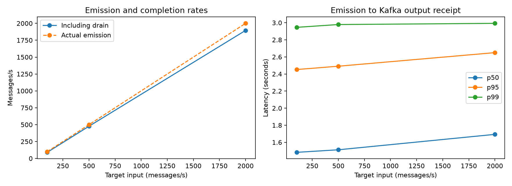
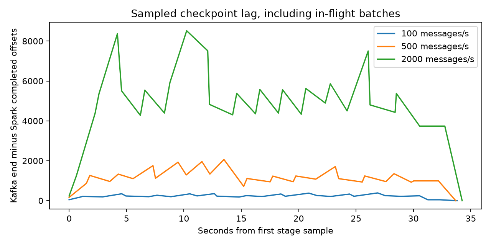

# Kafka–PySpark load-test results

Batch `load-20261110T140041-076d41`, completed 2026-11-10T14:02:57.964473+00:00.
Status: **complete**. The frozen model and threshold were unchanged.
Regression test transcript: `No test transcript attached to this batch.`.

| target_rows_per_second | expected_rows | actual_emission_rows_per_second | completed_rows_per_second | end_to_end_p50_ms | end_to_end_p95_ms | end_to_end_p99_ms | peak_sampled_checkpoint_lag | drain_after_last_ack_seconds | missing_rows | duplicate_records |
| --- | --- | --- | --- | --- | --- | --- | --- | --- | --- | --- |
| 100 | 3000 | 100 | 89.922667 | 1,482.5 | 2,452 | 2,946.16 | 388 | 3.368 | 0 | 0 |
| 500 | 15000 | 500 | 476.493011 | 1,512.5 | 2,491 | 2,979 | 2064 | 1.481 | 0 | 0 |
| 2000 | 60000 | 2,000.033334 | 1,895.135818 | 1,693 | 2,650 | 2,993 | 8519 | 1.66 | 0 | 0 |

<details><summary>Complete per-stage metrics</summary>

```json
[
  {
    "expected_rows": 3000,
    "delivered_rows": 3000,
    "received_records": 3000,
    "unique_outputs": 3000,
    "scored_rows": 3000,
    "invalid_rows": 0,
    "missing_rows": 0,
    "duplicate_records": 0,
    "delivery_errors": 0,
    "emission_seconds": 29.99,
    "emit_to_last_receive_seconds": 33.362,
    "actual_emission_rows_per_second": 100.0,
    "completed_rows_per_second": 89.92266650680415,
    "drain_after_last_ack_seconds": 3.368,
    "pending_at_last_emission": 95,
    "peak_sampled_checkpoint_lag": 388,
    "end_to_end_negative_latency_count": 0,
    "end_to_end_p50_ms": 1482.5,
    "end_to_end_p95_ms": 2452.0,
    "end_to_end_p99_ms": 2946.159999999996,
    "emit_to_worker_score_negative_latency_count": 0,
    "emit_to_worker_score_p50_ms": 1308.5,
    "emit_to_worker_score_p95_ms": 2244.0499999999997,
    "emit_to_worker_score_p99_ms": 2479.0599999999986,
    "counts_reconciled": true,
    "stage": "stage-1-100rps",
    "run_id": "load-20261110T140041-076d41-stage-1-100rps",
    "target_rows_per_second": 100,
    "configured_duration_seconds": 30,
    "end_checkpoint_lag": 0,
    "maximum_probability_error": 0.0,
    "probabilities_match": true,
    "risk_flags_match": true,
    "model_hashes_match": true,
    "expected_output_topics": true
  },
  {
    "expected_rows": 15000,
    "delivered_rows": 15000,
    "received_records": 15000,
    "unique_outputs": 15000,
    "scored_rows": 15000,
    "invalid_rows": 0,
    "missing_rows": 0,
    "duplicate_records": 0,
    "delivery_errors": 0,
    "emission_seconds": 29.998,
    "emit_to_last_receive_seconds": 31.48,
    "actual_emission_rows_per_second": 500.0,
    "completed_rows_per_second": 476.4930114358323,
    "drain_after_last_ack_seconds": 1.481,
    "pending_at_last_emission": 992,
    "peak_sampled_checkpoint_lag": 2064,
    "end_to_end_negative_latency_count": 0,
    "end_to_end_p50_ms": 1512.5,
    "end_to_end_p95_ms": 2491.0,
    "end_to_end_p99_ms": 2979.0,
    "emit_to_worker_score_negative_latency_count": 0,
    "emit_to_worker_score_p50_ms": 1305.0,
    "emit_to_worker_score_p95_ms": 2213.0,
    "emit_to_worker_score_p99_ms": 2556.0200000000004,
    "counts_reconciled": true,
    "stage": "stage-2-500rps",
    "run_id": "load-20261110T140041-076d41-stage-2-500rps",
    "target_rows_per_second": 500,
    "configured_duration_seconds": 30,
    "end_checkpoint_lag": 0,
    "maximum_probability_error": 0.0,
    "probabilities_match": true,
    "risk_flags_match": true,
    "model_hashes_match": true,
    "expected_output_topics": true
  },
  {
    "expected_rows": 60000,
    "delivered_rows": 60000,
    "received_records": 60000,
    "unique_outputs": 60000,
    "scored_rows": 60000,
    "invalid_rows": 0,
    "missing_rows": 0,
    "duplicate_records": 0,
    "delivery_errors": 0,
    "emission_seconds": 29.999,
    "emit_to_last_receive_seconds": 31.66,
    "actual_emission_rows_per_second": 2000.0333344444816,
    "completed_rows_per_second": 1895.1358180669615,
    "drain_after_last_ack_seconds": 1.66,
    "pending_at_last_emission": 3739,
    "peak_sampled_checkpoint_lag": 8519,
    "end_to_end_negative_latency_count": 0,
    "end_to_end_p50_ms": 1693.0,
    "end_to_end_p95_ms": 2650.0,
    "end_to_end_p99_ms": 2993.0,
    "emit_to_worker_score_negative_latency_count": 0,
    "emit_to_worker_score_p50_ms": 1365.0,
    "emit_to_worker_score_p95_ms": 2316.0,
    "emit_to_worker_score_p99_ms": 2565.0,
    "counts_reconciled": true,
    "stage": "stage-3-2000rps",
    "run_id": "load-20261110T140041-076d41-stage-3-2000rps",
    "target_rows_per_second": 2000,
    "configured_duration_seconds": 30,
    "end_checkpoint_lag": 0,
    "maximum_probability_error": 0.0,
    "probabilities_match": true,
    "risk_flags_match": true,
    "model_hashes_match": true,
    "expected_output_topics": true
  }
]
```

</details>

## What was measured

One continuous Spark query was warmed with 100 records, then given one
30-second paced stage per target rate. Each
stage drained before the next began. Topics and checkpoint were unique to the
test. Each stage reuses the first N historical validation applications; they are
distinct events within a stage, not new borrowers across stages. No invalid
fixtures were injected during the load test. Raw output and producer logs are
retained separately for warmup and every stage.

Actual emission rate is (N−1)/(last emission−first emission). Completed rows/s is
unique valid scores/(last collector receipt−first emission), including drain.
Latency percentiles use the first output per event and measure producer emission
to collector receipt from the output Kafka topic. They include micro-batch
scheduling, scoring, Kafka transport and collector polling/buffering; they are
not pure model inference times. Emit-to-worker-score percentiles are also saved.
Clocks share this local host; negative latency counts are recorded explicitly.

Lag is sampled about once per second: Kafka input log-end offsets minus the end
offsets in completed Spark progress. It includes the in-flight micro-batch and is
not Kafka consumer-group committed lag. Peak values can miss subsecond peaks.
`pending_at_last_emission` in the full metrics counts expected events without a
collected output at the final producer timestamp. Drain time ends at the last
unique receipt and starts at the last producer acknowledgement.

Every received valid probability and risk flag was compared with direct model
scoring. Stage metrics also count missing outputs, unexpected invalid outputs,
duplicates and delivery errors. Raw output IDs, model SHA and source offsets are
retained. A two-second quiet collection period follows each drain; duplicates
arriving later would require longer observation. Kafka delivery remains at least
once; no failure-injection or exactly-once claim is made.

## Machine and configuration

CPU: Intel(R) Core(TM) i7-10750H CPU @ 2.60GHz; 12 logical host CPUs.
Host memory: 14.88 GiB.
Docker VM: 12 CPUs,
3.54 GiB RAM.
Spark: local[2], 2-second trigger, 10,000 maximum offsets/trigger, 1,000-row Arrow
batches, three partitions per topic and one model thread per worker. Python
3.14.9; PySpark 4.1.2. Exact Java,
dependency versions, source hashes and input fingerprint are in the manifest.
The collector, producer and Spark share the host; the Kafka broker runs in Docker.

<details><summary>Complete environment, source fingerprints and manifest</summary>

```json
{
  "batch_id": "load-20261110T140041-076d41",
  "completed_at_utc": "2026-11-10T14:02:57.964473+00:00",
  "status": "complete",
  "rates": [
    100,
    500,
    2000
  ],
  "duration_seconds_per_stage": 30,
  "warmup_rows": 100,
  "topics": [
    "load-20261110T140041-076d41-input",
    "load-20261110T140041-076d41-scores",
    "load-20261110T140041-076d41-invalid"
  ],
  "result_directory": "assets/results/load_test/load-20261110T140041-076d41",
  "model_sha256": "beb4491348dfa7022290768ef79c8150fd7d14a722ef5b3ac78902fa9f0cc078",
  "python": "3.14.9",
  "platform": "Linux-7.0.0-38-generic-x86_64-with-glibc2.43",
  "logical_cpus": 12,
  "docker_resources": {
    "cpus": 12,
    "memory_bytes": 3804389376
  },
  "java": "openjdk version \"21.0.13.0.3\" 2026-10-24\nOpenJDK Runtime Environment (build 21.0.13.0.3+1-1-26.04.1-Ubuntu)\nOpenJDK 64-Bit Server VM (build 21.0.13.0.3+1-1-26.04.1-Ubuntu, mixed mode, sharing)\n",
  "host_memory_kib": 15607160,
  "cpu_model": "Intel(R) Core(TM) i7-10750H CPU @ 2.60GHz",
  "versions": {
    "pyspark": "4.1.2",
    "confluent-kafka": "2.16.1",
    "pandas": "3.1.0",
    "numpy": "2.5.4",
    "scikit-learn": "1.9.1"
  },
  "spark": {
    "master": "local[2]",
    "trigger_seconds": 2,
    "max_offsets_per_trigger": 10000,
    "arrow_batch_rows": 1000,
    "topic_partitions": 3,
    "model_threads_per_worker": 1
  },
  "source_sha256": {
    "scripts/15_replay_loans.py": "cbd2cc8cec35cc4a777f186f7b7f95e12f144acf115a2d86fe27271079525d04",
    "scripts/16_stream_score.py": "f1cc7f2c688b226c26c4f8add560b65feafd64effbf30222f21c9dacc28a0228",
    "scripts/18_run_load_test.py": "84f1f6982723d8bf2cbb2676cb74c3776e8bf4bb9ad21d1d970763fff1a9af6c",
    "util/streaming.py": "940aec522ed8f5aa729f8e97f37cc82bd5eabf2176eebc13a003ea10ddffa495",
    "util/load_test.py": "645b9dd8ddeef4770165870bef11fe48744543b930e3823ef083985509342f74",
    "docker-compose.yml": "d027bc64bf341f81b154adc1d6c498f34f3f1d49a8de0f46b85d63edabd8be00",
    "requirements-streaming.lock": "bcf3ef9777a243de87655cec81d03ac83847746e4af8be410779407c7eb70c19"
  },
  "validation_parquet_sha256": "c645fc9a7eebc4d8755155be63c8ffd44a1cd3b606f127ccb294d4b998a24fbc",
  "failure_injection_tested": false,
  "elk_monitoring_implemented": false,
  "latency_boundary": "producer emission to collector receipt of Kafka output; same-host wall clocks",
  "lag_definition": "sampled Kafka input end offsets minus Spark completed progress end offsets; includes in-flight batch",
  "limits": "One warmed run per rate, 30-second defaults, shared local machine, repeated validation cohort across stages; not a production capacity guarantee.",
  "mlflow_run_id": "eeef60a516fe4ab8a503eff7bbbcc256"
}
```

</details>

These are short local runs with one measurement per rate. They do not establish
long-duration stability, a production capacity limit or a latency SLA. JVM startup
was warmed, but stage-specific batch/model-loading costs remain part of the run.
Broker failure, worker failure, restart under active load and downstream
deduplication remain untested in this benchmark. ELK monitoring is still pending.





## Reproduce

With Java 17/21 and the optional streaming environment installed:

```bash
make kafka-up
make load-test
# Change the stage rates/duration; each stage must fit within 162,570 rows.
make load-test ARGS="--rates 100 500 2000 --duration 30 --drain-timeout 120"
```

Results are saved by batch ID. MLflow experiment:
`lendingclub_streaming_load_tests`; parent `eeef60a516fe4ab8a503eff7bbbcc256`, with one
child per measured stage. The query is stopped after drain. Kafka stays available
until `make kafka-down`. No source messages, topics or checkpoints are deleted.

[Full metrics](https://github.com/Codezy93/Credit-Risk-and-Failure-Modeling-Platform/blob/main/assets/results/load_test/load-20261110T140041-076d41/stage_metrics.csv),
[manifest](https://github.com/Codezy93/Credit-Risk-and-Failure-Modeling-Platform/blob/main/assets/results/load_test/load-20261110T140041-076d41/manifest.json), and
[verification](https://github.com/Codezy93/Credit-Risk-and-Failure-Modeling-Platform/blob/main/assets/results/load_test_verification.json).
See the [Spark Kafka guide](https://spark.apache.org/docs/4.1.2/streaming/structured-streaming-kafka-integration.html)
for source/sink and offset semantics.

## Later recovery work

These measurements retain their original Spark 4.1.2 environment and source
fingerprints. The [recovery and ELK stage](recovery_monitoring.md) now tests
Spark/store failures, durable deduplication and live ingestion on the patched
Spark 4.1.4 runtime. This does not remeasure the load rates above.
