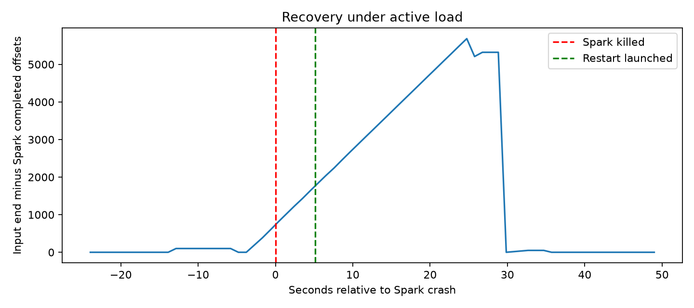

# Recovery, deduplication and ELK monitoring

Batch `recovery-20261110T145026-33d347` completed 2026-11-10T14:51:43.960186+00:00. Status: **passed**.
Regression transcript: `110 passed in 17.24s`.

| Measurement | Value |
| --- | --- |
| Main replay events | 6,000 |
| Unique stored results including 100 warmup events | 6,100 |
| Main event rate / second | 200 |
| Missing main scores | 0 |
| Restart to first outage-event result (seconds) | 22.311 |
| Crash to first outage-event result (seconds) | 27.429 |
| Peak sampled checkpoint lag | 5,685 |
| Final checkpoint lag | 0 |
| Suppressed duplicate deliveries | 110 |
| Deliberately injected duplicate deliveries | 110 |
| Conflicts flagged, first score preserved | 1 |
| Maximum probability difference | 0 |
| End-to-end p95, including outage (ms) | 27,040 |
| Sink restart to outbox drained (seconds) | 0.426964 |
| Sink restart to committed Kafka offsets caught up (seconds) | 9.871471 |
| Monitoring documents indexed | 6,295 |

## Failure experiment

A warmed Spark query processes historical validation events while a producer
continues at 200 events/second. The test waits for a source offset
file without its matching batch commit, then sends SIGKILL to that test's own
Spark process group. After 5 seconds,
Spark restarts from the same checkpoint. The producer was still active throughout
the injected downtime. The checkpoint query ID is preserved; no new checkpoint
or offset reset is used. Every main event's final probability and risk flag is
compared with direct predictions from the unchanged model.

First-result recovery measures the earliest stored result for an event emitted
during the outage, so already-buffered pre-crash results do not count. The
restart measurement includes JVM/connector startup. End-to-end latency uses the
first durable score's reception time and includes the outage. Peak checkpoint
lag is sampled, includes in-flight records and is not a latency SLA.

The test then injects 50 repeated application events, 50 repeated Kafka scores,
and one deliberately conflicting model fingerprint for an existing event ID.
Finally, it stops the store, injects 10 more duplicate scores, and crashes a new
store process with exit 73 immediately after its SQLite commit but before Kafka
offset commit. Restarting the same group/database retries those offsets and
drains the durable log outbox without adding score or delivery-ledger rows twice.
The test then waits for the restarted consumer's committed offsets to reach all
output partition ends. Outbox drainage alone is not treated as consumer recovery.

These are 110 deliberately repeated deliveries, separate from any natural Spark
retry duplicates observed before injection. The intentional conflict is retained
as evidence and triggers monitoring; it does not replace the original score.
This single local experiment does not establish broker failover, disk-loss
recovery, multi-host clock accuracy or distributed database availability.

## Durable deduplication

`scripts/20_store_scores.py` stores scores in SQLite with `event_id` as primary
key and a separate delivery ledger keyed by Kafka topic/partition/offset.
Logical equality includes run ID, original emission time, model fingerprint,
status, probability, flag, validation reason and threshold. Source output offsets
and scoring timestamps may change on retry. An ID reused for a different logical
result is a conflict: the first result stays intact and the conflict is recorded.
Use a new event ID for a changed application/model-scoring request.

The database uses WAL and FULL synchronization. Scores, delivery records and the
monitoring outbox commit in one transaction before Kafka offsets advance. Logs
are flushed from the outbox before it is marked exported. A repeated log export
keeps the same document ID, so Elasticsearch replaces that monitoring document.
SQLite is the authoritative score store. Kafka transport remains at least once;
this is persistent local idempotent storage, not an end-to-end exactly-once claim.
The ledger grows with deliveries and has no automatic retention policy.

## ELK

JSON-lines logs under ignored `models/streaming/logs/` feed Logstash's persistent
file reader and persistent queue. Elasticsearch stores `credit-risk-monitoring-*` with explicit field
types and stable `log_id` document IDs. Kibana has eight panels: stored results,
suppressed duplicates, conflicts, p95 score latency, stored results/minute,
checkpoint lag, average risk score and errors/invalid outputs. Counts of inserted
results exclude suppressed duplicates. Logs omit application features and loan IDs.

Dashboard: **http://127.0.0.1:15601/app/dashboards#/view/credit-risk-streaming**.
The default view includes all retained test batches. To isolate this batch, use:

```text
pipeline_id:"recovery-20261110T145026-33d347" or run_id:"recovery-20261110T145026-33d347-main" or run_id:"recovery-20261110T145026-33d347-warmup" or group_id:"recovery-20261110T145026-33d347-store"
```

The stored-result count includes 100 warmup events in addition to the main replay.
Elasticsearch: **http://127.0.0.1:19200**. These local services bind to loopback;
Elasticsearch security is disabled for this local demo. The monitoring services
use pinned Elastic 8.17.3 images, persistent data volumes and reduced heaps for
this machine. Kafka uses persistent ignored `models/streaming/kafka-data/`.
Existing broker data was preserved when adding that mount.

`make monitor-check` runs on-demand checks for conflicts/monitor errors, invalid
outputs, p95 above 10 seconds and latest checkpoint lag above 10,000. Add
`--expect-running` to the script to check for progress older than 30 seconds.
It emits JSON locally; no scheduled alerting, external messages or notifications
are configured. The deliberately injected conflict can produce a warning.
Score distributions are visible; this is not a statistical drift detector.

## Run

```bash
make streaming-setup
make kafka-up
make elk-up

# Separate terminals for normal operation; replay creates the topics.
make replay ARGS="--rows 10000 --rate 200 --run-id demo-unique-id"
make stream
make store-scores

# Automated isolated failure/retry experiment, including ELK verification.
make recovery-test
make monitor-check

# Stop services when finished; data, topics and checkpoints are retained.
make elk-down
make kafka-down
```

Spark Makefile targets select Java 21 at `/usr/lib/jvm/java-21-openjdk-amd64`.
Override `STREAM_JAVA_HOME=/your/java-21` on other machines. The optional runtime
and matching Kafka connector now use Spark 4.1.4. Fault injection reproduced
[SPARK-55271](https://issues.apache.org/jira/browse/SPARK-55271) on 4.1.2;
the patched release was installed before this successful test. Historical smoke
and load measurements retain their 4.1.2 fingerprints and are not restated as
4.1.4 measurements. Core modelling dependencies and the model are unchanged.



MLflow experiment: `lendingclub_streaming_recovery`; run `15ab49ecbc804015bc132ec18990485a`.
The replay dataset, metrics, logs and source snapshots are attached.
[Manifest](../assets/results/recovery_latest.json),
[verification](../assets/results/recovery_verification.json), and
[delivery ledger](../assets/results/recovery/recovery-20261110T145026-33d347/deliveries.csv.gz).

<details><summary>All recovery statistics and source fingerprints</summary>

```json
{
  "batch_id": "recovery-20261110T145026-33d347",
  "rows": 6000,
  "rate": 200,
  "configured_downtime_seconds": 5,
  "spark_killed_at_ms": 1794322250348,
  "main_results_before_crash": 272,
  "crashed_with_uncommitted_batch": true,
  "spark_exit_code": -9,
  "producer_active_after_downtime": true,
  "spark_restart_launched_at_ms": 1794322255466,
  "natural_duplicate_deliveries_before_injection": 0,
  "restart_to_first_outage_event_result_seconds": 22.311,
  "crash_to_first_outage_event_result_seconds": 27.429,
  "maximum_probability_error": 0.0,
  "checkpoint_query_id_preserved": true,
  "sink_crashed_after_sqlite_commit_before_kafka_commit": true,
  "sink_restart_to_outbox_drained_seconds": 0.42696363699906215,
  "sink_restart_to_kafka_offsets_caught_up_seconds": 9.871471237998776,
  "stored_main_unique_rows": 6000,
  "stored_total_unique_rows_including_warmup": 6100,
  "stored_delivery_rows": 6211,
  "suppressed_duplicate_deliveries": 110,
  "deliberately_injected_duplicate_deliveries": 110,
  "conflicts_flagged_without_overwrite": 1,
  "sqlite_outbox_pending_after_restart": 0,
  "sink_retry_did_not_duplicate_delivery_ledger": true,
  "missing_main_scores": 0,
  "end_checkpoint_lag": 0,
  "peak_checkpoint_lag": 5685,
  "end_to_end_p50_ms": 15478.5,
  "end_to_end_p95_ms": 27040.0,
  "end_to_end_p99_ms": 28090.390000000007,
  "drain_after_last_producer_ack_seconds": 3.138,
  "elk_verified": true,
  "expected_unique_monitoring_logs": 6295,
  "indexed_monitoring_logs": 6295,
  "status": "passed",
  "completed_at_utc": "2026-11-10T14:51:43.960186+00:00",
  "result_directory": "assets/results/recovery/recovery-20261110T145026-33d347",
  "database": "models/streaming/recovery/recovery-20261110T145026-33d347/scores.sqlite",
  "model_sha256": "beb4491348dfa7022290768ef79c8150fd7d14a722ef5b3ac78902fa9f0cc078",
  "validation_parquet_sha256": "c645fc9a7eebc4d8755155be63c8ffd44a1cd3b606f127ccb294d4b998a24fbc",
  "versions": {
    "pyspark": "4.1.4",
    "confluent-kafka": "2.16.1",
    "scikit-learn": "1.9.1",
    "numpy": "2.5.4",
    "pandas": "3.1.0"
  },
  "source_sha256": {
    "scripts/15_replay_loans.py": "cbd2cc8cec35cc4a777f186f7b7f95e12f144acf115a2d86fe27271079525d04",
    "scripts/16_stream_score.py": "e36879233f995196c39199c7628fb5e29bcff40b4e2f75778530ceefc1f15e5e",
    "scripts/20_store_scores.py": "2d57d4a39345e945acfc86c12c90628cef4643e21e01ff77d45fad1a90b8ace0",
    "scripts/21_test_recovery.py": "625b54084e9c1f466915390424b1c2aa93a8428d5513665452ae45ce517291db",
    "scripts/22_setup_elk.py": "75af106c023aafcf30e135bb53e0380ffd420dd0d3237c6e11334a9d5aeeafbc",
    "util/score_store.py": "9a1092113b7058156b54e529986b007d141a7726e0198213f51bc69a7e70a7f5",
    "util/logging.py": "44153f54a69ecb62d6c9ba710a7c11807300afa7da30ad4a6d8cf5a782c84eec",
    "util/streaming.py": "940aec522ed8f5aa729f8e97f37cc82bd5eabf2176eebc13a003ea10ddffa495",
    "util/elk/logstash.conf": "ed38c5b7ded505dd5a7430c34522dda7241e80644dd7d477b44a8f70446e1350",
    "util/elk/dashboard.ndjson": "bae90061a5c50bb0273082594e53e8c9f07283852cad6f1926fdc6bb21604621",
    "docker-compose.yml": "59e2beb699f9443d8a098cb34bcb7989b9a25d6a7944961b7f574b1eb43b87c5",
    "requirements-streaming.lock": "5e7a469b549961385edfa5ff935add14886adbd1e361becda3549a482f5e12a6"
  },
  "mlflow_run_id": "15ab49ecbc804015bc132ec18990485a"
}
```

</details>

Configuration follows the official [Logstash file input](https://www.elastic.co/guide/en/logstash/8.17/plugins-inputs-file.html)
and [Elasticsearch output](https://www.elastic.co/guide/en/logstash/8.17/plugins-outputs-elasticsearch.html) documentation.
