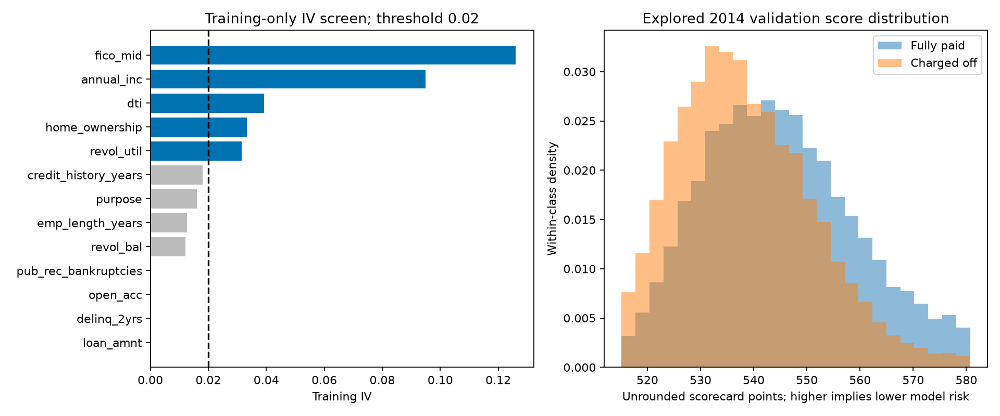

# WoE logistic scorecard challengers

Batch `7e8db47185e94b90aeec59a0e9bdca57`, completed 2026-11-11T23:31:14.569973+00:00.
These are new **research challengers**, not a replacement for the incumbent.
The original plain logistic regression remains a separate reference model.
The target remains [lifetime charge-off among resolved 36-month loans](risk_terminology.md).

## Binning and selection

Bins, missing-value effects, categorical risk order, IV screening and coefficients
are fitted on **2011–2013 training rows only**. 2014 is explored validation; 2015
is explored later-year evaluation. No new holdout or point-in-time backtest is claimed.
No validation labels choose bins, feature retention, directions or coefficients.

Numeric variables start with up to six quantile/discrete bins. Adjacent bins are
pooled for support and monotonicity of both raw and smoothed training event rates.
A zero-inflated variable retains a zero-versus-positive split where quantiles
collapse. Support pooling targets 5% of nonmissing rows and 20 examples of each
class where mergeable; a single remaining bin and missing bins can be exceptions.
Missing is a separate group outside numeric ordering. This is a transparent
heuristic, **not optimal binning** or OptBinning.

Directions for nine numeric fields are predeclared domain constraints. Revolving
balance and open-account directions choose the larger training IV of ascending
and descending pooling. Categories are grouped for rare training levels and then
ordered by training event rate; this is not a natural ordering of category names.
New categories get neutral WoE zero; never-observed missing values also get zero.
These are explicit fallback assumptions, not evidence about new groups.

WoE = log(smoothed good share / smoothed bad share), with 0.5 added to each class
count in occupied bins. IV is the sum of (good share − bad share) × WoE.
Only variables with **training IV ≥ 0.02** enter the logistic fit. Full training
counts and bin contributions are saved, including excluded variables.

| feature | train_iv | selected | direction | direction_basis |
| --- | --- | --- | --- | --- |
| loan_amnt | 0 | False | ascending | predeclared domain constraint |
| annual_inc | 0.094831 | True | descending | predeclared domain constraint |
| dti | 0.039295 | True | ascending | predeclared domain constraint |
| revol_util | 0.031431 | True | ascending | predeclared domain constraint |
| revol_bal | 0.012055 | False | descending | training-IV choice between ascending/descending |
| open_acc | 0.000181 | False | descending | training-IV choice between ascending/descending |
| delinq_2yrs | 0.000099 | False | ascending | predeclared domain constraint |
| pub_rec_bankruptcies | 0.000192 | False | ascending | predeclared domain constraint |
| emp_length_years | 0.012672 | False | descending | predeclared domain constraint |
| fico_mid | 0.12591 | True | descending | predeclared domain constraint |
| credit_history_years | 0.018026 | False | descending | predeclared domain constraint |
| home_ownership | 0.033351 | True | ascending | training risk order |
| purpose | 0.016133 | False | ascending | training risk order |

Selected features: **annual_inc, dti, revol_util, fico_mid, home_ownership**. Delinquency and bankruptcy are not
silently assigned favorable economic effects: their actual IV decisions appear
above. Pooling and screening are modeling choices that can discard weak or
nonconforming signals; they do not establish causality or universal risk direction.

## Coefficients and sign checks

Both models minimize the same L2 logistic objective (C=1), with the same L-BFGS-B
optimizer, initialization and tolerances. The constrained fit additionally bounds
WoE coefficients at zero from above. The intercept is unpenalized and unconstrained.
No one-hot reference ambiguity is introduced: each retained variable has one
WoE coefficient.

Under this good/bad WoE convention a nonpositive coefficient is the expected
relationship. Positive unconstrained WoE coefficients, if present, are reported,
not silently flipped. Current unconstrained sign failures: **none**.
Constrained signs are enforced by design; passing them is not regulatory validation
or proof that the assumed raw-variable direction is economically correct. Numeric
score monotonicity applies within regular bins, holding other inputs fixed; it does
not order missing values or prove monotone observed risk in future cohorts.

| model | feature | coefficient | expected_woe_sign | sign_check_passed | zero_effect |
| --- | --- | --- | --- | --- | --- |
| woe_unconstrained | annual_inc | -0.751237 | nonpositive | True | False |
| woe_unconstrained | dti | -0.631748 | nonpositive | True | False |
| woe_unconstrained | revol_util | -0.174193 | nonpositive | True | False |
| woe_unconstrained | fico_mid | -0.841819 | nonpositive | True | False |
| woe_unconstrained | home_ownership | -0.441886 | nonpositive | True | False |
| woe_constrained | annual_inc | -0.751237 | nonpositive | True | False |
| woe_constrained | dti | -0.631748 | nonpositive | True | False |
| woe_constrained | revol_util | -0.174193 | nonpositive | True | False |
| woe_constrained | fico_mid | -0.841819 | nonpositive | True | False |
| woe_constrained | home_ownership | -0.441886 | nonpositive | True | False |

| model | selected_features | intercept | factor | offset | optimizer_iterations |
| --- | --- | --- | --- | --- | --- |
| woe_unconstrained | 5 | -1.944959 | 28.853901 | 487.122876 | 17 |
| woe_constrained | 5 | -1.944959 | 28.853901 | 487.122876 | 17 |

## Points scaling and exported rules

Base **600 points at model-implied good:bad odds 50:1**, with **PDO = 20**.
Factor = 20 / ln(2); offset = 600 − factor × ln(50).
Score = offset − factor × fitted bad-event log-odds.
Doubling good:bad odds adds 20 points. Higher scores imply lower fitted charge-off
probability. The anchor is not a guarantee of observed default rates or a FICO scale.

Unrounded per-feature points distribute the offset and intercept equally across
retained variables. Adding their exported bin points reproduces the full model
score, including explicit missing and unseen-category fallback rows. No clipping
or rounding is used. Both saved-model probabilities and point sums were verified
on the complete cohorts; the exported CSV lookup was independently checked on
all validation and exploratory rows for both challengers.

Below is the constrained card's complete points table. The
[CSV](https://github.com/Codezy93/Credit-Risk-and-Failure-Modeling-Platform/blob/main/assets/results/scorecard/7e8db47185e94b90aeec59a0e9bdca57/points_table.csv) includes both cards at full precision.

| feature | bin | count | good | bad | event_rate | woe | coefficient | points |
| --- | --- | --- | --- | --- | --- | --- | --- | --- |
| annual_inc | [-inf, 36300.0) | 26332 | 21594 | 4738 | 0.179933 | -0.427277 | -0.751237 | 99.3868 |
| annual_inc | [36300.0, 48000.0) | 25021 | 21236 | 3785 | 0.151273 | -0.219451 | -0.751237 | 103.891651 |
| annual_inc | [48000.0, 60000.0) | 25621 | 22256 | 3365 | 0.131338 | -0.054937 | -0.751237 | 107.457681 |
| annual_inc | [60000.0, 75000.0) | 27585 | 24380 | 3205 | 0.116186 | 0.084921 | -0.751237 | 110.489261 |
| annual_inc | [75000.0, 98000.0) | 26602 | 24045 | 2557 | 0.096121 | 0.296923 | -0.751237 | 115.084646 |
| annual_inc | [98000.0, inf) | 26832 | 24702 | 2130 | 0.079383 | 0.506553 | -0.751237 | 119.628616 |
| annual_inc | Missing | 0 | 0 | 0 | — | 0 | -0.751237 | 108.648505 |
| dti | [-inf, 8.53) | 26292 | 23744 | 2548 | 0.096912 | 0.287851 | -0.631748 | 113.895572 |
| dti | [8.53, 12.56) | 26344 | 23556 | 2788 | 0.105831 | 0.189903 | -0.631748 | 112.110137 |
| dti | [12.56, 16.07) | 26332 | 23288 | 3044 | 0.115601 | 0.090628 | -0.631748 | 110.300514 |
| dti | [16.07, 19.8) | 26331 | 22928 | 3403 | 0.129239 | -0.036418 | -0.631748 | 107.984658 |
| dti | [19.8, 24.32) | 26338 | 22574 | 3764 | 0.142911 | -0.152789 | -0.631748 | 105.863411 |
| dti | [24.32, inf) | 26356 | 22123 | 4233 | 0.160609 | -0.290383 | -0.631748 | 103.355283 |
| dti | Missing | 0 | 0 | 0 | — | 0 | -0.631748 | 108.648505 |
| revol_util | [-inf, 31.9) | 26297 | 23880 | 2417 | 0.091912 | 0.346355 | -0.174193 | 110.38934 |
| revol_util | [31.9, 47.0) | 26236 | 23247 | 2989 | 0.113927 | 0.107118 | -0.174193 | 109.186899 |
| revol_util | [47.0, 58.7) | 26197 | 22959 | 3238 | 0.123602 | 0.014648 | -0.174193 | 108.722131 |
| revol_util | [58.7, 69.7) | 26471 | 22997 | 3474 | 0.131238 | -0.054038 | -0.174193 | 108.376901 |
| revol_util | [69.7, 81.7) | 26287 | 22657 | 3630 | 0.138091 | -0.112852 | -0.174193 | 108.081291 |
| revol_util | [81.7, inf) | 26401 | 22383 | 4018 | 0.152191 | -0.226558 | -0.174193 | 107.509792 |
| revol_util | Missing | 104 | 90 | 14 | 0.134615 | -0.112772 | -0.174193 | 108.081697 |
| fico_mid | [-inf, 672.0) | 21375 | 17561 | 3814 | 0.178433 | -0.417095 | -0.841819 | 98.517359 |
| fico_mid | [672.0, 682.0) | 24232 | 20358 | 3874 | 0.159871 | -0.284913 | -0.841819 | 101.72804 |
| fico_mid | [682.0, 692.0) | 23873 | 20393 | 3480 | 0.145771 | -0.175954 | -0.841819 | 104.374613 |
| fico_mid | [692.0, 707.0) | 31553 | 27646 | 3907 | 0.123823 | 0.012607 | -0.841819 | 108.954718 |
| fico_mid | [707.0, 727.0) | 27651 | 24898 | 2753 | 0.099562 | 0.25794 | -0.841819 | 114.913808 |
| fico_mid | [727.0, inf) | 29309 | 27357 | 1952 | 0.066601 | 0.695885 | -0.841819 | 125.551399 |
| fico_mid | Missing | 0 | 0 | 0 | — | 0 | -0.841819 | 108.648505 |
| home_ownership | MORTGAGE | 75212 | 67342 | 7870 | 0.104638 | 0.20261 | -0.441886 | 111.231813 |
| home_ownership | OWN | 13339 | 11568 | 1771 | 0.132769 | -0.0676 | -0.441886 | 107.786591 |
| home_ownership | RENT \| NONE \| OTHER | 69442 | 59303 | 10139 | 0.146007 | -0.17783 | -0.441886 | 106.381149 |
| home_ownership | Missing | 0 | 0 | 0 | — | 0 | -0.441886 | 108.648505 |
| home_ownership | Unseen category (neutral WoE) | 0 | 0 | 0 | — | 0 | -0.441886 | 108.648505 |

## Evaluation and trade-offs

| model | split | roc_auc | gini | ks | average_precision | brier_score | observed_positive_rate | mean_predicted_probability |
| --- | --- | --- | --- | --- | --- | --- | --- | --- |
| original_logistic | train | 0.650936 | 0.301871 | 0.218646 | 0.199628 | 0.106127 | 0.125195 | 0.125206 |
| original_logistic | validation | 0.646231 | 0.292462 | 0.213711 | 0.21028 | 0.114869 | 0.137264 | 0.132214 |
| original_logistic | exploratory_test | 0.646349 | 0.292698 | 0.212749 | 0.226319 | 0.122883 | 0.148863 | 0.132003 |
| incumbent_hgb | train | 0.684525 | 0.369051 | 0.265112 | 0.239525 | 0.104177 | 0.125195 | 0.125187 |
| incumbent_hgb | validation | 0.653889 | 0.307779 | 0.222796 | 0.216483 | 0.114375 | 0.137264 | 0.131767 |
| incumbent_hgb | exploratory_test | 0.65435 | 0.308701 | 0.223789 | 0.235027 | 0.122279 | 0.148863 | 0.132223 |
| woe_unconstrained | train | 0.630662 | 0.261324 | 0.186619 | 0.184045 | 0.107006 | 0.125195 | 0.125195 |
| woe_unconstrained | validation | 0.629116 | 0.258233 | 0.187128 | 0.199727 | 0.115577 | 0.137264 | 0.131814 |
| woe_unconstrained | exploratory_test | 0.627206 | 0.254412 | 0.181766 | 0.212171 | 0.123888 | 0.148863 | 0.13098 |
| woe_constrained | train | 0.630662 | 0.261324 | 0.186619 | 0.184045 | 0.107006 | 0.125195 | 0.125195 |
| woe_constrained | validation | 0.629116 | 0.258233 | 0.187128 | 0.199727 | 0.115577 | 0.137264 | 0.131814 |
| woe_constrained | exploratory_test | 0.627206 | 0.254412 | 0.181766 | 0.212171 | 0.123888 | 0.148863 | 0.13098 |

Both challenger variants were predeclared; no model is promoted from these results.
A monotone scorecard is not guaranteed to beat the original logistic regression or
boosting. The IV cutoff can remove jointly useful weak predictors; coarse bins
can lose ranking information. When unconstrained coefficients already have the
expected signs, the bounds may be inactive and need not improve discrimination.
Raw probabilities are not separately calibrated here. The default 0.5 classification
threshold is a reproducible diagnostic, not an approval or cost-optimized policy.

| model | split | reference | auc_difference | lower_95 | upper_95 |
| --- | --- | --- | --- | --- | --- |
| woe_unconstrained | validation | original_logistic | -0.017115 | -0.019257 | -0.014683 |
| woe_unconstrained | exploratory_test | original_logistic | -0.019143 | -0.020698 | -0.017794 |
| woe_constrained | validation | original_logistic | -0.017115 | -0.019257 | -0.014683 |
| woe_constrained | exploratory_test | original_logistic | -0.019143 | -0.020698 | -0.017794 |

Intervals compare each scorecard with the fixed original logistic model using
200 paired class-stratified resamples. They exclude binning/fit/selection uncertainty,
borrower dependence and macroeconomic variation. There is no significance claim
that these are universally better models. Per-bin counts and event rates for
train/validation/exploratory cohorts are in
[bin outcomes](https://github.com/Codezy93/Credit-Risk-and-Failure-Modeling-Platform/blob/main/assets/results/scorecard/7e8db47185e94b90aeec59a0e9bdca57/bin_outcomes_by_split.csv);
validation event-rate monotonicity is not forced.

## Reproduce and inspect

Local suite: **120 tests**, 0 failures, 0 errors, 0 skips. [JUnit](https://github.com/Codezy93/Credit-Risk-and-Failure-Modeling-Platform/blob/main/assets/results/scorecard/7e8db47185e94b90aeec59a0e9bdca57/test_results.xml).

Run `make scorecard` to fit the challengers, log real datasets/models/native
evaluations to MLflow and export reports. `make scorecard-report` reads saved
results without fitting. Current weights and input/metric/source hashes are in
[the manifest](https://github.com/Codezy93/Credit-Risk-and-Failure-Modeling-Platform/blob/main/assets/results/scorecard/7e8db47185e94b90aeec59a0e9bdca57/manifest.json).
[All bins](https://github.com/Codezy93/Credit-Risk-and-Failure-Modeling-Platform/blob/main/assets/results/scorecard/7e8db47185e94b90aeec59a0e9bdca57/binning_tables.csv),
[IV screen](https://github.com/Codezy93/Credit-Risk-and-Failure-Modeling-Platform/blob/main/assets/results/scorecard/7e8db47185e94b90aeec59a0e9bdca57/iv_screen.csv),
[coefficient audit](https://github.com/Codezy93/Credit-Risk-and-Failure-Modeling-Platform/blob/main/assets/results/scorecard/7e8db47185e94b90aeec59a0e9bdca57/coefficients.csv), and
[native evaluations](https://github.com/Codezy93/Credit-Risk-and-Failure-Modeling-Platform/blob/main/assets/results/scorecard/7e8db47185e94b90aeec59a0e9bdca57/native_evaluations.csv) remain inspectable.
Historical failed/diagnostic runs remain recorded with their execution-time sources.
No dependencies, incumbent artifacts, raw data or prepared datasets were changed.

For related ordered-fit concepts see [scikit-learn isotonic regression](https://scikit-learn.org/stable/modules/isotonic.html).
The bounded optimizer is documented by [SciPy L-BFGS-B](https://docs.scipy.org/doc/scipy/reference/optimize.minimize-lbfgsb.html).
