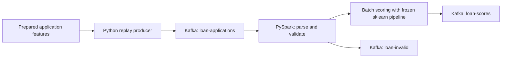

# Kafka and PySpark scoring

The streaming stage replays prepared LendingClub applications through Kafka and
uses PySpark Structured Streaming to validate and score them with the existing
frozen classifier. It does not train a Spark ML model or change the SQL cleaning
pipeline. These historical accepted loans are a replay, not live applications.



## Run locally

Prerequisites: Docker Compose, Python 3.14, Java 17 or 21, and the existing prepared
datasets and selected model. Set `JAVA_HOME` to your Java installation and put its
`bin` directory on `PATH`. The default broker listens on localhost port 9092.

On this project's Ubuntu machine, the installed Java 21 location is:

```bash
export JAVA_HOME=/usr/lib/jvm/java-21-openjdk-amd64
export PATH="$JAVA_HOME/bin:$PATH"
export SPARK_LOCAL_IP=127.0.0.1
"$JAVA_HOME/bin/java" -version
```

Set these variables in each terminal used to launch Spark. On another machine,
use its actual Java installation path. A literal placeholder such as
`/path/to/java-21` will not work. `JAVA_GATEWAY_EXITED` only says that Java exited
before Spark connected; the earlier Java/launcher output contains the underlying
cause. If it persists with a verified Java executable, retain that earlier output
when diagnosing it, including any connector download errors.

```bash
make streaming-setup
make kafka-up
make replay ARGS="--rows 1000 --rate 100 --run-id demo-001"
make stream ARGS="--available-now"
```

The last command drains records currently available and exits. For a continuous
job, run `make stream` in one terminal and replay in another. The producer creates
the three topics before publishing. Use a new run ID for each new replay.
`--rows` is capped at the available distinct validation rows; this script does not
manufacture additional borrowers. `--rate 0` disables pacing.

```bash
# Inspect scored output using the Kafka container's CLI.
docker compose exec kafka /opt/kafka/bin/kafka-console-consumer.sh \
  --bootstrap-server localhost:9092 --topic loan-scores --from-beginning

# Spark validation regression test; requires Java.
make stream-test

# A reproducible correctness check with three deliberate invalid payloads.
make replay ARGS="--rows 100 --rate 0 --run-id check-001 --invalid-fixtures"
make stream ARGS="--available-now"
make stream-check ARGS="--run-id check-001 --rows 100 --invalid-rows 3"

# Stop the broker while retaining its container data.
make kafka-down
```

`requirements-streaming.lock` pins the optional environment, including every core
dependency at its existing version. It leaves `requirements.lock` unchanged.
The Spark Kafka connector is separately resolved from Maven on first use and
cached under ignored `models/streaming/ivy/`. Internet access is needed for the
initial package, container and connector downloads. The Java runtime is an
external prerequisite, not a Python package in the lock.

## Processing and output

Messages contain `event_id`, `run_id`, `emitted_at_ms` and a `features` object with
the exact 13 model feature keys. Null values are allowed and left to the original
pipeline. Spark casts numeric strings/numbers to doubles; invalid nonnull numeric
values, NaN/infinity, missing feature keys, extra feature keys, malformed payloads
and missing identifiers/timestamps are routed to `loan-invalid`. Outcome fields
inside `features` are rejected. This is schema validation, not comprehensive
business-range validation or source certification.

Scoring uses `mapInPandas` on Spark workers, with up to 1,000 rows per Arrow batch.
The model is distributed with SparkFiles and loaded once per partition iterator.
Preprocessing and probabilities come from the existing sklearn pipeline. Numeric
missing values remain missing, and categorical nulls are converted to the same
missing representation expected by that pipeline. The model SHA is checked
against the training manifest before the query starts.

Output contains the event ID, replay run ID, Kafka source topic/partition/offset,
model SHA, timestamps, charged-off probability, frozen threshold and risk flag.
Invalid outputs have an error reason and null probability/flag. Outputs omit loan
IDs and original application features. The risk flag is an offline classifier
decision, not an actual lending approval or denial.

`--max-offsets 10000` caps Kafka records consumed per trigger. Continuous mode uses
a two-second micro-batch trigger, not a submillisecond per-event serving promise.
The default `--master local[2]` runs locally. A remote Spark cluster needs the same
Python/dependency environment on every worker and appropriate Kafka connectivity.
This local broker uses plaintext and a single replica; it demonstrates processing,
not fault-tolerant broker infrastructure.

## Restarts and duplicates

Spark stores progress in ignored `data/clean/streaming/checkpoint/`. Restarting with
the same checkpoint resumes committed source offsets. A scoring contract stored
there prevents accidental reuse with a different model, feature list, threshold,
broker or input topic. Use `--checkpoint PATH` for a deliberately new query.
Do not erase a checkpoint to restart an existing replay.

Kafka output has **at-least-once** semantics: a failed/retried micro-batch can write
duplicate scores. Producer idempotence does not make Spark's output exactly once.
The score key is the stable event ID; downstream storage should upsert/deduplicate
by that ID. The stream does not claim global duplicate suppression. Starting a
new checkpoint reads retained input from the earliest available offset.

Finite runs save Spark query progress to
`assets/results/streaming/last_query_progress.json`. These progress counters are
not a completed stress benchmark by themselves. The [load-test report](load_testing.md)
now records paced runs at 100, 500 and 2,000 messages/s, with end-to-end latency
and checkpoint lag. The [recovery and monitoring report](recovery_monitoring.md)
adds failure injection, durable deduplication and live ELK verification. Longer
repeated runs and broker failover remain future work.

Implementation follows the official [Spark Kafka integration guide](https://spark.apache.org/docs/4.1.2/streaming/structured-streaming-kafka-integration.html),
[PySpark installation requirements](https://spark.apache.org/docs/4.1.2/api/python/getting_started/install.html),
and [Apache Kafka Docker setup](https://kafka.apache.org/41/getting-started/docker/).

## Measured correctness check

Run `spark-verified-20261110` processed 100 real validation applications and three
deliberately invalid payloads. Every probability and threshold flag matched direct
model scoring; the maximum probability difference was 0.0. All three fixtures
were routed to `loan-invalid`. No duplicate outputs were observed for this run.
A clean restart reused the same checkpoint query ID, read zero source records
and left every score/invalid-topic output offset unchanged. This is not proof
of duplicate-free delivery under failure or of broker fault tolerance.

The complete streaming-environment suite passed 102 tests. Java was Temurin
21.0.13+9; PySpark 4.1.2; Kafka 4.1.2. The local two-worker query processed one
103-record micro-batch. Its recorded timing includes startup effects and is not
a capacity or latency claim. Earlier development messages also exist in the
local topics; the verification filters the exact replay run ID.

[Manifest](../assets/results/streaming_latest.json),
[score parity evidence](../assets/results/streaming/spark-verified-20261110/verification.json),
[checkpoint restart evidence](../assets/results/streaming/spark-verified-20261110/restart_verification.json),
and [Spark query progress](../assets/results/streaming/spark-verified-20261110/query_progress.json).

MLflow experiment: `lendingclub_streaming_smoke`; run `fe86cfd3742d47ec8ad81f248e623566`.
The input sample, source files, parity metrics and restart evidence are logged.

## Current recovery and monitoring stage

Use `make store-scores` in a separate terminal to persist outputs with deduplication
by event ID. Use `make elk-up` for the local dashboard on port 15601, and
`make recovery-test` for the isolated Spark/store failure experiment. These
commands and storage semantics are explained in the
[recovery and monitoring report](recovery_monitoring.md).

The current optional runtime is Spark **4.1.4** with a matching Kafka connector.
The earlier 4.1.2 measurements above remain historical. Mid-batch restart testing
exposed SPARK-55271, so the optional lock was patched; core dependencies and model
artifacts were not changed. Run `make streaming-setup` to synchronize the patch.
Spark Makefile targets select the installed Ubuntu Java 21 path automatically;
override `STREAM_JAVA_HOME` when needed. Direct Python invocations still require
a supported Java environment.
