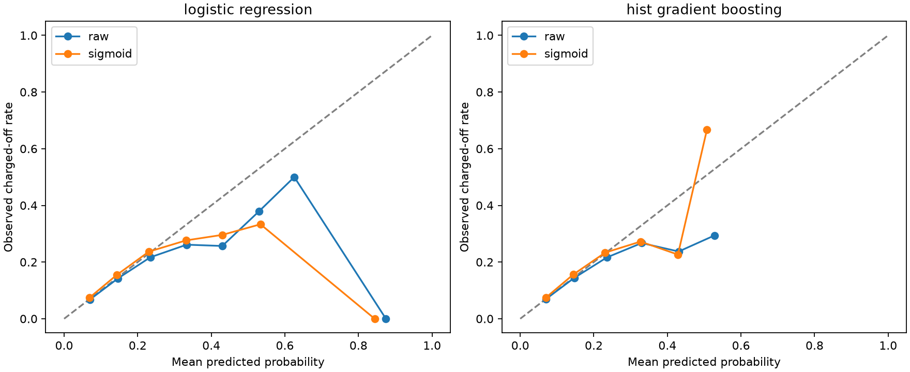
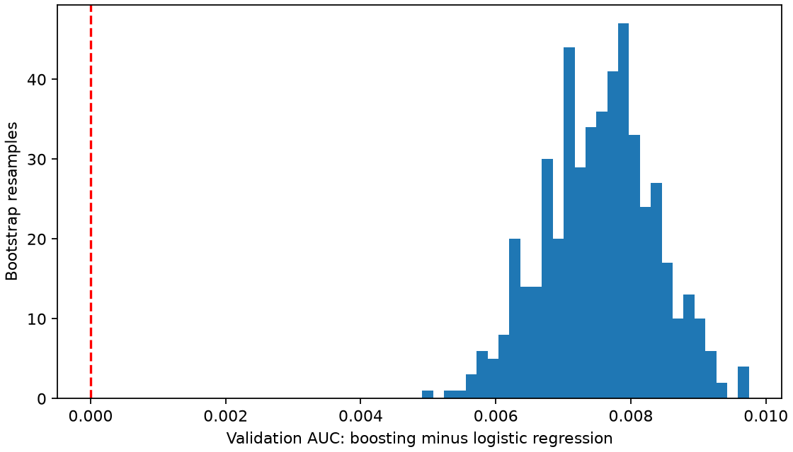

# Validation hardening

This is a retrospective analysis of charged-off versus fully-paid, resolved 36-month loans. The data has already been explored. There is no fresh holdout, fixed-horizon regulatory PD, or point-in-time deployment backtest. No 2015 rows are read by this stage.

## Exact historical diagnostics

Original saved models, unchanged inputs. KS uses every distinct score threshold and is the maximum absolute TPR–FPR difference; Gini = 2 × AUC − 1. Threshold metrics use 0.5.

| model | split | rows | observed_positive_rate | mean_predicted_probability | threshold | roc_auc | gini | ks | average_precision | brier_score | log_loss | ece_10_uniform_bins | accuracy | balanced_accuracy | precision | recall | specificity | f1 | predicted_positive_rate | tn | fp | fn | tp |
| --- | --- | --- | --- | --- | --- | --- | --- | --- | --- | --- | --- | --- | --- | --- | --- | --- | --- | --- | --- | --- | --- | --- | --- |
| dummy_prior | train | 157993 | 0.125195 | 0.125195 | 0.5 | 0.5 | 0 | 0 | 0.125195 | 0.109522 | 0.37715 | 0 | 0.874805 | 0.5 | 0 | 0 | 1 | 0 | 0 | 138213 | 0 | 19780 | 0 |
| dummy_prior | validation | 162570 | 0.137264 | 0.125195 | 0.5 | 0.5 | 0 | 0 | 0.137264 | 0.118568 | 0.400613 | 0.012069 | 0.862736 | 0.5 | 0 | 0 | 1 | 0 | 0 | 140255 | 0 | 22315 | 0 |
| logistic_regression | train | 157993 | 0.125195 | 0.125206 | 0.5 | 0.650936 | 0.301871 | 0.218646 | 0.199628 | 0.106127 | 0.36132 | 0.002319 | 0.874792 | 0.500101 | 0.416667 | 0.000253 | 0.999949 | 0.000505 | 0.000076 | 138206 | 7 | 19775 | 5 |
| logistic_regression | validation | 162570 | 0.137264 | 0.132214 | 0.5 | 0.646231 | 0.292462 | 0.213711 | 0.21028 | 0.114869 | 0.384341 | 0.006675 | 0.862705 | 0.500152 | 0.391304 | 0.000403 | 0.9999 | 0.000806 | 0.000141 | 140241 | 14 | 22306 | 9 |
| random_forest | train | 157993 | 0.125195 | 0.125167 | 0.5 | 0.711889 | 0.423779 | 0.307458 | 0.266368 | 0.103944 | 0.352131 | 0.019663 | 0.874805 | 0.5 | 0 | 0 | 1 | 0 | 0 | 138213 | 0 | 19780 | 0 |
| random_forest | validation | 162570 | 0.137264 | 0.129408 | 0.5 | 0.649133 | 0.298265 | 0.216818 | 0.213944 | 0.114923 | 0.384513 | 0.013567 | 0.862736 | 0.5 | 0 | 0 | 1 | 0 | 0 | 140255 | 0 | 22315 | 0 |
| hist_gradient_boosting | train | 157993 | 0.125195 | 0.125187 | 0.5 | 0.684525 | 0.369051 | 0.265112 | 0.239525 | 0.104177 | 0.353495 | 0.008189 | 0.874805 | 0.5 | 0 | 0 | 1 | 0 | 0 | 138213 | 0 | 19780 | 0 |
| hist_gradient_boosting | validation | 162570 | 0.137264 | 0.131767 | 0.5 | 0.653889 | 0.307779 | 0.222796 | 0.216483 | 0.114375 | 0.382348 | 0.005851 | 0.862736 | 0.5 | 0 | 0 | 1 | 0 | 0 | 140255 | 0 | 22315 | 0 |

## Paired AUC uncertainty

500 stratified loan-level bootstrap resamples, seed 42; identical sampled loans for both original models. Intervals are 2.5th/97.5th percentiles, conditional on the fitted models and observed class counts. They exclude model fitting and selection uncertainty, year-to-year variation, and possible borrower clustering. They are not a significance claim after model selection.

| comparison | metric | estimate | lower_95 | upper_95 |
| --- | --- | --- | --- | --- |
| logistic_regression | roc_auc | 0.646231 | 0.642467 | 0.650918 |
| logistic_regression | gini | 0.292462 | 0.284933 | 0.301835 |
| hist_gradient_boosting | roc_auc | 0.653889 | 0.649973 | 0.657992 |
| hist_gradient_boosting | gini | 0.307779 | 0.299945 | 0.315983 |
| boosting_minus_logistic | auc_difference | 0.007659 | 0.005913 | 0.009094 |

## Separate-year calibration

Both base models use the original fixed settings, refitted on 2011–2012 only. A frozen estimator receives sigmoid calibration using 2013 only; both versions are evaluated on 2014. This differs from the historical 2011–2013 training protocol, so compare raw and sigmoid within the table below. A calibration method can worsen later-cohort predictions. No model is promoted.

| role | rows | positives | positive_rate | first_issue_date | last_issue_date | dataset_digest |
| --- | --- | --- | --- | --- | --- | --- |
| model_fit | 57571 | 7402 | 0.128572 | 2011-01-01 | 2012-12-01 | f2d0b047 |
| calibration | 100422 | 12378 | 0.12326 | 2013-01-01 | 2013-12-01 | 342aece7 |
| evaluation | 162570 | 22315 | 0.137264 | 2014-01-01 | 2014-12-01 | 722bf1f9 |

| model | version | rows | observed_positive_rate | mean_predicted_probability | threshold | roc_auc | gini | ks | average_precision | brier_score | log_loss | ece_10_uniform_bins | accuracy | balanced_accuracy | precision | recall | specificity | f1 | predicted_positive_rate | tn | fp | fn | tp |
| --- | --- | --- | --- | --- | --- | --- | --- | --- | --- | --- | --- | --- | --- | --- | --- | --- | --- | --- | --- | --- | --- | --- | --- |
| logistic_regression | raw | 162570 | 0.137264 | 0.144645 | 0.5 | 0.639135 | 0.278269 | 0.203654 | 0.204675 | 0.115308 | 0.385851 | 0.007381 | 0.862687 | 0.500198 | 0.375 | 0.000538 | 0.999857 | 0.001074 | 0.000197 | 140235 | 20 | 22303 | 12 |
| logistic_regression | sigmoid | 162570 | 0.137264 | 0.128976 | 0.5 | 0.639135 | 0.278269 | 0.203654 | 0.204675 | 0.115251 | 0.385862 | 0.009377 | 0.862711 | 0.500042 | 0.3 | 0.000134 | 0.99995 | 0.000269 | 0.000062 | 140248 | 7 | 22312 | 3 |
| hist_gradient_boosting | raw | 162570 | 0.137264 | 0.143733 | 0.5 | 0.64165 | 0.283299 | 0.20478 | 0.20503 | 0.115216 | 0.385312 | 0.006469 | 0.862693 | 0.500069 | 0.294118 | 0.000224 | 0.999914 | 0.000448 | 0.000105 | 140243 | 12 | 22310 | 5 |
| hist_gradient_boosting | sigmoid | 162570 | 0.137264 | 0.129437 | 0.5 | 0.64165 | 0.283299 | 0.20478 | 0.20503 | 0.115126 | 0.38525 | 0.008678 | 0.862742 | 0.500041 | 0.666667 | 0.00009 | 0.999993 | 0.000179 | 0.000018 | 140254 | 1 | 22313 | 2 |

hist_gradient_boosting: sigmoid minus raw Brier change -0.000090; log-loss change -0.000062; ECE change +0.002209. Calibrated mean probability 12.9437%, observed rate 13.7264%.

logistic_regression: sigmoid minus raw Brier change -0.000057; log-loss change +0.000011; ECE change +0.001997. Calibrated mean probability 12.8976%, observed rate 13.7264%.

Negative Brier, log-loss, and ECE changes indicate improvement. Assess these together before choosing a calibration policy.

Calibration curves show all occupied uniform-width bins, including sparse bins; counts are saved in calibration_bins.csv. Interpret the tails using those counts.

## Controls and artifacts

Shared feature policy rejects post-origination fields before preparation/training, including when a denied field is accidentally added to an allowlist. This enforces the selected vocabulary; it cannot certify source timestamps. Expanded bureau fields remain research candidates.

The coefficient CSV describes the historical logistic pipeline's transformed coordinates (including scaling, log transforms, missing flags, and one-hot categories). These are not scorecard points or causal effects.

All CSVs and the hashed manifest: [assets/results/validation_hardening/62955be6d71845418f95174c621c98d2](https://github.com/Codezy93/Credit-Risk-and-Failure-Modeling-Platform/blob/main/assets/results/validation_hardening/62955be6d71845418f95174c621c98d2/manifest.json). MLflow stores the three full role datasets, four model versions, dataset-linked metrics, and four native classifier evaluations. The incumbent model remains unchanged.

Reproduce with `make validate` after the core workflow. Use `make all RAW_DATA=/path/to/accepted.csv` for a headless core run, or a `.csv.gz` file for local decompression.

Calibration follows the [scikit-learn guidance on disjoint fitting and calibration data](https://scikit-learn.org/stable/modules/calibration.html). Dependency locking uses [uv hash-locked requirements](https://docs.astral.sh/uv/pip/compile/).
